# Retinopatía diabética y retinopatía hipertensiva

**Siglas de uso frecuente.** Los términos se desarrollan al inicio de cada sección; las siglas se reservan para las menciones inmediatas.

| Sigla | Significado | Sigla | Significado |
|---|---|---|---|
| AGF | Angiografía con fluoresceína | PFC | Panfotocoagulación retiniana con láser |
| AMIR | Anomalías microvasculares intrarretinianas | PIO | Presión intraocular |
| AV | Agudeza visual | RD | Retinopatía diabética |
| BHR | Barrera hematorretiniana | RDNP | Retinopatía diabética no proliferativa |
| EMCS | Edema macular clínicamente significativo | RDP | Retinopatía diabética proliferativa |
| EMD | Edema macular diabético | RH | Retinopatía hipertensiva |
| ETDRS | Early Treatment Diabetic Retinopathy Study | VEGF | Factor de crecimiento del endotelio vascular |
| NVD | Neovasos en el disco óptico o a 1 diámetro papilar o menos | OCT | Tomografía de coherencia óptica |
| NVE | Neovasos en otro lugar de la retina | HTA | Hipertensión arterial |

---

## 1. Anatomía del fondo de ojo

### 1.1 Estructuras y orientación

El fondo de ojo permite observar directamente la retina, la papila óptica y su red vascular. Para orientarse se identifica primero la papila, que ocupa siempre el lado nasal de la imagen: si en una retinografía aparece a la derecha, el ojo examinado es el derecho, y viceversa.

La **papila óptica** es la porción visible del nervio óptico. Es redondeada u ovalada en sentido vertical, mide alrededor de 1,5 mm y tiene un anillo neurorretiniano anaranjado. De su centro emergen las arteriolas y a él drenan las vénulas; entre los vasos y el anillo queda la excavación fisiológica. Su diámetro sirve de unidad de medida del fondo de ojo, de modo que las distancias y el tamaño de las lesiones se expresan en diámetros papilares o de disco.

Los **vasos retinianos** son arteriolas y vénulas. La pared arteriolar tiene una túnica media de músculo liso, delgada, cuyo tono regula el flujo retiniano; su contracción sostenida y, después, su hiperplasia y degeneración hialina son la base de la retinopatía hipertensiva (sección 13). Cada arteriola tiene una sola vénula acompañante. La arteria y la vena centrales se dividen en ramas temporales y nasales, superiores e inferiores, que forman cuatro arcadas, de modo que cada cuadrante recibe una arteriola y una vénula principales. Las arteriolas son más finas y de un rojo menos intenso que las vénulas. Como no existen anastomosis entre ramas, la oclusión de una de ellas produce isquemia del sector que irriga.

La **mácula** ocupa la región comprendida entre las arcadas temporales; su centro se sitúa a unos 4 mm del borde temporal de la papila y 0,8 mm por debajo de ella. En el centro de la mácula, la **fóvea** se ve más oscura y concentra la mayor densidad de conos, por lo que es responsable de la máxima agudeza visual y de la visión del color. La fóvea carece de vasos, lo que evita que interfieran con el paso de la luz, y se nutre de la coroides subyacente. En alrededor del 20% de las personas existe además una **arteria ciliorretiniana**, dependiente de las arterias ciliares posteriores, que irriga la mácula y la preserva cuando se ocluye la arteria central de la retina.[^d2][^d4]

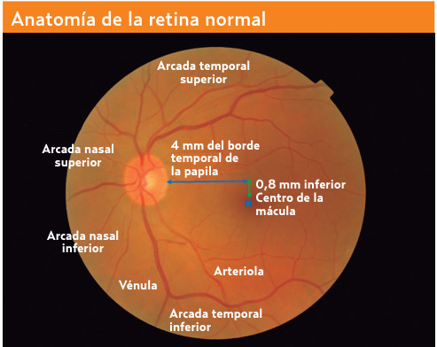

### 1.2 Fondo de ojo normal

La exploración compara cada estructura con su aspecto normal. La tabla resume los hallazgos de referencia y el significado de su alteración.

**Tabla 1. Fondo de ojo normal y significado de sus alteraciones.**[^d2][^garway][^msd][^dantona]

| Estructura | Aspecto normal | Alteración y significado |
|---|---|---|
| Retina | Rojiza y semitransparente; el color procede del epitelio pigmentario y varía con la raza, la edad y la pigmentación | Es la referencia para reconocer palidez, edema, exudados y hemorragias |
| Papila | Blanco-rosácea, de bordes netos (sobre todo temporales); puede haber pigmento peripapilar | Si los bordes están borrosos y la papila está hiperémica e ingurgitada, hay edema de papila |
| Excavación papilar | Proporcional al tamaño de la papila; el 30% del diámetro papilar es solo orientativo | Si es desproporcionada, asimétrica o creciente, se sospecha glaucoma |
| Calibre vascular | La vena es más oscura y ondulada; la relación arteria/vena es de 2/3 | Una relación menor de 2/3 indica estrechamiento arteriolar |
| Reflejo arteriolar | Línea central que ocupa 1/4 del ancho del vaso | Un reflejo ensanchado ("hilo de cobre") o una pared opaca ("hilo de plata") indican engrosamiento de la pared |
| Cruces arteriovenosos | Sin cambios de calibre ni de trayecto | La muesca o desviación venosa indica arteriolosclerosis |
| Pulso venoso espontáneo | La vena pulsa en el borde papilar; las arterias no pulsan | Véase el texto |

Dos hallazgos requieren una interpretación prudente:

- **Excavación papilar:** crece con el tamaño de la papila, de modo que una papila grande puede tener una excavación amplia sin ser patológica. Por eso importan más su proporción respecto al disco, la asimetría entre ambos ojos y su aumento con el tiempo que un umbral fijo.
- **Pulso venoso espontáneo:** sugiere una presión intracraneal normal, pero no la descarta. Además, falta en el 10 a 20% de las personas con presión intracraneal normal, por lo que su ausencia aislada no indica hipertensión intracraneal.

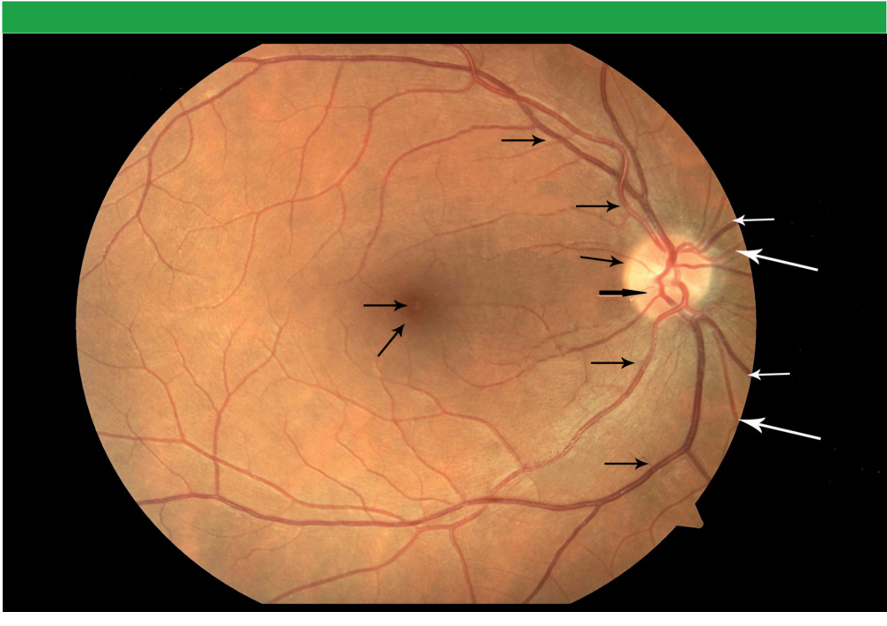

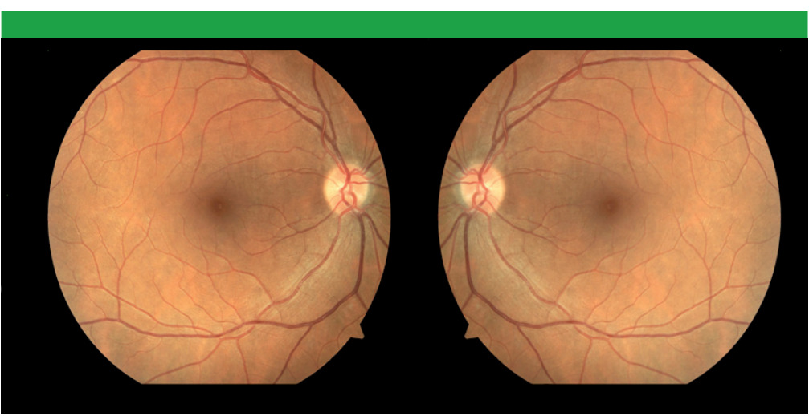

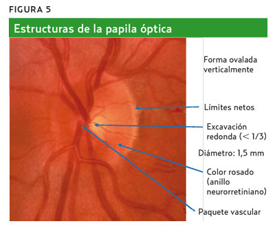

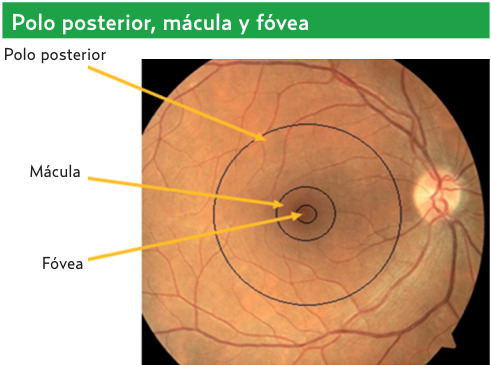

---

## 2. Exploración del fondo de ojo

### 2.1 El oftalmoscopio directo

El oftalmoscopio directo proyecta luz sobre la retina mediante un espejo y ofrece una imagen amplificada de 14 a 16 aumentos.

- **Lentes:** el cabezal contiene lentes esféricas de +20 a −25 dioptrías montadas en el disco de Recoss. Al girarlo en sentido horario se seleccionan las lentes convergentes (números negros), y en sentido antihorario, las divergentes (números rojos). Así se compensan la ametropía del paciente y la del examinador.
- **Mango:** aloja la fuente de luz y un reóstato que regula su intensidad.

El cabezal dispone además de aperturas y filtros con funciones distintas:

- La apertura grande se usa con la pupila dilatada, y la pequeña, con la pupila sin dilatar.
- El filtro verde, o luz aneritra, resalta los vasos y la capa de fibras nerviosas.
- El filtro azul cobalto muestra erosiones y úlceras corneales teñidas con fluoresceína.
- La apertura de fijación permite diagnosticar la fijación excéntrica y localizar lesiones maculares.
- La hendidura permite apreciar elevaciones y depresiones, comparar el calibre de los vasos y explorar la cámara anterior.

**Ventajas:** el oftalmoscopio es fácil de usar, portátil y de bajo costo, y resulta útil en el cribado.

**Limitaciones:** derivan de su óptica.

- El campo es muy pequeño y no permite explorar la periferia.
- Con medios turbios no se ve la retina.
- Al carecer de visión estereoscópica, no detecta el engrosamiento retiniano, que es el signo del edema macular.
- Obliga a acercarse mucho al paciente.[^d2]

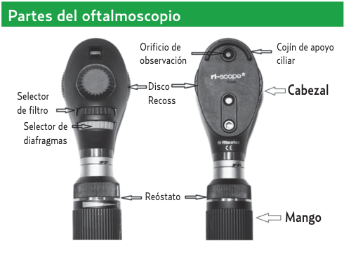

### 2.2 Midriasis farmacológica

La dilatación pupilar amplía el campo explorable y es casi siempre útil. También lo es en el hipertenso, cuyos cambios leves son difíciles de cuantificar incluso con retinografía.

**Valoración de la cámara anterior:** antes de dilatar, se ilumina el ojo lateralmente con una linterna. Cuanto menos profunda es la cámara anterior, mayor es la sombra que aparece en el sector nasal del iris. Si la cámara es estrecha no se dilata, porque la midriasis puede cerrar el ángulo iridocorneal y desencadenar un glaucoma agudo.

**Otras contraindicaciones de la midriasis:**

- antecedente de glaucoma de ángulo estrecho sin iridotomía profiláctica;
- rubeosis del iris;
- necesidad de vigilar los reflejos pupilares, como tras un traumatismo craneoencefálico o un accidente isquémico transitorio, porque la midriasis farmacológica invalida esa vigilancia.[^d2][^d6]

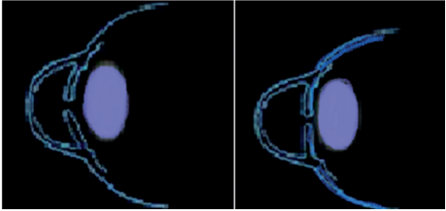

**Tropicamida al 1%:** es el midriático habitual.

- **Administración:** se aplica una gota, que puede repetirse cada 5 minutos hasta tres veces, y se explora a los 15 minutos.
- **Duración:** su efecto dura de 4 a 6 horas y altera la acomodación y la visión, por lo que se advierte al paciente.
- **Presión intraocular:** la eleva de forma leve y transitoria y, muy rara vez, desencadena un glaucoma agudo de ángulo cerrado.

**Fenilefrina:** potencia la midriasis, pero su efecto adrenérgico sistémico la hace peligrosa en cardiópatas y en ancianos. En ellos se prefiere la concentración del 2,5%.[^d2][^d3][^d7][^fenil]

**Tabla 2. Midriáticos para la exploración del fondo de ojo.**[^d3][^d7][^fenil]

| Fármaco | Pauta | Efectos adversos e interacciones | Contraindicaciones |
|---|---|---|---|
| Tropicamida 1% (alternativa: ciclopentolato 1%) | 1 gota, repetible cada 5 minutos hasta 3 veces | Glaucoma de ángulo cerrado, visión borrosa, fotofobia, eritema facial, sequedad de boca, erupción. Los adrenérgicos oftálmicos aumentan la midriasis | Hipersensibilidad; glaucoma de ángulo cerrado |
| Fenilefrina 10% (100 mg/ml) | 1 gota, repetible cada 5 minutos hasta 3 veces | Elevación de la presión arterial; en cardiópatas, vasoespasmo coronario, arritmias ventriculares e infarto. Potencian el efecto: antidepresivos tricíclicos, inhibidores de la monoaminooxidasa, betabloqueadores (arritmias) y guanetidina (midriasis) | Hipersensibilidad, glaucoma de ángulo estrecho, HTA, cardiopatía, hipertiroidismo, edad avanzada |
| Tropicamida 0,8% + fenilefrina 5% | 1 gota antes del examen | Los de ambos componentes | Las de ambos componentes |

### 2.3 Técnica de exploración

1. Se explica el procedimiento, que puede resultar molesto o fatigoso, y se advierten los efectos del midriático.
2. Se valora la cámara anterior y, si no hay contraindicación, se dilata con tropicamida 1% y se esperan 15 minutos.
3. El paciente fija la mirada al frente, en un punto lejano.
4. El ojo derecho del paciente se explora con el ojo y la mano derechos del examinador, y el izquierdo, con el ojo y la mano izquierdos.
5. Al mismo nivel horizontal que el paciente, el examinador se aproxima desde 15 a 20° por fuera del eje visual y localiza primero el reflejo rojo. Este reflejo indica la transparencia de los medios; si los medios están turbios, la retina no podrá verse.
6. Manteniendo el reflejo, el examinador se acerca hasta enfocar la retina y corrige la ametropía con el disco de Recoss.
7. Se explora la papila (forma, color, bordes, excavación y pulso venoso), después las cuatro arcadas vasculares (calibre, reflejo arteriolar, cruces y lesiones) y, por último, la mácula.
8. Se hacen pausas breves para no cansar al paciente. Con destreza, la exploración completa dura de 5 a 10 minutos.[^d2][^oft]

**Indicaciones de la oftalmoscopia:**

- disminución de la agudeza visual;
- diabetes mellitus;
- HTA;
- cefalea;
- síntomas neurológicos agudos, para descartar edema de papila;
- degeneración macular asociada a la edad;
- repercusión ocular de enfermedades hematológicas y neurológicas.[^d2]

### 2.4 Otras técnicas de exploración e imagen

**Oftalmoscopia indirecta y biomicroscopia con lámpara de hendidura.** Se realizan con lente de contacto tipo Goldmann o sin contacto (90 dioptrías). Exploran la retina periférica y, gracias a la visión estereoscópica, permiten ver el engrosamiento retiniano. Habitualmente las realiza el oftalmólogo y no dejan registro de imágenes.

**Retinografía.** Desde la década de 1980 es la técnica de elección para el cribado y el diagnóstico de la retinopatía diabética (RD) y de la retinopatía hipertensiva, porque deja un registro fotográfico comparable en el tiempo.

- **Cámara no midriática:** su sensibilidad del 87% y su especificidad del 97% para el cribado de RD la hacen fiable tanto para detectar como para descartar la enfermedad. Además es más costo-efectiva que la oftalmoscopia con dilatación y permite valorar el nervio óptico.
- **Quién la realiza:** la imagen la obtiene un técnico acreditado, y su primera lectura pueden hacerla médicos de familia o endocrinólogos con formación previa.

Los protocolos difieren en el número de campos fotografiados:

- **ETDRS:** siete campos de 30°; es el estándar de investigación.
- **EURODIAB:** dos campos de 45°, uno centrado en la mácula y otro en el lado nasal de la papila.
- **Joslin/WESDR:** añade un tercer campo temporal superior.
- **ADA y AAO:** una sola retinografía de 45°, centrada entre la mácula y el borde temporal de la papila, basta para el cribado, aunque no para el diagnóstico definitivo.

La retinografía de campo amplio, de hasta 180°, muestra la periferia, pero todavía está poco implantada.

**Angiografía con fluoresceína (AGF).** Registra con una cámara especial el paso de fluoresceína inyectada por vía intravenosa.

- Muestra de forma dinámica la rotura de la barrera hematorretiniana interna (edema), la falta de perfusión capilar (isquemia) y la fuga de los neovasos.
- Detecta neovasos apenas visibles en la fotografía en color y ayuda a clasificar las formas graves.

**Tomografía de coherencia óptica (OCT).** Es una técnica no invasiva que usa láser de baja energía. Es la forma más directa de demostrar el edema macular, que aparece como engrosamiento retiniano con quistes intrarretinianos, y es la prueba de referencia para diagnosticarlo y seguir su evolución.

**Angio-OCT.** Muestra sin colorante la vascularización macular, aunque de forma estática y con menor sensibilidad que la AGF. En el edema ya tratado, la isquemia macular que revela explica la falta de recuperación visual.

**Ecografía ocular.** Se indica cuando una hemorragia vítrea u otra opacidad impiden ver la retina.

En la población diabética, la OCT y la AGF no son pruebas de cribado. Su papel es diagnóstico y de seguimiento cuando se sospecha edema macular o isquemia.[^d1][^d2][^d4][^d7]

---

## 3. Retinopatía diabética: concepto, impacto e historia natural

La retinopatía diabética (RD) es una microangiopatía crónica y progresiva, específica de la diabetes y asociada a la hiperglucemia prolongada. Se distinguen dos formas según haya o no neovasos.

- **Retinopatía diabética no proliferativa (RDNP):** en los capilares venosos vecinos a zonas mal perfundidas se forman dilataciones saculares (microaneurismas), junto con cortocircuitos arteriovenosos y oclusiones microvasculares. Al dañarse la barrera hematorretiniana, el plasma se extravasa y produce edema, hemorragias y exudados. Su gravedad depende del tipo de lesiones, de su topografía y del número de cuadrantes afectados.
- **Retinopatía diabética proliferativa (RDP):** se caracteriza por la formación de neovasos en respuesta a la isquemia, en la papila, en la retina, en el iris o en el ángulo camerular. Los neovasos sangran hacia el vítreo y se acompañan de tejido fibroso que tracciona la retina hasta desprenderla.[^d3][^d7]

**Impacto clínico:**

- La RD es una de las principales causas de discapacidad visual entre los 25 y los 74 años.
- La pérdida de visión se produce por cuatro vías: edema macular, hemorragia de los neovasos, desprendimiento de retina y glaucoma neovascular.
- Las dos formas que amenazan la visión, el edema macular y la RDP, responden al tratamiento cuando se detectan a tiempo.
- La enfermedad suele ser asintomática hasta fases tardías y puede progresar con rapidez, por lo que toda persona con diabetes necesita cribado periódico.[^d1][^d7]

**Historia natural:**

- **Diabetes tipo 1:** la RD aparece de 3 a 5 años después del diagnóstico y afecta a casi todos los pacientes a los 15 a 20 años de evolución.
- **Diabetes tipo 2:** la incidencia alcanza el 50 al 80% a los 20 años, y del 20 al 39% de los pacientes ya tienen RD al diagnóstico. Esto se explica porque la hiperglucemia, insidiosa, precede de 4 a 7 años al diagnóstico clínico.
- **Efecto del tratamiento intensivo:** con la generalización del tratamiento intensivo con insulina en la diabetes tipo 1, la prevalencia y la gravedad de la RD han disminuido.[^d1][^d3]

---

## 4. Fisiopatología de la retinopatía diabética

Las lesiones de la RD aparecen en una secuencia que va del daño capilar a la isquemia y, finalmente, a la proliferación vascular. Cada etapa explica un grupo de signos del fondo de ojo.

1. **Daño de la unidad neurovascular.** La retina es uno de los tejidos con mayor actividad metabólica, lo que la hace muy vulnerable al desequilibrio de sustratos y a la isquemia. Por este motivo, la función neural retiniana ya está disminuida antes de que aparezcan lesiones vasculares visibles.

2. **Pérdida de pericitos y microaneurismas.** En fases muy tempranas se pierden los pericitos y las células endoteliales capilares, y la membrana basal se engruesa de forma análoga a la del glomérulo. La pared capilar debilitada forma dilataciones saculares con proliferación endotelial, los **microaneurismas**, que predominan en el lado venular del capilar, junto a zonas no perfundidas. Son la primera lesión visible y la que define la RDNP leve.

3. **Hiperpermeabilidad: exudados duros y edema macular.** La disfunción de la membrana basal y de la barrera hematorretiniana interna permite la salida de lípidos y proteínas desde los microaneurismas. La fracción soluble se reabsorbe y quedan depósitos lipoproteicos en las capas externas de la retina: los **exudados duros**. Cuando la retina dañada está rodeada de retina sana que reabsorbe el líquido, los exudados se disponen en anillo (**patrón circinado**), que marca el límite entre ambas zonas. Si el líquido se acumula en el centro de la mácula, aparece el **edema macular**, que reduce la agudeza visual.

4. **Oclusión capilar: hemorragias y manchas algodonosas.** La proliferación celular intraluminal, la alteración plaquetaria, la agregación de eritrocitos y leucocitos y el fibrinógeno elevado ocluyen y rompen los capilares.
   - Antes de la oclusión aparecen **hemorragias intrarretinianas**, cuya forma depende de la capa afectada: en llama cuando se sitúan en la capa superficial de fibras nerviosas, y en punto o mancha cuando son profundas. Las profundas indican isquemia de las capas internas y, por tanto, mayor gravedad.
   - Después de la oclusión de las arteriolas precapilares se detiene el transporte axoplásmico y los axones se edematizan. Así se forman las **manchas algodonosas**, que no son verdaderos exudados sino infartos de la capa de fibras nerviosas, y que por ello indican isquemia.

5. **Alteraciones venosas.** La proliferación del endotelio venoso modifica el calibre de las venas y forma asas, reduplicaciones y **arrosariamiento venoso** (dilataciones y estenosis sucesivas en "rosario"). El arrosariamiento es un signo de isquemia propio de la RDNP avanzada y uno de los predictores más fuertes de progresión a RDP.

6. **Isquemia extensa: AMIR y señal angiogénica.** Los ciclos repetidos de muerte y renovación celular obliteran la microvasculatura. Alrededor de los capilares ocluidos se forman **anomalías microvasculares intrarretinianas (AMIR)**: vasos dilatados y tortuosos o cortocircuitos que permanecen dentro de la retina, no atraviesan la membrana limitante interna y apenas fugan en la angiografía. Las AMIR indican isquemia y alto riesgo de progresión, pero no definen la RDP. Al mismo tiempo, la retina isquémica libera factores vasoproliferativos, como el VEGF y la eritropoyetina, que inducen la formación de neovasos en un intento fallido de revascularizar el tejido.

7. **Proliferación y sus complicaciones.** Los **neovasos** son capilares sin uniones estrechas que atraviesan la membrana limitante interna y fugan en la angiografía; su presencia define la RDP. Algunas AMIR evolucionan a neovasos cuando sus extremos atraviesan esa membrana.
   - Los neovasos crecen primero en el plano retiniano, bajo la hialoides posterior, y después hacia el vítreo a medida que este se desprende. Por su fragilidad se rompen.
   - Si la sangre queda atrapada entre la retina y la hialoides posterior, forma una hemorragia prerretiniana en "canoa", con nivel superior recto. Si pasa al vítreo, forma una hemorragia vítrea.
   - El tejido fibrovascular que acompaña a los neovasos se adhiere al vítreo posterior y, al contraerse, tracciona la retina hacia delante hasta producir un desprendimiento traccional.
   - Los neovasos del iris (rubeosis) y del ángulo camerular bloquean la salida del humor acuoso, lo que eleva la presión intraocular y produce un glaucoma neovascular.[^d1][^d3][^d4][^d7][^irma]

---

## 5. Factores de riesgo de retinopatía diabética

La **duración de la diabetes** y la **hiperglucemia** son los dos factores principales.

- **Duración:** una evolución de 15 años o más se asocia de forma marcada a RD.
- **Hiperglucemia:** una hemoglobina glucosilada (HbA1c) de 7% o más también se asocia de forma marcada a RD. Una vez establecida la RD, la hiperglucemia pesa más que la duración en su progresión.

**Factores sistémicos que actúan sobre la misma microcirculación:**

- **Hipertensión arterial:** aumenta el daño endotelial, y su control protege con independencia de la glucemia. En el estudio UKPDS, cada 10 mmHg menos de presión sistólica redujo el riesgo de RD en un 10%.
- **Nefropatía y microalbuminuria:** se asocian a una RD más grave, a edema macular clínicamente significativo y a exudados duros.
- **Anemia:** la hemoglobina baja también se asocia a una RD más grave, a edema macular clínicamente significativo y a exudados duros.
- **Dislipidemia:** el colesterol LDL elevado se asocia a exudados duros, y un cociente colesterol total/HDL mayor de 3,5 en hombres o de 3,0 en mujeres se asocia a RD.

**Situaciones vitales que aceleran la progresión:**

- **Pubertad y adolescencia:** la resistencia a la insulina fisiológica de esta etapa, la hormona del crecimiento y el factor de crecimiento similar a la insulina, sumados al peor control propio de la adolescencia, aceleran la RD. La duración de la diabetes después de la menarquia aumenta el riesgo en un 30%, mientras que antes de los 12 años las complicaciones son raras.
- **Embarazo:** acelera la progresión de la RD preexistente (sección 11.1).

**Otros factores:**

- **Tratamiento con insulina:** se asocia epidemiológicamente a mayor riesgo de RD, sin que ello signifique que la insulina la cause. El control glucémico sostenido, incluido el insulínico, reduce el riesgo. Lo que puede empeorar la RD de forma transitoria es el descenso rápido de la HbA1c al intensificar el tratamiento (sección 11.2).
- **Índice de masa corporal:** su asociación es inconstante; uno elevado se relaciona con RD en la adolescencia y en la diabetes tipo 1, pero otros estudios encuentran lo contrario.
- **Otros:** se han descrito como factores de riesgo los factores genéticos, la radioterapia y el traumatismo ocular.[^d1][^d3][^d4][^d5][^d6]

---

## 6. Manifestaciones clínicas y reconocimiento de las lesiones

### 6.1 Síntomas

La mayoría de los pacientes con retinopatía diabética no tienen síntomas hasta fases avanzadas, cuando el tratamiento puede ser ya menos eficaz. Por eso el diagnóstico depende del cribado y no de la consulta por síntomas.

- **Edema macular:** se manifiesta como visión borrosa de cerca y de lejos, de instauración gradual, con una disminución de la agudeza visual que no se corrige con refracción.
- **Hemorragia vítrea:**
  - Produce una aparición brusca e indolora de miodesopsias (moscas volantes) abundantes o de un velo oscuro, con una pérdida visual proporcional a la densidad de la sangre.
  - La sangre suele reabsorberse en semanas o meses, y durante ese tiempo persisten las miodesopsias.
  - Debe distinguirse del desprendimiento de retina, que produce una sombra o "cortina" que avanza desde la periferia del campo visual, con o sin fotopsias, y que requiere valoración oftalmológica el mismo día.
- **Pérdida visual permanente:** aparece cuando se produce un desprendimiento de retina, una isquemia macular o ambos.[^d1][^wikem]

### 6.2 Reconocimiento de las lesiones en el fondo de ojo

**Tabla 3. Aspecto y significado de las lesiones de la retinopatía diabética.**[^d1][^d3][^d4][^d7]

| Lesión | Aspecto | Significado clínico |
|---|---|---|
| Microaneurisma | Punto rojo, redondo y de bordes nítidos, de 15 a 125 micras (menos de 1/12 del diámetro papilar) | Primera lesión; define la RDNP leve |
| Hemorragia intrarretiniana | Superficial en llama; profunda en punto o mancha, de bordes irregulares y menor de 1/3 del diámetro papilar | Las profundas indican isquemia y mayor gravedad |
| Exudado duro | Depósito blanco-amarillento, céreo, de bordes netos; aislado, en placa, en estrella o en anillo circinado | Fuga crónica; cerca de la mácula, se asocia a edema macular |
| Mancha algodonosa | Lesión blanquecina superficial, de bordes imprecisos y estriada, de 1/5 a 1/2 del diámetro papilar, a menudo cerca de la papila | Infarto de la capa de fibras nerviosas; indica isquemia |
| AMIR | Capilares intrarretinianos dilatados y tortuosos, en "telaraña" | Isquemia; alto riesgo de progresión |
| Arrosariamiento venoso | Vénulas con dilataciones y estenosis sucesivas | Isquemia; uno de los predictores más fuertes de RDP |
| Asas, reduplicación y tortuosidad venosas | Desviaciones bruscas del trayecto venoso o canales paralelos | Indican gravedad |
| Neovasos | Vasos finos en penacho, sobre la papila (NVD) o a más de 1 diámetro papilar de ella (NVE) | Definen la RDP |
| Proliferación fibrosa | Tejido blanco opaco sobre la papila o las arcadas | Riesgo de hemorragia y de desprendimiento traccional |
| Hemorragia prerretiniana | En "canoa", con nivel superior recto; cubre los grandes vasos | Sangrado de neovasos |
| Hemorragia vítrea | Sangre en el vítreo; si es densa, impide ver el fondo | Sangrado de neovasos; pérdida visual aguda |

Algunas distinciones tienen importancia práctica:

- **Microaneurisma frente a hemorragia profunda:** el microaneurisma es más pequeño y de bordes nítidos, mientras que la hemorragia profunda es mayor y de bordes irregulares.
- **AMIR frente a neovasos extrapapilares:** las AMIR quedan dentro de la retina y apenas fugan en la angiografía, mientras que los neovasos atraviesan la membrana limitante interna y fugan. Por eso solo los neovasos definen la RDP.
- **Lesiones aisladas sin microaneurismas:** en la escala ETDRS, las hemorragias o manchas algodonosas aisladas sin microaneurismas (niveles 14 y 15) no bastan para diagnosticar RD.
- **Manchas algodonosas:** no son específicas de la diabetes; aparecen también en la HTA, en el síndrome de inmunodeficiencia adquirida y en la vasculopatía del lupus eritematoso sistémico.[^d1][^d3][^d4][^irma]

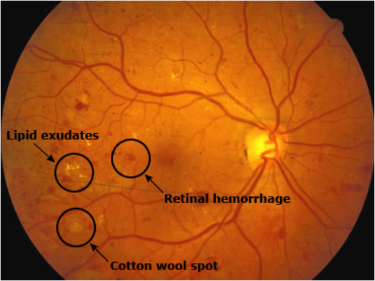

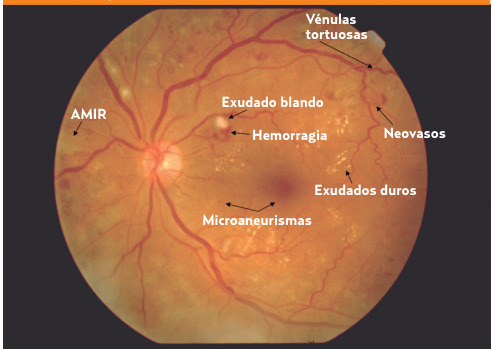

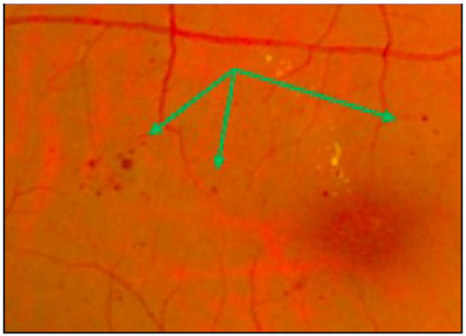

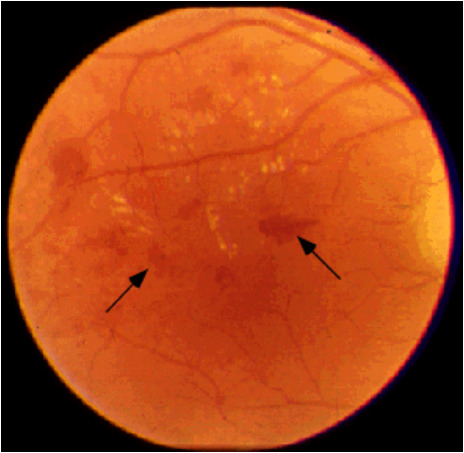

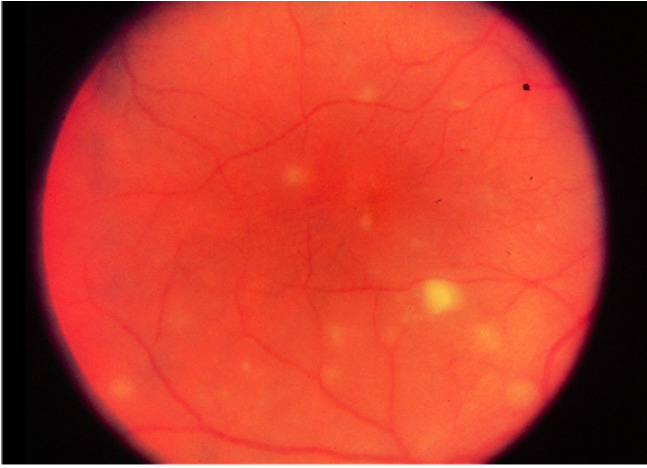

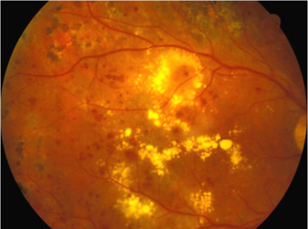

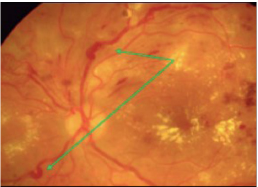

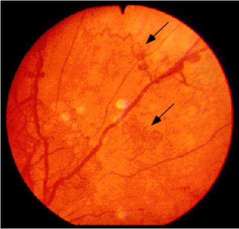

---

## 7. Clasificación de la retinopatía diabética

### 7.1 Escala clínica de gravedad

La clasificación de la retinopatía diabética tiene una finalidad práctica: cuanto más grave es la retinopatía no proliferativa, mayor es el riesgo de que aparezcan neovasos en el año siguiente. Por eso la categoría determina el intervalo de seguimiento y el momento del tratamiento.

- Cada ojo se clasifica por separado, porque puede tener un riesgo distinto.
- La gravedad se juzga comparando las lesiones con las fotografías estándar del ETDRS (atlas del anexo A).[^d1][^d7]

**Tabla 4. Escala clínica de gravedad y riesgo de progresión a retinopatía proliferativa en 1 año.**[^d1][^d7][^icdr]

| Categoría | Hallazgos | Riesgo a 1 año |
|---|---|---|
| Sin retinopatía aparente | Sin alteraciones | — |
| No proliferativa leve | Solo microaneurismas | 5% |
| No proliferativa moderada | Más que solo microaneurismas, pero sin criterios de forma severa | 15% |
| No proliferativa severa | Cualquiera de los criterios de la regla 4-2-1, sin neovasos | 52% |
| No proliferativa muy severa | Dos o más criterios de la regla 4-2-1, sin neovasos | 75% |
| Proliferativa sin alto riesgo | Neovasos que no cumplen criterios de alto riesgo | — |
| Proliferativa de alto riesgo | Criterios de la sección 7.2 | Sin tratamiento, 60% de pérdida visual severa a 5 años |

**Forma moderada:** incluye hemorragias o microaneurismas de extensión igual o mayor que la fotografía estándar 2A, o exudados blandos, arrosariamiento venoso o AMIR definidos; puede haber además exudados duros y hemorragias en punto y mancha.

**Regla 4-2-1:** define la forma severa por la presencia de cualquiera de estos tres criterios:

- más de 20 hemorragias intrarretinianas en cada uno de los 4 cuadrantes;
- arrosariamiento venoso definido en 2 o más cuadrantes;
- AMIR prominentes en 1 o más cuadrantes.

La versión original del ETDRS expresa estos criterios por comparación con fotografías estándar: hemorragias o microaneurismas iguales o mayores que la foto 2A en los 4 cuadrantes, y AMIR iguales o mayores que la foto 8A. La categoría "muy severa", con dos o más criterios, procede del ETDRS; la escala internacional la incluye dentro de la severa.

**Limitación:** la clasificación orienta, pero cada paciente combina hallazgos, síntomas y velocidad de progresión de forma propia, lo que obliga a individualizar el tratamiento.[^d1][^d7][^icdr]

### 7.2 Retinopatía proliferativa de alto riesgo

Dentro de la retinopatía proliferativa se distinguen las formas de alto riesgo porque, sin tratamiento, conducen a pérdida visual severa en el 60% de los casos a 5 años. El Diabetic Retinopathy Study (DRS) demostró que la panfotocoagulación reduce ese riesgo.

Se considera de alto riesgo la retinopatía proliferativa que presenta cualquiera de estas características:

1. Neovasos papilares iguales o mayores que la fotografía estándar 10A, que equivale a 1/4 a 1/3 del área papilar, con o sin hemorragia vítrea o prerretiniana.
2. Cualquier neovaso papilar, aunque sea menor que la foto 10A, acompañado de hemorragia vítrea o prerretiniana.
3. Neovasos extrapapilares de **1/2 área papilar o más** acompañados de hemorragia vítrea o prerretiniana.

La GPC IMSS sitúa el umbral de los neovasos extrapapilares en 1/4 del área papilar, y UpToDate describe los neovasos papilares de alto riesgo como mayores de 1/3 a 1/2 del área papilar. Ambos valores se apartan del criterio original del DRS, que es el que fundamenta la indicación de panfotocoagulación.[^drs8][^d1][^d3][^d7]

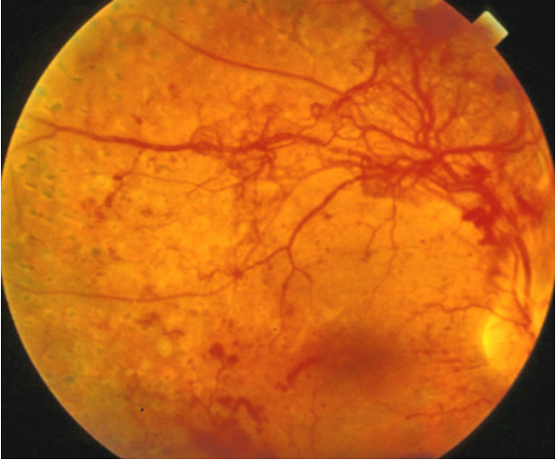

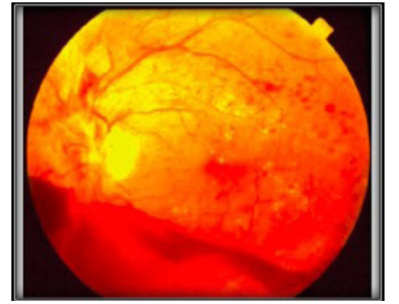

### 7.3 Edema macular diabético

El edema macular diabético (EMD) es el engrosamiento de la retina en la mácula por acumulación de líquido. Puede aparecer en cualquier estadio, desde la retinopatía no proliferativa leve hasta la proliferativa, y es la causa más frecuente de pérdida visual en la retinopatía diabética.

**Clasificación actual:** el EMD se clasifica según afecte o no al centro de la mácula.

- **Con afectación central:** el engrosamiento compromete el subcampo central.
- **Sin afectación central:** el engrosamiento o los exudados duros quedan fuera de ese subcampo.

Esta distinción tiene importancia terapéutica, porque la elección entre observación, tratamiento intravítreo y fotocoagulación depende de la localización del edema y de la agudeza visual (sección 9.2).

**Edema macular clínicamente significativo (EMCS):** es un concepto anterior, definido por el Early Treatment Diabetic Retinopathy Study (ETDRS). Se basa en la proximidad del engrosamiento o de los exudados duros al centro de la fóvea. Se conserva para interpretar las guías y los estudios que lo emplean, pero no equivale a la distinción actual entre edema con y sin afectación central. Hay EMCS si se cumple cualquiera de estos criterios:

1. engrosamiento retiniano a 500 micras o menos del centro de la fóvea;
2. exudados duros a 500 micras o menos del centro, con engrosamiento retiniano adyacente;
3. una zona de engrosamiento de 1 área papilar o más, situada en parte a 1 diámetro papilar o menos del centro.

**Diagnóstico:** los tres criterios dependen del engrosamiento retiniano, que el oftalmoscopio directo no detecta por carecer de visión estereoscópica. Por eso el diagnóstico requiere otras técnicas:

- **Biomicroscopia estereoscópica con lámpara de hendidura:** permite apreciar clínicamente el engrosamiento.
- **OCT:** lo demuestra y lo cuantifica, y es la técnica de referencia para seguir el tratamiento.
- **AGF:** añade información sobre los puntos de fuga y la isquemia macular.[^d1][^d3][^d4][^d7][^etdrs1]

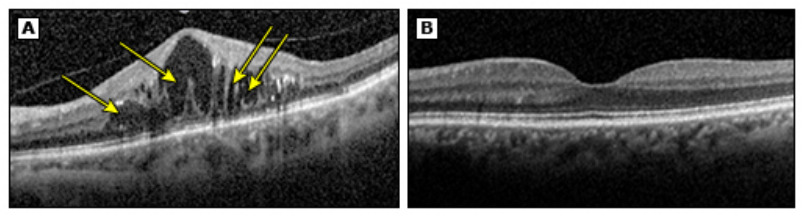

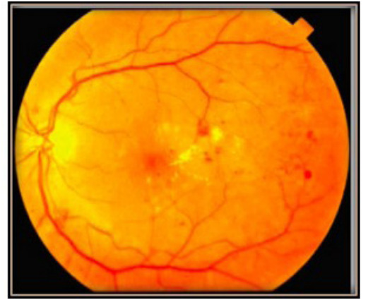

### 7.4 Escala del ETDRS y sistemas de cribado

La escala completa del ETDRS se usa en los ensayos clínicos para medir la mejoría o el empeoramiento por escalones (*steps*). Por su complejidad, en la práctica se emplean la escala internacional y los sistemas de cribado británicos, cuyas equivalencias aproximadas y plazos de referencia se recogen en el anexo B.

En el cribado, lo esencial es detectar las lesiones típicas, es decir, un nivel ETDRS de 20 o más (presencia de microaneurismas) o hemorragias abundantes, y remitir esos casos al oftalmólogo.[^d4][^d7]

---

## 8. Cribado, referencia y evaluación oftalmológica

### 8.1 Cribado de la retinopatía diabética

Como la retinopatía diabética es asintomática durante años y del 20 al 39% de las personas con diabetes tipo 2 ya la presentan al diagnóstico, el cribado empieza en momentos definidos y se repite periódicamente.

**Tabla 5. Primera exploración y seguimiento según el grupo de pacientes.**[^d1][^d3][^ada]

| Grupo | Primera exploración | Seguimiento |
|---|---|---|
| Diabetes tipo 2 | Al diagnóstico | Sin retinopatía tras uno o más exámenes anuales y con glucemia en meta: cada 1 a 2 años. Con cualquier grado de retinopatía: al menos anual |
| Diabetes tipo 1 diagnosticada después de la pubertad | En los primeros 5 años (la GPC IMSS precisa de 3 a 5 años) | Igual que en la diabetes tipo 2 |
| Diabetes tipo 1 diagnosticada antes de la pubertad | En la pubertad, salvo otras consideraciones | Anual |
| Mayor riesgo sin retinopatía (larga evolución, mal control, HTA o hiperlipidemia) | — | Al menos anual |
| Diabetes previa al embarazo | Antes de la concepción o en el primer trimestre | Cada trimestre y hasta 1 año posparto, según el grado de retinopatía |
| Diabetes gestacional | No requiere exploración, porque no aumenta el riesgo | — |

**Contenido de cada exploración:**

- se mide la agudeza visual;
- se dilata la pupila;
- se registran la duración de la diabetes, la HbA1c y la presión arterial;
- se establece la gravedad con la escala, porque de ella dependen la referencia, el seguimiento y el tratamiento.

**Planificación del seguimiento:** se consideran el tiempo de evolución, el control metabólico, el compromiso de autocuidado y el acceso a los servicios de salud. Conviene explicar al paciente que el tratamiento eficaz depende de intervenir a tiempo, aunque vea bien y no tenga síntomas.

**Niños y adolescentes:** deben estar a cargo de un equipo multidisciplinario que vigile la presión arterial y el índice de masa corporal y dé consejo dietético, sobre tabaquismo y sobre embarazo.[^d3][^ada]

### 8.2 Referencia a oftalmología

Se refiere de forma oportuna a un oftalmólogo con experiencia en retinopatía diabética a todo paciente con:

- cualquier grado de edema macular;
- retinopatía no proliferativa moderada o más grave, porque es precursora de la proliferativa;
- cualquier retinopatía proliferativa.

Requieren valoración oftalmológica urgente la pérdida visual súbita, la hemorragia vítrea y la sospecha de desprendimiento de retina.[^ada][^d4][^d7][^wikem]

**Papel del médico de primer nivel:**

- controla la glucemia, la presión arterial y los lípidos, y detecta y trata a tiempo la microalbuminuria;
- realiza o solicita el fondo de ojo con la periodicidad indicada, también como parte del control prenatal en la gestante con diabetes previa;
- refiere según los criterios anteriores.

La GPC IMSS de 2014 mantenía en el primer nivel, con revisión semestral, a los pacientes con lesiones moderadas; la ADA recomienda referirlos (anexo D).[^d3][^ada]

### 8.3 Evaluación oftalmológica

**Historia clínica:** recoge la duración de la diabetes, el control glucémico y los antecedentes patológicos.

**Exploración:**

- mejor agudeza visual corregida;
- presión intraocular;
- biomicroscopia con lámpara de hendidura;
- gonioscopia, para buscar neovasos en el ángulo;
- fondo de ojo bajo midriasis con oftalmoscopia indirecta o biomicroscopia, que describe el vítreo y la retina del polo posterior, del ecuador y de la periferia.

**Registro en la nota clínica:** se describen el vítreo, la papila, la mácula, el patrón vascular y las lesiones (microaneurismas, hemorragias, exudados o huellas de láser). El diagnóstico se formula como retinopatía no proliferativa leve, moderada o severa, o como proliferativa con o sin características de alto riesgo, y se indica si hay edema macular con o sin afectación central.

**Seguimiento de la forma no proliferativa:** incluye biomicroscopia periódica para detectar signos de isquemia.

**Estudios complementarios:** se piden según la pregunta clínica.

- La OCT confirma y cuantifica el edema macular.
- La AGF identifica la isquemia y los neovasos dudosos.
- La ecografía se indica cuando una hemorragia vítrea impide ver la retina.[^d7][^aao]

---

## 9. Tratamiento de la retinopatía diabética

### 9.1 Control metabólico y de factores de riesgo

En todos los estadios de la retinopatía diabética, el tratamiento incluye el control de la glucemia, de la presión arterial y de los lípidos. Mantener la glucemia y la presión arterial lo más cerca posible de lo normal reduce la aparición y la progresión de la retinopatía, y el control tensional protege con independencia del glucémico.[^d3][^d4][^d6]

**Tabla 6. Objetivos de control metabólico.**[^d3][^adametas]

| Parámetro | ADA vigente | GPC IMSS 2014 |
|---|---|---|
| HbA1c | Menor de 7% en la mayoría de los adultos no gestantes; menor de 8% si hay hipoglucemia grave previa, esperanza de vida limitada o complicaciones avanzadas | Menor de 6,5% |
| Presión arterial | Menor de 130/80 mmHg | 130/80 mmHg o menos |
| Colesterol total | — | Menor de 200 mg/dL |
| Colesterol LDL | — | Menor de 2,5 mmol/L (unos 97 mg/dL) |
| Triglicéridos | — | Menor de 2,0 mmol/L (unos 177 mg/dL) |

- **Meta de HbA1c individualizada:** la ADA ajusta el objetivo porque el control estricto en pacientes con diabetes tipo 2 de larga evolución y comorbilidades aumenta las hipoglucemias y la morbimortalidad, como mostraron los estudios ACCORD y ADVANCE. La meta uniforme de 6,5% de la GPC mexicana no distingue estos perfiles.
- **Aspirina:** el ETDRS no encontró que modificara la progresión de la retinopatía ni que aumentara las hemorragias vítreas o prerretinianas. Por lo tanto, la retinopatía diabética no contraindica la antiagregación cuando está indicada por motivos cardiovasculares.[^d4][^adametas][^etdrs8]

### 9.2 Elección del tratamiento según el estadio

La decisión terapéutica se apoya en dos ejes independientes:

- **La gravedad de la retinopatía:** determina el riesgo de proliferación y, por tanto, la necesidad de panfotocoagulación.
- **La presencia y la localización del edema macular:** determinan la necesidad de tratamiento intravítreo o de láser focal.

Cuando coexisten retinopatía proliferativa y edema macular, ambos se tratan en conjunto, y el edema se estabiliza antes o a la vez que se aplica la panfotocoagulación.

**Tabla 7. Conducta según el estadio de la retinopatía y del edema macular.**[^ada][^aao][^protS][^d7]

| Situación | Conducta | Seguimiento orientativo |
|---|---|---|
| Sin retinopatía o no proliferativa leve, sin edema | Control metabólico; sin tratamiento ocular | Anual |
| No proliferativa moderada, sin edema | Referencia a oftalmología; sin láser | Cada 6 a 12 meses |
| No proliferativa severa o muy severa, sin edema | Panfotocoagulación temprana en casos seleccionados (sección 9.3) | Cada 2 a 4 meses |
| Proliferativa sin alto riesgo | Panfotocoagulación o anti-VEGF, según el riesgo de progresión y la posibilidad de seguimiento | Cada 2 a 4 meses |
| Proliferativa de alto riesgo | Panfotocoagulación lo antes posible; anti-VEGF como alternativa | Estrecho |
| Edema con afectación central y visión disminuida | Anti-VEGF intravítreo como primera línea | Mensual al inicio |
| Edema con afectación central y visión de 20/25 o mejor | Observación estrecha y anti-VEGF si la visión disminuye | Estrecho |
| Edema sin afectación central | Láser focal o en rejilla, u observación | Cada 3 a 6 meses |
| Hemorragia vítrea densa o desprendimiento de retina | Ecografía y valoración de vitrectomía (sección 9.5) | Según la cirugía |

Los intervalos de seguimiento derivan de la tabla de la AAO de 2014 adoptada por la GPC IMSS de 2015, que se conserva en el anexo D.[^d7][^aao]

### 9.3 Panfotocoagulación y láser focal

**Indicaciones de la panfotocoagulación (PFC).** La PFC se indica cuando el riesgo de proliferación o de sus complicaciones es alto.

- **Retinopatía proliferativa de alto riesgo:** se aplica lo antes posible, con o sin edema, porque los estudios DRS y ETDRS demostraron que el láser precoz reduce la pérdida visual severa. En estos ojos el tratamiento se extiende hasta la periferia extrema.
- **Neovasos en el iris con medios transparentes:** se aplica una panfotocoagulación completa e inmediata para inducir su regresión. La regresión se reconoce por el cierre de la punta de los neovasos o por su sustitución por fibrosis, aunque en casos avanzados pueden persistir pese a un láser completo.
- **Retinopatía no proliferativa severa:** se considera la PFC temprana, sobre todo en la diabetes tipo 2 y cuando hay mal control metabólico, falta de adherencia a las revisiones, catarata que pueda impedir el láser o cirugía de catarata próxima, isquemia generalizada, embarazo, enfermedad renal o progresión.
- **Retinopatía no proliferativa leve o moderada:** no se trata con láser.

**Mecanismo y técnica.** La PFC distribuye impactos homogéneos en todos los cuadrantes, desde las arcadas temporales y la papila hasta la ora serrata. Insiste en la retina isquémica vecina a los neovasos, pero sin tratarlos directamente. Al destruir retina periférica reduce la demanda de oxígeno, lo que hace regresar las lesiones proliferativas.

- Se inicia después de estabilizar la maculopatía.
- Se aplica tras instilar tetracaína al 0,5% (1 o 2 gotas) y con hipromelosa al 2% en la curvatura de la lente de contacto.
- Tras el tratamiento se mantiene una vigilancia estrecha, porque las características de alto riesgo pueden reaparecer y requerir más láser.

**Efectos adversos.** La destrucción de retina periférica sana tiene un costo funcional:

- puede reducir de forma permanente el campo visual periférico;
- disminuye la visión nocturna y la adaptación a la oscuridad;
- puede provocar o empeorar el edema macular.

En el ensayo Protocol S la pérdida de campo periférico fue mayor con la PFC que con ranibizumab. Esto explica el interés por los anti-VEGF como alternativa en la retinopatía proliferativa.

**Láser focal o en rejilla.** Se dirige a los vasos anormales y a los puntos de fuga de los microaneurismas. Hoy se reserva sobre todo para el edema sin afectación central y como complemento de los anti-VEGF cuando el edema persiste.[^d3][^d7][^protS][^aao]

### 9.4 Tratamiento intravítreo

**Indicaciones de los anti-VEGF.** El factor de crecimiento del endotelio vascular (VEGF) aumenta la permeabilidad vascular y estimula la angiogénesis, que son la base del edema macular y de la neovascularización. Su bloqueo intravítreo tiene tres indicaciones.

- **Edema macular con afectación central y visión disminuida:** los anti-VEGF son el tratamiento de primera línea en la mayoría de los ojos.
- **Edema macular con afectación central y visión de 20/25 o mejor:** la observación estrecha, con anti-VEGF solo si la visión disminuye, es una opción equivalente al tratamiento inmediato.
- **Retinopatía proliferativa:** el ensayo Protocol S demostró que el ranibizumab no es inferior a la PFC en agudeza visual a 2 años, aunque exige inyecciones repetidas. La AAO mantiene la PFC como tratamiento principal y reconoce los anti-VEGF como alternativa eficaz.

**Elección del fármaco.** En el ensayo Protocol T, cuando la agudeza visual inicial era peor, el aflibercept logró a 1 año una mejoría mayor que el bevacizumab y el ranibizumab; con mejor visión inicial, los tres fueron similares.

**Seguridad.** Los efectos adversos de los anti-VEGF son poco frecuentes.[^ada][^aao][^protS][^protT]

**Tabla 8. Fármacos intravítreos.**[^d4][^d5][^papa][^protT][^ada]

| Fármaco | Diana y estructura | Dosis intravítrea |
|---|---|---|
| Bevacizumab | Anticuerpo monoclonal completo contra todas las isoformas del VEGF-A | 1,25 mg |
| Ranibizumab | Fragmento Fab de anticuerpo monoclonal contra el VEGF-A | 0,3 o 0,5 mg |
| Aflibercept | Proteína de fusión, receptor señuelo con dominios de los receptores 1 y 2 del VEGF unidos a la fracción Fc de la IgG1; capta VEGF-A, VEGF-B y factor de crecimiento placentario | 2 mg (existe una presentación de 8 mg) |
| Brolucizumab | Fragmento de anticuerpo de cadena única contra el VEGF-A | — |
| Faricimab | Anticuerpo biespecífico contra el VEGF-A y la angiopoyetina-2 | — |
| Triamcinolona | Corticoide: estabiliza el endotelio y reduce la permeabilidad | 4 mg en ojos no vitrectomizados; 8 mg en vitrectomizados |
| Dexametasona, fluocinolona | Corticoides antiinflamatorios y antiedematosos | — |

**Disponibilidad.** La ADA reconoce como anti-VEGF empleados en el edema con afectación central al bevacizumab, ranibizumab, aflibercept (2 y 8 mg), brolucizumab y faricimab.

- El bevacizumab carece de autorización oftálmica y se usa fuera de indicación.
- En México, la GPC IMSS de 2015 recogía en el cuadro básico solo el aflibercept y el ranibizumab; la disponibilidad actual depende del cuadro básico y del registro sanitario vigentes.

**Corticoides intravítreos.**

- **Cuándo se usan:** sobre todo cuando la respuesta a los anti-VEGF es insuficiente o estos no son adecuados.
- **En el ojo pseudofáquico:** la catarata, su principal efecto adverso, ya no es un riesgo, lo que facilita su uso, aunque la pseudofaquia no los convierte por sí sola en primera línea.
- **Precauciones:** pueden elevar la presión intraocular hasta producir un glaucoma secundario, por lo que exigen control de la presión intraocular.[^ada][^protT][^d7][^d4][^nice]

### 9.5 Vitrectomía vía pars plana

La vitrectomía vía pars plana está indicada en tres situaciones de la retinopatía proliferativa:

- cuando la hemorragia vítrea impide ver la retina y no se reabsorbe;
- cuando la proliferación fibrovascular tracciona la retina;
- cuando la enfermedad persiste pese a la panfotocoagulación.

La cirugía elimina la sangre y libera las adherencias responsables de la alteración anatómica.

**Hemorragia vítrea:**

- En la hemorragia vítrea asociada a retinopatía proliferativa, sin desprendimiento de retina, puede observarse hasta 2 meses con control de la agudeza visual y ecografía. Si no mejora lo suficiente, se valora la vitrectomía diferida.
- En la diabetes tipo 1 con hemorragia vítrea severa y sospecha de retinopatía proliferativa severa, se considera la vitrectomía en los primeros 3 meses.
- Los ojos con retinopatía proliferativa no tratados previamente que presentan opacidad vítrea y proliferación fibrovascular son candidatos a la cirugía.

**Tracción retiniana:**

- La vitrectomía libera la tracción sobre la mácula o la periferia.
- Está indicada en el desprendimiento traccional del área macular, sobre todo si es reciente, y en el desprendimiento de retina traccional o regmatógeno.
- La hemorragia vítrea con tracción vitreomacular y edema macular también es indicación quirúrgica.

**Enfermedad activa pese al láser:** se considera la vitrectomía, temprana en los casos que no responden a una PFC agresiva y extensa, cuando persisten o progresan los signos de actividad:

- retinopatía proliferativa persistente;
- hemorragia vítrea o prerretiniana severa;
- falta de regresión de los neovasos;
- aumento de neovasos en la retina o el iris;
- aparición de nuevas áreas de neovascularización.

**Referencia:** la hemorragia vítrea y el desprendimiento de retina traccional o regmatógeno se envían a tercer nivel para valorar la cirugía, porque la referencia tardía reduce la probabilidad de conservar una visión útil.[^d7]

### 9.6 Secuencia de decisiones

1. **Toda persona con diabetes:** fondo de ojo bajo dilatación o retinografía según la tabla 5, y control de glucemia, presión arterial y lípidos.
2. **Sin retinopatía o con retinopatía no proliferativa leve, sin edema:** cribado periódico y optimización metabólica.
3. **Retinopatía no proliferativa moderada o peor, cualquier edema macular o cualquier retinopatía proliferativa:** referencia oportuna a oftalmología.
4. **En oftalmología:** clasificación de cada ojo y confirmación del edema con OCT.
5. **Edema con afectación central:** anti-VEGF si la visión está disminuida; observación estrecha si es de 20/25 o mejor. Ante una respuesta insuficiente, se añade láser focal o se cambia a corticoide.
6. **Edema sin afectación central:** láser focal o en rejilla, u observación.
7. **Retinopatía no proliferativa severa:** seguimiento cada 2 a 4 meses y panfotocoagulación temprana si el riesgo es elevado.
8. **Retinopatía proliferativa:** panfotocoagulación (inmediata si hay alto riesgo) o anti-VEGF.
9. **Hemorragia vítrea que no se reabsorbe, tracción macular o desprendimiento de retina:** vitrectomía en tercer nivel.[^ada][^aao][^protS][^d7]

---

## 10. Complicaciones y pronóstico de la retinopatía diabética

Las complicaciones de la retinopatía diabética derivan de los mecanismos descritos en la sección 4. Su pronóstico depende sobre todo de la rapidez del tratamiento.

**Hemorragia vítrea y prerretiniana.** Producen pérdida visual aguda, a menudo reversible por reabsorción; si la sangre impide ver la retina, la ecografía permite conocer su estado.

**Desprendimiento traccional de retina.** Es más grave cuando los neovasos se han adherido al vítreo posterior, que arrastra la retina hacia delante. Si afecta a la mácula, la pérdida visual tiende a ser permanente.

**Glaucoma neovascular.** Resulta de la obstrucción del drenaje del humor acuoso por neovasos del iris y del ángulo, en un contexto de isquemia retiniana extensa.

**Edema macular.** Es la causa más frecuente de disminución de la agudeza visual en la retinopatía diabética y aparece tanto en la forma no proliferativa como en la proliferativa.

**Isquemia retiniana.** Se demuestra con AGF o angio-OCT.

- La isquemia macular produce una pérdida visual importante y, en general, irreversible.
- La isquemia del resto de la retina impulsa la neovascularización.

**Otras complicaciones:**

- **Neuropatía:** se incluye entre las complicaciones de la retinopatía diabética.
- **Catarata:** la asociada a la diabetes es otra causa importante de deterioro visual, sobre todo en la diabetes tipo 2.

**Riesgo cardiovascular.** La retinopatía diabética es además un marcador de morbimortalidad cardiovascular (infarto de miocardio, ictus, revascularización y muerte cardiovascular). Con retinopatía proliferativa, el riesgo de eventos cardiovasculares se mantiene duplicado aun después de ajustar por HTA y nefropatía. Por eso encontrar una retinopatía proliferativa obliga a intensificar el control del riesgo cardiovascular.[^d1][^d4][^d5][^d7]

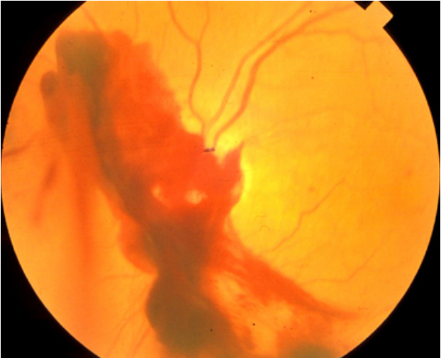

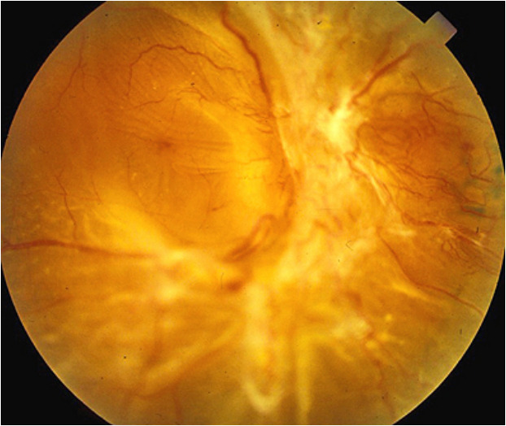

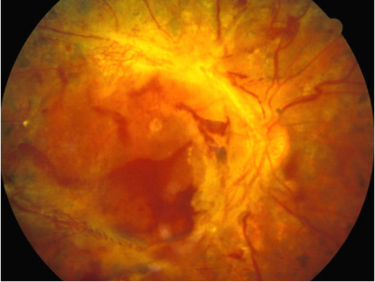

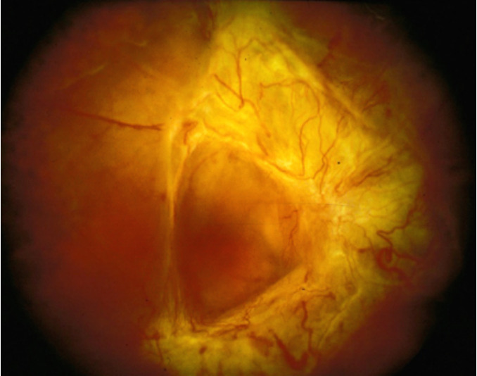

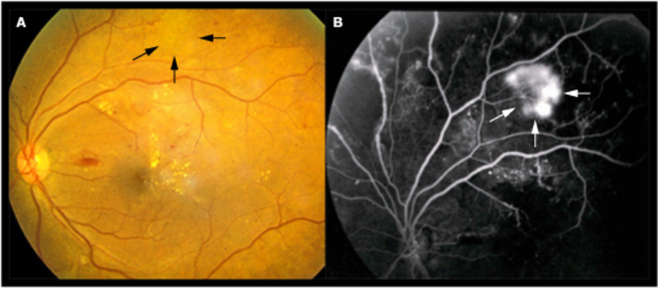

---

## 11. Situaciones especiales en la retinopatía diabética

### 11.1 Embarazo en la diabetes previa

**Por qué empeora la retinopatía.** El embarazo puede acelerar la retinopatía diabética por varios mecanismos que se suman:

- En el tercer trimestre, el diámetro venoso y el flujo sanguíneo de la retina disminuyen más en las gestantes diabéticas, lo que agrava la isquemia y la hipoxia retinianas.
- Contribuyen los cambios hormonales, los factores de crecimiento y las modificaciones hemodinámicas, como el descenso de la presión arterial.
- Una reducción rápida de la HbA1c también acelera la progresión, lo que indica que intervienen factores distintos de la mejoría glucémica.

**Predictores de progresión.** El principal es la gravedad de la retinopatía antes de la concepción:

- en las mujeres sin retinopatía previa, esta aparece en el 10%;
- con retinopatía de fondo leve, empeora en el 19%;
- con retinopatía no proliferativa moderada o severa, empeora en el 55%.

También predicen la progresión una HbA1c inicial elevada, una reducción mayor de la HbA1c y el tratamiento convencional antes del embarazo, frente al intensivo.

**Pronóstico.** Algunas pacientes necesitan láser durante la gestación, pero el embarazo no modifica el riesgo de progresión a largo plazo.

**Diabetes gestacional.** No aumenta el riesgo de retinopatía y no requiere exploración del fondo de ojo.

**Seguimiento.** Se explora antes de la concepción o en el primer trimestre, y después cada trimestre y hasta 1 año después del parto, según el grado de retinopatía. Los esquemas de la AAO y de la GPC IMSS se recogen en el anexo D.[^d1][^d3][^ada]

### 11.2 Intensificación del tratamiento hipoglucemiante

**Empeoramiento transitorio.** Durante el primer año de tratamiento intensivo, la retinopatía puede empeorar, con aumento de las manchas algodonosas. Al corregirse la hiperglucemia disminuye el volumen plasmático, lo que cierra capilares que estaban estrechados pero aún permeables; el aumento del factor de crecimiento similar a la insulina tipo 1 también contribuye.

**Beneficio a largo plazo.** El control intensivo compensa con creces ese empeoramiento inicial.

- En la diabetes tipo 1 reduce el riesgo de retinopatía en un 53%.
- Su beneficio persiste hasta 18 años aunque luego se vuelva a un control convencional; es el "efecto legado" de los estudios DCCT y EDIC.

**Conducta.** El control intensivo no se retrasa por miedo al empeoramiento inicial. La ADA recomienda, sin embargo, evaluar la retina al intensificar el tratamiento hipoglucemiante, incluidos los agonistas del receptor del péptido similar al glucagón tipo 1 (GLP-1), porque los descensos rápidos de la HbA1c pueden empeorar inicialmente la retinopatía.[^d1][^d3][^ada]

---

## 12. Retinopatía hipertensiva: concepto y significado sistémico

La retinopatía hipertensiva (RH) es el conjunto de alteraciones vasculares retinianas causadas por las lesiones microvasculares de la hipertensión arterial (HTA). En su desarrollo contribuyen también la arteriosclerosis, la enfermedad carotídea y la edad avanzada.

- **Prevalencia:** afecta al 7 a 11% de los hipertensos.
- **Forma aguda:** cuando la presión arterial se eleva bruscamente, por causa primaria o secundaria, la agudeza visual puede disminuir hasta la ceguera, y suele mejorar al normalizarse la presión.[^d4][^d5]

**La retina como marcador vascular.** La microcirculación retiniana permite observar arteriolas y vénulas de forma directa y no invasiva, y refleja lo que ocurre en la circulación coronaria y cerebral. Por eso sus alteraciones tienen valor pronóstico:

- el estrechamiento arteriolar retiniano predice la aparición futura de HTA;
- la RH predice el riesgo de ictus a largo plazo, con independencia de la presión arterial;
- la RH se asocia a cardiopatía coronaria, a remodelado ventricular izquierdo y a daño renal.

A la inversa, un fondo de ojo normal no descarta daño microvascular en otros órganos.[^d4][^d5][^d6]

**Calibre vascular peripapilar.** La dilatación venular medida en la región peripapilar se ha relacionado con el riesgo de ictus, de enfermedad coronaria y de nefropatía, porque los vasos retinianos y los cerebrales comparten origen. Su valor predictivo aún no está establecido.[^d4]

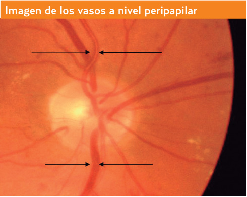

---

## 13. Fisiopatología de la retinopatía hipertensiva

La lesión retiniana por hipertensión arterial evoluciona en cuatro fases, que explican la secuencia de hallazgos del fondo de ojo.

1. **Fase de vasoconstricción.** Ante la elevación de la presión, la autorregulación aumenta el tono de la musculatura arteriolar y estrecha las arteriolas. En el joven, cuya pared arteriolar aún no está esclerosada, el estrechamiento es generalizado. En el adulto es focal, porque la pared ya esclerosada no puede contraerse y solo lo hacen los segmentos sin esclerosis.

2. **Fase de esclerosis.** La hiperplasia de la túnica media, la hialinización de la íntima y la hiperplasia endotelial engruesan progresivamente la pared y alteran la red capilar. El engrosamiento se manifiesta como ensanchamiento del reflejo arteriolar ("hilo de cobre"), opacidad completa de la pared ("hilo de plata") y compresión de las vénulas en los cruces.

3. **Fase exudativa.** La necrosis fibrinoide de la pared rompe la barrera hematorretiniana. Esto tiene tres consecuencias:
   - la sangre y el plasma salen al tejido y forman hemorragias, edema retiniano y exudados duros, que en la mácula adoptan la disposición radial de la estrella macular;
   - el cierre vascular produce isquemia;
   - la interrupción del transporte axoplásmico en la capa de fibras nerviosas da lugar a manchas algodonosas.

4. **Fase de complicaciones vasculares.** Los cambios ateroscleróticos de la pared provocan oclusiones arteriales, oclusiones venosas con edema retiniano y macroaneurismas arteriales.[^d4]

---

## 14. Hallazgos de la retinopatía hipertensiva

**Tabla 9. Hallazgos de la retinopatía hipertensiva y su interpretación.**[^d4][^d5][^d6][^wong]

| Hallazgo | Interpretación |
|---|---|
| Estrechamiento arteriolar generalizado | Refleja la presión arterial actual y la previa; predomina en el joven |
| Estrechamiento arteriolar focal | Refleja la presión arterial actual; predomina en el adulto |
| Opacificación de la pared ("hilo de cobre") | Arteriolosclerosis; retinopatía leve |
| "Hilo de plata" | Esclerosis avanzada; también vénula exangüe tras una oclusión venosa antigua |
| Cruces arteriovenosos patológicos | Principal signo de arteriolosclerosis; puede existir sin HTA |
| Hemorragias en llama o redondas | Retinopatía moderada; presión arterial actual elevada |
| Exudados duros y estrella macular | Retinopatía moderada o grave |
| Manchas algodonosas y microaneurismas | Retinopatía moderada |
| Edema de papila | Retinopatía grave; con presión muy elevada, emergencia hipertensiva |

**Valor cronológico de los hallazgos.** El estrechamiento generalizado y los cruces patológicos acompañan a la exposición mantenida a la presión elevada y reflejan por ello tanto la presión actual como la previa. En cambio, el estrechamiento focal, las hemorragias y los exudados dependen de la presión del momento, y por eso pueden regresar con el tratamiento.

**Cruces arteriovenosos patológicos.** La arteriola y la vénula comparten adventicia en el cruce, de modo que la arteriola engrosada comprime la vénula. Para considerar patológico un cruce, la columna venosa debe adelgazarse a ambos lados. Es el principal signo oftalmoscópico de arteriolosclerosis y puede aparecer sin HTA sistémica.

**Edema de papila.** La papila se ve hiperémica, ingurgitada y de bordes borrosos. Con presión arterial muy elevada, indica una emergencia hipertensiva (sección 17.2).[^d4][^d6][^wong]

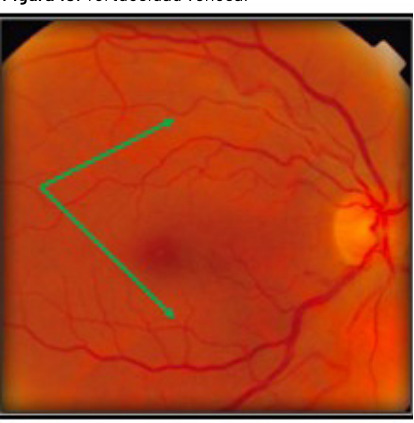

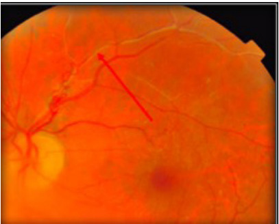

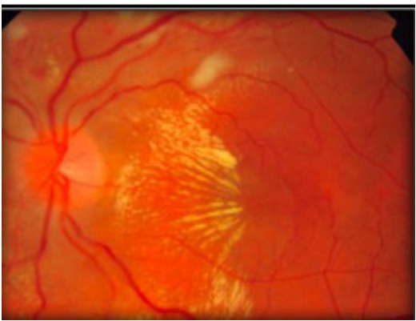

---

## 15. Clasificación de la retinopatía hipertensiva

### 15.1 Clasificación de Keith-Wagener-Barker

La clasificación de Keith-Wagener-Barker (1939) es la más citada. Se construyó según la supervivencia de los pacientes, que disminuía progresivamente del grado I al IV por enfermedad cardiovascular e ictus.

**Tabla 10. Clasificación de Keith-Wagener-Barker.**[^kwb][^d5][^wong]

| Grado | Hallazgos | Significado |
|---|---|---|
| I | Estrechamiento arteriolar generalizado leve | Vasculopatía hipertensiva |
| II | Estrechamiento focal definido, cruces patológicos y esclerosis arteriolar ("hilo de cobre") | Vasculopatía hipertensiva; compromiso sistémico mínimo o nulo |
| III | Grado II más hemorragias en llama, exudados duros y manchas algodonosas; arterias en "hilo de plata" | Retinopatía; puede haber afectación cardiaca o cerebral |
| IV | Grado III más edema de papila | Hipertensión maligna |

**Variante de la revisión de 2018.** Se aparta del esquema original en los grados I y II, aunque en ambas versiones el grado IV queda definido por el edema de papila.

- Describe el grado I como tortuosidad vascular sin vasoconstricción.
- Incluye en el grado II la dilatación venular y algunas hemorragias.
- Añade al grado III el vasoespasmo coroideo, la estrella macular y los microinfartos.[^d4]

**Vigencia.** La clasificación tiene hoy un valor limitado por tres motivos:

- su valor pronóstico original ya no es aplicable, porque el control actual de la HTA ha cambiado la supervivencia y los grados III y IV son poco frecuentes;
- es poco reproducible entre examinadores, sobre todo al distinguir los grados I y II;
- no hay consenso sobre la utilidad práctica de las distintas clasificaciones.[^d4][^wong]

### 15.2 Clasificación simplificada de Wong y Mitchell

La clasificación simplificada agrupa los hallazgos según su mecanismo y su relación con el riesgo vascular, y por eso estratifica mejor las formas leve y moderada.

**Tabla 11. Clasificación simplificada de la retinopatía hipertensiva.**[^d6][^wong]

| Grado | Hallazgos | Conducta |
|---|---|---|
| Leve | Estrechamiento arteriolar generalizado o focal, cruces patológicos y "hilo de cobre" | Control de la HTA |
| Moderada | Hemorragias, microaneurismas, manchas algodonosas o exudados duros | Control de la HTA; la retinopatía refuerza la indicación de tratar |
| Grave o maligna | Retinopatía moderada más edema de papila | Emergencia hipertensiva (sección 17.2) |

**Retinopatía moderada bilateral con presión muy elevada.** Si las hemorragias en llama o las manchas algodonosas son bilaterales y la presión arterial es muy elevada, la situación se trata como hipertensión maligna, aunque todavía no haya edema de papila (sección 17.2).

**Regresión.** Con un buen control tensional la retinopatía puede regresar, lo que la convierte en un indicador sencillo del éxito del tratamiento.[^d6][^wong][^escpos]

---

## 16. Complicaciones retinianas de la hipertensión arterial

### 16.1 Oclusiones venosas retinianas

Las oclusiones venosas son la segunda causa de ceguera legal (agudeza visual de 0,1 o menos) por enfermedad vascular retiniana, después de la retinopatía diabética.

- **Perfil del paciente:** afectan a personas de más de 40 años, con una edad media de 60.
- **Factores de riesgo:** la HTA multiplica por cinco el riesgo. También predisponen la diabetes, la enfermedad carotídea, el tabaquismo, las enfermedades hematológicas, las vasculitis y algunos fármacos.

**Tipos:**

- **Oclusión de rama venosa:** suele producirse en un cruce arteriovenoso, donde la arteriola esclerosada comprime la vénula con la que comparte adventicia.
- **Oclusión de la vena central de la retina:** se debe a una trombosis retrolaminar o a nivel de la lámina cribosa y suele acompañarse de edema del nervio óptico.

**Hallazgos en el sector drenado por la vena afectada:**

- tortuosidad y aumento del calibre venoso;
- hemorragias superficiales en "llama de vela" o profundas redondas;
- edema macular;
- a veces, manchas algodonosas.[^d4]

### 16.2 Macroaneurismas arteriales retinianos

Los macroaneurismas son dilataciones saculares únicas de una arteria retiniana, más frecuentes en las arcadas temporales y propias de pacientes hipertensos. A su alrededor se acumulan edema y exudación lipídica que, si se extienden a la mácula, comprometen la visión.[^d4]

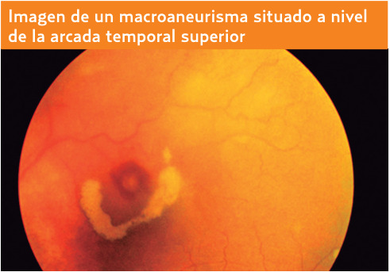

### 16.3 La hipertensión como factor de riesgo de otras enfermedades oculares

**Riesgo establecido:**

- **Retinopatía diabética:** es la más frecuente. La HTA añade daño endotelial, y su control reduce el riesgo con independencia de la glucemia.
- **Otras:** oclusiones venosas y arteriales retinianas, émbolos retinianos, macroaneurismas y neuropatía óptica isquémica anterior.

**Riesgo posible, con evidencia no concluyente:** degeneración macular asociada a la edad y glaucoma.

**Precaución terapéutica:** en el hipertenso con glaucoma hay que evitar el exceso de tratamiento antihipertensivo nocturno. La hipotensión nocturna reduce el flujo del nervio óptico y acentúa el daño glaucomatoso cuando la presión intraocular está elevada.[^d6]

---

## 17. Abordaje de la retinopatía hipertensiva

### 17.1 Indicaciones del fondo de ojo

- **Diagnóstico reciente de HTA:** el fondo de ojo forma parte de la exploración física inicial, preferentemente con midriasis de acción corta; la angio-OCT es una herramienta adicional.
- **HTA mal controlada o con complicaciones, como la nefropatía:** se recomienda el cribado periódico con retinografías, igual que en la diabetes.
- **HTA bien controlada:** no hay criterios que establezcan la utilidad del cribado periódico.
- **Crisis hipertensiva grave:** el fondo de ojo es obligatorio, porque la retinopatía avanzada define la hipertensión maligna y porque las lesiones maculares y papilares amenazan la visión.[^d4][^d6][^escpos]

### 17.2 Tratamiento

**Retinopatía leve o moderada.** El tratamiento de la retinopatía hipertensiva es el de la HTA que la causa. La presencia de retinopatía obliga a asegurar el control tensional ambulatorio.

**Algoritmo ambulatorio:**

- **Sin hallazgos de retinopatía:** control periódico de la presión arterial.
- **Con hallazgos:** estratificación del riesgo, tratamiento antihipertensivo y control metabólico.
- **Si además hay factores de riesgo o diabetes:** tratamiento antihipertensivo farmacológico y control oftalmológico cada 6 meses a 1 año.
- **Con un solo factor de riesgo en un paciente no diabético, o sin factores de riesgo:** cambios en el estilo de vida, control de las cifras tensionales y control oftalmológico periódico.[^d4][^d6][^d5]

**Hipertensión maligna.**

- **Definición:** es la combinación de una presión arterial muy elevada, habitualmente por encima de 200/120 mmHg, con retinopatía avanzada.
- **Retinopatía avanzada:** la Sociedad Europea de Cardiología (ESC) la define por la presencia bilateral de hemorragias en llama, manchas algodonosas o edema de papila. Por tanto, la hipertensión maligna puede diagnosticarse antes de que aparezca el edema de papila.

**Atención hospitalaria.** La hipertensión maligna es una emergencia hipertensiva y se trata en una unidad de cuidados intensivos o equivalente, con monitorización continua de la presión arterial.

- **Fármacos:** se usan fármacos intravenosos de acción corta. El labetalol y el nicardipino son de elección; el nitroprusiato y el urapidilo son alternativas.
- **Objetivo:** reducir la presión arterial media un 20 a 25% en varias horas. Un descenso brusco hasta valores normales expone a hipoperfusión de órganos cuya autorregulación se ha adaptado a presiones altas.

**Evaluación del daño agudo de órgano diana.** Se realiza al mismo tiempo que el tratamiento y busca tres complicaciones:

- **Microangiopatía trombótica:** hemólisis no inmune (Coombs negativa), con lactato deshidrogenasa elevada, haptoglobina indetectable o esquistocitos, y trombocitopenia.
- **Lesión renal aguda.**
- **Encefalopatía hipertensiva.**[^escpos][^esc][^d6]

---

## 18. Retinopatía diabética frente a retinopatía hipertensiva

**Tabla 12. Comparación entre la retinopatía diabética y la hipertensiva.**

| Aspecto | Retinopatía diabética | Retinopatía hipertensiva |
|---|---|---|
| Lesión inicial | Microaneurisma | Estrechamiento arteriolar |
| Mecanismo central | Daño capilar con hiperpermeabilidad y oclusión; la isquemia induce VEGF y neovasos | Vasoconstricción, arteriolosclerosis y necrosis fibrinoide con exudación |
| Signo de máxima gravedad | Neovasos; en la forma no proliferativa, criterios de la regla 4-2-1 | Retinopatía avanzada bilateral o edema de papila |
| Exudados duros | Patrón circinado; edema macular | Estrella macular |
| Cruces arteriovenosos | No característicos | Signo cardinal de arteriolosclerosis |
| Complicaciones principales | Edema macular, hemorragia vítrea, desprendimiento traccional, glaucoma neovascular | Oclusiones venosas, macroaneurismas |
| Tratamiento ocular | Anti-VEGF, panfotocoagulación, láser focal, corticoides intravítreos, vitrectomía | Control de la presión arterial; en la hipertensión maligna, descenso controlado en el hospital |
| Cribado | Sistemático en toda persona con diabetes | Al diagnóstico; periódico si hay mal control o complicaciones; obligatorio en la crisis |

---

## Anexo A. Atlas de fotografías estándar del ETDRS

Las fotografías estándar del Early Treatment Diabetic Retinopathy Study (ETDRS) son el patrón de referencia con el que se gradúan las lesiones de la retinopatía diabética. Las clasificaciones de la sección 7 remiten a ellas.[^d1][^d3]

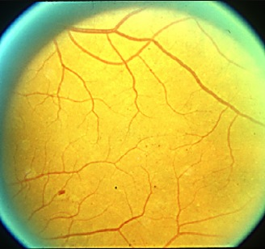

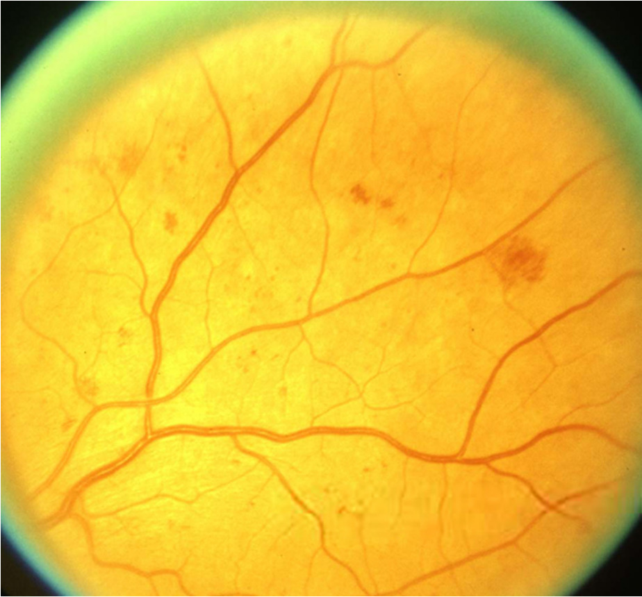

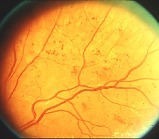

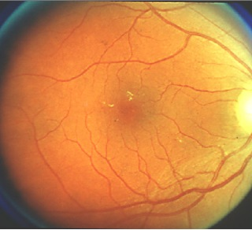

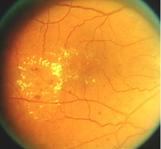

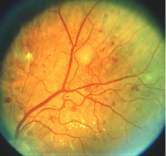

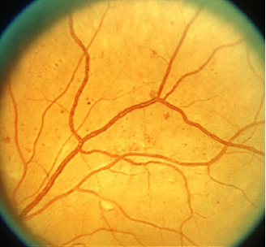

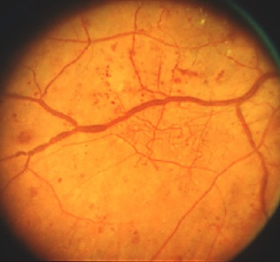

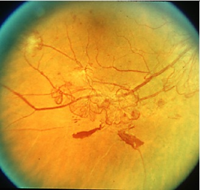

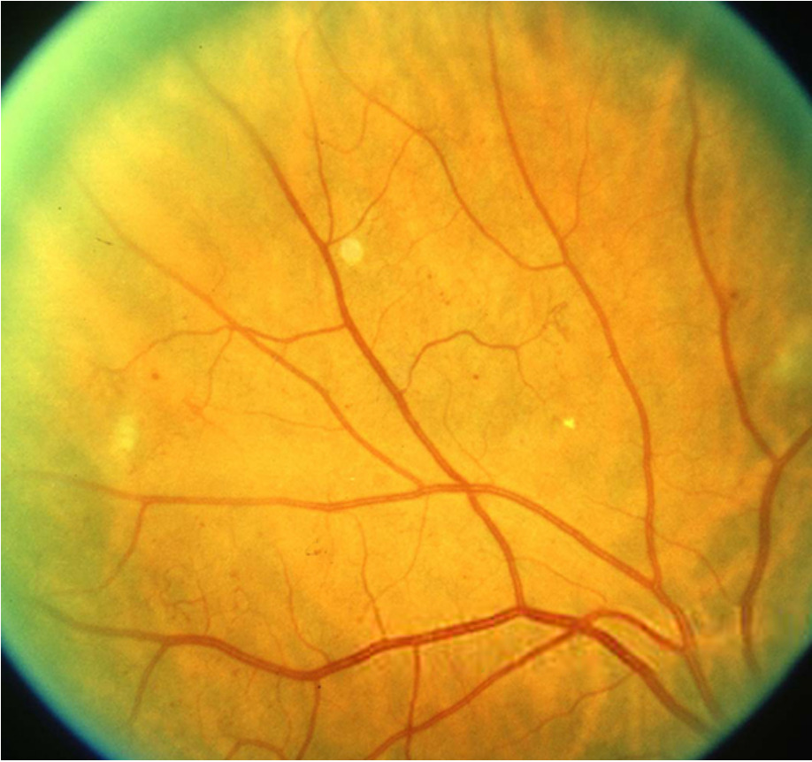

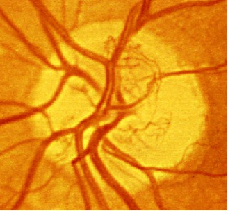

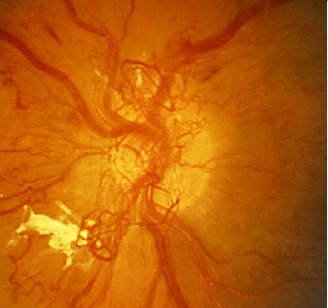

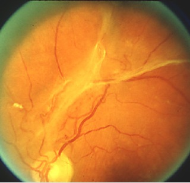

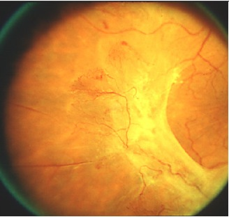

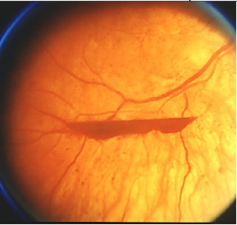

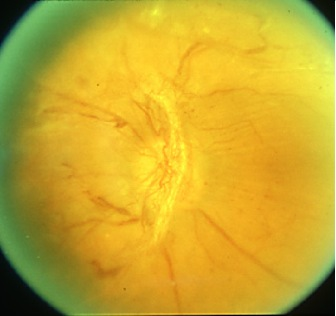

---

## Anexo B. Escala del ETDRS y sistemas de cribado

**Tabla B1. Equivalencias aproximadas entre la escala del ETDRS y las escalas clínicas y de cribado.**[^d4][^d7][^nhs]

| Nivel ETDRS | Hallazgos | Escala internacional | Inglaterra | Escocia |
|---|---|---|---|---|
| 10 | Sin microaneurismas | Sin retinopatía | R0 | R0 |
| 14 y 15 | Exudados blandos, AMIR (14) o hemorragias (15) aislados, sin microaneurismas | Sin retinopatía | — | — |
| 20 | Solo microaneurismas | No proliferativa leve | R1 | R1 leve |
| 35 | Microaneurismas y, en un cuadrante, bucles venosos, exudados blandos, AMIR o hemorragias | No proliferativa moderada | R1 | R1 |
| 43 | Hemorragias o microaneurismas moderados en 4 cuadrantes, o AMIR en 1 a 3 | No proliferativa moderada | R2 | R2 moderada |
| 47 | Nivel 43 más AMIR en 4 cuadrantes, hemorragias graves en 2 a 3 o bucles venosos en 1 | No proliferativa moderada | R2 | R2 |
| 53 A-D | Nivel 47 más hemorragias graves en 4 cuadrantes, AMIR moderadas en 1 o bucles en 2 a 3 | No proliferativa severa | R2 | R3 severa |
| 53 E | Dos o más criterios del nivel 53 | Severa (muy severa en el ETDRS) | R2 | R3 |
| 61 y 65 | Neovasos en la papila o en la retina | Proliferativa sin alto riesgo | R3 | R4 |
| 71 y 75 | Neovasos con hemorragia vítrea | Proliferativa de alto riesgo | R3 | R4 |
| 81 y 85 | Fondo de ojo no visible | Proliferativa avanzada | R3 | R4 |

**Tabla B2. Plazos de referencia en el cribado del Reino Unido.**[^d4][^nhs]

| Hallazgo | Conducta |
|---|---|
| Sin retinopatía | Control anual o bienal |
| Retinopatía de fondo | Control anual |
| Retinopatía preproliferativa | Derivación hospitalaria antes de 4 semanas |
| Retinopatía proliferativa (R3 en Inglaterra; R4 en Escocia) | Derivación hospitalaria en 1 semana |
| Maculopatía | Derivación hospitalaria antes de 4 semanas |
| Imagen no clasificable | Derivación hospitalaria |
| Fotocoagulación previa | Se registra |
| Otras lesiones | Se informa cuáles son |
| Pérdida visual súbita | Derivación hospitalaria el mismo día |

---

## Anexo C. Discrepancias normativas con implicación clínica

**Tabla C1. Discrepancias entre guías con repercusión en la conducta.**[^drs8][^ada][^adametas][^aao][^aao2025][^protS][^kwb][^escpos]

| Tema | Posición institucional o de revisión | Recomendación posterior verificada | Implicación |
|---|---|---|---|
| Retinopatía proliferativa de alto riesgo | GPC IMSS: neovasos extrapapilares de 1/4 de área papilar con hemorragia. UpToDate: neovasos papilares mayores de 1/3 a 1/2 | DRS: neovasos papilares iguales o mayores que la foto 10A; cualquier neovaso papilar con hemorragia; neovasos extrapapilares de 1/2 área papilar o más con hemorragia | Indicación de panfotocoagulación inmediata |
| Referencia desde el primer nivel | GPC IMSS 2014: lesiones leves a moderadas (fotos 1 a 3) vigiladas en el primer nivel | ADA 2026: referir cualquier edema, la forma no proliferativa moderada o peor y cualquier proliferativa | Momento de la referencia |
| Cribado sin retinopatía | GPC IMSS: cada 2 años solo con control continuo; AAO y SIGN: anual | ADA: cada 1 a 2 años tras exámenes anuales normales y con glucemia en meta | Intervalo de vigilancia |
| Embarazo | GPC IMSS: semanas 12, 16 a 20 o 28; revisión a los 6 meses posparto | ADA: antes de la concepción o en el primer trimestre, cada trimestre y hasta 1 año posparto | Duración de la vigilancia |
| Meta de HbA1c | GPC IMSS 2014: 6,5%. Revisión de 2018 (ADA 2014): 7 a 8,5% en diabetes de larga evolución | ADA vigente: menor de 7% en la mayoría; menor de 8% en pacientes frágiles | Riesgo de hipoglucemia |
| Meta de presión arterial | Revisión de 2018 (ADA 2014): unos 140/80 mmHg | ADA vigente: menor de 130/80 mmHg | Intensidad del tratamiento |
| Edema macular | GPC IMSS 2015 (AAO 2014): láser focal o en rejilla para el EMCS | AAO 2019 y ADA 2026: anti-VEGF de primera línea en el edema con afectación central y visión disminuida; láser en el edema sin afectación central | Tratamiento inicial |
| Anti-VEGF en la retinopatía proliferativa | GPC IMSS 2015: solo en la forma de alto riesgo sin edema | Protocol S: no inferior a la panfotocoagulación a 2 años; la AAO la mantiene como tratamiento principal | Láser frente a inyecciones repetidas |
| Efectos de la panfotocoagulación | GPC IMSS 2015: conserva el campo visual periférico | Puede reducir el campo periférico y la visión nocturna y empeorar el edema | Información al paciente |
| Corticoides intravítreos | Revisión de 2018: primera línea en ojos operados de catarata | Se reservan sobre todo para la respuesta insuficiente a los anti-VEGF | Secuencia terapéutica |
| Anti-VEGF disponibles | GPC IMSS 2015: aflibercept y ranibizumab | ADA 2026: además aflibercept 8 mg, brolucizumab y faricimab; bevacizumab fuera de indicación | Opciones terapéuticas |
| Keith-Wagener-Barker | Revisión de 2018: modifica los grados I y II | Esquema original (sección 15.1) | Asignación del grado |
| Hipertensión maligna | "Descenso rápido"; edema de papila como criterio | ESC: emergencia en cuidados intensivos; retinopatía avanzada bilateral aun sin edema de papila; reducción del 20 al 25% en varias horas | Lugar y ritmo del tratamiento |

---

## Anexo D. Esquemas institucionales e históricos

### D.1 Primer nivel de atención según la GPC IMSS de 2014

La guía clasificaba las lesiones por comparación con las fotografías estándar del ETDRS (anexo A). Las lesiones de las fotos 1, 2A, 2B y 3 seguían vigiladas en el primer nivel, y las de las fotos 4 a 13 se enviaban a oftalmología. Según la ADA vigente, la forma no proliferativa moderada ya es criterio de referencia (sección 8.2).

**Diabetes tipo 2:**

- Fondo de ojo al diagnóstico.
- Sin retinopatía: cada 2 años si el control era continuo, y cada año si no lo era.
- Retinopatía no proliferativa leve: revisión anual con control metabólico estricto.
- Retinopatía no proliferativa moderada: revisión semestral en el primer nivel.
- Formas severas y proliferativas: envío a oftalmología.

**Diabetes tipo 1:**

- Primera revisión de 3 a 5 años tras el debut, o en la pubertad.
- Sin retinopatía: revisión anual.
- Retinopatía leve o moderada: anual con buen control metabólico, y semestral si el control era malo.
- Retinopatía severa o baja visual inexplicable: envío a oftalmología.

**Metas:** la guía fijaba una HbA1c de 6,5%. Recogía además el dato del NICE de 2004 según el cual la terapia intensiva con bomba de insulina que lograba una HbA1c menor de 6,05% era la intervención que más reducía el riesgo de retinopatía en la diabetes tipo 1.[^d3]

### D.2 Seguimiento del embarazo según la AAO de 2012 y la GPC IMSS de 2014

**AAO 2012:** primer examen cerca de la concepción o al inicio del primer trimestre. Después:

- sin retinopatía o con retinopatía no proliferativa leve o moderada, cada 3 a 12 meses;
- con retinopatía no proliferativa severa o peor, cada 1 a 3 meses.

**GPC IMSS:** fijaba la siguiente revisión tras la evaluación inicial según la gravedad:

- sin retinopatía, a las 28 semanas;
- con retinopatía leve a moderada, entre las semanas 16 y 20;
- con retinopatía severa o proliferativa, a las 12 semanas.

Si había progresión, la revisión pasaba a ser mensual con envío a oftalmología; si no la había, era trimestral. La retinopatía diagnosticada durante el embarazo requería un fondo de ojo 6 meses después del parto.[^d3]

### D.3 Tabla de manejo de la AAO de 2014 adoptada por la GPC IMSS de 2015

**Tabla D1. Seguimiento y tratamiento según el estadio y el edema macular (AAO 2014).**[^d7]

| Estadio | Edema macular | Seguimiento (meses) | Panfotocoagulación | Láser focal o en rejilla |
|---|---|---|---|---|
| Normal o no proliferativa mínima | No | 12 | No | No |
| No proliferativa leve | No | 12 | No | No |
| No proliferativa leve | No significativo | 4 a 6 | No | No |
| No proliferativa leve | EMCS | 1 | No | Algunas veces |
| No proliferativa moderada | No | 6 a 12 | No | No |
| No proliferativa moderada | No significativo | 3 a 6 | No | No |
| No proliferativa moderada | EMCS | 1 | No | Algunas veces |
| No proliferativa severa | No | 4 | Algunas veces | No |
| No proliferativa severa | No significativo | 2 a 4 | Algunas veces | No |
| No proliferativa severa | EMCS | 1 | Algunas veces | Algunas veces |
| Proliferativa sin alto riesgo | No | 4 | Algunas veces | No |
| Proliferativa sin alto riesgo | No significativo | 4 | Algunas veces | No |
| Proliferativa sin alto riesgo | EMCS | 1 | Algunas veces | Algunas veces |
| Proliferativa de alto riesgo | No | 4 | Recomendada | No |
| Proliferativa de alto riesgo | No significativo | 4 | Recomendada | Algunas veces |
| Proliferativa de alto riesgo | EMCS | 1 | Recomendada | Algunas veces |

El láser del EMCS podía diferirse en dos situaciones:

- cuando el edema se agravaba por HTA o por retención de líquidos (insuficiencia cardiaca o renal, embarazo), mientras se trataba la causa médica;
- cuando el centro de la mácula no estaba afectado, la visión era buena, el seguimiento estrecho era posible y el paciente comprendía los riesgos.[^d7]

### D.4 Lista de verificación de la GPC IMSS de 2015

La lista fijaba la conducta en segundo nivel según la gravedad:

- sin retinopatía o con forma no proliferativa leve, vigilancia anual sin estudios;
- forma no proliferativa moderada, cita cada 6 meses;
- forma no proliferativa severa, cita cada 4 meses y panfotocoagulación periférica inmediata;
- proliferativa sin alto riesgo, vigilancia cada 4 meses y láser periférico inmediato;
- proliferativa de alto riesgo, láser inmediato y vigilancia cada 4 meses;
- hemorragia vítrea o desprendimiento de retina, envío a tercer nivel.

Esta lista era más intervencionista que la tabla D1 de la misma guía, que calificaba la panfotocoagulación como "algunas veces" indicada en la forma no proliferativa severa y en la proliferativa sin alto riesgo. La guía consideraba los anti-VEGF solo en la retinopatía proliferativa de alto riesgo sin edema macular.[^d7]

### D.5 Algoritmo de manejo de la retinopatía diabética de 2021

El algoritmo indicaba:

- sin hallazgos, control anual;
- con retinopatía o edema, control metabólico con HbA1c menor de 7%, LDL menor de 100 mg/dL y presión arterial menor de 130/80 mmHg;
- forma no proliferativa leve o moderada, seguimiento periódico;
- forma severa, seguimiento cada 2 a 3 meses y fotocoagulación si había alto riesgo de progresión, imposibilidad de seguimiento, catarata o embarazo;
- forma proliferativa, fotocoagulación y antiangiogénicos;
- edema macular, láser y bevacizumab intravítreo, sin distinguir la afectación central.

El tratamiento vigente del edema macular se describe en las secciones 9.2 y 9.4.[^d5]

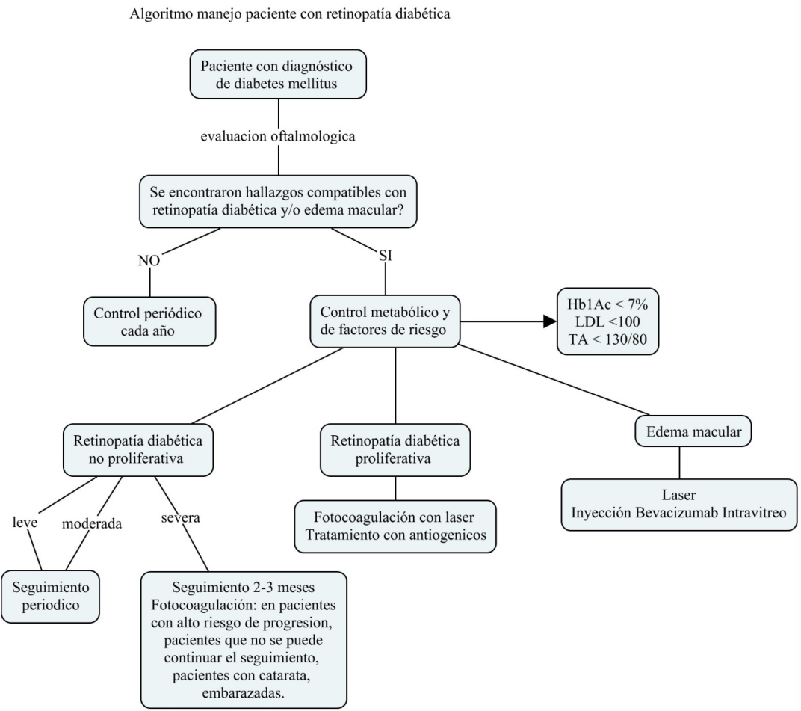

---

## Referencias

[^d1]: D'Amico DJ, Shah AR. Diabetic retinopathy: Classification and clinical features. UpToDate. Nathan DM, Trobe J (eds). Revisión de la literatura hasta mayo de 2025; tema actualizado el 20 de marzo de 2025.
[^d2]: Fernández Revuelta A. Técnica de exploración del fondo de ojo. AMF. 2012;8(7):383-387.
[^d3]: Instituto Mexicano del Seguro Social. Detección de retinopatía diabética en primer nivel de atención. Guía de Práctica Clínica IMSS-735-14. México: IMSS; 2014.
[^d4]: Romero-Aroca P, Sagarra Álamo R. La retinopatía diabética e hipertensiva. AMF. 2018;14(7):382-393.
[^d5]: Gasca Cuello D, Martínez Parra JP, Gómez Gordillo JS, Delgado Contreras SL, Fuentes Martínez RA. Manifestaciones de la retinopatía hipertensiva y de la retinopatía diabética en población adulta. S&EMJ. 2021;1:64-72.
[^d6]: Ocular effects of hypertension. UpToDate. Revisión de la literatura vigente en junio de 2025.
[^d7]: Instituto Mexicano del Seguro Social. Diagnóstico y tratamiento de retinopatía diabética. Guía de Práctica Clínica IMSS-171-09, actualización 2015. México: IMSS; 2015.
[^garway]: Garway-Heath DF, Ruben ST, Viswanathan A, Hitchings RA. Vertical cup/disc ratio in relation to optic disc size: its value in the assessment of the glaucoma suspect. Br J Ophthalmol. 1998;82(10):1118-1124.
[^msd]: Manual MSD, versión para profesionales. Tabla "Clinical clues to the causes of symptomatic seizures": ausencia de pulsaciones venosas espontáneas en el 10 a 20% de las personas con presión intracraneal normal.
[^dantona]: D'Antona L, Asif H, Craven CL, et al. Association of intracranial pressure and spontaneous retinal venous pulsation. JAMA Neurol. 2019;76(12):1502-1505.
[^fenil]: Minims Phenylephrine Hydrochloride 10% w/v eye drops. Ficha técnica (Summary of Product Characteristics). electronic Medicines Compendium, Reino Unido.
[^oft]: Oxford Medical Education. Approach to direct ophthalmoscopy. Disponible en: https://oxfordmedicaleducation.com/surgery/ophthalmology/fundoscopy/
[^wikem]: WikEM. Acute onset flashers and floaters. Disponible en: https://wikem.org/wiki/Acute_onset_flashers_and_floaters
[^irma]: Clinical characterization of intraretinal microvascular abnormality and associated neovascularization. Guoji Yanke Zazhi (Int Eye Sci). 2021;21(1).
[^icdr]: Wilkinson CP, Ferris FL 3rd, Klein RE, et al. Proposed international clinical diabetic retinopathy and diabetic macular edema disease severity scales. Ophthalmology. 2003;110(9):1677-1682.
[^drs8]: Diabetic Retinopathy Study Research Group. Photocoagulation treatment of proliferative diabetic retinopathy: clinical application of Diabetic Retinopathy Study (DRS) findings. DRS Report Number 8. Ophthalmology. 1981;88(7):583-600.
[^etdrs1]: Early Treatment Diabetic Retinopathy Study Research Group. Photocoagulation for diabetic macular edema. ETDRS report number 1. Arch Ophthalmol. 1985;103(12):1796-1806.
[^nhs]: Scottish Diabetic Retinopathy Screening Collaborative. Scottish Diabetic Retinopathy Grading Scheme. Disponible en: https://www.ndrs.scot.nhs.uk/?p=1609. NHS Diabetic Eye Screening Programme (Inglaterra): grados R0-R3 y M0-M1.
[^ada]: American Diabetes Association Professional Practice Committee. 12. Retinopathy, Neuropathy, and Foot Care: Standards of Care in Diabetes—2026. Diabetes Care. 2026;49(Suppl 1):S261-S276. Edición previa: Diabetes Care. 2025;48(Suppl 1).
[^adametas]: American Diabetes Association Professional Practice Committee. 6. Glycemic Goals and Hypoglycemia y 10. Cardiovascular Disease and Risk Management: Standards of Care in Diabetes—2025. Diabetes Care. 2025;48(Suppl 1).
[^etdrs8]: Early Treatment Diabetic Retinopathy Study Research Group. Effects of aspirin treatment on diabetic retinopathy. ETDRS report number 8. Ophthalmology. 1991;98(5 Suppl):757-765.
[^aao]: Flaxel CJ, Adelman RA, Bailey ST, et al. Diabetic Retinopathy Preferred Practice Pattern®. Ophthalmology. 2020;127(1):P66-P145 (American Academy of Ophthalmology, 2019).
[^aao2025]: Lim JI, Kim SJ, Bailey ST, Kovach JL, Vemulakonda GA, Ying GS, Flaxel CJ; American Academy of Ophthalmology Preferred Practice Pattern Retina/Vitreous Committee. Diabetic Retinopathy Preferred Practice Pattern®. Ophthalmology. 2025;132(4):P75-P162. doi:10.1016/j.ophtha.2024.12.020.
[^papa]: Papadopoulos N, Martin J, Ruan Q, et al. Binding and neutralization of vascular endothelial growth factor (VEGF) and related ligands by VEGF Trap, ranibizumab and bevacizumab. Angiogenesis. 2012;15(2):171-185.
[^protT]: Diabetic Retinopathy Clinical Research Network; Wells JA, Glassman AR, Ayala AR, et al. Aflibercept, bevacizumab, or ranibizumab for diabetic macular edema. N Engl J Med. 2015;372(13):1193-1203.
[^protS]: Writing Committee for the Diabetic Retinopathy Clinical Research Network; Gross JG, Glassman AR, Jampol LM, et al. Panretinal photocoagulation vs intravitreous ranibizumab for proliferative diabetic retinopathy: a randomized clinical trial. JAMA. 2015;314(20):2137-2146.
[^nice]: National Institute for Health and Care Excellence. Dexamethasone intravitreal implant for treating diabetic macular oedema. Technology appraisal guidance TA824. Londres: NICE; 2022.
[^wong]: Wong TY, Mitchell P. Hypertensive retinopathy. N Engl J Med. 2004;351(22):2310-2317.
[^kwb]: Keith NM, Wagener HP, Barker NW. Some different types of essential hypertension: their course and prognosis. Am J Med Sci. 1939;197:332-343 (reimpreso en Am J Med Sci. 1974;268:336).
[^escpos]: van den Born BH, Lip GYH, Brguljan-Hitij J, et al. ESC Council on hypertension position document on the management of hypertensive emergencies. Eur Heart J Cardiovasc Pharmacother. 2019;5(1):37-46.
[^esc]: Williams B, Mancia G, Spiering W, et al. 2018 ESC/ESH Guidelines for the management of arterial hypertension. Eur Heart J. 2018;39(33):3021-3104.
