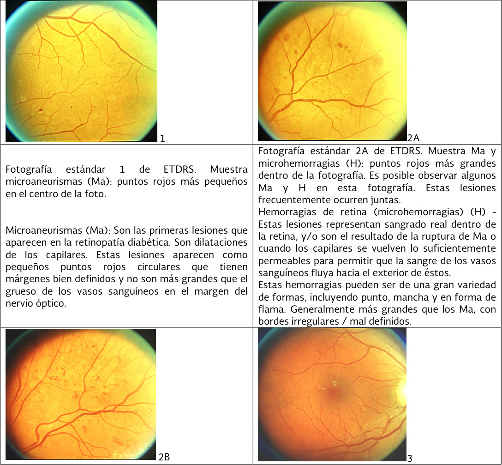
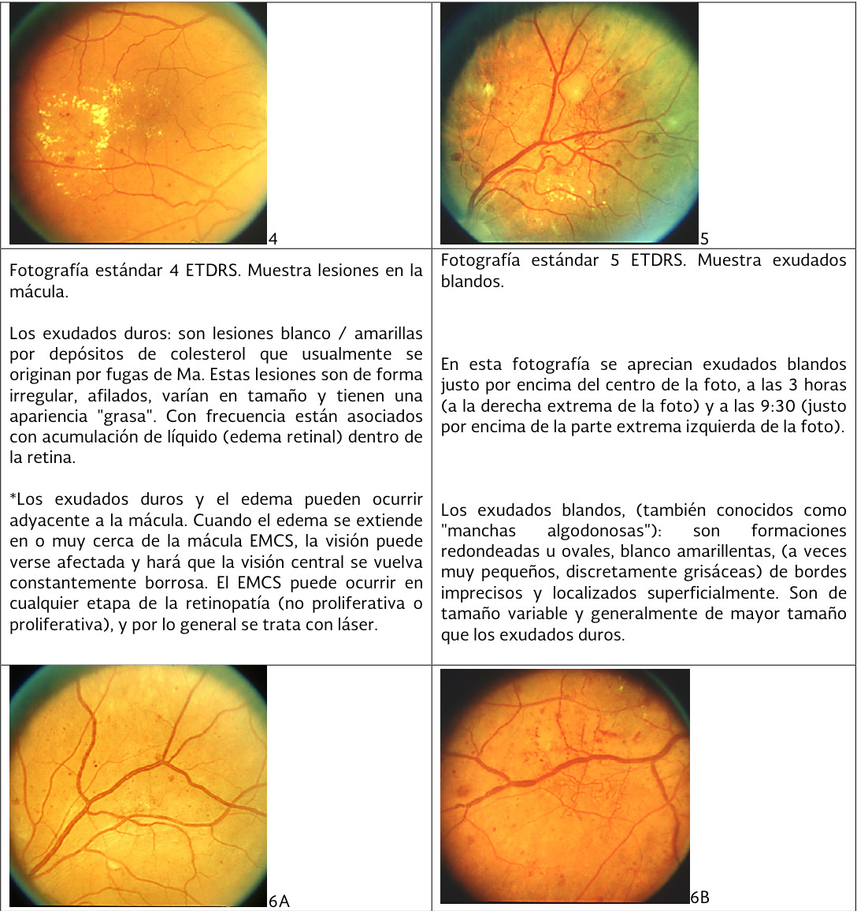
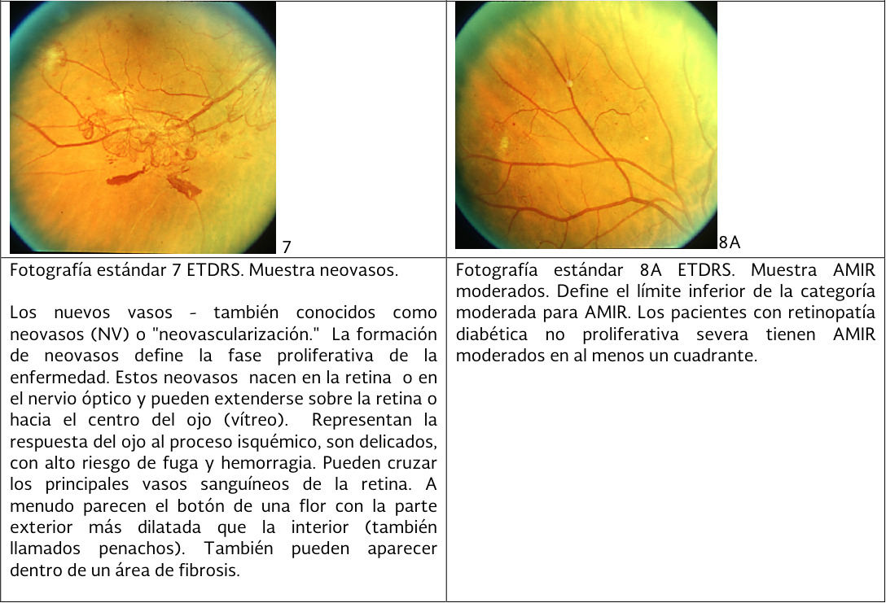
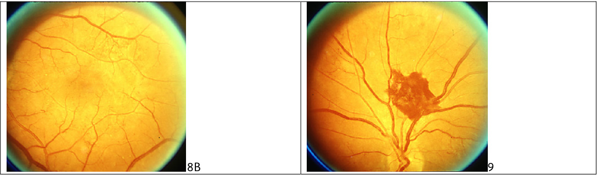
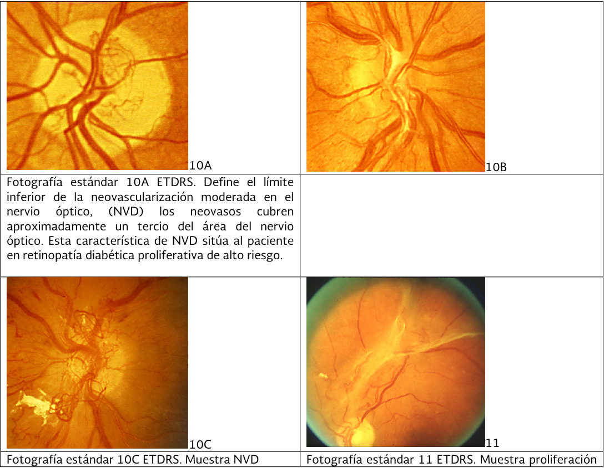
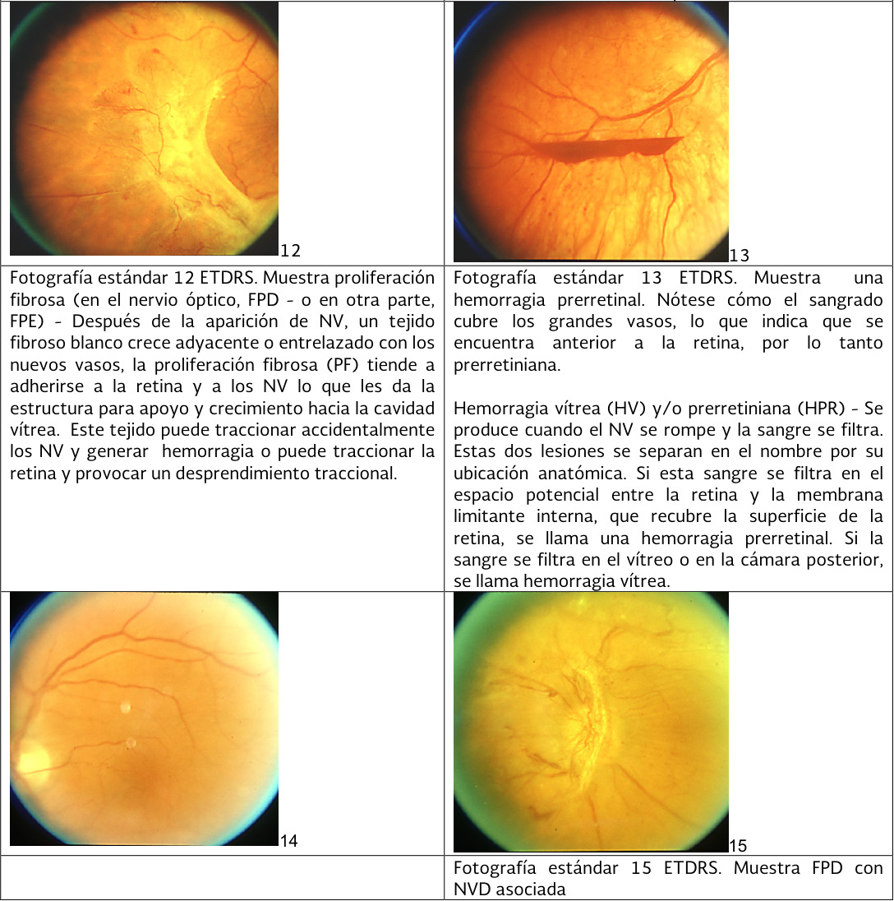

# Retinopatía diabética y retinopatía hipertensiva

| Sigla | Significado | Sigla | Significado |
|---|---|---|---|
| AGF | Angiografía con fluoresceína | NVD | Neovasos en el disco óptico o a 1 diámetro papilar o menos de él |
| AMIR | Anomalías microvasculares intrarretinianas | NVE | Neovasos en otro lugar de la retina, a más de 1 diámetro papilar del disco |
| AV | Agudeza visual | OCT | Tomografía de coherencia óptica |
| BHR | Barrera hematorretiniana | PFC | Panfotocoagulación retiniana con láser |
| EMCS | Edema macular clínicamente significativo | PIO | Presión intraocular |
| EMD | Edema macular diabético | RD | Retinopatía diabética |
| ETDRS | Early Treatment Diabetic Retinopathy Study | RDNP | Retinopatía diabética no proliferativa |
| HTA | Hipertensión arterial | RDP | Retinopatía diabética proliferativa |
| HV | Hemorragia vítrea | RH | Retinopatía hipertensiva |
| HbA1c | Hemoglobina glucosilada | VEGF | Factor de crecimiento del endotelio vascular |
| DM1 / DM2 | Diabetes mellitus tipo 1 / tipo 2 | AAO | Academia Americana de Oftalmología |
| ADA | American Diabetes Association | DRS | Diabetic Retinopathy Study |

---

## 1. Fundamentos anatómicos del fondo de ojo

### 1.1 Estructuras y orientación

- **Lateralidad de la imagen:** la papila óptica ocupa siempre el lado nasal del fondo de ojo. Por lo tanto, si en una retinografía aparece a la derecha, el ojo examinado es el derecho, y viceversa.
- **Papila óptica:** es la porción visible del nervio óptico. Es redondeada u ovalada en sentido vertical, mide unos 1,5 mm de diámetro y tiene un anillo neurorretiniano anaranjado.
  - De su centro emergen las arteriolas y a él drenan las vénulas retinianas.
  - Entre los vasos y el anillo queda la excavación papilar fisiológica.
  - Las distancias del fondo de ojo se expresan en "diámetros papilares" o "diámetros de disco".
- **Vasos retinianos:** carecen de capa media, por lo que son arteriolas y vénulas, no arterias y venas verdaderas. A diferencia de la circulación sistémica, cada arteriola tiene una sola vénula acompañante.
  - Se distribuyen de forma centrífuga en cuatro cuadrantes; cada cuadrante recibe una arteriola y una vénula principales.
  - La arteria y la vena centrales se dividen en ramas temporales y nasales, superiores e inferiores, que forman las cuatro arcadas vasculares.
  - Las arteriolas son de menor calibre y de un rojo menos intenso que las vénulas.
  - No existen anastomosis, de modo que la oclusión de una rama produce isquemia del sector que irriga.
- **Mácula:** es la región comprendida entre las dos arcadas temporales. Su centro está a unos 4 mm del borde temporal de la papila y 0,8 mm por debajo de ella.
- **Fóvea:** es la zona más oscura del centro macular y concentra la mayor densidad de conos, lo que explica que sea responsable de la máxima AV y de la percepción del color. Es avascular, para no interferir con el paso de la luz, y se nutre de la coroides subyacente.
- **Arteria ciliorretiniana:** existe en alrededor del 20% de las personas. Depende de las arterias ciliares posteriores e irriga la mácula, por lo que preserva la irrigación macular cuando se ocluye la arteria central de la retina.[^d2][^d4]

### 1.2 Fondo de ojo normal y significado de sus alteraciones

| Estructura | Aspecto normal | Significado de la alteración |
|---|---|---|
| Parénquima retiniano | Membrana semitransparente; el color rojizo se debe al epitelio pigmentario, varía con la raza, la edad y la pigmentación cutánea, y pierde brillo con los años | Es la referencia para identificar palidez, edema, exudados y hemorragias |
| Color de la papila | Blanco-rosáceo, con una excavación central blanquecina que no supera el 30% del diámetro papilar | El aumento de la excavación se vigila sobre todo en el glaucoma |
| Bordes de la papila | Netos, sobre todo en el lado temporal; puede haber pigmento peripapilar | Bordes borrosos con papila hiperémica e ingurgitada indican edema de papila |
| Calibre y color de los vasos | La vena es rojo vinoso, más oscura y de trayecto más ondulado; la relación de calibre arteria/vena es de 2/3 | Una relación menor de 2/3 indica estrechamiento arteriolar, como en la HTA |
| Reflejo luminoso arteriolar | Línea blanca central que ocupa 1/4 del ancho de la arteriola | Si el reflejo se ensancha, refleja engrosamiento de la pared ("hilo de cobre"); si la pared es completamente opaca, se habla de "hilo de plata" |
| Cruces arteriovenosos | Sin cambios de calibre ni de trayecto en el cruce | La muesca o desviación venosa en el cruce es un signo de arteriolosclerosis |
| Pulso venoso | Pulsaciones en el punto donde las venas salen por el borde papilar; las arterias no pulsan | Su presencia indica presión intracraneal normal |

[^d2]

---

## 2. Exploración del fondo de ojo y técnicas de imagen

### 2.1 Oftalmoscopio directo

El oftalmoscopio directo proyecta la luz sobre la retina mediante un espejo y da una imagen amplificada de 14 a 16 aumentos.

- **Cabezal:** contiene lentes esféricas de +20 a −25 dioptrías.
  - El disco de Recoss gira en sentido horario para las lentes convergentes (números negros) y en sentido antihorario para las divergentes (números rojos).
  - De este modo se compensa la ametropía del paciente y la del examinador.
- **Aperturas y filtros:**
  - La apertura grande se usa en pupilas dilatadas y la pequeña en pupilas sin dilatar.
  - El filtro verde o luz aneritra resalta las estructuras vasculares y la capa de fibras nerviosas.
  - El filtro azul cobalto resalta erosiones y úlceras corneales teñidas con fluoresceína.
  - La apertura de fijación sirve para diagnosticar la fijación excéntrica y para localizar lesiones maculares.
  - La hendidura permite apreciar elevaciones y depresiones, comparar el calibre de los vasos y explorar la cámara anterior.
- **Mango:** aloja la fuente de energía (halógena o batería) y un reóstato que regula la intensidad de la luz.

| Ventajas | Limitaciones |
|---|---|
| Fácil de usar, portátil, de bajo costo, útil en el cribado y con imagen amplificada | Con medios turbios no se ve la retina; el campo es muy limitado; no hay estereopsis, por lo que no se aprecia el engrosamiento retiniano; obliga a una gran proximidad al paciente; no explora la retina periférica |

[^d2]

### 2.2 Midriasis farmacológica

**Valoración previa de la cámara anterior.** Antes de dilatar se ilumina el ojo lateralmente con una linterna. Cuanto menos profunda es la cámara anterior, mayor es la sombra que aparece en el sector nasal del iris. Si la cámara es estrecha no se dilata, porque la midriasis puede cerrar el ángulo iridocorneal y desencadenar un glaucoma agudo.[^d2]

| Fármaco | Administración | Efectos adversos | Interacciones | Contraindicaciones |
|---|---|---|---|---|
| **Tropicamida 1%** (alternativa: ciclopentolato 1%) | 1 gota; puede repetirse cada 5 minutos hasta 3 veces; se explora 15 minutos después | Glaucoma de ángulo cerrado, visión borrosa, fotofobia, eritema facial, sequedad de boca, erupción cutánea | Los adrenérgicos oftálmicos aumentan la midriasis | Hipersensibilidad; glaucoma de ángulo cerrado |
| **Fenilefrina 10%** (100 mg/ml) | 1 gota; puede repetirse cada 5 minutos hasta 3 veces | Efectos adrenérgicos sistémicos | Los antidepresivos tricíclicos potencian el efecto cardiaco; la guanetidina aumenta la midriasis; con inhibidores de la monoaminooxidasa o betabloqueadores pueden aparecer arritmias | Hipersensibilidad, glaucoma de ángulo estrecho, HTA sistémica, hipertiroidismo |
| **Tropicamida 0,8% + fenilefrina 5%** | 1 gota antes del examen | Los de ambos componentes | Las de ambos componentes | Las de ambos componentes |

[^d2][^d3][^d7]

- **Duración y riesgos:** la tropicamida produce una midriasis rápida que altera la acomodación y la visión durante 4 a 6 horas. Además eleva la PIO de forma leve y transitoria y, muy rara vez, desencadena un glaucoma agudo de ángulo cerrado. Por eso se advierte al paciente antes de explorarlo.
- **No se dilata en estos casos:**
  - Cámara anterior estrecha.
  - Glaucoma de ángulo estrecho sin iridotomía profiláctica.
  - Rubeosis del iris.
  - Pacientes que necesitan vigilancia periódica de los reflejos pupilares, como tras un traumatismo craneoencefálico o un accidente isquémico transitorio, porque la midriasis farmacológica invalida esa vigilancia.
- **En el hipertenso:** la dilatación con un midriático de acción corta es casi siempre útil, porque los cambios leves son difíciles de cuantificar incluso con retinografía.[^d2][^d6]

### 2.3 Técnica de exploración con oftalmoscopio directo

1. Se explica el procedimiento, que puede resultar molesto o fatigoso, y se advierten los efectos del midriático.
2. Se valora la cámara anterior y, si no hay contraindicación, se dilata con tropicamida 1% y se esperan 15 minutos.
3. El paciente fija la mirada al frente, en un punto lejano.
4. El ojo derecho del paciente se explora con el ojo y la mano derechos del examinador, y el izquierdo con el ojo y la mano izquierdos.
5. Al mismo nivel horizontal que el paciente, el examinador se aproxima desde 15 a 20° por fuera del eje visual y localiza primero el **reflejo rojo**. Este reflejo refleja la transparencia de los medios; con medios turbios no se ve la retina.
6. Manteniendo el reflejo, el examinador se acerca hasta enfocar la retina y corrige la ametropía con el disco de Recoss.
7. Se exploran sistemáticamente:
   - la papila (forma, color, bordes, excavación y pulso venoso);
   - las cuatro arcadas vasculares (calibre, reflejo arteriolar, cruces y lesiones);
   - la mácula.
8. Se hacen pausas breves para no cansar al paciente. Con destreza adquirida, la exploración dura de 5 a 10 minutos.[^d2][^oft]

**Indicaciones de la oftalmoscopia:**

- Disminución de la AV.
- Diabetes mellitus.
- HTA.
- Cefalea.
- Síntomas neurológicos agudos, para descartar edema de papila.
- Degeneración macular asociada a la edad.
- Repercusión ocular de enfermedades hematológicas y neurológicas.[^d2]

### 2.4 Otras técnicas de exploración e imagen

- **Oftalmoscopia indirecta y biomicroscopia con lámpara de hendidura:** se realiza con lente de contacto tipo Goldmann o sin contacto (90 dioptrías). Explora la retina periférica y, gracias a la visión estereoscópica, permite ver el engrosamiento retiniano. Habitualmente la realiza el oftalmólogo y no deja registro de imágenes.
- **Retinografía:** desde la década de 1980 es la técnica de elección para el cribado y diagnóstico de la RD y de la RH, porque deja un registro fotográfico comparable en el tiempo.
  - La **cámara no midriática** tiene una sensibilidad del 87% y una especificidad del 97% para el cribado de RD. Además es más costo-efectiva que la oftalmoscopia con dilatación y permite valorar el nervio óptico.
  - **Protocolos de campos:**
    - ETDRS: siete campos de 30°; es el estándar de investigación.
    - EURODIAB: dos campos de 45°, uno centrado en la mácula y otro en el lado nasal de la papila.
    - Joslin/WESDR: añade un tercer campo temporal superior.
    - ADA y AAO: una sola retinografía de 45° centrada entre la mácula y el borde temporal de la papila basta para el cribado, aunque no sirve para el diagnóstico definitivo.
  - **Retinografía de campo amplio (hasta 180°):** muestra la periferia, pero aún está poco implantada.
  - La imagen la obtiene un técnico acreditado. Su primera lectura pueden hacerla médicos de familia o endocrinólogos con formación previa.
- **AGF:** registra con una cámara especial el paso de fluoresceína inyectada por vía intravenosa.
  - Muestra de forma dinámica la ruptura de la BHR interna (edema), las áreas de falta de perfusión capilar (isquemia) y la fuga de los neovasos.
  - Detecta NVE apenas visibles en la fotografía en color y permite clasificar las formas graves.
- **OCT:** es una técnica no invasiva con láser de baja energía. Es la forma más directa de demostrar el edema macular, que aparece como engrosamiento retiniano con quistes intrarretinianos, y es la prueba de referencia para diagnosticar y seguir el EMD.
- **Angio-OCT:** no requiere colorante. Muestra la vascularización macular de forma estática, a diferencia de la AGF, que es dinámica. Es menos sensible y está menos difundida que la AGF. En el EMD ya tratado, la isquemia macular que revela explica la falta de recuperación visual.
- **Ecografía ocular:** está indicada cuando la HV u otra opacidad impiden ver la retina, para conocer su estado.[^d1][^d2][^d4][^d7]

En la población diabética, la OCT y la AGF no son pruebas de detección y no se indican de rutina. Su papel es diagnóstico y de seguimiento cuando se sospecha edema macular o isquemia.[^d7]

---

## 3. Retinopatía diabética: definición e impacto clínico

La RD es una microangiopatía crónica y progresiva, específica de la diabetes y asociada a hiperglucemia prolongada.

- **Forma no proliferativa:** en los capilares venosos vecinos a zonas mal perfundidas se forman dilataciones saculares (microaneurismas), junto con cortocircuitos arteriovenosos y oclusiones microvasculares. Al dañarse la BHR, el plasma se extravasa y produce edema intrarretiniano, hemorragias y exudados. La gravedad la determinan estas lesiones, las AMIR, su topografía y el número de cuadrantes del polo posterior afectados.
- **Forma proliferativa:** su elemento central es la formación de neovasos en respuesta a la isquemia retiniana, en la papila, la retina, el iris o el ángulo camerular. Su ruptura produce hemorragias vítreas y prerretinianas, y la proliferación fibrosa que los acompaña tracciona la retina hasta desprenderla.[^d3][^d7]

**Impacto:**

- Es la principal causa de discapacidad visual en adultos de 25 a 74 años.
- La pérdida visual se produce por edema macular, hemorragia de los neovasos, desprendimiento de retina o glaucoma neovascular.
- La enfermedad suele ser asintomática hasta fases tardías y puede progresar con rapidez, mientras que el tratamiento oportuno mejora la visión y frena la progresión. Por ello, toda persona con diabetes requiere cribado periódico.
- Las formas que amenazan la visión son el EMCS y la RDP. Tratadas a tiempo con fotocoagulación, la pérdida visual se reduce en un 50% o más.
- La referencia tardía limita la recuperación: el 69,4% de los diabéticos con EMCS ya tienen deficiencia visual al diagnóstico.[^d1][^d7]

---

## 4. Fisiopatología de la retinopatía diabética

1. **Daño de la unidad neurovascular:** la retina es uno de los tejidos con mayor actividad metabólica, lo que la hace muy vulnerable al desequilibrio de sustratos y a la isquemia. Por este motivo, la función neural retiniana ya está disminuida antes de que aparezcan lesiones vasculares visibles.
2. **Pérdida de pericitos y engrosamiento de la membrana basal:** en fases muy tempranas se pierden los pericitos y las células endoteliales microvasculares, y la membrana basal se engruesa de forma análoga a la glomerular. Como consecuencia, la pared capilar se debilita y aparecen los **microaneurismas**, que son evaginaciones hipercelulares de los capilares.
3. **Hiperpermeabilidad:** la disfunción de la membrana basal y de la BHR permite la salida de lípidos y proteínas. La fracción soluble se reabsorbe y quedan depósitos lipídicos (**exudados duros**). Cuando el líquido se acumula en el centro de la mácula aparece el **edema macular**, que reduce la AV.
4. **Oclusión vascular:** la proliferación celular intraluminal, la alteración plaquetaria, la agregación de eritrocitos y leucocitos y el fibrinógeno elevado ocluyen y rompen los capilares. Por este mecanismo aparecen hemorragias en llama y en mancha antes de la oclusión, e infartos de la capa de fibras nerviosas (**manchas algodonosas**) después de ella.
5. **Alteraciones venosas:** la proliferación del endotelio venoso modifica el calibre de las venas y forma asas, arrosariamiento y reduplicaciones.
6. **Isquemia y estímulo angiogénico:** los ciclos repetidos de muerte y renovación celular obliteran progresivamente la microvasculatura. La retina isquémica libera entonces factores vasoproliferativos (VEGF, eritropoyetina y otros), que inducen neovasos desde los vasos adyacentes en un intento fallido de revascularizar el tejido.
7. **Proliferación y sus consecuencias:**
   - Los neovasos crecen primero en el plano retiniano, bajo la hialoides posterior, y después hacia la cavidad vítrea a medida que el vítreo se desprende.
   - Por su fragilidad se rompen y producen hemorragia prerretiniana o vítrea.
   - El tejido fibrovascular adherido al vítreo posterior se contrae y tracciona la retina hacia delante, lo que causa un desprendimiento traccional.
   - Los neovasos del iris (rubeosis) y del ángulo camerular bloquean la salida del humor acuoso, lo que eleva la PIO y produce un glaucoma neovascular agudo.[^d1][^d3][^d7]

---

## 5. Factores de riesgo e historia natural

| Factor | Relevancia clínica |
|---|---|
| **Duración de la diabetes** | Es el principal factor no modificable. Una evolución de 15 años o más se asocia de forma marcada a RD |
| **Hiperglucemia** | Es el principal factor modificable. Una HbA1c de 7% o más se asocia de forma marcada a RD. Una vez establecida la RD, la hiperglucemia pesa más que la duración en su progresión |
| **HTA** | Aumenta el daño endotelial. Su control protege con independencia de la glucemia: en el estudio UKPDS, cada 10 mmHg menos de presión sistólica redujo el riesgo de RD en un 10% |
| **Nefropatía y microalbuminuria** | Se asocian a mayor gravedad de la RD, a EMCS y a exudados duros |
| **Dislipidemia** | El colesterol LDL elevado se asocia a exudados duros. Un cociente colesterol total/HDL mayor de 3,5 en hombres o de 3,0 en mujeres se asocia a RD |
| **Anemia** | La hemoglobina baja se asocia a RD más grave, a EMCS y a exudados duros |
| **Embarazo** | Acelera la progresión de la RD preexistente (véase la sección 11.1) |
| **Pubertad y adolescencia** | La resistencia a la insulina fisiológica de la pubertad, la hormona del crecimiento y el factor de crecimiento similar a la insulina, sumados al peor control propio de la adolescencia, aceleran la RD. La duración de la diabetes después de la menarquia se asocia a un 30% más de riesgo. Antes de los 12 años las complicaciones son raras |
| **Tratamiento con insulina** | Se asocia a mayor riesgo de RD |
| **Índice de masa corporal** | La asociación es inconstante: un índice elevado se asocia a RD en la adolescencia y en la DM1, pero otros estudios encuentran lo contrario |
| **Otros** | Factores genéticos, radioterapia y traumatismo ocular |

[^d3][^d4][^d5][^d6]

**Historia natural:**

- **DM1:** la RD aparece de 3 a 5 años después del diagnóstico y afecta a casi todos los pacientes a los 15 a 20 años de evolución.
- **DM2:** la incidencia es del 50 al 80% a los 20 años. Del 20 al 39% de los pacientes ya tienen RD al diagnóstico, porque la hiperglucemia, insidiosa, precede de 4 a 7 años al diagnóstico clínico.
- **Efecto del control intensivo:** con la generalización del tratamiento intensivo con insulina en la DM1, la prevalencia y la gravedad de la RD han disminuido.[^d1][^d3]

---

## 6. Manifestaciones clínicas y lesiones elementales

### 6.1 Síntomas

- **Fases tempranas:** la mayoría de los pacientes no tiene síntomas hasta etapas avanzadas, cuando el tratamiento puede ser ya poco eficaz. Por eso el cribado no puede depender de los síntomas.
- **Edema macular:** visión borrosa de cerca y de lejos, de instauración gradual, con una disminución de la AV que no se corrige con refracción, en un paciente con otros signos de microangiopatía, como microaneurismas perimaculares.
- **Hemorragia vítrea:** se percibe como una "cortina que cae". Durante su reabsorción aparecen miodesopsias (moscas volantes).
- **Pérdida visual en la RDP:**
  - Es **aguda** cuando la sangre del vítreo bloquea el paso de la luz. La sangre suele reabsorberse y la visión se aclara en semanas o meses.
  - Es **permanente** cuando se produce desprendimiento de retina, isquemia macular o ambos.[^d1]

### 6.2 Lesiones del fondo de ojo

| Lesión | Aspecto | Mecanismo e interpretación |
|---|---|---|
| **Microaneurisma** | Punto rojo, redondo, de bordes lisos y bien definidos; los mayores tienen un reflejo central. Miden de 15 a 125 micras (menos de 1/12 del diámetro papilar); por debajo de 15 micras no son visibles. Predominan cerca de las vénulas, junto a zonas no perfundidas y alrededor de exudados blandos | Dilatación sacular de una pared capilar adelgazada, con proliferación endotelial. **Es la primera lesión y la lesión diagnóstica: sin microaneurismas no se diagnostica RD** |
| **Hemorragias intrarretinianas** | Superficiales, alargadas o en llama; profundas, redondas, en punto o mancha, menores de 1/3 del diámetro papilar | Se deben a la ruptura de microaneurismas, capilares o vénulas, o a una permeabilidad capilar que permite la salida de sangre; su forma depende de la capa afectada. **Las profundas indican isquemia de las capas internas y, por tanto, gravedad.** Las superficiales aisladas pueden preceder a la RD (nivel 15 del ETDRS) |
| **Exudados duros** | Blancos o amarillentos, céreos, de bordes irregulares pero netos. Van desde puntos hasta placas confluentes y se disponen aislados, en estrella, en anillo circinado o en placa. Se localizan en las capas externas de la retina | Son depósitos lipoproteicos residuales de la fuga desde microaneurismas por incompetencia de la BHR interna. El patrón circinado marca el límite entre la retina dañada y la sana que reabsorbe el edema. Cerca de la mácula y con edema, producen visión central constantemente borrosa |
| **Exudados blandos (manchas algodonosas)** | Blanco-amarillentos o grisáceos, redondeados u ovales, de bordes imprecisos, superficiales y con estrías paralelas a las fibras. Miden de 1/5 a 1/2 del diámetro papilar y predominan cerca de la papila | No son exudados, sino infartos de la capa de fibras nerviosas: la oclusión de las arteriolas precapilares detiene el transporte axoplásmico y edematiza los axones. **Indican isquemia.** Pueden preceder a la RD (nivel 14 del ETDRS) |
| **AMIR** | Capilares intrarretinianos telangiectásicos, tortuosos y de calibre irregular, en "telaraña", con ángulos agudos | Rodean áreas de vasos ocluidos y equivalen a neovasos de crecimiento intrarretiniano. **Indican una probabilidad alta de progresión** |
| **Arrosariamiento venoso** | Vénulas con dilataciones y estenosis sucesivas, en "salchicha" o "rosario" | Es un signo inespecífico de isquemia propio de la RDNP avanzada y **el predictor más fuerte de progresión a RDP** |
| **Asas, reduplicación y tortuosidad venosas** | Desviación curva y brusca de la vena, o un canal paralelo de calibre similar | Indican gravedad de la RD. La tortuosidad se atribuye al aumento del flujo sanguíneo |
| **Neovasos** | NVD (en la papila o a 1 diámetro papilar o menos) o NVE (a más de 1 diámetro papilar). Adoptan forma de penacho o "botón de flor", con la punta dilatada de 2 a 4 veces el calibre proximal; pueden cruzar los vasos principales o estar dentro de un área de fibrosis | Son capilares sin uniones estrechas que atraviesan la membrana limitante interna. **Su presencia define la RDP.** Tienen un alto riesgo de fuga y de hemorragia |
| **Proliferación fibrosa** | Tejido blanco opaco, desde láminas finas hasta un anillo fibroso en el polo posterior, sobre la papila y las arcadas | Sirve de soporte a los neovasos en su crecimiento hacia el vítreo. Al contraerse produce hemorragia o desprendimiento traccional |
| **Hemorragia prerretiniana (subhialoidea)** | En forma de "canoa", con un nivel superior recto; cubre los grandes vasos | Es sangre atrapada entre la membrana limitante interna y la hialoides posterior; puede romperse hacia el vítreo |
| **Hemorragia vítrea** | Sangre en la cavidad vítrea; si es densa, el fondo no se ve | Se produce por ruptura de neovasos y causa pérdida visual aguda |

[^d1][^d3][^d4][^d7]

Las manchas algodonosas indican isquemia retiniana y no son específicas de la RD: aparecen también en la HTA, en el síndrome de inmunodeficiencia adquirida y en la vasculopatía del lupus eritematoso sistémico.[^d1]

### 6.3 Fotografías estándar del ETDRS

Las fotografías estándar del ETDRS son el patrón de referencia para graduar la gravedad. En el primer nivel de atención, además, definen cuándo se refiere al paciente al oftalmólogo.

- **Foto 1:** microaneurismas aislados.
- **Foto 2A:** microaneurismas y microhemorragias. Es el umbral de la RDNP moderada.

- **Foto 4:** exudados duros en la mácula.
- **Foto 5:** exudados blandos.
- **Foto 6A:** arrosariamiento venoso; marca el límite inferior de la categoría moderada.
- **Foto 6B:** AMIR y arrosariamiento venoso evidentes.

- **Foto 7:** neovasos.
- **Foto 8A:** AMIR moderadas; marca el límite inferior de la categoría moderada de AMIR, presente en al menos un cuadrante en la RDNP severa.

- **Foto 10A:** neovasos que cubren entre 1/4 y 1/3 del área papilar. Es el límite inferior de la NVD moderada y sitúa al paciente en RDP de alto riesgo.
- **Foto 10C:** NVD.
- **Foto 11:** proliferación.

- **Foto 12:** proliferación fibrosa papilar o extrapapilar.
- **Foto 13:** hemorragia prerretiniana; la sangre cubre los grandes vasos, lo que la sitúa por delante de la retina.
- **Foto 15:** proliferación fibrosa papilar con NVD asociada.[^d1][^d3]

---

## 7. Clasificación de la retinopatía diabética

### 7.1 Escala clínica internacional de gravedad

La RD se divide en no proliferativa y proliferativa según la ausencia o presencia de neovasos. El edema macular se clasifica por separado, porque puede aparecer en cualquier estadio. Cada ojo se clasifica de forma independiente, ya que cada uno puede tener un riesgo de progresión distinto.

| Categoría | Hallazgos con oftalmoscopia bajo dilatación | Riesgo de progresión a RDP en 1 año |
|---|---|---|
| **Sin retinopatía aparente** | Sin alteraciones | — |
| **RDNP leve** | Solo microaneurismas | 5% |
| **RDNP moderada** | Más que solo microaneurismas, pero menos que una RDNP severa: hemorragias o microaneurismas iguales o mayores que la foto estándar 2A, o exudados blandos, arrosariamiento venoso o AMIR definidos. Puede haber exudados duros y hemorragias en punto y mancha | 15% |
| **RDNP severa** | Sin signos de RDP y con **cualquiera** de los siguientes (regla 4-2-1): más de 20 hemorragias intrarretinianas en cada uno de los 4 cuadrantes; arrosariamiento venoso definido en 2 o más cuadrantes; AMIR prominentes en 1 o más cuadrantes | 52% |
| **RDNP muy severa (categoría del ETDRS)** | Dos o más criterios de la regla 4-2-1, sin RDP | 75% |
| **RDP temprana (sin características de alto riesgo)** | Neovasos, en asas finas o redes, que no cumplen criterios de alto riesgo | — |
| **RDP de alto riesgo** | Véase la sección 7.2 | Sin tratamiento, 60% de pérdida visual severa a los 5 años |

[^d1][^d7][^icdr]

- **Para qué sirve la estratificación:** determina sobre todo el riesgo de progresión a RDP y, en consecuencia, el intervalo de seguimiento y el momento del tratamiento.
- **Limitación:** cada paciente combina hallazgos, síntomas y velocidad de progresión de forma propia, lo que obliga a individualizar el tratamiento.
- **Versión del ETDRS de la regla 4-2-1:** usa términos semicuantitativos referidos a fotografías estándar: hemorragias o microaneurismas severos (iguales o mayores que la foto 2A) en los 4 cuadrantes, arrosariamiento venoso en 2 o más cuadrantes y AMIR moderadas (iguales o mayores que la foto 8A) en 1 o más cuadrantes.[^d1][^d7][^icdr]

### 7.2 RDP de alto riesgo

Se considera RDP de alto riesgo la que presenta **cualquiera** de las siguientes características, definidas por el Diabetic Retinopathy Study (DRS):

1. NVD igual o mayor que la foto estándar 10A, que equivale a 1/4 a 1/3 del área papilar, con o sin hemorragia vítrea o prerretiniana.
2. Cualquier NVD, aunque sea menor que la foto 10A, acompañada de hemorragia vítrea o prerretiniana.
3. NVE de **1/2 área papilar o más** acompañada de hemorragia vítrea o prerretiniana.[^drs8][^d7]

La GPC IMSS cifra el umbral de la NVE con hemorragia en 1/4 del área papilar, y UpToDate describe la NVD de alto riesgo como mayor de 1/3 a 1/2 del área papilar. Ambos umbrales se apartan del criterio original del DRS, que es el que se usa para indicar la PFC.[^d1][^d3][^drs8]

### 7.3 Edema macular diabético

- **Definición:** engrosamiento y edema de la retina que afectan a la mácula. Puede aparecer en cualquier estadio, desde la RDNP leve hasta la RDP, y es la primera causa de baja visión en el diabético.
- **Clasificación:**
  - **Sin edema macular aparente:** no hay engrosamiento ni exudados duros en el polo posterior.
  - **EMD presente:** hay algún engrosamiento o exudados duros en el polo posterior. Se subdivide en:
    - **con afectación central**, cuando el engrosamiento incluye el subcampo central;
    - **sin afectación central**.
- **EMCS (definición del ETDRS):** cumple cualquiera de estos tres criterios:
  1. engrosamiento retiniano a 500 micras o menos del centro de la fóvea;
  2. exudados duros a 500 micras o menos del centro con engrosamiento retiniano adyacente;
  3. una zona de engrosamiento de 1 área papilar o más, situada en parte a 1 diámetro papilar o menos del centro.

  Como estos criterios se basan en el engrosamiento, que no se aprecia sin estereopsis, el EMCS no se diagnostica con oftalmoscopia directa.[^etdrs1][^d3][^d7]
- **Diagnóstico:** biomicroscopia estereoscópica con lámpara de hendidura, AGF y, de forma más directa, OCT.
- **Clínica:** disminución gradual de la AV que no corrige con refracción.[^d1][^d4][^d5]

### 7.4 Escala del ETDRS y equivalencias

La escala del ETDRS se usa en los ensayos clínicos para medir la mejoría o el empeoramiento por escalones (*steps*). Por su complejidad, en la práctica se usan escalas simplificadas. Las equivalencias son aproximadas.

| Nivel ETDRS | Hallazgos | Escala internacional | Sistema inglés (NSC) | Sistema escocés |
|---|---|---|---|---|
| 10 | Sin microaneurismas | Sin retinopatía aparente | R0 | R0 |
| 14 y 15 | 14: exudados blandos aislados o AMIR sin microaneurismas; 15: hemorragias aisladas sin microaneurismas | Sin retinopatía aparente | — | — |
| 20 | Solo microaneurismas | RDNP leve | R1 de fondo | R1 de fondo leve |
| 35 | Microaneurismas y, en un cuadrante, bucles venosos, exudados blandos, AMIR o hemorragias | RDNP moderada | R1 | R1 |
| 43 | Hemorragias o microaneurismas moderados en 4 cuadrantes, o AMIR en 1 a 3 cuadrantes | RDNP moderada | R2 preproliferativa | R2 de fondo moderada |
| 47 | Signos del nivel 43 más AMIR en 4 cuadrantes, hemorragias o microaneurismas graves en 2 a 3 cuadrantes, o bucles venosos en 1 cuadrante | RDNP moderada | R2 | R2 |
| 53 A-D | Signos del nivel 47 más hemorragias graves en 4 cuadrantes, AMIR moderadas en 1 cuadrante o bucles venosos en 2 a 3 cuadrantes | RDNP severa | R2 | R3 de fondo severa |
| 53 E | Dos o más criterios del nivel 53 | RDNP severa (muy severa en el ETDRS) | R2 | R3 |
| 61 y 65 | Neovasos en la papila o en la retina | RDP sin alto riesgo | R3 proliferativa | R4 proliferativa |
| 71 y 75 | Neovasos con hemorragia vítrea | RDP de alto riesgo | R3 | R4 |
| 81 y 85 | Fondo de ojo no visible | RDP avanzada | R3 | R4 |

[^d4][^d7][^nhs]

- **Implicación para el cribado:** lo esencial es detectar las lesiones típicas, es decir, un nivel ETDRS de 20 o más (presencia de microaneurismas) o hemorragias abundantes, y remitir esos casos al oftalmólogo.
- **Seguimiento del grado R0:** vigilar a los pacientes sin RD cada 2 años en lugar de cada año no aumenta la pérdida visual. En los diabéticos tipo 2 de atención primaria sin RD, la incidencia de RD de alto riesgo es del 0,3% al primer año y del 1,6% al tercero.[^d3][^d4]

### 7.5 Urgencia de referencia según el cribado del Reino Unido

| Hallazgo | Conducta |
|---|---|
| Sin retinopatía | Control anual o bienal |
| Retinopatía de fondo | Control anual |
| Retinopatía preproliferativa | Derivación hospitalaria antes de 4 semanas |
| Retinopatía proliferativa (R3 en el sistema inglés; R4 en el escocés) | Derivación hospitalaria en 1 semana |
| Maculopatía | Derivación hospitalaria antes de 4 semanas |
| Imagen no clasificable | Derivación hospitalaria |
| Fotocoagulación previa | Se registra |
| Otras lesiones | Se informa cuáles son |
| Pérdida visual súbita | Derivación hospitalaria el mismo día |

[^d4][^nhs]

---

## 8. Abordaje diagnóstico de la retinopatía diabética

### 8.1 Primera exploración y periodicidad del cribado

| Grupo | Primera exploración | Seguimiento |
|---|---|---|
| **DM2** | Al diagnóstico, porque del 20 al 39% ya tiene RD | Anual si hay RD. Si no hay RD y el control glucémico está en meta, cada 1 a 2 años |
| **DM1 diagnosticada después de la pubertad** | De 3 a 5 años tras el diagnóstico (ADA: en los primeros 5 años) | Anual, o antes si es necesario |
| **DM1 diagnosticada antes de la pubertad** | En la pubertad, salvo otras consideraciones | Anual |
| **Mayor riesgo sin RD** (diabetes de larga evolución, mal control glucémico, HTA o hiperlipidemia) | — | Al menos anual |
| **DM1 o DM2 que planea embarazo o está embarazada** | Antes de la concepción o en el primer trimestre, con consejo sobre el riesgo de aparición o progresión | Cada trimestre y hasta 1 año posparto, según el grado de RD |
| **Diabetes gestacional** | No requiere exploración, porque no aumenta el riesgo de RD | — |

[^d1][^d3][^ada]

- **Control con RD presente:** según la ADA, si existe cualquier grado de RD el examen bajo dilatación se repite al menos una vez al año, y con mayor frecuencia si progresa o amenaza la visión. La revisión cada 1 a 2 años solo es aceptable tras uno o más exámenes anuales sin RD y con el control glucémico en meta.[^ada]
- **GPC IMSS:** acepta el intervalo de 2 años solo si el control metabólico es continuo, y pide revisión anual si el control es irregular. La AAO y la guía SIGN prefieren la revisión anual.[^d3]
- **En cada exploración:**
  - se mide la AV;
  - se dilata la pupila;
  - se registran la duración de la diabetes, la HbA1c y la presión arterial;
  - se establece la gravedad con la escala, porque de ella dependen la referencia, el seguimiento y el tratamiento.
- **Para planificar el seguimiento** se consideran el tiempo de evolución, el control metabólico, el compromiso de autocuidado y el acceso a los servicios de salud.
- **Información al paciente:** el tratamiento eficaz depende de intervenir a tiempo aunque la visión sea buena y no haya síntomas.
- **Niños y adolescentes:** deben estar a cargo de un equipo multidisciplinario que vigile la presión arterial y el índice de masa corporal y dé consejo dietético, sobre tabaquismo y sobre embarazo.[^d3]

### 8.2 Actuación en el primer nivel de atención

1. **Control metabólico:** HbA1c de 6,5%, presión arterial y colesterol (LDL, HDL y total) normales, y detección y manejo tempranos de la microalbuminuria.
2. **Exploración del fondo de ojo** según los intervalos anteriores.
3. **Decisión según las fotografías estándar del ETDRS:**
   - Lesiones leves a moderadas (fotos 1, 2A, 2B y 3): el paciente sigue vigilado en el primer nivel.
   - Lesiones más significativas (fotos 4 a 13): se envía a oftalmología.
4. **Embarazo:** el fondo de ojo forma parte del protocolo prenatal; si hay lesiones, se envía a oftalmología.[^d3]

**Algoritmo en DM2:**

- **Al diagnóstico** se revisa el fondo de ojo.
- **Sin RD:**
  - cada 2 años si el control metabólico es continuo;
  - cada año si no lo es.
- **RDNP leve:** revisión anual y control metabólico estricto y continuo.
- **RDNP moderada:** revisión cada 6 meses.
- **RDNP severa o RDP:** envío a oftalmología para decidir el seguimiento o el tratamiento.[^d3]

**Algoritmo en DM1:**

- **Primera revisión** de 3 a 5 años tras el debut, o en la pubertad.
- **Sin RD:** revisión anual.
- **RD leve a moderada:**
  - revisión anual si el control metabólico es adecuado;
  - revisión semestral si no lo es.
- **RD severa o baja visual inexplicable:** valoración por oftalmología.[^d3]

### 8.3 Evaluación oftalmológica en el segundo nivel

- **Historia clínica:** duración de la diabetes, control glucémico y antecedentes patológicos.
- **Exploración:**
  - mejor AV corregida;
  - PIO;
  - biomicroscopia con lámpara de hendidura;
  - gonioscopia, para identificar neovasos en el ángulo;
  - fondo de ojo bajo midriasis con oftalmoscopia indirecta o biomicroscopia, describiendo el vítreo y la retina del polo posterior, del ecuador y de la periferia.
- **Registro en cada nota:** vítreo, papila, área macular, patrón vascular y lesiones retinianas (microaneurismas, hemorragias, exudados, huellas de láser). El diagnóstico se especifica como RDNP leve, moderada o severa, o como RDP con o sin características de alto riesgo.
- **En la RDNP:** se recomienda biomicroscopia periódica para buscar signos de isquemia.
- **Estudios complementarios:** la ecografía se indica cuando una HV u otra opacidad impiden ver la retina. La OCT y la AGF se reservan para el diagnóstico del edema macular y de la isquemia.[^d7]

---

## 9. Tratamiento de la retinopatía diabética

### 9.1 Control metabólico y de factores de riesgo

El tratamiento se basa siempre en el control de la glucemia, de la presión arterial y del resto de factores de riesgo. Mantener la glucemia y la presión arterial lo más cerca posible de lo normal reduce la aparición y la progresión de la RD. El control de la presión arterial protege con independencia del control glucémico.[^d3][^d4][^d6]

| Parámetro | GPC IMSS 2014 | ADA vigente |
|---|---|---|
| HbA1c | Menor de 6,5% | Menor de 7% en la mayoría de los adultos no gestantes sin hipoglucemias frecuentes o graves. Menor de 8% en pacientes con hipoglucemia grave previa, esperanza de vida limitada o complicaciones avanzadas |
| Presión arterial | 130/80 mmHg o menos | Menor de 130/80 mmHg |
| Colesterol total | Menor de 200 mg/dL | — |
| Colesterol LDL | Menor de 2,5 mmol/L (unos 97 mg/dL) | — |
| Triglicéridos | Menor de 2,0 mmol/L (unos 177 mg/dL) | — |
| Riñón | Detección y manejo de la microalbuminuria | — |

[^d3][^adametas]

- **Meta de HbA1c:** la GPC mexicana fija una meta uniforme de 6,5%, mientras que la ADA la individualiza. El motivo es que el control estricto en pacientes con DM2 de larga evolución y comorbilidades aumenta las hipoglucemias y la morbimortalidad (estudios ACCORD y ADVANCE).
- **Recomendaciones históricas:** los objetivos de HbA1c de 7 a 8,5% y de presión arterial de 140/80 mmHg que cita la revisión de 2018 corresponden a la ADA de 2014. La meta tensional vigente de la ADA es menor de 130/80 mmHg.
- **Aspirina:** el ETDRS no encontró que la aspirina modificara la progresión de la RD ni aumentara las hemorragias vítreas o prerretinianas. Por lo tanto, la RD no contraindica la antiagregación cuando está indicada por motivos cardiovasculares.[^d3][^d4][^adametas][^etdrs8]

### 9.2 Tratamiento oftalmológico según el estadio

| Estadio | Edema macular | Seguimiento (meses) | PFC | Láser focal o en rejilla |
|---|---|---|---|---|
| Normal o RDNP mínima | No | 12 | No | No |
| RDNP leve | No | 12 | No | No |
| RDNP leve | Edema no significativo | 4 a 6 | No | No |
| RDNP leve | EMCS | 1 | No | Algunas veces |
| RDNP moderada | No | 6 a 12 | No | No |
| RDNP moderada | Edema no significativo | 3 a 6 | No | No |
| RDNP moderada | EMCS | 1 | No | Algunas veces |
| RDNP severa | No | 4 | Algunas veces | No |
| RDNP severa | Edema no significativo | 2 a 4 | Algunas veces | No |
| RDNP severa | EMCS | 1 | Algunas veces | Algunas veces |
| RDP sin alto riesgo | No | 4 | Algunas veces | No |
| RDP sin alto riesgo | Edema no significativo | 4 | Algunas veces | No |
| RDP sin alto riesgo | EMCS | 1 | Algunas veces | Algunas veces |
| **RDP de alto riesgo** | No | 4 | **Recomendada** | No |
| **RDP de alto riesgo** | Edema no significativo | 4 | **Recomendada** | Algunas veces |
| **RDP de alto riesgo** | EMCS | 1 | **Recomendada** | Algunas veces |

[^d7]

- **Cuándo puede diferirse el láser del EMCS:**
  - Si el edema se agrava por HTA o por retención de líquidos (insuficiencia cardiaca o renal, embarazo); en ese caso se trata primero la causa médica durante un periodo breve.
  - Si el centro de la mácula no está afectado, la AV es buena, el seguimiento estrecho es posible y el paciente comprende los riesgos.[^d7]
- **Contraste normativo (EMD):** la tabla anterior (AAO 2014, adaptada por la GPC IMSS 2015) indica láser focal o en rejilla para el EMCS. Las recomendaciones posteriores de la AAO cambian el abordaje:
  - **EMD con afectación central:** el tratamiento inicial son los anti-VEGF intravítreos, con láser focal posterior si es necesario.
  - **EMD con afectación central y AV de 20/25 o mejor:** la observación con anti-VEGF diferido hasta que baje la AV es una opción equivalente.
  - **EMD sin afectación central:** el láser sigue siendo el tratamiento preferente.[^aao]

### 9.3 Fotocoagulación con láser

**RDNP leve o moderada.** No se trata con láser en ningún esquema; solo se vigila anualmente con buen control de la diabetes. En la RDNP moderada con EMCS puede aplicarse láser focal o en rejilla, valorando riesgos y beneficios sobre la visión.

**RDNP severa.** Se considera la PFC temprana, sobre todo cuando concurre alguna de estas situaciones:

- mal control metabólico;
- falta de adherencia a las revisiones;
- catarata que pueda impedir el láser en el futuro próximo, o cirugía de catarata a corto plazo;
- isquemia generalizada;
- embarazo;
- enfermedad renal;
- evidencia de progresión.

La PFC es apropiada en la DM2 con RDNP severa, con o sin edema. Se inicia después de estabilizar cualquier maculopatía y, si coexiste EMCS, se valora además láser focal o en rejilla.

**RDP sin características de alto riesgo.** Sin EMCS no se recomienda láser focal ni en rejilla; con EMCS se recomienda.

**RDP de alto riesgo.** La PFC se aplica **lo antes posible**, con o sin edema, porque los estudios DRS y ETDRS demostraron que el láser precoz reduce la pérdida visual severa. En los ojos de alto riesgo la PFC se extiende hasta la periferia extrema. El láser focal o en rejilla se añade solo si coexiste edema macular.

**Neovasos en el iris con medios transparentes.** Se aplica PFC completa inmediata para inducir la regresión, que se reconoce por el cierre de la punta de los neovasos o su sustitución por fibrosis. En casos avanzados los neovasos pueden persistir pese a un láser completo.

**Después del láser.** La vigilancia sigue siendo estrecha, porque las características de alto riesgo pueden reaparecer y requerir más tratamiento. Bien aplicado, el láser es seguro y eficaz y conserva la AV central y el campo visual periférico.[^d7]

**Técnicas:**

- **PFC:**
  - Los impactos se distribuyen de forma homogénea en todos los cuadrantes, desde las arcadas temporales y la papila hasta la ora serrata, con énfasis en la retina isquémica vecina a los NVE y sin tratar directamente los neovasos.
  - Reduce la demanda de oxígeno de la retina, lo que hace regresar las lesiones proliferativas y evita la pérdida grave de la visión.
- **Láser focal:** se dirige a los vasos anormales y a los puntos de fuga desde los microaneurismas.
- **Fármacos de apoyo al procedimiento:**
  - tetracaína 0,5%, 1 o 2 gotas antes del láser;
  - hipromelosa 2% en la curvatura de la lente de contacto, como lubricante y protector del globo ocular.[^d3][^d7]

### 9.4 Fármacos intravítreos

| Fármaco | Clase | Mecanismo | Dosis intravítrea |
|---|---|---|---|
| **Bevacizumab** | Anti-VEGF (anticuerpo monoclonal completo) | Se une a todas las isoformas activas del VEGF-A | 1,25 mg |
| **Ranibizumab** | Anti-VEGF (fragmento Fab de un anticuerpo monoclonal) | Se une al VEGF-A | 0,3 o 0,5 mg |
| **Aflibercept** | Anti-VEGF (proteína de fusión, receptor señuelo soluble) | Contiene dominios de los receptores 1 y 2 del VEGF unidos a la fracción Fc de la IgG1; se une al VEGF-A, al VEGF-B y al factor de crecimiento placentario con alta afinidad | 2 mg |
| **Triamcinolona** | Corticoide | Estabiliza el endotelio y reduce la permeabilidad vascular | 4 mg en ojos no vitrectomizados; 8 mg en ojos vitrectomizados |
| **Dexametasona o fluocinolona** | Corticoide | Efecto antiinflamatorio y antiedematoso | — |

[^d4][^d5][^papa][^protT]

- **Indicación en el EMD:** los anti-VEGF son el tratamiento de elección, porque el VEGF aumenta la permeabilidad vascular y la angiogénesis, que sustentan el edema.
  - Si hay resistencia a los anti-VEGF, se usan corticoides intravítreos (dexametasona o fluocinolona).
  - Los corticoides son de primera línea en los ojos operados de catarata.
- **Efectos adversos:**
  - Los de los anti-VEGF son poco frecuentes.
  - Los corticoides pueden inducir catarata y, en pacientes sensibles, una elevación de la PIO que llega a producir glaucoma secundario.
- **Autorización:** solo el aflibercept y el ranibizumab están autorizados para uso intraocular, tanto en el cuadro básico mexicano como por la Administración de Alimentos y Medicamentos de EE. UU. (FDA). El bevacizumab, propuesto en algunos algoritmos para el edema macular, se emplea fuera de indicación.[^d4][^d5][^d7][^protT]
- **Anti-VEGF en la RDP:**
  - La GPC IMSS 2015 solo los considera en la RDP de alto riesgo sin EMD y no los recomienda en la RDNP moderada o severa ni en la RDP sin alto riesgo.
  - El ensayo Protocol S demostró que el ranibizumab intravítreo no es inferior a la PFC en la AV a 2 años en la RDP.
  - La AAO mantiene la PFC como tratamiento principal y reconoce los anti-VEGF como tratamiento eficaz de la RDP, que exige inyecciones intravítreas repetidas.[^d7][^protS][^aao]

### 9.5 Vitrectomía vía pars plana

**Indicaciones:**

- **RDP no tratada previamente** con opacidad vítrea y proliferación fibrovascular.
- **HV con RDP sin desprendimiento de retina:** puede esperarse 2 meses con control de la AV y ecografía; si no mejora, se indica cirugía diferida.
- **DM1 con HV severa** y sospecha de RDP severa: vitrectomía en los primeros 3 meses.
- **HV con tracción vitreomacular y edema macular.**
- **RDP que no responde a una PFC agresiva y extensa:** vitrectomía temprana.
- **Tracción retiniana sobre la mácula o la periferia,** para liberarla.
- **Fracaso pese a la PFC**, cuando se presenta cualquiera de estas situaciones:
  - RDP persistente;
  - HV o prerretiniana severa;
  - falta de regresión de los neovasos;
  - aumento de los neovasos en la retina o el iris;
  - nuevas áreas de neovascularización;
  - desprendimiento traccional del área macular, sobre todo si es reciente;
  - desprendimiento de retina traccional o regmatógeno.

**Envío a tercer nivel:** la HV y el desprendimiento de retina traccional o regmatógeno se envían para valorar cirugía.

**Resultados:** cuando el láser ya no basta y se opera la RDP, la AV mejora en el 73% de los casos, pero solo el 43% alcanza una visión mejor que 20/200 (umbral de ceguera legal). Esto refleja el costo de la referencia tardía.[^d7]

### 9.6 Algoritmos de manejo

**Algoritmo general:**

- **Sin hallazgos de RD:** control anual.
- **Con RD o edema macular:** control metabólico y de factores de riesgo, con HbA1c menor de 7%, LDL menor de 100 mg/dL y presión arterial menor de 130/80 mmHg.
  - **RDNP leve o moderada:** seguimiento periódico.
  - **RDNP severa:** seguimiento cada 2 a 3 meses. La fotocoagulación se indica si hay alto riesgo de progresión, si no puede garantizarse el seguimiento, si hay catarata o si la paciente está embarazada.
  - **RDP:** fotocoagulación con láser y tratamiento antiangiogénico.
  - **Edema macular:** láser e inyección intravítrea de bevacizumab.[^d5]

**Seguimiento en el segundo nivel según la GPC IMSS 2015:**

- **Sin RD o RDNP leve:** vigilancia anual sin estudios diagnósticos.
- **RDNP moderada:** cita cada 6 meses.
- **RDNP severa:** cita cada 4 meses y láser periférico (PFC) inmediato.
- **RDP sin alto riesgo:** vigilancia cada 4 meses y láser periférico inmediato.
- **RDP de alto riesgo:** láser inmediato y vigilancia cada 4 meses.
- **HV o desprendimiento de retina traccional o regmatógeno:** envío a tercer nivel.

Esta lista de verificación de la GPC IMSS 2015 es más intervencionista que su propia tabla de manejo, que califica la PFC como "algunas veces" indicada en la RDNP severa y en la RDP sin alto riesgo.[^d7]

---

## 10. Complicaciones y pronóstico de la retinopatía diabética

- **Hemorragia vítrea o retrohialoidea:** se produce por la ruptura de neovasos frágiles.
  - Si la sangre queda entre el vítreo y la retina, la hemorragia es retrohialoidea o prerretiniana; si penetra en el vítreo, es vítrea.
  - Causa pérdida visual aguda, a menudo reversible por reabsorción.
  - Si impide ver la retina, se indica ecografía.
- **Desprendimiento traccional de retina:** la contracción del complejo fibroglial y neovascular separa la retina del epitelio pigmentario. Es más grave cuando los neovasos se han adherido al vítreo posterior, que los arrastra hacia delante.
- **Glaucoma neovascular:** la isquemia retiniana y del iris induce neovasos en el iris y en el ángulo iridocorneal. Al obstruir el drenaje del humor acuoso, la PIO aumenta.
- **Edema macular:** es la principal causa de disminución de la AV en la RD y puede aparecer tanto en la RDNP como en la RDP.
- **Isquemia retiniana:**
  - Si afecta a la mácula, la pérdida visual es grave y sin posibilidad de recuperación.
  - Si afecta al resto de la retina, impulsa la neovascularización.
  - Se demuestra con AGF o con angio-OCT.
- **Neuropatía:** figura entre las complicaciones de la RD.
- **Riesgo cardiovascular:** la RD es un marcador de morbimortalidad cardiovascular (infarto de miocardio, ictus, revascularización y muerte cardiovascular). Con RDP, el riesgo de eventos cardiovasculares se mantiene duplicado aun tras ajustar por HTA y nefropatía, lo que obliga a intensificar el control del riesgo cardiovascular.
- **Catarata:** la asociada a la diabetes es otra causa importante de deterioro visual, sobre todo en la DM2.[^d1][^d4][^d5][^d7]

---

## 11. Situaciones especiales

### 11.1 Embarazo en la diabetes pregestacional

- **Mecanismo del empeoramiento:**
  - En el tercer trimestre, el diámetro venoso y el flujo sanguíneo retinianos disminuyen más en las gestantes diabéticas, lo que agrava la isquemia y la hipoxia retinianas.
  - A ello se suman los cambios hormonales, los factores de crecimiento y las modificaciones hemodinámicas, como el descenso de la presión arterial sistémica.
  - Una reducción rápida de la HbA1c también acelera la progresión, de modo que intervienen factores ajenos a la mejoría glucémica.
- **Predictores de progresión:**
  - **Gravedad de la RD antes de la concepción:** la RD aparece en el 10% de quienes no la tenían; empeora en el 19% de las que tenían RD de fondo leve y en el 55% de las que tenían RDNP moderada a severa.
  - HbA1c inicial elevada.
  - Mayor reducción de la HbA1c.
  - Tratamiento convencional antes del embarazo, frente al intensivo.
- **Pronóstico:** hasta el 27% de las pacientes requieren láser durante la gestación, pero el embarazo no modifica el riesgo de progresión a largo plazo.
- **Diabetes gestacional:** no aumenta el riesgo de RD.[^d1][^d3]

**Seguimiento:**

- **ADA:** examen antes de la concepción o en el primer trimestre, y después vigilancia cada trimestre y hasta 1 año posparto según el grado de RD.[^ada]
- **AAO:** primer examen cerca de la concepción o al inicio del primer trimestre.
  - Sin RD, o con RDNP leve o moderada: cada 3 a 12 meses.
  - RDNP severa o peor: cada 1 a 3 meses.[^d3]
- **Esquema por semanas de la GPC IMSS (siguiente revisión tras la evaluación inicial):**
  - Sin RD: a las 28 semanas.
  - RD leve a moderada: entre las semanas 16 y 20.
  - RD severa o proliferativa: a las 12 semanas.
  - RD diagnosticada durante el embarazo: fondo de ojo 6 meses después del parto.
  - Si hay progresión, revisión mensual y envío a oftalmología; si no la hay, revisión trimestral.
  - El fondo de ojo a los 6 meses del parto es más corto que la vigilancia hasta 1 año posparto que recomiendan la ADA y UpToDate.[^d1][^d3][^ada]

### 11.2 Intensificación del tratamiento hipoglucemiante

- **Empeoramiento transitorio:** durante el primer año de tratamiento intensivo con insulina la RD puede empeorar, con aumento de los exudados blandos.
  - Al corregirse la hiperglucemia disminuye el volumen plasmático, lo que cierra capilares que estaban estrechados pero aún permeables.
  - El aumento del factor de crecimiento similar a la insulina tipo 1 también contribuye.
- **Beneficio a largo plazo:**
  - En la DM1, el control intensivo reduce el riesgo de RD en un 53%.
  - Su beneficio persiste hasta 18 años aunque luego se vuelva al control convencional; es el "efecto legado" observado en los estudios DCCT y EDIC.
  - La terapia intensiva con bomba de insulina que logra una HbA1c menor de 6,05% es la intervención que más reduce el riesgo de RD en la DM1.
- **Conducta:** la ADA recomienda evaluar el estado de la retina al intensificar el tratamiento hipoglucemiante, incluidos los agonistas del receptor del péptido similar al glucagón tipo 1 (GLP-1), porque los descensos rápidos de la HbA1c pueden empeorar inicialmente la RD.[^d1][^d3][^ada]

---

## 12. Retinopatía hipertensiva: definición y significado sistémico

- **Definición:** la RH es el conjunto de alteraciones vasculares retinianas causadas por las lesiones microvasculares de la HTA. Contribuyen también la arteriosclerosis, la enfermedad carotídea y la edad avanzada.
- **Forma aguda:** la elevación brusca de la presión arterial, de causa primaria o secundaria, puede reducir la AV hasta la ceguera. Al normalizarse la presión, la AV mejora de forma significativa.
- **Prevalencia:** afecta al 7 a 11% de los hipertensos.[^d4][^d5]

**La retina como marcador vascular:**

- La microcirculación retiniana es una representación anatómica de la circulación coronaria y cerebral, y es el único lecho vascular visible sin procedimientos invasivos.
- El estrechamiento arteriolar, los cruces arteriovenosos patológicos y la retinopatía acompañan a la vasculopatía coronaria y cerebral:
  - el estrechamiento arteriolar retiniano predice la aparición futura de HTA;
  - la RH predice el riesgo de ictus a largo plazo con independencia de la presión arterial;
  - se asocia a cardiopatía coronaria, remodelado ventricular izquierdo y daño renal.
- Un fondo de ojo normal no descarta daño microvascular en otros órganos del hipertenso.[^d4][^d5][^d6]

**Calibre vascular peripapilar:** la dilatación venular medida en la región peripapilar se ha relacionado con el riesgo de ictus, de enfermedad coronaria y de nefropatía. La base es que los vasos retinianos y cerebrales comparten origen y que el 30% de los ictus se asocian a enfermedad de pequeño vaso. Su valor predictivo aún no está establecido.[^d4]

---

## 13. Fisiopatología de la retinopatía hipertensiva

1. **Fase de vasoconstricción:** la autorregulación frente a la HTA aumenta el tono arteriolar y estrecha las arteriolas.
   - En el joven el estrechamiento es generalizado.
   - En el adulto es focal, porque la pared ya esclerosada no se contrae y solo lo hacen los segmentos sin esclerosis.
2. **Fase de esclerosis:** la hiperplasia de la túnica media y la degeneración hialina de la pared arteriolar alteran la red capilar. La hialinización de la íntima, la hipertrofia de la media y la hiperplasia endotelial engruesan progresivamente la pared.
3. **Fase exudativa:** la necrosis fibrinoide de la pared rompe la BHR, lo que tiene tres consecuencias:
   - salida de sangre y plasma, con hemorragias, edema retiniano y exudados duros, que en la mácula forman la estrella macular;
   - cierre vascular con isquemia;
   - alteración del transporte axoplásmico en la capa de fibras nerviosas, que produce manchas algodonosas.
4. **Fase de complicaciones vasculares:** los cambios ateroscleróticos de la pared causan oclusiones arteriales, oclusiones venosas con edema retiniano y macroaneurismas arteriales.[^d4]

---

## 14. Hallazgos oftalmoscópicos de la retinopatía hipertensiva

| Hallazgo | Mecanismo | Interpretación |
|---|---|---|
| **Estrechamiento arteriolar generalizado** | Vasoespasmo por autorregulación; predomina en el joven | Junto con los cruces patológicos, refleja la presión arterial actual y la previa (daño crónico) |
| **Estrechamiento arteriolar focal** | Vasoconstricción de los segmentos no esclerosados; predomina en el adulto | Refleja la presión arterial actual |
| **Opacificación de la pared ("hilo de cobre")** | Arteriolosclerosis con ensanchamiento del reflejo arteriolar | Retinopatía leve |
| **"Hilo de plata"** | Pared arteriolar completamente opaca, sin columna de sangre visible; también aparece en la vénula exangüe tras una oclusión venosa antigua | Esclerosis avanzada |
| **Cruces arteriovenosos patológicos (muesca)** | La arteriola y la vénula comparten adventicia en el cruce, de modo que el engrosamiento arteriolar comprime la vénula; para considerarlo patológico, la columna venosa debe adelgazarse a ambos lados del cruce | Es el signo oftalmoscópico más importante de arteriolosclerosis, que puede existir sin HTA sistémica |
| **Hemorragias** (superficiales en llama o profundas redondas) | Alteración de la permeabilidad capilar por daño de la BHR | Retinopatía moderada; reflejan la presión arterial actual |
| **Exudados duros y estrella macular** | La permeabilidad alterada de forma persistente deja depósitos lipídicos en disposición radial alrededor de la fóvea | Retinopatía moderada o grave; reflejan la presión arterial actual |
| **Manchas algodonosas** | Microinfartos de la capa de fibras nerviosas por interrupción del flujo axoplásmico | Retinopatía moderada |
| **Microaneurismas** | Daño de la pared capilar | Retinopatía moderada |
| **Edema de papila** | Papila hiperémica e ingurgitada, de bordes borrosos y difuminados | Signo clave de RH grave e hipertensión maligna; obliga a descender la presión arterial con rapidez |

[^d4][^d5][^d6][^wong]

---

## 15. Clasificación de la retinopatía hipertensiva

### 15.1 Clasificación de Keith-Wagener-Barker (1939)

Es la clasificación más citada. Se construyó según la supervivencia de los pacientes, que disminuía progresivamente del grado I al IV por enfermedad cardiovascular e ictus.

| Grado | Hallazgos | Significado clínico |
|---|---|---|
| **I** | Estrechamiento arteriolar generalizado leve | Vasculopatía hipertensiva |
| **II** | Estrechamiento arteriolar focal definido y cruces arteriovenosos patológicos, con esclerosis arteriolar ("hilo de cobre") | Vasculopatía hipertensiva; compromiso sistémico mínimo o nulo |
| **III** | Lesiones del grado II más hemorragias retinianas en llama, exudados duros y manchas algodonosas; las arterias pueden verse en "hilo de plata" | Retinopatía hipertensiva; puede coexistir con afectación cardiaca o cerebral |
| **IV** | Lesiones del grado III más **edema de papila** | Retinopatía hipertensiva; indica **hipertensión maligna** |

[^kwb][^d5][^wong]

- **Variante de la revisión de 2018:**
  - Describe el grado I como tortuosidad vascular sin vasoconstricción.
  - Incluye en el grado II la dilatación venular y algunas hemorragias.
  - Añade al grado III el vasoespasmo coroideo, la estrella macular y los microinfartos.
  - Se aparta del esquema original en los grados I y II, y en ambas versiones el grado IV queda definido por el edema de papila.[^d4]
- **Vigencia:**
  - El valor pronóstico original ya no es aplicable, porque el mejor control actual de la HTA ha cambiado la supervivencia y hoy rara vez se ven los grados III y IV.
  - La clasificación tiene baja reproducibilidad entre examinadores, sobre todo entre los grados I y II.
  - No existe consenso sobre la utilidad práctica de las distintas clasificaciones.[^d4][^wong]

### 15.2 Clasificación simplificada en tres grados (Wong y Mitchell)

| Grado | Hallazgos | Conducta |
|---|---|---|
| **Leve** | Estrechamiento arteriolar generalizado o focal, cruces arteriovenosos patológicos y opacificación de la pared arteriolar ("hilo de cobre") | Asegurar el control de la HTA |
| **Moderada** | Hemorragias (en llama, en punto o en mancha), microaneurismas, manchas algodonosas, exudados duros o una combinación de ellos | Asegurar el control de la HTA; la RH es un estímulo adicional para tratar |
| **Grave o maligna** | Signos de la retinopatía moderada más edema del disco óptico | Descenso rápido de la presión arterial |

[^d6][^wong]

- **Ventaja:** agrupa los hallazgos según su mecanismo y su relación con el riesgo vascular, por lo que es más útil para estratificar las formas leve y moderada que la clasificación de Keith-Wagener-Barker.
- **Regresión:** con un buen control tensional la RH puede regresar, lo que la convierte en un indicador sencillo del éxito del tratamiento.[^d6][^wong]

---

## 16. Complicaciones retinianas de la hipertensión arterial

### 16.1 Oclusiones venosas retinianas

- **Relevancia:** son la segunda causa de ceguera legal (AV de 0,1 o menos) por enfermedad vascular retiniana, después de la RD.
- **Perfil:** afectan a pacientes de más de 40 años, con una edad media de 60. La HTA multiplica por cinco el riesgo.
- **Otros factores de riesgo:** diabetes, enfermedad carotídea, tabaquismo, enfermedades hematológicas, vasculitis y algunos fármacos.
- **Oclusión de rama venosa:** suele producirse en un cruce arteriovenoso, donde la arteriola esclerosada comprime la vénula con la que comparte adventicia.
- **Oclusión de la vena central de la retina:** se debe a trombosis retrolaminar o a nivel de la lámina cribosa y suele acompañarse de edema del nervio óptico.
- **Hallazgos en el sector de drenaje de la vena afectada:**
  - tortuosidad y aumento del calibre venoso;
  - hemorragias superficiales en "llama de vela" o profundas redondas;
  - edema macular;
  - a veces, manchas algodonosas.[^d4]

### 16.2 Macroaneurismas arteriales retinianos

Son dilataciones saculares únicas de una arteria retiniana, más frecuentes en las arcadas temporales y típicas de pacientes hipertensos. A su alrededor se acumulan edema y exudación lipídica que, al extenderse a la mácula, comprometen la visión.[^d4]

### 16.3 La hipertensión como factor de riesgo de otras enfermedades oculares

- **Riesgo establecido:**
  - **RD:** es la más frecuente; la HTA añade daño endotelial y su control reduce el riesgo de RD con independencia de la glucemia.
  - Oclusión venosa y arterial retinianas.
  - Émbolos retinianos.
  - Macroaneurisma retiniano.
  - Neuropatía óptica isquémica anterior.
- **Riesgo posible, con evidencia no concluyente:** degeneración macular asociada a la edad y glaucoma.
- **Precaución terapéutica:** la hipotensión nocturna por exceso de tratamiento antihipertensivo reduce aún más el flujo del nervio óptico y acentúa el daño glaucomatoso cuando la PIO está elevada. Por lo tanto, en el hipertenso con glaucoma debe evitarse el sobretratamiento nocturno.[^d6]

---

## 17. Abordaje de la retinopatía hipertensiva

### 17.1 Indicaciones del fondo de ojo

- **Diagnóstico reciente de HTA:** el fondo de ojo forma parte de la exploración física inicial, de preferencia con midriasis de acción corta. La angio-OCT es una herramienta adicional.
- **HTA mal controlada o con complicaciones,** como la nefropatía: cribado periódico con retinografías de control, igual que en la diabetes.
- **HTA bien controlada:** no hay criterios que establezcan la utilidad del cribado periódico.
- **Crisis hipertensiva grave:** el fondo de ojo es obligatorio, porque puede haber complicaciones maculares (exudación lipídica) o papilares (edema de papila) con riesgo de pérdida visual posterior.[^d4][^d6]

### 17.2 Tratamiento

- **Principio:** el tratamiento de la RH es el de la HTA que la causa.
- **Cualquier grado de RH:** obliga a asegurar el control tensional.
- **Edema de papila (hipertensión maligna):** exige un descenso rápido pero controlado de la presión arterial. Se recomienda reducir la presión arterial media en un 20 a 25% en varias horas, con labetalol o nicardipino como fármacos de elección, en lugar de normalizarla bruscamente.[^d4][^d6][^esc]

**Algoritmo de manejo:**

- **Sin hallazgos de RH:** control periódico de la presión arterial.
- **Con hallazgos de RH:** estratificación del riesgo, tratamiento antihipertensivo y control metabólico.
  - **Con factores de riesgo o con diabetes:** tratamiento antihipertensivo farmacológico y control oftalmológico cada 6 meses a 1 año.
  - **Con un solo factor de riesgo en un paciente no diabético, o sin factores de riesgo:** modificación del estilo de vida, control de las cifras tensionales y control oftalmológico periódico.[^d5]

---

## 18. Integración: retinopatía diabética frente a retinopatía hipertensiva

| Aspecto | Retinopatía diabética | Retinopatía hipertensiva |
|---|---|---|
| Lesión inicial | Microaneurisma, que es además la lesión diagnóstica | Estrechamiento arteriolar |
| Mecanismo central | La pérdida de pericitos y el daño de la membrana basal causan hiperpermeabilidad y oclusión capilar; la isquemia induce VEGF y neovascularización | La vasoconstricción se sigue de arteriolosclerosis, y la necrosis fibrinoide causa exudación |
| Signo de máxima gravedad | Neovasos (RDP); en la RDNP severa, hemorragias en 4 cuadrantes, arrosariamiento venoso en 2 o AMIR en 1 | Edema de papila (hipertensión maligna) |
| Exudados duros | Patrón circinado; EMD | Estrella macular en la fase exudativa |
| Cruces arteriovenosos | No son característicos | Signo cardinal de arteriolosclerosis |
| Complicaciones principales | EMD, HV, desprendimiento traccional, glaucoma neovascular | Oclusiones venosas, macroaneurismas |
| Tratamiento ocular | PFC, láser focal, anti-VEGF, corticoides intravítreos, vitrectomía | Control de la presión arterial |
| Cribado | Sistemático en toda persona con diabetes | Al diagnóstico de HTA; periódico si hay mal control o complicaciones; obligatorio en la crisis hipertensiva |

---

## Anexo. Discrepancias normativas con implicación clínica

| Tema | Posición de las guías nacionales o revisiones | Posición verificada vigente | Implicación |
|---|---|---|---|
| RDP de alto riesgo | GPC IMSS: NVE de 1/4 de área papilar o más con hemorragia. UpToDate: NVD mayor de 1/3 a 1/2 | DRS: NVD igual o mayor que la foto 10A (1/4 a 1/3); cualquier NVD con hemorragia; NVE de 1/2 área papilar o más con hemorragia | Define la indicación de PFC inmediata |
| Cribado sin RD | GPC IMSS: cada 2 años solo si el control metabólico es continuo; AAO y SIGN: anual | ADA: cada 1 a 2 años tras uno o más exámenes anuales sin RD y con control glucémico en meta | Intervalo de vigilancia |
| Embarazo | GPC IMSS: semanas 12, 16 a 20 o 28 según la gravedad; fondo de ojo a los 6 meses posparto | ADA: antes de la concepción o en el primer trimestre, cada trimestre y hasta 1 año posparto | Duración de la vigilancia posparto |
| Meta de HbA1c | GPC IMSS 2014: 6,5% | ADA: menor de 7% en la mayoría; menor de 8% en pacientes frágiles | Riesgo de hipoglucemia con metas estrictas |
| Meta de presión arterial | Revisión de 2018 (cita a la ADA 2014): unos 140/80 mmHg | ADA: menor de 130/80 mmHg | Intensidad del tratamiento antihipertensivo |
| EMD | GPC IMSS 2015 (AAO 2014): láser focal o en rejilla para el EMCS | AAO 2019: anti-VEGF como tratamiento inicial del EMD con afectación central; láser para el EMD sin afectación central | Elección del tratamiento inicial |
| Anti-VEGF en la RDP | GPC IMSS 2015: solo en la RDP de alto riesgo sin EMD | Protocol S: no inferior a la PFC a 2 años; AAO: la PFC sigue siendo el tratamiento principal y los anti-VEGF son una alternativa eficaz | Elección entre láser e inyecciones intravítreas repetidas |
| Bevacizumab intravítreo | Algoritmo de 2021: tratamiento del edema macular | Sin autorización para uso intraocular; uso fuera de indicación | Consentimiento y disponibilidad |
| Keith-Wagener-Barker | La revisión de 2018 modifica los grados I y II | Esquema original: I estrechamiento generalizado; II estrechamiento focal y cruces; III hemorragias, exudados y manchas algodonosas; IV edema de papila | Asignación del grado |
| Hipertensión maligna | "Descenso rápido" de la presión arterial | Reducción de la presión arterial media del 20 al 25% en varias horas | Evita la hipoperfusión por un descenso brusco |

[^drs8][^ada][^adametas][^aao][^protS][^protT][^kwb][^esc]

---

## Referencias

[^d1]: D'Amico DJ, Shah AR. Diabetic retinopathy: Classification and clinical features. UpToDate. Nathan DM, Trobe J (eds). Revisión de la literatura hasta mayo de 2025; tema actualizado el 20 de marzo de 2025.
[^d2]: Fernández Revuelta A. Técnica de exploración del fondo de ojo. AMF. 2012;8(7):383-387.
[^d3]: Instituto Mexicano del Seguro Social. Detección de retinopatía diabética en primer nivel de atención. Guía de Práctica Clínica IMSS-735-14. México: IMSS; 2014.
[^d4]: Romero-Aroca P, Sagarra Álamo R. La retinopatía diabética e hipertensiva. AMF. 2018;14(7):382-393.
[^d5]: Gasca Cuello D, Martínez Parra JP, Gómez Gordillo JS, Delgado Contreras SL, Fuentes Martínez RA. Manifestaciones de la retinopatía hipertensiva y de la retinopatía diabética en población adulta. S&EMJ. 2021;1:64-72.
[^d6]: Ocular effects of hypertension. UpToDate. Revisión de la literatura vigente en junio de 2025.
[^d7]: Instituto Mexicano del Seguro Social. Diagnóstico y tratamiento de retinopatía diabética. Guía de Práctica Clínica IMSS-171-09, actualización 2015. México: IMSS; 2015.
[^oft]: Oxford Medical Education. Approach to direct ophthalmoscopy. Disponible en: https://oxfordmedicaleducation.com/surgery/ophthalmology/fundoscopy/
[^icdr]: Wilkinson CP, Ferris FL 3rd, Klein RE, et al. Proposed international clinical diabetic retinopathy and diabetic macular edema disease severity scales. Ophthalmology. 2003;110(9):1677-1682.
[^drs8]: Diabetic Retinopathy Study Research Group. Photocoagulation treatment of proliferative diabetic retinopathy: clinical application of Diabetic Retinopathy Study (DRS) findings. DRS Report Number 8. Ophthalmology. 1981;88(7):583-600.
[^etdrs1]: Early Treatment Diabetic Retinopathy Study Research Group. Photocoagulation for diabetic macular edema. ETDRS report number 1. Arch Ophthalmol. 1985;103(12):1796-1806.
[^nhs]: Scottish Diabetic Retinopathy Screening Collaborative. Scottish Diabetic Retinopathy Grading Scheme. Disponible en: https://www.ndrs.scot.nhs.uk/?p=1609. NHS Diabetic Eye Screening Programme (Inglaterra): grados R0-R3 y M0-M1.
[^ada]: American Diabetes Association Professional Practice Committee. 12. Retinopathy, Neuropathy, and Foot Care: Standards of Care in Diabetes—2025. Diabetes Care. 2025;48(Suppl 1). Recomendaciones mantenidas en la edición 2026: Diabetes Care. 2026;49(Suppl 1):S261-S276.
[^adametas]: American Diabetes Association Professional Practice Committee. 6. Glycemic Goals and Hypoglycemia y 10. Cardiovascular Disease and Risk Management: Standards of Care in Diabetes—2025. Diabetes Care. 2025;48(Suppl 1).
[^etdrs8]: Early Treatment Diabetic Retinopathy Study Research Group. Effects of aspirin treatment on diabetic retinopathy. ETDRS report number 8. Ophthalmology. 1991;98(5 Suppl):757-765.
[^aao]: Flaxel CJ, Adelman RA, Bailey ST, et al. Diabetic Retinopathy Preferred Practice Pattern®. Ophthalmology. 2020;127(1):P66-P145 (American Academy of Ophthalmology, 2019).
[^papa]: Papadopoulos N, Martin J, Ruan Q, et al. Binding and neutralization of vascular endothelial growth factor (VEGF) and related ligands by VEGF Trap, ranibizumab and bevacizumab. Angiogenesis. 2012;15(2):171-185.
[^protT]: Diabetic Retinopathy Clinical Research Network; Wells JA, Glassman AR, Ayala AR, et al. Aflibercept, bevacizumab, or ranibizumab for diabetic macular edema. N Engl J Med. 2015;372(13):1193-1203.
[^protS]: Writing Committee for the Diabetic Retinopathy Clinical Research Network; Gross JG, Glassman AR, Jampol LM, et al. Panretinal photocoagulation vs intravitreous ranibizumab for proliferative diabetic retinopathy: a randomized clinical trial. JAMA. 2015;314(20):2137-2146.
[^wong]: Wong TY, Mitchell P. Hypertensive retinopathy. N Engl J Med. 2004;351(22):2310-2317.
[^kwb]: Keith NM, Wagener HP, Barker NW. Some different types of essential hypertension: their course and prognosis. Am J Med Sci. 1939;197:332-343 (reimpreso en Am J Med Sci. 1974;268:336).
[^esc]: Williams B, Mancia G, Spiering W, et al. 2018 ESC/ESH Guidelines for the management of arterial hypertension. Eur Heart J. 2018;39(33):3021-3104.
