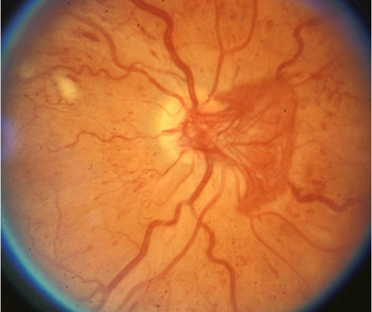
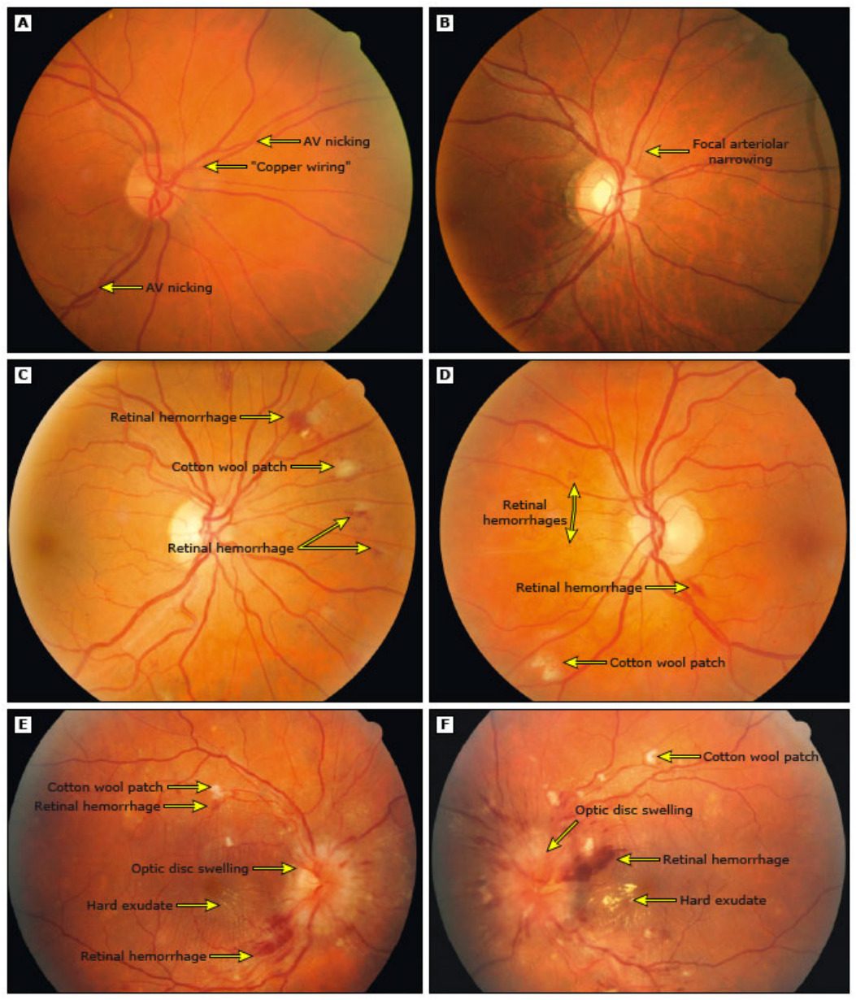
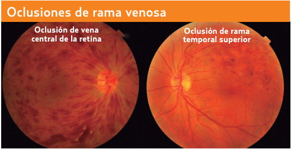

# Retinopatía diabética e hipertensiva · Guía práctica para la ECOE (versión 2)

**Estación de consulta con oftalmoscopia directa · Primer y segundo nivel de atención**

**Siglas de uso frecuente.** RD: retinopatía diabética. RDNP y RDP: retinopatía diabética no proliferativa y proliferativa. RH: retinopatía hipertensiva. AMIR: anomalías microvasculares intrarretinianas. PFC: panfotocoagulación retiniana con láser. VEGF: factor de crecimiento del endotelio vascular. OCT: tomografía de coherencia óptica. AV: agudeza visual. PIO: presión intraocular. DM: diabetes mellitus. HTA: hipertensión arterial. PA: presión arterial. HbA1c: hemoglobina glucosilada. LDL y HDL: colesterol de lipoproteínas de baja y de alta densidad. ADA: American Diabetes Association. ESC: Sociedad Europea de Cardiología.

---

## 1. La estación y su rúbrica

### 1.1 Criterios que se califican

La práctica 1 de la ECOE presenta a un paciente con DM y RDP y califica 21 criterios, cada uno como cumplido o no cumplido; la estación se acredita con 15.[^rub] Solo se pueden perder seis criterios, y seis se pierden si falta un solo elemento ("si falta algo = NO"): el 2, el 5, el 12, el 14, el 19 y el 20. Los criterios 19 y 20 están encadenados, porque la rúbrica marca "NO" en las metas de la ADA si no se otorgó tratamiento para la DM; omitir la insulina cuesta dos puntos.

**Tabla 1. Criterios de la práctica 1 y respuesta esperada.**[^rub]

| # | Criterio | Respuesta o acción esperada | Sección |
|---|------------------------|------------------------------------------|------|
| 1 | Presentación con el paciente | Saludar, presentarse por nombre y cargo, confirmar la identidad y explicar el motivo | 2.1 |
| 2 | Historia clínica ordenada y completa; signos vitales, somatometría y glucosa capilar | Si falta alguna, NO | 2.2 a 2.4 |
| 3 | Exploración cefalocaudal general | De la cabeza a los pies, antes del fondo de ojo | 3.1 |
| 4 | Indicaciones de la oftalmoscopia (al menos 3) e identificar las del paciente | Disminución de la AV, DM, HTA, cefalea, síntomas neurológicos agudos, degeneración macular asociada a la edad, enfermedades hematológicas y neurológicas | 3.3 |
| 5 | Pedir autorización y lavarse las manos | Si falta algo, NO | 3.4 |
| 6 | Material completo y ambiente | Oftalmoscopio con cabezal y mango; habitación en penumbra | 3.4 |
| 7 | Midriasis farmacológica | Dos motivos, dos fármacos (ciclopentolato, tropicamida, fenilefrina) y dos contraindicaciones | 3.5 |
| 8 | Fijación y posición | El paciente mira un punto lejano; ojo derecho con mano y ojo derechos, y viceversa | 3.6 |
| 9 | Aproximación y papila | A 15 cm y 15° se busca el reflejo rojo, se acerca a 2 o 3 cm y se valora la papila | 3.6 |
| 10 | Vasos y polo posterior | Vasos por cuadrantes (color, tortuosidad y calibre); polo posterior entre las arcadas temporales | 3.6 |
| 11 | Descripción de las lesiones de la RDP | Retina, papila, mácula y vasos, con neovasos | 3.7 |
| 12 | Laboratorios | Química sanguínea, HbA1c y perfil de lípidos; si falta algo, NO | 7 |
| 13 | Diagnósticos diferenciales (al menos 2) | RDNP leve, moderada o severa y edema macular | 11 |
| 14 | Integración diagnóstica | RDP y dislipidemia mixta; si falta alguno, NO | 5.3 |
| 15 | Primer dato histopatológico de la RD (pregunta directa) | Pérdida de pericitos | 4.1 |
| 16 | Tratamiento de elección de la RDP | Panfotocoagulación retiniana periférica | 8.1 |
| 17 | Principal causa de baja visual en la DM (pregunta directa) | Edema macular | 5.2 |
| 18 | Clasificación del edema macular | Leve, moderado y severo según la distancia al centro de la mácula | 5.2 |
| 19 | Tratamiento de la DM y de la dislipidemia mixta | Insulina de 0,1 a 0,2 UI/kg/día, atorvastatina 40 mg/día y dieta DASH o mediterránea | 8.3 y 8.4 |
| 20 | Metas de la ADA | Glucosa en ayuno menor de 130 mg/dL, posprandial menor de 180 mg/dL y HbA1c menor de 8% en el anciano | 8.2 |
| 21 | Recomendaciones de control | Glucemia, PA, sobrepeso y lípidos; referir a endocrinología, medicina interna o nefrología; HbA1c individualizada; PA menor de 140/80 mmHg | 8.5 |

### 1.2 Cómo usar esta guía

La rúbrica califica la RDP, pero la estación es una consulta de oftalmoscopia y el evaluador puede presentar cualquier fondo de ojo del tema: un diabético sin retinopatía en su cribado, cualquier grado de RDNP, un edema macular, una hemorragia vítrea, una gestante con DM previa, un hipertenso con cualquier grado de RH o una oclusión venosa. El esquema de la consulta (secciones 2 y 3) es igual en todos; cambian la descripción, la clasificación y la conducta, que se resumen en las tablas 5 y 9. La lógica es siempre la misma: describir lo que se ve, nombrar la lesión que define el estadio, decidir si el paciente se queda en el primer nivel o se refiere y con qué urgencia, y tratar los factores sistémicos.

La fisiopatología detallada, la técnica del láser, los fármacos intravítreos y las técnicas de imagen están en el documento clínico del tema; aquí solo aparece lo que se dice o se decide en la estación.

### 1.3 Secuencia de la consulta

1. Saludo, presentación, confirmación de la identidad y motivo de la consulta.
2. Historia clínica: ficha, antecedentes y padecimiento actual.
3. Signos vitales, somatometría y glucosa capilar.
4. Exploración general cefalocaudal, incluidos los pies.
5. Oftalmoscopia: indicaciones, autorización y lavado de manos, material y penumbra, AV y cámara anterior, midriasis, técnica y descripción.
6. Laboratorios.
7. Diagnósticos diferenciales y definitivos.
8. Preguntas directas.
9. Plan: tratamiento ocular o referencia, tratamiento metabólico, metas, seguimiento y datos de alarma.[^rub]

## 2. Interrogatorio

### 2.1 Presentación y ficha de identificación

El criterio 1 se cumple saludando al paciente por su nombre, diciendo el propio nombre y cargo, confirmando su identidad y explicándole que se le harán preguntas y una exploración de los ojos.[^rub] En la ficha importa la ocupación, porque la midriasis altera la visión durante varias horas y la AV condiciona trabajos como la conducción.

### 2.2 Antecedentes

La historia se recoge en orden: heredofamiliares, personales no patológicos, personales patológicos y padecimiento actual.[^rub] En esta estación cada antecedente se pregunta por un motivo concreto:

- **DM:** tipo, tiempo de evolución, tratamiento y apego, hipoglucemias y última HbA1c. La duración de la DM y la hiperglucemia son los dos factores principales de la RD; una evolución de 15 años o más y una HbA1c de 7% o más se asocian de forma marcada con ella.[^d1][^d3]
- **Cambios recientes del tratamiento:** un descenso rápido de la HbA1c puede empeorar la RD de forma transitoria (sección 9).[^ada]
- **HTA, dislipidemia, enfermedad renal y anemia:** todas se asocian con una RD más grave; el control de la PA protege con independencia de la glucemia.[^d1][^d4]
- **Antecedentes oculares:** último fondo de ojo, láser, inyecciones o cirugías y, sobre todo, glaucoma de ángulo estrecho, que contraindica la midriasis.[^d2]
- **Cardiopatía, hipertiroidismo, antidepresivos tricíclicos, inhibidores de la monoaminooxidasa y betabloqueadores:** contraindican la fenilefrina o interactúan con ella.[^fenil]
- **Traumatismo craneoencefálico o accidente isquémico transitorio recientes:** obligan a vigilar los reflejos pupilares y contraindican la midriasis.[^d2]
- **Embarazo actual o planeado:** acelera la RD preexistente.[^d1]

### 2.3 Padecimiento actual y síntomas visuales

La mayoría de los pacientes con RD no tienen síntomas hasta fases avanzadas, de modo que su ausencia no excluye una RD grave.[^d1] Cuando los hay, se precisa si el inicio fue gradual o brusco, si afectan a uno o ambos ojos, si mejoran con lentes y si se acompañan de dolor, ojo rojo, destellos o cefalea, porque cada patrón orienta a una causa y a un plazo de atención.

**Tabla 2. Síntomas visuales, causa probable y plazo de atención.**[^d1][^wikem][^nvg][^escpos][^d4]

| Síntoma | Causa probable | Plazo de atención |
|------------------|------------------------|--------------------|
| Visión borrosa de cerca y de lejos, gradual, que no mejora con lentes | Edema macular | Referencia oportuna a oftalmología |
| Miodesopsias abundantes o velo oscuro, de aparición brusca e indolora | Hemorragia vítrea por neovasos | Valoración oftalmológica urgente |
| Sombra o "cortina" que avanza desde la periferia, con o sin fotopsias | Desprendimiento de retina | Valoración oftalmológica el mismo día |
| Dolor ocular, ojo rojo y visión disminuida en un diabético con retinopatía avanzada | Glaucoma neovascular | Valoración oftalmológica urgente |
| Disminución visual de un ojo en un hipertenso mayor de 40 años | Oclusión venosa retiniana | Referencia a oftalmología |
| Cefalea, visión borrosa y síntomas neurológicos con PA muy elevada | Hipertensión maligna | Traslado hospitalario |

Se interrogan además la poliuria, la polidipsia y la pérdida de peso, porque la pérdida de peso con hiperglucemia es una de las indicaciones de iniciar insulina.[^ada9]

### 2.4 Signos vitales, somatometría y glucosa capilar

Se piden la PA, la frecuencia cardiaca, la frecuencia respiratoria, la temperatura, el peso, la talla, el índice de masa corporal, la cintura y la glucosa capilar; omitir uno anula el criterio 2.[^rub] La PA define la RH y, si es muy elevada, la hipertensión maligna; el peso es necesario para calcular la insulina; y una glucosa capilar de 300 mg/dL o más es indicación de insulina.[^escpos][^ada9]

## 3. Exploración física y oftalmoscopia

### 3.1 Exploración general cefalocaudal

Se explora de la cabeza a los pies buscando daño de órgano y riesgo cardiovascular: estado general, pulsos carotídeos, ruidos cardiacos y campos pulmonares, perímetro abdominal, pulsos periféricos y edema. En el diabético se explora el pie, que la ADA recomienda evaluar al menos una vez al año con inspección, pulsos y monofilamento de 10 g más otra prueba.[^rub][^ada]

### 3.2 Antes de dilatar

Se completan tres pasos que la rúbrica no califica por separado pero que la práctica exige: la **AV de cada ojo**, que documenta la repercusión funcional; los **reflejos pupilares**, que después de la midriasis ya no pueden valorarse; y la **cámara anterior**, que se valora iluminando el ojo lateralmente con una linterna. Cuanto menos profunda es la cámara, mayor es la sombra en el sector nasal del iris, y si es estrecha no se dilata.[^d2][^d3]

### 3.3 Indicaciones de la oftalmoscopia

El criterio 4 pide al menos tres y relacionarlas con el paciente: disminución de la AV, DM, HTA, cefalea, síntomas neurológicos agudos (para descartar edema de papila), degeneración macular asociada a la edad y repercusión ocular de enfermedades hematológicas y neurológicas.[^rub][^d2] Por ejemplo: "En este paciente está indicada por la DM de larga evolución, la disminución de la AV y la HTA".

### 3.4 Autorización, material y ambiente

Se explica que la exploración puede ser molesta y que la gota nublará la visión durante varias horas, se pide autorización y se hace la higiene de manos (criterio 5).[^rub][^d2] El oftalmoscopio directo tiene un **cabezal**, con lentes de +20 a −25 dioptrías en el disco de Recoss, aperturas y filtros, y un **mango**, con la fuente de luz y el reóstato; se comprueba que enciende. La habitación se deja en **penumbra**, porque así la pupila se dilata y la luz molesta menos (criterio 6).[^rub][^d2]

### 3.5 Midriasis farmacológica

El criterio 7 pide dos motivos, dos fármacos y dos contraindicaciones.[^rub]

**Motivos:** la dilatación amplía el campo explorable y hace la exploración más completa; la rúbrica añade paralizar el músculo ciliar para medir la refracción sin acomodación (cicloplejía), efecto que producen los antimuscarínicos y no la fenilefrina.[^d2][^fenil]

**Tabla 3. Midriáticos para la exploración del fondo de ojo.**[^d2][^d3][^fenil]

| Fármaco | Pauta | Precauciones |
|---------------|------------------|--------------------------|
| Tropicamida 1% (de elección) | 1 gota, repetible cada 5 minutos hasta 3 veces; se explora a los 15 minutos; efecto de 4 a 6 horas | Visión borrosa y fotofobia; muy rara vez, glaucoma agudo de ángulo cerrado |
| Ciclopentolato 1% | Alternativa antimuscarínica | Las de la tropicamida |
| Fenilefrina 10% | Potencia la midriasis; en ancianos y cardiópatas se prefiere la del 2,5% | Eleva la PA; vasoespasmo coronario, arritmias e infarto en el cardiópata. Contraindicada en HTA, cardiopatía, hipertiroidismo y edad avanzada |

En el hipertenso, que es el paciente de la mitad de los casos de esta estación, se usa la tropicamida sola.

**Contraindicaciones de la midriasis:** cámara anterior estrecha; glaucoma de ángulo estrecho sin iridotomía; rubeosis del iris; y necesidad de vigilar los reflejos pupilares tras un traumatismo craneoencefálico o un accidente isquémico transitorio, que la rúbrica resume como "antes de la valoración neurológica".[^rub][^d2] Al terminar se advierte al paciente que no conduzca hasta que pase el efecto.[^d2]

### 3.6 Técnica

Los criterios 8 a 10 califican la técnica paso por paso:[^rub][^d2][^oft]

1. El paciente fija la mirada en un punto lejano.
2. El ojo derecho del paciente se explora con la mano y el ojo derechos del examinador, y el izquierdo con los izquierdos.
3. A unos 15 cm, al mismo nivel y unos 15° por fuera del eje visual, se busca el reflejo rojo, que indica medios transparentes; si no aparece, una hemorragia vítrea o una catarata pueden impedir ver la retina.
4. Sin perder el reflejo, el examinador se acerca a 2 o 3 cm y enfoca con el disco de Recoss.
5. Se localiza la papila siguiendo los vasos y se valoran su forma, sus bordes, su color, la excavación y el pulso venoso.
6. Se siguen las cuatro arcadas valorando calibre, color, tortuosidad, reflejo arteriolar y cruces, y se buscan lesiones en cada cuadrante.
7. Se explora el polo posterior, entre las arcadas temporales, donde está la mayoría de las lesiones de la RD, y al final la mácula, pidiendo al paciente que mire la luz, porque lo deslumbra y provoca miosis.

![Posición del examinador y del paciente durante la oftalmoscopia directa. Fernández Revuelta.[^d2]](../assets/fo_posicion_exploracion.jpg)

### 3.7 Cómo describir el fondo de ojo

Se describe cada ojo en el mismo orden: reflejo rojo y medios, retina, papila, vasos y mácula, y se cierra con la conclusión. Como referencia, en el fondo normal la papila es blanco-rosácea, de bordes netos y mide unos 1,5 mm (su diámetro es la unidad de medida); la relación arteria/vena es de 2/3 y el reflejo arteriolar ocupa 1/4 del vaso; y la mácula está a unos 4 mm del borde temporal de la papila, con la fóvea más oscura y sin vasos.[^d2][^d4]

![Fondo de ojo normal con sus estructuras señaladas: papila, arcadas vasculares, mácula y fóvea. Fernández Revuelta.[^d2]](../assets/fo_normal_estructuras.jpg)

Los modelos siguientes cubren los fondos de ojo que pueden presentarse; se adaptan a lo que se ve.[^d1][^d4][^d6]

- **Normal:** "Reflejo rojo presente. Retina rojiza y homogénea, sin hemorragias ni exudados. Papila blanco-rosácea, de bordes netos, con excavación proporcional. Relación arteria/vena de 2/3, cruces normales. Mácula con reflejo foveal. Sin retinopatía."
- **RDNP leve:** "Escasos puntos rojos, pequeños y de bordes nítidos en el polo posterior, compatibles con microaneurismas, sin otras lesiones."
- **RDNP moderada:** "Microaneurismas, hemorragias en punto y mancha, algún exudado duro y alguna mancha algodonosa, sin cumplir la regla 4-2-1 y sin neovasos."
- **RDNP severa:** "Más de 20 hemorragias en cada uno de los cuatro cuadrantes (o arrosariamiento venoso en dos, o AMIR prominentes en uno), sin neovasos."
- **RDP, caso de la rúbrica (criterio 11):** "Reflejo rojo presente. Retina heterogénea con múltiples manchas algodonosas de predominio temporal, hemorragias en punto y mancha y exudados duros. Papila con neovasos finos en penacho. Venas de calibre aumentado y tortuosas, con pérdida de la relación arteria/vena y neovasos a lo largo de las arcadas. Mácula a unos dos diámetros papilares de la papila. Retinopatía diabética proliferativa; de alto riesgo si los neovasos papilares son extensos o hay hemorragia prerretiniana o vítrea."[^rub]
- **Sospecha de edema macular:** "Exudados duros en la mácula, en anillo circinado, cerca del centro o afectándolo." El engrosamiento no se ve con el oftalmoscopio directo y se confirma con OCT.[^d2]
- **RH leve:** "Arteriolas estrechas con relación arteria/vena menor de 2/3, reflejo arteriolar ensanchado y cruces con adelgazamiento venoso a ambos lados; sin hemorragias ni exudados."
- **RH grave:** "En ambos ojos, hemorragias en llama, manchas algodonosas, exudados en estrella macular y papila hiperémica, ingurgitada y de bordes borrosos."

En la descripción de la RDP lo que define el diagnóstico son los **neovasos**; las manchas algodonosas indican isquemia pero no bastan. La rúbrica describe además una excavación amplia, que no es un signo de RDP; si se ve, se menciona aparte como sospecha de glaucoma.[^d1][^garway]

## 4. Retinopatía diabética: lo que se pregunta

### 4.1 Primer dato histopatológico y secuencia de las lesiones

La respuesta del criterio 15 es **la pérdida de pericitos**, junto con la de células endoteliales y el engrosamiento de la membrana basal.[^rub][^d1] A partir de ahí la secuencia explica cada signo: la pared debilitada forma **microaneurismas** (primera lesión visible); la rotura de la barrera hematorretiniana deja salir lípidos (**exudados duros**) y líquido (**edema macular**); la oclusión capilar produce **hemorragias** y **manchas algodonosas** (infartos de la capa de fibras nerviosas); la isquemia produce **arrosariamiento venoso** y **AMIR**; y la retina isquémica libera VEGF, que induce **neovasos**, cuya presencia define la RDP. Los neovasos sangran hacia el vítreo, su tejido fibroso tracciona la retina hasta desprenderla, y los del iris y el ángulo producen glaucoma neovascular.[^d1][^d4][^d7]

### 4.2 Lesiones y su significado

**Tabla 4. Lesiones de la retinopatía diabética.**[^d1][^d3][^d4][^d7]

| Lesión | Cómo se ve | Qué significa |
|----------|----------------------|------------------|
| Microaneurisma | Punto rojo, redondo y de bordes nítidos, menor de 1/12 del diámetro papilar | Primera lesión visible; define la RDNP leve |
| Hemorragia intrarretiniana | En llama (superficial) o en punto y mancha (profunda), de bordes irregulares | Las profundas indican isquemia |
| Exudado duro | Blanco-amarillento, céreo, de bordes netos; aislado o en anillo circinado | Fuga crónica; cerca de la mácula, edema macular |
| Mancha algodonosa | Blanquecina, superficial, de bordes imprecisos | Infarto de la capa de fibras nerviosas; isquemia |
| Arrosariamiento venoso | Vénulas con dilataciones y estenosis sucesivas | Isquemia; fuerte predictor de RDP |
| AMIR | Capilares intrarretinianos dilatados y tortuosos | Isquemia y alto riesgo; no definen la RDP |
| Neovasos | Vasos finos en penacho en la papila o en la retina | Definen la RDP |
| Proliferación fibrosa | Tejido blanco opaco sobre la papila o las arcadas | Riesgo de hemorragia y de desprendimiento traccional |
| Hemorragia prerretiniana o vítrea | En "canoa" con nivel recto, o sangre que impide ver el fondo | Sangrado de neovasos |

Las manchas algodonosas no son específicas de la DM: aparecen también en la HTA, en el síndrome de inmunodeficiencia adquirida y en el lupus eritematoso sistémico.[^d1]

![Esquema de las lesiones de la retinopatía diabética: vénulas tortuosas, exudado blando, AMIR, hemorragia, neovasos, exudados duros y microaneurismas. Romero-Aroca y Sagarra Álamo.[^d4]](../assets/rd_lesiones_esquema.jpg)

### 4.3 Factores de riesgo

Los principales son la duración de la DM y la hiperglucemia. Se suman la HTA (en el UKPDS, cada 10 mmHg menos de sistólica redujo el riesgo un 10%), la nefropatía con microalbuminuria, la anemia, la dislipidemia, la pubertad y el embarazo.[^d1][^d3][^d4]

## 5. Clasificación y conducta

### 5.1 Retinopatía diabética

La clasificación se hace en cada ojo y determina el riesgo de progresión, el seguimiento y el tratamiento. La tabla reúne en una sola vista lo que se dice en la estación ante cada fondo de ojo.

**Tabla 5. Estadios de la retinopatía diabética: hallazgos, riesgo y conducta.**[^d1][^icdr][^ada][^aao][^d7]

| Estadio | Hallazgos | Riesgo de RDP a 1 año | Conducta | Seguimiento |
|-----------|------------------|------|------------------|----------|
| Sin retinopatía | Sin alteraciones | — | Control metabólico en el primer nivel | Cada 1 a 2 años si hay exámenes previos normales y glucemia en meta; si no, anual |
| RDNP leve | Solo microaneurismas | 5% | Control metabólico en el primer nivel | Anual |
| RDNP moderada | Más que microaneurismas, sin criterios de la severa | 15% | Referencia oportuna a oftalmología; sin láser | Cada 6 a 12 meses |
| RDNP severa | Cualquier criterio de la regla 4-2-1 (dos o más: muy severa, 75%) | 52% | Referencia; PFC temprana en casos seleccionados | Cada 2 a 4 meses |
| RDP sin alto riesgo | Neovasos sin criterios de alto riesgo | — | PFC o anti-VEGF | Cada 2 a 4 meses |
| RDP de alto riesgo | Criterios de alto riesgo | 60% de pérdida visual severa a 5 años sin tratamiento | PFC lo antes posible | Estrecho |
| Hemorragia vítrea o desprendimiento | Reflejo rojo apagado o retina elevada | — | Valoración urgente; ecografía y vitrectomía en tercer nivel | Según la cirugía |

**Regla 4-2-1 (RDNP severa):** más de 20 hemorragias intrarretinianas en cada uno de los **4** cuadrantes, arrosariamiento venoso en **2** o más, o AMIR prominentes en **1** o más.[^d1][^icdr]

**RDP de alto riesgo:** neovasos papilares iguales o mayores que la fotografía estándar 10A (1/4 a 1/3 del área papilar); cualquier neovaso papilar con hemorragia vítrea o prerretiniana; o neovasos extrapapilares de 1/2 área papilar o más con hemorragia.[^drs8]

### 5.2 Edema macular

La respuesta del criterio 17 es **el edema macular**: puede aparecer en cualquier estadio y es la causa más frecuente de pérdida visual en la RD.[^rub][^d1] Para el criterio 18 se da la escala internacional que pide la rúbrica y se añade la que decide el tratamiento:[^rub][^icdr][^ada]

- **Leve:** engrosamiento o exudados duros en el polo posterior, distantes del centro de la mácula.
- **Moderado:** próximos al centro, sin afectarlo.
- **Severo:** afectan el centro de la mácula.
- **Clasificación actual:** con afectación central (equivale al severo) o sin afectación central.

![Esquema generado de los tres grados del edema macular en un ojo derecho. El círculo de trazos señala la región macular y el punto negro, su centro; el área sombreada es el engrosamiento y los puntos amarillos, los exudados duros. Construido con las definiciones de la escala internacional; no reproduce un caso real.[^icdr]](assets/ecoe_rd_edema_macular_grados.png){.ancho}

El oftalmoscopio directo no ve el engrosamiento porque carece de visión estereoscópica; el edema se sospecha por la baja visual gradual y los exudados cerca de la mácula, y se confirma con OCT.[^d2][^d7] La conducta depende de la localización y de la AV: con afectación central y visión disminuida, anti-VEGF intravítreo; con afectación central y AV de 20/25 o mejor, observación estrecha; sin afectación central, láser focal u observación.[^ada][^aao]

### 5.3 Cómo formular el diagnóstico

Se dice para cada ojo el estadio, si la RDP es de alto riesgo y si hay edema macular: "Retinopatía diabética proliferativa de alto riesgo en ambos ojos, sin edema macular aparente".[^d7] El criterio 14 exige además la **dislipidemia mixta** (sección 7), y se añaden los que el caso sustenta, como la DM tipo 2 descontrolada o la HTA.[^rub]

## 6. Cribado y referencia

**Tabla 6. Primer fondo de ojo y seguimiento según el paciente.**[^d3][^ada]

| Paciente | Primer fondo de ojo | Seguimiento sin retinopatía |
|--------------|----------------|--------------------|
| DM tipo 2 | Al diagnóstico | Cada 1 a 2 años si hay exámenes normales y glucemia en meta; con mal control o factores de riesgo, anual |
| DM tipo 1 diagnosticada después de la pubertad | En los primeros 5 años | Igual que en la DM tipo 2 |
| DM tipo 1 diagnosticada antes de la pubertad | En la pubertad | Anual |
| DM previa al embarazo | Antes de la concepción o en el primer trimestre | Cada trimestre y hasta 1 año posparto |
| Diabetes gestacional | No requiere | — |

El primer fondo de ojo de la DM tipo 2 se hace al diagnóstico porque del 20 al 39% ya tienen RD: la hiperglucemia precede de 4 a 7 años al diagnóstico clínico.[^d1]

**Referencia oportuna a oftalmología:** cualquier edema macular, RDNP moderada o más grave y cualquier RDP. **Referencia urgente:** pérdida visual súbita, hemorragia vítrea y sospecha de desprendimiento de retina, esta el mismo día. La hemorragia vítrea y el desprendimiento se envían a tercer nivel para valorar la vitrectomía.[^ada][^wikem][^d7]

## 7. Laboratorios y dislipidemia mixta

El criterio 12 exige tres estudios, y la falta de uno lo anula: **química sanguínea** (glucosa y creatinina, que estima la filtración glomerular y condiciona los hipoglucemiantes), **HbA1c** (más de 10% indica insulina) y **perfil de lípidos**.[^rub][^ada9] Se añaden el **cociente albúmina/creatinina en orina**, que la ADA recomienda cada año, y la **biometría hemática**, porque la nefropatía y la anemia se asocian con una RD más grave.[^ada11][^d1]

La **dislipidemia mixta** es la elevación simultánea del LDL y de los triglicéridos, a menudo con HDL bajo.

**Tabla 7. Puntos de corte del perfil de lípidos (ATP III).**[^atp3]

| Fracción | Normal u óptimo | Limítrofe | Alto |
|------------|--------------|--------------|--------------|
| LDL | Menor de 100 mg/dL | 130 a 159 mg/dL | 160 a 189 mg/dL |
| Triglicéridos | Menor de 150 mg/dL | 150 a 199 mg/dL | 200 a 499 mg/dL |
| HDL | — | — | Bajo si es menor de 40 mg/dL |

## 8. Tratamiento

### 8.1 Tratamiento ocular

La respuesta del criterio 16 es **panfotocoagulación retiniana periférica**: el láser destruye retina periférica isquémica, reduce la señal angiogénica y hace regresar los neovasos. Se aplica lo antes posible en la RDP de alto riesgo y se considera en la RDNP severa con mal control, mala adherencia, catarata, embarazo o enfermedad renal. Puede reducir el campo visual periférico y la visión nocturna y empeorar el edema macular. Los anti-VEGF intravítreos son una alternativa no inferior a 2 años (Protocol S), aunque exigen inyecciones repetidas.[^rub][^d7][^protS][^aao] La hemorragia vítrea que no se reabsorbe y el desprendimiento traccional se tratan con vitrectomía.[^d7] En todos los estadios se controlan la glucemia, la PA y los lípidos.[^d3]

### 8.2 Metas

**Tabla 8. Metas de control.**[^adametas][^ada13][^rub]

| Parámetro | Meta de la ADA | Lo que pide la rúbrica |
|------------|--------------------------|----------------|
| Glucosa en ayuno | 80 a 130 mg/dL | Menor de 130 mg/dL |
| Glucosa posprandial | Menor de 180 mg/dL | Menor de 180 mg/dL |
| HbA1c | Menor de 7% en la mayoría; menor de 8% con hipoglucemia grave, esperanza de vida limitada, complicaciones avanzadas o adulto mayor con salud compleja | Menor de 8% en el anciano |
| PA | Menor de 130/80 mmHg | Menor de 140/80 mmHg |
| LDL | Menor de 70 mg/dL y reducción de 50% o más con riesgo cardiovascular | — |

Se dicen las metas de la rúbrica y la general de HbA1c; la ADA individualiza la HbA1c porque el control estricto en la DM tipo 2 de larga evolución con comorbilidades aumenta las hipoglucemias.[^adametas]

### 8.3 Insulina

La rúbrica pide **insulina de 0,1 a 0,2 UI/kg/día**, que coincide con la dosis inicial de insulina basal de la ADA (o 10 unidades al día).[^rub][^ada9] Se dice con cinco elementos:

- **Indicación:** pérdida de peso, síntomas de hiperglucemia, HbA1c mayor de 10% o glucosa de 300 mg/dL o más.
- **Cálculo en voz alta:** en 70 kg, de 7 a 14 unidades al día de insulina basal.
- **Ajuste:** según la glucosa en ayuno, por ejemplo 2 unidades cada 3 días hasta la meta; ante hipoglucemia sin causa clara, se reduce un 10 a 20%.
- **Base:** se mantiene la metformina si la función renal lo permite.
- **Precaución:** el descenso rápido de la HbA1c puede empeorar la RD al inicio, por lo que se coordina con oftalmología, pero el control no se retrasa.[^ada9][^ada]

Se enseña a medir la glucosa capilar y a reconocer y tratar la hipoglucemia.[^ada9]

### 8.4 Estatina y alimentación

La rúbrica pide **atorvastatina 40 mg/día**, una estatina de alta intensidad que reduce el LDL un 50% o más; la ADA la indica en la DM de 40 a 75 años con factores de riesgo cardiovascular.[^rub][^acc2018][^adametas] Se acompaña de **dieta DASH o mediterránea**, actividad física, reducción de peso y abandono del tabaco.[^rub][^ada5] La RD no contraindica la aspirina cuando está indicada por motivos cardiovasculares.[^etdrs8]

### 8.5 Recomendaciones del criterio 21

Se dicen como las escribe la rúbrica, con su precisión: control de la glucemia, la PA, el sobrepeso y los lípidos, con envío a endocrinología, medicina interna o nefrología cuando sea necesario; HbA1c individualizada; y PA menor de 140/80 mmHg, que hoy la ADA baja a menos de 130/80 mmHg en la DM. Con albuminuria, el antihipertensivo incluye un inhibidor de la enzima convertidora de angiotensina o un antagonista del receptor de angiotensina II.[^rub][^adametas][^esc2024]

## 9. Situaciones especiales

- **Embarazo con DM previa:** la gestación acelera la RD; con RDNP moderada o severa previa empeora en el 55%. Fondo de ojo antes de la concepción o en el primer trimestre, cada trimestre y hasta 1 año posparto; el embarazo anticipa la PFC en la RDNP severa. La diabetes gestacional no requiere fondo de ojo.[^d1][^ada][^d7]
- **Intensificación del tratamiento:** al bajar rápido la HbA1c, incluido el inicio de agonistas del receptor de GLP-1, la RD puede empeorar de forma transitoria, con más manchas algodonosas. No se suspende el control intensivo, cuyo beneficio a largo plazo es mayor; se vigila la retina.[^d1][^ada]
- **Niños y adolescentes con DM tipo 1:** las complicaciones son raras antes de los 12 años, pero la pubertad acelera la RD; el cribado empieza en la pubertad y es anual.[^d1][^d3]

## 10. Retinopatía hipertensiva

### 10.1 Qué es y cuándo se explora

La RH es el conjunto de alteraciones vasculares retinianas causadas por la HTA; afecta al 7 a 11% de los hipertensos y predice el riesgo de ictus con independencia de la PA.[^d4][^d6] El fondo de ojo se explora al diagnóstico de la HTA, periódicamente si está mal controlada o con complicaciones como la nefropatía, y siempre en la crisis hipertensiva grave.[^d4][^escpos]

### 10.2 Hallazgos y clasificación

Los hallazgos siguen la secuencia de la lesión arteriolar: vasoconstricción (estrechamiento), esclerosis (reflejo en "hilo de cobre" o "de plata" y cruces patológicos) y exudación (hemorragias, exudados en estrella macular y manchas algodonosas). El estrechamiento generalizado y los cruces reflejan la PA mantenida; las hemorragias y los exudados, la del momento, y pueden regresar con el tratamiento.[^d4][^wong]

**Tabla 9. Retinopatía hipertensiva: grados y conducta.**[^wong][^kwb][^d6][^escpos]

| Clasificación simplificada | Hallazgos | Keith-Wagener-Barker | Conducta |
|------------|--------------------------|----------|----------------|
| Leve | Estrechamiento arteriolar generalizado o focal, cruces patológicos, "hilo de cobre" | I y II | Control de la HTA |
| Moderada | Hemorragias, microaneurismas, manchas algodonosas o exudados duros | III | Control de la HTA; la retinopatía refuerza la indicación de tratar |
| Grave o maligna | Retinopatía moderada más edema de papila | IV | Emergencia hipertensiva |

Si las hemorragias en llama o las manchas algodonosas son bilaterales con PA muy elevada, se trata como hipertensión maligna aunque no haya edema de papila.[^escpos]

### 10.3 Tratamiento ambulatorio

El tratamiento de la RH leve o moderada es el de la HTA. Se solicitan creatinina con filtración glomerular, electrolitos, examen general de orina con cociente albúmina/creatinina, glucosa o HbA1c, perfil de lípidos y electrocardiograma.[^esc] El tratamiento inicial de la mayoría es una combinación en dosis bajas de un bloqueador del sistema renina-angiotensina con un calcioantagonista o un diurético, con meta sistólica de 120 a 129 mmHg si se tolera (menos de 130/80 mmHg en la DM). Con RH y DM o factores de riesgo, el control oftalmológico es cada 6 meses a 1 año.[^esc2024][^adametas][^d4]

### 10.4 Hipertensión maligna

PA muy elevada, habitualmente mayor de 200/120 mmHg, con retinopatía avanzada bilateral (hemorragias en llama, manchas algodonosas o edema de papila). En el primer nivel se traslada al hospital sin bajar la PA de forma brusca. En el hospital se trata en cuidados intensivos con labetalol o nicardipino intravenosos, reduciendo la presión arterial media un 20 a 25% en varias horas, y se buscan microangiopatía trombótica, lesión renal aguda y encefalopatía.[^escpos][^d6]

### 10.5 Oclusión venosa y macroaneurisma

La **oclusión venosa retiniana** es la segunda causa de ceguera por enfermedad vascular retiniana; afecta a mayores de 40 años y la HTA multiplica por cinco su riesgo. La de rama ocurre en un cruce arteriovenoso y limita al sector drenado las venas tortuosas y dilatadas, las hemorragias en llama de vela y el edema macular; la de la vena central afecta a toda la retina con edema del nervio óptico. Se refiere a oftalmología. El **macroaneurisma** es una dilatación sacular única de una arteria de las arcadas temporales, rodeada de exudados.[^d4]

## 11. Diagnóstico diferencial

Para el criterio 13 la rúbrica acepta los otros estadios de la RD (**RDNP leve, moderada o severa y edema macular**): los no proliferativos no tienen neovasos, y el edema macular puede coexistir con cualquier estadio.[^rub] Se añaden los diferenciales propiamente dichos.

**Tabla 10. Retinopatía diabética frente a retinopatía hipertensiva.**[^d1][^d4][^d6]

| Dato | Retinopatía diabética | Retinopatía hipertensiva |
|------------|--------------------|--------------------|
| Lesión inicial | Microaneurisma | Estrechamiento arteriolar |
| Signo de máxima gravedad | Neovasos | Edema de papila o retinopatía avanzada bilateral |
| Exudados duros | En anillo circinado | En estrella macular |
| Cruces arteriovenosos | No característicos | Signo cardinal |
| Tratamiento ocular | PFC, anti-VEGF, vitrectomía | Control de la PA |

Otros diferenciales que se plantean a partir de un hallazgo:[^d4][^garway][^d2]

- **Oclusión de rama venosa:** las lesiones se limitan a un sector; en la RD se reparten por los cuatro cuadrantes.
- **Excavación papilar amplia:** no es RD ni RH; se sospecha glaucoma.
- **Edema de papila con PA normal y síntomas neurológicos:** se busca una causa neurológica.

## 12. Cierre de la consulta

El plan se comunica en un orden fijo: qué se encontró en cada ojo y qué significa; a quién se refiere y con qué urgencia; tratamiento sistémico; metas; próximo fondo de ojo; y datos de alarma. Se pide al paciente que acuda de inmediato si nota una disminución brusca de la visión, muchas "moscas volantes", destellos, una sombra que avanza o dolor con ojo rojo, y, si es hipertenso, ante cefalea intensa o síntomas neurológicos. Se le recuerda que no conduzca hasta que pase el efecto del midriático.[^wikem][^nvg][^escpos][^d2]

## 13. Casos clínicos para practicar

Se ensayan en voz alta en el orden de la sección 1.3. El caso 1 es el de la rúbrica; los demás recorren el resto del tema.

### Caso 1. Retinopatía proliferativa y dislipidemia mixta (rúbrica)

**Planteamiento.** Hombre de 62 años, chofer, con DM tipo 2 de 18 años, con baja visual progresiva del ojo derecho. Toma metformina de forma irregular, nunca se ha revisado los ojos, fuma y perdió 4 kg en 3 meses con poliuria y polidipsia. PA de 128/78 mmHg, peso de 70 kg, glucosa capilar de 312 mg/dL. "Cámara anterior normal. Fondo de ojo: manchas algodonosas, hemorragias en los cuatro cuadrantes, neovasos sobre la papila y en la arcada inferior y una hemorragia prerretiniana en canoa." HbA1c de 10,8%, LDL de 168 mg/dL, HDL de 36 mg/dL y triglicéridos de 310 mg/dL.

**Respuesta esperada:**

1. **Midriasis:** tropicamida al 1%; advertirle que no conduzca.
2. **Diagnósticos:** RDP de alto riesgo (neovasos papilares con hemorragia prerretiniana), dislipidemia mixta y DM tipo 2 descontrolada.
3. **Diferenciales:** RDNP severa (sin neovasos) y edema macular (se confirma con OCT).
4. **Ojo:** referencia para PFC lo antes posible.
5. **DM:** insulina basal de 7 a 14 unidades al día por HbA1c mayor de 10%, glucosa mayor de 300 mg/dL y pérdida de peso; continuar la metformina; enseñar a reconocer la hipoglucemia.
6. **Lípidos:** atorvastatina 40 mg, dieta DASH o mediterránea y abandono del tabaco.
7. **Metas:** glucosa en ayuno de 80 a 130 mg/dL, posprandial menor de 180 mg/dL, HbA1c menor de 7%, PA menor de 130/80 mmHg y LDL menor de 70 mg/dL.

### Caso 2. Diabetes tipo 2 recién diagnosticada

Mujer de 48 años con DM tipo 2 de un mes, sin síntomas. "Fondo de ojo normal en ambos ojos." **Respuesta:** sin retinopatía; el fondo de ojo se hace al diagnóstico porque una parte de los pacientes ya tiene RD. Seguimiento anual y, tras exámenes normales con glucemia en meta, cada 1 a 2 años; control metabólico. Se le explica que la RD no da síntomas al inicio.

### Caso 3. Retinopatía no proliferativa leve

Hombre de 55 años con DM tipo 2 de 7 años. "Escasos microaneurismas en el polo posterior, sin otras lesiones." **Respuesta:** RDNP leve (riesgo de RDP de 5% a un año); se queda en el primer nivel con revisión anual y control metabólico estricto. Si se pregunta por el primer dato histopatológico: la pérdida de pericitos; la primera lesión visible es el microaneurisma.

### Caso 4. Retinopatía no proliferativa moderada

Mujer de 60 años con DM tipo 2 de 12 años e HTA. "Microaneurismas y hemorragias en los cuatro cuadrantes, menos de 20 por cuadrante, alguna mancha algodonosa y exudados lejos de la mácula; sin arrosariamiento ni neovasos." **Respuesta:** RDNP moderada (15% a un año); referencia oportuna a oftalmología, sin láser, revisión cada 6 a 12 meses; PA menor de 130/80 mmHg y control de lípidos. La GPC IMSS de 2014 la vigilaba en el primer nivel; la ADA indica referirla.

### Caso 5. Retinopatía no proliferativa severa

Hombre de 50 años con DM tipo 2 de 15 años, HbA1c de 9,6% y catarata incipiente. "Más de 20 hemorragias en cada cuadrante y arrosariamiento venoso en dos cuadrantes, sin neovasos." **Respuesta:** RDNP muy severa (dos criterios de la regla 4-2-1; 75% a un año). Referencia, seguimiento cada 2 a 4 meses y PFC temprana por el mal control y la catarata. No es RDP porque no hay neovasos.

### Caso 6. Edema macular con afectación central

Mujer de 58 años con DM tipo 2 e HTA, con visión borrosa gradual que no mejora con lentes; AV de 20/60. "Exudados duros en anillo que llegan al centro de la mácula; sin neovasos." **Respuesta:** RDNP con edema macular severo (con afectación central). OCT para confirmarlo y referencia para anti-VEGF intravítreo; control de glucemia, PA y lípidos. Es la principal causa de baja visual en la DM.

### Caso 7. Edema macular con buena visión

Dos pacientes con AV de 20/20: uno con edema que afecta el centro en la OCT, otro con exudados y engrosamiento lejos del centro. **Respuesta:** el primero, observación estrecha y anti-VEGF si la visión baja; el segundo tiene un edema sin afectación central (leve), que se trata con láser focal u observación. Lo que decide el tratamiento del edema es su relación con el centro y la AV.

### Caso 8. Miodesopsias bruscas

Hombre de 45 años con DM tipo 1 y RDP no tratada, con muchas "moscas volantes" y un velo oscuro desde la mañana. "Reflejo rojo apagado en el ojo izquierdo; no se ve la retina." **Respuesta:** hemorragia vítrea por neovasos; valoración oftalmológica urgente y ecografía para ver la retina. Sin desprendimiento puede observarse hasta 2 meses; si no se reabsorbe o hay tracción, vitrectomía en tercer nivel; después, PFC.

### Caso 9. Sombra que avanza

Mujer de 52 años con RDP y proliferación fibrosa, con una sombra que avanza en el campo visual superior de un ojo. **Respuesta:** sospecha de desprendimiento de retina traccional; valoración el mismo día y referencia a tercer nivel para vitrectomía, porque si afecta a la mácula la pérdida tiende a ser permanente.

### Caso 10. Ojo rojo y doloroso

Hombre de 63 años con RDP no tratada, con dolor, ojo rojo y baja visual de un ojo. "Vasos finos irregulares sobre el iris." **Respuesta:** glaucoma neovascular por rubeosis del iris; la midriasis está contraindicada. Valoración oftalmológica urgente para medir la PIO y PFC completa e inmediata.

### Caso 11. Gestante con diabetes tipo 1

Mujer de 27 años con DM tipo 1 de 14 años y RDNP moderada, con 9 semanas de embarazo; su HbA1c bajó de 8,9 a 6,8% en pocas semanas. **Respuesta:** alto riesgo de progresión (55% con RDNP moderada previa, más el descenso rápido de la HbA1c). Fondo de ojo ahora, cada trimestre y hasta 1 año posparto, con oftalmología; si progresa a severa, el embarazo anticipa la PFC. La diabetes gestacional no requeriría fondo de ojo.

### Caso 12. Empeoramiento tras intensificar el tratamiento

Hombre de 57 años con RDNP moderada que inició insulina y un agonista del receptor de GLP-1; su HbA1c bajó de 11,2 a 7,4% en 4 meses. "Más manchas algodonosas que antes, sin neovasos." **Respuesta:** empeoramiento transitorio por el descenso rápido de la HbA1c; no se suspende el tratamiento, cuyo beneficio a largo plazo es mayor, y se vigila la retina con más frecuencia.

### Caso 13. Hipertensa controlada

Mujer de 60 años con HTA controlada (128/76 mmHg). "Relación arteria/vena de 1/2, reflejo ensanchado y cruces con adelgazamiento venoso; sin hemorragias." **Respuesta:** RH leve (grado II de Keith-Wagener-Barker); seguir el control con meta sistólica de 120 a 129 mmHg si se tolera, estudios de daño de órgano y fondo de ojo periódico. Midriasis con tropicamida sola.

### Caso 14. Retinopatía hipertensiva moderada

Hombre de 58 años con HTA mal controlada (168/98 mmHg) y DM tipo 2, sin síntomas neurológicos. "Ojo derecho con hemorragias en llama, una mancha algodonosa y cruces patológicos; papila normal; ojo izquierdo sin hemorragias." **Respuesta:** RH moderada (grado III); no es maligna porque no es bilateral, no hay edema de papila y la PA no es muy elevada. Tratamiento farmacológico con meta menor de 130/80 mmHg, estudios de daño de órgano, control oftalmológico cada 6 meses a 1 año, y valorar también su fondo de ojo como diabético.

### Caso 15. Hipertensión maligna

Hombre de 44 años sin tratamiento, con cefalea intensa y visión borrosa; PA de 228/134 mmHg. "En ambos ojos, hemorragias en llama, manchas algodonosas, estrella macular y papilas de bordes borrosos." **Respuesta:** RH grado IV, hipertensión maligna. En el primer nivel, traslado sin bajar la PA de forma brusca; en el hospital, labetalol o nicardipino intravenosos con descenso de la presión arterial media de un 20 a 25% en horas, y búsqueda de esquistocitos, plaquetopenia, lactato deshidrogenasa, haptoglobina, creatinina y encefalopatía. Puede diagnosticarse sin edema de papila si las lesiones son bilaterales.

### Caso 16. Pérdida visual de un sector

Mujer de 66 años con HTA y tabaquismo, con baja visual indolora de un ojo desde hace una semana. "En el cuadrante temporal superior, vena dilatada y tortuosa desde un cruce, con hemorragias en llama de vela; resto de la retina sin lesiones." **Respuesta:** oclusión de la rama temporal superior; se distingue de la RD porque las lesiones se limitan a un sector. Referencia a oftalmología por el riesgo de edema macular, control de la PA y del tabaquismo, y búsqueda de DM.

## 14. Respuestas de la rúbrica que conviene precisar

Se dice primero lo que pide la rúbrica y se añade la precisión en la misma frase.[^rub]

- **Criterio 7:** la rúbrica escribe "ciclopentano"; el fármaco es el ciclopentolato. La cicloplejía la producen los antimuscarínicos, no la fenilefrina.[^fenil]
- **Criterio 11:** la rúbrica sitúa la mácula a 1 o 1,5 diámetros papilares de la papila; las fuentes, a unos 4 mm, unos dos diámetros. Su excavación amplia no es un signo de RDP.[^d2][^oft][^garway]
- **Criterio 13:** se dan los estadios de la RD que acepta la rúbrica y se añaden la RH y la oclusión venosa.[^d4]
- **Criterio 16:** "Panfotocoagulación; los anti-VEGF son una alternativa no inferior".[^protS]
- **Criterio 18:** se da la escala leve-moderado-severo y se añade la de afectación central, que decide el tratamiento.[^icdr][^ada]
- **Criterio 19:** se dice la dosis calculada con el peso y la indicación de la insulina en el caso.[^ada9]
- **Criterio 20:** la meta general de HbA1c es menor de 7%; el menor de 8% es para el adulto mayor con salud compleja.[^adametas][^ada13]
- **Criterio 21:** la meta de 140/80 mmHg es anterior; la ADA recomienda menos de 130/80 mmHg.[^adametas]

## 15. Diferencias entre fuentes

Las guías mexicanas del tema son de 2014 y 2015 y algunas de sus recomendaciones cambiaron. Lo seguro es dar la vigente y mencionar la anterior si el evaluador la pide:[^d3][^d7][^ada][^aao][^adametas][^escpos]

- **Referencia:** la GPC de 2014 vigilaba la RDNP moderada en el primer nivel cada 6 meses; la ADA indica referirla.
- **Cribado sin retinopatía:** la GPC lo hacía cada 2 años solo con control continuo; la ADA, cada 1 a 2 años tras exámenes normales y glucemia en meta.
- **Meta de HbA1c:** la GPC fijaba 6,5% para todos; la ADA, menos de 7% en la mayoría y menos de 8% en pacientes frágiles.
- **Edema macular:** la GPC de 2015 lo trataba con láser; hoy el de afectación central con visión baja se trata con anti-VEGF.
- **Embarazo:** la GPC revisaba a las semanas 12, 16 a 20 o 28 y a los 6 meses posparto; la ADA, cada trimestre y hasta 1 año posparto.
- **Hipertensión maligna:** el "descenso rápido" y el edema de papila como requisito se sustituyeron por el descenso del 20 a 25% en horas y el diagnóstico con retinopatía avanzada bilateral aun sin edema de papila.

## 16. Plan de estudio de dos días

- **Día 1, mañana:** secciones 1 a 3; recitar la historia sin omitir signos vitales ni glucosa capilar y ensayar con el oftalmoscopio la midriasis completa y la técnica.
- **Día 1, tarde:** los ocho modelos de descripción (sección 3.7) y las tablas 4 y 5.
- **Día 1, noche:** edema macular, cribado, referencia y laboratorios (secciones 5.2 a 7).
- **Día 2, mañana:** tratamiento ocular y metabólico, con la insulina calculada para tres pesos distintos (secciones 8 y 9).
- **Día 2, tarde:** retinopatía hipertensiva y diferencial (secciones 10 y 11).
- **Día 2, noche:** los dieciséis casos en voz alta y la Tabla 1 con las precisiones; ensayar varias veces los criterios 2, 5, 12, 14, 19 y 20.

## Referencias

[^rub]: Rúbricas ECOE VI. Práctica 1: Retinopatía diabética proliferativa (21 criterios; acredita con 15). Documento de evaluación proporcionado por el usuario; sin fecha.
[^d1]: D'Amico DJ, Shah AR. Diabetic retinopathy: classification and clinical features. UpToDate. Nathan DM, Trobe J, editores. Revisión de la literatura hasta mayo de 2025; tema actualizado el 20 de marzo de 2025.
[^d2]: Fernández Revuelta A. Técnica de exploración del fondo de ojo. AMF. 2012;8(7):383-387.
[^d3]: Instituto Mexicano del Seguro Social. Detección de retinopatía diabética en primer nivel de atención. Guía de Práctica Clínica IMSS-735-14. México: IMSS; 2014.
[^d4]: Romero-Aroca P, Sagarra Álamo R. La retinopatía diabética e hipertensiva. AMF. 2018;14(7):382-393.
[^d6]: Ocular effects of hypertension. UpToDate. Revisión de la literatura vigente en junio de 2025.
[^d7]: Instituto Mexicano del Seguro Social. Diagnóstico y tratamiento de retinopatía diabética. Guía de Práctica Clínica IMSS-171-09, actualización 2015. México: IMSS; 2015.
[^garway]: Garway-Heath DF, Ruben ST, Viswanathan A, Hitchings RA. Vertical cup/disc ratio in relation to optic disc size: its value in the assessment of the glaucoma suspect. Br J Ophthalmol. 1998;82(10):1118-1124.
[^fenil]: Minims Phenylephrine Hydrochloride 10% w/v eye drops. Ficha técnica (Summary of Product Characteristics). Electronic Medicines Compendium, Reino Unido.
[^oft]: Oxford Medical Education. Approach to direct ophthalmoscopy. Disponible en: https://oxfordmedicaleducation.com/surgery/ophthalmology/fundoscopy/
[^wikem]: WikEM. Acute onset flashers and floaters. Disponible en: https://wikem.org/wiki/Acute_onset_flashers_and_floaters
[^icdr]: Wilkinson CP, Ferris FL 3rd, Klein RE, et al. Proposed international clinical diabetic retinopathy and diabetic macular edema disease severity scales. Ophthalmology. 2003;110(9):1677-1682.
[^drs8]: Diabetic Retinopathy Study Research Group. Photocoagulation treatment of proliferative diabetic retinopathy: clinical application of Diabetic Retinopathy Study (DRS) findings. DRS Report Number 8. Ophthalmology. 1981;88(7):583-600.
[^ada]: American Diabetes Association Professional Practice Committee. 12. Retinopathy, neuropathy, and foot care: Standards of Care in Diabetes—2026. Diabetes Care. 2026;49(Suppl 1):S261-S276.
[^ada5]: American Diabetes Association Professional Practice Committee. 5. Facilitating positive health behaviors and well-being to improve health outcomes: Standards of Care in Diabetes—2025. Diabetes Care. 2025;48(Suppl 1).
[^ada9]: American Diabetes Association Professional Practice Committee. 9. Pharmacologic approaches to glycemic treatment: Standards of Care in Diabetes—2025. Diabetes Care. 2025;48(Suppl 1).
[^ada11]: American Diabetes Association Professional Practice Committee. 11. Chronic kidney disease and risk management: Standards of Care in Diabetes—2025. Diabetes Care. 2025;48(Suppl 1).
[^ada13]: American Diabetes Association Professional Practice Committee. 13. Older adults: Standards of Care in Diabetes—2025. Diabetes Care. 2025;48(Suppl 1).
[^adametas]: American Diabetes Association Professional Practice Committee. 6. Glycemic goals and hypoglycemia, y 10. Cardiovascular disease and risk management: Standards of Care in Diabetes—2025. Diabetes Care. 2025;48(Suppl 1).
[^atp3]: Expert Panel on Detection, Evaluation, and Treatment of High Blood Cholesterol in Adults. Executive summary of the Third Report of the National Cholesterol Education Program (NCEP) Expert Panel on Detection, Evaluation, and Treatment of High Blood Cholesterol in Adults (Adult Treatment Panel III). JAMA. 2001;285(19):2486-2497.
[^acc2018]: Grundy SM, Stone NJ, Bailey AL, et al. 2018 AHA/ACC/AACVPR/AAPA/ABC/ACPM/ADA/AGS/APhA/ASPC/NLA/PCNA guideline on the management of blood cholesterol. Circulation. 2019;139(25):e1082-e1143.
[^etdrs8]: Early Treatment Diabetic Retinopathy Study Research Group. Effects of aspirin treatment on diabetic retinopathy. ETDRS report number 8. Ophthalmology. 1991;98(5 Suppl):757-765.
[^aao]: Flaxel CJ, Adelman RA, Bailey ST, et al. Diabetic Retinopathy Preferred Practice Pattern®. Ophthalmology. 2020;127(1):P66-P145.
[^protS]: Writing Committee for the Diabetic Retinopathy Clinical Research Network; Gross JG, Glassman AR, Jampol LM, et al. Panretinal photocoagulation vs intravitreous ranibizumab for proliferative diabetic retinopathy: a randomized clinical trial. JAMA. 2015;314(20):2137-2146.
[^nvg]: Drinkwater OJ, Panarelli JF. Diagnosis and management of neovascular glaucoma. EyeNet Magazine. American Academy of Ophthalmology. Disponible en: https://www.aao.org/eyenet/article/diagnosis-and-management-of-neovascular-glaucoma
[^wong]: Wong TY, Mitchell P. Hypertensive retinopathy. N Engl J Med. 2004;351(22):2310-2317.
[^kwb]: Keith NM, Wagener HP, Barker NW. Some different types of essential hypertension: their course and prognosis. Am J Med Sci. 1939;197:332-343.
[^escpos]: van den Born BH, Lip GYH, Brguljan-Hitij J, et al. ESC Council on hypertension position document on the management of hypertensive emergencies. Eur Heart J Cardiovasc Pharmacother. 2019;5(1):37-46.
[^esc]: Williams B, Mancia G, Spiering W, et al. 2018 ESC/ESH Guidelines for the management of arterial hypertension. Eur Heart J. 2018;39(33):3021-3104.
[^esc2024]: McEvoy JW, McCarthy CP, Bruno RM, et al. 2024 ESC Guidelines for the management of elevated blood pressure and hypertension. Eur Heart J. 2024;45(38):3912-4018.
