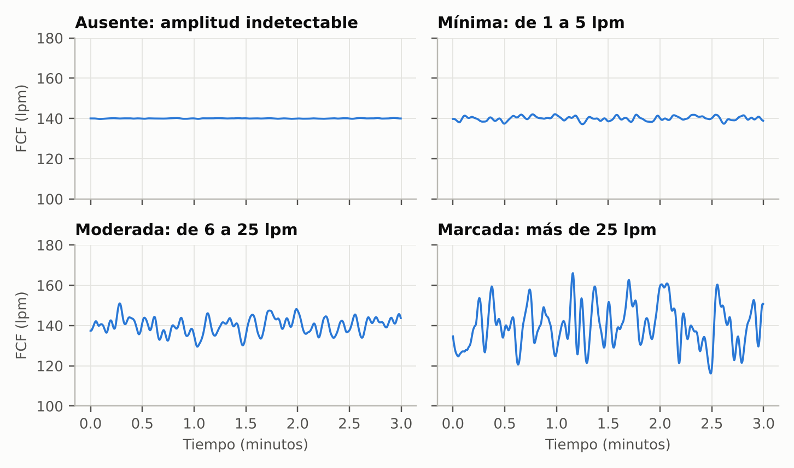
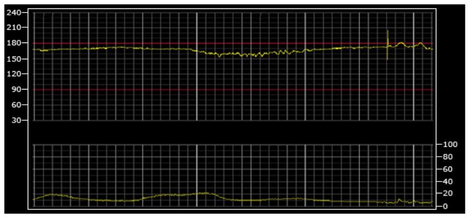
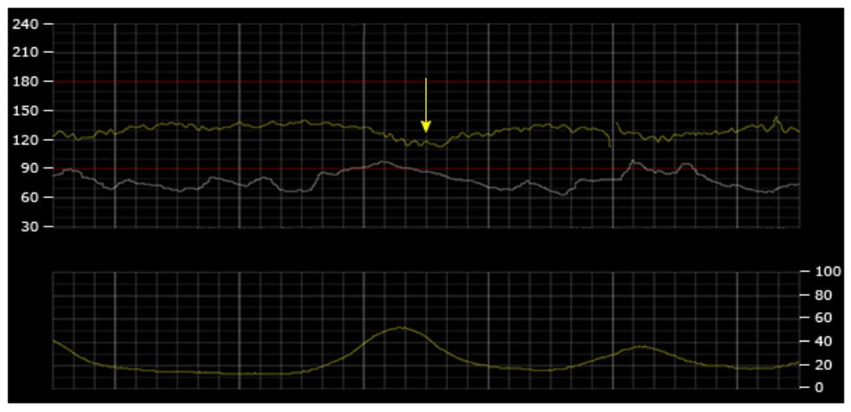
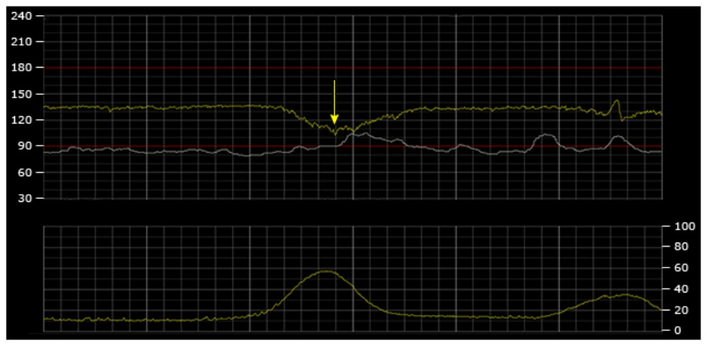
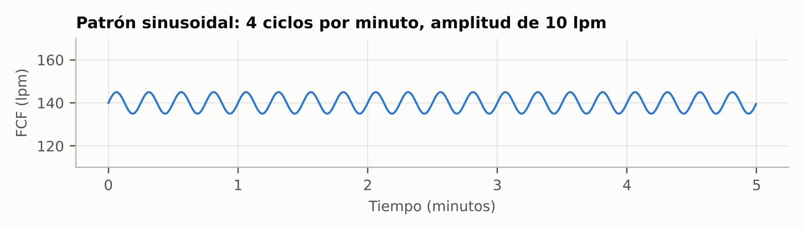
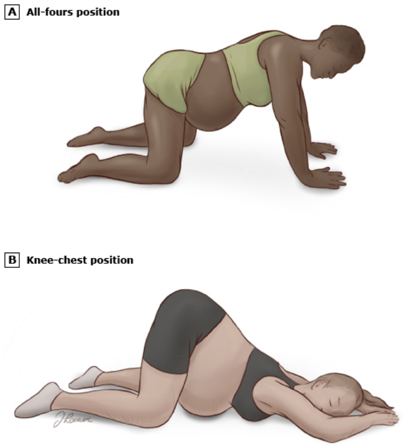

# Registro cardiotocográfico intraparto

**Siglas de uso frecuente.** Los términos se desarrollan al inicio de cada sección; las siglas se reservan para las menciones inmediatas.

| Sigla | Significado | Sigla | Significado |
|---|---|---|---|
| ACOG | American College of Obstetricians and Gynecologists | lpm | Latidos por minuto |
| FCF | Frecuencia cardiaca fetal | MEF | Monitorización electrónica fetal continua |
| FIGO | Federación Internacional de Ginecología y Obstetricia | NICHD | National Institute of Child Health and Human Development (Estados Unidos) |
| RCTG | Registro cardiotocográfico | ECG | Electrocardiograma |

---

## 1. Fundamentos: por qué se vigila la frecuencia cardiaca fetal

### 1.1 La oxigenación fetal durante el trabajo de parto

Las contracciones del trabajo de parto comprimen los vasos maternos que atraviesan la pared uterina y reducen de forma repetida el flujo hacia el espacio intervelloso. En consecuencia, la oxigenación fetal se interrumpe de manera transitoria con cada contracción, que además puede comprimir el cordón umbilical y la cabeza fetal.

La mayoría de los fetos toleran estas interrupciones gracias a la reserva placentaria y a sus mecanismos de compensación: la hemoglobina fetal tiene una gran afinidad por el oxígeno, y la concentración de hemoglobina es alta. Algunos fetos no las toleran, por una insuficiencia uteroplacentaria previa, por una enfermedad fetal o por factores del propio parto.

La frecuencia cardiaca fetal (FCF) refleja la respuesta del corazón y del sistema nervioso central fetales a los cambios de presión arterial, de gases sanguíneos y de equilibrio ácido-base. Por eso es un marcador indirecto de la oxigenación fetal.[^d2]

**La vía del oxígeno.** El oxígeno llega al feto a través de una cadena de estructuras: pulmones, corazón y vasos maternos, útero, placenta y cordón umbilical. Ante un registro anormal, cada una de ellas es un punto que hay que evaluar. Una hipoxemia materna, un gasto cardiaco bajo, una hipotensión, contracciones excesivas, un desprendimiento de placenta o una compresión del cordón pueden interrumpir la oxigenación fetal.[^d2]

### 1.2 Objetivo y valor predictivo de la monitorización

El objetivo de la vigilancia intraparto de la FCF es doble:

- identificar a tiempo los cambios asociados a una oxigenación fetal insuficiente, para intervenir antes de que se produzca una lesión hipóxica o la muerte;
- reconocer al feto bien oxigenado, para evitar intervenciones innecesarias.

El registro cardiotocográfico (RCTG) es una **prueba de cribado de la interrupción de la oxigenación fetal**, no una prueba diagnóstica de lesión fetal.

- **Falsos positivos:** su tasa para predecir parálisis cerebral supera el 99%. De cada 1000 fetos con un patrón "no tranquilizador", solo uno o dos desarrollarán parálisis cerebral.
- **Falsos negativos:** su tasa es muy baja, de modo que un registro normal identifica a un feto con un riesgo muy bajo de lesión hipóxica intraparto.[^d2][^d3]

La monitorización no ha reducido la parálisis cerebral porque el 70% de los casos se originan antes del inicio del parto y solo el 4% de las encefalopatías neonatales se atribuyen exclusivamente a eventos intraparto. Además, muchas anomalías de la FCF no se acompañan de acidemia, y la mayoría de las acidemias no producen secuelas neurológicas.

Hay consenso en que un RCTG intraparto normal, acompañado de puntuaciones de Apgar normales, de una gasometría normal de arteria umbilical o de ambas, es incompatible con un evento hipóxico-isquémico agudo intraparto capaz de causar encefalopatía hipóxico-isquémica y parálisis cerebral.[^d2][^d3]

### 1.3 Beneficios demostrados y limitaciones

**Comparación con la auscultación intermitente.** No existen ensayos que comparen la monitorización con su ausencia; toda la evidencia procede de comparar la monitorización electrónica fetal continua (MEF) con la auscultación intermitente.

- **Beneficio:** la MEF reduce a la mitad las convulsiones neonatales.
- **Mortalidad perinatal:** la reducción global no es significativa, aunque un metaanálisis encontró menos muertes perinatales atribuidas a hipoxia.
- **Parálisis cerebral y desarrollo neurológico:** no los mejora.
- **Partos operatorios:** aumenta los partos vaginales instrumentados y las cesáreas indicados por FCF anormal o acidosis.
- **Ensayos posteriores a 1980:** no mostraron un aumento significativo de la tasa global de cesáreas con la MEF.[^d2][^d3]

**Variabilidad entre observadores.** La interpretación es poco reproducible entre observadores y para un mismo observador.

- En un estudio, cuatro obstetras coincidieron solo en el 22% de los registros.
- Al reinterpretarlos dos meses después, cambiaron su interpretación en el 21%.
- La concordancia es mayor cuando el registro es normal.
- Conocer el resultado neonatal sesga la reinterpretación retrospectiva, por lo que esta puede no ser fiable.[^d3]

---

## 2. Indicaciones y modalidades de monitorización

### 2.1 Quién debe monitorizarse

Toda gestación en la que detectar una anomalía de la FCF llevaría a una intervención es candidata a la vigilancia intraparto. Esa intervención puede consistir en maniobras para mejorar la oxigenación fetal o en un parto operatorio. Por el mismo motivo, no suele monitorizarse cuando ninguna anomalía cambiaría la conducta, como en gestaciones por debajo del límite de viabilidad o con una anomalía fetal letal no tratable.[^d2]

**Gestaciones de alto riesgo.** Se monitorizan de forma continua. Son las que presentan complicaciones capaces de comprometer al feto, por ejemplo:

- cesárea previa;
- preeclampsia;
- restricción del crecimiento fetal;
- diabetes que requiere fármacos;
- desprendimiento de placenta o sangrado vaginal inexplicado;
- corioamnionitis o sepsis;
- líquido amniótico meconial;
- gestación prolongada.[^d2][^d3]

**Gestaciones sin complicaciones.** La ACOG considera aceptables tanto la MEF como la auscultación intermitente, porque ninguna ha demostrado ser superior siempre que la auscultación se realice según los protocolos de los ensayos. La auscultación intermitente tiene dos limitaciones:

- solo identifica cambios de la frecuencia basal, sin valorar la variabilidad ni los patrones de deceleración;
- exige atención individual de enfermería, lo que en la práctica se cumple con dificultad: en un estudio, el protocolo se completó solo en el 3% de los casos.[^d2][^d3]

**Feto muy prematuro.** La decisión de monitorizar requiere una discusión entre el obstetra, el pediatra y la paciente sobre la probabilidad de supervivencia y de morbilidad grave, y sobre la vía del parto.

- Si se prevé una cesárea por indicación fetal, se usa la monitorización continua.
- En el parto prematuro son frecuentes los patrones anormales, que aparecen hasta en el 60% de los casos; las deceleraciones variables son más frecuentes (55 a 70%) que a término (20 a 30%).[^d3]

### 2.2 Equipos de monitorización

**Monitorización externa.** Un transductor Doppler sobre el abdomen materno detecta el movimiento del corazón fetal. El ordenador calcula la FCF promediando varios intervalos entre latidos consecutivos (autocorrelación), lo que reduce el artefacto. El trazado resultante se parece mucho al obtenido con electrocardiograma (ECG) fetal, aunque la variabilidad puede parecer mayor con el Doppler. Existen además:

- sistemas con electrodos abdominales que captan el ECG fetal;
- monitores inalámbricos que permiten la deambulación.

En la mayoría de los casos, la monitorización externa es tan fiable como la interna.[^d2]

**Monitorización interna.** Se coloca un electrodo espiral bipolar en el cuero cabelludo fetal a través del cuello uterino, con un electrodo de referencia en el muslo materno. La FCF se calcula a partir del intervalo entre ondas R del ECG fetal, sin necesidad de autocorrelación, por lo que mide con exactitud la variabilidad. Es preferible cuando el registro externo es técnicamente deficiente, como ocurre en:

- la gestación temprana;
- la obesidad materna;
- los movimientos frecuentes de la madre o del feto;
- los miomas;
- el polihidramnios;
- la gestación múltiple.[^d2][^d3]

**Auscultación intermitente.** Se realiza con un estetoscopio de Pinard o de DeLee o con un Doppler manual; la evidencia no permite preferir un dispositivo sobre otro.[^d2]

### 2.3 Frecuencia de evaluación

Al ingreso se suele registrar la FCF durante 20 a 30 minutos junto con la actividad uterina y las constantes maternas. Esto ayuda a decidir entre monitorización continua o intermitente y el uso de uterotónicos, aunque en gestaciones de bajo riesgo esta "prueba de ingreso" no predice la tolerancia al parto ni reduce la morbilidad neonatal.[^d2]

**Tabla 1. Frecuencia mínima de revisión del registro.**[^d1][^d2][^d3]

| Situación | Fase activa del primer periodo | Segundo periodo |
|---|---|---|
| Sin complicaciones, monitorización electrónica | Cada 30 minutos | Cada 15 minutos |
| Con complicaciones, monitorización electrónica | Cada 15 minutos | Cada 5 minutos |
| Auscultación intermitente sin factores de riesgo | Cada 30 minutos (UpToDate) o cada 15 minutos (ACOG 2009) | Cada 15 minutos (UpToDate) o cada 5 minutos (ACOG 2009) |
| Auscultación intermitente con factores de riesgo | Cada 15 minutos | Cada 5 minutos |

**Técnica de la auscultación intermitente.** Se ausculta durante al menos 60 segundos durante la contracción e inmediatamente después. Si hay factores de riesgo, se ausculta preferiblemente antes, durante y después de la contracción. Son hallazgos anormales:

- un ritmo irregular;
- un descenso de la frecuencia por debajo de la basal;
- la taquicardia o la bradicardia;
- un aumento de la frecuencia basal de 20 lpm o más respecto al inicio del parto.[^d2]

**Interrupción de la monitorización.** Con un registro normal y una situación materna y fetal estable, puede interrumpirse hasta 30 minutos para facilitar la deambulación, el baño o los cambios de posición.

**Registro documental.** La interpretación se documenta en el expediente. El trazado forma parte del registro clínico y debe conservarse sin posibilidad de modificación.[^d1][^d3]

### 2.4 Actividad uterina

La interpretación de la FCF siempre incluye la actividad uterina, porque las contracciones son la principal causa de interrupción transitoria de la oxigenación.

**Frecuencia de contracciones.** Se cuentan en ventanas de 10 minutos y se promedian durante 30 minutos:

- **Normal:** 5 contracciones o menos en 10 minutos.
- **Taquisistolia:** más de 5 contracciones en 10 minutos. Se aplica tanto al parto espontáneo como al estimulado, y siempre debe precisarse si se acompaña o no de deceleraciones, porque la conducta difiere en cada caso.

**Otros componentes.** La frecuencia es solo una parte de la evaluación. La intensidad, la duración, el tiempo de relajación y el tono basal entre contracciones son igual de importantes.

**Terminología.** Los términos "hiperestimulación" e "hipercontractilidad" no están definidos y deben abandonarse.[^d2][^d3]

## 3. Componentes del registro y su significado fisiológico

La interpretación del registro analiza, de forma ordenada:

- la frecuencia basal y su variabilidad;
- la presencia de aceleraciones, deceleraciones o patrón sinusoidal;
- la evolución de estos elementos en el tiempo;
- la actividad uterina.[^d2]

### 3.1 Frecuencia basal

**Cómo se mide.** La frecuencia basal es la media de la FCF, redondeada a múltiplos de 5 lpm, durante una ventana de 10 minutos. Se excluyen los cambios periódicos o episódicos, los periodos de variabilidad marcada y los segmentos que difieren en más de 25 lpm. Debe identificarse durante al menos 2 minutos, no necesariamente seguidos, dentro de la ventana; si no, se considera indeterminada y se recurre a la ventana de 10 minutos previa.

**Rangos:**

- normal, de 110 a 160 lpm;
- taquicardia, más de 160 lpm durante al menos 10 minutos;
- bradicardia, menos de 110 lpm durante al menos 10 minutos.

**Qué la regula.** Una frecuencia basal normal indica que funcionan correctamente sus reguladores: los marcapasos cardiacos (nódulos sinusal y auriculoventricular), las vías de conducción, la inervación simpática y parasimpática, las catecolaminas, los fármacos y los electrolitos locales (calcio y potasio).[^d1][^d2][^d3]

**Causas de taquicardia fetal:**

- fiebre o infección materna o fetal;
- fármacos (betamiméticos, atropina) y cocaína;
- hipertiroidismo materno;
- catecolaminas maternas elevadas;
- desprendimiento de placenta;
- anemia o arritmia fetal;
- interrupción de la oxigenación.

La taquicardia aislada por debajo de 200 lpm no se asocia fuertemente a acidemia. Una frecuencia superior a 200 lpm sugiere una taquiarritmia, como un flúter auricular o una taquicardia supraventricular, que puede producir hidropesía fetal.[^d1][^d2]

**Causas de bradicardia fetal:**

- betabloqueadores maternos;
- hipotermia, hipoglucemia o hipotiroidismo maternos;
- bloqueo cardiaco fetal;
- interrupción de la oxigenación.[^d2]

### 3.2 Variabilidad

**Definición.** Son las fluctuaciones irregulares, en amplitud y frecuencia, de la línea de base. Se mide visualmente la amplitud de pico a valle en una ventana de 10 minutos, sin distinguir entre variabilidad a corto y a largo plazo.

**Categorías:**

- **ausente:** amplitud indetectable;
- **mínima:** detectable, pero de 5 lpm o menos;
- **moderada (normal):** de 6 a 25 lpm;
- **marcada:** más de 25 lpm.[^d1][^d3]

**Significado.** La variabilidad resulta de la interacción entre los componentes simpático y parasimpático del sistema nervioso autónomo. Una variabilidad moderada indica que el sistema nervioso central está bien oxigenado y predice de forma fiable la ausencia de acidemia metabólica dañina en ese momento: se asocia en el 98% de los casos a un pH de arteria umbilical mayor de 7,15.

La relación inversa no se cumple. Una variabilidad mínima o ausente, por sí sola, predice mal la acidemia, porque también aparece en:

- la variación cíclica normal y el sueño fetal;
- la arritmia fetal y la prematuridad extrema;
- las cardiopatías y la lesión neurológica previa;
- el efecto de fármacos maternos.

La literatura no distingue de forma fiable entre variabilidad ausente y mínima. La variabilidad suele estar presente desde las 24 semanas. El significado de la variabilidad marcada no está claro: puede ser una variante normal o una respuesta autonómica exagerada a la hipoxemia inicial.[^d2][^d3]

### 3.3 Aceleraciones

**Definición.** Una aceleración es un aumento brusco de la FCF, que alcanza su pico en menos de 30 segundos.

- **Desde las 32 semanas:** el pico supera la basal en 15 lpm o más y dura 15 segundos o más.
- **Antes de las 32 semanas:** basta con 10 lpm durante 10 segundos.
- **Aceleración prolongada:** dura de 2 a 10 minutos.
- **Cambio de basal:** si dura 10 minutos o más, ya se considera un cambio de la frecuencia basal.

**Significado.** Las aceleraciones suelen acompañar a los movimientos fetales, por estímulo de los propioceptores periféricos, liberación de catecolaminas y estimulación autonómica del corazón. Al igual que la variabilidad moderada, predicen de forma fiable la ausencia de acidemia metabólica en ese momento. Su ausencia, en cambio, predice mal la acidemia, porque también se da en el sueño fetal, con fármacos, en la prematuridad extrema, en las anomalías congénitas, en la anemia fetal y en la lesión neurológica previa.[^d1][^d2][^d3]

### 3.4 Deceleraciones

Las deceleraciones se clasifican por su forma, que puede ser gradual o brusca, y por su relación temporal con la contracción. Una deceleración es **gradual** si tarda 30 segundos o más desde el inicio hasta el nadir, y **brusca** si tarda menos de 30 segundos. Se consideran **recurrentes** cuando acompañan al menos al 50% de las contracciones en una ventana de 20 minutos, e **intermitentes** cuando acompañan a menos de la mitad.[^d1][^d2][^d3]

**Deceleración temprana.** Es un descenso gradual y simétrico de la FCF cuyo nadir coincide con el pico de la contracción; su inicio, nadir y recuperación coinciden con el inicio, el pico y el final de la contracción. Probablemente se debe a una respuesta autonómica a los cambios de presión intracraneal o de flujo cerebral por la compresión de la cabeza durante la contracción y el pujo. Es benigna, porque no se asocia a interrupción de la oxigenación, acidemia ni lesión neurológica.[^d2][^d3]

**Deceleración tardía.** Es un descenso gradual cuyo nadir se produce después del pico de la contracción; su inicio, nadir y recuperación ocurren después del inicio, el pico y el final de la contracción.

En la mayoría de los casos es una respuesta refleja a la hipoxemia transitoria que causa la contracción:

1. La contracción comprime los vasos maternos de la pared uterina. Cuando la presión intrauterina supera los 35 mmHg, el flujo diastólico miometrial puede detenerse.
2. Llega menos sangre oxigenada al espacio intervelloso y disminuye la difusión de oxígeno hacia el feto.
3. Cuando la presión parcial de oxígeno fetal cae por debajo de su rango normal (de 15 a 25 mmHg en la arteria umbilical), los quimiorreceptores activan una respuesta simpática.
4. La respuesta simpática produce vasoconstricción periférica, que desvía la sangre hacia el cerebro, el corazón y las suprarrenales, y eleva la presión arterial fetal.
5. Los barorreceptores detectan esa elevación y desencadenan un reflejo parasimpático que enlentece la FCF.
6. Al terminar la contracción se restablece la oxigenación y la FCF vuelve gradualmente a la basal.

Con menos frecuencia, la interrupción de la oxigenación es tan grave que produce acidemia metabólica y depresión miocárdica directa, que también generan deceleraciones tardías. Estas sí aumentan el riesgo neonatal. Las dos situaciones se distinguen por la variabilidad y las aceleraciones: si hay variabilidad moderada o aceleraciones, se excluye una acidemia dañina. En cambio, las deceleraciones tardías recurrentes con variabilidad mínima o ausente y sin aceleraciones exigen atención inmediata.[^d2]

**Deceleración variable.** Es un descenso brusco de 15 lpm o más, que dura de 15 segundos a menos de 2 minutos. Cuando se relaciona con las contracciones, su inicio, profundidad y duración varían de una contracción a otra.

Refleja la compresión mecánica transitoria del cordón umbilical:

1. La compresión ocluye primero la vena umbilical, de pared fina. Al disminuir el retorno venoso, la FCF sube de forma refleja (el llamado "hombro").
2. Al ocluirse después las arterias umbilicales, aumentan bruscamente la resistencia periférica y la presión arterial fetal.
3. Los barorreceptores desencadenan entonces un descenso brusco de la FCF.
4. Al liberarse el cordón, la secuencia se invierte.

**Deceleraciones variables preocupantes:**

- las recurrentes con variabilidad mínima o ausente y sin aceleraciones;
- las que llegan a un nadir por debajo de 60 lpm, o más de 60 lpm por debajo de la basal, durante más de 60 segundos.

Clasificar las variables en leves, moderadas o graves no se correlaciona con el pronóstico y no se recomienda. Tampoco se recomiendan los términos "variable con componente tardío", "hombros" u "overshoot", porque no se ha demostrado su significado clínico.[^d2][^d3]

**Deceleración prolongada.** Es un descenso de 15 lpm o más que dura de 2 a menos de 10 minutos; si dura 10 minutos o más, se considera un cambio de la frecuencia basal. Se produce por los mismos mecanismos que las tardías o las variables, pero con una interrupción más larga de la oxigenación. Si se acompaña de variabilidad mínima o ausente y sin aceleraciones, requiere atención inmediata, porque el registro no permite excluir una lesión hipóxica en curso.[^d2][^d3]

### 3.5 Patrón sinusoidal

**Definición.** Es una ondulación lisa, regular y en forma de onda sinusoidal de la línea de base, con una frecuencia de 3 a 5 ciclos por minuto y una amplitud de 5 a 15 lpm, que persiste durante 20 minutos o más. Es muy poco frecuente.

**Causas:**

- **Anemia fetal grave:** es la asociación clásica, aunque su mecanismo no está demostrado.
- **Hipoxia con acidosis.**
- **Opioides:** el butorfanol produjo un patrón sinusoidal transitorio en el 75% de las pacientes sin efectos adversos; se describe también con meperidina, alfaprodina y nalbufina.

**Pronóstico.** El riesgo de acidemia aumenta si el patrón es prolongado o su amplitud es de 15 lpm o más.[^d1][^d2][^d3]

**Tabla 2. Definiciones del NICHD para el registro de la FCF.**[^d1][^d3][^nichd]

| Elemento | Definición |
|---|---|
| Frecuencia basal | Media redondeada a 5 lpm en 10 minutos; normal de 110 a 160 lpm |
| Variabilidad | Ausente, mínima (5 lpm o menos), moderada (6 a 25 lpm) o marcada (más de 25 lpm) |
| Aceleración | Aumento brusco de al menos 15 lpm durante al menos 15 segundos (10 y 10 antes de las 32 semanas) |
| Deceleración temprana | Gradual; nadir simultáneo al pico de la contracción |
| Deceleración tardía | Gradual; nadir posterior al pico de la contracción |
| Deceleración variable | Brusca; al menos 15 lpm durante 15 segundos a menos de 2 minutos |
| Deceleración prolongada | Al menos 15 lpm durante 2 a menos de 10 minutos |
| Patrón sinusoidal | Onda regular de 3 a 5 ciclos por minuto durante 20 minutos o más |

---

## 4. Clasificación del registro

### 4.1 Sistema de tres categorías del NICHD

El sistema de tres categorías, propuesto por el NICHD en 2008 y adoptado por la ACOG, clasifica el registro **en el momento de la observación**: evalúa el estado ácido-base fetal en ese instante. Como el registro cambia, un mismo trazado puede pasar de una categoría a otra según la evolución y las medidas aplicadas. La guía ACOG de 2025 mantiene este sistema como base de la conducta.[^d1][^d3][^acog2025]

**Tabla 3. Categorías del registro de la FCF (NICHD).**[^d1][^d3][^nichd]

| Categoría | Criterios | Significado |
|---|---|---|
| I (normal) | Todos: frecuencia basal de 110 a 160 lpm, variabilidad moderada, sin deceleraciones tardías ni variables; las deceleraciones tempranas y las aceleraciones pueden estar presentes o ausentes | Predice un estado ácido-base fetal normal |
| II (indeterminada) | Todo registro que no cumple criterios de categoría I ni III | No predice acidemia, pero exige evaluación y vigilancia |
| III (anormal) | Variabilidad ausente con deceleraciones tardías recurrentes, deceleraciones variables recurrentes o bradicardia; o patrón sinusoidal | Asociada a un estado ácido-base fetal anormal; requiere evaluación inmediata |

**Ejemplos de registros de categoría II.** La ACOG enumera los siguientes hallazgos como ejemplos de categoría II, siempre que el trazado no cumpla los criterios de la categoría III:

- **Frecuencia basal:** bradicardia que no se acompaña de variabilidad ausente, o taquicardia.
- **Variabilidad:** mínima, marcada, o ausente sin deceleraciones recurrentes.
- **Aceleraciones:** ausencia de aceleraciones inducidas tras la estimulación fetal.
- **Deceleraciones:** variables recurrentes con variabilidad mínima o moderada; prolongadas, de 2 a 10 minutos; tardías recurrentes con variabilidad moderada; variables con retorno lento a la basal, ascenso compensador posterior ("overshoot") u "hombros".[^d3]

**Frecuencia de cada categoría durante el parto:**

- casi todas las pacientes tienen un registro de categoría I durante la mayor parte del parto;
- en algún momento aparece categoría II en el 84% de los registros y categoría III en el 0,1%;
- la categoría I se hace menos frecuente cerca del parto.

**Riesgo según la categoría.** Con la categoría III, el riesgo de pH de arteria umbilical menor de 7,0 (31%) y de encefalopatía hipóxico-isquémica (19%) es muy superior al de las categorías I y II, que no difieren de forma significativa entre sí. Aun así, la mayoría de los recién nacidos con registros de categoría III no tienen un resultado adverso.[^d1][^d2]

### 4.2 Clasificación de la FIGO

La clasificación de la FIGO de 2015 divide los registros en normales, sospechosos y patológicos. Se usa en muchos países y difiere en algunos umbrales del sistema del NICHD.

**Tabla 4. Clasificación cardiotocográfica de la FIGO (2015).**[^d1][^figo]

| Elemento | Normal | Sospechoso | Patológico |
|---|---|---|---|
| Frecuencia basal | 110 a 160 lpm | Falta al menos un rasgo de normalidad, sin rasgos patológicos | Menos de 100 lpm |
| Variabilidad | 5 a 25 lpm | Igual que la casilla anterior | Reducida, aumentada o patrón sinusoidal |
| Deceleraciones | Sin deceleraciones repetitivas | Igual que la casilla anterior | Tardías o prolongadas repetitivas durante más de 30 minutos (o más de 20 si la variabilidad está reducida), o una prolongada de más de 5 minutos |
| Interpretación | Feto sin hipoxia ni acidosis | Baja probabilidad de hipoxia o acidosis | Alta probabilidad de hipoxia o acidosis |
| Conducta | No requiere intervención | Corregir causas reversibles, vigilancia estrecha o métodos adicionales de evaluación | Acción inmediata sobre las causas reversibles y métodos adicionales; si no es posible, acelerar el parto. En el prolapso de cordón, la rotura uterina o el desprendimiento, parto inmediato |

**Aclaraciones de la FIGO:**

- Las deceleraciones son repetitivas cuando acompañan a más del 50% de las contracciones.
- Las aceleraciones indican un feto sin hipoxia ni acidosis, pero su ausencia durante el parto tiene un significado incierto.

### 4.3 Otros sistemas propuestos

- **Sistema de cinco niveles:** estratifica el riesgo de evolución a acidemia según la frecuencia basal, la variabilidad y las deceleraciones. No se ha validado en estudios prospectivos amplios; la guía ACOG de 2025 lo incluye en un apéndice.
- **Calculadora de riesgo para la categoría II:** tiene en cuenta la fase y la progresión del parto, la variabilidad y las deceleraciones recurrentes. No se ha evaluado en ensayos clínicos.
- **Interpretación computarizada con inteligencia artificial:** en los ensayos FM-ALERT e INFANT, este último con más de 47 000 gestaciones, no mejoró ningún resultado materno ni neonatal.[^d2][^acog2025]

---

## 5. Situaciones que simulan hipoxia fetal

Los registros de categoría II y III no siempre se deben a hipoxia. Antes de atribuirles ese significado se descartan las siguientes situaciones.

**Variación cíclica normal.** Durante el parto, el registro puede alternar entre las categorías I y II, con periodos de variabilidad moderada y mínima.

**Sueño fetal tranquilo.** Disminuye la variabilidad, las aceleraciones y los movimientos. Suele durar unos 20 minutos, pero puede prolongarse hasta 40 a 60 minutos; al terminar, la variabilidad moderada reaparece.

**Factores técnicos.** Pueden alterar el trazado:

- una placa o un electrodo defectuosos;
- la velocidad del papel a 1 cm/min en lugar de los 3 cm/min habituales;
- el propio algoritmo del monitor, que puede duplicar frecuencias muy lentas o dividir a la mitad las mayores de 240 lpm.

**Registro de la frecuencia materna.** Se comprueba con el pulso radial, la pulsioximetría o el ECG maternos y, para la FCF, con ecografía o electrodo interno. Puede producirse de tres formas:

- con el feto muerto, el electrodo interno puede captar el ECG materno;
- el Doppler externo puede registrar una arteria materna, como la uterina, aunque el feto esté vivo; si la madre está taquicárdica, el trazado puede parecer un registro fetal normal. Casi el 10% de las parturientas superan los 120 lpm y casi el 20% superan los 110 lpm en el segundo periodo;
- las "aceleraciones" que coinciden con las contracciones, sobre todo durante el pujo, pueden ser maternas.

**Fiebre materna.** Aumenta la frecuencia basal y reduce la variabilidad.

**Arritmias fetales.** Algunos patrones las sugieren, y toda frecuencia menor de 110 lpm debe estudiarse antes de atribuirla a una causa benigna. Las pistas son:

- picos descendentes bruscos hasta la mitad de la frecuencia basal, que indican latidos bloqueados;
- un pico ascendente seguido de uno descendente, que indica un latido prematuro con pausa compensadora;
- una frecuencia basal cercana a la mitad de la normal, que sugiere un bloqueo 2:1;
- una frecuencia por debajo de 110 lpm pero superior a la mitad de la normal, que sugiere una bradicardia sinusal; las cardiopatías estructurales pueden asociarse a bloqueo completo;
- una frecuencia mayor de 240 lpm, que sugiere una taquiarritmia, aunque el papel no registra más allá de 240 lpm y el monitor puede mostrar la mitad de la frecuencia real.

**Lesión neurológica fetal previa.** Un registro anormal desde el inicio, sin reactividad, con una frecuencia basal fija y variabilidad mínima o ausente, se ha atribuido a lesiones prenatales, como un infarto cerebral. Sin embargo, un registro intraparto normal no excluye una lesión prenatal.[^d2]

### 5.1 Fármacos que modifican el registro

**Tabla 5. Efecto de los fármacos sobre el registro de la FCF.**[^d1][^d3]

| Fármaco | Efecto |
|---|---|
| Opioides | Reducen la variabilidad y la frecuencia de aceleraciones; a dosis equivalentes, todos actúan de forma similar. El efecto suele durar menos de 2 horas |
| Butorfanol | Patrón sinusoidal transitorio y ligero aumento de la frecuencia media |
| Cocaína | Disminución de la variabilidad |
| Betametasona | Disminución transitoria de la variabilidad, sobre todo los días 2 y 3, que se normaliza entre el 4.º y el 7.º día; la dexametasona no la modifica |
| Sulfato de magnesio | Disminución de la variabilidad a corto plazo y descenso de la frecuencia clínicamente irrelevante |
| Terbutalina | Aumento de la frecuencia basal y taquicardia fetal |
| Zidovudina | Sin cambios en el registro |

Los cambios por fármacos suelen ser transitorios, pero pueden motivar intervenciones obstétricas. Por eso conviene saber cómo actúa cada uno:

- **Sulfato de magnesio:** la disminución de la variabilidad que se le atribuye se relaciona más con la edad gestacional temprana que con la concentración de magnesio. Hay que ser prudente antes de atribuirle por sí solo un registro desfavorable.
- **Analgesia epidural:** los anestésicos locales pueden causar bloqueo simpático, hipotensión materna e insuficiencia uteroplacentaria transitoria, con cambios en la FCF. La tasa de cesáreas por registro no tranquilizador es similar con y sin epidural.
- **Analgesia combinada espinal-epidural:** se ha asociado a más bradicardia fetal.
- **Opioides intratecales:** pueden provocar una contracción uterina tetánica con bradicardia fetal transitoria.[^d1][^d3]

---

## 6. Abordaje sistemático del registro

La evaluación sigue una secuencia constante.

1. **Confirmar la calidad de la señal:** comprobar que el monitor registra bien la FCF y la actividad uterina y que la frecuencia registrada no es la materna.
2. **Analizar y clasificar:** analizar la actividad uterina, la frecuencia basal, la variabilidad, las aceleraciones, las deceleraciones y el patrón sinusoidal, y clasificar el registro en categoría I, II o III.
3. **Categoría I en una gestación de bajo riesgo:** mantener la vigilancia habitual.
4. **Categoría II o III:** evaluar la integridad de la vía del oxígeno (pulmones, corazón y vasos maternos, útero, placenta y cordón) y corregir lo posible con medidas de reanimación intrauterina (sección 8). Se complementa con pruebas auxiliares (sección 7).
5. **Valorar la evolución:** las deceleraciones más profundas, más frecuentes o más largas, la disminución de la variabilidad a mínima o indetectable y el cambio de la frecuencia basal (habitualmente taquicardia) indican que puede estar desarrollándose una acidosis. En fetos con un registro inicial normal se ha observado acidosis neonatal cuando las deceleraciones y la pérdida de variabilidad persisten durante aproximadamente una hora.
6. **Preparar un parto rápido:** si el registro no mejora en un plazo razonable, se prepara la posibilidad de un parto rápido (quirófano, equipo, anestesia, pediatría, consentimiento y laboratorio).
7. **Decidir la vía y la urgencia:** se decide si se necesita un parto operatorio (cesárea o instrumentado) y con qué urgencia, teniendo en cuenta el centro, el personal, la madre, el feto y la fase del parto, y estimando el tiempo necesario para extraer al feto si la situación cambia de forma súbita.[^d2]

---

## 7. Pruebas auxiliares de bienestar fetal

### 7.1 Estimulación fetal

**Fundamento.** Una aceleración de 15 lpm o más durante 15 segundos (10 y 10 antes de las 32 semanas) casi siempre garantiza la ausencia de acidemia. Si no hay aceleraciones espontáneas, se intenta provocarlas, porque las aceleraciones inducidas excluyen la lesión hipóxica en curso igual que las espontáneas.[^d2]

**Técnica.** La estimulación digital del cuero cabelludo es sencilla, barata y puede realizarse en cualquier sala de partos.

- Durante el tacto vaginal se frota el cuero cabelludo con los dedos índice y medio durante 15 a 30 segundos, con una firmeza similar a la de un pellizco atraumático.
- Son alternativas igual de eficaces la estimulación vibroacústica sobre el abdomen y la punción del cuero cabelludo al colocar un electrodo interno. La estimulación digital y la vibroacústica son las preferidas por ser menos invasivas.
- La estimulación se realiza cuando la FCF está en su frecuencia basal, porque durante una deceleración no la interrumpe ni predice el estado ácido-base.[^d2][^d3]

**Interpretación:**

- **Si se produce una aceleración:** el pH fetal es mayor de 7,20 en más del 90% de los casos.
- **Si no se produce:** el pH es menor de 7,20 en aproximadamente el 50%.

La prueba es más útil para descartar la acidemia que para confirmarla. Cuando la evaluación electrónica no es posible, la percepción materna de movimientos fetales tras un estímulo sonoro también predice el bienestar fetal.[^d1][^d2]

### 7.2 Otras pruebas

**Muestra de sangre del cuero cabelludo fetal.** Mide el pH, el exceso o déficit de bases o el lactato en sangre capilar.

- **Técnica:** se expone el cuero cabelludo con un amnioscopio, se limpia, se aplica gel de silicona, se punciona con una hoja de 2 mm y se recoge la sangre en capilares heparinizados.
- **Requisitos:** dilatación cervical de al menos 2 a 3 cm.
- **Contraindicaciones:** infección materna transmisible grave, como el VIH o las hepatitis, y riesgo de diátesis hemorrágica fetal.
- **Complicaciones:** son raras: infección, hemorragia y fuga de líquido cefalorraquídeo.
- **Valor diagnóstico:** su principal virtud es el valor predictivo negativo, del 97 al 99%; su sensibilidad y su valor predictivo positivo son bajos. El lactato y el pH rinden de forma similar.
- **Uso actual:** no ha demostrado reducir los partos operatorios ni mejorar el pronóstico, falla hasta en el 10% de los intentos y requiere equipos poco disponibles. Por eso se usa poco y la estimulación del cuero cabelludo, que da una información similar, la ha sustituido. Si está disponible, puede aportar información ante un registro de categoría III persistente.[^d2][^d3]

**Análisis del segmento ST del ECG fetal (STAN).** Analiza los cambios de la onda T y del segmento ST, que la hipoxemia puede elevar o deprimir, a partir de un electrodo en el cuero cabelludo.

- **Autorización:** está aprobado como complemento en gestaciones de más de 36 semanas, en parto, con presentación cefálica y membranas rotas.
- **Contraindicaciones:** el inicio en el segundo periodo, porque no da tiempo a obtener el ECG basal, y el uso de estimulación nerviosa transcutánea, porque interfiere con la señal.
- **Eficacia:** en tres metaanálisis no mejoró los resultados neonatales ni redujo las cesáreas.
- **Recomendación vigente:** la guía ACOG de 2025 desaconseja su uso sistemático.[^d2][^acog2025]

**Pulsioximetría fetal.** Una saturación fetal menor del 30% durante más de 10 minutos se asocia a acidemia, pero la técnica no cambió la tasa de cesáreas ni los resultados en los ensayos. No es útil en la práctica y la guía ACOG de 2025 desaconseja su uso sistemático.[^d2][^d3][^acog2025]

---

## 8. Reanimación intrauterina

La reanimación intrauterina es el conjunto de medidas que mejoran el flujo uteroplacentario, el flujo placentofetal y la oxigenación fetal ante un registro de categoría II o III. Las medidas suelen aplicarse a la vez y se eligen según la causa probable del patrón. No hay ensayos aleatorizados que demuestren la eficacia de cada medida.[^d1]

**Medidas generales:**

- **Decúbito lateral izquierdo o derecho:** alivia la compresión del cordón, de la vena cava y de la aorta y mejora la perfusión uteroplacentaria.
- **Posición a cuatro patas o genupectoral:** se usa si el decúbito lateral no basta y hay deceleraciones variables recurrentes, una deceleración prolongada o bradicardia, para descomprimir el cordón.
- **Bolo intravenoso:** de 500 a 1000 mL de solución de Ringer lactato o salina. Mejora el flujo uteroplacentario si hay hipovolemia por ayuno prolongado, vómitos o bloqueo simpático. Se evita la glucosa porque una infusión materna aguda causa hiperglucemia fetal, acidosis metabólica e hipoglucemia neonatal. Se administra con cautela en la preeclampsia, en las cardiopatías y durante la tocolisis con betamiméticos, por el riesgo de sobrecarga de volumen.
- **Suspensión de los uterotónicos:** las contracciones reducen el flujo uteroplacentario, y suspender la oxitocina a menudo basta para corregir el patrón.
- **Pujo:** en el segundo periodo se suspende temporalmente o se puja en contracciones alternas.
- **Tacto vaginal:** descarta un prolapso de cordón, una dilatación rápida o un descenso brusco de la cabeza. Si se detecta un prolapso de cordón, se eleva la presentación mientras se prepara el parto operatorio.
- **Valoración de la hipotensión por analgesia neuraxial:** se consulta con anestesia. La hipotensión tras una dosis epidural se corrige con líquidos y un vasopresor (fenilefrina o efedrina), administrado por personal con experiencia. El bloqueo simpático puede reducir la perfusión placentaria aun sin una hipotensión llamativa.[^d1][^d3]

**Tocolisis aguda.** Se usa si el patrón persiste tras suspender los uterotónicos o en ausencia de estos, y sobre todo si hay taquisistolia, salvo que se sospeche un desprendimiento de placenta.

- **Fundamento:** la taquisistolia, las contracciones prolongadas o la actividad uterina que supera la capacidad de compensación de la unidad fetoplacentaria reducen el flujo, y la relajación uterina lo restablece.
- **Terbutalina:** 250 µg por vía subcutánea. En un estudio retrospectivo, el 98% de las taquisistolias con cambios en la FCF respondieron a un betamimético. Su uso obstétrico está fuera de indicación. La FDA advierte contra su uso prolongado (más de 48 a 72 horas) y contra la tocolisis de mantenimiento, por el riesgo materno de taquicardia, arritmias, edema pulmonar, isquemia miocárdica, hiperglucemia e hipopotasemia; reconoce, sin embargo, su empleo hospitalario en situaciones urgentes, al que no se dirige la advertencia.
- **Nitroglicerina:** una o dos dosis intravenosas de 50 µg relajan el útero entre 30 segundos y 2 minutos después, durante uno o dos minutos. Es útil también en la hipertonía uterina tras opioides intratecales.
- **Evidencia:** frente a la cesárea urgente, la tocolisis aguda mejoró el equilibrio ácido-base neonatal y redujo los ingresos en cuidados intensivos, aunque alargó el intervalo hasta el parto y su beneficio real es incierto.[^d1][^d3][^fdaterb]

**Amnioinfusión.** Consiste en infundir líquido en la cavidad uterina para aliviar la compresión del cordón.

- **Indicación:** se considera ante deceleraciones variables recurrentes, como medida de segunda línea tras el cambio de posición. Reduce las deceleraciones y las cesáreas por sospecha de sufrimiento fetal.
- **Técnica:** puede hacerse en bolo o en infusión continua, con eficacia similar.
- **Cuándo es menos útil:** cuando el líquido amniótico es abundante (índice mayor de 12 cm), porque entonces la causa más probable es una circular o un nudo de cordón y no la falta de líquido.
- **En la categoría III:** en general no está indicada. Solo puede considerarse con deceleraciones variables recurrentes, y si estas no mejoran rápidamente debe extraerse al feto sin demora.[^d1][^d3]

**Oxígeno materno.** No se recomienda administrar oxígeno de forma sistemática a la parturienta con saturación normal ante un registro de categoría II o III; se reserva para tratar la hipoxemia materna.

- La razón es que el oxígeno no corrige la causa de la hipoxemia fetal (hipotensión, hipovolemia, compresión del cordón, taquisistolia o desprendimiento).
- En los ensayos aleatorizados no mejoró el pH de arteria umbilical ni otros resultados neonatales en mujeres en trabajo de parto.[^d1][^acog2025]

---

## 9. Conducta según la categoría

### 9.1 Categoría I

El feto se considera bien oxigenado y sin acidemia, por lo que no se requieren medidas de reanimación.[^d1]

- **Modalidad:** la monitorización suele ser continua, porque el estado fetal puede cambiar bruscamente. En gestaciones de bajo riesgo es razonable pasar a auscultación intermitente mientras el registro se mantenga en categoría I.
- **Interrupciones:** si la madre y el feto están estables, la monitorización puede interrumpirse hasta 30 minutos.
- **Frecuencia de revisión:** la indicada en la tabla 1.

### 9.2 Categoría III

El registro de categoría III se asocia a un mayor riesgo de acidemia hipóxica, cuyas consecuencias van desde la normalidad hasta el déficit neurológico grave o la muerte. La conducta combina evaluación, preparación y reanimación de forma simultánea.

**Primeras medidas:**

- **Estimulación del cuero cabelludo:** si provoca una aceleración, la probabilidad de un pH menor de 7,20 es inferior al 10%; si no la provoca, es de aproximadamente el 50%.
- **Preparación del parto operatorio** desde el primer momento.
- **Reanimación intrauterina** (sección 8).[^d1]

**Valoración de la respuesta:**

- **Si el registro se resuelve:** se continúa la vigilancia que corresponda a la categoría I o II.
- **Si no hay aceleración tras la estimulación ni mejoría con la reanimación:** se acelera el parto. Diez minutos de categoría III, sobre todo con una gran área de deceleración, se asocian a acidemia.
- **Seguridad materna:** el tiempo hasta el parto debe considerarla. Una vía aérea difícil, una coagulopatía o una obesidad grave pueden impedir un parto operatorio rápido y seguro.[^d1]

**Causa del patrón:**

- **Parto urgente:** lo exigen la rotura uterina, el prolapso visible de cordón y el desprendimiento grave.
- **Estabilización materna previa:** en una enfermedad materna aguda, como la sepsis, el traumatismo o la cetoacidosis diabética, el parto puede diferirse para estabilizar primero a la madre, porque la corrección de la causa materna mejora la oxigenación fetal.[^d1]

**Patrón sinusoidal:**

- Se indica el parto si las medidas de reanimación no lo mejoran.
- Si la gestación y el parto eran normales, el registro era normal hasta entonces y el patrón aparece poco después de administrar un opioide, puede ser transitorio y no deberse a hipoxia. Por ejemplo, tras alfaprodina apareció a los 19 minutos y duró 60 minutos.[^d1]

### 9.3 Categoría II

La categoría II reúne patrones muy diversos, cuyo riesgo de evolucionar a acidosis varía mucho. Es la más frecuente y la más difícil de manejar, y no hay datos que indiquen cuánto tiempo es seguro vigilar una categoría II persistente pese a la reanimación.

**Abordaje general:**

- **Estimulación del cuero cabelludo.**
- **Valoración de la variabilidad:** la variabilidad moderada se asocia en el 98% de los casos a ausencia de acidosis.
- **Búsqueda de factores que reduzcan la oxigenación:** desprendimiento de placenta, rotura uterina durante una prueba de parto tras cesárea, restricción del crecimiento fetal, preeclampsia con datos de gravedad y anemia fetal grave.
- **Reanimación intrauterina.**
- **Reevaluación frecuente** según la fase y la progresión del parto, hasta que el registro vuelva a la categoría I o progrese a la III. La progresión indica que fallan los mecanismos de compensación y obliga a acelerar el parto.

Si hay variabilidad moderada o aceleraciones, la progresión del parto es normal y no hay una situación de compromiso rápido (como un desprendimiento o una rotura uterina), está justificado continuar la vigilancia.[^d1]

**Tabla 6. Conducta ante los patrones más frecuentes de categoría II.**[^d1][^acog116]

| Patrón | Causas e interpretación | Conducta |
|---|---|---|
| Deceleraciones variables intermitentes (menos del 50% de las contracciones) | Compresión transitoria del cordón, bien tolerada | Ninguna intervención |
| Deceleraciones variables recurrentes (50% o más) | Compresión del cordón por oligohidramnios, prolapso, circular o nudo; la acidosis aumenta con la duración, la profundidad y la frecuencia | Tacto vaginal (descartar prolapso), cambio de posición, amnioinfusión como segunda línea, líquidos y reducción de las contracciones, estimulación del cuero cabelludo. Parto si aparece categoría III o si no mejora y se sospecha acidemia |
| Deceleraciones tardías recurrentes con variabilidad conservada | Insuficiencia uteroplacentaria por taquisistolia, hipotensión, hipoxemia, acidemia o vasculopatía maternas, o insuficiencia placentaria | Decúbito lateral, líquidos, reducción de las contracciones y estimulación del cuero cabelludo. El tiempo seguro de vigilancia depende de si la causa es reversible. Parto si no mejora |
| Taquicardia fetal (más de 160 lpm durante 10 minutos o más) | Infección, fármacos, hipertiroidismo, desprendimiento, hipoxia, catecolaminas, taquiarritmia | Tratar la causa: paracetamol para la fiebre, antibióticos para la infección, revisión de fármacos. Parto si se sospecha acidemia o desprendimiento |
| Variabilidad mínima sin deceleraciones | Sueño fetal (recupera en 20 a 60 minutos), fármacos (opioides, sulfato de magnesio), hipoxemia, corticoides | Si el registro previo era normal, presumir sueño o fármaco y mantener la atención habitual; estimular el cuero cabelludo; líquidos y cambio de posición. Parto si no hay aceleraciones ni mejoría y se sospecha acidemia |
| Bradicardia o deceleración prolongada con variabilidad conservada | Descenso fetal rápido, prolapso o compresión mantenida del cordón, desprendimiento, hipotensión materna, rotura uterina, taquisistolia, hemorragia fetal aguda | Buscar la causa (presión arterial, contracciones, tacto vaginal). Parto si la causa no es corregible o la bradicardia persiste. Si la FCF recupera una basal normal con variabilidad y aceleraciones, la acidemia es improbable |
| Taquisistolia con cambios en la FCF | Espontánea o por inducción o conducción | Espontánea: decúbito lateral, líquidos y tocolítico si no basta. Inducida: reducir o suspender el uterotónico, decúbito lateral, líquidos y tocolítico si no basta. En ambos casos, estimular el cuero cabelludo |

**Matices de algunos patrones:**

- **Taquicardia por corioamnionitis:** en general no es indicación de parto, salvo que aparezcan deceleraciones o un registro de categoría III, o que el parto esté lejano y la taquicardia no ceda con hidratación y antipiréticos.
- **Taquisistolia espontánea con registro normal:** no requiere tratamiento, pero obliga a considerar un desprendimiento de placenta.[^d1]

**Propuesta de algoritmo para la categoría II con deceleraciones significativas.** Un algoritmo de 2018 abordó las deceleraciones significativas recurrentes: tardías, prolongadas o variables de al menos 60 segundos con nadir de 60 lpm o menos o de 60 lpm o más por debajo de la basal. Se aplicó cuando acompañaban a más del 50% de las contracciones durante 30 minutos con variabilidad moderada:

- con dilatación menor de 4 cm, se indicaba el parto si las deceleraciones no se resolvían con las medidas correctoras;
- con dilatación de 4 cm o más, el parto continuaba solo si progresaba con normalidad (al menos 1 cm/h en el primer periodo; descenso con el pujo y duración total de 90 minutos o menos en el segundo);
- se indicaba el parto si no se cumplían esos criterios o si persistía una variabilidad mínima o ausente.

Su aplicación redujo las cesáreas primarias y las complicaciones neonatales graves en una cohorte. Aún no se ha replicado.[^d2]

---

## 10. Integración: secuencia de decisiones

1. **Al ingreso:** se elige entre monitorización continua (gestación de alto riesgo) o intermitente o continua (bajo riesgo) y se valora la actividad uterina.
2. **En cada revisión:** se confirma la señal fetal, se analizan los componentes del registro y se clasifica en categoría I, II o III.
3. **Categoría I:** vigilancia habitual con la frecuencia de revisión de la tabla 1.
4. **Categoría II:** se buscan la causa y los factores de riesgo, se estimula el cuero cabelludo, se aplican medidas de reanimación intrauterina dirigidas al patrón y se reevalúa con frecuencia. Si aparece la categoría III o no hay mejoría con sospecha de acidemia, se procede al parto.
5. **Categoría III:** se estimula el cuero cabelludo, se prepara el parto y se reanima. Sin aceleración ni mejoría, se acelera el parto con seguridad materna; ante una rotura uterina, un prolapso de cordón o un desprendimiento grave, el parto es inmediato.
6. **En todos los casos:** se descartan las causas no hipóxicas (registro materno, sueño, fármacos, fiebre, arritmias) y se documenta la interpretación.[^d1][^d2][^acog2025]

**Tratamientos en investigación.** El sildenafilo profiláctico en el parto precoz redujo los patrones patológicos en un ensayo pequeño, pero no mostró beneficio en un ensayo multicéntrico de más de 3000 pacientes. No se recomienda fuera de investigación.[^d2]

---

## Anexo A. Discrepancias normativas con implicación clínica

**Tabla A1. Discrepancias entre las fuentes y las recomendaciones posteriores.**[^d1][^d2][^d3][^acog2025][^figo][^fdaterb]

| Tema | Fuente o recomendación previa | Recomendación posterior verificada | Implicación |
|---|---|---|---|
| Documento de referencia | ACOG, boletines 106 (2009) y 116 (2010) | La guía ACOG n.º 10 (2025) los sustituye y mantiene el sistema de tres categorías | La base de la conducta no cambia |
| Oxígeno materno | El boletín 106 lo incluía entre las medidas iniciales ante un registro anormal | ACOG 2025 desaconseja el oxígeno sistemático en categoría II o III sin hipoxemia materna (recomendación fuerte) | Oxígeno solo si hay hipoxemia materna |
| Sistema de cinco niveles | Propuesto sin validación | ACOG 2025 lo recoge en un apéndice; la conducta se sigue basando en tres categorías | Uso complementario |
| Análisis del ST, pulsioximetría e interpretación computarizada | Investigacionales o sin beneficio | ACOG 2025 desaconseja su uso sistemático y no recomienda depender principalmente de la interpretación computarizada | No sustituyen a la interpretación clínica |
| Frecuencia de la auscultación intermitente sin factores de riesgo | ACOG 2009: cada 15 minutos en fase activa y cada 5 en el segundo periodo | UpToDate: cada 30 y cada 15 minutos; otras sociedades de enfermería: cada 15 a 30 y cada 5 a 15 minutos | Seguir el protocolo institucional dentro de estos rangos |
| Umbrales FIGO frente a NICHD | NICHD: bradicardia por debajo de 110 lpm; variabilidad moderada de 6 a 25 | FIGO: patológica por debajo de 100 lpm; variabilidad normal de 5 a 25 | No mezclar los criterios de ambos sistemas |
| Terbutalina | Uso agudo como tocolítico | Uso obstétrico fuera de indicación; la FDA advierte contra el uso de más de 48 a 72 horas | Solo dosis aguda hospitalaria |

---

## Referencias

[^d1]: Macones G. Intrapartum category I, II, and III fetal heart rate tracings: Management. UpToDate. Berghella V (ed). Revisión de la literatura hasta mayo de 2025; tema actualizado el 12 de agosto de 2024.
[^d2]: Miller DA. Intrapartum fetal heart rate monitoring: Overview. UpToDate. Berghella V (ed). Revisión de la literatura hasta mayo de 2025; tema actualizado el 26 de junio de 2025.
[^d3]: American College of Obstetricians and Gynecologists. Intrapartum fetal heart rate monitoring: nomenclature, interpretation, and general management principles. ACOG Practice Bulletin No. 106. Obstet Gynecol. 2009;114(1):192-202.
[^nichd]: Macones GA, Hankins GD, Spong CY, Hauth J, Moore T. The 2008 National Institute of Child Health and Human Development workshop report on electronic fetal monitoring: update on definitions, interpretation, and research guidelines. Obstet Gynecol. 2008;112(3):661-666.
[^figo]: Ayres-de-Campos D, Spong CY, Chandraharan E; FIGO Intrapartum Fetal Monitoring Expert Consensus Panel. FIGO consensus guidelines on intrapartum fetal monitoring: Cardiotocography. Int J Gynaecol Obstet. 2015;131(1):13-24.
[^acog116]: American College of Obstetricians and Gynecologists. Management of intrapartum fetal heart rate tracings. ACOG Practice Bulletin No. 116. Obstet Gynecol. 2010;116(5):1232-1240.
[^acog2025]: American College of Obstetricians and Gynecologists. Intrapartum fetal heart rate monitoring: interpretation and management. ACOG Clinical Practice Guideline No. 10. Obstet Gynecol. 2025;146(4):583-599. doi:10.1097/AOG.0000000000006049.
[^fdaterb]: U.S. Food and Drug Administration. FDA Drug Safety Communication: New warnings against use of terbutaline to treat preterm labor. 2011.
