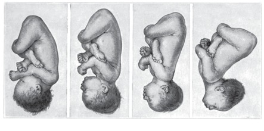
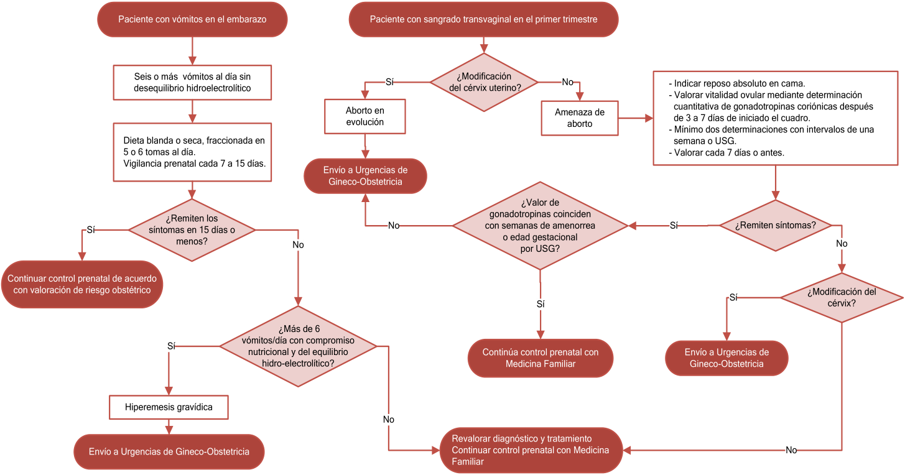
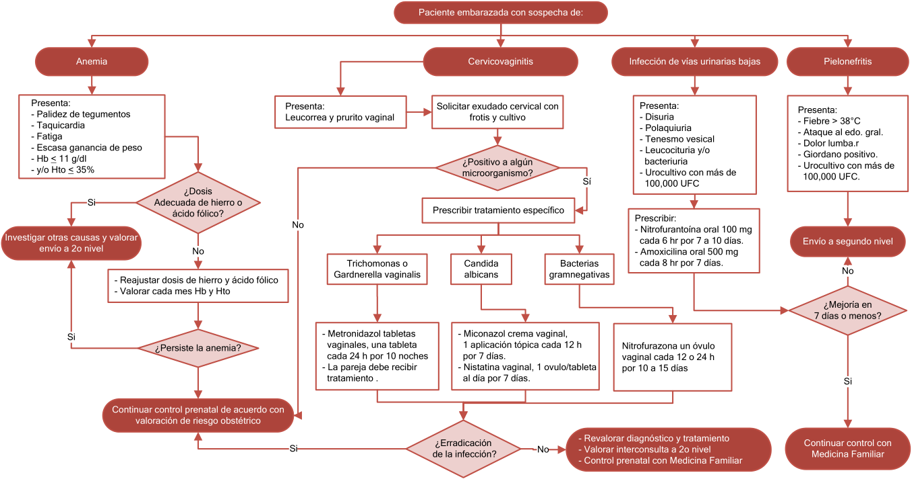

# Propedéutica obstétrica y control prenatal

**Siglas de uso frecuente.** Los términos se desarrollan al inicio de cada sección; las siglas se reservan para las menciones inmediatas.

| Sigla | Significado | Sigla | Significado |
|---|---|---|---|
| AFU | Altura del fondo uterino | FUM | Fecha de la última menstruación |
| EG | Edad gestacional | FPP | Fecha probable de parto |
| FCF | Frecuencia cardiaca fetal | IMC | Índice de masa corporal |
| DG | Diabetes gestacional | USG | Ultrasonido (ecografía) |
| GPC | Guía de práctica clínica del IMSS (2022) | NOM | Norma Oficial Mexicana NOM-007-SSA2-2016 |
| OMS | Organización Mundial de la Salud | ACOG | American College of Obstetricians and Gynecologists |
| VIH | Virus de la inmunodeficiencia humana | RCIU | Restricción del crecimiento intrauterino |

---

## 1. La atención prenatal: objetivos, eficacia y organización

### 1.1 Definición y objetivos

La atención prenatal es la serie de contactos, entrevistas o visitas programadas de la embarazada con el personal de salud para vigilar la evolución del embarazo y preparar el parto, el puerperio y el cuidado de la persona recién nacida. Incluye informar sobre la evolución normal del embarazo y sobre los síntomas de urgencia obstétrica, respetar el derecho a una atención digna y culturalmente pertinente, y elaborar con la mujer un plan de seguridad que identifique el establecimiento al que debe acudir ante una urgencia. Todas estas acciones se registran en el expediente clínico.[^d4]

Su objetivo principal es lograr el nacimiento de un recién nacido sano con el menor riesgo materno. Para conseguirlo, la atención combina tres componentes: la valoración del riesgo, la promoción de la salud con educación, y la intervención terapéutica cuando se detecta un problema. De ahí derivan las tareas concretas de cada consulta:[^d5]

- estimar la edad gestacional de forma temprana y precisa, porque de ella depende la interpretación de casi todas las pruebas y decisiones posteriores;
- identificar los embarazos con mayor riesgo materno, fetal o neonatal;
- evaluar de forma continua la salud materna y fetal, y anticipar los problemas para prevenirlos o reducir su repercusión;
- educar, apoyar y decidir de forma compartida, teniendo en cuenta los determinantes sociales de la salud;
- ofrecer una atención respetuosa, que evite el maltrato, la falta de confidencialidad, los procedimientos innecesarios y la discriminación.

### 1.2 Eficacia de la atención prenatal

La atención prenatal aporta beneficios, aunque es difícil atribuirlos a un componente aislado, porque combina el momento de inicio, el número de consultas, su contenido, el personal y los servicios de apoyo. Los datos con implicación práctica son los siguientes:[^d3][^d5]

- **Número de consultas:** reducir el número de visitas en embarazos de bajo riesgo aumentó la mortalidad perinatal en los países de ingresos bajos y medios, y las mujeres de todos los entornos se mostraron menos satisfechas porque percibían demasiado largo el intervalo entre consultas. No cambiaron la muerte materna, los trastornos hipertensivos, el parto pretérmino ni el bajo peso para la edad gestacional. Ocho consultas o más, frente a cuatro, pueden evitar unas 8 muertes perinatales por cada 1000 nacimientos.
- **Atención en grupo:** produce resultados obstétricos equivalentes a la atención individual, con alta satisfacción, pero no es superior; la modalidad se acuerda con la paciente.
- **Modelos de continuidad dirigidos por partería:** se asociaron a menos cesáreas, más partos vaginales espontáneos y una experiencia del parto más positiva.

### 1.3 Inicio y calendario de las consultas

**Inicio.** El control prenatal comienza en el primer trimestre. La NOM fija la primera consulta entre las semanas 6 y 8 o al obtener una prueba de embarazo positiva; la GPC la sitúa antes de la semana 12, y UpToDate la recomienda idealmente antes de la semana 10, porque algunas pruebas de cribado y de diagnóstico prenatal se realizan a las 10 u 11 semanas. Iniciar pronto permite datar el embarazo con precisión, obtener valores basales (peso, presión arterial, laboratorio) y activar el apoyo social si se necesita.[^d3][^d4][^d5]

**Duración.** La primera consulta dura al menos de 30 a 40 minutos y las siguientes, al menos 20 minutos. Si la mujer inicia el control después de la semana 32, en la primera consulta se realizan todas las actividades de las citas previas, además de las que corresponden a su edad gestacional.[^d3]

**Tabla 1. Calendario de consultas prenatales de la NOM-007.**[^d4]

| Consulta | Semana de gestación | Consulta | Semana de gestación |
|---|---|---|---|
| 1.ª | 6 a 8 | 5.ª | 28 |
| 2.ª | 10 a 13,6 | 6.ª | 32 |
| 3.ª | 16 a 18 | 7.ª | 36 |
| 4.ª | 22 | 8.ª | 38 a 41 |

La NOM establece un mínimo de cinco consultas para el embarazo de bajo riesgo y propone el calendario de ocho. Otros esquemas difieren en el número de contactos, por lo que el calendario se adapta al riesgo de cada embarazo:[^d3][^d4]

- **OMS (2016):** ocho contactos, uno en el primer trimestre, dos en el segundo y cinco en el tercero.
- **Esquema tradicional de Estados Unidos:** una consulta cada 4 semanas hasta la semana 28, cada 2 semanas hasta la 36 y semanal hasta el parto, lo que suma unas 16 consultas.
- **NICE:** 10 consultas en nulíparas y 7 en multíparas, cada una con un objetivo definido.
- **GPC:** recomienda mantener esquemas de 10 a 12 consultas, porque reducirlas aumenta la mortalidad perinatal en los países de ingresos bajos y no satisface las expectativas de las pacientes.

**Embarazo de 41 semanas o más.** Toda embarazada que alcanza las 41 semanas se traslada al segundo nivel de atención para su valoración, por el mayor riesgo de morbilidad y mortalidad perinatales.[^d4]

### 1.4 Quién proporciona la atención y cuándo referir

El control del embarazo sin complicaciones lo realizan medicina familiar, partería profesional o ginecoobstetricia. La medicina materno-fetal atiende los embarazos de alto riesgo, definidos como aquellos en los que la madre, el feto o el recién nacido tienen más riesgo de muerte o de secuelas y requieren recursos especializados. Por eso se refiere a las mujeres con enfermedades crónicas, con complicaciones en embarazos previos o con complicaciones en el actual, y las que tienen comorbilidades se benefician de un equipo multidisciplinario.[^d5]

Según las necesidades, se considera además la referencia a:[^d4][^d5]

- **nutrición**, para orientar la dieta y la ganancia de peso;
- **estomatología**, que la NOM incluye en las consultas preconcepcional y prenatal;
- **trabajo social**, ante problemas económicos, de vivienda, de violencia o de consumo de sustancias;
- **genética**, cuando hay riesgo de un trastorno hereditario, exposición a un teratógeno o muerte fetal previa.

---

## 2. Diagnóstico de embarazo

**Métodos.** El embarazo se diagnostica por la clínica, por el laboratorio (prueba inmunológica de embarazo en orina o en sangre) o por ecografía. La NOM prohíbe usar con este fin radiografías ni prescribir medicamentos hormonales.[^d4]

**Signos de certeza.** Son la imagen ecográfica del saco gestacional, del embrión o del feto, y la auscultación del latido fetal con un Doppler de mano. Si no están presentes, la sospecha se confirma detectando la subunidad beta de la gonadotropina coriónica humana en sangre o en orina.[^d5]

- **En sangre:** es más sensible y específica y detecta concentraciones de 1 a 2 miliunidades internacionales por mililitro.
- **En orina:** es más barata, cómoda y rápida, por lo que suele ser la primera prueba.[^d3]

**Latido cardiaco fetal.** La ecografía transvaginal detecta la actividad cardiaca desde las 5,5 semanas. El Doppler de mano suele captar el latido hacia las 12 semanas (la GPC lo sitúa a partir de la semana 10), y el estetoscopio de Pinard, a partir de la semana 20.[^d3][^d5]

**Tamaño uterino en el primer trimestre.** La correlación entre el tamaño del útero y la edad gestacional se aprende con la práctica y suele describirse con frutas: una ciruela a las 6 a 8 semanas, una naranja a las 8 a 10 y una toronja a las 10 a 12. Es una estimación imprecisa. Cuando el tamaño no concuerda con la amenorrea, se indica una ecografía temprana, porque la discrepancia puede deberse a miomas, a un útero en retroversión, a un embarazo múltiple o a una fecha de última menstruación incorrecta.[^d5]

---

## 3. Historia clínica de la primera consulta

La primera consulta busca los datos que modifican el riesgo del embarazo actual. Un cuestionario previo, completado por la paciente, ahorra tiempo y sirve para iniciar el expediente obstétrico. Toda la información se registra en el expediente, en el carnet perinatal o en la guía básica para la mujer embarazada.[^d4][^d5]

### 3.1 Identificación

Se registran el nombre completo acreditado con una identificación oficial, la edad, la escolaridad, el estado civil, el empleo, el lugar de residencia habitual, el teléfono y los datos de un familiar o una amistad para contactar en caso necesario.[^d4] Conviene preguntar también por objeciones religiosas a la transfusión y por reticencias a la vacunación, porque condicionan decisiones posteriores, y recoger los datos de la pareja.[^d5]

### 3.2 Antecedentes obstétricos

Se registran el número de embarazos, partos a término y pretérmino, gestaciones múltiples, cesáreas y abortos. De cada nacimiento se anotan la fecha, la edad gestacional, el peso, el sexo, si el parto fue espontáneo o inducido, su duración, la vía del nacimiento y las complicaciones.[^d5]

El interrogatorio busca de forma intencionada cesárea, preeclampsia, hemorragia obstétrica, parto pretérmino, restricción del crecimiento intrauterino, muerte fetal, pérdida repetida de la gestación, diabetes gestacional y malformaciones fetales, porque un resultado adverso en un embarazo previo aumenta el riesgo de repetirlo.[^d4][^d5]

**Riesgo de embarazo ectópico.** Si la paciente tiene factores de riesgo, se localiza el embarazo de forma temprana con ecografía.[^d5]

- **Riesgo alto:** ectópico previo, cirugía o patología tubárica, esterilización tubárica, dispositivo intrauterino en uso (incluido el de levonorgestrel) y fecundación in vitro en el embarazo actual.
- **Riesgo moderado:** anticonceptivos orales combinados en uso, infecciones de transmisión sexual o enfermedad pélvica inflamatoria previas, exposición intrauterina a dietilestilbestrol, tabaquismo, cirugía pélvica o abdominal previa y aborto espontáneo previo.
- **Riesgo bajo:** aborto inducido previo, infertilidad, edad de 40 años o más, duchas vaginales, inicio de relaciones sexuales antes de los 18 años y apendicectomía previa.

### 3.3 Antecedentes médicos, quirúrgicos, familiares y exposiciones

**Antecedentes personales.** Se registran alergias, medicamentos con y sin receta, inmunizaciones, infecciones previas, uso de sustancias y antecedentes quirúrgicos, incluida la cirugía bariátrica. También se interroga la historia menstrual y ginecológica y si el embarazo es deseado.[^d4][^d5]

- **Cardiopatía:** se buscan fatiga, palpitaciones, disnea o dolor anginoso, sobre todo si hay factores de riesgo, porque no reconocer una cardiopatía ni su deterioro contribuye a los eventos cardiacos graves del embarazo.
- **Fenilcetonuria:** se pregunta por ella o por dietas restringidas en la infancia, porque la fenilalanina elevada al inicio del embarazo produce una embriopatía que se previene con dieta.
- **Exposiciones:** se investigan viajes o residencia en zonas con paludismo, tuberculosis o enfermedad de Chagas, y exposición laboral, doméstica o recreativa a antineoplásicos, humo de tabaco, metales pesados (plomo, mercurio, cadmio), radiación, solventes, plaguicidas y disruptores endocrinos.[^d5]
- **Fármacos y sustancias:** se informa a la embarazada del riesgo de la automedicación, del tabaco, el alcohol, la marihuana y otras sustancias psicoactivas, y se vigila la prescripción valorando el riesgo y el beneficio de cada fármaco (sección 8.5).[^d4]

**Antecedentes familiares.** Orientan a un trastorno hereditario con repercusión fetal: enfermedad genética conocida o sospechada, malformaciones congénitas múltiples, abortos repetidos, recurrencia de trastornos similares, discapacidad intelectual, trastorno del espectro autista y consanguinidad.[^d5]

### 3.4 Evaluación psicosocial

**Salud mental.** Se identifican datos de depresión u otro trastorno mental durante el embarazo, el parto y el puerperio.[^d4] La ACOG sugiere hacerlo con un instrumento validado en la primera consulta, más adelante en el embarazo y en el posparto, por ejemplo con el cuestionario PHQ-9 o la Escala de Depresión Postnatal de Edimburgo (anexo A). Antes de iniciar un antidepresivo se descarta un trastorno bipolar, porque un tratamiento inadecuado puede precipitar manía, psicosis o estados mixtos.[^d5] La GPC recomienda identificar los factores de riesgo de depresión e iniciar acciones preventivas.[^d3]

**Violencia.** Se pregunta de forma sistemática por violencia interpersonal pasada o actual, y en las adolescentes menores de 15 años se busca intencionadamente violencia sexual, familiar o de género; si hay datos sugestivos, se procede conforme a las disposiciones legales.[^d4][^d5] La violencia de pareja se asocia a bajo peso al nacer y parto pretérmino, y la consejería y la intervención la reducen. Hacen sospecharla:[^d5]

- lesiones o hematomas con explicación improbable;
- depresión;
- inicio tardío del control prenatal, consultas perdidas o canceladas con poca antelación.

Las mujeres con antecedente de trauma sexual pueden revivir el malestar durante la exploración, el parto o los procedimientos, por lo que la atención se adapta para no retraumatizarlas.[^d5]

**Consumo de sustancias y entorno social.** El consumo se explora con un instrumento validado, como el cuestionario AUDIT para el alcohol (anexo A), y los casos positivos se evalúan y tratan. Se valoran también la vivienda, la seguridad alimentaria, las barreras para acudir a consulta y la situación de los hijos previos.[^d3][^d5]

### 3.5 Factores de riesgo obstétrico

La NOM exige que cada establecimiento detecte, registre y asigne el riesgo reproductivo, obstétrico y perinatal de cada embarazo, para planear un esquema de vigilancia individual con los especialistas que correspondan.[^d4] La GPC distingue los factores no modificables, que se vigilan, de los modificables, sobre los que se concentra la intervención.[^d3]

**Tabla 2. Factores de riesgo obstétrico.**[^d3]

| Tipo | Factores |
|------------|------------------------------------------------|
| Edad y paridad | Menos de 16 años (menos de 20 en la lista de la OMS) o más de 35 años; más de 3 embarazos o 4 o más previos; intervalo intergenésico menor de 15 meses (menor de 2 años en la lista de la OMS) |
| Antecedentes obstétricos | Más de 2 abortos; dos o más cesáreas o abortos; cesárea corporal o miomectomía; preeclampsia o eclampsia; hemorragia de la segunda mitad del embarazo; muerte fetal; parto pretérmino; hijos con malformaciones congénitas |
| Enfermedades maternas | Hipertensión arterial, diabetes, cardiopatía, nefropatía, enfermedad tiroidea, neoplasia, infección urinaria crónica u otra enfermedad crónica grave |
| Embarazo actual | Embarazo múltiple; embarazo por técnicas de reproducción asistida; inserción anómala de la placenta después de la semana 28 |
| Factores modificables | Obesidad o desnutrición, calidad de la alimentación, sedentarismo, vaginosis bacteriana, infección urinaria, tabaco, alcohol y otras drogas, salud mental, salud bucal e inmunizaciones |
| Factores sociales | Estatura menor de 1,50 m y escolaridad primaria incompleta |

La GPC incluye además una escala de riesgo biopsicosocial que suma puntos por la historia reproductiva, las complicaciones del embarazo actual y el riesgo psicosocial; una puntuación de 3 o más define alto riesgo (anexo A).[^d3]

---

## 4. Edad gestacional y fecha probable de parto

### 4.1 Definiciones e importancia

**Edad gestacional.** Es el tiempo transcurrido desde el primer día de la última menstruación normal, en una mujer con ciclos regulares, sin anticoncepción hormonal y con una fecha de última menstruación confiable, hasta el nacimiento o el evento en estudio. Se expresa en semanas y días completos. No coincide con la edad embriológica real, que es unas dos semanas menor, porque supone que la fecundación ocurrió a mitad de un ciclo de 28 días; aun así, es el estándar universal.[^d3][^d4]

**Clasificación del nacimiento por la edad gestacional.**[^d4]

- **Pretérmino:** antes de las 37 semanas completas (menos de 259 días).
- **A término:** de las 37 semanas a menos de 42 semanas completas (259 a 293 días).
- **Postérmino:** a las 42 semanas completas o más (294 días o más).

**Por qué importa.** Asignar pronto la fecha probable de parto permite organizar las consultas, interpretar el cribado, valorar el crecimiento fetal y decidir las intervenciones ante un parto pretérmino o un embarazo prolongado. Si la edad gestacional se sobrestima, un feto con crecimiento normal puede clasificarse como pequeño y recibir intervenciones innecesarias.[^d3][^d5]

### 4.2 Cálculo a partir de la última menstruación

**Regla de Naegele.** Al primer día de la última menstruación se suman 7 días, se restan 3 meses y se suma 1 año. Equivale a sumar 9 meses y 7 días, o a contar 280 días (40 semanas). Por ejemplo, con una última menstruación el 10 de octubre de 2016, la fecha probable de parto es el 17 de julio de 2017.[^d1][^d3][^d4]

**Regla de Wahl.** Es una variante que suma 10 días en lugar de 7. La NOM recoge ambas como "agregar de 7 a 10 días y restar 3 meses".[^d1][^d4]

**Condiciones de validez.** Las reglas suponen un ciclo regular de 28 días con ovulación el día 14, por lo que la fecha se desplaza si los ciclos son irregulares o la ovulación fue más temprana o más tardía. Se usa siempre el primer día de la última menstruación, siempre que sea confiable. La GPC reserva la regla de Naegele para cuando no se dispone de un método más preciso, como la ecografía.[^d3]

### 4.3 Datación por ecografía

**Método de elección.** La medición ecográfica del embrión o del feto en el primer trimestre, hasta las 13 semanas y 6 días, es el método más preciso para establecer o confirmar la edad gestacional, porque en esa etapa la variabilidad biológica del tamaño es mínima.[^d3][^acog700]

- La ecografía temprana sistemática, antes de las 20 semanas, calcula mejor la edad gestacional que la última menstruación y reduce las inducciones por embarazo prolongado y la tocolisis por sospecha de parto pretérmino.[^d5]
- En un ensayo, la ecografía del primer trimestre obligó a corregir la fecha probable de parto en el 40% de las mujeres, frente al 10% cuando la ecografía se hizo en el segundo trimestre, aunque conocieran su última menstruación.[^d3]
- Es especialmente necesaria si la fecha de última menstruación se desconoce o es imprecisa, si los ciclos son irregulares, si el embarazo ocurrió con anticoncepción hormonal o si el tamaño uterino no concuerda con la amenorrea.[^d3][^d5]

**Parámetros según la etapa.** La GPC mide la longitud cráneo-caudal en el primer trimestre (de 11 a 13,6 semanas, o mientras sea menor de 84 mm), el diámetro biparietal en el segundo y la circunferencia cefálica con la abdominal en el tercero (diámetro biparietal mayor de 70 mm).[^d3]

**Cuándo se corrige la fecha.** La fecha de la última menstruación se sustituye por la ecográfica cuando la diferencia supera el umbral de la tabla 3, que crece con la edad gestacional porque la ecografía pierde precisión a medida que avanza el embarazo.[^acog700]

**Tabla 3. Diferencia entre la última menstruación y la ecografía que justifica corregir la edad gestacional.**[^acog700]

| Edad gestacional por última menstruación | Parámetro ecográfico | Se corrige si la diferencia supera |
|---|---|---|
| Hasta 8 semanas y 6 días | Longitud cráneo-caudal | 5 días |
| 9 semanas a 13 semanas y 6 días | Longitud cráneo-caudal | 7 días |
| 14 semanas a 15 semanas y 6 días | Biometría fetal | 7 días |
| 16 semanas a 21 semanas y 6 días | Biometría fetal | 10 días |
| 22 semanas a 27 semanas y 6 días | Biometría fetal | 14 días |
| 28 semanas o más | Biometría fetal | 21 días |

**Ecografía tardía.** Un embarazo sin ecografía antes de las 22 semanas que confirme o corrija la fecha se considera datado de forma subóptima. Después de las 28 semanas la ecografía no se usa para calcular la edad gestacional, porque su error alcanza de 21 a 30 días y, si el feto tiene restricción del crecimiento, subestima la edad.[^d3][^acog700]

**Registro.** La fecha probable de parto se asigna en cuanto se dispone de la última menstruación, de la primera ecografía o de ambas; se comenta con la paciente y se documenta en la nota médica.[^d3]

El algoritmo de la GPC coincide con la tabla 3 en los umbrales de 7 días para el primer trimestre y de 10 días para la ecografía estructural de las 18 a 22 semanas; la tabla añade el umbral de 5 días antes de las 9 semanas.[^d3][^acog700]

---

## 5. Exploración física obstétrica

### 5.1 Exploración general

**Signos vitales y somatometría.** En la primera consulta y en las siguientes se miden y registran el peso, la talla, la presión arterial, la temperatura, la frecuencia cardiaca y la frecuencia respiratoria.[^d4] El índice de masa corporal de la primera consulta orienta la ganancia de peso recomendada (sección 8.1).[^d5]

**Presión arterial.** Se mide en todas las consultas, porque la hipertensión crónica y la del embarazo suelen ser asintomáticas.[^d3]

- Si la primera cifra está elevada, se buscan registros previos al embarazo para documentar una hipertensión crónica. Ese valor basal permite distinguir después entre hipertensión crónica, preeclampsia e hipertensión gestacional.
- Las categorías de referencia fuera del embarazo son: presión elevada, sistólica de 120 a 129 mmHg con diastólica menor de 80; hipertensión estadio 1, sistólica de 130 a 139 o diastólica de 80 a 89; hipertensión estadio 2, sistólica de 140 o más o diastólica de 90 o más.
- Los aparatos automáticos deben estar validados en embarazadas.[^d5]
- El aumento de la presión entre el primer y el segundo trimestre se asocia a más trastornos hipertensivos aunque las cifras sigan dentro de la normalidad.[^d3]

**Exploración por regiones.**

- **Bucodental:** se explora en la primera consulta, porque la enfermedad periodontal se asocia a parto pretérmino, preeclampsia y bajo peso al nacer.[^d3][^d4]
- **Cardiaca:** la NOM incluye la auscultación cardiaca materna.[^d4]
- **Mamaria:** la NOM la incluye en la primera consulta; la GPC no la recomienda de forma sistemática, sino en casos seleccionados, para diagnosticar nódulos y detectar a tiempo el cáncer de mama (anexo B).[^d3][^d4]
- **Pélvica:** la GPC no la recomienda de rutina en mujeres de bajo riesgo con molestias comunes al inicio del embarazo y con embarazo intrauterino confirmado, porque no cambia el tratamiento; se reserva para buscar anomalías del aparato reproductor o para el cribado de infecciones de transmisión sexual. UpToDate incluye en la exploración completa el tamaño y la forma del útero y los anexos.[^d3][^d5]
- **Citología cervicovaginal:** se toma si corresponde según el calendario de cribado; el embarazo no modifica la frecuencia, pero sí el manejo de un resultado anormal.[^d4][^d5]

### 5.2 Altura del fondo uterino

**Técnica.** Se mide con cinta métrica desde el borde superior de la sínfisis del pubis hasta el fondo uterino. Es una medición accesible, barata, rápida, fácil de aprender y reproducible, aunque varía entre exploradores por la técnica y por la variabilidad fisiológica; por eso se hace con estricto apego a la técnica.[^d3][^d4]

**Tabla 4. Ubicación del fondo uterino según la edad gestacional.**[^d3]

| Semanas | Ubicación del fondo uterino | Altura (cm) |
|---|---|---|
| 9 | A nivel de la sínfisis del pubis | |
| 12 | Comienza a palparse en el abdomen | |
| 16 | A la mitad entre la sínfisis del pubis y el ombligo | 16 |
| 22 | A nivel del ombligo | 20 |
| 28 | Tres traveses de dedo por encima del ombligo | 24 |
| 32 | Otros tres traveses de dedo más arriba | 28 |
| 36 | Alcanza el reborde costal y deja de crecer | 32 |
| 40 | Crece muy poco; en las primigestas tiende a descender por el encajamiento | 30 a 32 |

**Interpretación con la curva de referencia.** La NOM clasifica la altura según su percentil para la edad gestacional:[^d4]

- **Normal:** entre los percentiles 10 y 90; se continúa el control habitual.
- **Anormal:** por debajo del percentil 10 o por encima del 90. Se investigan y tratan las causas, se cita cada 8 días y se consulta de inmediato con el especialista.

**Causas de una altura discordante.** Una altura mayor o menor de lo esperado, o que crece más o menos rápido, puede indicar restricción del crecimiento fetal, embarazo múltiple, macrosomía, oligohidramnios o polihidramnios.[^d3]

**Utilidad y límites.** Para detectar alteraciones del crecimiento, la altura uterina tiene una sensibilidad muy variable (del 27 al 86%) y una especificidad del 91%: un valor normal no excluye la alteración, pero un valor anormal la hace probable. La ecografía es más precisa (detecta el 93% de las restricciones del crecimiento y el 90% de las macrosomías), pero es costosa como cribado. Por eso la altura uterina se usa para sospechar y la ecografía para confirmar. Ante la sospecha de restricción del crecimiento, el diagnóstico, la clasificación y el seguimiento se hacen en el segundo o tercer nivel.[^d3][^d4]

**Reglas para estimar la edad gestacional.** Solo se usan cuando no se dispone de un método más preciso, porque son aproximaciones.[^d1][^d3]

- **Regla de McDonald:** la altura uterina en centímetros multiplicada por 8 y dividida entre 7 da las semanas de gestación; multiplicada por 2 y dividida entre 7, los meses lunares. Por ejemplo, 21 cm equivalen a 24 semanas o 6 meses lunares. Después de las 24 semanas, la altura en centímetros suele coincidir aproximadamente con las semanas de gestación.
- **Regla de Alfehld:** a la altura uterina en centímetros se suman 4 y el resultado se divide entre 4 para obtener los meses de embarazo. Por ejemplo, 28 cm equivalen a 8 meses.

### 5.3 Estimación clínica del peso fetal

**Regla de Johnson-Toshach.** El peso fetal en gramos es igual a la altura uterina en centímetros menos una constante, multiplicado por 155, con un margen de 200 g por arriba o por abajo. La constante vale 12 si la presentación de vértice está por arriba de las espinas ciáticas (no encajada) y 11 si está por debajo (encajada). Por ejemplo, con una altura de 32 cm y la cabeza libre, el peso estimado es (32 − 12) × 155 = 3100 g, es decir, de 2900 a 3300 g.[^d1]

Estimar el peso fetal ayuda a sospechar macrosomía o restricción del crecimiento y a valorar la desproporción cefalopélvica. Su precisión es limitada, por lo que una estimación anormal se confirma por ecografía.[^d1][^d3]

### 5.4 Estática fetal

La estática fetal describe la relación del feto con el útero y la pelvis materna. Se define con los siguientes conceptos:[^d2][^d3]

- **Situación:** relación entre el eje longitudinal del feto y el de la madre. Puede ser longitudinal, transversa u oblicua; la oblicua es inestable y durante el parto se convierte en longitudinal o transversa. Conocerla al inicio del parto es decisivo para elegir la vía del nacimiento.
- **Presentación:** parte del feto que se aboca al estrecho superior de la pelvis, lo ocupa en su totalidad y es capaz de efectuar un mecanismo de parto. En la situación longitudinal es cefálica o pélvica (de nalgas); en la transversa, de hombro.
- **Actitud:** relación de flexión o extensión de las partes fetales entre sí. Lo normal es la flexión: la cabeza flexionada con el mentón contra el tórax.
- **Posición:** relación del dorso fetal con el lado derecho o izquierdo de la madre.
- **Punto de referencia:** parte de la presentación que se usa para nombrar la posición y la variedad: el occipucio en la presentación de vértice, el mentón en la de cara, el sacro en la pélvica y el acromion en la de hombro.
- **Variedad de posición:** relación del punto de referencia con la mitad anterior, transversa o posterior de la pelvis materna, a la derecha o a la izquierda. En la presentación de vértice se describen así las variedades occipitoiliacas izquierdas y derechas, anteriores, transversas y posteriores.

**Presentaciones cefálicas según la actitud.** La flexión o extensión de la cabeza determina qué parte se presenta. En el vértice, la cabeza está flexionada y se presenta el occipucio; en el sincipucio, la flexión es parcial y se presenta la fontanela anterior (bregma); en la frente, la cabeza está parcialmente extendida; en la cara, el cuello está totalmente extendido. Las presentaciones de sincipucio y de frente suelen ser transitorias, porque con el avance del parto se convierten en vértice al flexionarse o en cara al extenderse.[^d2]

**Anomalías de presentación y de posición.** Las presentaciones anómalas son la de nalgas, hombro, compuesta, cara y frente. Dependen de factores maternos y fetales, como el tamaño fetal, el volumen de líquido amniótico, las anomalías fetales, el hábito corporal materno y la estructura de la pelvis.[^d3]

- **Presentación de nalgas:** es la más frecuente. Se maneja con versión cefálica externa o con cesárea, y el parto vaginal solo se considera en casos seleccionados, porque se asocia a peores resultados perinatales.
- **Posiciones occipitoposterior y occipitotransversa:** son frecuentes y se diagnostican en el trabajo de parto activo por la exploración o por ecografía. La mayoría rota espontáneamente a occipitoanterior; si persisten, la rotación digital o manual tiene altas tasas de éxito y pocos efectos adversos.
- **Conducta en el primer nivel:** en la consulta más cercana al término se realiza una exploración abdominal cuidadosa; si se detecta una anomalía de presentación, se refiere al siguiente nivel, y si se detecta después de la semana 35 con trabajo de parto, se envía de inmediato.[^d3]

### 5.5 Maniobras de Leopold

Las maniobras de Leopold son cuatro palpaciones abdominales que identifican la situación, la presentación, la posición y el encajamiento del feto. Se practican en el tercer trimestre y la GPC las recomienda para evaluar la presentación cuando no se dispone de ecografía.[^d3][^glowm]

1. **Primera maniobra:** con ambas manos sobre el fondo uterino, se identifica qué polo fetal lo ocupa. Si en el fondo hay una cabeza o unas nalgas, la situación es longitudinal; si no hay ningún polo, es probable que sea transversa.
2. **Segunda maniobra:** con las palmas a ambos lados del abdomen, se localiza el dorso fetal y, en el lado opuesto, las partes pequeñas (las extremidades). Así se establece la posición.
3. **Tercera maniobra:** con una mano se toma la parte baja del abdomen justo por encima de la sínfisis del pubis, entre el pulgar y los demás dedos, para identificar la presentación y valorar si está encajada.
4. **Cuarta maniobra:** el explorador se gira hacia los pies de la paciente y, con la punta de los dedos de ambas manos dirigida hacia el estrecho superior, identifica las partes fetales del polo inferior y su grado de descenso.

**Precisión y límites.** En el tercer trimestre, las maniobras identifican correctamente la presentación en el 89% de los casos y la posición en el 96%, con alta sensibilidad y baja especificidad. Pierden precisión con una circunferencia abdominal grande, con miomas, en el embarazo múltiple y en el polihidramnios. El encajamiento se confirma con el tacto vaginal.[^d3][^glowm]

### 5.6 Frecuencia cardiaca y movimientos fetales

**Frecuencia cardiaca fetal.** Se registra en cada consulta desde que es audible. El intervalo normal es de 110 a 160 latidos por minuto según el NICHD (véase el tema de registro cardiotocográfico); la NOM, para la vigilancia intraparto, usa de 120 a 160 (anexo B).[^d4]

**Movimientos fetales.** La NOM incluye su registro en cada consulta.[^d4] La GPC no recomienda que la embarazada lleve un conteo sistemático, porque aumenta la ansiedad y las consultas de urgencia sin mejorar los resultados; en cambio, la disminución o la ausencia de movimientos es un signo de alarma que obliga a consultar (sección 11).[^d3]

---

## 6. Estudios de laboratorio y gabinete

### 6.1 Panel inicial

En la primera consulta se solicita un panel de laboratorio a todas las embarazadas, que se amplía en las que tienen riesgo de enfermedades concretas (sección 6.2). Las pruebas hechas en la consulta preconcepcional no se repiten.[^d5]

**Tabla 5. Estudios de la primera consulta y su interpretación.**[^d3][^d4][^d5]

| Estudio | Finalidad | Interpretación y conducta |
|------------|------------------|------------------------------------|
| Biometría hemática | Detectar anemia | Anemia: hemoglobina menor de 11 g/dL (hematocrito menor de 33%) en el primer y tercer trimestres, y menor de 10,5 g/dL (hematocrito menor de 32%) en el segundo. Un volumen corpuscular medio menor de 80 fL sin deficiencia de hierro sugiere talasemia y se estudia con electroforesis de hemoglobina. Cada vez más se añade la ferritina para detectar la deficiencia de hierro sin anemia |
| Grupo sanguíneo, factor Rh y detección de anticuerpos | Prevenir la aloinmunización y detectar anticuerpos que causan enfermedad hemolítica fetal | En la mujer Rh negativo se solicita la prueba de Coombs indirecta; si no está sensibilizada, recibe inmunoglobulina anti-D (sección 7.6) |
| Glucosa | Detectar diabetes previa o diabetes gestacional | La NOM pide glucosa en ayuno y una hora después de una carga de 50 g; en mujeres con factores de riesgo se buscan criterios de diabetes manifiesta (sección 6.3) |
| Creatinina y ácido úrico | Valores basales | Forman parte del panel de la NOM y de la GPC |
| Examen general de orina y urocultivo | Proteinuria basal y bacteriuria asintomática | La tira reactiva se repite en cada consulta. El urocultivo se prefiere a las pruebas rápidas, que no son suficientemente sensibles ni específicas. La bacteriuria no tratada predispone a pielonefritis y a parto pretérmino (sección 10.2) |
| Prueba de sífilis | Prevenir la sífilis congénita | Prueba no treponémica o treponémica, siempre con confirmación por el riesgo de falsos positivos. Se realiza en las primeras 12 semanas; si no se hizo, antes del parto o en el posparto inmediato. Un resultado positivo se envía al segundo nivel |
| Prueba de VIH | Prevenir la transmisión vertical | Se ofrece a todas, con consejería y consentimiento registrados, en las primeras 12 semanas. La GPC indica prueba rápida en el primer y tercer trimestres, con confirmación por inmunoensayo enzimático si es positiva. Un resultado positivo se envía al segundo nivel |
| Antígeno de superficie del virus de la hepatitis B | Prevenir la transmisión perinatal | Se solicita en cada embarazo, aunque la mujer esté vacunada; la inmunización activa y pasiva del recién nacido en las primeras 12 horas evita más del 95% de las transmisiones |
| Anticuerpos contra el virus de la hepatitis C | Identificar a las portadoras para tratarlas después del parto y vigilar al recién nacido | La ACOG y los CDC recomiendan el cribado universal en cada embarazo |
| Inmunidad a rubéola y varicela | Identificar a las mujeres susceptibles | Las susceptibles evitan la exposición y se vacunan después del parto, porque ambas vacunas son de virus vivos |
| Citología cervicovaginal | Cribado de cáncer cervicouterino | Si no se ha realizado en los últimos 3 años o según el calendario vigente |
| Clamidia y gonorrea | Detectar infecciones de transmisión sexual | En menores de 25 años o con factores de riesgo, con pruebas de amplificación de ácidos nucleicos en muestra vaginal o endocervical |

**Seguimiento de las pruebas de transmisión sexual.**[^d3][^d5]

- **VIH:** la prueba se repite en el segundo trimestre si la mujer mantiene prácticas de riesgo, sobre todo si su pareja tiene VIH, y siempre que tenga otra infección de transmisión sexual, síntomas de infección aguda o exposición continua. El enfoque de exclusión voluntaria (se realiza salvo que la mujer la rechace) logra tasas de cribado del 95 al 100%; si la mujer la rechaza, se exploran los motivos y se vuelve a ofrecer.
- **Clamidia:** tras el tratamiento se comprueba la curación a las 3 a 4 semanas y se repite la prueba a los 3 a 4 meses.
- **Gonorrea:** se trata de inmediato y se repite la prueba a los 3 meses.

### 6.2 Cribado selectivo

Estas pruebas se reservan para las mujeres con factores de riesgo o en contextos concretos:[^d5]

- **Función tiroidea:** se mide la hormona estimulante del tiroides si hay síntomas o factores de riesgo (antecedente personal o familiar de enfermedad tiroidea, diabetes tipo 1 o sospecha clínica), con valores de referencia propios del embarazo. Sin valores locales, una cifra mayor de 4 mUI/L con tiroxina libre baja define el hipotiroidismo manifiesto. Las sociedades profesionales recomiendan el cribado selectivo y no el universal, aunque el selectivo omite hasta un tercio de los hipotiroidismos subclínicos.
- **Diabetes tipo 2 no diagnosticada:** se busca al inicio del embarazo si hay factores de riesgo (sección 6.3).
- **Tuberculosis latente:** se busca si hay exposición reciente o inmunodepresión importante, como el VIH. En personas vacunadas con BCG se prefiere el ensayo de liberación de interferón gamma a la prueba de la tuberculina.
- **Enfermedad de Chagas:** se recomienda en mujeres nacidas o residentes en zonas endémicas de México, Centroamérica o Sudamérica. Lo ideal es hacerlo antes del embarazo, porque los tratamientos antiparasitarios previenen la infección congénita pero están contraindicados durante la gestación; si se detecta en el embarazo, se trata a la madre después del parto y se estudia al recién nacido.
- **Plomo:** solo si hay factores de riesgo de exposición; si la cifra es menor de 5 µg/dL no se repite.
- **Tricomoniasis:** en mujeres con VIH, porque aumenta la transmisión del virus.
- **Hepatitis A:** se vacuna, no se estudia, a las mujeres con riesgo (viajes internacionales, uso de drogas, riesgo laboral o hepatopatía crónica).
- **Sarampión:** se documenta la inmunidad en todas las mujeres en edad reproductiva; la serología es razonable durante brotes.
- **Virus del Zika:** se estudia en las 12 semanas siguientes a una posible exposición, aunque no haya síntomas.

**Cribados que no se recomiendan de rutina:**[^d5]

- **Vaginosis bacteriana asintomática:** tratarla no reduce el parto pretérmino.
- **Herpes simple:** la serología universal no cumple los criterios de una estrategia preventiva eficaz.
- **Citomegalovirus:** solo se estudia ante un cuadro similar a la mononucleosis, una anomalía fetal sugestiva o si la paciente lo solicita.
- **Toxoplasmosis:** el cribado universal es controvertido y poco frecuente fuera de las zonas de alta prevalencia.

### 6.3 Diabetes gestacional

**Definición.** Es la alteración del metabolismo de los carbohidratos que se detecta por primera vez durante el embarazo y traduce una adaptación insuficiente a la insulina.[^d4] Aumenta el riesgo de aborto, anomalías fetales, preeclampsia, macrosomía, hipoglucemia e hiperbilirrubinemia neonatales, síndrome de dificultad respiratoria y muerte fetal, y a largo plazo predispone a obesidad, hipertensión y diabetes tipo 2.[^d3]

**Factores de riesgo según la NOM.** Padres o familiares de primer grado con diabetes; diabetes gestacional previa; edad mayor de 25 años; peso al nacer de la paciente de 4 kg o más; obesidad (90 kg o más, o índice de masa corporal de 30 o más antes del embarazo); cribado previo alterado (130 mg/dL o más a la hora); hijos con peso al nacer de 4000 g o más; muerte fetal; aborto recurrente; hijos con malformaciones congénitas, e hipertensión arterial crónica.[^d4]

**Diabetes manifiesta al inicio del embarazo.** En las mujeres con factores de riesgo de diabetes tipo 2 (diabetes gestacional previa, sobrepeso con antecedentes familiares u otros factores metabólicos, edad de 35 años o más), se diagnostica diabetes previa si en la primera consulta hay:[^d5]

- glucosa en ayuno de 126 mg/dL o más;
- hemoglobina glucosilada de 6,5% o más;
- glucosa al azar de 200 mg/dL o más con síntomas de hiperglucemia.

**Cribado entre las semanas 24 y 28.** La NOM lo exige a todas las embarazadas y permite adelantarlo en las de mayor riesgo; la GPC lo sugiere en las de riesgo bajo o moderado y recomienda evaluar el riesgo desde la primera consulta.[^d3][^d4]

**Tabla 6. Estrategias de cribado y diagnóstico de la diabetes gestacional.**[^d3][^d4][^acog190]

| Estrategia | Prueba | Valores diagnósticos | Criterio |
|---|---|---|---|
| Un paso (criterios IADPSG) | Carga oral de 75 g en ayuno, con glucosa en ayuno, a la hora y a las 2 horas | 92, 180 y 153 mg/dL | Basta un valor igual o mayor |
| Dos pasos, primer paso | Carga de 50 g sin ayuno; glucosa a la hora | Umbral de 130, 135 o 140 mg/dL | Si se supera, se realiza el segundo paso |
| Dos pasos, segundo paso (criterios de Carpenter y Coustan) | Carga oral de 100 g en ayuno; glucosa en ayuno y a las 1, 2 y 3 horas | 95, 180, 155 y 140 mg/dL | Se necesitan dos valores o más |

La GPC sugiere la estrategia de un paso de la IADPSG (Asociación Internacional de Grupos de Estudio de Diabetes y Embarazo), y la NOM la adopta en su apéndice K. En un ensayo con más de 23 000 embarazadas, la estrategia de un paso diagnosticó casi el doble de diabetes gestacional que la de dos pasos, sin diferencias en las complicaciones maternas ni neonatales.[^d3][^d4]

**Después del diagnóstico.** La mujer se refiere al segundo o tercer nivel para su manejo. Entre 6 y 12 semanas después del parto se repite la curva de tolerancia con 75 g para identificar a las que tienen diabetes, y se da seguimiento especializado al hijo.[^d4]

### 6.4 Ecografía obstétrica y cribado genético

**Calendario de ecografías de la NOM.** Se promueve una ecografía por trimestre, realizada por personal capacitado:[^d4]

- **De 11 a 13,6 semanas:** vitalidad, edad gestacional y número de fetos.
- **De 18 a 22 semanas:** estudio estructural.
- **De 29 a 30 semanas o más:** bienestar materno y fetal.

La ecografía del primer trimestre permite además determinar la corionicidad y la amnionicidad en el embarazo gemelar, necesarias para su vigilancia.[^d5]

**Detección de anomalías.** La ecografía del primer trimestre detecta en población de bajo riesgo alrededor de un tercio de todas las anomalías y casi la mitad de las mayores, y en población de alto riesgo, alrededor del 60%; su rendimiento mejora con un protocolo anatómico estandarizado. Como el tamaño fetal limita la valoración temprana, casi todas las pacientes necesitan además el estudio anatómico de las 18 a 20 semanas.[^d3][^d5] La GPC recomienda la ecografía ante la sospecha de malformaciones, antes de la semana 24 en mujeres con factores de riesgo de anomalías genéticas, y la referencia para diagnóstico genético cuando los antecedentes lo justifican.[^d3]

**Cribado de aneuploidías.** Se ofrece a todas las embarazadas, sin importar la edad, el cribado o directamente una prueba diagnóstica. Antes de cualquier prueba, la pareja debe entender que el cribado estima un riesgo y no da un diagnóstico, qué detecta, qué significan los falsos positivos y negativos, y qué opciones tiene ante un resultado positivo.[^d5]

- **Cribado con ADN fetal libre en sangre materna:** detecta las trisomías 21, 18 y 13 y las aneuploidías de los cromosomas sexuales.
- **Cribado con marcadores bioquímicos maternos, con o sin marcadores ecográficos:** como la translucencia nucal, en el primer trimestre o en el segundo; puede revelar otras alteraciones además de las buscadas.
- **Pruebas diagnósticas:** la biopsia de vellosidades coriales se hace a las 10 a 13 semanas y la amniocentesis, a partir de las 15 o 16 semanas.
- **Paneles ampliados de ADN fetal libre** (microdeleciones, trisomías raras, enfermedades monogénicas): las sociedades científicas no los recomiendan de rutina, porque no se conocen bien su tasa de detección ni sus falsos positivos; quien desea la máxima información genética opta por una prueba diagnóstica con microarreglos.

**Portadores y consanguinidad.** En Estados Unidos se ofrece a todas las pacientes el cribado de portadoras de fibrosis quística y atrofia muscular espinal, y los índices eritrocitarios se usan para detectar portadoras de hemoglobinopatías. Si la mujer es portadora, se estudia a la pareja y se refiere a consejo genético. La consanguinidad (unión entre primos segundos o parientes más cercanos) aumenta el riesgo de enfermedades recesivas y de muerte perinatal, por lo que se ofrece consejo genético.[^d5]

---

## 7. Prevención, suplementación e inmunizaciones

### 7.1 Ácido fólico

El ácido fólico es esencial para la síntesis de ADN, la división celular y la formación de los eritrocitos, y es crítico al inicio del embarazo. Su deficiencia se asocia a anemia megaloblástica, defectos del tubo neural, cardiopatías congénitas, fisuras orales, restricción del crecimiento, bajo peso al nacer y parto pretérmino.[^d3]

- **Dosis habitual:** 0,4 mg al día, iniciados al menos 3 meses antes del embarazo y mantenidos durante todo el embarazo (NOM); la GPC los prolonga hasta 3 meses después del parto.[^d3][^d4]
- **Antecedente de un embarazo con defecto del tubo neural:** se recomiendan 4 mg al día.[^uspstffol]

### 7.2 Hierro y micronutrientes

La NOM promueve la prescripción de hierro, ácido fólico y multivitamínicos.[^d4] La OMS recomienda a todas las embarazadas un suplemento diario de 30 a 60 mg de hierro elemental con 0,4 mg de ácido fólico, para prevenir la anemia materna, la sepsis puerperal, el bajo peso al nacer y el parto pretérmino.[^who2016]

- **Presentaciones del cuadro básico:** una tableta de 200 mg de fumarato ferroso aporta 65,7 mg de hierro elemental, y una de 200 mg de sulfato ferroso, 60,3 mg.[^d3]
- **Absorción:** la vitamina C la aumenta; los antiácidos, las tetraciclinas, la vitamina E y la colestiramina la disminuyen.[^d3]
- **Efectos adversos:** dolor abdominal, náusea, vómito, pirosis, estreñimiento y oscurecimiento de las heces.[^d3]

### 7.3 Ácidos grasos omega 3

La GPC sugiere de 500 a 1000 mg al día de ácidos grasos poliinsaturados de cadena larga omega 3 desde la semana 12, porque reducen el parto pretérmino antes de las 37 semanas (en un 11%) y, sobre todo, antes de las 34 semanas (en un 42%).[^d3]

### 7.4 Ácido acetilsalicílico para prevenir la preeclampsia

**Indicación.** La GPC recomienda dosis bajas de ácido acetilsalicílico a las mujeres con un factor de riesgo alto o con más de un factor de riesgo moderado de preeclampsia:[^d3]

- **Riesgo alto:** preeclampsia previa, enfermedad renal, enfermedad autoinmune, diabetes tipo 1 o 2 e hipertensión crónica.
- **Riesgo moderado:** primer embarazo, edad mayor de 35 años, índice de masa corporal mayor de 30, antecedente familiar de preeclampsia y factores sociodemográficos.

**Dosis y duración.** La GPC recoge dos esquemas, que se explican en el tema de enfermedades hipertensivas del embarazo (anexo B):[^d3][^acog743]

- **150 mg al día desde las 11 o 12 semanas hasta la semana 36:** en el ensayo ASPRE redujo un 62% la preeclampsia pretérmino, sin efecto sobre la de término.
- **81 mg al día iniciados entre las semanas 12 y 28, idealmente antes de la 16, hasta el final del embarazo:** es el esquema de la ACOG.

**Cribado combinado del primer trimestre.** Entre las 11 y 13,6 semanas, la combinación de factores de riesgo, presión arterial media, índice de pulsatilidad de las arterias uterinas y marcadores bioquímicos (proteína plasmática A asociada al embarazo y factor de crecimiento placentario) detecta el 96% de las preeclampsias que aparecen antes de las 34 semanas. Si no se dispone de Doppler ni de marcadores, la indicación se basa en los factores de riesgo.[^d3]

### 7.5 Progestágenos para prevenir el parto pretérmino

La GPC recomienda progestágenos en el embarazo único con antecedente de parto pretérmino, y señala que no son eficaces en el embarazo múltiple.[^d3] En 2023 la FDA retiró el caproato de 17-alfa-hidroxiprogesterona por falta de eficacia, y la progesterona vaginal se mantiene para el cérvix corto (menor de 25 mm); su uso con antecedente de parto pretérmino sin cérvix corto se decide de forma compartida (anexo B).[^smfm2023]

### 7.6 Inmunizaciones e inmunoglobulina anti-D

**Tabla 7. Vacunas durante el embarazo.**[^d3][^d4][^d5][^cdcvac]

| Vacuna | Indicación y momento | Fundamento |
|------------------|------------------------|------------------------|
| Influenza (inactivada o recombinante) | Todas las embarazadas, en cualquier trimestre durante la temporada de influenza | Su seguridad y eficacia están demostradas |
| Toxoide tetánico y diftérico (Td) | Esquema de la NOM: primera dosis preferentemente antes de la semana 14 y segunda de 4 a 8 semanas después | El toxoide tetánico durante el embarazo reduce la mortalidad neonatal por tétanos en un 94% |
| Tétanos, difteria y tos ferina acelular para adultos (Tdpa) | La GPC la indica entre las semanas 16 y 32 en las mujeres no vacunadas previamente; los CDC la recomiendan en cada embarazo, preferentemente entre las semanas 27 y 36 | Confiere inmunidad pasiva al recién nacido contra la tos ferina |
| Virus sincitial respiratorio (vacuna de prefusión F) | Los CDC indican una dosis entre las semanas 32 y 36 en la temporada de mayor circulación del virus | Protege al lactante mediante los anticuerpos maternos |
| Hepatitis B | Mujeres susceptibles | Previene la infección materna y la transmisión |
| Hepatitis A | Mujeres con factores de riesgo | Previene la infección materna |
| Triple viral (sarampión, rubéola y parotiditis) y varicela | Contraindicadas en el embarazo por ser de virus vivos; se aplican en el posparto a las susceptibles | Aunque el riesgo demostrado de daño fetal es bajo, se evitan por su posible efecto teratógeno |

**Inmunoglobulina anti-D.** Previene que la madre Rh negativo se sensibilice contra los eritrocitos Rh positivo del feto.[^d4][^d5][^sogc]

- **Prenatal:** las mujeres Rh negativo no sensibilizadas reciben 300 µg a las 28 semanas si el feto es Rh positivo o se desconoce su grupo.
- **Posparto:** si el recién nacido es Rh positivo y la prueba de Coombs indirecta materna es negativa, la madre recibe 300 µg en las primeras 72 horas.
- **Otros eventos:** también se aplica tras cualquier evento obstétrico o procedimiento invasivo que pueda causar hemorragia feto-materna.

---

## 8. Nutrición, ganancia de peso y estilo de vida

### 8.1 Estado nutricional y ganancia de peso

**Índice de masa corporal.** Es el peso en kilogramos dividido entre el cuadrado de la estatura en metros; para el pregestacional se necesita conocer con seguridad el peso previo al embarazo. No está validado en púberes ni en mujeres de menos de 1,50 m.[^d4]

**Tabla 8. Clasificación del índice de masa corporal pregestacional.**[^d4]

| Índice de masa corporal (kg/m²) | Categoría |
|---|---|
| Menos de 18,5 | Bajo peso |
| 18,5 a 24,9 | Peso normal |
| 25 a 29,9 | Sobrepeso |
| 30 a 34,9 | Obesidad leve (clase I) |
| 35 a 39,9 | Obesidad media (clase II) |
| 40 o más | Obesidad mórbida (clase III) |

**Tabla 9. Ganancia de peso recomendada en el embarazo único según el índice de masa corporal pregestacional.**[^d3][^d4][^d5]

| Categoría | Ganancia total (kg) | Ritmo en el segundo y tercer trimestres (kg por semana) |
|---|---|---|
| Bajo peso | 12,5 a 18 | 0,51 (0,44 a 0,58) |
| Peso normal | 11,5 a 16 | 0,42 (0,35 a 0,50) |
| Sobrepeso | 7 a 11,5 | 0,28 (0,23 a 0,33) |
| Obesidad | 5 a 9 | 0,22 (0,17 a 0,27) |

Los rangos de la tabla 9 son los del Instituto de Medicina de Estados Unidos (2009) y suponen una ganancia de 0,5 a 2 kg en el primer trimestre; la NOM usa cifras equivalentes. Se ajustan de la siguiente manera:[^d3][^d4][^d5]

- **Adolescentes:** se recomienda el límite superior del rango.
- **Mujeres de menos de 1,50 m:** se recomienda el límite inferior.
- **Embarazo múltiple:** la ganancia recomendada es mayor.
- **Obesidad por clases:** un metaanálisis de cohortes (LifeCycle) propone de 2 a menos de 6 kg en la clase I, de 0 a 4 kg en la clase II y de 0 a 6 kg en la clase III, porque con esos rangos se observaron menos desenlaces adversos.

**Conducta.** Se registra el índice de masa corporal previo y se fijan metas de ganancia por trimestre, y toda embarazada recibe al menos una consulta de nutrición. Una ganancia mayor de 0,5 kg por semana en el último trimestre es un signo de alarma (sección 11).[^d3]

### 8.2 Alimentación

**Dieta.** La alimentación saludable incluye una variedad de alimentos, sobre todo integrales y sin procesar, en cantidad suficiente para una ganancia de peso adecuada pero no excesiva, con suplementos adecuados de vitaminas y minerales y sin alcohol, tabaco ni otras sustancias nocivas. Una dieta equilibrada en proteínas y energía reduce el bajo peso al nacer y el peso bajo para la edad gestacional.[^d3]

**Cafeína.** Se limita a menos de 200 mg al día. En el embarazo su eliminación es de 1,5 a 3,5 veces más lenta, atraviesa la placenta y el hígado fetal inmaduro apenas la metaboliza; una ingesta de 200 mg al día o más se asoció al doble de riesgo de aborto.[^d3]

### 8.3 Tabaco, alcohol y otras sustancias

**Recomendación general.** Durante el embarazo y la lactancia, la mujer debe abstenerse del tabaco (también como fumadora pasiva), del alcohol y de las sustancias psicoactivas.[^d4]

- **Tabaco:** el tabaquismo activo aumenta el aborto espontáneo, la muerte fetal, neonatal y perinatal y reduce el peso fetal; además, se asocia a parto pretérmino, placenta previa y desprendimiento prematuro de placenta. La consejería y las estrategias psicosociales favorecen la abstinencia y reducen el bajo peso al nacer y los ingresos a cuidados intensivos neonatales.[^d3][^d4]
- **Alcohol:** no existe una cantidad segura durante el embarazo. Produce restricción del crecimiento, disfunción del sistema nervioso central, microcefalia y malformaciones faciales (síndrome alcohólico fetal). Toda embarazada se interroga sobre su consumo, y la consejería lo reduce.[^d3][^d4]
- **Drogas ilegales:** se informa de sus efectos sobre el feto; las consumidoras requieren intervenciones especializadas, como un programa de rehabilitación o, en la dependencia de opiáceos, tratamiento con metadona. La cocaína se asocia a malformaciones intestinales, cardiacas, renales y faciales, microcefalia, restricción del crecimiento, lesiones cerebrales y muerte fetal.[^d3][^d4]

### 8.4 Consejería y educación prenatal

**Programas de educación.** La GPC recomienda que la embarazada y su pareja participen en programas de preparación para el parto, porque mejoran los conocimientos, reducen el estrés, las cesáreas y el uso de analgesia epidural, y se asocian a mejor recuperación posparto. Se priorizan el trabajo de parto, la seguridad del recién nacido, la lactancia y el apego.[^d3]

**Contenidos de la NOM.** La consulta prenatal informa sobre los factores de riesgo, los estilos de vida saludables, la nutrición, la lactancia materna exclusiva, la planificación familiar y la anticoncepción después del evento obstétrico, los signos de alarma, los signos del inicio del parto y los cuidados del recién nacido. Se promueve que la mujer acuda acompañada de su pareja o de un familiar.[^d4]

**Lactancia.** Se promueve la lactancia materna exclusiva, salvo en los casos médicamente justificados. La NOM recomienda sucedáneos de la leche materna en la madre con VIH, y la GPC añade la farmacodependencia y ciertos medicamentos como contraindicaciones.[^d3][^d4]

**Tabla 10. Temas de consejería durante el embarazo.**[^d3]

| Tema | Recomendación |
|------------|------------------------------------------------|
| Actividad física | Al menos 30 minutos de ejercicio moderado todos los días si no hay complicaciones; evitar actividades con riesgo de caídas o traumatismo abdominal |
| Viajes en avión | En general son seguros hasta 4 semanas antes de la fecha probable de parto; los viajes largos aumentan el riesgo de trombosis venosa |
| Cinturón de seguridad | Usar el de tres puntos |
| Relaciones sexuales | Pueden continuar, salvo en situaciones como la placenta previa |
| Trabajo | Es seguro, pero la bipedestación prolongada y algunas sustancias químicas se asocian a complicaciones |
| Calor extremo | Evitar baños muy calientes y sauna, sobre todo en el primer trimestre, por su asociación con defectos del tubo neural y aborto |
| Productos químicos | Evitar solventes (sobre todo sin ventilación), metales pesados en el primer trimestre y tintes para el cabello en el primer trimestre |
| Herbolaria | Evitar productos con daño fetal conocido, como ginkgo, efedra y ginseng, y ser cautelosa con los de efecto desconocido |
| Radiación | Evitar la radiación ionizante; las radiografías diagnósticas habituales (menos de 50 mGy) sin incidencia directa sobre el abdomen no se asocian a efectos adversos |
| Medicamentos | Valorar el riesgo y el beneficio de cada uno; pocos son seguros, sobre todo en el primer trimestre |
| Trabajo de parto | Qué hacer ante la rotura de membranas, qué esperar al inicio del parto, alivio del dolor y valor del acompañamiento |

### 8.5 Medicamentos y teratógenos

La prescripción en el embarazo se vigila de cerca, valorando el riesgo y el beneficio, y se desaconseja la automedicación.[^d4] La NOM conserva la clasificación de riesgo fetal por letras (A, B, C, D y X), que la FDA retiró del etiquetado en 2015 por considerarla confusa y simplista (anexos A y B).[^d4][^fdapllr]

**Tabla 11. Teratógenos de importancia clínica.**[^d4][^d5]

| Agente | Efecto fetal | Periodo de riesgo |
|------------------|------------------------------------|------------|
| Inhibidores de la enzima convertidora de angiotensina y antagonistas del receptor de angiotensina | Hipoperfusión renal fetal, anuria, oligohidramnios, hipoplasia pulmonar y de los huesos del cráneo, restricción del crecimiento y muerte fetal | Segundo y tercer trimestres |
| Ácido valproico | Espina bífida, dismorfia facial, autismo, cardiopatías, fisura palatina e hipospadias | Organogénesis (18 a 60 días tras la concepción) |
| Fenitoína | Síndrome hidantoínico fetal: dismorfia facial, fisura palatina, comunicación interventricular y retraso del crecimiento y del desarrollo intelectual | Organogénesis |
| Carbamazepina | Dismorfia facial, defectos del tubo neural, cardiopatías y defectos urinarios | Primer trimestre |
| Warfarina | Embriopatía: hipoplasia nasal, microftalmia, hipoplasia de extremidades, restricción del crecimiento y alteraciones cardiovasculares y del sistema nervioso | Semanas 6 a 10 |
| Retinoides sistémicos (isotretinoína) | Aborto, defectos del sistema nervioso central, cardiacos, del oído y del timo, y dismorfia craneofacial | Primer trimestre |
| Metotrexato | Aborto, restricción del crecimiento, microcefalia, mielomeningocele y defectos de extremidades | Organogénesis |
| Micofenolato | Aborto y malformaciones del encéfalo, oído, ojos, extremidades, corazón, riñón y fisura labiopalatina | Primer trimestre |
| Metimazol | Aplasia cutis y otras anomalías | Primer trimestre, sobre todo semanas 6 a 10 |
| Talidomida | Focomelia y malformaciones cardiacas y gastrointestinales | Primer trimestre |
| Yodo radiactivo | Alteración de la tiroides fetal | Todo el embarazo |
| Andrógenos | Masculinización del feto femenino | Primer trimestre (fusión labial) y después (clitoromegalia) |
| Litio | Anomalía de Ebstein y otras malformaciones, con riesgo bajo | Primer trimestre |

---

## 9. Molestias frecuentes del embarazo

Las molestias siguientes son propias del embarazo normal. El tratamiento empieza por las medidas más sencillas, baratas y seguras, y solo después se añaden fármacos.[^d3]

**Náusea, vómito e hiperemesis gravídica.** La hiperemesis gravídica consiste en vómitos incoercibles que producen deshidratación, pérdida de peso y cetosis; su diagnóstico es clínico y se apoya en las cetonas urinarias, los electrolitos y la función renal.[^d3]

- **Seis o más vómitos al día sin desequilibrio hidroelectrolítico:** dieta blanda o seca, fraccionada en 5 o 6 tomas al día, y vigilancia prenatal cada 7 a 15 días.
- **Síntomas moderados:** combinación de piridoxina y doxilamina, prometazina o metoclopramida.
- **Síntomas más graves:** ondansetrón; los corticoides, como la metilprednisolona, son el último recurso.
- **Referencia:** si los síntomas no remiten en 15 días y hay más de 6 vómitos al día con compromiso nutricional o hidroelectrolítico, se diagnostica hiperemesis gravídica y se envía a urgencias de ginecoobstetricia.

**Pirosis y reflujo.** Se tratan con preparados de carbonato de magnesio o hidróxido de aluminio con simeticona.[^d3]

**Calambres.** Pueden usarse calcio, 1 g por vía oral dos veces al día, o magnesio, de 300 a 360 mg dos o tres veces al día, durante 2 a 4 semanas; la evidencia sobre el magnesio es poco consistente. Según la preferencia de la paciente, se añaden relajación muscular, masaje, calor y dorsiflexión del pie.[^d3]

**Lumbalgia y dolor pélvico.** El ejercicio en el suelo o en el agua (yoga, aeróbicos acuáticos) durante 8 a 12 semanas reduce el dolor y la discapacidad, y puede complementarse con fisioterapia, cinturones de soporte o acupuntura. No se recomienda el ejercicio en la disfunción de la sínfisis del pubis, porque agrava el dolor pélvico. No hay evidencia de calidad que apoye la manipulación quiropráctica u osteopática, la estimulación nerviosa eléctrica transcutánea, la relajación muscular progresiva ni la terapia craneosacra.[^d3]

**Estreñimiento.** La primera medida es aumentar el agua y la fibra (verduras, nueces, frutas y granos); si no basta, se añaden suplementos de fibra o salvado de trigo. Los laxantes estimulantes, como el sen, son más eficaces que los formadores de masa, pero causan más molestias abdominales.[^d3]

**Várices y edema de miembros inferiores.** Se empieza por la elevación de las piernas, la inmersión en agua durante 20 minutos y el reposo. Los rutósidos y la reflexología también alivian los síntomas, mientras que la compresión neumática y el masaje no mostraron mejoría.[^d3]

---

## 10. Complicaciones frecuentes y criterios de referencia

### 10.1 Anemia

**Definición y repercusión.** La anemia se define por los umbrales de hemoglobina de la tabla 5 y, en el posparto, por una hemoglobina menor de 10 g/dL (hematocrito menor de 30%). Se trata porque se asocia a bajo peso al nacer y a parto pretérmino, sobre todo cuando aparece en el primer trimestre, y suele deberse a deficiencia de hierro.[^d3][^d5]

**Clínica.** Palidez, taquicardia, fatiga y escasa ganancia de peso, con hemoglobina de 11 g/dL o menos o hematocrito de 35% o menos según el algoritmo de la GPC.[^d3]

**Tratamiento de la anemia ferropénica.**

- **Hierro oral:** es el tratamiento de primera línea en la mayoría de las guías; el hierro intravenoso se reserva para la intolerancia o la falta de respuesta al oral, la anemia grave o la necesidad de reponer el hierro con rapidez, sobre todo en el segundo y tercer trimestres.[^acog233]
- **Postura de la GPC:** recomienda el hierro intravenoso, con carboximaltosa férrica como primera elección, porque alcanza antes la hemoglobina objetivo y causó menos efectos adversos que la sacarosa de hierro en los ensayos que revisó (anexo B).[^d3]
- **Seguimiento:** si la dosis era insuficiente, se ajusta y se controlan la hemoglobina y el hematocrito cada mes; si la anemia persiste con una dosis adecuada, se investigan otras causas y se valora el envío al segundo nivel.[^d3]

**Anemia megaloblástica.** Se debe a deficiencia de folato o de vitamina B12. La suplementación con ácido fólico eleva el folato sérico, reduce la homocisteína y se asoció a menos preeclampsia y bajo peso al nacer.[^d3]

### 10.2 Bacteriuria asintomática e infección urinaria

**Bacteriuria asintomática.** Se busca con urocultivo al inicio del embarazo y se trata según el antibiograma, porque sin tratamiento predispone a pielonefritis y a parto pretérmino.[^d5]

- Hasta el 30% de las pacientes no la eliminan con un ciclo corto, por lo que se repite el urocultivo una semana después de terminar el tratamiento.
- La bacteriuria por estreptococo del grupo B, con cualquier recuento de colonias, indica profilaxis antibiótica durante el parto.

**Cistitis.** Se manifiesta con disuria, polaquiuria y tenesmo vesical, con leucocituria o bacteriuria y un urocultivo con más de 100 000 unidades formadoras de colonias.[^d3]

- **Tratamiento empírico:** amoxicilina, 500 mg cada 8 horas durante 5 a 7 días, o ampicilina; el algoritmo de la GPC incluye también nitrofurantoína, 100 mg cada 6 horas durante 7 a 10 días.[^d3]
- **Nitrofurantoína y sulfonamidas en el primer trimestre:** la ACOG las considera adecuadas solo si no hay otra alternativa; en el segundo y tercer trimestres son de primera línea.[^acog717]

**Pielonefritis.** Fiebre mayor de 38 °C, ataque al estado general, dolor lumbar, puñopercusión renal (signo de Giordano) positiva y urocultivo con más de 100 000 unidades formadoras de colonias. Se envía al segundo nivel.[^d3]

### 10.3 Cervicovaginitis

Ante leucorrea y prurito vaginal se solicita un exudado vaginal con frotis y cultivo y se prescribe un tratamiento específico; el diagnóstico y el tratamiento se desarrollan en el tema de cervicovaginitis.[^d3]

- **Tricomoniasis:** se asocia a parto pretérmino, rotura prematura de membranas y bajo peso al nacer. Se trata con metronidazol, 500 mg por vía oral dos veces al día durante 7 días, que es más eficaz que la dosis única, y se trata también a la pareja.
- **Candidiasis:** clotrimazol tópico durante 7 días.
- **Vaginosis bacteriana sintomática:** metronidazol, 250 mg por vía oral tres veces al día durante 7 días. La asintomática no se busca ni se trata de rutina (sección 6.2).[^d3][^d5]

### 10.4 Sangrado en el primer trimestre

Ante un sangrado transvaginal o factores de riesgo se realiza una ecografía para descartar un aborto. Una frecuencia cardiaca embrionaria baja (cada descenso de 10 latidos por minuto por debajo de 130 aumenta el riesgo), un saco gestacional o una longitud cráneo-caudal pequeños para la edad, o una diferencia menor de 5 mm entre ambos se asocian a aborto.[^d3] Las definiciones y el manejo se tratan en el tema de aborto; el reposo en cama que propone el algoritmo de la GPC no ha demostrado prevenirlo (anexo C).[^d3][^cochrest]

### 10.5 Preeclampsia

**Definición.** Es una enfermedad multisistémica que complica del 3 al 8% de los embarazos y suele aparecer después de las 20 semanas, con frecuencia cerca del término. Se diagnostica por:[^d3]

- **Hipertensión:** presión sistólica de 140 mmHg o más, o diastólica de 90 mmHg o más, en dos ocasiones separadas al menos 4 horas, después de las 20 semanas, en una mujer con presión previa normal; o sistólica de 160 o más, o diastólica de 110 o más, que puede confirmarse en minutos para no retrasar el tratamiento.
- **Y proteinuria:** 300 mg o más en orina de 24 horas, cociente proteína/creatinina de 0,3 o más, o tira reactiva con dos cruces si no hay métodos cuantitativos.
- **O, sin proteinuria, cualquiera de estos datos:** plaquetas menores de 100 000/µL; creatinina mayor de 1,1 mg/dL o el doble de la basal sin otra nefropatía; transaminasas al doble de lo normal; edema pulmonar; o cefalea de nueva aparición que no responde a los analgésicos y no se explica por otro diagnóstico, o síntomas visuales.

**Conducta en el primer nivel.** Ante una preeclampsia se refiere de inmediato al segundo nivel. Su tratamiento definitivo es la extracción del feto y la placenta, cuyo momento depende de la gravedad y de la edad gestacional; el manejo se desarrolla en el tema de enfermedades hipertensivas del embarazo.[^d3]

### 10.6 Parto pretérmino y rotura prematura de membranas

**Parto pretérmino.** Es el nacimiento antes de las 37 semanas. Alrededor del 85% son moderados o tardíos (de 32 a 36 semanas), el 10% muy pretérmino (de 28 a 31) y el 5% extremos (menos de 28). La longitud cervical medida por ecografía transvaginal a mitad del embarazo predice su probabilidad, y las contracciones dolorosas antes de la semana 37 son un signo de alarma. La prevención con progestágenos se describe en la sección 7.5.[^d3]

**Rotura prematura de membranas.** Es la rotura antes del inicio del trabajo de parto; si ocurre antes de la semana 37 se llama pretérmino y aumenta la morbilidad y la mortalidad maternas y perinatales. Ante ella se refiere de inmediato a ginecoobstetricia por el riesgo de corioamnionitis.[^d3]

### 10.7 Urgencias obstétricas

La hemorragia obstétrica, los trastornos hipertensivos, la amenaza de parto pretérmino, la sepsis y las enfermedades concomitantes graves son urgencias obstétricas. Su atención es prioritaria todos los días del año, con independencia de la derechohabiencia. Si el establecimiento no tiene capacidad resolutiva, estabiliza a la paciente y la refiere a uno que la tenga.[^d4]

---

## 11. Signos de alarma y plan de seguridad

**Signos de urgencia obstétrica.** En cada consulta se informa a la embarazada y a su familia de los signos que obligan a acudir de inmediato: hipertensión arterial, pérdida de la conciencia, convulsiones, dolor en epigastrio, cefalea intensa, hemorragia transvaginal, palidez intensa, dolor abdominal, fiebre y salida de líquido o sangre por la vagina.[^d4]

**Tabla 12. Hallazgos de la consulta que indican una complicación o una enfermedad intercurrente.**[^d3]

| Área | Hallazgo |
|------------|------------------------------------------------|
| Peso y presión arterial | Ganancia mayor de 0,5 kg por semana en el último trimestre; presión diastólica de 90 mmHg o más o sistólica de 140 mmHg o más |
| Edema | En una o más regiones del cuerpo, excepto el maleolar |
| Pérdidas vaginales | Sangrado transvaginal, salida de líquido amniótico, leucorrea con prurito |
| Útero y feto | Altura uterina fuera de los valores normales; disminución o ausencia de movimientos fetales; contracciones dolorosas antes de la semana 37 |
| Síntomas digestivos | Más de 6 vómitos al día |
| Laboratorio | Proteinuria; bacteriuria, urocultivo positivo o leucocituria; hemoglobina menor de 11 g/dL; glucemia mayor de 110 mg/dL o curva de tolerancia anormal |

**Plan de seguridad.** Se elabora con la embarazada un plan para el parto y para una urgencia que identifica el establecimiento que la atenderá, el vehículo para el traslado y la persona acompañante, con planes alternativos. Se registra en el carnet perinatal o en la guía básica de la embarazada.[^d4]

**Carnet perinatal.** Contiene la identificación, los antecedentes heredofamiliares, personales y ginecoobstétricos, los factores de riesgo, la evolución de cada consulta (fecha, edad gestacional, peso, presión arterial, altura uterina y frecuencia cardiaca fetal), los resultados de laboratorio, las observaciones, el resultado del embarazo y los factores de riesgo para embarazos futuros.[^d4]

---

## 12. Consultas subsecuentes

**Actividades de cada consulta.** En las consultas siguientes se:[^d3][^d4]

- permite a la embarazada exponer sus dudas y síntomas, y se aclaran con lenguaje comprensible;
- interroga de forma dirigida por los signos de alarma;
- miden peso, presión arterial, temperatura, frecuencia cardiaca y respiratoria, altura uterina (con cinta desde la semana 20), movimientos fetales y frecuencia cardiaca fetal;
- interpretan los estudios solicitados; ante cualquier anormalidad se refiere de inmediato al especialista o, si es urgente, al servicio de urgencias obstétricas;
- busca de nuevo cualquier factor de riesgo o complicación;
- refuerzan la lactancia materna exclusiva, la planificación familiar y el plan de seguridad, se aplican las vacunas que correspondan y se actualiza el carnet perinatal.

**Tabla 13. Actividades específicas según la edad gestacional.**[^d3][^d4][^d5][^cdcvac]

| Semanas | Actividades |
|------------|------------------------------------------------|
| 6 a 8 (1.ª consulta) | Historia clínica completa y valoración del riesgo; exploración física; fecha probable de parto; panel de laboratorio inicial; ácido fólico y hierro; primera dosis de Td; plan de seguridad |
| 10 a 13,6 (2.ª consulta) | Ecografía de 11 a 13,6 semanas (vitalidad, edad gestacional, número de fetos); cribado de aneuploidías; cribado de preeclampsia y, si está indicado, inicio de ácido acetilsalicílico; segunda dosis de Td de 4 a 8 semanas después de la primera |
| 16 a 18 (3.ª consulta) | Revisión de resultados; frecuencia cardiaca fetal; Tdpa desde la semana 16 según la GPC |
| 18 a 22 | Ecografía estructural |
| 22 (4.ª consulta) | Altura uterina a nivel del ombligo; movimientos y frecuencia cardiaca fetales |
| 24 a 28 | Cribado de diabetes gestacional |
| 28 (5.ª consulta) | Inmunoglobulina anti-D en la mujer Rh negativo no sensibilizada; Tdpa entre las semanas 27 y 36 según los CDC |
| 29 a 30 o más | Ecografía del tercer trimestre |
| 32 (6.ª consulta) | Prueba rápida de VIH del tercer trimestre (GPC); vacuna contra el virus sincitial respiratorio entre las semanas 32 y 36 en temporada (CDC) |
| 36 (7.ª consulta) | Presentación fetal con maniobras de Leopold o ecografía; signos del inicio del parto y plan de parto |
| 38 a 41 (8.ª consulta) | Vigilancia del bienestar materno y fetal; a las 41 semanas se envía al segundo nivel |

---

## 13. Integración: secuencia de decisiones

1. **Confirmar el embarazo:** por signos de certeza o, si faltan, con la prueba de gonadotropina coriónica en orina o sangre, sin radiografías ni hormonales.
2. **Datar el embarazo:** calcular la fecha probable de parto con la última menstruación (regla de Naegele) y confirmarla o corregirla con la ecografía del primer trimestre según los umbrales de la tabla 3; documentarla.
3. **Valorar el riesgo:** historia obstétrica, médica, familiar y psicosocial (depresión, violencia, sustancias), exploración completa con presión arterial e índice de masa corporal, y clasificación del riesgo; referir a medicina materno-fetal los embarazos de alto riesgo.
4. **Solicitar el panel inicial y los cribados selectivos:** biometría, grupo y Rh, glucosa, orina con urocultivo, sífilis, VIH, hepatitis B y C, inmunidad a rubéola y varicela, citología si corresponde y pruebas según el riesgo.
5. **Prevenir:** ácido fólico y hierro, vacunas según la edad gestacional, ácido acetilsalicílico si hay riesgo de preeclampsia, inmunoglobulina anti-D en la mujer Rh negativo, consejería sobre nutrición, ganancia de peso, tabaco, alcohol y otras sustancias.
6. **Vigilar en cada consulta:** presión arterial, peso, altura uterina, frecuencia cardiaca y movimientos fetales, signos de alarma; cribado de diabetes gestacional entre las semanas 24 y 28; ecografías por trimestre; presentación a las 36 semanas.
7. **Tratar en el primer nivel:** las molestias comunes, la anemia y las infecciones urinarias y vaginales no complicadas.
8. **Referir de inmediato:** preeclampsia, pielonefritis, rotura prematura de membranas, sangrado, amenaza de parto pretérmino, altura uterina fuera de los percentiles 10 a 90, anomalía de la presentación con trabajo de parto después de la semana 35, VIH o sífilis positivos, diabetes gestacional y embarazo de 41 semanas.

---

## Anexo A. Herramientas de consulta

**Tabla A1. Escala de Depresión Postnatal de Edimburgo.** Se pregunta cómo se ha sentido la mujer en los últimos 7 días; cada respuesta puntúa de 0 a 3, en el orden indicado.[^d3]

| Pregunta | 0 puntos | 1 punto | 2 puntos | 3 puntos |
|---|---|---|---|---|
| 1. He sido capaz de reír y ver el lado bueno de las cosas | Tanto como siempre | No tanto ahora | Mucho menos | No, no he podido |
| 2. He mirado el futuro con placer | Tanto como siempre | Algo menos de lo que solía | Definitivamente menos | No, nada |
| 3. Me he culpado sin necesidad cuando las cosas no salían bien | No, nunca | No muy a menudo | Sí, algunas veces | Sí, la mayoría de las veces |
| 4. He estado ansiosa y preocupada sin motivo | No, para nada | Casi nada | Sí, a veces | Sí, a menudo |
| 5. He sentido miedo y pánico sin motivo alguno | No, nada | No, no mucho | Sí, a veces | Sí, bastante |
| 6. Las cosas me oprimen o agobian | No, nada | No, casi nunca | Sí, a veces | Sí, la mayor parte de las veces |
| 7. Me he sentido tan infeliz que he tenido dificultad para dormir | No, nada | No muy a menudo | Sí, a veces | Sí, la mayoría de las veces |
| 8. Me he sentido triste y desgraciada | No, nada | No muy a menudo | Sí, bastante a menudo | Sí, casi siempre |
| 9. He sido tan infeliz que he estado llorando | No, nunca | Solo en ocasiones | Sí, bastante a menudo | Sí, casi siempre |
| 10. He pensado en hacerme daño a mí misma | Nunca | Casi nunca | A veces | Sí, bastante a menudo |

**Interpretación.** La mujer responde las 10 preguntas por sí misma, sin comentarlas con otras personas. Una puntuación total de 10 o más indica una depresión probable, pero no su gravedad. Cualquier respuesta distinta de 0 en la pregunta 10 obliga a una evaluación inmediata. La escala apoya el juicio clínico y no lo sustituye; en el posparto se aplica entre las 6 y 8 semanas.[^d3]

**Tabla A2. Cuestionario AUDIT para el consumo de alcohol.** Las preguntas 1 a 8 puntúan de 0 a 4 según la frecuencia; las preguntas 9 y 10, con 0, 2 o 4 puntos.[^d3]

| Pregunta | Respuestas y puntos |
|------------------------------|------------------------------------|
| 1. ¿Con qué frecuencia consume bebidas que contienen alcohol? | Nunca (0); mensualmente o menos (1); de 2 a 4 veces al mes (2); de 2 a 3 veces a la semana (3); 4 o más veces a la semana (4) |
| 2. ¿Cuántas bebidas alcohólicas toma en un día normal? | 1 o 2 (0); 3 o 4 (1); 5 o 6 (2); 7 a 9 (3); 10 o más (4) |
| 3. ¿Con qué frecuencia toma 5 o más copas en una ocasión? | Nunca (0); menos que mensualmente (1); mensualmente (2); semanalmente (3); a diario o casi a diario (4) |
| 4. ¿Con qué frecuencia en el último año no fue capaz de dejar de beber una vez que había empezado? | Misma escala que la pregunta 3 |
| 5. ¿Con qué frecuencia en el último año no pudo hacer lo que se esperaba de usted a causa de la bebida? | Misma escala |
| 6. ¿Con qué frecuencia en el último año necesitó beber por la mañana para ponerse en marcha tras haber bebido mucho? | Misma escala |
| 7. ¿Con qué frecuencia en el último año se sintió culpable o arrepentida después de beber? | Misma escala |
| 8. ¿Con qué frecuencia en el último año olvidó lo que ocurrió la noche anterior por el alcohol? | Misma escala |
| 9. ¿Usted u otra persona ha resultado lesionada por su consumo de alcohol? | No (0); sí, pero no en el último año (2); sí, en el último año (4) |
| 10. ¿Algún familiar, amigo o profesional se ha preocupado por su consumo o le ha sugerido reducirlo? | No (0); sí, pero no en el último año (2); sí, en el último año (4) |

**Interpretación.** De 0 a 7 puntos, riesgo bajo; de 8 a 15, riesgo medio; de 16 a 19, riesgo alto; 20 o más, probable dependencia. En el embarazo, cualquier consumo justifica consejería, porque no hay una cantidad segura.[^d3]

**Tabla A3. Escala de riesgo biopsicosocial prenatal.** Una puntuación de 3 o más define alto riesgo.[^d3]

| Componente | Situación | Puntos |
|------------|------------------------------------------|------|
| Edad | Menos de 16 años / 16 a 35 / más de 35 | 1 / 0 / 2 |
| Paridad | 0 / 1 a 4 / más de 4 | 1 / 0 / 2 |
| Historia reproductiva | Cesárea previa; preeclampsia o hipertensión; abortos recurrentes o infertilidad; hemorragia posparto o extracción manual de placenta; recién nacido de menos de 2500 g o más de 4000 g; muerte fetal tardía o neonatal temprana; trabajo de parto anormal o difícil; cirugía ginecológica previa | 1 cada uno |
| Embarazo actual | Hemorragia antes de las 20 semanas / después de las 20 | 1 / 2 |
| Embarazo actual | Anemia (hemoglobina menor de 10 g/dL); embarazo prolongado (más de 42 semanas) | 1 cada uno |
| Embarazo actual | Enfermedad renal crónica; diabetes gestacional; hipertensión arterial; polihidramnios | 2 cada uno |
| Embarazo actual | Diabetes pregestacional; embarazo múltiple; presentación de frente o transversa; isoinmunización | 3 cada uno |
| Riesgo psicosocial | Ansiedad grave (tensión emocional, ánimo depresivo, síntomas de angustia intensos); apoyo familiar o de pareja inadecuado | 1 cada uno |

**Tabla A4. Clasificación de los medicamentos por riesgo fetal recogida en la NOM.** La FDA retiró estas letras del etiquetado en 2015 (anexo B), pero siguen apareciendo en documentos mexicanos.[^d4][^fdapllr]

| Categoría | Significado | Ejemplos de la NOM |
|------|------------------------|------------------------------|
| A | Sin riesgo fetal; uso aprobado en el embarazo | |
| B | Sin evidencia de riesgo en fetos humanos; posible toxicidad en animales | Penicilinas, cefalosporinas, eritromicina, azitromicina, clindamicina, metronidazol, nitrofurantoína, clotrimazol, miconazol, nistatina |
| C | Riesgo humano desconocido; toxicidad fetal en animales | Gentamicina, claritromicina, quinolonas, trimetoprima con sulfametoxazol, vancomicina, carbamazepina, rifampicina, isoniazida |
| D | Evidencia de daño fetal; se usa si el beneficio lo justifica y no hay alternativa | Tetraciclinas, estreptomicina, fenitoína, fenobarbital, ácido valproico; inhibidores de la enzima convertidora de angiotensina en el segundo y tercer trimestres |
| X | Contraindicado en el embarazo | Metotrexato, andrógenos, cumarínicos, retinoides, quinina |

---

## Anexo B. Discrepancias normativas con implicación clínica

**Tabla B1. Discrepancias entre las fuentes y las recomendaciones posteriores.**[^d3][^d4][^d5][^acog700][^cdcvac][^acog743][^smfm2023][^acog233][^fdapllr]

| Tema | Fuente o recomendación previa | Recomendación posterior o alternativa verificada | Implicación |
|------------|------------------|------------------------|------------------|
| Número de consultas | NOM: mínimo 5, calendario de 8 | OMS: 8 contactos; GPC: 10 a 12; NICE: 10 en nulíparas y 7 en multíparas | Cumplir al menos el calendario de 8 y añadir consultas según el riesgo |
| Datación por ecografía | Algoritmo de la GPC: corregir con 7 días o más en el primer trimestre y 10 o más a las 18 a 22 semanas | ACOG (2017): umbrales de 5 días antes de las 9 semanas y crecientes hasta 21 días después de las 28 | Aplicar la tabla 3 |
| Exploración mamaria | NOM: en la primera consulta | GPC: no sistemática, solo en casos seleccionados | Explorar si hay síntomas o hallazgos; seguir la norma institucional |
| Frecuencia cardiaca fetal normal | NOM (intraparto): de 120 a 160 lpm | NICHD: de 110 a 160 lpm | Usar 110 a 160 lpm |
| Vacuna contra tos ferina | GPC: "DTaP" (formulación pediátrica) entre las semanas 16 y 32 en mujeres no vacunadas | CDC: Tdpa (formulación para adultos) en cada embarazo, preferentemente entre las semanas 27 y 36 | Aplicar Tdpa en cada embarazo según el esquema nacional vigente |
| Ácido acetilsalicílico | GPC (evidencia y cédula): 150 mg/día de las 12 a las 36 semanas | GPC (recomendación final) y ACOG (2018): 81 mg/día desde las 12 a 28 semanas hasta el parto | Ambos esquemas son aceptados; véase el tema de enfermedades hipertensivas |
| Progestágenos | GPC: en el embarazo único con parto pretérmino previo | FDA (2023): retirada del caproato de 17-hidroxiprogesterona; progesterona vaginal en el cérvix corto; sin cérvix corto, la ACOG no la ofrece y la SMFM la decide de forma compartida | Medir la longitud cervical y usar progesterona vaginal si es menor de 25 mm |
| Anemia ferropénica | GPC: hierro intravenoso, carboximaltosa como primera elección | ACOG (2021) y la mayoría de las guías: hierro oral de primera línea; intravenoso ante intolerancia, falta de respuesta, anemia grave o embarazo avanzado | Iniciar con hierro oral salvo indicación de vía intravenosa |
| Apéndice K de la NOM | Incluye un valor a las 3 horas (140 mg/dL) en la curva de 75 g y una glucosa "posprandial de 1 hora" de 126 mg/dL como diagnóstica | La curva de 75 g de la IADPSG solo tiene tres valores (92, 180 y 153 mg/dL); el valor de 140 a las 3 horas pertenece a la curva de 100 g. La diabetes manifiesta se diagnostica con ayuno de 126 mg/dL o más, hemoglobina glucosilada de 6,5% o más, o glucosa al azar de 200 mg/dL o más con síntomas | Usar los criterios de la tabla 6 y de la sección 6.3 |
| Glucosa en la primera consulta | NOM: glucosa en ayuno y tras 50 g a todas | UpToDate y ADA: búsqueda de diabetes previa solo con factores de riesgo; cribado universal entre las 24 y 28 semanas | Seguir la NOM en México y aplicar los criterios de diabetes manifiesta |
| Inmunoglobulina anti-D | NOM: en el posparto y tras eventos con hemorragia feto-materna | UpToDate y SOGC: además, dosis prenatal a las 28 semanas | Aplicar a las 28 semanas y en el posparto |
| Hepatitis C | No figura en el panel de la NOM ni de la GPC | ACOG y CDC: cribado universal en cada embarazo | Incluirlo cuando sea posible |
| Alarma por presión arterial | GPC (cuadro 9): aumento de 30 mmHg en la sistólica o de 15 en la diastólica sobre la basal | Los criterios actuales de preeclampsia, recogidos por la propia GPC, se basan en cifras absolutas | El aumento sobre la basal obliga a vigilar, pero no diagnostica |
| Definición de aborto | GPC (cuadro 8): antes de las 20 semanas o menos de 400 g | NOM: menos de 500 g (unas 22 semanas) | En México rige la definición de la NOM |
| Clasificación de riesgo fetal por letras | NOM: categorías A, B, C, D y X | FDA (2015): retiradas por confusas; el etiquetado describe el riesgo con texto | Consultar la información de riesgo de cada fármaco, no solo la letra |

---

## Anexo C. Esquemas institucionales de la GPC

Estos algoritmos de la GPC resumen la conducta del primer nivel. Se conservan como referencia, con las precisiones de la lectura actual.

**Lectura actual del algoritmo de vómitos y sangrado.**[^d3][^cochrest]

- La rama de vómitos coincide con la sección 9.
- En la amenaza de aborto, el reposo absoluto en cama no ha demostrado prevenir el aborto, y la revisión Cochrane no encontró evidencia suficiente para recomendarlo. El seguimiento con ecografía y gonadotropina coriónica se mantiene; el manejo se desarrolla en el tema de aborto.

**Lectura actual del algoritmo de anemia e infecciones.**[^d3][^acog233][^acog717]

- **Anemia:** el algoritmo usa umbrales de hemoglobina de 11 g/dL o menos y de hematocrito de 35% o menos; los umbrales por trimestre están en la tabla 5. El hierro oral es la primera línea en la mayoría de las guías (sección 10.1).
- **Cervicovaginitis:** el tratamiento vigente de cada agente se desarrolla en el tema de cervicovaginitis.
- **Infección urinaria:** la nitrofurantoína en el primer trimestre se reserva para cuando no hay alternativa.
- **Pielonefritis:** se envía al segundo nivel.

---

## Referencias

[^d1]: Velasco A. Reglas de apoyo en obstetricia: regla de Alfehld, regla de Johnson-Toshach, regla de McDonald y regla de Naegele. Material didáctico en PDF (fuente del usuario).
[^d2]: Cunningham FG, Leveno KJ, Dashe JS, Hoffman BL, Spong CY, Casey BM. Williams Obstetricia. McGraw-Hill. Extracto: definiciones de la estática fetal y maniobras de Leopold (fuente del usuario, ilustraciones sin texto).
[^d3]: Instituto Mexicano del Seguro Social. Atención y cuidados multidisciplinarios en el embarazo. Guía de Práctica Clínica: Evidencias y Recomendaciones. GPC-IMSS-028-22. México: CENETEC; 2022.
[^d4]: Secretaría de Salud. Norma Oficial Mexicana NOM-007-SSA2-2016, Para la atención de la mujer durante el embarazo, parto y puerperio, y de la persona recién nacida. Diario Oficial de la Federación, 7 de abril de 2016.
[^d5]: Lockwood CJ, Magriples U. Prenatal care: Initial assessment. UpToDate. Berghella V (ed). Revisión de la literatura hasta mayo de 2025; tema actualizado el 15 de mayo de 2025.
[^acog700]: American College of Obstetricians and Gynecologists. Methods for estimating the due date. Committee Opinion No. 700. Obstet Gynecol. 2017;129(5):e150-e154.
[^glowm]: Presentation and mechanisms of labor. The Global Library of Women's Medicine (GLOWM). Maniobras de Leopold, según Pritchard JA, MacDonald PC. Williams Obstetrics. 16.ª ed.
[^acog190]: American College of Obstetricians and Gynecologists. Gestational diabetes mellitus. Practice Bulletin No. 190. Obstet Gynecol. 2018;131(2):e49-e64.
[^uspstffol]: U.S. Preventive Services Task Force. Folic acid for the prevention of neural tube defects: recommendation statement. Ann Intern Med. 2009;150(9):626-631.
[^who2016]: World Health Organization. WHO recommendations on antenatal care for a positive pregnancy experience. Geneva: WHO; 2016.
[^acog743]: American College of Obstetricians and Gynecologists. Low-dose aspirin use during pregnancy. Committee Opinion No. 743. Obstet Gynecol. 2018;132(1):e44-e52.
[^smfm2023]: Society for Maternal-Fetal Medicine. SMFM statement: response to the Food and Drug Administration's withdrawal of 17-alpha hydroxyprogesterone caproate. 2023.
[^cdcvac]: Centers for Disease Control and Prevention. Prenatal care and routinely recommended vaccinations. Vaccines during pregnancy toolkit for health care professionals. 2024.
[^sogc]: Fung KFK, Eason E. No. 133 - Prevention of Rh alloimmunization. J Obstet Gynaecol Can. 2018;40(1):e1-e10.
[^acog233]: American College of Obstetricians and Gynecologists. Anemia in pregnancy. Practice Bulletin No. 233. Obstet Gynecol. 2021;138(2):e55-e64.
[^acog717]: American College of Obstetricians and Gynecologists. Sulfonamides, nitrofurantoin, and risk of birth defects. Committee Opinion No. 717. Obstet Gynecol. 2017;130(3):e150-e152.
[^fdapllr]: U.S. Food and Drug Administration. Content and format of labeling for human prescription drug and biological products; requirements for pregnancy and lactation labeling (Pregnancy and Lactation Labeling Rule). Fed Regist. 2014;79(233):72064-72103. Vigente desde el 30 de junio de 2015.
[^cochrest]: Aleman A, Althabe F, Belizán JM, Bergel E. Bed rest during pregnancy for preventing miscarriage. Cochrane Database Syst Rev. 2005;(2):CD003576.
