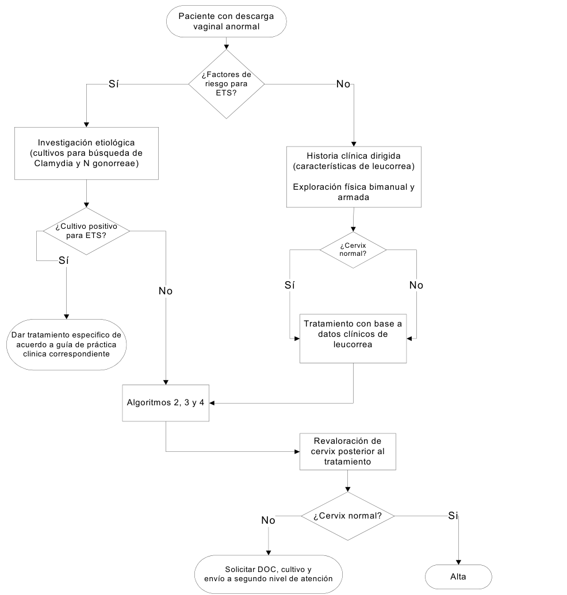

# Cervicovaginitis

**Siglas de uso frecuente.** Los términos se desarrollan al inicio de cada sección; las siglas se reservan para las menciones inmediatas.

| Sigla | Significado | Sigla | Significado |
|---|---|---|---|
| VB | Vaginosis bacteriana | CVV | Candidosis vulvovaginal |
| ITS | Infección de transmisión sexual | VIH | Virus de la inmunodeficiencia humana |
| KOH | Hidróxido de potasio | NAAT | Prueba de amplificación de ácidos nucleicos |
| CDC | Centers for Disease Control and Prevention | GPC | Guía de práctica clínica del IMSS |
| DIU | Dispositivo intrauterino | RPM | Rotura prematura de membranas |

---

## 1. Conceptos generales

### 1.1 Definición

La cervicovaginitis infecciosa es la inflamación de la mucosa vaginal, y a menudo del cuello uterino, causada sobre todo por tres agentes: bacterias (vaginosis bacteriana), hongos del género *Candida* y el protozoo *Trichomonas vaginalis*. Se manifiesta por uno o más de los siguientes datos: aumento de la secreción vaginal, prurito, ardor, irritación, disuria, dispareunia y mal olor.[^d1]

Dentro de este concepto se distinguen dos situaciones con un mecanismo diferente:

- **Vaginitis y vaginosis:** afectan a la vagina. La vaginosis bacteriana no es propiamente una inflamación: es un desequilibrio de la flora en el que proliferan bacterias anaerobias y desaparecen los lactobacilos, por lo que la vagina pierde su acidez (pH mayor de 4,5) sin signos inflamatorios.[^d1][^d2]
- **Cervicitis:** afecta al epitelio cilíndrico del endocérvix y se debe sobre todo a *Chlamydia trachomatis* y *Neisseria gonorrhoeae*, que son infecciones de transmisión sexual. Se reconoce por un exudado endocervical purulento o mucopurulento o por un sangrado endocervical que se provoca con facilidad al pasar un hisopo.[^cdc2021]

### 1.2 Flora y secreción vaginal normales

En condiciones normales predominan los lactobacilos, que mantienen un pH vaginal de 3,5 a 4,5. La secreción fisiológica varía con los cambios hormonales antes y después de la ovulación, por lo que no requiere tratamiento. Se considera anormal la secreción lechosa o blanquecina, amarillenta, fétida (con olor a pescado), pruriginosa o acompañada de ardor genital.[^d1] *Candida* forma parte de la flora normal de la vulva y la vagina, y entre el 10 y el 15% de las mujeres sin síntomas están colonizadas; su presencia sin síntomas no requiere estudios ni tratamiento.[^d2]

### 1.3 Vaginitis aeróbica

La flora aerobia de origen intestinal, como *Escherichia coli*, puede sustituir a los lactobacilos y producir la **vaginitis aeróbica**, una alteración de la flora con inflamación que es distinta de la vaginosis bacteriana.[^donders] En el embarazo se ha asociado con parto pretérmino, rotura prematura de membranas e infección fetal.[^avpreg] Su diagnóstico se apoya en el exudado con cultivo, y las guías del IMSS y de los CDC no establecen su tratamiento. Corresponde a las "bacterias gramnegativas" que mencionan algunos programas de evaluación.[^donders][^d1][^cdc2021]

### 1.4 Frecuencia y repercusión

Las infecciones genitales son una de las primeras causas de consulta. La vaginosis bacteriana es la causa más frecuente de vaginitis infecciosa y la candidosis vulvovaginal, la segunda. Alrededor del 75% de las mujeres tendrá al menos un episodio de candidosis en su vida, y del 5 al 10%, candidosis recurrente.[^d1][^d2]

Hasta el 60% de las infecciones genitales son asintomáticas. Su importancia radica en que aumentan el riesgo de enfermedad inflamatoria pélvica, de complicaciones del embarazo (como la rotura prematura de membranas), de adquirir el VIH y de infertilidad.[^d1]

Dos asociaciones con otras infecciones de transmisión sexual tienen respaldo en metaanálisis: la tricomoniasis aumentó alrededor de 1,5 veces el riesgo de adquirir el VIH, y la vaginosis bacteriana se asoció con infección por el virus del papiloma humano y con neoplasia intraepitelial cervical. Por eso la mujer con cervicovaginitis se estudia para VIH y sífilis según su riesgo, y se revisa la fecha de su última citología.[^masha][^liang][^d1]

---

## 2. Abordaje de la mujer con flujo vaginal anormal

### 2.1 Interrogatorio

Los síntomas por sí solos no distinguen las causas de vaginitis, por lo que el diagnóstico se apoya en la exploración y en el estudio microscópico o microbiológico.[^d1][^d2] El interrogatorio recoge:[^d1]

- **Características del flujo:** cantidad, color, consistencia, olor y síntomas asociados (prurito, ardor, disuria, dispareunia, dolor pélvico).
- **Historia sexual:** número de parejas, cambio reciente de pareja y uso de condón, para estimar el riesgo de una infección de transmisión sexual.
- **Factores predisponentes:** duchas vaginales, diabetes, uso reciente de antibióticos o corticoides, inmunodepresión y embarazo.
- **Cuerpos extraños:** un tampón o un condón retenidos pueden causar flujo anormal y deben descartarse.

### 2.2 Exploración

Toda mujer con flujo anormal persistente se explora. La exploración incluye la palpación abdominal en busca de dolor, la inspección de la vulva, la especuloscopia de las paredes vaginales y del cuello, la descripción de la secreción (cantidad y consistencia) y el tacto bimanual.[^d1][^d2] Antes de explorar se pide autorización, se explica el procedimiento, se ofrece una bata y se asegura la privacidad; quien explora se lava las manos y usa guantes.[^manualcito]

**Inspección vulvar.** Se buscan eritema, edema, fisuras, excoriaciones o huellas de rascado y lesiones satélite, que orientan a candidosis, y el flujo que sale por el introito.[^d2][^manualcito]

**Técnica de la especuloscopia.**[^manualcito][^d1]

1. Se elige un espejo vaginal de Graves de tamaño adecuado.
2. Si se van a tomar muestras, se coloca **sin lubricantes**, porque alteran la muestra; puede humedecerse con solución fisiológica o agua.
3. Se introduce cerrado, con un ángulo de 45° a 90° respecto del piso de la vagina, mientras la paciente puja.
4. Se avanza hasta el tercio medio, se gira a la posición horizontal y se abren las valvas hasta exponer el cuello sin lastimarlo.
5. Se inspeccionan las paredes vaginales, la secreción (cantidad, color, consistencia y olor), los fondos de saco y el cuello (tamaño, forma, color, orificio externo y lesiones). El cuello inflamado se ve rojo violáceo, despulido y sangra al roce del espejo.
6. Se toman las muestras antes de cualquier tacto.
7. Se retira el espejo cerrándolo lentamente, mientras se revisan las paredes vaginales hasta el introito.

**Toma de muestras.**[^d1][^d2][^cdc2021]

- **pH vaginal:** tira de pH sobre la secreción de la pared lateral de la vagina.
- **Exudado vaginal:** hisopo de las paredes vaginales para el examen en fresco con solución salina y con KOH al 10%, y para Gram y cultivo.
- **Muestra endocervical o vaginal, u orina:** NAAT para *Chlamydia*, gonococo y tricomonas cuando hay cervicitis o factores de riesgo de una infección de transmisión sexual.

**Hallazgos según la causa.**[^d1][^d2][^cdc2021]

- **Vaginosis bacteriana:** vulva y vagina sin inflamación; secreción fluida, homogénea, blanco-grisácea, con olor a pescado; cuello sin alteraciones.
- **Candidosis:** eritema, edema, fisuras y lesiones satélite; secreción blanca, espesa, grumosa y adherente, sin mal olor.
- **Tricomoniasis:** vulva y vagina eritematosas; flujo abundante, amarillo-verdoso, espumoso y fétido; cuello con puntilleo rojo ("en fresa").
- **Cervicitis:** exudado endocervical purulento o mucopurulento, o sangrado endocervical que se provoca con facilidad al pasar un hisopo.
- **Embarazada:** se comprueba que el orificio cervical esté cerrado y que no salga líquido amniótico, para no confundir una rotura prematura de membranas con un flujo.[^gpcprenatal]

**Tacto bimanual.** Se hace después de la especuloscopia y valora el útero, los anexos y el dolor.[^d1]

- **Cuello uterino:** si está alterado, se revalora después del tratamiento; si la alteración persiste, se solicitan citología cervical y cultivo y se refiere al segundo nivel.[^d1]
- **Cervicitis:** ante un episodio nuevo se valoran los signos de enfermedad inflamatoria pélvica: dolor a la movilización del cuello, dolor uterino o dolor anexial.[^cdc2021]

### 2.3 Pruebas diagnósticas

**Tabla 1. Pruebas de consultorio para el diagnóstico de la vaginitis.**[^d1][^d2][^cdc2021][^amsel]

| Prueba | Técnica | Interpretación |
|------------|------------------------|------------------------------------|
| pH vaginal | Tira de pH sobre la secreción de la pared lateral de la vagina | Normal de 3,5 a 4,5. Mayor de 4,5 en la vaginosis bacteriana y a menudo en la tricomoniasis; en la candidosis suele ser normal |
| Prueba de aminas | Se añade KOH al 10% a la secreción | Un olor a pescado orienta a vaginosis bacteriana |
| Examen en fresco con solución salina | Microscopía inmediata de la secreción | Células clave (células epiteliales cubiertas de bacterias) en la vaginosis; tricomonas móviles en la tricomoniasis, con una sensibilidad de alrededor del 60% |
| Examen en fresco con KOH al 10% | El KOH destruye las células y deja ver los hongos | Levaduras, hifas o pseudohifas en la candidosis |
| Tinción de Gram | Frotis teñido de la secreción | Es la referencia para la vaginosis bacteriana; según los criterios de Hay e Ison, el grado 1 es normal (predominan los lactobacilos), el 2 es intermedio y el 3 es vaginosis (predominan *Gardnerella* o *Mobiluncus*) |
| Cultivo para *Candida* | Siembra de la secreción | Identifica la especie; se reserva para la candidosis complicada o recurrente |
| NAAT | Muestra vaginal o endocervical, u orina | Es la prueba de elección para tricomonas, *Chlamydia* y gonococo |
| Citología cervicovaginal | Papanicolaou | Puede revelar vaginosis, tricomonas o *Candida* como hallazgo; es complementaria |

**Orden de las pruebas.** En las formas leves, el pH vaginal es útil; en las moderadas o graves, se solicita el estudio microscópico (examen en fresco, Gram o citología) acompañado de los hallazgos clínicos para quien lo interprete. Si no se dispone de microscopía, las formas no complicadas pueden tratarse de forma empírica según la clínica, con vigilancia de la respuesta.[^d1][^d2] Los cultivos bacterianos no se piden ante la sospecha de vaginosis, porque la flora es polimicrobiana y su resultado no orienta el tratamiento.[^d2]

**Tabla 2. Diagnóstico diferencial de las vaginitis infecciosas.**[^d1][^d2]

| Rasgo | Vaginosis bacteriana | Candidosis vulvovaginal | Tricomoniasis |
|------------|------------------|------------------|------------------|
| Agente | Anaerobios (*Gardnerella vaginalis*, *Mycoplasma hominis*, *Prevotella*, *Mobiluncus*) con pérdida de lactobacilos | *Candida albicans* (85 a 95%), *C. glabrata* y otras | *Trichomonas vaginalis* |
| Flujo | Homogéneo, fluido, blanco o grisáceo, con olor a pescado | Blanco, espeso y grumoso ("como requesón"), adherente, sin mal olor | Abundante, amarillo-verdoso, espumoso, fétido |
| Síntomas | Por lo general, ninguno además del flujo y el olor; sin dolor ni prurito | Prurito frecuente, ardor vulvar, disuria y dispareunia | Disuria, dispareunia, dolor pélvico bajo |
| Signos | Sin inflamación de la vagina ni de la vulva | Eritema y edema vulvovaginal, fisuras, excoriaciones y lesiones satélite | Vaginitis intensa, eritema vulvar y cuello en fresa (puntilleo rojo) |
| pH vaginal | Mayor de 4,5 | Normal | Habitualmente mayor de 4,5 |
| Transmisión sexual | Se asocia a la actividad sexual, pero no se trata a la pareja de rutina | No se transmite sexualmente | Es una ITS: se trata a la pareja |

---

## 3. Vaginosis bacteriana

### 3.1 Mecanismo y factores de riesgo

La vaginosis bacteriana se produce cuando los lactobacilos son sustituidos por un crecimiento excesivo de bacterias anaerobias. Al desaparecer los lactobacilos, la vagina pierde su acidez y el pH supera 4,5; las aminas que producen los anaerobios explican el olor a pescado.[^d1][^d2] Se asocia a las duchas vaginales, al cunnilingus receptivo, al cambio reciente de pareja sexual, al tabaquismo y a otras infecciones de transmisión sexual, por lo que se aconseja evitarlos.[^d1]

### 3.2 Diagnóstico

**Clínica.** Flujo vaginal fluido, blanco o grisáceo, con olor a pescado, sin dolor, prurito ni irritación.[^d1]

**Criterios de Amsel.** El diagnóstico clínico requiere al menos tres de estos cuatro criterios:[^amsel][^cdc2021]

- flujo fino y homogéneo;
- células clave en más del 20% de las células epiteliales del examen en fresco;
- pH vaginal mayor de 4,5;
- prueba de aminas positiva (olor a pescado al añadir KOH al 10%).

**Tinción de Gram.** Es la prueba de referencia; se interpreta con la escala de Nugent o con los grados de Hay e Ison (tabla 1).[^d1][^cdc2021]

### 3.3 Tratamiento

**Indicaciones.** Se tratan las mujeres sintomáticas, las asintomáticas que van a someterse a un procedimiento quirúrgico y las asintomáticas que desean tratarse. Con síntomas característicos y bajo riesgo de infección de transmisión sexual, el tratamiento empírico puede iniciarse sin pruebas.[^d1]

**Tabla 3. Tratamiento de la vaginosis bacteriana.**[^d1][^cdc2021]

| Tipo | Esquema |
|------------|------------------------------------------------|
| Recomendado | Metronidazol, 500 mg por vía oral cada 12 horas durante 7 días |
| Recomendado | Metronidazol en gel al 0,75%, un aplicador (5 g) intravaginal al día durante 5 días |
| Recomendado | Clindamicina en crema al 2%, un aplicador (5 g) intravaginal al acostarse durante 7 días |
| Alternativo | Clindamicina, 300 mg por vía oral cada 12 horas durante 7 días |
| Alternativo | Clindamicina en óvulos de 100 mg, intravaginal al acostarse durante 3 días |
| Alternativo | Tinidazol, 2 g por vía oral al día durante 2 días, o 1 g al día durante 5 días |
| Alternativo | Secnidazol, 2 g por vía oral en dosis única |

**Precauciones.**

- La GPC recomienda evitar el alcohol durante el tratamiento con metronidazol por el riesgo de reacción similar a la del disulfiram.[^d1]
- La GPC desaconseja la clindamicina durante la lactancia.[^d1]

**Pareja.** No se estudia ni se trata de rutina, aunque puede considerarse según el criterio clínico.[^d1] Un ensayo de 2025 en parejas heterosexuales monógamas mostró que tratar también al varón (metronidazol oral y crema de clindamicina en la piel del pene durante 7 días) redujo la recurrencia a las 12 semanas del 63 al 35% (anexo A).[^vodstrcil]

**Probióticos.** La GPC permite considerarlos cuando se documenta la ausencia o disminución de lactobacilos, si se dispone del recurso.[^d1]

### 3.4 Embarazo

**Vaginosis sintomática.** Se trata, porque se asocia a aborto, parto pretérmino, rotura prematura de membranas y endometritis. El metronidazol oral es de elección, sobre todo si hay antecedente de parto pretérmino o de rotura prematura de membranas; con alergia o intolerancia se usa clindamicina en crema vaginal al 2% durante 7 días o clindamicina oral, 300 mg cada 12 horas durante 7 días.[^d1]

**Seguridad del metronidazol.** Puede usarse en cualquier trimestre: las revisiones de la literatura no han encontrado efecto teratógeno. La GPC de control prenatal indica 250 mg por vía oral cada 8 horas durante 7 días, y los CDC, 500 mg cada 12 horas durante 7 días.[^struthers][^cdc2021][^gpcprenatal]

**Vaginosis asintomática.** La GPC de 2014 recomienda tratarla para prevenir la rotura prematura de membranas. Las guías posteriores (ACOG, CDC, USPSTF y SOGC) desaconsejan buscarla y tratarla de rutina en la embarazada asintomática, porque su tratamiento no ha reducido el parto pretérmino (anexo A).[^lockwood]

---

## 4. Candidosis vulvovaginal

### 4.1 Definición y factores de riesgo

La candidosis vulvovaginal es la infección del epitelio estrogenizado de la vagina y el vestíbulo por levaduras del género *Candida*, que puede extenderse a los labios y a la región inguinal. *Candida albicans* causa del 85 al 95% de los casos; le sigue *C. glabrata*.[^d2]

**Factores de riesgo.** El embarazo es el único que se ha correlacionado de forma consistente: la progesterona aumenta el glucógeno vaginal, que sirve de nutriente a la levadura, y los estrógenos aumentan su adherencia al epitelio. Se citan también, con evidencia menos consistente, la diabetes mal controlada, la inmunodepresión (incluido el tratamiento con corticoides), los antibióticos sistémicos, los anticonceptivos, la obesidad y el periodo premenstrual. La humedad, el calor, la maceración y la fricción también la favorecen.[^d1][^d2]

**Transmisión.** Su incidencia aumenta con el inicio de la actividad sexual, pero no se ha demostrado que se transmita sexualmente; por eso no se trata a la pareja ni se exige abstinencia.[^d1][^d2]

### 4.2 Clínica y clasificación

**Clínica.** Prurito vulvar, ardor o dolor vaginal, dispareunia y disuria, con un flujo blanco, espeso y grumoso, adherente y sin mal olor. A la exploración hay eritema y edema vulvovaginal, fisuras, excoriaciones y lesiones satélite. Los síntomas suelen empeorar la semana previa a la menstruación.[^d1][^d2]

**Clasificación.** Distinguir la forma no complicada de la complicada decide el tratamiento y la referencia:[^d1][^d2]

- **No complicada:** episodio esporádico (menos de 4 al año), síntomas leves o moderados, probablemente por *C. albicans*, en una mujer inmunocompetente.
- **Complicada:** forma grave (eritema vulvar extenso, edema, excoriaciones y fisuras), recurrente, por especies distintas de *C. albicans*, o en una mujer con diabetes, inmunodepresión, VIH, desnutrición o embarazo.
- **Recurrente:** 4 o más episodios sintomáticos y documentados en un año, con resolución entre ellos (anexo A).
- **Crónica:** síntomas persistentes, sin remisión entre los episodios.

### 4.3 Diagnóstico

**Examen en fresco.** Se toma una muestra de las paredes vaginales para observarla con solución salina y con KOH al 10%, o con tinción de Gram, en busca de levaduras en gemación, hifas o pseudohifas. Si se dispone del recurso, debe solicitarse siempre ante la sospecha.[^d2]

**Cultivo.** Es indispensable en la candidosis complicada, porque identifica la especie: *C. glabrata* no responde a los azoles. En la no complicada es preferible, pero no imprescindible.[^d2]

**Sin recursos de laboratorio.** La forma no complicada puede tratarse de forma empírica, vigilando la respuesta; la complicada se envía al siguiente nivel. El autotratamiento y el tratamiento empírico basado solo en los síntomas no bastan para establecer el diagnóstico, por lo que una falta de respuesta obliga a confirmar la causa.[^d2]

### 4.4 Tratamiento de la forma no complicada

Los azoles alivian los síntomas y negativizan el cultivo en el 80 a 90% de las pacientes, sin diferencias de eficacia entre la vía oral y la vaginal ni entre los esquemas cortos y los largos. La elección depende de la preferencia de la paciente, las contraindicaciones, las alergias y el costo. Los azoles tópicos son más eficaces que la nistatina.[^d2]

**Tabla 4. Tratamiento de la candidosis vulvovaginal no complicada.**[^d1][^d2]

| Vía | Esquema |
|------------|------------------------------------------------|
| Oral | Fluconazol, 150 mg en dosis única (primera línea) |
| Oral | Itraconazol, 200 mg cada 12 horas durante 1 día |
| Vaginal | Clotrimazol en comprimido vaginal de 500 mg en dosis única o de 200 mg al día durante 3 días |
| Vaginal | Miconazol en óvulo de 1200 mg en dosis única o de 400 mg al día durante 3 días; o crema al 2%, una aplicación diaria durante 7 días |
| Vaginal | Isoconazol en óvulo de 600 mg en dosis única |
| Vaginal | Nistatina, 100 000 UI en óvulo o tableta vaginal al día durante 14 días |

**Efectos adversos.** Los azoles tópicos causan ardor o irritación local en el 1 al 10% de los casos, lo que debe considerarse si los síntomas persisten, y pueden dañar los condones y diafragmas de látex. Los orales causan en ocasiones náusea, dolor abdominal y cefalea, y rara vez elevan las enzimas hepáticas; el itraconazol produce más efectos adversos que el fluconazol.[^d1][^d2]

### 4.5 Tratamiento de la forma complicada

**Candidosis grave.** Fluconazol, 150 mg por vía oral, con una segunda dosis a las 72 horas.[^d2]

**Enfermedad de base (diabetes, VIH, corticoides).** Se controla la enfermedad subyacente y se evitan los esquemas cortos: nistatina vaginal durante 14 días, o fluconazol de 100, 150 o 200 mg cada tercer día por tres dosis (días 1, 4 y 7). En la mujer con VIH los esquemas no difieren de los de la mujer sin VIH.[^d2]

**Candidosis recurrente.** Se busca una enfermedad subyacente y una especie distinta de *C. albicans*, y se trata en dos fases:[^d2]

- **Inducción:** hasta lograr la remisión micológica, con terapia tópica de 7 a 14 días (nistatina 14 días, o 21 días si es *C. glabrata*) o fluconazol de 100, 150 o 200 mg cada tercer día por tres dosis.
- **Mantenimiento:** fluconazol de 100, 150 o 200 mg una vez por semana durante 6 meses. Si no es posible, itraconazol 200 mg cada 12 horas un día al mes, o clotrimazol tópico 200 mg dos veces por semana, durante 6 meses.
- **Resultado:** al terminar el mantenimiento, casi el 91% está en remisión, pero en los 6 meses siguientes recae más de la mitad. Un esquema de fluconazol decreciente durante un año logró una eficacia del 77%.

**Especies distintas de *C. albicans*.** Los azoles fallan con frecuencia frente a *C. glabrata*. Se usa nistatina vaginal durante 21 días; el ácido bórico vaginal (600 mg al día durante 7 a 21 días según la guía) logra curaciones de hasta el 70% y no se usa en el embarazo.[^d2][^cid2022]

**Ketoconazol oral.** La GPC de 2014 lo incluía en la candidosis recurrente; la FDA limitó su uso en 2013 por hepatotoxicidad grave y no debe ser un tratamiento de primera línea (anexo A).[^d1][^fdaketo]

**Remedios no probados.** No hay ensayos que apoyen el aceite de árbol de té, el ajo, el yogur ni las duchas vaginales; las duchas se han asociado en estudios observacionales a enfermedad inflamatoria pélvica, endometritis y embarazo ectópico.[^d2]

### 4.6 Embarazo y lactancia

- **Asintomática:** la embarazada colonizada sin síntomas no requiere tratamiento.[^d1]
- **Sintomática:** solo se usan azoles tópicos durante 7 días, porque los orales se han asociado a aborto y malformaciones. En el IMSS la opción disponible es la nistatina vaginal durante 14 días.[^d2][^cid2022]
- **Azoles orales:** la GPC los contraindica en el embarazo y la lactancia.[^d1]

### 4.7 Referencia y seguimiento

- **Al segundo nivel (ginecología):** la candidosis no complicada tratada empíricamente sin respuesta, para establecer el diagnóstico etiológico; la complicada sin recursos de laboratorio; las mujeres con VIH; y las infecciones por especies distintas de *C. albicans* que no responden.[^d1][^d2]
- **Al tercer nivel (infectología):** la candidosis recurrente o complicada cuando no se puede identificar la especie ni estudiar la resistencia.[^d2]
- **Seguimiento:** se orienta a la paciente para que vuelva si los síntomas persisten o recurren. La candidosis grave puede incapacitar para las actividades diarias y laborales, y justifica de 1 a 3 días de incapacidad.[^d1]

---

## 5. Tricomoniasis

### 5.1 Clínica y diagnóstico

*Trichomonas vaginalis* es un protozoo de transmisión sexual. Produce un flujo abundante, amarillento o amarillo-verdoso, espumoso y fétido, con disuria si afecta a la uretra, dolor pélvico bajo, dispareunia, vulvovaginitis con edema y eritema, y un cuello uterino con puntilleo rojo ("en fresa"). Puede ser asintomática.[^d1][^d2]

**Por qué importa.** Al ser una infección de transmisión sexual, su diagnóstico debe ser confiable por sus implicaciones para la paciente y su pareja. En el embarazo se asocia a parto pretérmino, rotura prematura de membranas y bajo peso al nacer, y en la mujer con VIH aumenta la transmisión del virus; en los casos recurrentes se investiga la infección por VIH.[^d1][^gpcprenatal][^lockwood]

**Diagnóstico.** El examen en fresco detecta tricomonas móviles con una sensibilidad de alrededor del 60%, por lo que un resultado negativo no la descarta. Pueden detectarse también en la citología, por cultivo, con pruebas rápidas de antígeno o de ADN, y con NAAT, que es la prueba más sensible. Si la citología o el frotis informan tricomonas y no hay prueba confirmatoria, se trata.[^d1][^cdc2021]

### 5.2 Tratamiento

El tratamiento es sistémico (oral), porque el metronidazol en gel vaginal no es eficaz contra las tricomonas.[^d1][^cdc2021]

**Tabla 5. Tratamiento de la tricomoniasis.**[^d1][^cdc2021][^gpcprenatal]

| Situación | Esquema |
|------------------|------------------------------------------|
| Mujer, incluida la embarazada | Metronidazol, 500 mg por vía oral cada 12 horas durante 7 días |
| Varón | Metronidazol, 2 g por vía oral en dosis única |
| Alternativa | Tinidazol o secnidazol, 2 g por vía oral en dosis única |

En la mujer, el esquema de 7 días redujo a la mitad la persistencia de la infección frente a la dosis única de 2 g, que la GPC de 2014 aún incluía como opción (anexo A).[^gpcprenatal]

**Pareja y prevención de la reinfección.**[^d1]

- La pareja o parejas reciben tratamiento simultáneo.
- No se mantienen relaciones sexuales, ni genitales ni orales, hasta que ambos completen el tratamiento y estén asintomáticos.
- Se recomienda el uso de preservativo.

**Seguimiento.** La paciente se revalora en un plazo no mayor de 3 meses, porque la reinfección alcanza el 17%. Si el tratamiento falla, se comprueba el cumplimiento, se descarta que la paciente haya vomitado el metronidazol, se busca una reinfección y se confirma que la pareja se trató.[^d1]

**Lactancia y alcohol.** La GPC indica suspender la lactancia durante el tratamiento con metronidazol y hasta 12 a 24 horas después de terminarlo, y evitar el alcohol por la reacción similar a la del disulfiram.[^d1]

---

## 6. Cervicitis por *Chlamydia trachomatis* y *Neisseria gonorrhoeae*

### 6.1 Clínica y diagnóstico

**Clínica.** La infección por *Chlamydia* es asintomática en alrededor del 75% de las mujeres y del 50% de los varones, lo que dificulta su control. Cuando da síntomas, produce ardor al orinar, dolor en hipogastrio, prurito y escozor vaginal durante el coito y un flujo amarillento.[^d1] La cervicitis se reconoce por un exudado endocervical purulento o mucopurulento, o por un sangrado endocervical que se provoca con facilidad; ante un episodio nuevo se valora la enfermedad inflamatoria pélvica y se buscan ambos agentes.[^cdc2021]

**Diagnóstico.** Las NAAT en muestra vaginal, endocervical o de orina son las pruebas de elección para *Chlamydia* y gonococo. La mujer con sospecha de infección de transmisión sexual se estudia además para sífilis.[^d1][^cdc2021] En el embarazo se busca la clamidia en las menores de 25 años y en las mayores con factores de riesgo.[^lockwood]

### 6.2 Tratamiento

**Tabla 6. Tratamiento de la cervicitis por *Chlamydia* y gonococo.**[^d1][^cdc2021][^cdcgono]

| Infección | Fuera del embarazo | En el embarazo |
|------------|------------------------------|------------------------------|
| *Chlamydia trachomatis* | Recomendado: doxiciclina, 100 mg por vía oral cada 12 horas durante 7 días. Alternativas: azitromicina, 1 g por vía oral en dosis única, o levofloxacino, 500 mg al día durante 7 días | Azitromicina, 1 g por vía oral en dosis única; alternativa: amoxicilina, 500 mg cada 8 horas durante 7 días. La doxiciclina y las quinolonas están contraindicadas |
| *Neisseria gonorrhoeae* | Ceftriaxona, 500 mg por vía intramuscular en dosis única (1 g si la paciente pesa 150 kg o más) | Igual |
| Gonococo sin descartar *Chlamydia* | Se añade doxiciclina durante 7 días | Se añade azitromicina, 1 g en dosis única |

La GPC de 2014 situaba la azitromicina y la doxiciclina como primera línea y la eritromicina, el levofloxacino y el ofloxacino como alternativas; los CDC (2021) prefieren la doxiciclina por su mayor eficacia (anexo A).[^d1][^cdc2021]

**Pareja y seguimiento.**[^d1][^cdc2021][^lockwood]

- La pareja recibe tratamiento.
- En la embarazada con clamidia se comprueba la curación a las 3 o 4 semanas y se repite la prueba a los 3 meses; en la gonorrea se repite la prueba a los 3 meses.
- Se promueve el preservativo para prevenir nuevas infecciones.

---

## 7. Situaciones especiales

**Tabla 7. Tratamiento de la cervicovaginitis durante el embarazo.**[^d1][^d2][^cdc2021][^lockwood]

| Infección | Conducta |
|------------------|------------------------------------------|
| Vaginosis bacteriana sintomática | Metronidazol oral; alternativa, clindamicina oral o en crema vaginal durante 7 días |
| Vaginosis bacteriana asintomática | No se busca ni se trata de rutina |
| Candidosis sintomática | Azoles tópicos durante 7 días (en el IMSS, nistatina vaginal durante 14 días); sin azoles orales |
| Candidosis asintomática | No se trata |
| Tricomoniasis | Metronidazol, 500 mg cada 12 horas durante 7 días; tratamiento de la pareja |
| *Chlamydia* | Azitromicina, 1 g en dosis única; curación comprobada a las 3 o 4 semanas |
| Gonorrea | Ceftriaxona, 500 mg intramuscular en dosis única |

**Diagnóstico diferencial en la embarazada.** La salida de líquido por el orificio cervical no es un flujo: es una rotura prematura de membranas y se refiere de inmediato a ginecoobstetricia. La disuria puede deberse a una infección urinaria, que se busca con examen general de orina y urocultivo. La embarazada con cervicovaginitis se interroga además sobre los datos de alarma obstétrica: salida de líquido o sangre, contracciones antes de la semana 37, disminución de los movimientos fetales y fiebre.[^gpcprenatal][^nom007]

**Mujer con VIH.** Se refiere al segundo nivel. Los esquemas para la candidosis son los mismos que sin VIH, y la tricomoniasis se busca de forma sistemática por su efecto sobre la transmisión del virus.[^d1][^d2][^lockwood]

**Diabetes.** El tratamiento de la candidosis incluye el control de la glucemia y esquemas no cortos.[^d2]

**Dispositivo intrauterino.** La GPC de 2014 sugiere cambiar de método en la mujer con vaginosis bacteriana y DIU (anexo A).[^d1]

---

## 8. Integración: secuencia de decisiones

1. **Valorar el flujo:** interrogar sus características, la historia sexual y los factores predisponentes; descartar un cuerpo extraño.
2. **Explorar:** vulva, paredes vaginales, cuello uterino y tacto bimanual; ante una cervicitis, valorar los signos de enfermedad inflamatoria pélvica.
3. **Medir el pH y hacer el examen en fresco:** pH mayor de 4,5 con células clave y prueba de aminas positiva orienta a vaginosis; pH normal con levaduras o hifas, a candidosis; tricomonas móviles, a tricomoniasis.
4. **Buscar infecciones de transmisión sexual:** si hay factores de riesgo o cervicitis, NAAT para *Chlamydia*, gonococo y tricomonas, y prueba de sífilis.
5. **Tratar según la causa:** vaginosis con metronidazol o clindamicina; candidosis no complicada con fluconazol oral o un azol tópico; tricomoniasis con metronidazol de 7 días y tratamiento de la pareja; clamidia con doxiciclina (azitromicina en el embarazo); gonorrea con ceftriaxona.
6. **Adaptar al embarazo:** tratar la vaginosis sintomática, usar solo azoles tópicos para la candidosis y evitar doxiciclina y quinolonas.
7. **Referir:** VIH, falta de respuesta, candidosis complicada sin laboratorio, especies distintas de *C. albicans* y cuello uterino alterado que persiste tras el tratamiento.
8. **Seguir:** revalorar la tricomoniasis antes de 3 meses, comprobar la curación de la clamidia en el embarazo y pedir a la paciente que vuelva si los síntomas persisten o recurren.

---

## Anexo A. Discrepancias normativas con implicación clínica

**Tabla A1. Discrepancias entre las fuentes y las recomendaciones posteriores.**[^d1][^d2][^cdc2021][^cdcgono][^lockwood][^vodstrcil][^fdaketo][^rvvc2022]

| Tema | Fuente o recomendación previa | Recomendación posterior verificada | Implicación |
|------------|------------------|------------------------|------------------|
| Metronidazol en dosis única de 2 g para la vaginosis | GPC 2014: opción de primera línea | CDC 2021: no figura entre los esquemas recomendados ni alternativos | Usar el esquema de 7 días |
| Vaginosis asintomática en el embarazo | GPC 2014: tratarla para prevenir la rotura prematura de membranas | ACOG, CDC, USPSTF y SOGC: no buscarla ni tratarla de rutina, porque no reduce el parto pretérmino | Tratar solo la sintomática |
| Tratamiento de la pareja en la vaginosis | GPC 2014 y CDC 2021: no de rutina | Ensayo de 2025: tratar al varón de una pareja monógama redujo la recurrencia | Puede considerarse en la vaginosis recurrente; las guías aún no lo han incorporado |
| Tricomoniasis en la mujer | GPC 2014: metronidazol 500 mg cada 12 horas 7 días o 2 g en dosis única; en el embarazo, 2 g en dosis única | CDC 2021 y GPC de control prenatal 2022: 7 días en todas las mujeres, incluidas las embarazadas | Usar el esquema de 7 días |
| Clamidia | GPC 2014: azitromicina o doxiciclina como primera línea | CDC 2021: doxiciclina 7 días de elección; azitromicina como alternativa y de elección en el embarazo | Preferir doxiciclina fuera del embarazo |
| Gonorrea | No figura en las fuentes | CDC 2020: ceftriaxona 500 mg intramuscular en dosis única | Aplicar el esquema de los CDC |
| Ketoconazol oral en la candidosis recurrente | GPC 2014: inducción y mantenimiento con ketoconazol | FDA 2013: no debe ser de primera línea por hepatotoxicidad grave; la GPC de 2019 ya no lo incluye | Usar fluconazol |
| Definición de candidosis recurrente | GPC 2019: 4 o más episodios al año | Consenso de expertos de 2022 que cita las guías de los CDC: 3 o más episodios en un año | Con 3 episodios en un año, estudiar y valorar la pauta de recurrente |
| Candidosis no complicada | GPC 2014 (cuadro 2): "mujer no inmunocompetente" | GPC 2019: mujer previamente sana | Se trata de un error de la guía de 2014: la forma no complicada ocurre en la mujer inmunocompetente |
| pH en la candidosis | GPC 2014 (cuadro 1): mayor de 4,5 | Las demás fuentes: pH normal | Un pH mayor de 4,5 orienta a vaginosis o tricomoniasis |
| *Chlamydia* como "vaginitis" | GPC 2014: la incluye entre las vaginitis | CDC: produce cervicitis (y uretritis) | Buscarla ante cervicitis o factores de riesgo de ITS |
| Vaginosis y DIU | GPC 2014: sugerir cambio de método | No figura en las demás guías revisadas | No justifica por sí misma retirar el DIU |
| Cultivo en la sospecha de ITS | Algoritmo de la GPC 2014: cultivos para *Chlamydia* y gonococo | CDC 2021: NAAT de elección | Usar NAAT si se dispone de ellas |

---

## Anexo B. Esquema institucional de la GPC de 2014

**Lectura actual.**[^d1][^cdc2021]

- La búsqueda de *Chlamydia* y gonococo se hace hoy con NAAT, no con cultivo.
- Los "algoritmos 2, 3 y 4" a los que remite corresponden a los tratamientos de las secciones 3 a 6, con los esquemas actualizados del anexo A.
- La revaloración del cuello uterino tras el tratamiento y la referencia si sigue alterado se mantienen.

---

## Referencias

[^d1]: Instituto Mexicano del Seguro Social. Prevención, diagnóstico y tratamiento de vaginitis infecciosa en mujeres en edad reproductiva en el primer nivel de atención. Guía de Referencia Rápida. México: CENETEC; 2014.
[^d2]: Instituto Mexicano del Seguro Social. Diagnóstico y tratamiento de candidosis vulvovaginal en mujeres mayores a 12 años de edad. Guía de Evidencias y Recomendaciones. GPC-IMSS-609-19. México: CENETEC; 2019.
[^cdc2021]: Workowski KA, Bachmann LH, Chan PA, et al. Sexually Transmitted Infections Treatment Guidelines, 2021. MMWR Recomm Rep. 2021;70(4):1-187.
[^cdcgono]: St Cyr S, Barbee L, Workowski KA, et al. Update to CDC's treatment guidelines for gonococcal infection, 2020. MMWR Morb Mortal Wkly Rep. 2020;69(50):1911-1916.
[^amsel]: Amsel R, Totten PA, Spiegel CA, Chen KC, Eschenbach D, Holmes KK. Nonspecific vaginitis. Diagnostic criteria and microbial and epidemiologic associations. Am J Med. 1983;74(1):14-22.
[^cid2022]: Nyirjesy P, Brookhart C, Lazenby G, Schwebke J, Sobel JD. Vulvovaginal candidiasis: a review of the evidence for the 2021 Centers for Disease Control and Prevention of Sexually Transmitted Infections Treatment Guidelines. Clin Infect Dis. 2022;74(Suppl 2):S162-S168.
[^rvvc2022]: Topical treatment of recurrent vulvovaginal candidiasis: an expert consensus. 2022. PMC8812501.
[^vodstrcil]: Vodstrcil LA, Plummer EL, Fairley CK, et al. Male-partner treatment to prevent recurrence of bacterial vaginosis. N Engl J Med. 2025;392(10):947-957.
[^fdaketo]: U.S. Food and Drug Administration. FDA Drug Safety Communication: FDA limits usage of Nizoral (ketoconazole) oral tablets due to potentially fatal liver injury and risk of drug interactions and adrenal gland problems. 26 de julio de 2013.
[^lockwood]: Lockwood CJ, Magriples U. Prenatal care: Initial assessment. UpToDate. Berghella V (ed). Revisión de la literatura hasta mayo de 2025.
[^gpcprenatal]: Instituto Mexicano del Seguro Social. Atención y cuidados multidisciplinarios en el embarazo. GPC-IMSS-028-22. México: CENETEC; 2022.
[^nom007]: Secretaría de Salud. Norma Oficial Mexicana NOM-007-SSA2-2016, Para la atención de la mujer durante el embarazo, parto y puerperio, y de la persona recién nacida. Diario Oficial de la Federación, 7 de abril de 2016. Fuente del usuario del tema 3.
[^manualcito]: Secretaría de Salud, Centro Nacional de Equidad de Género y Salud Reproductiva. Manual de procedimientos para la toma de la muestra de citología cervical. México: Secretaría de Salud; sin fecha (administración 2000-2006). Fuente del usuario del tema 9.
[^struthers]: Struthers BJ. Metronidazole appears not to be a human teratogen: review of literature. Infect Dis Obstet Gynecol. 1997;5(4):326-335.
[^donders]: Donders GG, Vereecken A, Bosmans E, et al. Definition of a type of abnormal vaginal flora that is distinct from bacterial vaginosis: aerobic vaginitis. BJOG. 2002;109(1):34-43.
[^avpreg]: The threat of aerobic vaginitis to pregnancy and neonatal morbidity. Afr J Reprod Health. 2017.
[^masha]: Masha SC, Cools P, Sanders EJ, et al. Trichomonas vaginalis and HIV infection acquisition: a systematic review and meta-analysis. Sex Transm Infect. 2019;95(1):36-42.
[^liang]: Liang Y, Chen M, Qin L, et al. A meta-analysis of the relationship between vaginal microecology, human papillomavirus infection and cervical intraepithelial neoplasia. Infect Agent Cancer. 2019;14:29.
