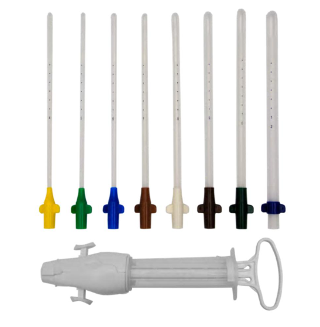
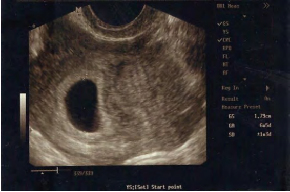

# Aborto

**Siglas de uso frecuente.** Los términos se desarrollan al inicio de cada sección; las siglas se reservan para las menciones inmediatas.

| Sigla | Significado | Sigla | Significado |
|---|---|---|---|
| hCG | Gonadotropina coriónica humana (fracción beta) | LCC | Longitud craneocaudal del embrión |
| DMS | Diámetro medio del saco gestacional | FCF | Frecuencia cardiaca fetal |
| AMEU | Aspiración manual endouterina | D y E | Dilatación y evacuación |
| LUI | Legrado uterino instrumental | DIU | Dispositivo intrauterino |
| IVE | Interrupción voluntaria del embarazo (por violencia sexual) | ILE | Interrupción legal del embarazo (por decisión de la mujer) |
| NA | Niñas y adolescentes | GPC | Guía de práctica clínica |
| OMS | Organización Mundial de la Salud | ACOG | American College of Obstetricians and Gynecologists |
| NICE | National Institute for Health and Care Excellence | NOM | Norma Oficial Mexicana |

---

## 1. Conceptos generales

### 1.1 Definición

El **aborto** es la terminación del embarazo, espontánea o inducida, antes de las 22 semanas completas de gestación o con un producto de menos de 500 g. Este es el límite que usan el Lineamiento técnico de aborto seguro y la GPC de amenaza de aborto de 2020; la GPC del IMSS de 2009 usaba las 20 semanas, y la OMS sitúa el límite del aborto espontáneo en las 24 semanas. La diferencia tiene consecuencias prácticas, porque determina si un evento se atiende y se registra como aborto o como muerte fetal (sección 15.10).[^d1][^d2][^d3]

La atención del aborto abarca dos grupos:

- **Aborto espontáneo:** amenaza de aborto, aborto en evolución o inevitable, incompleto, diferido (retenido) y muerte fetal intrauterina antes del límite gestacional.[^d3]
- **Aborto inducido:** la interrupción de un embarazo viable o no viable por decisión de la mujer, por violencia sexual o por otra causa prevista en la ley (sección 15).[^d3]

Según la edad gestacional, la amenaza de aborto es **temprana** si ocurre antes de las 14 semanas y **tardía** si ocurre entre las semanas 14 y 22.[^d2]

### 1.2 Frecuencia y repercusión

La pérdida espontánea es el desenlace más frecuente de la concepción. Se estima que entre el 50 y el 70% de los embarazos terminan en aborto espontáneo si se cuentan los que se pierden antes de diagnosticarse. Del total de concepciones, alrededor del 30% se pierde por falla de la implantación, otro 30% como aborto preclínico, un 10% como aborto clínico y solo el 30% llega a nacer vivo. Entre los embarazos ya diagnosticados clínicamente, del 15 al 20% se pierde en el primer trimestre o al inicio del segundo.[^d1]

El riesgo disminuye a medida que avanza la gestación con un embrión vivo, lo que permite orientar el pronóstico de cada consulta:

- con un feto vivo visible por ultrasonido a las 6 semanas, el riesgo de aborto es del 15 al 30%;
- de la semana 7 a la 9 baja al 5 a 10%;
- después de la semana 9 es de alrededor del 5%.[^d1][^d2]

El sangrado del primer trimestre es frecuente: lo presenta del 20 al 40% de las embarazadas, y la amenaza de aborto complica del 20 al 25% de los embarazos tempranos (uno de cada cinco). Solo del 3 al 16% de las amenazas termina en aborto, de modo que la mayoría de las mujeres que sangran conservan el embarazo. Aun así, la amenaza de aborto se asocia después con parto pretérmino, bajo peso al nacer y rotura prematura de membranas.[^d1][^d2]

En México, el aborto se encuentra entre las cinco primeras causas de muerte materna; entre 1990 y 2016 causó el 7,5% de las muertes maternas. La OMS calcula que alrededor del 10% de las muertes maternas en el mundo se deben a una sepsis relacionada con el aborto, mientras que en los países de ingresos altos sin restricciones legales la sepsis mortal tras un aborto inducido ocurre en menos de 1 por cada 10 000 casos. La diferencia refleja el peso de las condiciones en que se realiza y se atiende el aborto.[^d3]

### 1.3 Aborto seguro

La OMS considera **seguro** el aborto que se realiza con un método recomendado, adecuado a la edad gestacional, por personal capacitado o con información suficiente para autogestionarlo. El aborto es un servicio esencial y dependiente del tiempo: es más seguro cuanto antes se realiza respecto a la edad gestacional, por lo que su atención resolutiva no debe aplazarse. Por esa misma razón el Lineamiento considera obsoleto el legrado uterino instrumental y recomienda la aspiración endouterina y los medicamentos (sección 8.5).[^d3][^who2022]

## 2. Etiología y factores de riesgo

**Factores fetales.** Alrededor del 50% de las pérdidas tempranas del embarazo se deben a anomalías cromosómicas del embrión.[^d1][^d2]

**Edad materna.** Junto con el antecedente de pérdida temprana, es el factor de riesgo más frecuente en las mujeres que abortan. La pérdida clínicamente reconocida ocurre en el 9 a 17% de las mujeres de 20 a 30 años, en el 20% a los 35 años, en el 40% a los 40 años y en el 80% a los 45 años. Incluso con un cariotipo fetal normal, la incidencia de aborto es del 10% en las mujeres mayores de 36 años y del 3% en las menores de 30 años.[^d1][^d2][^acog200]

**Edad paterna.** El riesgo aumenta cuando el padre tiene más de 35 a 40 años.[^d1]

**Abortos previos.** El riesgo de aborto clínicamente detectable es del 11 al 15% en la mujer que nunca ha abortado y aumenta al 16, 25, 45 y 54% después de uno, dos, tres y cuatro abortos, respectivamente. Por eso la mujer con pérdidas previas requiere un estudio específico (sección 14).[^d1]

**Otros factores.** La obesidad se relaciona tanto con la pérdida gestacional como con la infertilidad. La GPC señala que existen medidas preventivas desde la preconcepción y tratamientos oportunos de las enfermedades maternas, sobre todo en las mujeres con comorbilidades que causan pérdidas tempranas.[^d2]

## 3. Clasificación clínica

### 3.1 Variantes clínicas

La clasificación se basa en tres datos que se obtienen en la primera valoración: si el orificio cervical está cerrado o abierto, si ya se expulsó tejido y si el embrión tiene actividad cardiaca. Su utilidad es práctica, porque cada variante tiene un pronóstico y un tratamiento distintos.[^d1][^d2][^d3]

- **Amenaza de aborto:** sangrado transvaginal, con o sin dolor abdominal o contracciones, sin dilatación cervical y sin expulsión del producto. El embrión está vivo y el embarazo puede continuar.[^d1][^d2]
- **Aborto inevitable o en evolución:** aborto que se espera que ocurra o que ocurre de forma inminente. Se reconoce por la dilatación cervical o la rotura de membranas; una vez que el cuello uterino comienza a dilatarse, el aborto ya no puede evitarse.[^d1][^d2]
- **Aborto incompleto:** hay productos de la concepción de un embarazo uterino no viable en el canal cervical, con expulsión parcial del contenido uterino; se presenta con dolor abdominal, sangrado y cuello permeable.[^d1][^d3]
- **Aborto completo:** expulsión total del producto de la concepción de un embarazo intrauterino. El cuello vuelve a cerrarse y el sangrado y el dolor disminuyen.[^d1]
- **Aborto diferido o retenido:** embarazo intrauterino no viable, diagnosticado por ultrasonido en ausencia de sangrado y sin cambios cervicales (cuello cerrado). Puede haber sangrado escaso y un útero claramente menor de lo esperado.[^d1][^d3]
- **Aborto séptico:** cualquier variante complicada por infección (sección 11.5).[^d1][^d3]

![Variantes del aborto espontáneo según el estado del orificio cervical y la actividad cardiaca fetal. Amenaza: orificio cerrado y actividad cardiaca presente. Inevitable: orificio abierto y actividad cardiaca presente o ausente. Incompleto: orificio abierto, restos en el canal cervical y sin actividad cardiaca. Completo: orificio cerrado, cavidad vacía y sin actividad cardiaca. Diferido: orificio cerrado, saco retenido y sin actividad cardiaca. Esquema de los apuntes del usuario, con rótulos originales en inglés.](assets/ab_tipos_aborto_espontaneo.png)

**Tabla 1. Datos que distinguen las variantes del aborto espontáneo.**[^d1][^d2][^d3]

| Variante | Sangrado y dolor | Orificio cervical | Expulsión | Ultrasonido |
|----------|------------------|-------------------|-----------|-------------|
| Amenaza | Sangrado escaso a moderado, con o sin dolor | Cerrado | No | Embrión vivo intrauterino |
| Inevitable | Sangrado y dolor en aumento; puede haber salida de líquido | Abierto o membranas rotas | Inminente | Embrión vivo o muerto |
| Incompleto | Sangrado y dolor persistentes | Abierto | Parcial, restos en el canal cervical | Restos intrauterinos |
| Completo | Sangrado y dolor que disminuyen | Cerrado | Total | Cavidad vacía |
| Diferido | Ausente o escaso | Cerrado | No | Embrión sin latido o saco sin embrión |

### 3.2 Situaciones de diagnóstico incierto

En el primer trimestre el ultrasonido no siempre permite clasificar en la primera consulta. Se reconocen dos situaciones que obligan a repetir el estudio antes de decidir:

- **Embarazo de localización desconocida:** prueba de embarazo positiva sin signos de embarazo intrauterino ni extrauterino y sin restos retenidos. Su importancia es que puede corresponder a un embarazo intrauterino temprano, a un aborto completo o a un embarazo ectópico, por lo que no se trata como aborto hasta aclarar la localización.[^d1][^acog193]
- **Embarazo de viabilidad incierta:** saco intrauterino o embrión cuyas medidas todavía no permiten afirmar ni descartar la viabilidad (tabla 3). Para confirmar o refutar la viabilidad, el estudio se repite con un intervalo mínimo de una semana.[^d1][^nice126]

La pérdida gestacional recurrente, que se define por el número de pérdidas y no por el cuadro clínico, se trata en la sección 14.

## 4. Diagnóstico

### 4.1 Evaluación clínica

La sospecha surge en una mujer en edad reproductiva con sangrado transvaginal, dolor cólico o dolor lumbosacro. La historia clínica establece la fecha de la última menstruación, la regularidad de los ciclos, el uso de anticonceptivos, los embarazos previos y sus resultados, las enfermedades crónicas, las alergias, los medicamentos actuales y el antecedente de infecciones de transmisión sexual.[^d2][^d3]

- **Cantidad de sangrado:** va desde el manchado hasta el choque hipovolémico, por lo que la primera valoración incluye los signos vitales y la búsqueda de inestabilidad hemodinámica.[^d2]
- **Especuloscopia:** permite ver el origen del sangrado, el estado del orificio cervical y la presencia de restos o de líquido.[^d2]
- **Exploración bimanual:** estima el tamaño uterino, que se compara con la edad gestacional por fecha de última menstruación. Un útero significativamente menor de lo esperado orienta a aborto diferido, y cualquier discordancia entre el tamaño uterino y la fecha de última menstruación justifica el ultrasonido.[^d3]
- **Edad gestacional:** se calcula desde la fecha de última menstruación cuando los ciclos previos fueron regulares y no había anticoncepción hormonal ni amenorrea de lactancia, y se complementa con la exploración bimanual. Para tratar el aborto, el Lineamiento basa la conducta en el tamaño uterino más que en las semanas calculadas.[^d3]

### 4.2 Ultrasonido

El ultrasonido transvaginal confirma que el embarazo es intrauterino, establece la viabilidad y la edad gestacional y orienta la variante clínica. Hasta la semana 12 la edad gestacional se determina con la longitud craneocaudal (LCC), cuya precisión es de más o menos 5 a 7 días hasta las 13,6 semanas; después se usan el fémur y el diámetro biparietal, que son menos precisos. Para confirmar un aborto completo, el ultrasonido transvaginal tiene un valor predictivo del 98%.[^d1][^d3]

**Tabla 2. Hallazgos ecográficos esperados en el primer trimestre normal.**[^d1]

| Edad gestacional | Hallazgos |
|---|---|
| 6,5 semanas | LCC de alrededor de 5 mm |
| 7 a 8 semanas | LCC de 11 a 16 mm; se identifican los polos cefálico y caudal |
| 8 a 9 semanas | LCC de 17 a 23 mm; aparecen los esbozos de las extremidades y la cabeza se ve separada del cuerpo |
| 9 a 10 semanas | LCC de 23 a 32 mm; FCF de 170 a 180 latidos por minuto |
| 10 a 11 semanas | Se observan movimientos fetales y el rombencéfalo como una estructura hipoecoica redonda en el cerebro; puede comenzar a verse la translucencia nucal; desaparece la hernia intestinal fisiológica |
| 11 semanas | Se ven el estómago, la vejiga y los riñones |
| 13 semanas | Buena visualización del corazón |

**Criterios de pérdida del embarazo.** Las cifras que separan un embarazo no viable de uno de viabilidad incierta tienen consecuencias graves, porque un diagnóstico erróneo de pérdida puede llevar a interrumpir un embarazo deseado y viable. Por eso los criterios diagnósticos son estrictos y, ante cualquier duda, se repite el estudio en lugar de tratar.[^acog200][^nice126]

**Tabla 3. Criterios de pérdida del embarazo y de viabilidad incierta por ultrasonido transvaginal.**[^d1][^d2][^acog200][^nice126]

| Hallazgo | Interpretación | Conducta |
|------------------------|--------------------------|--------------------------------|
| LCC de 7 mm o más sin actividad cardiaca | Pérdida del embarazo confirmada | Ofrecer tratamiento (sección 8.1) |
| DMS de 25 mm o más sin embrión | Pérdida del embarazo confirmada | Ofrecer tratamiento |
| Ausencia de embrión con latido 2 semanas o más después de un estudio con saco sin saco vitelino, u 11 días o más después de un estudio con saco y saco vitelino | Pérdida del embarazo confirmada | Ofrecer tratamiento |
| LCC menor de 7 mm sin actividad cardiaca | Viabilidad incierta | Repetir el ultrasonido en al menos 7 días |
| DMS menor de 25 mm sin embrión | Viabilidad incierta | Repetir el ultrasonido en al menos 7 días o medir hCG seriada |
| Saco intrauterino ausente con prueba positiva | Localización desconocida o ectópico | Valorar embarazo ectópico y referir |

La GPC de amenaza de aborto resume esta secuencia en su algoritmo de marcadores ecográficos. El algoritmo escribe "mayor de 7 mm" y "mayor de 25 mm"; los criterios originales incluyen el valor exacto de 7 mm y de 25 mm como diagnósticos de pérdida.[^d2][^acog200]

![Algoritmo de marcadores ecográficos en la mujer con sangrado transvaginal en el primer trimestre, de la GPC SS-026-20. Sin saco gestacional intrauterino se considera un embarazo ectópico. Con embrión y frecuencia cardiaca fetal, el embarazo es viable y sigue el control prenatal. Con embrión sin latido, una longitud craneocaudal (LCR en el original) mayor de 7 mm indica un embarazo no viable y la menor de 7 mm, viabilidad incierta. Sin embrión, un saco gestacional menor de 25 mm indica viabilidad incierta, con repetición del ultrasonido o de la hCG, y uno mayor de 25 mm, un embarazo no viable que se refiere.](assets/ab_algoritmo_usg_gpc.png)

Algunas guías anteriores usaban umbrales menores para la viabilidad incierta (saco menor de 20 mm sin embrión o LCC menor de 6 mm sin latido). Los criterios vigentes son los de 25 mm y 7 mm, que la propia GPC adopta en su algoritmo (anexo B).[^d1][^nice126]

### 4.3 Gonadotropina coriónica humana

La hCG es una glucoproteína que produce el embrión después de la fecundación y luego el sincitiotrofoblasto. Su medición cuantitativa seriada es útil para seguir la evolución del embarazo temprano, normal o anormal, y para decidir el momento óptimo del ultrasonido transvaginal.[^d1][^d2]

- **Embarazo normal:** la hCG se duplica aproximadamente cada 1,4 a 2,1 días. Los apuntes citan un aumento mínimo del 66% en dos días; sin embargo, se han descrito embarazos intrauterinos viables con aumentos menores, de hasta el 35% en 48 horas, por lo que un ascenso lento sugiere un embarazo anormal pero no basta por sí solo para diagnosticar una pérdida ni un ectópico.[^d1][^acog193]
- **Embarazo anormal:** en los embarazos intrauterinos de mal pronóstico, como el aborto, y en los ectópicos no se observa la progresión normal. La hCG no se interpreta sola, sino junto con la clínica y el ultrasonido.[^d1][^acog193]
- **Intervalo en la amenaza de aborto:** la GPC indica mediciones cada 2 a 3 días.[^d2]
- **Después de un aborto con medicamentos:** en un aborto completo la hCG disminuye más del 90% siete días después de la mifepristona. Una cifra sérica menor de 900 UI/L entre 14 y 21 días después de un aborto farmacológico temprano (menos de 9 semanas) permite excluir la continuación del embarazo. Las guías canadienses aceptan como confirmación un descenso del 80% o más entre los días 7 y 14.[^d1][^ipas][^sogc2016]

### 4.4 Progesterona sérica

La progesterona sérica es útil cuando el ultrasonido sugiere un embarazo de localización desconocida, como apoyo para estimar si el embarazo es viable.[^d1]

### 4.5 Estudios de laboratorio

Los estudios dependen del contexto, y su ausencia no debe retrasar la atención de un aborto en curso.[^d2][^d3]

- **En la amenaza de aborto:** el algoritmo de la GPC indica biometría hemática, química sanguínea, grupo sanguíneo y factor Rh, examen general de orina y exudado cervicovaginal, porque las infecciones urinarias y vaginales se tratan como causas posibles del sangrado.[^d2]
- **En la atención del aborto:** el Lineamiento indica el grupo sanguíneo y el factor Rh cuando sea posible y no retrase el tratamiento; la biometría hemática solo cuando esté justificada, y la identificación de infecciones de transmisión sexual para tratarlas.[^d3]

### 4.6 Diagnóstico diferencial

Ante un sangrado del primer trimestre, el primer diagnóstico que se descarta es el **embarazo ectópico**, porque su retraso pone en riesgo la vida. Sus factores de riesgo son el DIU colocado, la enfermedad pélvica inflamatoria, el dolor pélvico crónico, la cirugía abdominopélvica (sobre todo tubaria) y el ectópico previo. El dolor pélvico unilateral, progresivo, irradiado al hombro y sin sangrado o con sangrado escaso es altamente sugestivo de ectópico.[^d3][^acog193]

Antes de tratar también se descarta la **enfermedad trofoblástica gestacional**. Si no se confirma el embarazo, se buscan otras causas de sangrado ginecológico. El ectópico y la enfermedad trofoblástica se tratan con sus propios lineamientos y no con los esquemas de este documento.[^d2][^d3]

## 5. Amenaza de aborto

### 5.1 Cuadro clínico

La amenaza de aborto se caracteriza por sangrado transvaginal en las primeras 20 a 22 semanas, con o sin dolor lumbopélvico, con el cuello uterino cerrado. El sangrado procede de la decidua o de un hematoma entre el corion y la pared uterina, lo que explica sus hallazgos ecográficos.[^d1][^d2]

**Tabla 4. Datos clínicos de la amenaza de aborto, según la GPC de intervenciones de enfermería y el Centro Latinoamericano de Perinatología (Fescina et al., 2011).**[^d1]

| Dato | Hallazgo |
|---|---|
| Sangrado (metrorragia) | Oscuro y escaso |
| Contracciones uterinas dolorosas | Presentes |
| Modificaciones cervicales | Cuello cerrado |
| Desprendimiento y expulsión | Ausentes |
| Ecografía | Hemorragia decidual, coágulo subcorial y embrión vivo intrauterino |

### 5.2 Tratamiento y vigilancia

El tratamiento se enfoca en la causa, la edad gestacional y los síntomas, con el objetivo de evitar la pérdida: se confirma la viabilidad, se trata la causa cuando se identifica y se vigila la evolución. El manejo es ambulatorio cuando la paciente está estable.[^d2]

- **Viabilidad:** se confirma con ultrasonido transvaginal; la GPC propone repetirlo cada semana y medir la hCG cada 2 a 3 días mientras persista la duda.[^d2]
- **Infección:** se descarta y se tratan con antibióticos la infección urinaria y la vaginal cuando están presentes.[^d2]
- **Actividad física y sexual:** la evidencia es insuficiente para demostrar que el reposo en cama prevenga el aborto. La GPC aconseja evitar el esfuerzo físico excesivo y la actividad sexual; para esta última argumenta que el semen contiene prostaglandinas.[^d2]
- **Síntomas:** se pueden usar analgésicos y antiespasmódicos como la butilhioscina para el dolor cólico.[^d2]
- **Grupo sanguíneo y Rh:** se solicitan para decidir la profilaxis anti-D (sección 12).[^d2]
- **Control:** se revisa a las 48 horas o antes si los síntomas persisten o aumentan, con indicación de acudir a urgencias si el sangrado continúa.[^d2]
- **Apoyo psicológico:** el aborto espontáneo se asocia con angustia, ansiedad y depresión, por lo que se ofrece información y apoyo de forma sensible a las circunstancias y respuestas emocionales de cada mujer.[^d2]

### 5.3 Progesterona

La GPC limita la progesterona natural (200 a 400 mg cada 12 horas hasta la semana 12) a la insuficiencia del cuerpo lúteo, es decir, a los embarazos obtenidos mediante técnicas de reproducción asistida o con inductores de la ovulación, en los que el cuerpo lúteo puede producir poca progesterona.[^d2]

La guía NICE amplió esta indicación en 2021: a la mujer con sangrado transvaginal, embarazo intrauterino confirmado por ultrasonido y al menos un aborto previo se le ofrece progesterona micronizada vaginal, 400 mg cada 12 horas, desde el diagnóstico hasta las 16 semanas completas. El beneficio se limita a ese grupo; en la mujer sin abortos previos la progesterona no ha mostrado utilidad.[^nice126]

### 5.4 Medidas sin beneficio demostrado

Algunas indicaciones de la cédula y del cuadro de tratamiento de la GPC no tienen respaldo en la evidencia actual y no forman parte de la conducta vigente (anexo B):

- **Reposo absoluto:** la propia GPC reconoce que no hay evidencia de beneficio.[^d2]
- **Tocolíticos y betaagonistas:** la terbutalina, la isoxsuprina, el fenoterol y la ritodrina no han demostrado prevenir el aborto del primer trimestre.[^d2]
- **Multivitamínicos para prevenir el aborto:** la suplementación con vitaminas, incluidas las vitaminas A y C, no previene el aborto espontáneo.[^d2][^balogun2016]
- **Caproato de hidroxiprogesterona:** la FDA retiró su autorización en 2023 porque no demostró beneficio en la prevención del parto pretérmino; no tiene indicación en la amenaza de aborto.[^d2][^fda17ohpc]

### 5.5 Referencia

Se refiere a la paciente a un hospital cuando el sangrado persiste o aumenta, cuando hay inestabilidad hemodinámica, cuando el ultrasonido no muestra saco intrauterino (sospecha de ectópico), cuando confirma un embarazo no viable que requiere tratamiento o cuando la unidad no dispone de laboratorio ni ultrasonido para completar la evaluación.[^d1][^d2]

## 6. Principios de la atención del aborto

Las secciones 6 a 13 se aplican tanto al aborto espontáneo (incompleto, inevitable o diferido) como al inducido. La atención se individualiza según las necesidades y el estado general de la usuaria, el diagnóstico, las semanas de gestación, la capacidad técnica del personal y la infraestructura disponible, y siempre toma en cuenta lo que solicita la persona, incluidas las niñas y adolescentes.[^d3]

### 6.1 Consejería

La OMS define la consejería como un proceso dirigido e interactivo por el cual la usuaria recibe voluntariamente apoyo, información y orientación de una persona capacitada, en un entorno propicio para expresar lo que piensa y siente sobre el procedimiento. Su finalidad es que la decisión sea libre, consciente e informada, sin anteponer los valores ni las opiniones del personal de salud.[^d3]

- **Acompañamiento emocional y escucha empática:** se valida lo que la usuaria siente, se le anima a preguntar y se usa un lenguaje claro, sin minimizar los hechos ni abusar de tecnicismos.[^d3]
- **Privacidad y confidencialidad:** el lugar de la entrevista debe proteger la confidencialidad visual y auditiva; una tercera persona solo está presente si la usuaria lo pide expresamente.[^d3]
- **Información pertinente:** alternativas de tratamiento (farmacológico o aspiración), su eficacia y seguridad, duración, manejo del dolor, signos de alarma, servicios disponibles en caso de urgencia, y los riesgos y beneficios de cada opción según su estado de salud.[^d3]
- **Respeto por la decisión:** el personal se asegura de que nadie fuerce a la usuaria y respeta su decisión, sin mensajes estigmatizantes ni juicios de valor.[^d3]

**Niñas y adolescentes.** La consejería se adapta a la edad, el desarrollo y el contexto, busca indicadores de violencia y factores de riesgo psicosociales, informa los riesgos de llevar un embarazo a término a edades tempranas y describe paso a paso los procedimientos, porque puede tratarse de su primer examen ginecológico. La adolescente puede acudir con su madre, padre o tutor o elegir la consejería sin acompañamiento, con apoyo de psicología si lo desea; esta elección se registra en el formato del apéndice C de la NOM-047-SSA2-2015. En los casos de violencia sexual, el abordaje evita la revictimización y sigue la NOM-046-SSA2-2005 (sección 15).[^d3]

### 6.2 Consentimiento informado

El consentimiento informado es un proceso continuo de comunicación, no solo un formato, y se otorga para cada procedimiento: la modalidad de tratamiento y el método anticonceptivo. La usuaria puede revocarlo en cualquier momento, y la revocación se documenta en el expediente. En los procedimientos transcervicales, como la aspiración manual endouterina, se aclara antes de empezar que no podrán interrumpirse una vez iniciados sin haberlos concluido.[^d3]

- **Presión de terceros:** el personal identifica y limita la coacción de la familia, la pareja u otras personas, y la información sin fundamento científico.[^d3]
- **Usuarias con discapacidad:** el servicio se presta con base en su consentimiento libre e informado, respetando su voluntad y sus preferencias.[^d3]
- **Incapacidad transitoria o permanente:** firma el familiar más cercano que la acompañe, el tutor o el representante legal. Si no es posible y no hay acompañantes, al menos dos médicos autorizados del hospital, previa valoración, deciden el procedimiento y lo dejan por escrito en el expediente (artículo 81 del Reglamento de la Ley General de Salud en materia de prestación de servicios de atención médica).[^d3]
- **Registro:** el documento se integra al expediente según la NOM-004-SSA3-2012.[^d3]

### 6.3 Valoración clínica previa al tratamiento

Antes de elegir la modalidad, el personal completa los siguientes pasos y los documenta en el expediente:[^d3]

- **Historia y exploración:** incluyen trastornos de la coagulación, alergias, medicamentos, comorbilidades agudas o crónicas, embarazos previos, anticoncepción e infecciones de transmisión sexual, incluido el VIH. Si se identifican maniobras abortivas previas, se registran y se tratan con confidencialidad y buen trato, en apego al secreto profesional.
- **Edad gestacional:** se confirma por fecha de última menstruación y exploración bimanual. El ultrasonido o la hCG cuantitativa son útiles si están disponibles, sobre todo cuando hay duda sobre la localización, la variante clínica o la concordancia entre la fecha y el tamaño uterino; la OMS recomienda no imponerlos como requisito cuando retrasarían la atención.
- **Conducta durante el ultrasonido:** se evita comentar los hallazgos y señalar la frecuencia cardiaca fetal, salvo que la usuaria lo pida.
- **Grupo y Rh:** se solicitan cuando sea posible sin retrasar la atención (sección 12).
- **Infecciones de transmisión sexual:** se identifican para tratarlas y darles seguimiento. La biometría hemática y otros estudios de rutina solo se piden cuando están justificados.
- **Profilaxis antibiótica:** se administra antes o durante la aspiración endouterina, independientemente del riesgo individual de enfermedad pélvica inflamatoria; su falta no debe impedir el procedimiento.
- **Riesgo de embarazo ectópico:** DIU colocado (se retira antes del tratamiento), enfermedad pélvica inflamatoria, dolor pélvico crónico, cirugía abdominopélvica o tubaria y ectópico previo.
- **Necesidad de manejo no ambulatorio:** comorbilidades graves, descontroladas o inestables, como trastornos hemorrágicos, cardiopatía o anemia grave.
- **Contraindicaciones del tratamiento farmacológico:** se descartan (sección 6.4).
- **Muestra forense:** cuando procede, se preserva una muestra del tejido ovular; no es necesario resguardar el feto.
- **Referencias posteriores:** servicios de atención a la violencia, salud mental, nutrición, estomatología, detección de cáncer cervicouterino y servicios amigables para adolescentes, según cada caso.
- **Diagnósticos diferenciales:** antes de tratar se descartan el embarazo ectópico y la enfermedad trofoblástica gestacional.

**Telemedicina.** La OMS 2022 incluye la telemedicina para proveer total o parcialmente el aborto con medicamentos. La entrevista a distancia permite identificar, sobre todo en mujeres sanas con menos de 12 semanas, los factores que obligan a un manejo presencial, supervisado u hospitalario.[^d3][^who2022]

### 6.4 Contraindicaciones del tratamiento farmacológico

El Lineamiento agrupa como contraindicaciones absolutas condiciones de naturaleza distinta. La ficha técnica de la mifepristona y las recomendaciones de Ipas distinguen las contraindicaciones verdaderas, que obligan a cambiar de método, de las precauciones, que obligan a valorar el riesgo y, a menudo, a tratar en un entorno supervisado. Además, la mayoría de las contraindicaciones son propias de la mifepristona, de modo que el misoprostol solo o la aspiración siguen siendo opciones.[^d3][^fdamife][^ipas]

**Tabla 5. Contraindicaciones y precauciones del aborto con medicamentos.**[^d1][^d3][^fdamife][^ipas]

| Condición | Lineamiento 2022 | Clasificación verificada | Implicación |
|--------------------|--------------|------------------------------|------------------------------|
| Embarazo ectópico confirmado o sospechado | Absoluta | Contraindicación de ambos fármacos | Tratar el ectópico según su guía |
| Alergia a la mifepristona, al misoprostol o a otras prostaglandinas | Absoluta | Contraindicación del fármaco implicado | Aspiración |
| Insuficiencia suprarrenal crónica | Absoluta | Contraindicación de la mifepristona | Misoprostol solo o aspiración |
| Porfiria hereditaria | Escrita como ejemplo de trastorno hemorrágico | Contraindicación de la mifepristona, distinta de los trastornos hemorrágicos | Misoprostol solo o aspiración |
| Trastorno hemorrágico o anticoagulación | Absoluta | Contraindicación en la ficha de la mifepristona; precaución para Ipas | Manejo supervisado o aspiración, según la gravedad |
| Anemia grave | Absoluta | Precaución | Manejo supervisado u hospitalario |
| Cardiopatía | Absoluta | Precaución | Manejo supervisado u hospitalario |
| Corticoterapia prolongada o asma grave no controlada | Relativa | Contraindicación en la ficha de la mifepristona; precaución para Ipas | Valorar misoprostol solo o aspiración |
| DIU colocado | Factor de riesgo de ectópico | Debe retirarse antes del tratamiento | Retirar el DIU y descartar ectópico |
| Cesárea o cirugía uterina previa | Sin cambio de dosis hasta 22 a 24 semanas; juicio clínico en las dosis repetidas | La GPC del IMSS de 2009 la consideraba relativa | Vigilar y limitar las dosis repetidas con criterio clínico |
| Inestabilidad hemodinámica, infección intrauterina o sepsis | Contraindica el manejo expectante y el farmacológico | Sin cambios | Aspiración tras estabilizar y administrar antibióticos |

### 6.5 Elección de la modalidad

En el primer trimestre se prioriza el manejo ambulatorio con medicamentos cuando la usuaria tiene un entorno que lo permita. Las dosis son las mismas si el tratamiento se hace de forma ambulatoria o supervisada, y la aspiración endouterina puede hacerse en el primer nivel de atención si no hay complicaciones ni factores de riesgo. Se entregan por escrito las indicaciones, los signos de alarma y las opciones de atención.[^d3]

**Tabla 6. Alternativas de tratamiento del aborto en el primer trimestre.**[^d3]

| Característica | Régimen combinado | Misoprostol solo | Aspiración endouterina | Manejo expectante |
|------------|------------|------------|------------|------------|
| Antibiótico profiláctico | No | No | Sí, sin que su falta impida el procedimiento | No |
| Lugar | Ambulatorio y autogestionado hasta 10 semanas; ambulatorio con acceso a personal hasta 12 semanas | Igual que el combinado | Ambulatorio, en primer nivel | Ambulatorio, solo en aborto espontáneo |
| Dolor y sangrado | Menor dolor que con misoprostol solo | Mayor dolor y sangrado | Menor sangrado; requiere bloqueo paracervical y analgésicos | Impredecibles |
| Tiempo hasta la resolución | Días | Mayor que con el combinado | Inmediata (minutos) | Impredecible y mayor |
| Riesgo de falla | Menor, sobre todo a menor edad gestacional | Bajo a menor edad gestacional | Muy bajo; la inspección del tejido reduce el riesgo de no advertir un ectópico | Mayor riesgo de requerir otra intervención |
| Ventaja particular | Privacidad y comodidad | Privacidad y comodidad | Primera elección en inestabilidad o sepsis | Evita procedimientos y anestesia |
| Contraindicación | Inestabilidad o sepsis | Inestabilidad o sepsis | Ninguna de estas | Inestabilidad o sepsis |

## 7. Fármacos para el aborto con medicamentos

### 7.1 Mifepristona y misoprostol

La OMS considera la combinación de mifepristona y misoprostol el estándar del aborto con medicamentos; ambos están en su lista de medicamentos esenciales y en el cuadro básico de México.[^d3]

- **Mifepristona:** antiprogestágeno que se une a los receptores de progesterona e inhibe su acción, lo que interfiere con la continuación del embarazo. Se administra por vía oral, en dosis única de 200 mg.[^d3]
- **Misoprostol:** análogo sintético de la prostaglandina E1 que reblandece y dilata el cuello uterino y produce contracciones, lo que ayuda a expulsar el contenido uterino. En estudios controlados, sus vías vaginal, oral y sublingual logran tasas de éxito del 87 al 93%. Sus efectos adversos son dolor, sangrado, náusea, vómito, diarrea y fiebre.[^d1][^d3]

El régimen combinado es de primera elección por su eficacia, su seguridad y sus menores efectos adversos, sobre todo el dolor. El misoprostol solo es seguro y eficaz, pero requiere más dosis. Las dosis y vías del misoprostol cambian según la edad gestacional y el antecedente de cirugía uterina, sobre todo en gestaciones avanzadas.[^d3]

**Tabla 7. Vías de administración del misoprostol.**[^d1][^d3]

| Vía | Técnica | Características |
|----------|--------------------------|----------------------------------------|
| Sublingual | Tabletas bajo la lengua; el remanente se deglute a los 30 minutos | Absorción muy rápida; aumenta el tono uterino a los 10 minutos; niveles séricos más altos que la vía oral; más efectos adversos que la bucal y la vaginal |
| Bucal | Tabletas entre la mejilla y la encía; el remanente se deglute a los 30 minutos | Niveles menores que la sublingual, con pico a los 60 minutos y más prolongados que la oral; perfil parecido al vaginal, con más efectos gastrointestinales |
| Oral | Tabletas deglutidas | Los alimentos y los antiácidos reducen su absorción; el metabolito activo tiene una vida media de 20 a 40 minutos; el tono uterino sube a los 8 minutos y llega al máximo hacia los 26; en el régimen de misoprostol solo se asocia a más intervenciones quirúrgicas; durante la lactancia se difiere el amamantamiento 6 horas |
| Vaginal | Tabletas en el fondo de saco; la usuaria permanece acostada 30 minutos | Biodisponibilidad tres veces mayor que la oral; concentración máxima entre 60 y 120 minutos y mínima hacia las 6 horas; tono uterino a los 21 minutos y efecto máximo hacia los 46; se evita si hay sangrado o datos de infección; es la vía menos elegible en contextos legales restrictivos |

### 7.2 Letrozol

El letrozol es un inhibidor selectivo no esteroideo de la aromatasa, que impide la producción de estrógenos. La OMS 2022 sugiere como alternativa, hasta las 14 semanas, letrozol 10 mg cada 24 horas durante 3 días seguido de misoprostol 800 µg sublingual el cuarto día. La evidencia es baja a muy baja y no se ha documentado la seguridad de su uso ambulatorio ni autogestionado. Como es embriotóxico y fetotóxico (se asocia con ausencia o acortamiento de la papila renal, dilatación del uréter, edema y osificación incompleta del cráneo frontal y los metatarsianos), si el tratamiento falla debe completarse la evacuación.[^d1][^d3][^who2022]

### 7.3 Efectos esperados y signos de alarma

La usuaria recibe por escrito qué efectos esperar, cuáles son los signos de alarma y a dónde acudir si se presentan.[^d1][^d3]

**Tabla 8. Información para la usuaria en el aborto con medicamentos del primer trimestre.**[^d1][^d3]

| Situación | Qué esperar o qué hacer |
|------------------|------------------------------------------|
| Dolor cólico y sangrado esperados | Comienzan entre 30 minutos y 4 horas después del misoprostol, aumentan hasta la expulsión de material organizado y después disminuyen; suelen superar a una menstruación y pueden persistir en poca cantidad hasta 4 a 6 semanas. La mifepristona no suele causar síntomas |
| Escalofrío, calambres, diarrea, náusea, vómito o fiebre tras el misoprostol | Son autolimitados; ceden con antipirético, líquidos claros, dieta astringente y medicamentos paliativos |
| Sangrado excesivo | Acudir de inmediato si necesita más de 2 toallas sanitarias grandes durante 2 horas consecutivas, o antes si siente debilidad o mareo |
| Ausencia de sangrado o sangrado escaso | Si en las primeras 4 a 6 horas no hay sangrado o es menor que una menstruación, puede tratarse de un embarazo ectópico o de un embarazo en curso; se valora lo antes posible y, descartado el ectópico, se repite el misoprostol o se hace aspiración |
| Dolor pélvico unilateral, progresivo, irradiado al hombro, sin sangrado | Altamente sugestivo de embarazo ectópico, con o sin choque; también puede indicar aborto incompleto |
| Fiebre más de 24 horas después de la última dosis, o secreción fétida | Acudir a la unidad de salud más cercana por posible infección |
| Exantema, edema facial o bucal, dificultad para respirar | Reacción alérgica; acudir de inmediato |
| Persistencia de síntomas de embarazo (dolor mamario, náusea, somnolencia) | Sugiere embarazo en curso; acudir para valoración |

La GPC del IMSS de 2009, citada en los apuntes, define el sangrado excesivo como la saturación de apósitos en menos de 1 hora durante 2 horas consecutivas, y advierte que la expulsión suele ocurrir en las primeras 24 horas (hasta 72), con sangrado mayor que una menstruación durante 3 o 4 días y manchado hasta 2 semanas más.[^d1]

En la aspiración endouterina, el dolor se presenta con la manipulación cervical, al inicio y al final del procedimiento, y el cólico y el sangrado posteriores suelen ser leves. Ameritan valoración el sangrado o el dolor persistentes, progresivos o que aumentan después de haber disminuido, la fiebre 24 horas después del misoprostol de preparación cervical (con o sin fetidez) y la ausencia de tejido o una cantidad menor a la esperada, que sugiere un ectópico o una falla del procedimiento. Tras una dilatación y evacuación, el sangrado o el dolor persistentes, la fiebre, la fetidez, la intolerancia a la vía oral y el deterioro progresivo requieren valoración inmediata.[^d3]

## 8. Tratamiento en el primer trimestre

### 8.1 Aborto diferido

Desde la sexta semana del desarrollo el ultrasonido transvaginal debe mostrar un saco intrauterino con embrión y actividad cardiaca, por lo que el diagnóstico se establece con los criterios de la tabla 3: ausencia de latido con una LCC de 7 mm o más, o saco sin embrión con un DMS de 25 mm o más. Clínicamente puede haber sangrado, el útero es significativamente menor de lo esperado y no hay modificaciones cervicales.[^d3][^acog200]

- **Manejo expectante:** la mayoría de los abortos diferidos se resuelven solos, con expulsión completa en un promedio de 6 semanas, lo que evita procedimientos y anestesia. Sus inconvenientes son la duración impredecible, el dolor y el sangrado y la posible necesidad de una evacuación posterior. Se explica el manejo del dolor y se acuerda un plan de contacto para el sangrado excesivo, la infección o la expulsión incompleta, con seguimiento clínico entre una y dos semanas.[^d3]
- **Manejo farmacológico antes de las 14 semanas:** mifepristona 200 mg por vía oral y, 1 a 2 días después, misoprostol 800 µg por vía bucal, vaginal o sublingual. Sin mifepristona se usan 800 µg de misoprostol por las mismas vías; pasadas las 9 semanas pueden requerirse dosis repetidas cada 3 horas, aunque no suelen hacer falta más de 5. La analgesia se administra antes del misoprostol (sección 10).[^d1][^d3][^who2022]
- **Aspiración endouterina:** con antibiótico profiláctico, preparación cervical y analgesia previos (sección 8.4).[^d3]

### 8.2 Aborto incompleto e inevitable

Se reconocen por dolor abdominal, sangrado transvaginal y cuello permeable con expulsión parcial del contenido uterino. La conducta depende del cuadro clínico y de la preferencia de la usuaria.[^d3]

- **Manejo expectante:** logra un aborto completo en el 52 al 85% de los casos y se ofrece si la usuaria está estable.[^d3]
- **Manejo farmacológico antes de las 14 semanas:** misoprostol solo, 600 µg por vía oral o 400 µg por vía sublingual, de forma ambulatoria o supervisada. Logra un aborto completo en el 80 al 99% de los casos. Se considera analgesia previa.[^d1][^d3]
- **Aspiración endouterina:** ambulatoria, con antibiótico profiláctico y analgesia previos.[^d3]

La inestabilidad hemodinámica, la infección intrauterina o la sepsis contraindican el manejo expectante y el farmacológico en cualquier variante; en esos casos se hace aspiración endouterina después de estabilizar y, cuando procede, de iniciar antibióticos de amplio espectro (sección 11).[^d1][^d3]

### 8.3 Aborto inducido

El aborto inducido puede tratarse con medicamentos o con aspiración, y todas las modalidades son más eficaces a menor edad gestacional. El tratamiento ambulatorio con medicamentos, incluido el autogestionado en todo o en parte del proceso, se ofrece hasta las 10 semanas; más allá, se hace bajo supervisión. Si la usuaria tiene acceso a personal de salud en cualquier momento del proceso, puede hacerse de forma ambulatoria hasta las 12 semanas, tomando preferentemente la mifepristona en la unidad y el misoprostol en su domicilio. La OMS reconoce que, con información precisa y acceso a personal capacitado, el aborto con medicamentos puede autogestionarse con seguridad en las primeras 12 semanas.[^d1][^d3][^who2022]

- **Régimen combinado:** es el método farmacológico más eficaz y seguro. Logra la expulsión en el 95 al 98% de los casos, con continuación del embarazo en menos del 2% hasta las 13 semanas, y complicaciones en menos del 1% hasta las 10 semanas y en el 3% hasta las 12. Hasta las 12 semanas se da mifepristona 200 mg por vía oral y, 1 a 2 días después, misoprostol 800 µg por vía bucal, sublingual o vaginal en dosis única. Entre las 9 y las 12 semanas se considera una segunda dosis de 800 µg por vía bucal o sublingual si 4 horas después de la primera no hay sangrado ni expulsión de material organizado.[^d1][^d3]
- **Letrozol con misoprostol:** alternativa sugerida por la OMS hasta las 14 semanas (sección 7.2).[^d3][^who2022]
- **Misoprostol solo:** eficacia del 80 al 85%, continuación del embarazo del 3 al 10% y complicaciones del 1 al 4% hasta las 13 semanas. Se dan 800 µg por vía bucal, sublingual o vaginal cada 3 horas hasta la expulsión, sin número máximo de dosis: el número lo decide el juicio clínico según la respuesta, la capacidad de atender complicaciones y el antecedente de cirugía uterina.[^d1][^d3]
- **Aspiración endouterina:** ambulatoria, con antibiótico profiláctico, preparación cervical y analgesia previos.[^d3]

Las dosis no cambian hasta las 11,6 semanas, sea el tratamiento supervisado, autogestionado o a distancia. A partir de las 12 semanas, el misoprostol se administra por vía sublingual o vaginal, 400 µg cada 3 horas hasta la expulsión. La analgesia se indica siempre antes del misoprostol.[^d3]

**Tabla 9. Esquemas farmacológicos en el primer trimestre.**[^d3][^who2022]

| Variante | Régimen combinado | Misoprostol solo |
|---------------|------------------------------------|------------------------------------|
| Aborto diferido (menos de 14 semanas) | Mifepristona 200 mg por vía oral; 1 a 2 días después, misoprostol 800 µg bucal, vaginal o sublingual | 800 µg bucal, vaginal o sublingual; pasadas las 9 semanas, dosis repetidas cada 3 horas (rara vez más de 5) |
| Aborto incompleto o inevitable (menos de 14 semanas) | No aplica | 600 µg por vía oral o 400 µg sublingual |
| Aborto inducido (hasta 12 semanas) | Mifepristona 200 mg; 1 a 2 días después, misoprostol 800 µg; después de las 9 semanas, segunda dosis de 800 µg si a las 4 horas no hay sangrado ni expulsión | 800 µg bucal, sublingual o vaginal cada 3 horas hasta la expulsión |
| Aborto inducido desde las 12 semanas | Misoprostol 400 µg sublingual o vaginal cada 3 horas | 400 µg sublingual o vaginal cada 3 horas |

### 8.4 Aspiración endouterina

La aspiración por vacío es la técnica más segura, eficaz y recomendada para evacuar el útero en el primer trimestre. Se puede hacer de forma ambulatoria en el primer nivel de atención, con menor costo que el manejo hospitalario. Consiste en evacuar el contenido uterino con una cánula, generalmente de plástico, unida a una fuente de vacío, lo que permite inspeccionar el tejido.[^d3]

- **Aspiración manual endouterina (AMEU):** el vacío se crea con un aspirador plástico de 60 mL accionado a mano, y se usan cánulas de 4 a 12 mm de diámetro según la edad gestacional. Las cánulas son desechables, pero pueden reutilizarse, igual que los aspiradores, después de limpiarlas y esterilizarlas o someterlas a desinfección de alto nivel (anexo A.3).[^d3]
- **Aspiración eléctrica endouterina:** usa una bomba de vacío eléctrica.[^d3]

**Preparación cervical.** Una preparación cervical inadecuada es un factor de riesgo de perforación uterina (sección 11.4). La OMS la recomienda antes de la aspiración a partir de las 12 semanas; antes de esa edad, la GPC del IMSS de 2009 la indicaba en las nulíparas con más de 9 semanas completas y en las menores de 18 años. La técnica de AMEU del Lineamiento la incluye de forma sistemática.[^d1][^d3][^who2022]

**Técnica de la AMEU según el Lineamiento.**[^d3]

1. **Preparación:** con el consentimiento firmado, la usuaria vacía la vejiga y se verifica el equipo (lubricación y ensamblado).
2. **Analgesia:** medidas no farmacológicas y, de 30 a 60 minutos antes, ibuprofeno 400 a 800 mg por vía oral o ketorolaco 30 mg por vía intramuscular o intravenosa en 15 segundos, antes del misoprostol de preparación.
3. **Profilaxis antibiótica:** doxiciclina 200 mg por vía oral 1 hora antes, azitromicina 500 mg por vía oral 1 hora antes o metronidazol 500 mg por vía oral antes del procedimiento. Si no se dispone de profilaxis, no se retrasa el procedimiento; si hay datos de infección, los antibióticos se dan a dosis terapéuticas, también sin retrasarlo.
4. **Preparación cervical:** misoprostol 400 µg por vía sublingual o vaginal de 1 a 3 horas antes. Si hay alergia al misoprostol se usan dilatadores osmóticos de 6 a 24 horas antes; si se dispone de mifepristona, 200 mg por vía oral 1 o 2 días antes.
5. **Exploración bimanual:** establece la posición del útero, la orientación del fondo respecto al cuello, su consistencia y las modificaciones cervicales.
6. **Antisepsia:** tras colocar el espéculo con suavidad, se limpia el cuello con clorhexidina o un compuesto yodado.
7. **Bloqueo paracervical:** jeringa con 20 mL de lidocaína al 1% y aguja de 3 cm, o 10 mL de lidocaína al 2%, sin superar 4,5 mg/kg ni 200 mg en total; si se dispone de bicarbonato de sodio al 8,4%, se añade 1 mL por cada 10 mL de anestésico. Se aspira antes de infiltrar para evitar la inyección intravascular. Se aplican 2 mL superficiales en el labio anterior del cuello, a las 12, donde se colocará el tenáculo, y el resto en partes iguales y lentamente en la unión cervicovaginal a las 2, 4, 8 y 10, a 3 cm de profundidad, que alivia mejor el dolor que la aplicación superficial. Este bloqueo, por sí solo, no controla el dolor de la expulsión fetal en el aborto con medicamentos después del primer trimestre.
8. **Introducción de la cánula:** con el cuello fijo y tracción suave del tenáculo, se introduce la cánula del menor diámetro adecuado a la edad gestacional y a la dilatación hasta pasar el orificio cervical interno, tomándola por su extremo distal para que la punta no toque las paredes vaginales. Al llegar al fondo, se retira 1 a 2 cm.
9. **Aspiración:** se conecta el aspirador preparado (aro de seguridad colocado, botones de la válvula cerrados y brazos del émbolo abiertos), se liberan los botones y se evacua desplazando la cánula con suavidad, con rotaciones de 180° en cada dirección y movimientos de adentro hacia afuera.
10. **Fin del procedimiento:** se reconoce por el paso de espuma roja o rosada sin restos, la sensación de aspereza al deslizar la cánula sobre el útero vacío, la contracción del útero alrededor de la cánula y el cólico que refiere la usuaria. Se oprimen los botones y se desconecta la cánula.
11. **Hemostasia:** antes de retirar el espéculo se comprueba que no sangren el orificio cervical ni los puntos del tenáculo; si sangran, basta con presión directa con una gasa durante algunos minutos.
12. **Inspección del tejido:** el contenido se vacía en un recipiente; encontrar restos ovulares acordes con la edad gestacional confirma que la evacuación fue completa y descarta un embarazo ectópico, salvo el heterotópico, que es muy infrecuente. Cuando corresponde se preserva una muestra forense, sin pedir a la usuaria que constate los hallazgos.
13. **Procesamiento del instrumental:** se inicia en cuanto termina la aspiración, manteniendo el equipo sumergido en agua hasta lavarlo (anexo A.3).
14. **Anticoncepción:** el DIU se coloca antes de retirar el espéculo, salvo que haya infección intrauterina; el implante, antes o al terminar; los métodos de corta duración, el mismo día, con condón para doble protección y anticoncepción de emergencia (sección 13).
15. **Egreso:** se informa a la usuaria que el procedimiento terminó, se vigilan los signos vitales y se le entregan por escrito los signos de alarma y el seguimiento.

### 8.5 Legrado uterino instrumental y dilatación y evacuación

Con base en la evidencia de la OMS, el **legrado uterino instrumental** se considera obsoleto, sobre todo en el primer trimestre. Requiere quirófano y anestesia especializada, cuesta más y tiene más complicaciones: las anestésicas, las laceraciones cervicales, la perforación uterina y las sinequias (síndrome de Asherman). La OMS recomienda no usar la dilatación y curetaje, ni siquiera las legras cortantes para comprobar el éxito de una aspiración. El Lineamiento solo lo justifica cuando lo realiza personal competente y no se dispone de otro método. Las indicaciones de legrado de la GPC del IMSS de 2009 se conservan en el anexo C.[^d1][^d3][^who2022]

La **dilatación y evacuación** es el procedimiento quirúrgico del segundo trimestre: se prepara el cuello y se evacua el útero combinando la aspiración con pinzas. Como requiere más dilatación y manipulación, dura más y puede doler más que la aspiración del primer trimestre, se hace en un entorno clínico supervisado; los medicamentos y el control del dolor dependen de la preferencia de la usuaria, de la capacitación del personal y del equipo de monitorización disponible.[^d3]

Las complicaciones del tratamiento quirúrgico incluyen la perforación uterina, la hemorragia, la endometritis y las adherencias intrauterinas (sección 11).[^d1]

### 8.6 Confirmación del éxito y seguimiento

La confirmación del éxito es esencialmente clínica.[^d3]

- **Tras el tratamiento farmacológico:** se espera dolor y sangrado mayores que una menstruación, expulsión de material organizado y desaparición de los síntomas de embarazo, con disminución progresiva del dolor y del sangrado, que puede continuar en poca cantidad hasta la siguiente menstruación. La ausencia de sangrado o un sangrado mínimo sugieren un embarazo en curso o un ectópico.[^d1][^d3]
- **Tras la aspiración:** se espera tejido trofoblástico acorde con la edad gestacional y un sangrado escaso que disminuye. La ausencia de tejido sugiere un ectópico; la fiebre, el dolor persistente, el aumento del sangrado o la fetidez obligan a descartar infección o perforación inadvertida.[^d3]

La consulta de seguimiento es opcional y no condiciona la atención. Si se programa, se hace entre 7 y 14 días después para completar la referencia a otros servicios, tratar infecciones de transmisión sexual, dar asesoría o proveer el anticonceptivo elegido. El flujograma del Lineamiento la indica entre 14 y 21 días después cuando se trató una infección de transmisión sexual, cuando se usó misoprostol solo o cuando se colocó un anticonceptivo posterior al evento obstétrico. La GPC del IMSS de 2009 recomendaba un ultrasonido entre 7 y 14 días después del tratamiento farmacológico para confirmar la evacuación completa, y una revisión a las 24 horas de la primera dosis. Los criterios de hCG para descartar un embarazo en curso están en la sección 4.3.[^d1][^d3]

## 9. Tratamiento en el segundo trimestre

En el segundo trimestre la atención se da bajo supervisión, dentro de la unidad de salud y con un manejo adecuado del dolor. En la pérdida espontánea se toman en cuenta las creencias culturales y familiares para el duelo y, si la mujer desea despedirse del feto, se prefiere el manejo con medicamentos para hacerlo posible. Las usuarias que requieren una unidad de mayor complejidad se refieren de forma efectiva, idealmente con el enlace y la aceptación de la unidad receptora.[^d3]

El régimen combinado es de primera elección, considerando las preferencias de la usuaria, su estado clínico y la capacidad resolutiva de la unidad. Sin mifepristona se usa misoprostol solo, sabiendo que requiere más dosis y produce más efectos adversos. Si se elige la evacuación quirúrgica, se prevé el apoyo de anestesiología cuando se requiera; con cicatriz uterina previa el manejo se individualiza con cautela.[^d3]

- **Aborto diferido desde las 14 semanas:** misoprostol 400 µg por vía bucal, sublingual o vaginal cada 4 a 6 horas hasta la expulsión, precedido, si se dispone de ella, de mifepristona 200 mg por vía oral 1 a 2 días antes. La analgesia se da antes del misoprostol y la profilaxis antibiótica se individualiza. Pasadas las 14 semanas también se recomienda la dilatación y evacuación.[^d3]
- **Aborto incompleto desde las 14 semanas:** misoprostol 400 µg por vía bucal, sublingual o vaginal cada 3 horas hasta la expulsión; también pueden considerarse el manejo expectante y la dilatación y evacuación.[^d3]
- **Aborto inevitable con rotura de membranas desde las 13 semanas:** misoprostol 200 µg por vía bucal o sublingual cada 6 horas hasta la expulsión (la tabla del Lineamiento indica cada 4 a 6 horas). Se puede dar una dosis adicional si la placenta no se expulsa 30 minutos después del feto.[^d3]
- **Aborto inducido:** hasta antes de las 14 semanas puede hacerse con medicamentos o con aspiración; después, con medicamentos o con dilatación y evacuación en un entorno supervisado.[^d3]

**Régimen combinado en el aborto inducido.** Mifepristona 200 mg por vía oral y, 1 a 2 días después, misoprostol 400 µg por vía bucal, sublingual o vaginal cada 3 horas hasta la expulsión del feto y la placenta. Logra la expulsión en más del 90% de los casos a las 24 horas, con un intervalo promedio de 6 a 10 horas y complicaciones graves (hemorragia que requiera transfusión o cirugía urgente) en menos del 1%; si las dosis continúan sin límite de tiempo, el aborto es completo en el 99%.[^d3]

**Misoprostol solo en el aborto inducido.** 400 µg por vía bucal, sublingual o vaginal cada 3 horas hasta la expulsión fetal y placentaria. Logra la expulsión en el 84% de los casos a las 24 horas y en el 95% a las 48 horas, con un intervalo promedio de 10 a 15 horas y complicaciones graves en menos del 1%.[^d3]

**Expulsión de la placenta.** Si la mujer está estable se puede esperar al menos 4 horas después de la expulsión fetal, administrando mientras tanto la dosis de misoprostol que corresponda. Se extrae antes si la usuaria lo pide, si hay sangrado importante o para abreviar la estancia. Si la retención supera las 4 horas, sobre todo con sangrado o fiebre, se hace una evacuación complementaria.[^d3]

**Tabla 10. Esquemas farmacológicos en el segundo trimestre.**[^d3]

| Variante | Régimen combinado | Misoprostol solo |
|---------------|------------------------------------|------------------------------------|
| Aborto diferido | Mifepristona 200 mg; 1 a 2 días después, misoprostol 400 µg sublingual o vaginal cada 4 a 6 horas hasta la expulsión | 400 µg sublingual o vaginal cada 4 a 6 horas hasta la expulsión |
| Aborto incompleto | No aplica | 400 µg sublingual o vaginal cada 3 horas hasta la expulsión |
| Aborto inevitable con rotura de membranas | No aplica | 200 µg bucal o sublingual cada 4 a 6 horas hasta la expulsión; dosis adicional si la placenta no se expulsa |
| Aborto inducido | Mifepristona 200 mg; 1 a 2 días después, misoprostol 400 µg bucal, sublingual o vaginal cada 3 horas hasta la expulsión del feto y la placenta | 400 µg bucal, sublingual o vaginal cada 3 horas hasta la expulsión del feto y la placenta |

Las condiciones generales para todas las variantes son las siguientes:[^d3]

- La dosis se basa en el tamaño uterino más que en las semanas calculadas por fecha de última menstruación.
- Con cicatriz uterina previa no es necesario cambiar las dosis mientras el tamaño uterino corresponda a 22 a 24 semanas o menos; las dosis repetidas se dan con cautela y según la capacidad de atender complicaciones.
- Con placenta previa puede ofrecerse el manejo farmacológico o la dilatación y evacuación en unidades con capacidad para atender la urgencia obstétrica.
- El tejido o el feto se manejan según la ley y los procedimientos de cada institución, evitando revictimizar a la usuaria.

## 10. Manejo del dolor

El aborto puede ser físicamente doloroso, y su percepción depende de factores biológicos, de los mitos sobre el procedimiento y de las condiciones en que se realiza. Por eso todo plan de tratamiento incluye un plan de analgesia, que se inicia antes del misoprostol o del procedimiento.[^d3]

**Tabla 11. Analgésicos y medicamentos paliativos.**[^d3]

| Fármaco | Dosis y momento | Finalidad |
|----------|----------------------------------------|----------|
| Ibuprofeno | 400 a 800 mg por vía oral 1 hora antes del misoprostol (aborto con medicamentos o AMEU); después, cada 8 horas si hay dolor, máximo 3 días | Analgésico |
| Ketorolaco | 10 a 30 mg por vía oral o sublingual 1 hora antes del misoprostol y luego cada 8 horas si hay dolor, máximo 3 días; o 30 mg intravenosos en 15 segundos, 30 a 60 minutos antes de la AMEU; o 60 mg intramusculares 1 hora antes. Mitad de la dosis si el peso es menor de 50 kg | Analgésico |
| Paracetamol | 1 g por vía oral cada 8 horas si la temperatura supera 38 °C o hay alergia a los antiinflamatorios no esteroideos | Antipirético y analgésico |
| Loperamida | 2 mg por vía oral cada 8 horas; no suele requerirse más de un día | Antidiarreico |
| Metoclopramida | 10 mg por vía oral cada 8 horas; no suele requerirse más de un día | Antiemético |
| Dimenhidrinato | 50 mg por vía oral cada 8 horas; no suele requerirse más de un día | Antiemético |

- **Medidas no farmacológicas:** el acompañamiento, el trato respetuoso y empático, el apoyo verbal y una almohadilla térmica o bolsa de agua caliente en la región abdominopélvica mejoran la percepción del dolor, pero no sustituyen la analgesia farmacológica.[^d3]
- **Bloqueo paracervical:** forma parte de la técnica de AMEU (sección 8.4).[^d3]
- **Narcóticos, ansiolíticos, sedación y anestesia regional:** requieren interconsulta con anestesiología. En el segundo trimestre la sedación intravenosa y la anestesia regional mejoran la experiencia de las usuarias en las edades gestacionales avanzadas.[^d3]

## 11. Complicaciones

### 11.1 Frecuencia y atención inmediata

Las complicaciones mayores (hemorragia que requiere hemoderivados, cirugía de urgencia o infección grave) son infrecuentes, sobre todo en el primer trimestre y cuando se siguen las recomendaciones basadas en la evidencia. Aumentan con la edad gestacional, en las mujeres con muerte fetal y en las que acuden tras un aborto inseguro. Pueden aparecer durante el tratamiento, en la recuperación o después del egreso.[^d3]

- **Con medicamentos:** las más frecuentes son la hemorragia, la continuación del embarazo, la retención de restos y el embarazo ectópico no advertido; la infección es menos probable.[^d3]
- **Con aspiración:** las más frecuentes son la hemorragia, el ectópico no advertido, la retención de restos, la perforación uterina, la infección y la sepsis; la continuación del embarazo es menos probable.[^d3]

Ante cualquier complicación se activa el **Código Mater** y, de forma simultánea, se inicia el manejo del choque: reposición de volumen con cristaloides por accesos venosos de grueso calibre, sonda urinaria para cuantificar la diuresis y monitorización continua de los signos vitales (anexo A.1). Al mismo tiempo se identifica la causa y se trata o se traslada a la usuaria sin demora a una unidad con mayor capacidad resolutiva, después de estabilizarla.[^d3]

### 11.2 Hemorragia

La hemorragia se define como una pérdida de 500 mL o más durante el embarazo o el puerperio. Tras un aborto inducido en condiciones seguras su riesgo es muy bajo: de 0 a 3 por cada 1000 casos con medicamentos hasta las 9 semanas o con aspiración antes de las 13 semanas, y de 0,9 a 10 por cada 1000 con evacuación a las 13 semanas o más. Sus causas son la atonía uterina, la retención de restos, la laceración cervical o vaginal, la lesión uterina, la placenta previa o acreta y la coagulopatía, y el tratamiento se dirige a cada una.[^d3]

1. **Choque:** se inicia el manejo inicial del choque hipovolémico.
2. **Exploración:** el examen bimanual valora el tono y la sensibilidad uterinos, y la inspección del cuello y la vagina identifica laceraciones.
3. **Laceraciones:** se tratan con presión directa con una gasa montada, con agentes hemostáticos tópicos (nitrato de plata o subsulfato férrico) o con suturas absorbibles.
4. **Restos ovulares:** se retiran con aspiración o con misoprostol 800 µg sublingual.
5. **Atonía:** se administran uterotónicos (tabla 12).
6. **Medidas temporales:** pinzamiento de las arterias uterinas con la técnica de Zea o balón hidrostático intrauterino mientras se estabiliza a la usuaria y se resuelve la causa, con muestra de sangre para tipificación y pruebas cruzadas por si se necesitan hemoderivados. Las suturas compresivas, la desarterialización, la ligadura de las arterias hipogástricas, la histerectomía y el empaquetamiento pélvico siguen las guías de hemorragia obstétrica.[^d3]

**Tabla 12. Uterotónicos para la hemorragia por atonía tras un aborto.**[^d3]

| Fármaco | Dosis | Precauciones |
|----------|------------------------------|------------------------------|
| Misoprostol | 800 µg sublingual, dosis única | La misma dosis sirve para expulsar restos ovulares |
| Maleato de ergometrina | 0,2 mg intramuscular; se repite cada 2 a 4 horas | Contraindicada en la hipertensión arterial |
| Oxitocina | 10 a 40 unidades en 500 a 1000 mL de solución cristaloide isotónica sin glucosa, intravenosa a 125 mL/h, o 10 unidades intramusculares | No es útil en el primer trimestre porque el útero aún carece de receptores de oxitocina suficientes; se recomienda después de las 18 a 20 semanas |

### 11.3 Falla del tratamiento

La ausencia de sangrado o un sangrado mínimo tras el misoprostol, o la falta de tejido trofoblástico tras la aspiración, indican que el embarazo puede continuar o que se trata de un ectópico. El embarazo en curso y el saco gestacional persistente ocurren en menos del 1% de los abortos inducidos con régimen combinado.[^d3]

- **Embarazo en curso confirmado por ultrasonido:** se ofrece la evacuación lo antes posible, con aspiración o con dosis repetidas de misoprostol. Tras el letrozol la evacuación debe completarse por su toxicidad embriofetal (sección 7.2).[^d3]
- **Saco gestacional persistente:** puede manejarse con aspiración, con dosis repetidas de misoprostol o de forma expectante, según el cuadro clínico y la preferencia de la usuaria.[^d3]

### 11.4 Perforación uterina

La perforación es rara, de 0,1 a 3 por cada 1000 abortos inducidos, y su frecuencia aumenta con la edad gestacional. Puede ocurrir en cualquier etapa del procedimiento y en cualquier parte del útero, aunque es más frecuente en la cara anterior o posterior del fondo. Antes de las 13 semanas la mayoría no se detecta y se resuelve sola.[^d3]

**Factores de riesgo:** útero en retroversión o en anteversión aguda, infección, multiparidad, gestación múltiple, edad gestacional avanzada, preparación cervical inadecuada, dilatación difícil, anomalías uterinas o cavidad deformada por miomas, cirugía cervical o uterina previa (incluida la cesárea), poca experiencia del personal y atención posterior a un aborto inseguro.[^d3]

**Reconocimiento y conducta.** Se sospecha ante una pérdida súbita de resistencia durante la dilatación o la aspiración, que deja avanzar el instrumento más allá de la longitud uterina prevista. Si en el material aspirado aparece tejido adiposo amarillo, se sospecha una perforación con lesión intestinal: la usuaria no es candidata a manejo expectante y se refiere de inmediato, aunque esté estable, a una unidad resolutiva para confirmar y tratar la lesión por laparoscopia o laparotomía.[^d3]

### 11.5 Aborto séptico e infección

El **aborto infectado** es una forma complicada de cualquier aborto, espontáneo o inducido, acompañada de infección. Los apuntes lo definen como la infección de la placenta y el feto antes de las 20 semanas, asociada de forma inevitable con la muerte fetal. Se produce como complicación de un aborto diferido, inevitable o incompleto o tras la instrumentación vaginal o uterina. Una infección no detectada o mal tratada puede progresar a **sepsis**, que la OMS define como la disfunción orgánica causada por una infección durante el embarazo, el parto, el postaborto o el puerperio, y puede causar discapacidad y muerte.[^d1][^d3]

**Microorganismos:** estreptococo del grupo B, *Bacteroides fragilis*, *Escherichia coli*, anaerobios, *Neisseria gonorrhoeae*, *Chlamydia trachomatis* y *Trichomonas*; con menor frecuencia, *Clostridium perfringens* y estreptococo del grupo A.[^d3]

**Diagnóstico.** Es predominantemente clínico y se sospecha sobre todo en la atención del aborto incompleto o después de un aborto inseguro.[^d1][^d3]

- fiebre mayor de 38 °C;
- dolor abdominal o pélvico e hipersensibilidad uterina;
- restos ovulares;
- secreción vaginal purulenta o fétida y sangrado con esas características, en cantidad variable;
- en los casos graves, choque séptico.

**Gravedad.** Las escalas pronósticas identifican a las usuarias que requieren una unidad de mayor complejidad. El Lineamiento remite a la escala qSOFA obstétrica modificada, que considera una presión sistólica de 90 mm Hg o menos, una frecuencia respiratoria de 25 por minuto o más y cualquier alteración del estado mental; la presencia de dos o más criterios hace sospechar una sepsis con disfunción orgánica y obliga a una valoración completa.[^d3][^bowyer2017]

**Tratamiento.**[^d1][^d3]

- **Estabilización hemodinámica**, con especial cuidado en el aporte de líquidos, porque puede producirse un edema agudo pulmonar iatrógeno.
- **Cultivos** antes de iniciar antibióticos intravenosos de amplio espectro (tabla 13).
- **Evacuación del contenido uterino**, de preferencia por aspiración, bajo el efecto de un uterotónico para disminuir el riesgo de perforación, sobre todo en el segundo trimestre. El aborto séptico es una indicación de tratamiento quirúrgico, y la sepsis contraindica el manejo expectante y el farmacológico.
- **DIU:** está contraindicado después de un aborto séptico (sección 13).
- **Traslado:** si no se dispone de quirófano, se estabiliza a la usuaria para un traslado oportuno y seguro.

**Tabla 13. Esquemas antimicrobianos intravenosos para el aborto infectado o séptico.**[^d1][^d3]

| Esquema | Dosis |
|----------------------|----------------------------------------|
| Ampicilina, gentamicina y metronidazol | Ampicilina 2 g cada 4 horas; gentamicina 5 mg/kg cada 24 horas; metronidazol 500 mg cada 8 horas |
| Clindamicina, gentamicina y ampicilina | Clindamicina 900 mg cada 8 horas; gentamicina 5 mg/kg cada 24 horas; ampicilina 2 g cada 4 horas |
| Piperacilina con tazobactam | 4,5 g cada 6 horas |
| Levofloxacino y metronidazol | Levofloxacino 500 mg cada 24 horas; metronidazol 500 mg cada 8 horas |
| Imipenem | 500 mg cada 6 horas |

## 12. Profilaxis anti-D

La inmunoglobulina anti-D se usa en la mujer Rh negativo para prevenir la isoinmunización, es decir, la producción de anticuerpos maternos ante antígenos eritrocitarios distintos de los propios. La conducta vigente depende de la edad gestacional:[^d2][^d3][^who2022][^acogrh2024]

- **Antes de las 12 semanas:** la OMS no recomienda la inmunoglobulina anti-D en el aborto con medicamentos ni en la aspiración, y la ACOG (2024) no recomienda ni la determinación del Rh ni la inmunoglobulina en el aborto o la pérdida del embarazo antes de las 12 semanas 0 días. El Lineamiento señala además que no se requiere conocer el Rh antes de un aborto temprano con medicamentos.
- **Desde las 12 semanas:** se indica a la mujer Rh negativo no sensibilizada, cuando está médicamente justificada; la OMS la recomienda a partir de las 12,1 semanas.
- **Grupo y Rh:** se solicitan cuando es posible sin retrasar la atención, sobre todo si la edad gestacional es de 12 semanas o más.

La GPC de amenaza de aborto recomienda administrar la inmunoglobulina anti-D (100 µg, equivalentes a 500 UI) a las mujeres Rh negativo embarazadas, salvo que el padre sea Rh negativo, y remite a la GPC de isoinmunización del IMSS para el esquema completo; su redacción y su relación con la edad gestacional se comentan en el anexo B.[^d2]

## 13. Anticoncepción postaborto

Después de un aborto la fertilidad regresa de inmediato, en el primer y en el segundo trimestre y con cualquier tratamiento: la ovulación puede ocurrir 8 a 10 días después de la aspiración o del tratamiento farmacológico. Por eso la consejería anticonceptiva se ofrece en el mismo momento y lugar que la atención del aborto, para que la usuaria, incluidas las niñas y adolescentes, egrese con un método si lo desea.[^d3]

Después de un aborto espontáneo o inducido se puede usar cualquier método disponible, porque todos están en las categorías 1 o 2 de los criterios de elegibilidad de la OMS, salvo que exista una contraindicación específica (anexo A.2). La edad, por sí sola, no es razón para negar un método a una adolescente. Si el método elegido no está disponible, se refiere a la usuaria y se le da otro mientras tanto.[^d3]

**Tabla 14. Momento de inicio de los anticonceptivos después del aborto.**[^d3]

| Método | Momento de inicio | Categoría de la OMS |
|----------------------|----------------------------------------|----------|
| Hormonales de corta duración (solo progestina o combinados) | Junto con la mifepristona o con la primera dosis de misoprostol | 1 |
| Inyectable de solo progestina e implante subdérmico | Junto con la mifepristona o la primera dosis de misoprostol, o después de la AMEU o la dilatación y evacuación, antes del egreso | 1; el inyectable es categoría 2 en las menores de 18 años |
| DIU de cobre o con levonorgestrel | Inmediatamente después de la AMEU o la dilatación y evacuación, o al confirmar el éxito del aborto con medicamentos | 1 en el primer trimestre; 2 en el segundo; 4 (contraindicado) tras un aborto séptico |
| Oclusión tubaria bilateral y vasectomía | Lo antes posible y antes del alta, con paridad satisfecha, consentimiento informado, quirófano para cirugía ambulatoria y las demás condiciones clínicas | 1 |

- **Métodos de larga duración:** se priorizan cuando la paridad no está satisfecha o no se desea un método definitivo, por ser la opción más costo-efectiva.[^d3]
- **Doble protección:** se recomienda el condón, interno o externo, para reducir el riesgo de infecciones de transmisión sexual, incluido el VIH.[^d3]
- **Anticoncepción de emergencia:** se informa que puede usarse las veces que se necesite, aunque es menos eficaz que los métodos regulares y no protege contra infecciones de transmisión sexual.[^d3]
- **Hormonales combinados:** requieren criterio clínico en las usuarias con factores de riesgo de tromboembolia.[^d3]
- **Oclusión tubaria no disponible en el momento:** se da un método temporal y se refiere a la unidad donde pueda realizarse.[^d3]

## 14. Pérdida gestacional recurrente

**Definición.** La GPC del IMSS de 2009 definía la pérdida repetida de la gestación como la pérdida espontánea en 2 o más ocasiones, consecutivas o alternas; los apuntes señalan que una guía posterior exige 3 o más. La ESHRE (2022) la define como la pérdida de 2 o más embarazos antes de las 24 semanas, mientras que el Royal College of Obstetricians and Gynaecologists (2023) conserva el umbral de 3 o más pérdidas del primer trimestre, pero aconseja iniciar el estudio después de 2 cuando se sospecha que las pérdidas no son esporádicas. Afecta al 1% de las mujeres.[^d1][^eshre2022][^rcog17]

La importancia del número de pérdidas es pronóstica: el riesgo de un nuevo aborto aumenta con cada pérdida previa (sección 2).[^d1]

**Estudio según el algoritmo de los apuntes (Jauniaux et al., 2006).** El algoritmo busca cuatro grupos de causas y deriva a la pareja a biología de la reproducción y genética. Se conserva completo en el anexo C.4.[^d1][^jauniaux2006]

- **Anomalías cromosómicas estructurales de los padres:** se sospechan si el segundo aborto ocurre a edad reproductiva temprana, si hay 3 o más abortos, o si hay 2 o más abortos en hermanas, en esposas de hermanos o en los padres; en esos casos se pide el cariotipo.
- **Enfermedades crónicas metabólicas o degenerativas descontroladas:** se descartan y se tratan.
- **Síndrome antifosfolípido:** se busca si hay antecedente de trombosis, preeclampsia o insuficiencia placentaria en embarazos previos, y se trata.
- **Alteraciones anatómicas:** el ultrasonido busca malformaciones uterinas, que se corrigen quirúrgicamente, y la incompetencia istmicocervical, que se trata con cerclaje.

**Cambios posteriores.** La guía de la ESHRE de 2022 recomienda estudiar la anatomía uterina, los anticuerpos antifosfolípido y la función tiroidea, considera el cariotipo de los padres una opción tras una evaluación individual y no recomienda estudiar de rutina las trombofilias hereditarias. En la mujer con un aborto previo que presenta sangrado en un nuevo embarazo, la progesterona vaginal tiene indicación (sección 5.3).[^eshre2022][^nice126]

## 15. Marco legal y ético en México

### 15.1 Fundamento jurídico

La atención del aborto seguro se apoya en los artículos 1 y 4 de la Constitución, en los tratados internacionales de derechos humanos, en la Ley General de Salud, en la Ley General de Acceso de las Mujeres a una Vida Libre de Violencia, en la Ley General de Víctimas, en el reglamento de la Ley General de Salud en materia de prestación de servicios de atención médica, en la Ley General de los Derechos de Niñas, Niños y Adolescentes, en las normas NOM-046-SSA2-2005 y NOM-047-SSA2-2015, en las leyes estatales de salud y en los códigos penales. La Ley General de Salud considera servicios básicos los de salud sexual y reproductiva, incluido el aborto seguro (la lista completa está en el anexo C.7).[^d3]

Para el Lineamiento, la atención del aborto seguro no depende de los permisos de los códigos penales: es una obligación constitucional de las autoridades de salud para proteger la salud y la autonomía reproductiva, y ante varias normas aplicables se elige la más protectora para la usuaria (principio pro persona).[^d3]

### 15.2 Resoluciones de la Suprema Corte

- **Septiembre de 2021 (acción de inconstitucionalidad 148/2017, Coahuila):** la Suprema Corte declaró inconstitucional criminalizar el aborto de forma absoluta. No pueden imponerse penas a la mujer que aborta ni a quien la asiste con su consentimiento.[^d3]
- **Límites gestacionales en la violación:** la Corte invalidó las porciones de los códigos penales que limitaban la IVE por violación a 90 días o 12 semanas.[^d3]
- **2021 (objeción de conciencia):** al invalidar el artículo 10 bis de la Ley General de Salud, la Corte fijó los límites que debe tener la objeción de conciencia (sección 15.8).[^d3]
- **Septiembre de 2023 (amparo en revisión 267/2023):** la Primera Sala declaró inconstitucionales los artículos del Código Penal Federal que castigaban el aborto voluntario, por lo que las instituciones federales de salud deben prestar el servicio.[^scjn2023]

### 15.3 Interrupción voluntaria del embarazo por violencia sexual

La Ley General de Víctimas (desde 2013) y la NOM-046-SSA2-2005 reconocen la IVE como un derecho de las víctimas de violación y como parte de los servicios de urgencia y de la reparación del daño. Sus reglas son de observancia obligatoria en todo el Sistema Nacional de Salud.[^d3]

- **Oportunidad:** se presta de inmediato, sin necesidad de denuncia.
- **Único requisito:** una solicitud por escrito, bajo protesta de decir verdad, de que el embarazo es producto de una violación; si no hay formato, la usuaria la escribe de su puño y letra. El personal no está obligado a verificar el dicho (principio de buena fe).
- **Edad:** las mayores de 12 años pueden solicitarla por sí mismas. En las menores de 12 años la solicitan el padre, la madre o el tutor; si no están presentes, se da aviso a la Procuraduría de Protección de Niñas, Niños y Adolescentes, que hace la solicitud atendiendo al interés superior de la niñez, sin retrasar la atención.
- **Edad gestacional:** la ley y la norma no fijan límite.
- **Aviso al Ministerio Público:** se da cuando las lesiones o signos de violencia ponen en peligro la vida. El aviso informa la violencia; no es una denuncia y no condiciona la atención.
- **Otros delitos sexuales:** la IVE también procede en la violación equiparada, el estupro, la pederastia, el abuso sexual y el incesto. En las menores de 15 años se valora si el supuesto consentimiento estuvo viciado por la diferencia de edad, la asimetría de poder o la dependencia económica.
- **Negativa:** negar la atención prolonga la violencia, constituye revictimización y violencia institucional y genera responsabilidad profesional.

### 15.4 Interrupción legal del embarazo

La ILE es la interrupción por decisión de la mujer dentro del plazo que fija cada entidad. El concepto surgió con las reformas de la Ciudad de México en 2007. En 2022 el Lineamiento la reconocía hasta las 12 semanas en la Ciudad de México, Oaxaca, Hidalgo, Veracruz, Colima, Baja California, Guerrero y Baja California Sur, y hasta las 13 semanas en Sinaloa, y advertía que la lista crecería con nuevas reformas.[^d3]

Desde entonces la lista ha aumentado: en agosto de 2026 el aborto voluntario hasta cierta edad gestacional era legal en 25 entidades, según el seguimiento de Fundar, y desde 2023 ya no es delito en el ámbito federal. Por eso el plazo aplicable se comprueba en el código penal vigente de cada entidad. Donde la ILE es legal, las instituciones públicas deben prestarla de forma accesible, gratuita, confidencial, segura, expedita y sin discriminación.[^d3][^scjn2023][^fundar2026]

### 15.5 Causales de aborto legal

Los códigos penales reconocen circunstancias en las que el aborto no constituye delito (excluyentes de responsabilidad) o en las que, aun siendo delito, no se sanciona (excusas absolutorias). Las causales reconocidas en el país son el aborto imprudencial o accidental, la violación, la inseminación artificial no consentida, el peligro de muerte, el daño a la salud, las alteraciones genéticas o congénitas del producto, las causas económicas y la autonomía reproductiva, además de otras causales presentes en pocas entidades; la violación es causal en todas. La distribución por entidad en 2022 se conserva en el anexo C.6.[^d3]

El personal de salud interpreta las causales con el principio pro persona y desde la protección de la salud integral, física, mental y social. El **riesgo** para la salud no exige que el daño se haya producido: basta la presencia de uno o varios factores de riesgo para considerarlo existente, y la decisión sobre cuánto riesgo está dispuesta a correr corresponde a la mujer.[^d3]

### 15.6 Niñas y adolescentes

- **NOM-047-SSA2-2015 (atención de 10 a 19 años):** el embarazo en menores de 15 años se considera de alto riesgo y obliga a buscar factores de riesgo, signos y síntomas de violencia o abuso sexual (numeral 6.8.10) y, si se encuentran, a proceder según la NOM-046.[^d3]
- **Principios:** interés superior de la niñez, buena fe y autonomía progresiva, que reconoce que la capacidad de decidir crece con el desarrollo y no puede fijarse por edades rígidas, sino valorarse en cada caso.[^d3]
- **Aviso a la autoridad:** la NOM-046 obliga a notificar a la instancia de procuración de justicia los casos de violencia en niñas, adolescentes o personas sin capacidad jurídica. El aviso sirve para protegerlas y nunca para autorizar la IVE.[^d3]
- **Acceso:** los servicios deben estar disponibles en la atención primaria, con rutas de referencia, porque las adolescentes recurren con más frecuencia a proveedores no capacitados o a la autoinducción y hacen varios intentos inseguros.[^d3]

### 15.7 Confidencialidad y responsabilidad profesional

- **Secreto profesional:** la información de la usuaria solo se comparte con su consentimiento. La NOM-004-SSA3-2012 considera confidenciales los datos del expediente, y la violación de la confidencialidad disuade a las mujeres de buscar atención oportuna por un aborto incompleto o por violencia sexual.[^d3]
- **Sospecha de aborto inducido:** el personal no tiene obligación de denunciarla, porque la normativa protege el secreto profesional y la Suprema Corte declaró inconstitucional criminalizar a la mujer que aborta.[^d3]
- **Negativa de atención urgente:** la Ley General de Salud (artículo 469) sanciona con 6 meses a 5 años de prisión, multa y suspensión profesional a quien, sin causa justificada, niegue asistencia en una urgencia que ponga en peligro la vida.[^d3]
- **Violencia institucional:** la Ley General de Acceso de las Mujeres a una Vida Libre de Violencia la define como los actos u omisiones de servidores públicos que dilatan, obstaculizan o impiden el ejercicio de los derechos de las mujeres, y su incumplimiento genera responsabilidad administrativa.[^d3]

### 15.8 Objeción de conciencia

La objeción de conciencia es la negativa individual del personal médico o de enfermería que interviene directamente en el procedimiento a realizarlo por sus convicciones. Nunca puede ser institucional y tiene carácter excepcional. Los límites que fijó la Suprema Corte en 2021 son los siguientes:[^d3]

- cada institución debe contar con personal médico y de enfermería no objetor suficiente;
- no puede invocarse cuando hay riesgo para la vida, una urgencia médica o una carga desproporcionada para la usuaria;
- no justifica negar ni retrasar la atención, la información o la referencia;
- el personal objetor se abstiene de emitir juicios que discriminen o intenten influir en la decisión;
- las instituciones deben tener rutas previamente diseñadas para referir de inmediato a la usuaria con personal no objetor.

Como la atención del aborto depende del tiempo, el retraso puede poner en riesgo la salud o la vida aunque en la primera consulta no haya un peligro inminente. La NOM-046 obliga a respetar la objeción, pero también a contar con personal no objetor y a referir de inmediato si el servicio no puede prestarse.[^d3]

### 15.9 Principios de la atención y estigma

- **Respeto y protección:** no se exigen requisitos que la ley no prevé, como la autorización de familiares o de la pareja, el mandato de una autoridad, la intervención de comités de ética o la denuncia en la IVE.[^d3]
- **Oportunidad:** el servicio se ofrece e informa en las situaciones previstas por la ley; cualquier unidad obstétrica lo atiende o refiere sin demora.[^d3]
- **Igualdad y equidad:** se adoptan estrategias diferenciadas para usuarias indígenas, niñas, adolescentes, migrantes o con discapacidad.[^d3]
- **Confidencialidad y privacidad:** la usuaria puede estar acompañada por la persona que elija o no estarlo.[^d3]
- **No discriminación:** negar servicios de salud reproductiva legales es discriminatorio; el principio protege también al personal que decide prestarlos.[^d3]
- **Seguridad:** la seguridad de la usuaria se antepone a cualquier otro aspecto, con instalaciones, insumos y personal competentes.[^d3]
- **Buen trato:** se usan los términos que la usuaria prefiere para referirse a su embarazo, se evitan palabras como "bebé" o "hijo" y no se le pregunta si quiere ver las imágenes o escuchar el latido durante el ultrasonido.[^d3]

**Estigma.** El estigma lleva a las mujeres a retrasar la atención ante la infección o el sangrado y es uno de los factores con mayor impacto en su salud mental. El temor, la tristeza o la angustia antes del procedimiento y el alivio después son parte de una adaptación normal y no deben confundirse con un trastorno afectivo; aun así, se identifican los antecedentes de salud mental, que pueden relacionarse con abuso o violencia. En el personal de salud, el estigma se reduce con el trabajo en equipo y la clarificación de valores.[^d3]

### 15.10 Registro de la información

El expediente clínico es un instrumento legal que puede servir como prueba para el acceso a la justicia, por lo que se documenta cada momento de la atención, sin abreviaturas y sin conclusiones ajenas a lo clínico (NOM-004-SSA3-2012). Los formatos de detección de violencia de la NOM-046 se integran al expediente.[^d3]

- **Codificación (CIE-10):** el aborto inducido por IVE u otras causales se registra con el código O04 ("aborto médico"); la ILE, con el código Z30.3 ("extracción menstrual"). La GPC de amenaza de aborto usa los códigos O00 a O09 y O20 (hemorragia precoz del embarazo).[^d2][^d3]
- **Violencia:** la atención se registra en la hoja SINBA SEUL-17-P de la Dirección General de Información en Salud.[^d3]
- **Certificado de muerte fetal:** no se expide en los abortos. Se expide para los productos de 22 semanas o más, y puede expedirse con 21 semanas o menos si los padres solicitan los restos para darles destino final. Ningún documento normativo exige avisar a una autoridad distinta de la sanitaria.[^d3]

### 15.11 Rutas de referencia

La atención ambulatoria con medicamentos o con AMEU corresponde al primer nivel. Se refiere a una unidad hospitalaria con ginecología y obstetricia a las usuarias con embarazo del segundo trimestre, comorbilidades o descompensación, complicaciones por maniobras inseguras o sospecha de embarazo molar o ectópico. Cuando hay violencia, la vinculación incluye a las procuradurías o fiscalías de protección de niñas, niños y adolescentes, los centros de justicia para las mujeres y las fiscalías especializadas. El flujograma completo del Lineamiento está en el anexo C.8.[^d3]

## 16. Integración: secuencia de decisiones

1. **Estabilidad:** ante sangrado con inestabilidad hemodinámica se activa el Código Mater, se inicia el manejo del choque y se evacua el útero por aspiración tras estabilizar, o se traslada a la usuaria (secciones 11.1 y 11.2).
2. **Embarazo y localización:** se confirma el embarazo con hCG y se busca el saco intrauterino por ultrasonido. Sin saco intrauterino se considera un ectópico o un embarazo de localización desconocida y se refiere (sección 4).
3. **Clasificación:** con embrión vivo y cuello cerrado, se trata como amenaza de aborto (sección 5); con criterios de pérdida, como aborto diferido; con cuello abierto o restos, como aborto incompleto o inevitable; con cavidad vacía y cuello cerrado, como aborto completo. Si las medidas no son concluyentes, se repite el ultrasonido en al menos 7 días (tabla 3).
4. **Infección:** la fiebre, la hipersensibilidad uterina o la secreción fétida orientan a un aborto séptico, que requiere cultivos, antibióticos intravenosos y evacuación por aspiración (sección 11.5).
5. **Consejería y consentimiento:** se informa de las opciones y se obtiene el consentimiento para el tratamiento y el anticonceptivo; en las niñas y adolescentes se busca violencia y se aplican la NOM-046 y la NOM-047 (secciones 6 y 15).
6. **Contraindicaciones y modalidad:** se descartan las contraindicaciones (tabla 5) y se elige entre manejo expectante, medicamentos o aspiración según la variante, la edad gestacional por tamaño uterino y la preferencia de la usuaria (tablas 6, 9 y 10).
7. **Medidas comunes:** plan de analgesia (sección 10), signos de alarma por escrito (tabla 8), anti-D en la mujer Rh negativo con 12 semanas o más (sección 12) y anticoncepción antes del egreso (sección 13).
8. **Confirmación:** el éxito se confirma por la clínica; el seguimiento es opcional y se dirige a la falla, a las complicaciones y a los servicios complementarios (secciones 8.6 y 11).
9. **Pérdidas repetidas:** a partir de la segunda pérdida se ofrece el estudio especializado (sección 14).
10. **Registro:** se codifica el evento y se documentan el consentimiento y, en su caso, la violencia (sección 15.10).

## Anexo A. Tablas de consulta

### A.1 Clasificación del choque hipovolémico

**Tabla 15. Clasificación del choque hipovolémico del Advanced Trauma Life Support, reproducida en el Lineamiento.**[^d3][^atls]

| Parámetro | Clase I | Clase II | Clase III | Clase IV |
|---|---|---|---|---|
| Pérdida sanguínea estimada (mL) | Hasta 750 | 750 a 1500 | 1500 a 2000 | Más de 2000 |
| Pérdida (% del volumen sanguíneo) | Hasta 15 | 15 a 30 | 30 a 40 | Más de 40 |
| Pulso (latidos por minuto) | Menos de 100 | 100 a 120 | 120 a 140 | Más de 140 |
| Presión arterial | Normal | Normal | Disminuida | Disminuida |
| Presión de pulso | Normal o aumentada | Disminuida | Disminuida | Disminuida |
| Frecuencia respiratoria (por minuto) | 14 a 20 | 20 a 30 | 30 a 40 | Más de 35 |
| Estado mental | Ansiedad | Ansiedad | Ansiedad y confusión | Confusión y letargia |
| Reposición | Cristaloides | Cristaloides | Cristaloides y concentrado eritrocitario | Cristaloides y concentrado eritrocitario |

### A.2 Categorías de los criterios médicos de elegibilidad de la OMS

**Tabla 16. Categorías de elegibilidad para el uso de anticonceptivos.**[^d3]

| Categoría | Significado | Uso del método |
|---|---|---|
| 1 | No hay restricciones para el uso del método | Se usa en cualquier circunstancia |
| 2 | Las ventajas del método superan, en general, a los riesgos teóricos o demostrados | En general se usa |
| 3 | Los riesgos teóricos o demostrados superan, en general, a las ventajas | No se recomienda, salvo que no haya otros métodos apropiados o aceptables |
| 4 | El método representa un riesgo inaceptable para la salud | No se usa |

### A.3 Procesamiento del instrumental de AMEU

El riesgo de transmitir contaminantes de una usuaria a otra obliga a procesar por completo el aspirador y las cánulas entre cada uso.[^d3]

- **Prevención de infecciones:** lavado de manos antes y después de cada usuaria, barreras de protección cuando se prevé contacto con sangre y técnica de no tocar: la punta de la cánula o de cualquier instrumento que entra al útero no debe tocar superficies no estériles, incluidas las paredes vaginales.
- **Inmediatamente después del procedimiento:** el instrumental se mantiene mojado hasta lavarlo (agua o rociador enzimático), sin cloro ni solución salina.
- **Lavado y desarmado:** con guantes y protección facial se lava con agua tibia y detergente, no jabón, y se desarma por completo el aspirador. Si no es posible retirar la sangre o los restos tras varios intentos, el instrumental se desecha. No se usan objetos punzocortantes para limpiar la válvula ni el anillo O, porque el aspirador dejaría de conservar el vacío.
- **Esterilización (de mayor a menor eficacia):** autoclave de vapor a 121 °C y 106 kPa durante 30 minutos, con el instrumental envuelto y plano, sin parámetros más altos; glutaraldehído al 2% durante el tiempo indicado por el fabricante (habitualmente 10 horas); o solución Sporox II durante 6 horas.
- **Desinfección de alto nivel:** hervir 20 minutos (las cánulas se sacan con el agua ya fría, tomándolas de la base); cloro al 0,5% durante 20 minutos, cambiando la solución a diario o antes si se enturbia; glutaraldehído al 2% de 20 a 90 minutos según el fabricante; o Sporox II durante 30 minutos.
- **Después del procesamiento químico:** las cánulas se enjuagan con agua hervida (desinfección de alto nivel) o estéril (esterilización), y el aspirador con agua potable.
- **Almacenamiento:** el aspirador puede guardarse seco y rearmado en un lugar limpio, sin necesidad de estar estéril; las cánulas se guardan estériles o desinfectadas en recipientes procesados y se manipulan por la base. El instrumental procesado con métodos líquidos se reprocesa a diario.
- **Comprobación antes del uso:** se rearma, se lubrica el anillo O con una gota de silicona u otro lubricante no derivado del petróleo y se comprueba el vacío: con los botones cerrados y el émbolo trabado, se espera 2 a 3 minutos y se liberan los botones; debe oírse la entrada de aire. Si el aspirador no conserva el vacío después de revisarlo, se desecha.

## Anexo B. Discrepancias normativas con implicación clínica

**Tabla 17. Discrepancias entre las fuentes y las recomendaciones verificadas.**[^d1][^d2][^d3][^who2022][^acog200][^nice126][^acogrh2024][^eshre2022][^rcog17][^balogun2016][^fda17ohpc][^fdaterb][^fdamife][^ipas][^acog193][^scjn2023][^fundar2026][^atls]

| Tema | Posición en las fuentes | Recomendación verificada | Implicación |
|------------|----------------------|----------------------|----------------------|
| Límite gestacional del aborto | GPC del IMSS 2009: antes de 20 semanas o menos de 500 g. GPC 2020 y Lineamiento: antes de 22 semanas o menos de 500 g. OMS: aborto espontáneo antes de 24 semanas | En México rige el límite de 22 semanas, que coincide con el del certificado de muerte fetal | Se usa el límite de 22 semanas |
| Límite de la amenaza de aborto | La introducción de la GPC dice "antes de la semana 22"; su glosario, "antes de la vigésima semana completa" | Contradicción interna de la GPC | Se usa la semana 22, coherente con la definición de aborto |
| Definición de pérdida recurrente | GPC del IMSS 2009: 2 o más pérdidas. Apuntes: "nueva GPC, 3 o más" | ESHRE 2022: 2 o más pérdidas antes de 24 semanas. RCOG 2023: 3 o más del primer trimestre, con estudio posible desde 2 | Ofrecer el estudio desde la segunda pérdida |
| Viabilidad incierta | Apuntes: saco menor de 20 mm sin embrión o LCC menor de 6 mm sin latido | Criterios de pérdida: LCC de 7 mm o más sin latido o DMS de 25 mm o más sin embrión; por debajo, viabilidad incierta | Repetir el ultrasonido en al menos 7 días por debajo de 7 y 25 mm |
| Umbrales del algoritmo ecográfico de la GPC | "Mayor de 7 mm" y "mayor de 25 mm" | Los valores de 7 y 25 mm ya son diagnósticos de pérdida | Leer los umbrales como "7 mm o más" y "25 mm o más" |
| Aumento mínimo de la hCG | Apuntes: 66% en 48 horas | Se han descrito embarazos viables con aumentos de hasta 35% en 48 horas | Un ascenso lento no basta para diagnosticar pérdida ni ectópico |
| Multivitamínicos | Cédula de la GPC: suplementar a todas las embarazadas para prevenir el aborto | Las vitaminas, incluidas la A y la C, no previenen el aborto (Cochrane 2016, citado en la propia GPC) | No se indican con ese fin |
| Tocolíticos, relajantes y betaagonistas | Cédula y cuadro 1 de la GPC: tocolíticos o relajantes musculares; terbutalina, isoxsuprina, nilidrina, fenoterol y ritodrina | Sin evidencia de beneficio en la amenaza de aborto. La FDA advierte que la terbutalina oral no debe usarse para prevenir ni tratar el parto pretérmino por sus efectos cardiacos maternos graves | No se indican |
| Reposo | Cédula: reposo absoluto 48 horas tras el cese del sangrado | La propia GPC reconoce que no hay evidencia de beneficio del reposo en cama | Evitar solo el esfuerzo excesivo |
| Progesterona | GPC: 200 a 400 mg cada 12 horas hasta la semana 12, solo en insuficiencia del cuerpo lúteo | NICE 2021: progesterona micronizada vaginal 400 mg cada 12 horas hasta las 16 semanas si hay sangrado y al menos un aborto previo | Ampliar la indicación a ese grupo |
| Caproato de hidroxiprogesterona y hCG | Cuadro de medicamentos de la GPC: 250 mg intramuscular y 5000 UI intramuscular | El caproato de hidroxiprogesterona fue retirado por la FDA en 2023; ninguna de las guías revisadas recomienda la hCG en la amenaza de aborto | No se indican |
| Profilaxis anti-D | GPC: a todas las Rh negativo "que pretendan embarazarse o estén embarazadas", 100 µg en el primer embarazo | OMS 2022 y ACOG 2024: no se indica antes de las 12 semanas en el aborto ni en la pérdida del embarazo; desde las 12 semanas, si está justificada. La anti-D no tiene función antes del embarazo | Anti-D solo desde las 12 semanas en la mujer Rh negativo no sensibilizada |
| Contraindicaciones del aborto con medicamentos | Lineamiento: "trastorno hemorrágico (porfiria hereditaria)"; anemia grave y cardiopatía como absolutas | La porfiria hereditaria es una contraindicación propia de la mifepristona; la anemia grave, la cardiopatía y, para Ipas, los trastornos hemorrágicos son precauciones | Ver la tabla 5 |
| Cesárea previa | GPC del IMSS 2009: contraindicación relativa | Lineamiento: sin cambio de dosis hasta un tamaño uterino de 22 a 24 semanas | No impide el tratamiento con medicamentos |
| Lugar del tratamiento con medicamentos | GPC del IMSS 2009: domiciliario antes de 10 semanas; hospitalización desde las 10 semanas hasta la expulsión | Lineamiento y OMS 2022: ambulatorio hasta 12 semanas con acceso a personal; supervisado en el segundo trimestre | Ambulatorio hasta 12 semanas si hay acceso a atención |
| Legrado uterino instrumental | GPC del IMSS 2009: indicado en sangrado excesivo, inestabilidad, restos infectados o sospecha de enfermedad trofoblástica | OMS y Lineamiento: obsoleto; la aspiración es de primera elección en inestabilidad y sepsis | Aspiración endouterina |
| Seguimiento tras el aborto con medicamentos | GPC del IMSS 2009: control a las 24 horas y ultrasonido a los 7 a 14 días | Lineamiento: confirmación clínica; seguimiento opcional a los 7 a 14 días | Ultrasonido solo si la clínica lo sugiere |
| Misoprostol en el aborto inevitable con rotura de membranas | Texto del Lineamiento: 200 µg cada 6 horas; su tabla 5: cada 4 a 6 horas | Contradicción interna | Intervalo de 4 a 6 horas según la respuesta clínica |
| Pico del misoprostol vaginal | Lineamiento: "entre 160 y 120 minutos" | Error tipográfico; el intervalo coherente es de 60 a 120 minutos | Corregido en la tabla 7 |
| Interrupción legal del embarazo | Lineamiento 2022: legal en 9 entidades | Suprema Corte 2023: inconstitucional castigar el aborto voluntario en el Código Penal Federal. Fundar (agosto de 2026): 25 entidades | Comprobar el código penal vigente de cada entidad |
| Presión de pulso y frecuencia respiratoria en el choque | Lineamiento: presión de pulso disminuida en la clase I; frecuencia respiratoria mayor de 40 en la clase IV | ATLS: presión de pulso normal o aumentada en la clase I; frecuencia respiratoria mayor de 35 en la clase IV | Corregido en la tabla 15 |

## Anexo C. Esquemas institucionales e históricos

Los esquemas de este anexo se conservan íntegros. Los que contradicen la conducta vigente están señalados en el anexo B.

### C.1 Tratamiento de la amenaza de aborto según la GPC SS-026-20 (no vigente en parte)

**Cuadro 1 de la GPC: consideraciones generales del manejo ambulatorio.**[^d2]

- Identificar las causas posibles.
- Reposo en cama: la evidencia es insuficiente para demostrar su beneficio, pero se recomienda evitar el esfuerzo físico excesivo y la actividad sexual.
- Descartar enfermedad infecciosa.
- Confirmar la viabilidad fetal.
- Explicar la importancia del coito interrumpido durante la actividad sexual, porque el semen libera prostaglandinas.
- Medir la hCG en serie cada 2 a 3 días.
- Hacer seguimiento con ultrasonido transvaginal cada semana.
- Tratar la causa y las enfermedades asociadas.
- Usar analgésicos.
- Usar antiespasmódicos (butilhioscina).
- Usar betaagonistas (terbutalina, isoxsuprina, clorhidrato de nilidrina, fenoterol y ritodrina). No vigente.
- Usar progesterona natural, 200 a 400 mg cada 12 horas hasta la semana 12, solo en la insuficiencia del cuerpo lúteo (embarazos por técnicas de reproducción asistida o con inductores de la ovulación).
- Hacer control clínico a las 48 horas, o antes si los signos y síntomas persisten o aumentan.
- Prescribir antibióticos si es necesario (infección urinaria o vaginal).
- Solicitar el grupo sanguíneo y el factor Rh.

**Cédula de verificación de recomendaciones clave de la GPC.**[^d2]

- Prevención: suplementar a todas las embarazadas con multivitamínicos para prevenir el aborto. No vigente.
- Detección: historia clínica y examen físico completos en las mujeres con datos de amenaza de aborto.
- Pronóstico: ultrasonido en la sospecha de amenaza de aborto para determinar el sitio y la viabilidad del embarazo.
- Tratamiento: tocolíticos o relajantes musculares en la amenaza de aborto. No vigente.
- Tratamiento: reposo absoluto durante 48 horas tras el cese del sangrado. No vigente.
- Referencia: evaluación exhaustiva con exploración física, ultrasonido y hCG para el diagnóstico definitivo.

**Mujeres que requieren cuidados adicionales en el control prenatal, según la GPC (tomado de NICE).** Trastornos psiquiátricos tratados con medicamentos; trastornos hematológicos o autoinmunes; epilepsia tratada con anticonvulsivos; enfermedad maligna; asma grave; uso de drogas recreativas como heroína, cocaína (incluido el crack) o éxtasis; infección por VIH o por virus de la hepatitis B; índice de masa corporal de 30 o más o de 18 o menos; edad de 40 años o más; tabaquismo; y vulnerabilidad especial, como la adolescencia o la falta de apoyo social. La primera consulta prenatal, idealmente a las 10 semanas, incluye la talla, el peso, el índice de masa corporal, el grupo sanguíneo y el Rh, y la detección de anemia, hemoglobinopatías, aloanticuerpos eritrocitarios, hepatitis B, VIH, susceptibilidad a la rubéola y sífilis.[^d2]

### C.2 Cuadro de medicamentos de la GPC SS-026-20

**Tabla 18. Medicamentos del cuadro básico citados por la GPC para la amenaza de aborto.**[^d2]

| Medicamento | Presentación y dosis | Efectos adversos | Contraindicaciones |
|----------|--------------------|--------------------|--------------------|
| Progesterona | Comprimidos de 200 mg; 200 a 400 mg cada 12 horas por vía oral | Irregularidad menstrual, náusea, fatiga, somnolencia, molestias digestivas, cefalea o migraña, prurito, depresión, cambios de la libido | Hepatitis, ictericia colestásica, tumores hepáticos, síndromes de Rotor y de Dubin-Johnson, sangrado vaginal no diagnosticado |
| Gonadotropina coriónica humana | Frasco con 5000 UI; 5000 UI intramusculares | Dolor en el sitio de inyección, cefalea, irritabilidad, depresión | Hipersensibilidad, tumores hipofisarios y gonadales, distrofia ovárica, pubertad precoz |
| Caproato de hidroxiprogesterona | Frasco de 250 mg; 250 mg intramusculares (retirado por la FDA en 2023) | Eritema, eritema nudoso, migraña, trombosis, hemorragia cerebral, depresión, alteraciones del sangrado | Hipersensibilidad, cáncer de mama, herpes gravídico previo, procesos tromboembólicos |
| Ácido fólico | Tabletas de 0,4 mg; 0,4 mg cada 24 horas por vía oral | Reacciones alérgicas | Hipersensibilidad; anemias megaloblásticas con alteraciones neurológicas |
| Butilhioscina | Frasco de 20 mg; 20 mg cada 8 horas intramusculares o intravenosos | Taquicardia, erupciones, reacciones alérgicas | Glaucoma, hipertrofia prostática, taquicardia, megacolon, asma |
| Terbutalina | Tabletas de 5 mg (sin indicación vigente en la amenaza de aborto) | Nerviosismo, temblor, cefalea, palpitaciones, taquicardia, náusea y vómito | Hipersensibilidad; precaución en hipertensión, hipertiroidismo, cardiopatía y diabetes |

En las interacciones, la ficha de la progesterona advierte sobre los tratamientos prolongados (más de 3 meses) con barbitúricos, carbamazepina, hidantoínas o rifampicina; la del caproato de hidroxiprogesterona, sobre la modificación de los requerimientos de insulina; la del ácido fólico, sobre la menor absorción de fenitoína, primidona, barbitúricos y anticonceptivos orales; la de la butilhioscina, sobre el aumento del efecto anticolinérgico de los tricíclicos, la amantadina y la quinidina, y la de la terbutalina, sobre las crisis hipertensivas con los inhibidores de la monoaminooxidasa y la inhibición de su efecto por los betabloqueadores.[^d2]

### C.3 Algoritmo 1 de la GPC SS-026-20: atención de la amenaza de aborto

El algoritmo vectorial no se extrajo como imagen; se transcriben los recuadros legibles en el reconocimiento óptico de caracteres de los apuntes.[^d1][^d2]

1. Paciente en edad reproductiva con sangrado transvaginal, dolor lumbosacro de tipo cólico o ambos.
2. Historia clínica y sospecha de embarazo: determinación de hCG y ultrasonido endovaginal o abdominal.
3. ¿Se confirma el embarazo? Si no, buscar otras causas.
4. Si se confirma: exámenes complementarios (biometría hemática, química sanguínea, examen general de orina, grupo sanguíneo y Rh, exudado cervicovaginal).
5. Tratamiento específico, reposo y cita abierta.
6. ¿Persiste el sangrado? Si persiste, acudir a urgencias y referir.

### C.4 Algoritmo de pérdida repetida de la gestación de los apuntes (Jauniaux et al., 2006)

El algoritmo está incompleto en la fuente; se transcriben los recuadros legibles y no se reconstruyen las conexiones dudosas.[^d1][^jauniaux2006]

- **Factores de riesgo de anormalidades cromosómicas estructurales:** mujer con un segundo aborto a edad reproductiva temprana; antecedente de 3 o más abortos; antecedente de 2 o más abortos en hermanas o esposas de hermanos; o en los padres (riesgo individual). Si existen, se solicita el cariotipo.
- **Enfermedades crónicas metabólicas o degenerativas descontroladas:** se descartan; si existen, tratamiento.
- **Antecedente de trombosis, preeclampsia o insuficiencia placentaria en embarazos previos:** síndrome antifosfolípido.
- **Ultrasonido obstétrico:** malformaciones uterinas, con corrección quirúrgica; incompetencia istmicocervical, con cerclaje.
- **Envío** a biología de la reproducción y genética.

### C.5 Criterios de la GPC del IMSS de 2009 citados en los apuntes

Estos criterios proceden de la GPC de aborto espontáneo del IMSS de 2009 y fueron sustituidos por el Lineamiento de 2022 en los puntos señalados en el anexo B.[^d1]

- **Tratamiento médico:** recomendado antes de las 10 semanas en el aborto incompleto y el diferido, con tratamiento domiciliario; desde las 10 semanas, hospitalización hasta la expulsión del feto y la placenta.
- **Información a la paciente:** la expulsión de los restos puede ocurrir en horas (se espera en 24) o en los días siguientes (hasta 72); puede sangrar más que una menstruación durante 3 o 4 días y seguir con manchado 2 semanas más. Debe acudir de inmediato si presenta sangrado excesivo, fiebre de 24 horas o dolor abdominal intenso.
- **Sangrado excesivo:** cambio de apósitos saturados en menos de 1 hora durante 2 horas consecutivas.
- **Control:** a las 24 horas de la primera dosis de misoprostol; ultrasonido a los 7 a 14 días para valorar la evacuación total.
- **Tratamiento quirúrgico:** indicado en el aborto séptico, el sangrado abundante o las comorbilidades maternas; en el primer trimestre, aspiración o dilatación y legrado, y en el segundo, dilatación y evacuación. Sus complicaciones son la perforación uterina, la hemorragia, la endometritis y las adherencias intrauterinas.
- **Preparación cervical antes del aborto quirúrgico:** en las nulíparas con más de 9 semanas completas, en las menores de 18 años y en todas las mujeres con más de 12 semanas completas.
- **Legrado uterino instrumental:** sangrado excesivo y persistente, inestabilidad hemodinámica, tejido retenido infectado o sospecha de enfermedad trofoblástica gestacional.
- **Contraindicación relativa del misoprostol:** cesárea previa.
- **Criterios de hospitalización (lista incompleta en la fuente):** polipnea; necesidad de interrumpir un embarazo de más de 10 semanas, por el mayor riesgo de complicaciones durante el procedimiento; y aborto recurrente.

### C.6 Causales de aborto legal por entidad federativa en 2022

La tabla refleja la legislación vigente cuando se publicó el Lineamiento; varias entidades la han reformado después (sección 15.4).[^d3]

**Tabla 19. Causales de aborto legal por entidad federativa según el Lineamiento de 2022.**[^d3]

| Causal | Entidades que la reconocían en 2022 |
|--------------------|------------------------------------------------------------|
| Imprudencial o accidental | Todas, excepto Chiapas, Nuevo León y Tabasco; también el Código Penal Federal |
| Violación | Todas las entidades y el Código Penal Federal |
| Inseminación artificial no consentida | Baja California, Baja California Sur, Chihuahua, Ciudad de México, Coahuila, Colima, Guerrero, Hidalgo, Michoacán, Morelos, Oaxaca, San Luis Potosí, Sinaloa, Tabasco, Tlaxcala, Veracruz y Yucatán |
| Peligro de muerte | Aguascalientes, Baja California Sur, Chiapas, Coahuila, Colima, Durango, Guerrero, Hidalgo, Jalisco, Estado de México, Morelos, Nayarit, Nuevo León, Oaxaca, Puebla, Quintana Roo, San Luis Potosí, Sinaloa, Sonora, Tabasco, Tamaulipas, Tlaxcala, Veracruz, Yucatán, Zacatecas y Código Penal Federal |
| Daño a la salud | Baja California, Baja California Sur, Campeche, Chihuahua, Ciudad de México, Coahuila, Colima, Guerrero, Hidalgo, Jalisco, Michoacán, Nayarit, Nuevo León, Oaxaca, Sinaloa, Tamaulipas, Tlaxcala, Veracruz y Zacatecas |
| Alteraciones genéticas o congénitas del producto | Baja California, Baja California Sur, Chiapas, Ciudad de México, Coahuila, Colima, Guerrero, Hidalgo, Estado de México, Michoacán, Morelos, Oaxaca, Puebla, Quintana Roo, Sinaloa, Tlaxcala, Veracruz y Yucatán |
| Causas económicas | Michoacán y Yucatán |
| "Negativa en primer trimestre" (rótulo de la fuente) | Colima y Guerrero |
| Omisión de información sobre el derecho a interrumpir el embarazo | Colima |
| Trastorno ginecológico | Sinaloa |
| Autonomía reproductiva | Baja California, Baja California Sur, Ciudad de México, Colima, Guerrero, Hidalgo, Oaxaca, Sinaloa y Veracruz |

En Coahuila, la Suprema Corte declaró inconstitucional en septiembre de 2021 el artículo que castigaba el aborto voluntario (acción de inconstitucionalidad 148/2017). En 2023 se declararon inconstitucionales los artículos del Código Penal Federal que castigaban el aborto voluntario.[^d3][^scjn2023]

### C.7 Marco jurídico aplicable según el Lineamiento

- Constitución Política de los Estados Unidos Mexicanos, artículos 1 y 4.
- Tratados internacionales de derechos humanos: Convención Americana sobre Derechos Humanos y su Protocolo de San Salvador; Convención de Belém do Pará; Convención para la Eliminación de todas las Formas de Discriminación contra la Mujer; Pacto Internacional de Derechos Económicos, Sociales y Culturales; Convención sobre los Derechos del Niño; Conferencia Internacional sobre la Población y el Desarrollo (El Cairo); Declaración y Plataforma de Acción de Beijing; Agenda 2030; Declaración de Nairobi.
- Ley General de Salud, artículos 1, 10 bis, 27 (fracciones IV y V), 37, 61 y 67.
- Ley General de Acceso de las Mujeres a una Vida Libre de Violencia, artículo 18.
- Ley General de Víctimas, artículos 29, 30 y 35.
- Reglamento de la Ley General de Salud en materia de prestación de servicios de atención médica, capítulo IX bis.
- Ley General de los Derechos de Niñas, Niños y Adolescentes, artículo 50.
- Resoluciones de la Suprema Corte: acciones de inconstitucionalidad 148/2017, 106/2018 y su acumulada 107/2018, 54/2018, 41/2019 y su acumulada 42/2019; controversias constitucionales 45/2016 y 53/2016.
- NOM-046-SSA2-2005, apartados 2, 6.4.2.7 y 6.4.2.8, y NOM-047-SSA2-2015, apartados 6.8.9, 6.8.10 y 6.8.11.
- Leyes estatales de salud, códigos penales estatales y Código Penal Federal.[^d3]

### C.8 Flujograma de atención del aborto seguro

![Algoritmo. Flujograma del Lineamiento, sección 1A: contacto con la usuaria que solicita atención; si es menor de 15 años se buscan factores de riesgo y signos de violencia o abuso sexual (NOM-047, numeral 6.8.10) y se refiere al paso 10; si es menor de 12 años sin autorización de madre, padre o tutor, se notifica a los responsables de violencia, aborto seguro y salud sexual y reproductiva y a la Procuraduría de Protección de Niñas, Niños y Adolescentes, que coordinan la protección y la unidad que dará la atención.](assets/ab_flujograma_1a.png)

## Referencias

[^d1]: Apuntes de estudio sobre aborto (ABORTO.pdf, fuente del usuario). Citan la GPC SS-026-20, la GPC del IMSS de aborto espontáneo y manejo inicial de aborto recurrente (IMSS-088-08, 2009) y el Lineamiento técnico para la atención del aborto seguro en México (2022).
[^d2]: Secretaría de Salud. Prevención, diagnóstico, tratamiento y referencia de la paciente con amenaza de aborto en el primer y segundo nivel de atención. Guía de Evidencias y Recomendaciones: Guía de Práctica Clínica SS-026-20. México: CENETEC; 2020.
[^d3]: Secretaría de Salud, Centro Nacional de Equidad de Género y Salud Reproductiva. Lineamiento técnico para la atención del aborto seguro en México. Edición 2022. México: CNEGSR; 2022.
[^who2022]: World Health Organization. Abortion care guideline. Geneva: World Health Organization; 2022.
[^acog200]: American College of Obstetricians and Gynecologists. Early pregnancy loss. ACOG Practice Bulletin No. 200. Obstet Gynecol. 2018;132(5):e197-e207.
[^acog193]: American College of Obstetricians and Gynecologists. Tubal ectopic pregnancy. ACOG Practice Bulletin No. 193. Obstet Gynecol. 2018;131(3):e91-e103.
[^nice126]: National Institute for Health and Care Excellence. Ectopic pregnancy and miscarriage: diagnosis and initial management. NICE guideline NG126. London: NICE; 2019, actualizada en 2021.
[^acogrh2024]: American College of Obstetricians and Gynecologists. Rh D immune globulin administration after abortion or pregnancy loss at less than 12 0/7 weeks of gestation. Clinical Practice Update. Obstet Gynecol. 2024.
[^eshre2022]: ESHRE Guideline Group on RPL; Bender Atik R, Christiansen OB, Elson J, et al. ESHRE guideline: recurrent pregnancy loss: an update in 2022. Hum Reprod Open. 2023;2023(1):hoad002.
[^rcog17]: Regan L, Rai R, Saravelos S, Li TC; Royal College of Obstetricians and Gynaecologists. Recurrent miscarriage. Green-top Guideline No. 17. BJOG. 2023;130(12):e9-e39.
[^jauniaux2006]: Jauniaux E, Farquharson RG, Christiansen OB, Exalto N. Evidence-based guidelines for the investigation and medical treatment of recurrent miscarriage. Hum Reprod. 2006;21(9):2216-2222.
[^balogun2016]: Balogun OO, da Silva Lopes K, Ota E, et al. Vitamin supplementation for preventing miscarriage. Cochrane Database Syst Rev. 2016;(5):CD004073.
[^fda17ohpc]: U.S. Food and Drug Administration. FDA commissioner and chief scientist announce decision to withdraw approval of Makena. 6 de abril de 2023.
[^fdaterb]: U.S. Food and Drug Administration. FDA Drug Safety Communication: New warnings against use of terbutaline to treat preterm labor. 2011.
[^fdamife]: Danco Laboratories. Mifeprex (mifepristone) tablets, 200 mg, for oral use: prescribing information. U.S. Food and Drug Administration; revisión de 2023.
[^ipas]: Ipas. Clinical Updates in Reproductive Health: Medical abortion contraindications and precautions; Confirmation of success of medical abortion. Chapel Hill (NC): Ipas; edición en línea, revisada en 2022.
[^sogc2016]: Costescu D, Guilbert E, Bernardin J, et al. Medical abortion. SOGC Clinical Practice Guideline No. 332. J Obstet Gynaecol Can. 2016;38(4):366-389.
[^bowyer2017]: Bowyer L, Robinson HL, Barrett H, et al. SOMANZ guidelines for the investigation and management of sepsis in pregnancy. Aust N Z J Obstet Gynaecol. 2017;57(5):540-551.
[^atls]: American College of Surgeons Committee on Trauma. Advanced Trauma Life Support: student course manual. 9.ª ed. Chicago: American College of Surgeons; 2012. La 10.ª edición (2018) sustituyó las cifras de la tabla por tendencias.
[^scjn2023]: Suprema Corte de Justicia de la Nación, Primera Sala. Amparo en revisión 267/2023. Resuelto el 6 de septiembre de 2023.
[^fundar2026]: Fundar, Centro de Análisis e Investigación. Voces por el derecho a decidir. México: Fundar; 2026.
