# 1. RETINOPATÍAS

Documentos fuente (7): Diabetic retinopathy_ Classification and clinical features - UpToDate.pdf, FONDO DE OJO.pdf, GPC Retinopatía diabética 1er nivel.pdf, La-retinopatía-diabética-e-hipertensiva.pdf, Manifestacciones de la RD y RH 2021.pdf, Ocular effects of hypertension - UpToDate.pdf, Retinopatía diabética dx y tx.pdf

---

## Documento 1: Diabetic retinopathy_ Classification and clinical features - UpToDate.pdf

> 32 páginas | 2.2 MB

Diabetic retinopathy: Classification and clinical features - UpToDate 

23/6/25, 4:03 p.m. 


Official reprint from UpToDate® www.uptodate.com © 2025 UpToDate, Inc. and/or its affiliates. All Rights Reserved. 

# **Diabetic retinopathy: Classification and clinical features** 

**AUTHORS:** Donald J D'Amico, MD, Anjali R Shah, MD **SECTION EDITORS:** David M Nathan, MD, Jonathan Trobe, MD **DEPUTY EDITOR:** Katya Rubinow, MD 

All topics are updated as new evidence becomes available and our peer review process is complete. 

Literature review current through: **May 2025.** This topic last updated: **Mar 20, 2025.** 

## **INTRODUCTION** 

Diabetic retinopathy (DR) is one of the most important causes of visual loss worldwide and is the principal cause of impaired vision in patients between 25 and 74 years of age. Visual loss from DR may be secondary to macular edema (ME; retinal thickening and edema involving the macula), hemorrhage from new vessels, retinal detachment, or neovascular glaucoma. 

DR is often asymptomatic until the very late stages. Because the rate of progression may be rapid and therapy can be beneficial for visual improvement, prevention of further visual loss, and reduction in the rate of disease progression, it is important to screen patients with diabetes regularly for the development of retinal disease. 

The classification, clinical features, and natural history of DR will be reviewed here. The pathogenesis, screening, and treatment of DR are discussed elsewhere. (See "Diabetic retinopathy: Pathogenesis" and "Diabetic retinopathy: Screening" and "Diabetic retinopathy: Prevention and treatment".) 

Cataracts associated with diabetes are also a major cause of visual impairment, especially in type 2 diabetes. Cataracts are reviewed separately. (See "Cataract in adults".) 

## **CLASSIFICATION** 

Diabetic retinopathy (DR) is divided into two major forms: nonproliferative and proliferative, respectively named for the absence or presence of abnormal new blood vessels emanating 

https://www.uptodate.com/contents/diabetic-retinopathy-classification-and-clinical-features/print?search=retinopatia diabetica&source=search_result&selectedTitle=… 

1/32 

Diabetic retinopathy: Classification and clinical features - UpToDate 

23/6/25, 4:03 p.m. 

from the retina. DR can be further classified by severity ( picture 1 and picture 2 and 

table 1). Diabetic macular edema (ME) may develop at any point along the spectrum of mild nonproliferative disease to proliferative diabetic retinopathy. These designations have been useful for analysis of treatment efficacy in the literature and general indicators for treatment strategies. However, each patient with DR has a unique combination of findings, symptoms, and rate of progression, which necessarily requires an individualized approach to treatment in the effort to preserve vision. 

**Nonproliferative retinopathy** — Nonproliferative DR (NPDR) consists of the variable presence of nerve-fiber layer infarcts (cotton wool spots), intraretinal hemorrhages, hard exudates, and microvascular abnormalities (including microaneurysms, occluded vessels, and dilated or tortuous vessels) primarily in the macula and posterior retina ( picture 3). Visual loss in NPDR is primarily through the development of ME. (See 'Macular edema' below.) 

NPDR can be further classified into mild, moderate, and severe categories ( picture 1 and 

picture 2 and table 1). This stratification primarily impacts the risk of progression to proliferative retinopathy, which influences follow-up intervals and treatment strategies. Whereas the one-year risks of progression to proliferative retinopathy for mild and moderate NPDR are 5 and 15 percent, respectively, the severe and very severe categories have respective one-year risks of 52 and 75 percent [1]. 

**Proliferative retinopathy** — Proliferative DR (PDR) is marked by the presence of neovascularization (abnormal new vessels) arising from the disc and/or retinal vessels ( picture 4 and picture 5) and the consequences of this neovascularization ( table 1), including preretinal and vitreous hemorrhage ( picture 6), subsequent fibrosis, and traction retinal detachment ( picture 7 and picture 8). PDR may develop in the setting of prior or coexisting severe nonproliferative changes or may arise without substantial NPDR. Diabetic ME may also occur in the presence of PDR. 

Visual loss in PDR may occur acutely if bleeding from the abnormal vessels into the vitreous blocks the light path to the retina; however, the blood is often reabsorbed and vision may clear spontaneously over several weeks to months. More permanent loss of vision may occur through retinal detachment, ischemia of the macula, or combinations of these factors. 

In early PDR, new vessels are present as fine loops or networks, but they do not meet criteria for the high-risk category. 

High-risk PDR is defined by moderate to severe neovascularization of the optic disc (greater than one-third to one-half disc area), any neovascularization of the optic disc if vitreous or preretinal hemorrhage is present, or moderate to severe neovascularization elsewhere on the 

https://www.uptodate.com/contents/diabetic-retinopathy-classification-and-clinical-features/print?search=retinopatia diabetica&source=search_result&selectedTitle=… 

2/32 

Diabetic retinopathy: Classification and clinical features - UpToDate 

23/6/25, 4:03 p.m. 

retina (at least one-half disc area) if vitreous or preretinal hemorrhage is present. Untreated high-risk PDR results in a 60 percent risk of severe vision loss at five years [1]. ME can be present with any degree of PDR and should be addressed as part of the overall treatment strategy. 

**Macular edema** — ME can occur at any stage of DR. It is defined as retinal thickening and edema involving the macula, and it may be visualized by specialized fundus examination with stereoscopic viewing, fluorescein angiography, and, most directly, by optical coherence tomography (OCT; a noninvasive, low-energy laser imaging technology) ( image 1). 

Diabetic ME is categorized as center involved (retinal thickening in the macula that involves the central subfield zone) or non-center involved ( table 1). 

The ophthalmologic features of ME are discussed in more detail below. (See 'Retinal thickening and edema' below.) 

## **CLINICAL MANIFESTATIONS** 

**Visual symptoms** — Many patients who develop diabetic retinopathy (DR) have no symptoms until the very late stages (by which time it may be too late for effective treatment). Because the rate of progression may be rapid and therapy can be beneficial for both symptom amelioration and reduction in the rate of disease progression, it is important to screen patients with diabetes regularly for the development of retinal disease ( table 2). (See "Diabetic retinopathy: Screening".) 

In later stages of DR, patients may have some symptoms depending upon the type of eye problem (eg, a curtain falling with a vitreous bleed, floaters during the resolution of vitreous bleeds, and decreased visual acuity that cannot be corrected with refraction in the setting of macular edema [ME]). 

**Ophthalmologic features** — The development of clinical DR is complex and is the result of many interrelated factors, which lead to damage to the retinal neurovascular unit. The neurovascular unit is a concept that highlights the functional connectivity between retinal neural cells and retinal vasculature [2]. Clinically evident features primarily result from two basic changes within the retinal vessels, namely abnormal permeability and vascular occlusion with ischemia and subsequent neovascularization. Several studies have demonstrated that decreased retinal neural function can be measured prior to the onset of clinical retinopathy [3,4]. (See "Diabetic retinopathy: Pathogenesis".) 

https://www.uptodate.com/contents/diabetic-retinopathy-classification-and-clinical-features/print?search=retinopatia diabetica&source=search_result&selectedTitle=… 3/32 

Diabetic retinopathy: Classification and clinical features - UpToDate 

23/6/25, 4:03 p.m. 

The retina is one of the most metabolically active organs in the body and is particularly susceptible to substrate imbalance or ischemia [5]. Retinal pericytes and microvascular endothelial cells are lost at a very early stage of diabetes [6]. Thickening of the retinal basement membrane is another early change in DR, a finding similar to that seen in glomeruli. 

Death of retinal pericytes and microvascular cells and impairment of basement membrane function are associated with the formation of retinal capillary microaneurysms and excessive vascular permeability. Microaneurysms (hypercellular outpouchings of retinal capillaries with weakened walls due in part to pericyte loss) and the leakage of lipid and proteinaceous material ("hard" exudates) are the initial clinical signs of DR. 

**Neovascularization** — The initial stage of cell death and increased capillary permeability may be followed by cycles of renewal and further cell death, leading to progressive microvascular obliteration and ischemic injury with the subsequent release of vasoproliferative factors (such as vascular endothelial growth factor [VEGF], erythropoietin, and many others) in the ischemic retinal area [6]. These diffusible factors incite the development of new vessels (neovascularization) from the adjacent retinal vessels in an abortive attempt to revascularize the diseased tissue. This process is associated with the following clinical changes: 

- The intraluminal proliferation of cells, as well as changes in platelet function, erythrocyte and leukocyte aggregation, and high plasma fibrinogen concentrations, results in vascular occlusion and rupture. This can cause small flame-shaped and blot hemorrhages proximal to the occlusion ( picture 9) and intraretinal infarcts ("cotton wool" or "soft exudates") distal to the occlusion ( picture 10). 

- Proliferation of the endothelial cells of retinal veins results in marked changes in the caliber of the veins with formation of tortuous loops ( picture 11). 

- More severe ischemia results in vasoproliferation with formation of new vessels (neovascularization or proliferative DR [PDR]) ( picture 5) [5]. 

Although PDR can be diagnosed by fundus examination, fluorescein angiography (a photographic study in which the transit of intravenously injected fluorescein dye is recorded by photography with a special camera) is useful to document capillary nonperfusion and leakage from new blood vessels ( image 2). An alternative, rapid, and dye-free noninvasive technique called optical coherence tomographic angiography (OCT-A) can also be used to document retinal circulatory abnormalities, but it is less widely used and less sensitive than fluorescein angiography. 

https://www.uptodate.com/contents/diabetic-retinopathy-classification-and-clinical-features/print?search=retinopatia diabetica&source=search_result&selectedTitle=… 4/32 

Diabetic retinopathy: Classification and clinical features - UpToDate 

23/6/25, 4:03 p.m. 

New vessels are categorized by four variables: presence, location, severity, and associated hemorrhagic activity. In PDR, the vessels initially grow along the plane of the retina under the posterior hyaloid or outermost layer of the vitreous body, but as the vitreous gradually pulls away and detaches from the retina, the new vessels grow out from the retina plane and into the vitreous cavity. 

The consequences of neovascularization are severe because the fragile new vessels invariably rupture, resulting in the development of intraocular (usually vitreous) hemorrhage ( picture 6). Alternatively, they can create a fibrovascular overgrowth of the retina that can cause distortion of the retina and tractional retinal detachment, especially if forward-growing vessels have attached to the posterior pole of the vitreous body and pull the retina anteriorly when they contract ( picture 12 and picture 13). 

New vessel proliferation can also occur on the surface of the iris (rubeosis [neovascularization of the iris]) and in the anterior chamber. The latter change can block the outflow path for aqueous humor in the eye, leading to acute glaucoma (neovascular glaucoma). 

**Retinal thickening and edema** — Capillary leakage is associated with retinal thickening and edema. This can result in loss of visual acuity if edema involves the central macula [7]. ME can develop at all stages of retinopathy. It typically presents with the gradual onset of blurring of near and distant vision in patients who have other evidence of microvascular eye disease, such as perimacular microaneurysms. 

The yellow exudates typically seen in association with ME in DR represent a residuum of more copious leakage that has been principally reabsorbed, leaving behind the least soluble lipid components. These hard exudates are often noted in a "circinate" pattern ( picture 14), with an arc-like appearance because of demarcation of areas of damaged retinal vessels from those adjacent more normal areas that are capable of reabsorbing the edema. 

## **PREVALENCE AND NATURAL HISTORY** 

**Conventional therapy** — The Wisconsin Epidemiologic Study of Diabetic Retinopathy is one of the most comprehensive studies documenting the natural history of retinal disease in patients with diabetes. Ninety-nine percent of clinicians in an 11-county area of southern Wisconsin participated in a series of studies involving over 10,000 patients with diabetes starting in the early 1980s [7]. The following data, largely representing retinopathy incidence and prevalence prior to "tight" blood glucose management, were noted: 

https://www.uptodate.com/contents/diabetic-retinopathy-classification-and-clinical-features/print?search=retinopatia diabetica&source=search_result&selectedTitle=… 5/32 

Diabetic retinopathy: Classification and clinical features - UpToDate 

23/6/25, 4:03 p.m. 

- The prevalence of retinopathy increased progressively in patients with both type 1 and type 2 diabetes with increasing duration of disease. 

- Diabetic retinopathy (DR) began to occur in patients with type 1 diabetes three to five years after diagnosis, and almost all patients were affected at 15 to 20 years ( figure 1). 

- The incidence of DR in patients with type 2 diabetes was 50 to 80 percent at 20 years. Some had retinopathy at the time of diagnosis; extrapolating backward suggested that their retinopathy began four to seven years before the clinical diagnosis of diabetes ( figure 2). This observation is primarily a reflection of the typically insidious onset of hyperglycemia and delayed diagnosis of type 2 diabetes. 

These older studies included patients treated predominantly with conventional therapy. 

**Impact of intensive insulin therapy** — The Diabetes Control and Complications Trial (DCCT) found that glycemic management is a major determinant of the rate of development and progression of DR in patients with type 1 diabetes [8]. The United Kingdom study indicated that glycemic management is similarly important for preventing retinopathy in patients with type 2 diabetes [9]. (See "Glycemic management and vascular complications in type 1 diabetes mellitus", section on 'Retinopathy'.) 

- **Reduced retinopathy prevalence and severity** – The prevalence of DR has significantly decreased as intensive insulin therapy for the management of type 1 diabetes has become more widespread [10]. Prevalence rates for retinopathy at 8 to 10 years' duration of type 1 diabetes vary between 32 and 59 percent in reports from Finland, Sweden and a follow-up cohort from Wisconsin [11]. The severity of DR has decreased as well, with only 18 percent of retinopathy patients found to have vision-threatening levels of retinopathy at 20 years followup compared with 43 percent at 20 years in the earlier Wisconsin study [12]. Similarly, in studies from the United States and the United Kingdom, rates of DR and the proportion of patients with type 2 diabetes requiring laser therapy have decreased over a six-year interval [13,14]. 

In addition to the effectiveness of glycemic management, the incidence of severe visual loss is influenced by other forms of therapy, including photocoagulation and control of hypertension [15]. These issues are discussed elsewhere. (See "Diabetic retinopathy: Prevention and treatment".) 

- **Transient worsening after treatment initiation** – Another observation from DCCT and other trials is that intensive insulin therapy is often associated with worsening of retinopathy during the first year ( figure 3) [8,16]. The deterioration is associated with an increased 

https://www.uptodate.com/contents/diabetic-retinopathy-classification-and-clinical-features/print?search=retinopatia diabetica&source=search_result&selectedTitle=… 6/32 

Diabetic retinopathy: Classification and clinical features - UpToDate 

23/6/25, 4:03 p.m. 

   - number of soft exudates (due to retinal infarcts in the superficial layers) [16]. This probably represents the closure of small retinal blood vessels that were narrowed but patent. Correction of hyperglycemia lowers the plasma volume, which can put marginal vessels at risk. As noted above, increased insulin-like growth factor 1 (IGF-1) levels also may contribute to the exacerbation of the retinopathy [17]. 

- **Improved long-term outcomes** – Importantly, however, despite an initial progression of retinopathy after initiation of intensive glycemic management, long-term outcomes are improved with intensive treatment compared with standard treatment. In fact, in the DCCT, despite resumption of conventional glycemic management after the trial ended, those who achieved intensive glycemic targets continued to demonstrate reduced incidence of retinopathy progression and vision-threatening disease for up to 18 years after study completion, suggesting a "legacy" effect of intensive treatment [18]. 

**Worsening during pregnancy** — The modest increase in risk of worsening DR during pregnancy is sufficient to recommend more frequent retinal evaluations during this time and for one year postpartum ( table 2) [19]. However, women can be reassured that over time, their long-term risk of retinopathy progression is not altered by pregnancy. In addition, women who develop gestational diabetes should be reassured that they are not at increased risk for developing DR. 

- **Risk of progression** – The effect of pregnancy on the natural history of DR has been addressed in several studies; progression has been observed in 16 to 85 percent of patients, and the rate of progression may be accelerated [19-23]. In a report from the DCCT, as an example, the likelihood of worsening retinopathy was significantly greater during pregnancy and in the first year postpartum in the 180 women who became pregnant during the course of the study compared with 500 women who did not become pregnant [19]. The risk was higher in women who were receiving conventional therapy before pregnancy than in those receiving intensive therapy (odds ratio 2.5 versus 1.6), even though the conventional therapy group women were advised to initiate intensive therapy when planning for pregnancy. 

A substantial number of pregnant women had a greater than three-step progression in retinopathy, including a small number who required laser photocoagulation during pregnancy [19]. Despite these short-term risks, however, the long-term risk of progression (over an average of 6.5 years of follow-up) was not different between the women who did or did not become pregnant. 

- **Contributing factors** – The Diabetes in Early Pregnancy (DIEP) study found that the likelihood of progression is related in part to the severity of retinal involvement before pregnancy [23]. 

https://www.uptodate.com/contents/diabetic-retinopathy-classification-and-clinical-features/print?search=retinopatia diabetica&source=search_result&selectedTitle=… 7/32 

Diabetic retinopathy: Classification and clinical features - UpToDate 

23/6/25, 4:03 p.m. 

Among 140 women who did not have proliferative retinopathy at the time of conception, retinopathy appeared in 10 percent of those who had no baseline retinopathy, and it worsened in 19 percent of those with mild background retinopathy and 55 percent of those with moderate-to-severe nonproliferative DR (NPDR). 

The importance of glycemia as a contributing factor was also confirmed in the Diabetes in Early Pregnancy (DIEP) study [23]. The risk for progression of DR during pregnancy was increased in those with the highest initial glycated hemoglobin (A1C) values and in those with the greatest reduction in A1C values. The rate of worsening retinopathy was significantly higher than that during the first two years on intensive therapy in the DCCT, suggesting that factors other than improved glycemia contribute to the acceleration of retinopathy in pregnant women. 

Retinal blood flow may also be important. In one study, retinal venous diameter and retinal volumetric blood flow decreased during the third trimester of pregnancy significantly more in mothers with diabetes than in those without diabetes [24]. This lower retinal blood flow may exacerbate retinal ischemia and hypoxia, thereby causing progression of retinopathy. Changes in hormones, growth factors, and systemic hemodynamics (such as a fall in systemic blood pressure) during pregnancy also play a contributory role. (See "Maternal adaptations to pregnancy: Kidney and urinary tract physiology".) 

**Morbidity and mortality** — The presence of DR appears to be a marker of excess morbidity and mortality risk (primarily cardiovascular) [25-30], as illustrated by a prospective study of 2013 patients with type 2 diabetes, free of known cardiovascular disease (CVD) at baseline [29]. Patients with NPDR or proliferative DR (PDR) had a greater risk of incident CVD events, including myocardial infarction, stroke, revascularization, and CVD death, compared with those without retinopathy [29]. Although the presence of other cardiovascular risk factors may explain the association, the risk of CVD events remained twofold higher in individuals with PDR, but not in those with NPDR, after adjustment for hypertension and nephropathy. 

The topic of diabetes mellitus and CVD is discussed in detail elsewhere. (See "Prevalence of and risk factors for coronary heart disease in patients with diabetes mellitus".) 

## **SUMMARY AND RECOMMENDATIONS** 

- **Classification of diabetic retinopathy** – Diabetic retinopathy (DR) is divided into two major forms: nonproliferative and proliferative, respectively named for the absence or presence of abnormal new blood vessels emanating from the retina. DR can be further classified by 

https://www.uptodate.com/contents/diabetic-retinopathy-classification-and-clinical-features/print?search=retinopatia diabetica&source=search_result&selectedTitle=… 

8/32 

Diabetic retinopathy: Classification and clinical features - UpToDate 

23/6/25, 4:03 p.m. 

severity ( picture 1 and picture 2 and table 1). Macular edema (ME; retinal thickening and edema involving the macula) is a visually significant type of DR and can occur at any stage of DR. (See 'Classification' above.) 

These stratifications have been useful for analysis of treatment efficacy in the literature and general indicators for treatment strategies. However, each patient with DR has a unique combination of findings, symptoms, and rate of progression, which necessarily requires an individualized approach to treatment in the effort to preserve vision. 

- 

- **Clinical manifestations** – Because the majority of patients who develop DR have no symptoms and the rate of progression may be rapid, it is important to screen patients with diabetes regularly for the development of retinal disease ( table 2). (See 'Clinical manifestations' above and "Diabetic retinopathy: Screening".) 

The development of clinical DR is complex and is the result of many interrelated factors, which cause two basic changes within the retinal vessels, namely abnormal permeability and vascular occlusion with ischemia and subsequent neovascularization. (See 'Ophthalmologic features' above.) 

> ● **Prevalence and natural history** – In individuals with both type 1 and type 2 diabetes, glycemic management is a major determinant of the rate of development and progression of DR. The prevalence of DR increases progressively in patients with both type 1 and type 2 diabetes with increasing duration of disease. Some patients with type 2 diabetes have retinopathy at the time of diagnosis; this observation reflects the typically insidious onset of hyperglycemia in type 2 diabetes many years before the diagnosis is established. (See 'Conventional therapy' above.) 

- **Impact of intensive insulin therapy** – Data from the Diabetes Control and Complications Trial (DCCT) and other trials suggest that intensive insulin therapy may be associated with worsening of DR during the first year of treatment ( figure 3). However, intensive treatment improves long-term outcomes, and the prevalence and severity of DR have significantly decreased as intensive insulin therapy for the management of type 1 diabetes has become more widespread. (See 'Impact of intensive insulin therapy' above.) 

- **Worsening during pregnancy** – The modest increase in risk of worsening DR during pregnancy is sufficient to recommend more frequent retinal evaluations during this time and for one year postpartum. However, women can be reassured that over time, their longterm risk of retinopathy progression is not altered by pregnancy. In addition, women who develop gestational diabetes should be reassured that they are not at increased risk for 

https://www.uptodate.com/contents/diabetic-retinopathy-classification-and-clinical-features/print?search=retinopatia diabetica&source=search_result&selectedTitle=… 9/32 

Diabetic retinopathy: Classification and clinical features - UpToDate 

23/6/25, 4:03 p.m. 

developing DR. (See 'Worsening during pregnancy' above and "Diabetic retinopathy: Screening", section on 'Pregnancy'.) 

## **ACKNOWLEDGMENT** 

The UpToDate editorial staff acknowledges Claire E Fraser, MD, PhD, who contributed to earlier versions of this topic review. 

Use of UpToDate is subject to the Terms of Use. 

Topic 1783 Version 21.0 

https://www.uptodate.com/contents/diabetic-retinopathy-classification-and-clinical-features/print?search=retinopatia diabetica&source=search_result&selectedTitle… 

10/32 

Diabetic retinopathy: Classification and clinical features - UpToDate 

23/6/25, 4:03 p.m. 

### **GRAPHICS** 

## **Standard retinal photograph #2A** 

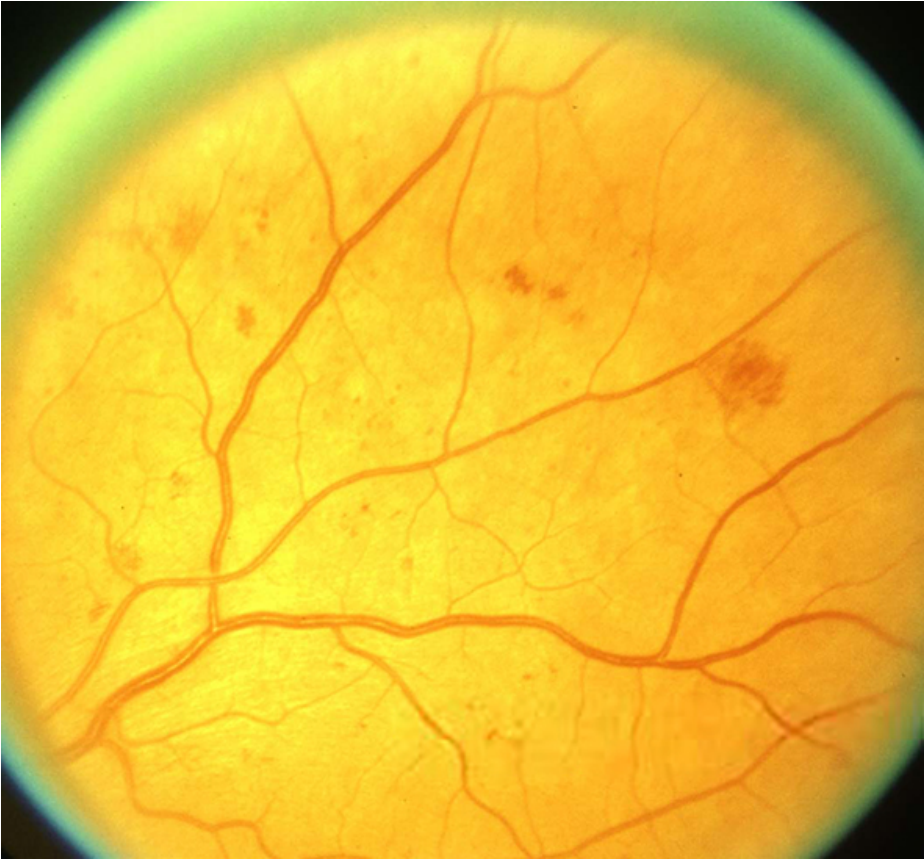

Standard photograph from the Early Treatment of Diabetic Retinopathy Study (ETDRS), which is used as the gold standard for grading severity in the clinical and research arena. Photograph #2A shows retinal hemorrhages and microaneurysms. 

_Reproduced with permission from: Early Treatment Diabetic Retinopathy Study Research Group. Grading diabetic retinopathy from stereoscopic colour fundus photographs--an extension of the modified Airlie House classification. ETDRS report number 10. Ophthalmology 1991; 98:786. Copyright © 1991 Fundus Photograph Reading Center Department of Ophthalmology & Visual Sciences University of Wisconsin – Madison._ 

Graphic 94444 Version 2.0 

https://www.uptodate.com/contents/diabetic-retinopathy-classification-and-clinical-features/print?search=retinopatia diabetica&source=search_result&selectedTitle… 

11/32 

Diabetic retinopathy: Classification and clinical features - UpToDate 

23/6/25, 4:03 p.m. 

## **Standard retinal photograph #8A** 

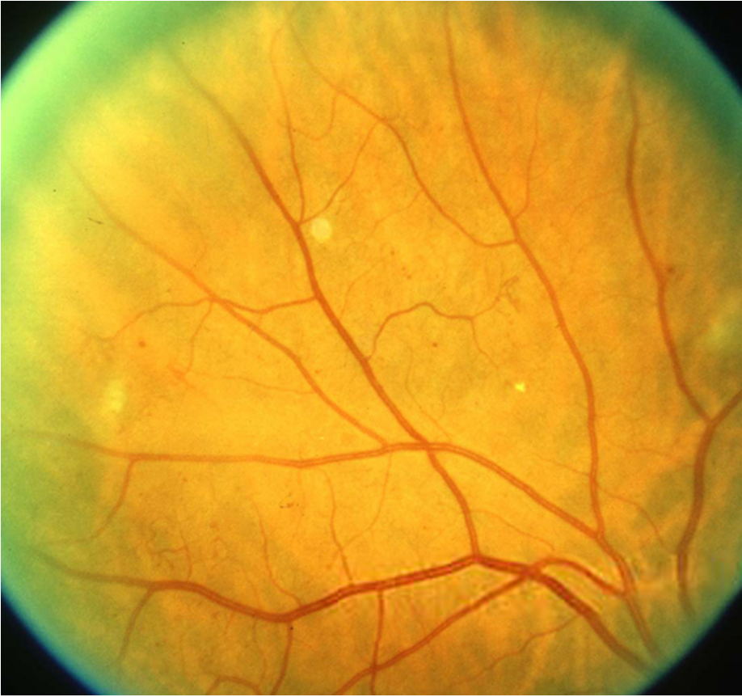

Standard photograph from the Early Treatment of Diabetic Retinopathy Study (ETDRS), which is used as the gold standard for grading severity in the clinical and research arena. Photograph #8A show intraretinal microvascular abnormalities (eg, dilated capillaries). 

_Reproduced with permission from: Early Treatment Diabetic Retinopathy Study Research Group. Grading diabetic retinopathy from stereoscopic colour fundus photographs--an extension of the modified Airlie House classification. ETDRS report number 10. Ophthalmology 1991; 98:786. Copyright © 1991 Fundus Photograph Reading Center Department of Ophthalmology & Visual Sciences University of Wisconsin – Madison._ 

Graphic 94445 Version 2.0 

https://www.uptodate.com/contents/diabetic-retinopathy-classification-and-clinical-features/print?search=retinopatia diabetica&source=search_result&selectedTitle… 

12/32 

Diabetic retinopathy: Classification and clinical features - UpToDate 

23/6/25, 4:03 p.m. 

## **Classification of diabetic retinopathy and diabetic macular edema** 

|**Classification**|**Observable findings**|
|---|---|
|No apparent retinopathy|No abnormalities|
|Mild nonproliferative diabetic retinopathy|Microaneurysms only|
|Moderate nonproliferative diabetic retinopathy|More than just microaneurysms but less than<br>severe nonproliferative diabetic retinopathy*|
|Severe nonproliferative diabetic retinopathy|No signs of proliferative retinopathy**and**any of the<br>following:<br>More than 20 intraretinal hemorrhages in<br>each of 4 quadrants<br>Definite venous beading in 2+ quadrants<br>Prominent intraretinal microvascular<br>abnormalities in 1+ quadrant|
|Proliferative diabetic retinopathy|At least 1 of the following:<br>Neovascularization<br>Vitreous/preretinal hemorrhage|
|No apparent macular edema|No apparent retinal thickening or hard exudates in<br>posterior pole|
|Diabetic macular edema is present<br>¶|Some apparent retinal thickening or hard exudates<br>in posterior pole|

* Other findings may include hard exudates, cotton wool spots, or dot and blot hemorrhages. 

¶ Diabetic macular edema is categorized as center involved (retinal thickening in the macula that involves the central subfield zone) or non-center involved. 

_From: Bastos de Carvalho A, Ware SL, Lei F, et al. Implementation and sustainment of a statewide telemedicine diabetic retinopathy screening network for federally designated safety-net clinics. PLoS One 2020; 15:e0241767. Copyright © 2020 The Authors. Adapted under the terms of the Creative Commons Attribution License 4.0._ 

Graphic 50486 Version 6.0 

https://www.uptodate.com/contents/diabetic-retinopathy-classification-and-clinical-features/print?search=retinopatia diabetica&source=search_result&selectedTitle… 

13/32 

Diabetic retinopathy: Classification and clinical features - UpToDate 

23/6/25, 4:03 p.m. 

## **Nonproliferative diabetic retinopathy: Appearance on fundus photograph** 

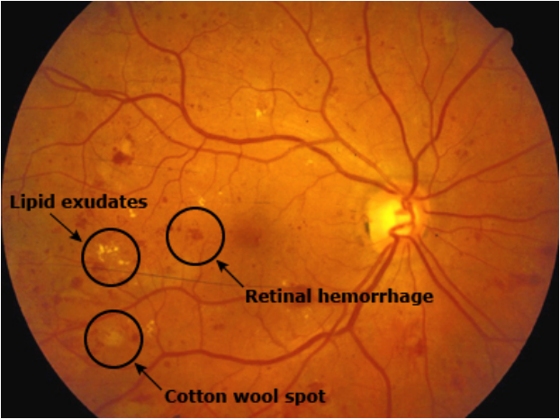

<details>
<summary>📝 Texto extraído (OCR) — Diabetic_retinopathy__Classification_and_clinical_features_-_UpToDate.pdf-0014-03.png</summary>

```
Lipid exudates

SQL.

Cotton wool spot
```

</details>

Color fundus photograph of nonproliferative diabetic retinopathy showing retinal (or "dot-blot") hemorrhages, yellow lipid (or "hard") exudates, and dull-white cotton wool spots (nerve fiber layer infarcts). 

Graphic 56138 Version 6.0 

https://www.uptodate.com/contents/diabetic-retinopathy-classification-and-clinical-features/print?search=retinopatia diabetica&source=search_result&selectedTitle… 

14/32 

Diabetic retinopathy: Classification and clinical features - UpToDate 

23/6/25, 4:03 p.m. 

## **Proliferative diabetic retinopathy displaying prominent neovascularization at the disc (NVD): Appearance on fundus photograph** 

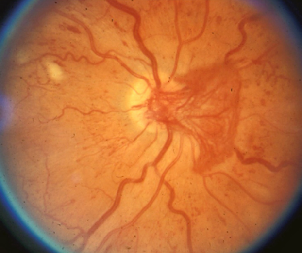

Color fundus photograph of proliferative diabetic retinopathy displaying prominent neovascularization at the disc (NVD). 

Graphic 56334 Version 3.0 

https://www.uptodate.com/contents/diabetic-retinopathy-classification-and-clinical-features/print?search=retinopatia diabetica&source=search_result&selectedTitle… 

15/32 

Diabetic retinopathy: Classification and clinical features - UpToDate 

23/6/25, 4:03 p.m. 

## **Proliferative diabetic retinopathy displaying severe neovascularization along the superior arcade (NVE): Appearance on fundus photograph** 

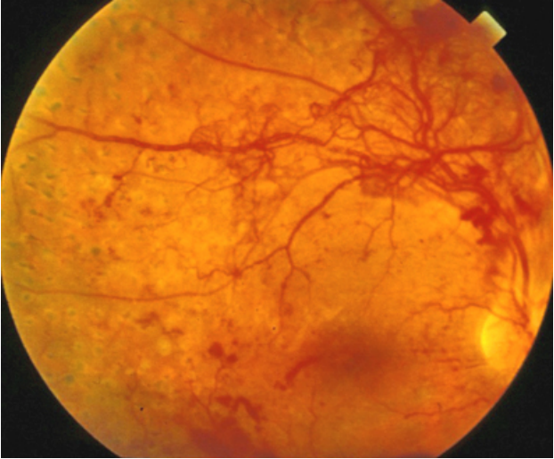

Color fundus photograph of proliferative diabetic retinopathy displaying severe neovascularization along the superior arcade (NVE). 

Graphic 70167 Version 3.0 

https://www.uptodate.com/contents/diabetic-retinopathy-classification-and-clinical-features/print?search=retinopatia diabetica&source=search_result&selectedTitle… 

16/32 

Diabetic retinopathy: Classification and clinical features - UpToDate 

23/6/25, 4:03 p.m. 

## **Vitreous hemorrhage: Appearance on fundus photograph** 

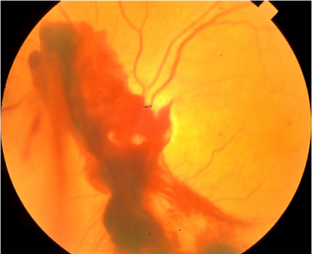

Color fundus photograph displaying vitreous hemorrhage arising from neovascularization at the disc (NVD). 

Graphic 74536 Version 3.0 

https://www.uptodate.com/contents/diabetic-retinopathy-classification-and-clinical-features/print?search=retinopatia diabetica&source=search_result&selectedTitle… 

17/32 

Diabetic retinopathy: Classification and clinical features - UpToDate 

23/6/25, 4:03 p.m. 

## **Severe traction retinal detachment in proliferative diabetic retinopathy: Appearance on fundus photograph** 

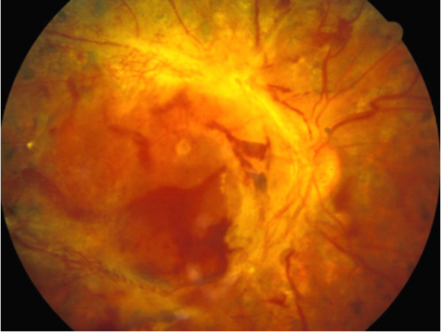

Color fundus photograph of severe proliferative diabetic retinopathy with extensive traction retinal detachment of the macula due to fibrovascular proliferation along the arcades and across the macula with associated hemorrhage. 

Graphic 82420 Version 3.0 

https://www.uptodate.com/contents/diabetic-retinopathy-classification-and-clinical-features/print?search=retinopatia diabetica&source=search_result&selectedTitle… 

18/32 

Diabetic retinopathy: Classification and clinical features - UpToDate 

23/6/25, 4:03 p.m. 

## **Severe traction retinal detachment in proliferative diabetic retinopathy: Appearance on fundus photograph** 

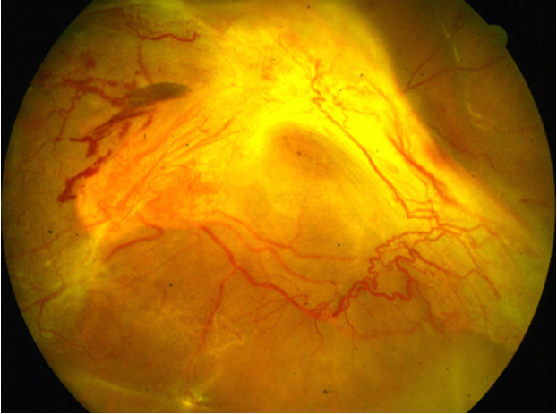

Color fundus photograph of extremely severe traction retinal detachment in proliferative diabetic retinopathy, with elevation and distortion of the macula due to overgrowth and contraction of neovascular proliferations. 

Graphic 59002 Version 3.0 

https://www.uptodate.com/contents/diabetic-retinopathy-classification-and-clinical-features/print?search=retinopatia diabetica&source=search_result&selectedTitle… 

19/32 

Diabetic retinopathy: Classification and clinical features - UpToDate 

23/6/25, 4:03 p.m. 

## **Diabetic macular edema: Appearance on optical coherence tomography** 

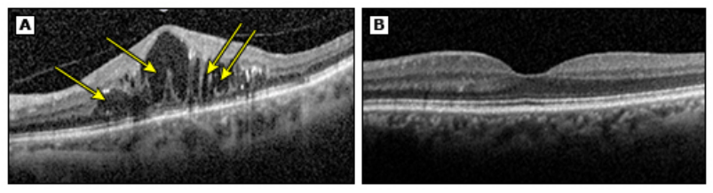

- (A) Optical coherence tomography (OCT) of diabetic macular edema. There are numerous large cysts visible within the macula (arrows), and the retinal thickness is increased. 

- (B) OCT of normal macula (for comparison) showing typical foveal contour. 

Graphic 88023 Version 2.0 

https://www.uptodate.com/contents/diabetic-retinopathy-classification-and-clinical-features/print?search=retinopatia diabetica&source=search_result&selectedTitle… 

20/32 

Diabetic retinopathy: Classification and clinical features - UpToDate 

23/6/25, 4:03 p.m. 

## **Ophthalmologic examination schedule** 

|**Patient group**|**Recommended first**<br>**examination**|**Minimum routine follow-up**|
|---|---|---|
|Type 1 diabetes|Within 5 years after diagnosis of<br>diabetes once patient is age 10<br>years or older.|Yearly, if retinopathy present<br>Every 2 years if there is no<br>evidence of retinopathy<br>*|
|Type 2 diabetes|At time of diagnosis of diabetes.|Yearly, if retinopathy present<br>Every 2 years if there is no<br>evidence of retinopathy<br>*|
|Pregnancy in preexisting diabetes|Prior to conception and during<br>first trimester. Counsel on the<br>risk of development and/or<br>progression of retinopathy.|Close follow-up throughout<br>pregnancy and for 1 year<br>postpartum|

* Abnormal findings necessitate more frequent follow-up. 

_Copyright © 2004 American Diabetes Association from Diabetes Care Vol 27, Supplement 1, 2004. Reprinted with permission from The American Diabetes Association. Updated from American Diabetes Association. Standards of medical care in diabetes--2014. Diabetes Care 2014; 37 Suppl 1:S14. These recommendations are consistent with those published in Retinopathy, Neuropathy, and Foot Care: Standards of Medical Care in Diabetes-2024. Diabetes Care 2024; 47:S231._ 

Graphic 61833 Version 9.0 

https://www.uptodate.com/contents/diabetic-retinopathy-classification-and-clinical-features/print?search=retinopatia diabetica&source=search_result&selectedTitle… 

21/32 

Diabetic retinopathy: Classification and clinical features - UpToDate 

23/6/25, 4:03 p.m. 

## **Retinal blot hemorrhages: Appearance on fundus photograph** 

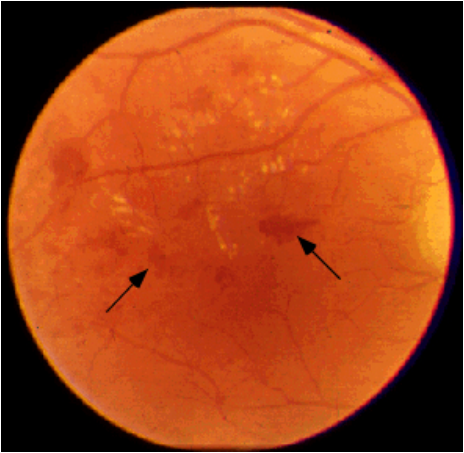

Diabetic retinopathy, showing several blot hemorrhages (arrows). These lesions are due to vascular occlusion and rupture. 

_Courtesy of David McCulloch, MD._ 

Graphic 75988 Version 3.0 

https://www.uptodate.com/contents/diabetic-retinopathy-classification-and-clinical-features/print?search=retinopatia diabetica&source=search_result&selectedTitle… 

22/32 

Diabetic retinopathy: Classification and clinical features - UpToDate 

23/6/25, 4:03 p.m. 

## **Cotton wool spots** 

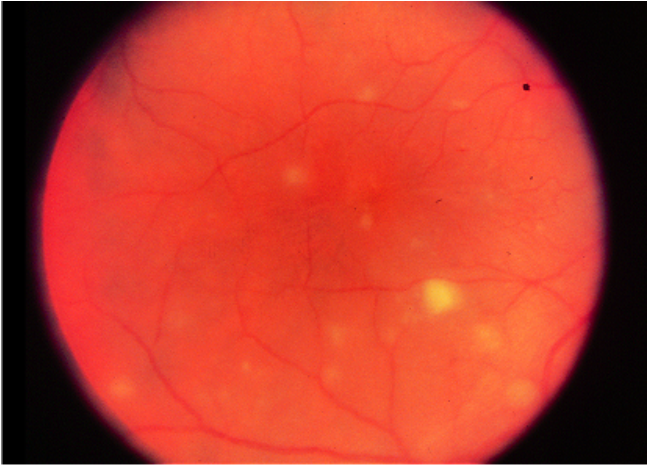

Cotton wool spots are indicative of retinal ischemia. The differential diagnosis includes diabetes, hypertension, acquired immunodeficiency syndrome (AIDS), and the retinal vascular changes of systemic lupus erythematosus. 

_Courtesy of James T Rosenbaum, MD._ 

Graphic 67621 Version 2.0 

https://www.uptodate.com/contents/diabetic-retinopathy-classification-and-clinical-features/print?search=retinopatia diabetica&source=search_result&selectedTitle… 

23/32 

Diabetic retinopathy: Classification and clinical features - UpToDate 

23/6/25, 4:03 p.m. 

## **Early diabetic retinal neovascularization: Appearance on fundus photograph** 

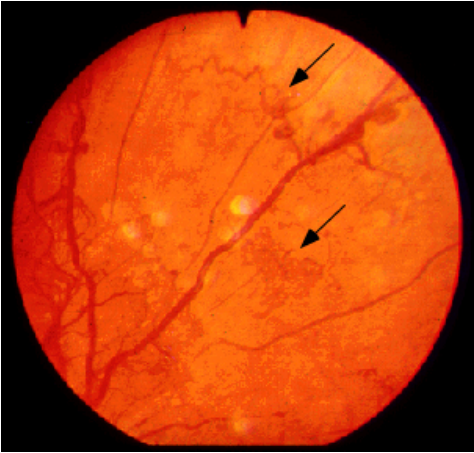

Diabetic retinopathy, showing irregular changes in venous caliber, tortuosity of blood vessels, and proliferation of networks of fragile new vessels, arising from both arteries and veins (arrows). 

_Courtesy of David McCulloch, MD._ 

Graphic 82311 Version 3.0 

https://www.uptodate.com/contents/diabetic-retinopathy-classification-and-clinical-features/print?search=retinopatia diabetica&source=search_result&selectedTitle… 

24/32 

Diabetic retinopathy: Classification and clinical features - UpToDate 

23/6/25, 4:03 p.m. 

## **Fluorescein angiogram** 

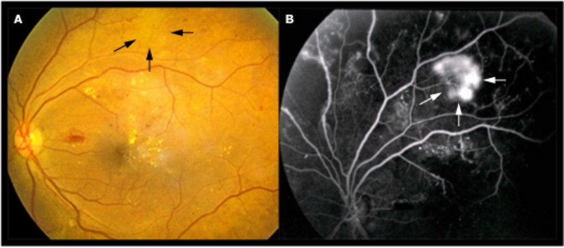

A) Color fundus photograph and B) fluorescein angiogram showing early detection of significant neovascularization elsewhere (NVE) by angiography that is barely visible in the color photograph. 

Graphic 80102 Version 4.0 

https://www.uptodate.com/contents/diabetic-retinopathy-classification-and-clinical-features/print?search=retinopatia diabetica&source=search_result&selectedTitle… 

25/32 

Diabetic retinopathy: Classification and clinical features - UpToDate 

23/6/25, 4:03 p.m. 

## **Traction retinal detachment: Appearance on fundus photograph** 

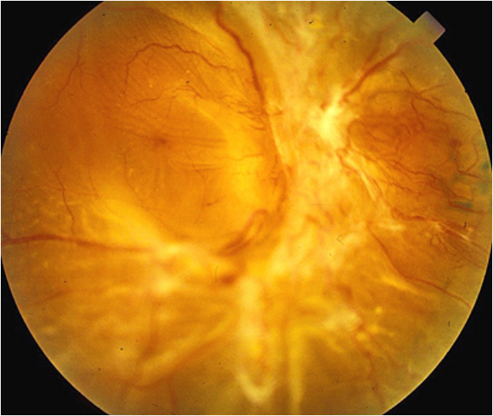

Color fundus photograph of traction retinal detachment due to contraction of neovascularization with prominent associated fibrous tissue; there are numerous striae indicating tractional retinal elevation of the macula and fovea to the left of the disc. 

Graphic 71858 Version 3.0 

https://www.uptodate.com/contents/diabetic-retinopathy-classification-and-clinical-features/print?search=retinopatia diabetica&source=search_result&selectedTitle… 

26/32 

Diabetic retinopathy: Classification and clinical features - UpToDate 

23/6/25, 4:03 p.m. 

## **Advanced traction retinal detachment due to severe neovascularization: Appearance on fundus photograph** 

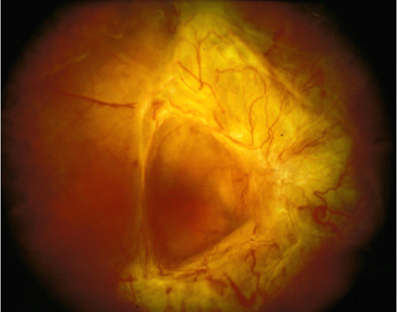

Color fundus photograph showing advanced traction retinal detachment due to extremely severe neovascularization on the disc and arcades, which has drawn the retina toward the vitreous cavity. 

Graphic 50023 Version 3.0 

https://www.uptodate.com/contents/diabetic-retinopathy-classification-and-clinical-features/print?search=retinopatia diabetica&source=search_result&selectedTitle… 

27/32 

Diabetic retinopathy: Classification and clinical features - UpToDate 

23/6/25, 4:03 p.m. 

## **Circinate exudate: Appearance on fundus photograph** 

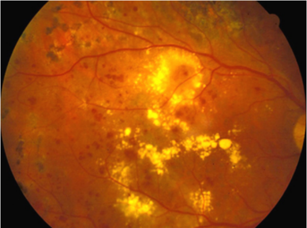

Color fundus photograph of extensive yellow circinate exudate in the macula; intraretinal hemorrhages and previous peripheral laser treatment are also visible. 

Graphic 79466 Version 3.0 

https://www.uptodate.com/contents/diabetic-retinopathy-classification-and-clinical-features/print?search=retinopatia diabetica&source=search_result&selectedTitle… 

28/32 

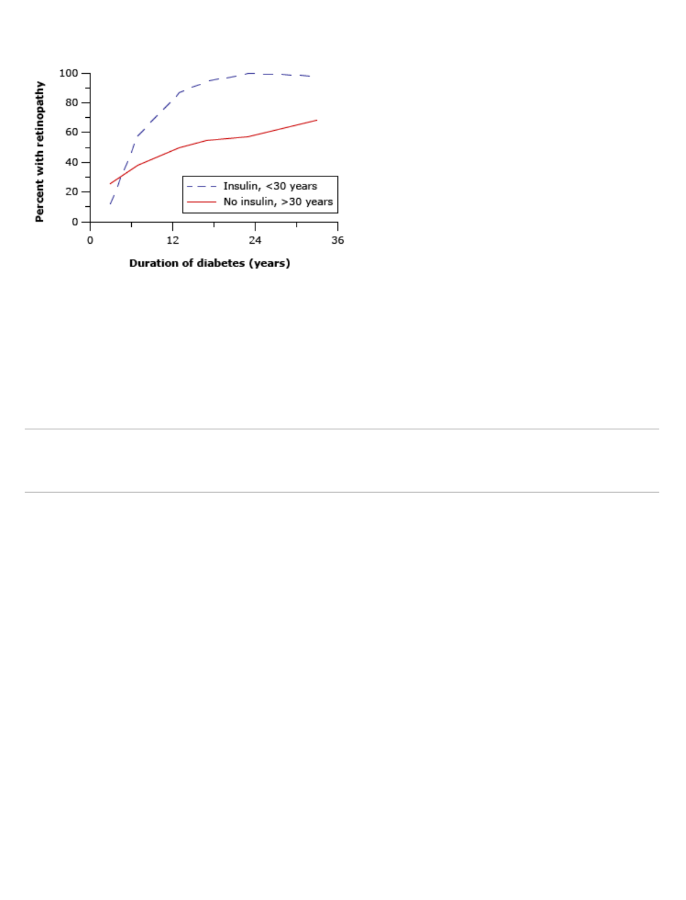

<details>
<summary>📝 Texto extraído (OCR) — Diabetic_retinopathy__Classification_and_clinical_features_-_UpToDate.pdf-0029-00.png</summary>

```
Percent with retinopathy

100

80

60

40

20

Insulin, <30 years
No

sulin, >30 years

y T 7 T y 1
12 24 36

Duration of diabetes (years)
```

</details>

<!-- Start of picture text -->
100 eee<br>z -"<br>S 80 Z ral<br>= ra<br>—<br>a<br>i<br>=<br>g 40 /<br>= 20 — — - Insulin, <30 years<br>& i — No insulin, >30 years<br>a 9<br>0 12 24 36<br>Duration of diabetes (years)<br><!-- End of picture text -->

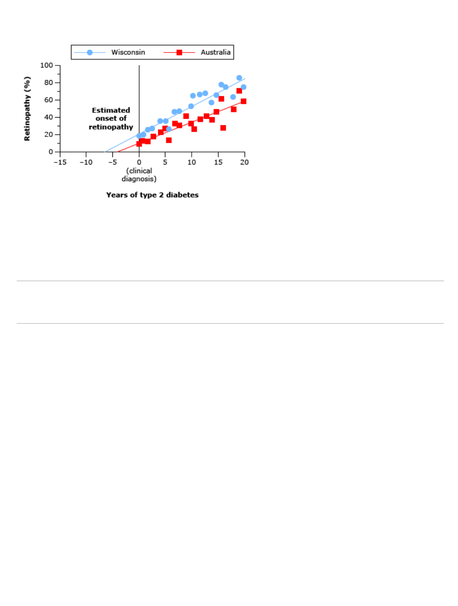

<details>
<summary>📝 Texto extraído (OCR) — Diabetic_retinopathy__Classification_and_clinical_features_-_UpToDate.pdf-0030-00.png</summary>

```
Retinopathy (%)

100

80

20

——®— Wisconsin —— Australia

-15

(clinical
diagnosis)

Years of type 2 diabetes
```

</details>

<!-- Start of picture text -->
Wisconsin —t—_ Australia<br>100<br>S<br>£ 380 Li<br>E 60 a<br>= Estimated<br>8 40 onset of =<br>s retinopathy |<br>@ 20<br>o|<br>0<br>-15 -10 -5 o 5 10 i520<br>(clinical<br>diagnosis)<br>Years of type 2 diabetes<br><!-- End of picture text -->

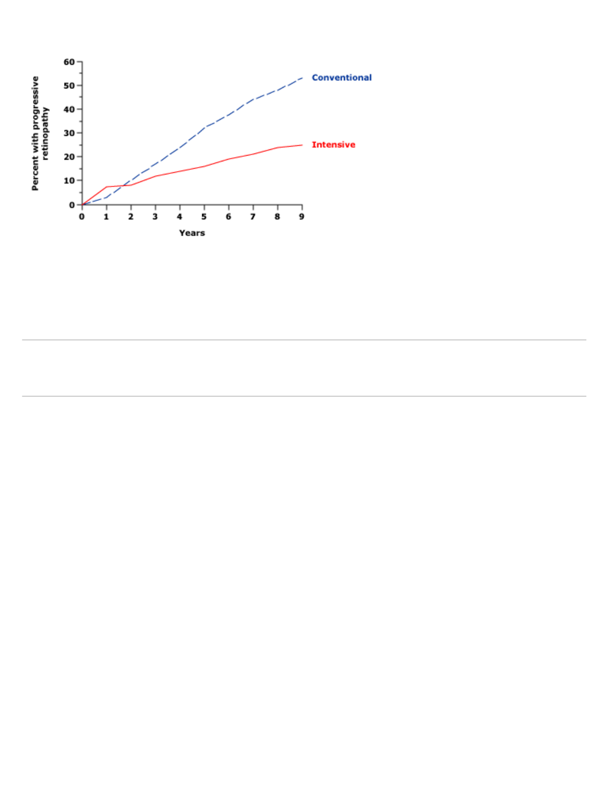

<details>
<summary>📝 Texto extraído (OCR) — Diabetic_retinopathy__Classification_and_clinical_features_-_UpToDate.pdf-0031-00.png</summary>

```
E
3
$
$
o

Intensive

38.32.2883

Ayedounas
anSS2ABOIH unin JUDI1D4

Years
```

</details>

<!-- Start of picture text -->
60<br>o - Conventional<br>2 50 a“<br>é a --<br>a = 40 = a<br>o Fs =<br>ag —<br>Zz a 30 vt<br>£e= = - “ Intensive<br>2 a 20 ra<br>o a<br>fr a<br>Fj 10 ra “<br>a i<br>0<br>o 1 2 3 4 5 6 7 8 9<br>Years<br><!-- End of picture text -->

Diabetic retinopathy: Classification and clinical features - UpToDate 

23/6/25, 4:03 p.m. 

<mark></mark> 

https://www.uptodate.com/contents/diabetic-retinopathy-classification-and-clinical-features/print?search=retinopatia diabetica&source=search_result&selectedTitle… 

32/32

---

## Documento 2: FONDO DE OJO.pdf

> 5 páginas | 2.6 MB

## Paso a paso 

# Técnica de exploración del fondo de ojo 

Araceli Fernández Revuelta Especialista en Medicina Familiar y Comunitaria. Profesora asociada. Universidad de Zaragoza. EAP Delicias Sur. Zaragoza. 

La exploración del fondo de ojo u oftalmoscopia consiste en la visualización a través de la pupila y de los medios transparentes del globo ocular (córnea, humor acuoso, cristalino y humor vítreo) de la retina y del disco óptico. Es un componente importante de la evaluación clínica de muchas enfermedades y es la única localización donde puede observarse in vivo el lecho vascular de forma incruenta. Para su realización en las consultas de Atención Primaria (AP) y en otras especialidades se dispone del oftalmoscopio directo. 

A diferencia del oftalmoscopio directo, los retinógrafos permiten obtener fotografías digitales del fondo de ojo y son de utilidad en el cribado de retinopatía diabética en AP, entre otras. 

La lámpara de hendidura es un microscopio binocular con una fuente de iluminación potente y ajustable, que proyecta un haz lineal por la hendidura, facilitando la exploración del polo anterior con una imagen amplificada y en tres dimensiones. Las técnicas de oftalmoscopia indirecta (con binocular y luz externa) y de lámpara de hendidura con lente de Goldman permiten explorar la retina periférica y habitualmente son realizadas por el oftalmólogo. 

En este artículo se expone la técnica de exploración del fondo de ojo mediante el oftalmoscopio directo. 

### Material necesario 

   - vergentes). Permiten compensar la ametropía del paciente y del examinador. 

- Diafragmas y filtros (figura 2): 

   - _a)_ La apertura grande sirve para la visión en pupilas dilatadas y la pequeña facilita la visión en pupilas sin dilatación pupilar. 

   - _b)_ Filtro verde o luz aneritra: destacan las estructuras vasculares y las fibras nerviosas. 

   - _c)_ Filtro azul cobalto: sirve para resaltar las erosiones o úlceras corneales teñidas con fluoresceína. 

   - _d)_ Apertura de fijación: uso en diagnóstico de fijación excéntrica y para situar lesiones maculares. 

   - _e)_ Apertura de hendidura: muy útil para apreciar diferencias de nivel (elevaciones o depresiones), 

Ventajas e inconvenientes de la oftalmoscopia directa 

|Ventajas|Inconvenientes|
|---|---|
|Facilidad de uso<br>Portabilidad<br>Útil en el cribado|No permite la visualización en medios<br>turbios<br>Campo muy limitado<br>Falta de estereopsis (percepción de<br>profundidad)|
|Bajo coste<br>Imagen amplifcada|Necesidad de acercarse demasiado<br>No se puede explorar la periferia de la<br>retina|

### Oftalmoscopio directo 

Instrumento óptico que dirige una luz directamente sobre la retina a través de un espejo que refleja el rayo proveniente de la fuente luminosa. Proporciona una imagen amplificada entre 14 y 16 aumentos. Las ventajas e inconvenientes se describen en la tabla 1. 

Consta de los siguientes componentes (figura 1): 

- Cabezal. Dispone de diversas lentes, diafragmas y filtros: –  Lentes esféricas de diferente poder dióptrico entre +20 y –25 D para enfocar estructuras oculares situadas a varias distancias. El disco de Recoss gira en sentido horario (números negros con lentes convergentes) y antihorario (números rojos con lentes di- 

FIGURA 1 


<details>
<summary>📝 Texto extraído (OCR) — FONDO_DE_OJO.pdf-0001-21.png</summary>

```
Partes del oftalmoscopi

Orificio de
observación

Cojín de apoyo
ciar

Disco ==

<= Cabezal

Selector

de filtro
Selector de
diafragmas

Recoss

| <= Reóstato =>
```

</details>

<!-- Start of picture text -->
Partes del oftalmoscopio<br>Orificio de Cojín de apoyo<br>observación ciliar<br>Disco Cabezal<br>Selector Recoss<br>de filtro<br>Selector de<br>diafragmas<br>Reóstato<br>Mango<br><!-- End of picture text -->

AMF 2012;8(7):383-387 

383 

29 

Araceli Fernández Revuelta 

Técnica de exploración del fondo de ojo 

##### FIGURA 2 

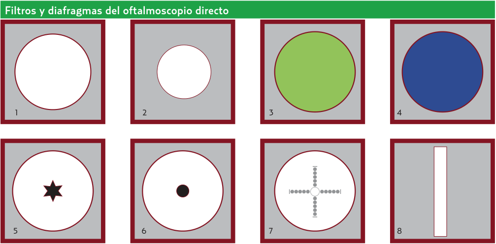

<details>
<summary>📝 Texto extraído (OCR) — FONDO_DE_OJO.pdf-0002-03.png</summary>

```
Filtros y diafragmas del oftalmoscopio directo

OOO
OOO
```

</details>

<!-- Start of picture text -->
Filtros y diafragmas del oftalmoscopio directo<br>1 2 3 4<br>5 6 7 8<br><!-- End of picture text -->

1. Apertura grande. 2. Apertura pequeña. 3. Luz aneritra. 4. Luz azul cobalto. 5, 6 y 7. Fijación muscular. 8. Hendidura. 

comparar el calibre de los vasos y para explorar la cámara anterior. 

- Mango. Depósito de la fuente de energía (halógena o con batería) con un reóstato en el cuello permitiendo regular la intensidad de la luz. 

### Colirio midriático 

Tropicamida o ciclopentolato al 1% (opcional). 

### Oftalmoscopia del fondo de ojo normal 

Las estructuras del fondo de ojo que se examinan son (figuras 3 y 4): 

- Parénquima retiniano: la retina se visualiza como una membrana semitransparente. La coloración rojiza que presenta se debe a la tonalidad del epitelio pigmentario, y puede variar dependiendo de la raza, edad y color de la piel. Va perdiendo el brillo con los años. 

- Papila o disco óptico: es la parte visible del nervio óptico y en su valoración debe incluirse (figura 5): 

- Forma: redondeada u ovalada en sentido vertical, de 1,5 mm de diámetro. Los tamaños y las distancias dentro del fondo de ojo se miden en «diámetros de disco». 

- Color: blanco-rosáceo, con una zona central blanquecina, que corresponde a la excavación fisiológica, es de tamaño variable no sobrepasando el 30% del diámetro papilar. Su tamaño sirve para controlar la 

evolución de algunas patologías que afectan al nervio óptico, sobre todo el glaucoma. 

- Límites: netos, sobre todo en la zona temporal. Es frecuente observar pigmento a su alrededor. 

- Vasos retinianos 

- En el centro del disco óptico se sitúa el paquete vascular formado por la arteria y vena central de la retina, que se dividen en las arterias y venas temporales superior e inferior, y nasales superior e inferior. 

- Las ramas de los vasos de la retina se acercan desde todos lados pero no llegan a la fóvea. 

- No hay anastomosis. 

- La vena es de color rojo vinoso más oscuro y de trayecto más ondulado con una relación de calibre arteria-vena de 2/3 (figura 3). 

- El reflejo luminoso arteriolar es una línea brillante blanca en el centro de la arteriola y ocupa ¼ del total de la anchura de esta. 

- Cruces arteriovenosos: normalmente no hay cambios en el tamaño o trayecto de los vasos cuando se cruzan. 

- La arteria ciliorretiniana solo está presente en el 20% de los pacientes, depende de las arterias ciliares posteriores, irriga la mácula, lo que permitirá preservar la irrigación de esta área en caso de oclusión de la arteria central de la retina. 

- Pulso venoso: hay que fijarse en el punto donde salen las venas en el borde papilar, si hay pulsaciones venosas indica que la presión intracraneal es normal. Las arterias no pulsan a diferencia de las venas. 

AMF 2012;8(7):383-387 

384 

30 

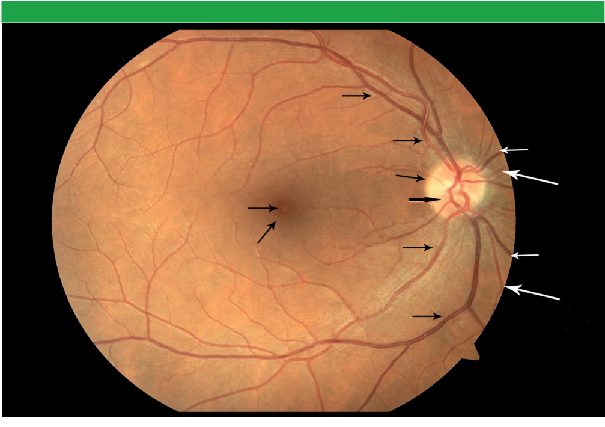

<!-- Start of picture text -->
a<br>X ee<br>~<br>me” & = NeSe rea Psee‘ Ai3 ; —é_€#___<br>3 ee ; io ae<br>-—- , os 3 =<br><!-- End of picture text -->

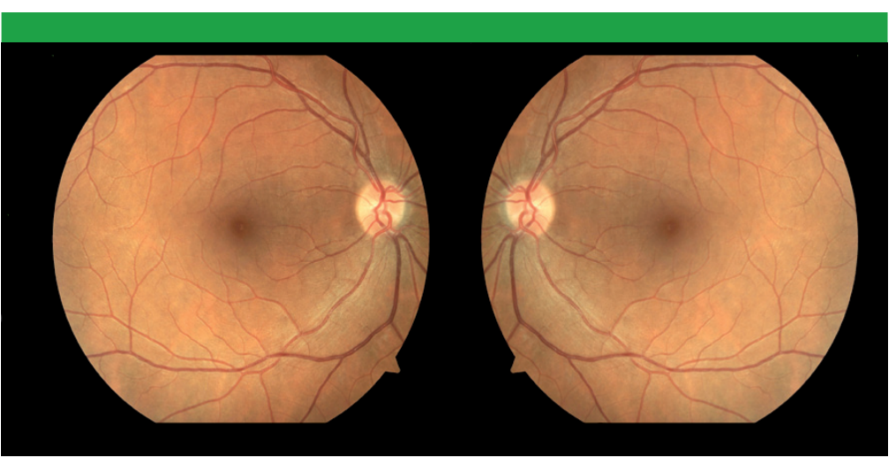

<!-- Start of picture text -->
Bae -" Py a<br>EW: beeuea Meal Se<br>ai he Nef<br>a. r a, Jute am<br>ae + Tie a4, \ af hs. i 4 F, oe oe,<br>we ue a4 = ae eee f ee yt ae we<br>. i ey + Pe 4 rt ra a4 J<br>=eaLDes aaa<br>TS —_i Ge<br><!-- End of picture text -->

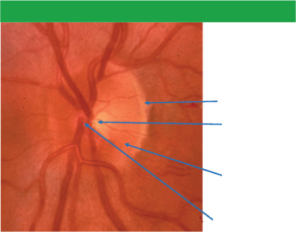

<!-- Start of picture text -->
08 | |<br><!-- End of picture text -->

08 | | 


<!-- Start of picture text -->
| = — e<br>j |<br>¢ |<br>JL 7<br>a 4 , fee re |<br><!-- End of picture text -->

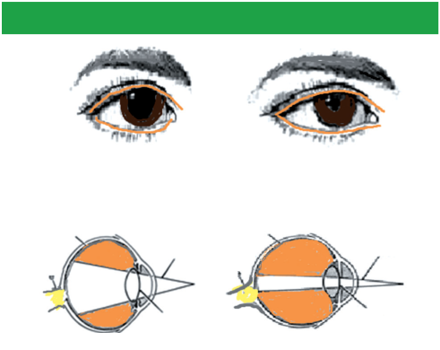

<details>
<summary>📝 Texto extraído (OCR) — FONDO_DE_OJO.pdf-0004-03.png</summary>

```
(ill, ly,

HS
```

</details>

<!-- Start of picture text -->
en “rere<br>;<br><!-- End of picture text -->

Araceli Fernández Revuelta 

Técnica de exploración del fondo de ojo 

FIGURA 8 

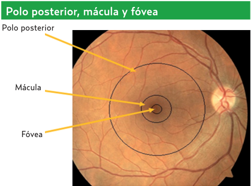

<details>
<summary>📝 Texto extraído (OCR) — FONDO_DE_OJO.pdf-0005-03.png</summary>

```
Polo posterior, mácula y fóvea
Polo posterior Y

AS
Mácula
Fóvea \
y
KK
```

</details>

<!-- Start of picture text -->
Polo posterior, mácula y fóvea<br>Polo posterior<br>Mácula<br>Fóvea<br><!-- End of picture text -->

FIGURA 9 


para no cansar en exceso al paciente. Cuando se emplea tropicamida al 1% es preciso esperar 15 minutos previos a la exploración para que la pupila se dilate. 

### Tiempo necesario 

Al igual que otras habilidades clínicas, el dominio de esta está condicionado por la técnica adecuada y la práctica. Es importante la perseverancia ya que al principio puede no resultar fácil la visualización del fondo de ojo. Cuando se ha adquirido la destreza suficiente, puede realizarse en 5 o 10 minutos. Es conveniente realizar breves descansos 

#### Indicaciones de la oftalmoscopia 

Disminución de agudeza visual Diabetes mellitus Hipertensión arterial Cefalea 

Síntomas neurológicos agudos para descartar edema de papila 

Degeneración macular asociada a la edad 

Repercusión de otras enfermedades hematológicas, neurológicas 

#### Riesgos y precauciones con el uso de midriáticos 

### Indicaciones y riesgos (tablas 2 y 3) 

Antes de dilatar la pupila conviene explorar la cámara anterior. Una linterna puede servir para explorar la profundidad de esta, y seleccionar así los pacientes que pueden tener riesgo de sufrir glaucoma agudo. Al iluminar lateralmente el ojo se observa una sombra en el sector nasal del iris tanto mayor cuanto menos profunda sea la cámara anterior. Si la cámara es estrecha, abstenerse de dilatar farmacológicamente (figura 9). 

### Instrucciones previas y posteriores al paciente 

La exploración puede resultar algo molesta o fatigosa, por lo que se debe explicar previamente al paciente en qué consiste. 

Advertir que la tropicamida ocasiona una midriasis rápida, con el consiguiente efecto sobre la acomodación y la visión. Su efecto dura entre 4 y 6 horas. Produce un aumento leve y transitorio de la presión intraocular y, en muy raras ocasiones, glaucoma agudo de ángulo cerrado. 

Agradecer a Leticia Pérez Bolea su colaboración en la realización de retinografías y fotos. 

Abstenerse de usar midriáticos 

Cámara anterior estrecha (puede desencadenar un ataque agudo de glaucoma) 

Antecedentes de glaucoma de ángulo estrecho sin iridotomía profiláctica Rubeosis en iris 

Antes de realizar valoración neurológica (revisión periódica de reflejos pupilares) por traumatismo craneoencefálico, accidente isquémico transitorio, etc. 

### Bibliografía 

Arias Puente A. Oftalmoscopia. Medicine. 1991;(9):13-21. Corcóstegui B. El fondo de ojo en la medicina práctica. Barcelona: Espaxs, 1983. 

- Degowin RL. Guía para la exploración diagnóstica. 6.<sup>a</sup> ed. México, D.F.: McGraw-Hill Interamericana, 1998. 

- Michaelson I. Textbook of the Fundus of the Eye. Churchill Livingstone, 1980. 

- Piñero Bustamante A. La retina periférica. Barcelona: Scriba, 1983. 

AMF 2012;8(7):383-387 

387 

33

---

## Documento 3: GPC Retinopatía diabética 1er nivel.pdf

> 49 páginas | 8.1 MB

71% ‘Cy 

Ls , =: , q ' = : i - | ys a Vi | dis oD ee I i ‘i | Ze Pm fi. 

> on. ~ Va’ S EO Fe oe a eee ge |] zz * 4 ore + w i. We ae — (Oe | We Site ee Ss > “ == be i itt es rn Fy : | 1? — <4 — on = ! i 7s ; an cr 

at LES Se oa 

:ie el 

**a** a 

<details>
<summary>📝 Texto extraído (OCR) — GPC_Retinopatía_diabética_1er_nivel.pdf-0002-00.png</summary>

```
inopatia Diabética en Primer Nivel de Atención
```

</details>

<!-- Start of picture text -->
Detección de Retinopatía Diabética en Primer Nivel de Atención<br><!-- End of picture text -->

<details>
<summary>📝 Texto extraído (OCR) — GPC_Retinopatía_diabética_1er_nivel.pdf-0002-01.png</summary>

```
INSTITUTO MEXICANO DEL SEGURO SOCIAL

SEGURIDAD Y SOLIDARIDAD SOCIAL
```

</details>

###### DIRECTOR GENERAL **DR. JOSÉ ANTONIO GONZÁLEZ ANAYA** 

DIRECTOR DE PRESTACIONES MÉDICAS **DR. JAVIER DÁVILA TORRES** 

UNIDAD DE ATENCION MÉDICA **DR. JOSÉ DE JESÚS GONZÁLEZ IZQUIERDO** 

COORDINADOR DE UNIDADES MÉDICAS DE ALTA ESPECIALIDAD **DR. JAIME ANTONIO ZALDÍVAR CERVERA** 

(ENCARGADO) COORDINACIÓN INTEGRAL DE ATENCIÓN EN EL SEGUNDO NIVEL 

###### **DR. ROBERTO AGULI RUIZ ROSAS** 

COORDINADOR DE PLANEACIÓN DE INFRAESTRUCTURA MÉDICA **MTRO. DANIEL SAÚL BROID KRAUZE** 

COORDINADOR TÉCNICO DE EXCELENCIA CLÍNICA 

###### **DR. ARTURO VINIEGRA OSORIO** 

TITULAR DE LA UNIDAD DE EDUCACIÓN, INVESTIGACIÓN Y POLÍTICAS EN SALUD **DR. GERMÁN ENRIQUE FAJARDO DOLCI** 

COORDINADOR DE POLÍTICAS DE SALUD 

###### **DR. MARIO MADRAZO NAVARRO** 

COORDINADOR DE EDUCACIÓN EN SALUD 

###### **DR. SALVADOR CASARES QUERALT** 

COORDINADOR DE INVESTIGACIÓN EN SALUD 

###### **DR. FABIO ABDEL SALAMANCA GÓMEZ** 

COORDINADOR DE PLANEACIÓN EN SALUD **LIC. MIGUEL ÁNGEL RODRÍGUEZ DÍAZ PONCE** 

TITULAR DE LA UNIDAD DE ATENCIÓN PRIMARIA A LA SALUD 

###### **DR. VICTOR HUGO BORJA ABURTO** 

COORDINACIÓN DE ATENCIÓN INTEGRAL A LA SALUD EN EL PRIMER NIVEL **DR. MANUEL CERVANTES OCAMPO** 

COORDINADOR DE VIGILANCIA EPIDEMIOLÓGICA Y APOYO EN CONTINGENCIAS **DR. ROMEO S. RODRÍGUEZ SUÁREZ** 

COORDINADOR DE SALUD EN EL TRABAJO 

###### **DR. RAFAEL RODRIGUEZ CABRERA** 

COORDINADOR DE CONTROL TÉCNICO DE INSUMOS **DR. RODOLFO A. DE MUCHA MACÍAS** 

**2** 

<details>
<summary>📝 Texto extraído (OCR) — GPC_Retinopatía_diabética_1er_nivel.pdf-0003-00.png</summary>

```
inopatia Diabética en Primer Nivel de Atención
```

</details>

<!-- Start of picture text -->
Detección de Retinopatía Diabética en Primer Nivel de Atención<br><!-- End of picture text -->

Durango 289- 1A Colonia Roma Delegación Cuauhtémoc, 06700 México, DF. Página Web: www.imss.gob.mx 

Publicado por Instituto Mexicano del Seguro Social 

© Copyright Instituto Mexicano del Seguro Social “Derechos Reservados”. Ley Federal de Derecho de Autor 

Editor General Coordinación Técnica de Excelencia Clínica Coordinación de Unidades Médicas de Alta Especialidad 

Esta guía de práctica clínica fue elaborada con la participación de las instituciones que conforman el Sistema Nacional de Salud, bajo la coordinación del Centro Nacional de Excelencia Tecnológica en Salud. Los autores han hecho un esfuerzo por asegurarse de que la información aquí contenida  sea completa y actual; por lo que asumen la responsabilidad editorial por el contenido de esta guía, declaran que no tienen conflicto de intereses y en caso de haberlo lo han manifestado puntualmente, de tal manera que no se afecte su participación y la confiabilidad de las evidencias y recomendaciones. 

Las recomendaciones son de carácter general, por lo que no definen un curso único de conducta en un procedimiento o tratamiento.  Las recomendaciones aquí establecidas, al ser aplicadas en la práctica, podrían tener variaciones justificadas con fundamento en el juicio clínico de quien las emplea como referencia, así como en las necesidades específicas y preferencias de cada paciente en particular, los recursos disponibles al momento de la atención y la normatividad establecida por cada Institución o área de práctica. 

En cumplimiento de los artículos 28 y 29 de la Ley General de Salud; 50 del Reglamento Interior de la Comisión Interinstitucional del Cuadro Básico y Catálogo de Insumos del Sector Salud y Primero del Acuerdo por el que se establece que las dependencias y entidades de la Administración Pública Federal que presten servicios de salud aplicarán, para el primer nivel de atención médica, el cuadro básico y, en el segundo y tercer nivel, el catálogo de insumos, las recomendaciones contenidas en las GPC con relación a la prescripción de fármacos y biotecnológicos deberán aplicarse con apego a los cuadros básicos de cada Institución. 

Este documento puede reproducirse libremente sin autorización escrita, con fines de enseñanza y actividades no lucrativas, dentro del Sistema Nacional de Salud. Queda prohibido todo acto por virtud del cual el Usuario pueda explotar o servirse comercialmente, directa o indirectamente, en su totalidad o parcialmente, o beneficiarse, directa o indirectamente, con lucro, de cualquiera de los contenidos, imágenes, formas, índices y demás expresiones formales que formen parte del mismo, incluyendo la modificación o inserción de textos o logotipos. 

Debe ser citado como: Detección de Retinopatía Diabética en el Primer Nivel de Atención. México: Instituto Mexicano del Seguro Social; **11 de diciembre de 2014** 

Esta guía puede ser descargada de internet en: <u>http://www.imss.gob.mx/profesionales/guiasclinicas/Pages/guias.aspx http://www.cenetec.salud.gob.mx/interior/catalogoMaestroGPC.html</u> 

**3** 

<details>
<summary>📝 Texto extraído (OCR) — GPC_Retinopatía_diabética_1er_nivel.pdf-0004-00.png</summary>

```
inopatia Diabética en Primer Nivel de Atención
```

</details>

<!-- Start of picture text -->
Detección de Retinopatía Diabética en Primer Nivel de Atención<br><!-- End of picture text -->

<mark>CIE- 10: H36.0 Retinopatía Diabética GPC: Detección de Retinopatía Diabética en Primer Nivel de Atención</mark> **<mark>Autores y Validadores</mark>** 

|Coordinadores:|||||
|---|---|---|---|---|
|**Dra.**<br>**Yuribia**<br>**Karina**<br>**Millán**<br>**Gámez**<br>Autores:|Oftalmología|Instituto<br>Mexicano del<br>Seguro Social|Coordinador<br>de<br>Programas<br>Médicos<br>de<br>la<br>División<br>de<br>Excelencia Clínica|Sociedad Mexicana<br>de Oftalmología|
|**Dra.**<br>**Beatriz**<br>**Reynoso Núñez**|Oftalmología|Instituto<br>Mexicano del<br>Seguro Social|Médico Adscrito al Servicio de<br>Oftalmología del Hospital General<br>Regional<br>No.<br>1<br>Cuernavaca<br>Delegación Morelos|Sociedad Mexicana<br>de Oftalmología|
|**Dra.**<br>**Alina**<br>**Rodarte**<br>**Reveles**|Medicina<br>Familiar|Instituto<br>Mexicano del<br>Seguro Social|Médico<br>Adscrito<br>al<br>Hospital<br>General de Zona con Medicina<br>Familiar No. I “Lic. Ignacio García<br>Téllez” Durango,Durango|Colegio mexicano<br>de<br>Medicina<br>Familiar|
|**Dra.**<br>**Julieta**<br>**Guadalupe**<br>**Cortés**<br>**Carrasco**|Medicina<br>Familiar|Instituto<br>Mexicano del<br>Seguro Social|Médico Familiar Adscrito a la<br>Unidad de Medicina Familiar No.<br>160 Delegación D.F. Sur||
|**Dra.**<br>**Yuribia**<br>**Karina**<br>**Millán**<br>**Gámez**|Oftalmología|Instituto<br>Mexicano del<br>Seguro Social|Coordinador<br>de<br>Programas<br>Médicos<br>de<br>la<br>División<br>de<br>Excelencia Clínica|Sociedad Mexicana<br>de Oftalmología|
|Validación:|||||
|**Dr.**<br>**Néstor**<br>**Hugo**<br>**Garrido**<br>**Gaspar**|Oftalmología|Instituto<br>Mexicano del<br>Seguro Social|Jefe del Servicio de Oftalmología<br>del Hospital de Especialidades No.2<br>"Luis Donaldo Colosio Murrieta",<br>CMN del Noroeste. Delegación<br>Sonora.|Colegio<br>de<br>Oftalmólogos<br>del<br>Estado de Sonora.<br>Sociedad Mexicana<br>de Oftalmología.|
|**Dr.**<br>**Rolando**<br>**López López**|Oftalmología|Instituto<br>Mexicano del<br>Seguro Social|Médico<br>Adscrito<br>al<br>Hospital<br>General Regional No. 12 Benito<br>Juárez. Mérida,Yucatán|Colegio Médico de<br>Oftalmólogos<br>de<br>Yucatán.|
|**Dr.**<br>**Sergio**<br>**Oswaldo**<br>**Pacheco**<br>**Calderón**|Medicina<br>Familiar|Instituto<br>Mexicano del<br>Seguro Social|Supervisor de Primer Nivel de<br>Atención, Delegación Sinaloa.||

**4** 

<details>
<summary>📝 Texto extraído (OCR) — GPC_Retinopatía_diabética_1er_nivel.pdf-0005-00.png</summary>

```
inopatia Diabética en Primer Nivel de Atención
```

</details>

<!-- Start of picture text -->
Detección de Retinopatía Diabética en Primer Nivel de Atención<br><!-- End of picture text -->

# **Índice** 

|**1. Clasificación ................................................................................................................................................... 6**|
|---|
|**2. Preguntas a Responder ............................................................................................................................... 7**|
|**3. Aspectos Generales ...................................................................................................................................... 8**|
|3.1 Justificación ...................................................................................................................................................................................................... 10|
|3.2 Objetivo ............................................................................................................................................................................................................. 12|
|3.3 Definición  de Retinopatía Diabética ........................................................................................................................................................ 13|
|**4. Evidencias y Recomendaciones ................................................................................................................ 14**|
|4.1. Detección de Retinopatía Diabética ........................................................................................................................................................ 15|
|_4.1.1. Población en riesgo ......................................................................................................................................................................... 15_<br>|
|4.2. Control metabólico del paciente diabético ............................................................................................................................................ 21<br>_4.2.1. Criterios de seguimiento ............................................................................................................................................................... 21_|
|4.3. Actividades a realizar por el médico familiar capacitado.................................................................................................................. 23|
|**5. Anexos .......................................................................................................................................................... 24**|
|5.1 Protocolo de Búsqueda ................................................................................................................................................................................. 24|
|_5.1.1 Primera Etapa ................................................................................................................................................................................... 24_|
|_5.1.2 Segunda Etapa.................................................................................................................................................................................. 25_|
|5.2 Escalas de Gradación ..................................................................................................................................................................................... 26|
|5.3 Escalas de Clasificación Clínica ................................................................................................................................................................... 30|
|5.4 Diagramas de Flujo ......................................................................................................................................................................................... 37|
|5.5 Listado de Recursos ....................................................................................................................................................................................... 40|
|_5.5.1 Tabla de Medicamentos ................................................................................................................................................................ 40_|
|**6.  Glosario ........................................................................................................................................................ 41**|
|**7. Bibliografía................................................................................................................................................... 45**|
|**8. Agradecimientos......................................................................................................................................... 48**|
|**9. Comité Académico ...................................................................................................................................... 49**|

**5** 

<details>
<summary>📝 Texto extraído (OCR) — GPC_Retinopatía_diabética_1er_nivel.pdf-0006-00.png</summary>

```
inopatia Diabética en Primer Nivel de Atención
```

</details>

<!-- Start of picture text -->
Detección de Retinopatía Diabética en Primer Nivel de Atención<br><!-- End of picture text -->

# **1. Clasificación** 

|**Profesionales de**<br>**la salud**|**Catálogo Maestro:**IMSS-735-14<br>1.23. Medicina familiar<br>1.38. Oftalmología|
|---|---|
|**Clasificación de**<br>**la enfermedad**|CIE-10: H36.0: Retinopatía Diabética|
|**Categoría de la**<br>**guía**|Primer nivel de atención|
|**Usuarios**|4.12 Médicos especialistas<br>4.5. Enfermeras generales|
|**potenciales**|<br>4.13 Médicos generales<br>4.14 Médicos familiares<br>4.16. Optometristas<br> <br>4.6. Enfermeras especializadas<br>4.7  Estudiantes|
|**Tipo de**<br>**organización**<br>**desarrolladora**|Hospital General Regional No. 1 Cuernavaca Delegación Morelos<br>Hospital General de Zona con Medicina Familiar No. 1 “Lic. Ignacio García Téllez” Durango, Durango<br>UMAE Hospital de Especialidades No. 2 Luis Donaldo Colosio. Ciudad Obregón Sonora.<br>Hospital Benito Juárez No. 12 Delegación Mérida<br>Delegación Sinaloa. Supervisión de Primer Nivel<br>Coordinación de Unidades Médicas de Alta Especialidad. División de Excelencia clínica|
|**Población blanco**|Toda lapoblación con diagnóstico de diabetes mellitus|
|**Fuente de**<br>**financiamiento /**<br>**Patrocinador**|Instituto Mexicano del Seguro Social|
|**Intervenciones y**<br>**actividades**<br>**consideradas**|Casos con lesiones en retina confirmados por oftalmología, Casos controlados con Hb A1c de 6.5%, Casos<br>diagnosticados y tratados por microalbuminuria, Casos controlados de hipertensión arterial sistémica|
|**Impacto**<br>**esperado en la**<br>**salud**|Incremento en los casos de detección de retinopatía diabética<br>Detección temprana de los casos de retinopatía diabética<br>Control metabólico de diabetes mellitus|
|**Metodología de**<br>**actualización**|Adopción o elaboración  de la Guía de Práctica Clínica: de las preguntas a responder y conversión a<br>preguntas clínicas estructuradas, búsqueda y revisión sistemática de la literatura: recuperación de guías<br>internacionales o meta análisis, o ensayos clínicos aleatorizados, o estudios observacionales publicados que<br>den respuesta a las preguntas planteadas, de los cuales se seleccionarán las fuentes con mayor puntaje<br>obtenido en la evaluación de su metodología y las de mayor nivel en cuanto a gradación de evidencias y<br>recomendaciones de acuerdo con la escala.|
|**Método de**|Métodos empleados para colectar y seleccionar evidencia|
|**integración**|Protocolo sistematizado de búsqueda: Algoritmo de búsqueda reproducible en bases de datos electrónicas,<br>en centros elaboradores o compiladores de guías, de revisiones sistemáticas, meta análisis, en sitios Web<br>especializados. Búsqueda manual de la literatura.<br>Número de fuentes documentales utilizadas: 29<br>Guías de Práctica Clínica: 9<br>Revisiones sistemáticas: 0<br>Ensayos controlados aleatorizados: 0<br>Reportes de casos: 0<br>|
||Otras fuentes seleccionadas: 21|
|**Método de**|<br>Validación por pares clínicos|
|<br>**validación de la**<br>**GPC actualizada:**|<br>Validación del protocolo de búsqueda: Instituto Mexicano del Seguro Social<br>Validación de laguía: Instituto Mexicano del Seguro Social|
|**Conflicto de**<br>**interés**|Todos los miembros del grupo de trabajo han declarado la ausencia de conflictos de interés|
|**Registro**|IMSS-735-14|
|**Actualización**|Fecha de publicación de la actualización: 11 de diciembre de 2014. Esta guía será actualizada nuevamente<br>cuando exista evidencia que así lo determine o de manera programada, a los 3 a 5 años posteriores a la<br>publicación de la actualización.|

_Para mayor información sobre los aspectos metodológicos empleados en la construcción de esta Guía, puede dirigir su correspondencia a la Coordinación Técnica de Excelencia Clínica, con domicilio en Durango No. 289 Piso 1ª, Col. Roma, México, D.F., C.P. 06700, teléfono 55533589._ 

**6** 

<details>
<summary>📝 Texto extraído (OCR) — GPC_Retinopatía_diabética_1er_nivel.pdf-0007-00.png</summary>

```
inopatia Diabética en Primer Nivel de Atención
```

</details>

<!-- Start of picture text -->
Detección de Retinopatía Diabética en Primer Nivel de Atención<br><!-- End of picture text -->

# **2. Preguntas a Responder** 

1. En la población diabética de México ¿Cuáles son los factores de riesgo que deben ser controlados para retrasar la aparición de retinopatía diabética? 

2. Considerando la situación actual de diabetes en México (población enferma, recursos disponibles y control metabólico del paciente ¿Cuál es el momento ideal para la primer evaluación oftalmológica para detectar retinopatía diabética? 

3. Considerando la edad de aparición de la enfermedad y de acuerdo al tipo de diabetes ¿Cuáles son los parámetros clínicos de seguimiento y vigilancia del paciente diabético juvenil, diabético tipo 2 y la mujer diabética embarazada? 

**7** 

<details>
<summary>📝 Texto extraído (OCR) — GPC_Retinopatía_diabética_1er_nivel.pdf-0008-00.png</summary>

```
inopatia Diabética en Primer Nivel de Atención
```

</details>

<!-- Start of picture text -->
Detección de Retinopatía Diabética en Primer Nivel de Atención<br><!-- End of picture text -->

# **3. Aspectos Generales** 

La retinopatía diabética es una causa importante de pérdida visual evitable en países desarrollados y una de las principales causas de ceguera en países de ingresos medios. Los reportes indican que de los 37 millones de personas ciegas en el mundo, el 5% corresponde a retinopatía diabética y se estima que hasta el 39% de los recién diagnosticados diabéticos ya presentan algún grado de retinopatía. La Asociación Americana de Diabetes recomienda que todo paciente diabético tenga un examen anual de retina bajo dilatación pupilar con el fin de detectar retinopatía. (Foster, 2013) 

Históricamente la clasificación y gravedad de la retinopatía diabética se han basado en los datos clínicos evidenciados a través de oftalmoscopia, clasificados en una escala gradual que va desde ausencia de retinopatía hasta enfermedad proliferativa avanzada, pasando a través de varias etapas de la enfermedad: no proliferativa, pre-proliferativa y proliferativa. Sin embargo, esta clasificación puede no reflejar con exactitud la enfermedad, ya que la maculopatía con pérdida visual severa puede ocurrir en presencia de signos oftalmoscópicos moderados. Han surgido dos enfoques diferentes para la clasificación de la retinopatía, la dirigida al oftalmólogo que se basa en la clasificación original Airlie House utilizada en el EDTRS y la que se propone para uso en el cribado poblacional (The Royal College Ophthalmologists, 2013) 

La importancia de realizar pruebas de detección en personas con diabetes tipo 2 al momento del diagnóstico está relacionada con el hallazgo de que entre el 21 y el 39% de esas personas ya tiene algún grado de retinopatía (que para entonces ya puede suponer amenaza de pérdida visual). En el WESDR, el 1,6% de los diabéticos tipo 2 eran legalmente ciegos. En personas que debutan con diabetes mellitus tipo 2 y que en ese momento no han desarrollado retinopatía, la posibilidad de desarrollarla con compromiso serio de la visión en los siguientes 2 años es inferior al 1%. Aunque todavía no se ha determinado si es necesario realizar la detección cada año, y aunque la guía canadiense recomienda la revisión de 1 a 2 años, mientras que otras guías, (SIGN, 2001) se pronuncian a favor de la revisión anual a la espera de obtener más información que identifique a los subgrupos para los que se  podrían dejar períodos más largos entre las revisiones sin riesgo para su salud visual. El UKPDS, 2004 proporcionó evidencia acerca de la importancia del control óptimo de la glucemia y presión arterial para disminuir el riesgo de desarrollar complicaciones microvasculares. El ETDRS investigó los efectos de la aspirina y estableció la asociación de los niveles altos del colesterol LDL a exudados duros (International Diabetes Federation, 2005) 

La causa más frecuente de ceguera en los países desarrollados es la retinopatía diabética. Un 20% de los pacientes diabéticos de tipo 2 tienen lesiones de retinopatía en el momento del diagnóstico, y a partir de 20 años de evolución de la enfermedad más del 60% tiene afectación ocular. El porcentaje de pacientes diabéticos que no se han realizado nunca una exploración oftalmológica supera el 30% según diversos estudios (García-Serrano 2009, Vargas-Sánchez, 2011). Un elevado porcentaje no acude a la exploración anual recomendada. En ello influyen diversos factores, organización del sistema sanitario, oftalmoscopia con dilatación pupilar, listas de espera, desplazamientos, infravaloración de la retinopatía, etc. La exploración periódica del fondo de ojo queda justificada por la eficacia del tratamiento de fotocoagulación con láser que previene la pérdida visual. La fotografía del fondo de ojo con cámara no midriática es una buena alternativa a la oftalmoscopia con dilatación pupilar para el cribado de la retinopatía, pues posee unas elevadas 

**8** 

<details>
<summary>📝 Texto extraído (OCR) — GPC_Retinopatía_diabética_1er_nivel.pdf-0009-00.png</summary>

```
inopatia Diabética en Primer Nivel de Atención
```

</details>

<!-- Start of picture text -->
Detección de Retinopatía Diabética en Primer Nivel de Atención<br><!-- End of picture text -->

sensibilidad y especificidad (87% y 97%), es una técnica sencilla y accesible, facilita el seguimiento y es más costo-efectiva que el método habitual por lo que se ha adoptado como método de detección en algunos servicios de atención primaria. (García-Serrano, 2009) 

La introducción de la cámara de fondo de ojo no midiátrica, como forma de diagnóstico rápido, ha sido evaluada en diferentes estudios, siendo validada en la mayoría de ellos como método útil y rápido para el diagnóstico de lesiones incipientes de retinopatía. (Romero-Aroca, 2013). La cobertura de exploración oftalmológica del paciente diabético es baja, con más de un 30% de pacientes no explorados nunca e incluso con un elevado número de pacientes con riesgo conocido de retinopatía diabética potencialmente grave y tratable no controlados periódicamente. La fotografía de fondo de ojo con cámara no midriática es un método de detección seguro, eficaz, fácil de utilizar, barato y accesible al paciente que permite, también, explorar el nervio óptico. (Sender-Palacios 2011 y 2013) 

**9** 

<details>
<summary>📝 Texto extraído (OCR) — GPC_Retinopatía_diabética_1er_nivel.pdf-0010-00.png</summary>

```
inopatia Diabética en Primer Nivel de Atención
```

</details>

<!-- Start of picture text -->
Detección de Retinopatía Diabética en Primer Nivel de Atención<br><!-- End of picture text -->

## **3.1 Justificación** 

La diabetes es una enfermedad crónica que requiere atención médica continua y educación al paciente para su propio manejo; para prevenir complicaciones agudas y reducir el riesgo de complicaciones a largo plazo (American Diabetes Asociation 2004).  La retinopatía diabética se presenta hasta en 40% de los pacientes con diabetes, es la principal causa de ceguera legal en población económicamente activa, se presenta en el 27% de los pacientes que tiene entre los 5 y 10 años de evolución, en el 71 a 90% de aquellos con más de 10 años y en el 95% después de 20 años; de estos entre el 30 y 50% desarrollan una etapa proliferativa. (Prado, 2009) 

La retinopatía diabética es la causa más frecuente de nuevos casos de ceguera, provocando hasta 30% de las afecciones retinianas importantes en adultos de mediana edad. Afecta a 20% de los diabéticos tipo 2 en el momento de su diagnóstico y su incidencia se incrementa de forma paralela al tiempo de evolución de la diabetes (8% a los 3 años, 25% a los 5 años y 60% a los 10 años), pudiendo alcanzar 80% a los 15 años. (Vargas-Sánchez 2011) 

La Organización Mundial de la Salud calcula que en el mundo hay más de 180 millones de pacientes diabéticos y es probable que esta cifra aumente a más del doble para el año 2030. Aproximadamente un 2% de pacientes diabéticos estarán ciegos después de 15 años y un 80% presentarán algún grado de retinopatía diabética (Martínez-Rubio 2012) 

En México, los resultados de la Encuesta Nacional de Salud y Nutrición en el año 2012, muestran que 3 de cada 4 diabéticos, requieren de un mayor control del padecimiento de diabetes mellitus que permita reducir las complicaciones que se presentan a largo plazo. Las más frecuentes son baja visual con 3 millones (47.6%) y daños a la retina con 889 mil (13.9%) (ENSANUT 2012). Es la principal causa de años de vida saludables perdidos (AVISA) y contribuye con 13% del total de AVISA por la población derechohabiente. La mayor proporción de AVISA se debió a las enfermedades crónicas. En el año 2000, la tasa de AVISA resultó 1.5 veces mayor en comparación con 1995 y en el año 2000 se observó un nuevo incremento de AVISA que se debe entre otras afecciones a diabetes mellitus (Rodríguez-Abrego 2007). En todas las instituciones de salud, el costo en el manejo integral de las principales complicaciones de la diabetes, tiene el mayor impacto en el manejo de nefropatía diabética, siguiéndole de mayor a menor retinopatía, enfermedad cardiovascular, neuropatía diabética y finalmente enfermedad vascular periférica (Arredondo A, 2011). 

Estas complicaciones son cada vez más frecuentes en pacientes más jóvenes lo que lleva a pension por invalidez a edades más tempranas, lo que significa gran gasto económico para el IMSS y para el gobierno (Cruz-Torres, 2005). En el primer nivel de atención la prevalencia de retinopatía en pacientes diabéticos ha sido detecta en 33.3% en Hidalgo (Carrillo-Alarcón, 2011), y 26.6% en León Guanajuato (Hernández-Ordoñez, 2012). 

En el año 2002 se realizó un análisis en la población asegurada en la delegación Nuevo León del IMSS que mostro que el ramo de invalidez y vida en el año 2000 fue de 1,024 pensionados por diversos padecimientos y de estos 142 fueron pensionados en edad productiva fueron por 

**10** 

<details>
<summary>📝 Texto extraído (OCR) — GPC_Retinopatía_diabética_1er_nivel.pdf-0011-00.png</summary>

```
inopatia Diabética en Primer Nivel de Atención
```

</details>

<!-- Start of picture text -->
Detección de Retinopatía Diabética en Primer Nivel de Atención<br><!-- End of picture text -->

complicaciones crónicas de diabetes mellitus; con una tasa especifica de 13.86 por cada 100 pacientes pensionados en ese año. La principal complicación fue la retinopatía diabética con una frecuencia de 47.22% y la menos frecuente la insuficiencia renal con 11.11%. El porcentaje más alto de años de vida productiva perdidos está en el grupo de 6 a 10 años, el porcentaje más alto de los casos pierden estos años a causa de la retinopatía (14.81%) y el porcentaje más bajo (2.77%) los pierden por insuficiencia renal. Al sumar el promedio de años de vida productiva perdidos de cada una de las complicaciones se perdieron en total 8,087 años, de los cuales el mayor numero 507.5 años se perdieron por retinopatía y el menor número de años 124.5 se perdieron a causa de la insuficiencia renal (Ibarra de Suarez, 2002). En el año 2005, el HGR No. 6 de Cd. Madero, en la delegación Tamaulipas del IMSS, la principal causa de pensión por invalidez en pacientes con DM tipo 2, coincide con retinopatía diabética como principal complicación en el 35% (Cruz-Torres, 2005). 

La insuficiencia en los servicios de salud, el desconocimiento de la enfermedad y el mal control genera complicaciones visuales que se detectan tardíamente, lo que ocasiona deterioro importante de la visión y pobres resultados visuales que obligan a buscar alternativas, que mejoren los resultados y que les permitan a estos pacientes conservar una visión útil, mantener calidad de vida y productividad laboral. Encontrar una alternativa representa conservar la visión así como la calidad de vida y reducción de los casos de pensión por retinopatía diabética, así como menos casos de dependencia y trastorno a la dinámica familiar. Por todo esto es necesario un sistema de detección temprana que nos ayude a prevenir el desarrollo de retinopatía diabética y pérdida visual permanente. 

**11** 

<details>
<summary>📝 Texto extraído (OCR) — GPC_Retinopatía_diabética_1er_nivel.pdf-0012-00.png</summary>

```
inopatia Diabética en Primer Nivel de Atención
```

</details>

<!-- Start of picture text -->
Detección de Retinopatía Diabética en Primer Nivel de Atención<br><!-- End of picture text -->

## **3.2 Objetivo** 

La Guía de Práctica Clínica **Detección de Retinopatía Diabética en el Primer Nivel de Atención** forma parte de las guías que integrarán el Catálogo Maestro de Guías de Práctica Clínica, el cual se instrumentará a través del Programa de Acción Específico: Desarrollo de Guías de Práctica Clínica, de acuerdo con las estrategias y líneas de acción que considera el Programa Nacional de Salud 2013-2018. 

La finalidad de este catálogo es establecer un referente nacional para orientar la toma de decisiones clínicas basadas en recomendaciones sustentadas en la mejor evidencia disponible. 

Esta guía pone a disposición del personal del primer nivel de atención las recomendaciones basadas en la mejor evidencia disponible con la intención de estandarizar las acciones nacionales acerca de: 

- Identificar oportunamente los factores de riesgo que favorecen la aparición de retinopatía diabética. 

- Promover las medidas preventivas adecuadas para retrasar la aparición de retinopatía diabética. 

- Establecer las indicaciones para el envío oportuno a segundo nivel de atención en los pacientes con retinopatía diabética. 

- Realizar el seguimiento adecuado a todos los pacientes con diabetes mellitus 

Lo anterior favorecerá la mejora en la efectividad, seguridad y calidad de la atención médica, contribuyendo de esta manera al bienestar de las personas y de las comunidades, que constituye el objetivo central y la razón de ser de los servicios de salud. 

**12** 

<details>
<summary>📝 Texto extraído (OCR) — GPC_Retinopatía_diabética_1er_nivel.pdf-0013-00.png</summary>

```
inopatia Diabética en Primer Nivel de Atención
```

</details>

<!-- Start of picture text -->
Detección de Retinopatía Diabética en Primer Nivel de Atención<br><!-- End of picture text -->

## **3.3 Definición  de Retinopatía Diabética** 

Es una microangiopatia crónica que produce dilataciones saculares en los capilares venosos cercanos a zonas de pobre perfusión, que conforman los primeros cambios oftalmoscópicos llamados microaneurismas, también existen cortocircuitos arterio-venosos, oclusiones microvasculares y neovascularizacion. Además se genera extravasación microvascular de los componentes plasmáticos por daño de la barrera hematorretiniana, edema intrarretiniano, hemorragias y fenómenos exudativos cuya severidad, unida a las anormalidades de la microvasculatura intrarretiniana, topografía, y número de cuadrantes afectados en el polo posterior, determinan la severidad y gravedad del tipo no proliferativo. En la variedad proliferativa, el principal elemento fisiopatológico es la formación de neovasos, como resultado de la isquemia del tejido retiniano, dichos vasos pueden formarse en la papila o en cualquier otro lugar de la retina, y que al romperse determinan hemorragias vítreas, prerretinianas y proliferación fibrosa que ejerce tracción sobre la misma retina y que ocasiona su desprendimiento (Prado-Serrano 2009). 

**13** 

<details>
<summary>📝 Texto extraído (OCR) — GPC_Retinopatía_diabética_1er_nivel.pdf-0014-00.png</summary>

```
jopatia Diabética en Primer Nivel de Atención
```

</details>

<!-- Start of picture text -->
Detección de Retinopatía Diabética en Primer Nivel de Atención<br><!-- End of picture text -->

# **4. Evidencias y Recomendaciones** 

Las recomendaciones señaladas en esta guía son producto del análisis de las fuentes de información obtenidas mediante el modelo de revisión sistemática de la literatura. La presentación de las Evidencias y Recomendaciones expresadas corresponde a la información disponible y organizada según criterios relacionados con las características cuantitativas, cualitativas, de diseño y tipo de resultados de los estudios que las originaron. 

Las evidencias y recomendaciones provenientes de las GPC utilizadas como documento base se gradaron de acuerdo a la escala original utilizada por cada una. En caso de evidencias y/o recomendaciones desarrolladas a partir de otro tipo de estudios, los autores utilizaron la escala: Shekelle 

Símbolos empleados en las tablas de Evidencias y Recomendaciones de esta guía: 

<details>
<summary>📝 Texto extraído (OCR) — GPC_Retinopatía_diabética_1er_nivel.pdf-0014-05.png</summary>

```
Evidencia
```

</details>

<!-- Start of picture text -->
Evidencia  E<br><!-- End of picture text -->

<details>
<summary>📝 Texto extraído (OCR) — GPC_Retinopatía_diabética_1er_nivel.pdf-0014-06.png</summary>

```
Recomendación
```

</details>

<!-- Start of picture text -->
Recomendación  R<br><!-- End of picture text -->

<details>
<summary>📝 Texto extraído (OCR) — GPC_Retinopatía_diabética_1er_nivel.pdf-0014-07.png</summary>

```
Punto de buena práctica
```

</details>

<!-- Start of picture text -->
Punto de buena práctica  <br><!-- End of picture text -->

En la columna correspondiente al nivel de evidencia y recomendación, el número y/o letra representan la calidad de la evidencia y/o fuerza de la recomendación, especificando debajo la escala de gradación empleada; las siglas que identifican el nombre del primer autor y el año de publicación se refiere a la cita bibliográfica de donde se obtuvo la información, como se observa en el ejemplo siguiente: 

|**Evidencia / Recomendación**|**Nivel / Grado**|
|---|---|
|La valoración del riesgo para el desarrollo de UPP a<br>través de la escala de “BRADEN” tiene una capacidad<br>predictiva superior al juicio clínico del personal de<br>salud.|**1a**<br>**Shekelle**<br>_Matheson, 2007_|

**14** 

<details>
<summary>📝 Texto extraído (OCR) — GPC_Retinopatía_diabética_1er_nivel.pdf-0015-00.png</summary>

```
jopatia Diabética en Primer Nivel de Atención
```

</details>

<!-- Start of picture text -->
Detección de Retinopatía Diabética en Primer Nivel de Atención<br><!-- End of picture text -->

**4.1. Detección de Retinopatía Diabética** _4.1.1. Población en riesgo_ 

### Evidencia / Recomendación 

### Nivel / Grado 

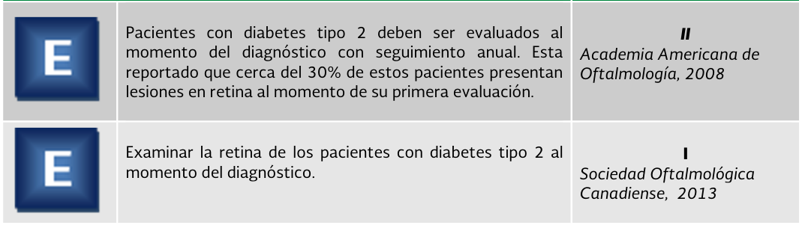

<details>
<summary>📝 Texto extraído (OCR) — GPC_Retinopatía_diabética_1er_nivel.pdf-0015-04.png</summary>

```
Pacientes con diabetes tipo 2 deben ser evaluados al
momento del diagnóstico con seguimiento anual. Esta
reportado que cerca del 30% de estos pacientes presentan
lesiones en retina al momento de su primera evaluación.

Examinar la retina de los pacientes con diabetes tipo 2 al
momento del diagnóstico.

i]
Academia Americana de
Oftalmologia, 2008

]
Sociedad Oftalmológica
Canadiense, 2013
```

</details>

<!-- Start of picture text -->
Pacientes con diabetes tipo 2 deben ser evaluados al  II<br>momento del diagnóstico con seguimiento anual. Esta  Academia Americana de<br>reportado que cerca del 30% de estos pacientes presentan  Oftalmología, 2008<br>lesiones en retina al momento de su primera evaluación.<br>Examinar la retina de los pacientes con diabetes tipo 2 al  I<br>momento del diagnóstico.  Sociedad Oftalmológica<br>Canadiense,  2013<br><!-- End of picture text -->

**_II_** _Academia Americana de Oftalmología, 2008_ **I** _Sociedad Oftalmológica Canadiense,  2013_ **A** _Academia Americana de Oftalmología, 2008_ 

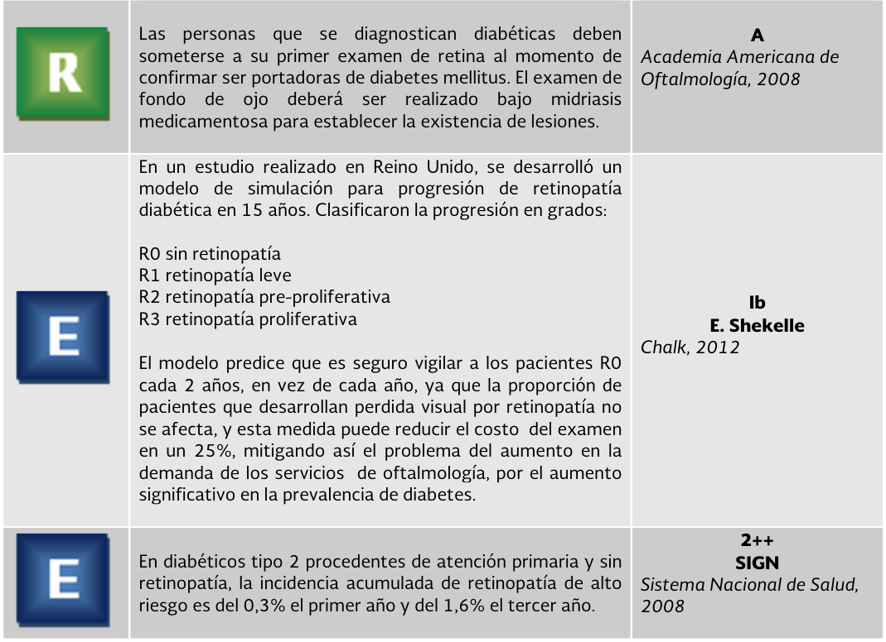

<details>
<summary>📝 Texto extraído (OCR) — GPC_Retinopatía_diabética_1er_nivel.pdf-0015-06.png</summary>

```
Las personas que se diagnostican diabéticas deben
someterse a su primer examen de retina al momento de
confirmar ser portadoras de diabetes mellitus. El examen de
fondo de ojo deberá ser realizado bajo midriasis
medicamentosa para establecer la existencia de lesiones.

En un estudio realizado en Reino Unido, se desarrolló un
modelo de simulación para progresión de retinopatía
diabética en 15 años. Clasificaron la progresión en grados:

RO sin retinopatía

R1 retinopatía leve

R2 retinopatía pre-proliferativa
R3 retinopatía proliferativa

El modelo predice que es seguro vigilar a los pacientes RO
cada 2 años, en vez de cada año, ya que la proporción de
pacientes que desarrollan perdida visual por retinopatía no
se afecta, y esta medida puede reducir el costo del examen
en un 25%, mitigando así el problema del aumento en la
demanda de los servicios de oftalmología, por el aumento
significativo en la prevalencia de diabetes.

En diabéticos tipo 2 procedentes de atención primaria y sin
retinopatía, la incidencia acumulada de retinopatía de alto
riesgo es del 0,3% el primer año y del 1,6% el tercer año.

A
Academia Americana de
Oftalmología, 2008

Ib
E. Shekelle
Chalk, 2012

2++

SIGN
Sistema Nacional de Salud,
2008
```

</details>

<!-- Start of picture text -->
Las personas que se diagnostican diabéticas deben  A<br>someterse a su primer examen de retina al momento de  Academia Americana de<br>confirmar ser portadoras de diabetes mellitus. El examen de  Oftalmología, 2008<br>fondo  de  ojo  deberá  ser  realizado  bajo  midriasis<br>medicamentosa para establecer la existencia de lesiones.<br>En un estudio realizado en Reino Unido, se desarrolló un<br>modelo de simulación para progresión de retinopatía<br>diabética en 15 años. Clasificaron la progresión en grados:<br>R0 sin retinopatía<br>R1 retinopatía leve<br>R2 retinopatía pre-proliferativa Ib<br>R3 retinopatía proliferativa E. Shekelle<br>Chalk, 2012<br>El modelo predice que es seguro vigilar a los pacientes R0<br>cada 2 años, en vez de cada año, ya que la proporción de<br>pacientes que desarrollan perdida visual por retinopatía no<br>se afecta, y esta medida puede reducir el costo  del examen<br>en un 25%, mitigando así el problema del aumento en la<br>demanda de los servicios  de oftalmología, por el aumento<br>significativo en la prevalencia de diabetes.<br>2++<br>En diabéticos tipo 2 procedentes de atención primaria y sin  SIGN<br>retinopatía, la incidencia acumulada de retinopatía de alto  Sistema Nacional de Salud,<br>riesgo es del 0,3% el primer año y del 1,6% el tercer año.  2008<br><!-- End of picture text -->

**15** 

<details>
<summary>📝 Texto extraído (OCR) — GPC_Retinopatía_diabética_1er_nivel.pdf-0016-00.png</summary>

```
jopatia Diabética en Primer Nivel de Atención
```

</details>

<!-- Start of picture text -->
Detección de Retinopatía Diabética en Primer Nivel de Atención<br><!-- End of picture text -->

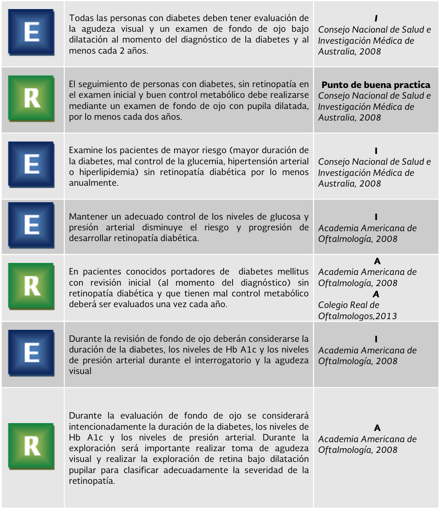

<details>
<summary>📝 Texto extraído (OCR) — GPC_Retinopatía_diabética_1er_nivel.pdf-0016-01.png</summary>

```
Todas las personas con diabetes deben tener evaluación de
la agudeza visual y un examen de fondo de ojo bajo
dilatación al momento del diagnóstico de la diabetes y al
menos cada 2 años.

El seguimiento de personas con diabetes, sin retinopatía en
el examen inicial y buen control metabólico debe realizarse
mediante un examen de fondo de ojo con pupila dilatada,
por lo menos cada dos años.

Examine los pacientes de mayor riesgo (mayor duración de
la diabetes, mal control de la glucemia, hipertensión arterial
o hiperlipidemia) sin retinopatía diabética por lo menos
anualmente.

Mantener un adecuado control de los niveles de glucosa y
presión arterial disminuye el riesgo y progresión de
desarrollar retinopatía diabética.

En pacientes conocidos portadores de diabetes mellitus
con revisión inicial (al momento del diagnóstico) sin
retinopatía diabética y que tienen mal control metabólico
deberá ser evaluados una vez cada año.

Durante la revisión de fondo de ojo deberán considerarse la
duración de la diabetes, los niveles de Hb Alc y los niveles
de presión arterial durante el interrogatorio y la agudeza
visual

Durante la evaluación de fondo de ojo se considerará
intencionadamente la duración de la diabetes, los niveles de
Hb Alc y los niveles de presión arterial. Durante la
exploración será importante realizar toma de agudeza
visual y realizar la exploración de retina bajo dilatación
pupilar para clasificar adecuadamente la severidad de la
retinopatía.

I
Consejo Nacional de Salud e
Investigacion Médica de
Australia, 2008

Punto de buena practica
Consejo Nacional de Salud e
Investigacion Médica de
Australia, 2008

]
Consejo Nacional de Salud e
Investigación Médica de
Australia, 2008

I
Academia Americana de
Oftalmologia, 2008

A
Academia Americana de
Oftalmologia, 2008

A
Colegio Real de
Oftalmologos,2013

I
Academia Americana de
Oftalmologia, 2008

A
Academia Americana de
Oftalmologia, 2008
```

</details>

<!-- Start of picture text -->
Todas las personas con diabetes deben tener evaluación de  I<br>la agudeza visual y un examen de fondo de ojo bajo  Consejo Nacional de Salud e<br>dilatación al momento del diagnóstico de la diabetes y al  Investigación Médica de<br>menos cada 2 años.  Australia, 2008<br>El seguimiento de personas con diabetes, sin retinopatía en  Punto de buena practica<br>el examen inicial y buen control metabólico debe realizarse  Consejo Nacional de Salud e<br>mediante un examen de fondo de ojo con pupila dilatada,  Investigación Médica de<br>por lo menos cada dos años.  Australia, 2008<br>Examine los pacientes de mayor riesgo (mayor duración de  I<br>la diabetes, mal control de la glucemia, hipertensión arterial  Consejo Nacional de Salud e<br>o hiperlipidemia) sin retinopatía diabética por lo menos  Investigación Médica de<br>anualmente. Australia, 2008<br>Mantener un adecuado control de los niveles de glucosa y  I<br>presión arterial disminuye el riesgo y progresión de  Academia Americana de<br>desarrollar retinopatía diabética.  Oftalmología, 2008<br> A<br>En pacientes conocidos portadores de  diabetes mellitus  Academia Americana de<br>con revisión inicial (al momento del diagnóstico) sin  Oftalmología, 2008<br>retinopatía diabética y que tienen mal control metabólico  A<br>deberá ser evaluados una vez cada año.  Colegio Real de<br>Oftalmologos,2013<br>Durante la revisión de fondo de ojo deberán considerarse la  I<br>duración de la diabetes, los niveles de Hb A1c y los niveles  Academia Americana de<br>de presión arterial durante el interrogatorio y la agudeza  Oftalmología, 2008<br>visual<br>Durante la evaluación de fondo de ojo se considerará<br>intencionadamente la duración de la diabetes, los niveles de   A<br>Hb A1c y los niveles de presión arterial. Durante la  Academia Americana de<br>exploración será importante realizar toma de agudeza  Oftalmología, 2008<br>visual y realizar la exploración de retina bajo dilatación<br>pupilar para clasificar adecuadamente la severidad de la<br>retinopatía.<br><!-- End of picture text -->

**16** 

<details>
<summary>📝 Texto extraído (OCR) — GPC_Retinopatía_diabética_1er_nivel.pdf-0017-00.png</summary>

```
jopatia Diabética en Primer Nivel de Atención
```

</details>

<!-- Start of picture text -->
Detección de Retinopatía Diabética en Primer Nivel de Atención<br><!-- End of picture text -->

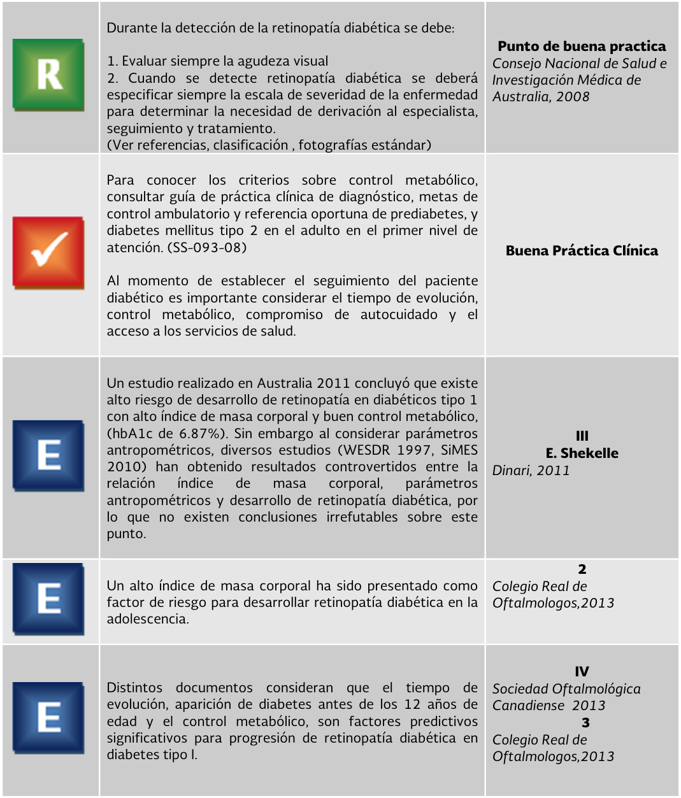

<details>
<summary>📝 Texto extraído (OCR) — GPC_Retinopatía_diabética_1er_nivel.pdf-0017-01.png</summary>

```
E [3

Durante la detección de la retinopatía diabética se debe:

1. Evaluar siempre la agudeza visual

2. Cuando se detecte retinopatía diabética se deberá
especificar siempre la escala de severidad de la enfermedad
para determinar la necesidad de derivación al especialista,
seguimiento y tratamiento.

(Ver referencias, clasificación , fotografías estándar)

Para conocer los criterios sobre control metabólico,
consultar guía de práctica clínica de diagnóstico, metas de
control ambulatorio y referencia oportuna de prediabetes, y
diabetes mellitus tipo 2 en el adulto en el primer nivel de
atención. (SS-093-08)

Al momento de establecer el seguimiento del paciente
diabético es importante considerar el tiempo de evolución,
control metabólico, compromiso de autocuidado y el
acceso a los servicios de salud.

Un estudio realizado en Australia 2011 concluyó que existe
alto riesgo de desarrollo de retinopatía en diabéticos tipo 1
con alto índice de masa corporal y buen control metabólico,
(hbAlc de 6.87%). Sin embargo al considerar parámetros
antropométricos, diversos estudios (WESDR 1997, SiMES
2010) han obtenido resultados controvertidos entre la
relación indice de masa corporal, parámetros
antropométricos y desarrollo de retinopatía diabética, por
lo que no existen conclusiones irrefutables sobre este
punto.

Un alto índice de masa corporal ha sido presentado como
factor de riesgo para desarrollar retinopatía diabética en la
adolescencia.

Distintos documentos consideran que el tiempo de
evolución, aparición de diabetes antes de los 12 años de
edad y el control metabólico, son factores predictivos
significativos para progresión de retinopatía diabética en
diabetes tipo |.

Punto de buena practica
Consejo Nacional de Salud e
Investigacién Médica de
Australia, 2008

Buena Practica Clinica

"
E. Shekelle
Dinari, 2011

2
Colegio Real de
Oftalmologos,2013

IV
Sociedad Oftalmológica
Canadiense 2013
3
Colegio Real de
Oftalmologos,2013
```

</details>

<!-- Start of picture text -->
Durante la detección de la retinopatía diabética se debe:<br>Punto de buena practica<br>1. Evaluar siempre la agudeza visual   Consejo Nacional de Salud e<br>2. Cuando se detecte retinopatía diabética se deberá  Investigación Médica de<br>especificar siempre la escala de severidad de la enfermedad  Australia, 2008<br>para determinar la necesidad de derivación al especialista,<br>seguimiento y tratamiento.<br>(Ver referencias, clasificación , fotografías estándar)<br>Para conocer los criterios sobre control metabólico,<br>consultar guía de práctica clínica de diagnóstico, metas de<br>control ambulatorio y referencia oportuna de prediabetes, y<br>diabetes mellitus tipo 2 en el adulto en el primer nivel de<br>atención. (SS-093-08)   Buena Práctica Clínica<br>Al momento de establecer el seguimiento del paciente<br>diabético es importante considerar el tiempo de evolución,<br>control metabólico, compromiso de autocuidado y el<br>acceso a los servicios de salud.<br>Un estudio realizado en Australia 2011 concluyó que existe<br>alto riesgo de desarrollo de retinopatía en diabéticos tipo 1<br>con alto índice de masa corporal y buen control metabólico,<br>(hbA1c de 6.87%). Sin embargo al considerar parámetros  III<br>antropométricos, diversos estudios (WESDR 1997, SiMES  E. Shekelle<br>2010) han obtenido resultados controvertidos entre la  Dinari, 2011<br>relación  índice  de  masa  corporal,  parámetros<br>antropométricos y desarrollo de retinopatía diabética, por<br>lo que no existen conclusiones irrefutables sobre este<br>punto.<br>2<br>Un alto índice de masa corporal ha sido presentado como  Colegio Real de<br>factor de riesgo para desarrollar retinopatía diabética en la  Oftalmologos,2013<br>adolescencia.<br>IV<br>Distintos documentos consideran que el tiempo de  Sociedad Oftalmológica<br>evolución, aparición de diabetes antes de los 12 años de  Canadiense  2013<br>edad y el control metabólico, son factores predictivos    3<br>significativos para progresión de retinopatía diabética en  Colegio Real de<br>diabetes tipo I.  Oftalmologos,2013<br><!-- End of picture text -->

**17** 

<details>
<summary>📝 Texto extraído (OCR) — GPC_Retinopatía_diabética_1er_nivel.pdf-0018-00.png</summary>

```
jopatia Diabética en Primer Nivel de Atención
```

</details>

<!-- Start of picture text -->
Detección de Retinopatía Diabética en Primer Nivel de Atención<br><!-- End of picture text -->

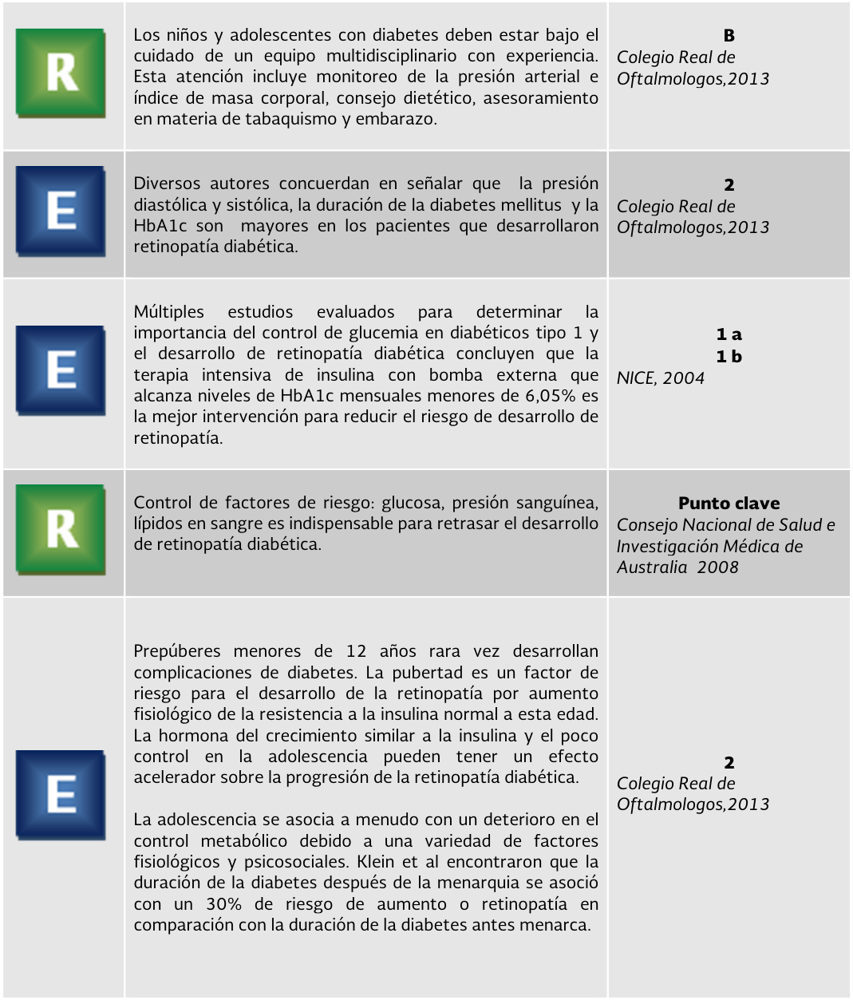

<details>
<summary>📝 Texto extraído (OCR) — GPC_Retinopatía_diabética_1er_nivel.pdf-0018-01.png</summary>

```
Los niños y adolescentes con diabetes deben estar bajo el
cuidado de un equipo multidisciplinario con experiencia.
Esta atención incluye monitoreo de la presión arterial e
índice de masa corporal, consejo dietético, asesoramiento
en materia de tabaquismo y embarazo.

Diversos autores concuerdan en señalar que la presión
diastólica y sistólica, la duración de la diabetes mellitus y la
HbAlc son mayores en los pacientes que desarrollaron
retinopatía diabética.

Múltiples estudios evaluados para determinar la
importancia del control de glucemia en diabéticos tipo 1 y
el desarrollo de retinopatía diabética concluyen que la
terapia intensiva de insulina con bomba externa que
alcanza niveles de HbA1c mensuales menores de 6,05% es
la mejor intervención para reducir el riesgo de desarrollo de
retinopatía.

Control de factores de riesgo: glucosa, presión sanguínea,
lípidos en sangre es indispensable para retrasar el desarrollo
de retinopatía diabética.

Prepúberes menores de 12 años rara vez desarrollan
complicaciones de diabetes. La pubertad es un factor de
riesgo para el desarrollo de la retinopatía por aumento
fisiológico de la resistencia a la insulina normal a esta edad.
La hormona del crecimiento similar a la insulina y el poco
control en la adolescencia pueden tener un efecto
acelerador sobre la progresión de la retinopatía diabética.

La adolescencia se asocia a menudo con un deterioro en el
control metabólico debido a una variedad de factores
fisiológicos y psicosociales. Klein et al encontraron que la
duración de la diabetes después de la menarquia se asoció
con un 30% de riesgo de aumento o retinopatía en
comparación con la duración de la diabetes antes menarca.

B
Colegio Real de
Oftalmologos,2013

2
Colegio Real de
Oftalmologos,2013

la
1b
NICE, 2004

Punto clave
Consejo Nacional de Salud e
Investigación Médica de
Australia 2008

2
Colegio Real de
Oftalmologos,2013
```

</details>

<!-- Start of picture text -->
Los niños y adolescentes con diabetes deben estar bajo el  B<br>cuidado de un equipo multidisciplinario con experiencia.  Colegio Real de<br>Esta atención incluye monitoreo de la presión arterial e  Oftalmologos,2013<br>índice de masa corporal, consejo dietético, asesoramiento<br>en materia de tabaquismo y embarazo.<br>Diversos autores concuerdan en señalar que  la presión  2<br>diastólica y sistólica, la duración de la diabetes mellitus  y la  Colegio Real de<br>HbA1c son  mayores en los pacientes que desarrollaron  Oftalmologos,2013<br>retinopatía diabética.<br>Múltiples  estudios  evaluados  para  determinar  la<br>importancia del control de glucemia en diabéticos tipo 1 y  1 a<br>el desarrollo de retinopatía diabética concluyen que la  1 b<br>terapia intensiva de insulina con bomba externa que  NICE, 2004<br>alcanza niveles de HbA1c mensuales menores de 6,05% es<br>la mejor intervención para reducir el riesgo de desarrollo de<br>retinopatía.<br>Control de factores de riesgo: glucosa, presión sanguínea,  Punto clave<br>lípidos en sangre es indispensable para retrasar el desarrollo  Consejo Nacional de Salud e<br>de retinopatía diabética.   Investigación Médica de<br>Australia  2008<br>Prepúberes menores de 12 años rara vez desarrollan<br>complicaciones de diabetes. La pubertad es un factor de<br>riesgo para el desarrollo de la retinopatía por aumento<br>fisiológico de la resistencia a la insulina normal a esta edad.<br>La hormona del crecimiento similar a la insulina y el poco<br>control en la adolescencia pueden tener un efecto  2<br>acelerador sobre la progresión de la retinopatía diabética.<br>Colegio Real de<br>Oftalmologos,2013<br>La adolescencia se asocia a menudo con un deterioro en el<br>control metabólico debido a una variedad de factores<br>fisiológicos y psicosociales. Klein et al encontraron que la<br>duración de la diabetes después de la menarquia se asoció<br>con un 30% de riesgo de aumento o retinopatía en<br>comparación con la duración de la diabetes antes menarca.<br><!-- End of picture text -->

**18** 

<details>
<summary>📝 Texto extraído (OCR) — GPC_Retinopatía_diabética_1er_nivel.pdf-0019-00.png</summary>

```
jopatia Diabética en Primer Nivel de Atención
```

</details>

<!-- Start of picture text -->
Detección de Retinopatía Diabética en Primer Nivel de Atención<br><!-- End of picture text -->

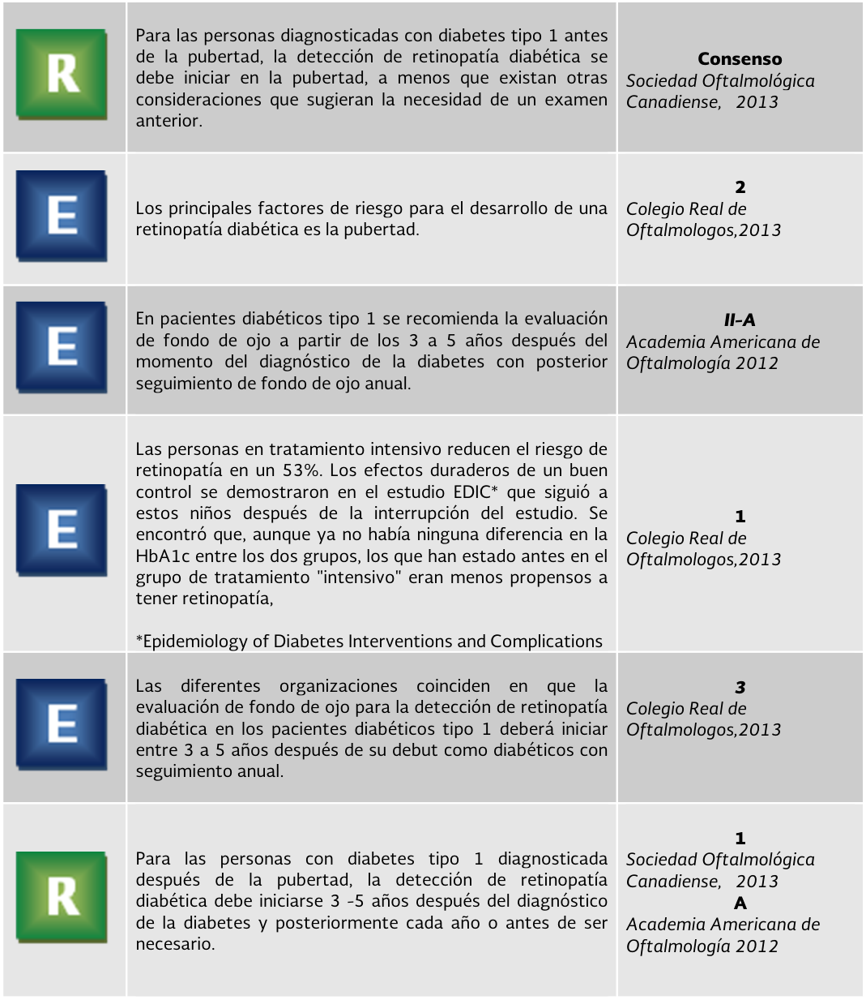

<details>
<summary>📝 Texto extraído (OCR) — GPC_Retinopatía_diabética_1er_nivel.pdf-0019-01.png</summary>

```
Para las personas diagnosticadas con diabetes tipo 1 antes
de la pubertad, la detección de retinopatía diabética se
debe iniciar en la pubertad, a menos que existan otras
consideraciones que sugieran la necesidad de un examen
anterior.

Los principales factores de riesgo para el desarrollo de una
retinopatía diabética es la pubertad.

En pacientes diabéticos tipo 1 se recomienda la evaluación
de fondo de ojo a partir de los 3 a 5 años después del
momento del diagnóstico de la diabetes con posterior
seguimiento de fondo de ojo anual.

Las personas en tratamiento intensivo reducen el riesgo de
retinopatía en un 53%. Los efectos duraderos de un buen
control se demostraron en el estudio EDIC* que siguió a
estos niños después de la interrupción del estudio. Se
encontró que, aunque ya no había ninguna diferencia en la
HbAlc entre los dos grupos, los que han estado antes en el
grupo de tratamiento "intensivo" eran menos propensos a
tener retinopatía,

*Epidemiology of Diabetes Interventions and Complications

Las diferentes organizaciones coinciden en que la
evaluación de fondo de ojo para la detección de retinopatía
diabética en los pacientes diabéticos tipo 1 deberá iniciar
entre 3 a 5 años después de su debut como diabéticos con
seguimiento anual.

Para las personas con diabetes tipo 1 diagnosticada
después de la pubertad, la detección de retinopatía
diabética debe iniciarse 3 -5 años después del diagnóstico
de la diabetes y posteriormente cada año o antes de ser
necesario.

Consenso
Sociedad Oftalmológica
Canadiense, 2013

2
Colegio Real de
Oftalmologos,2013

I-A
Academia Americana de
Oftalmologia 2012

1
Colegio Real de
Oftalmologos,2013

3
Colegio Real de
Oftalmologos,2013

1
Sociedad Oftalmológica
Canadiense, 2013

A
Academia Americana de
Oftalmologia 2012
```

</details>

<!-- Start of picture text -->
Para las personas diagnosticadas con diabetes tipo 1 antes<br>de la pubertad, la detección de retinopatía diabética se  Consenso<br>debe iniciar en la pubertad, a menos que existan otras  Sociedad Oftalmológica<br>consideraciones que sugieran la necesidad de un examen  Canadiense,   2013<br>anterior.<br>2<br>Los principales factores de riesgo para el desarrollo de una  Colegio Real de<br>retinopatía diabética es la pubertad.  Oftalmologos,2013<br>En pacientes diabéticos tipo 1 se recomienda la evaluación  II-A<br>de fondo de ojo a partir de los 3 a 5 años después del  Academia Americana de<br>momento del diagnóstico de la diabetes con posterior  Oftalmología 2012<br>seguimiento de fondo de ojo anual.<br>Las personas en tratamiento intensivo reducen el riesgo de<br>retinopatía en un 53%. Los efectos duraderos de un buen<br>control se demostraron en el estudio EDIC* que siguió a<br>estos niños después de la interrupción del estudio. Se  1<br>encontró que, aunque ya no había ninguna diferencia en la  Colegio Real de<br>HbA1c entre los dos grupos, los que han estado antes en el  Oftalmologos,2013<br>grupo de tratamiento "intensivo" eran menos propensos a<br>tener retinopatía,<br>*Epidemiology of Diabetes Interventions and Complications<br>Las  diferentes  organizaciones  coinciden  en  que  la  3<br>evaluación de fondo de ojo para la detección de retinopatía  Colegio Real de<br>diabética en los pacientes diabéticos tipo 1 deberá iniciar  Oftalmologos,2013<br>entre 3 a 5 años después de su debut como diabéticos con<br>seguimiento anual.<br>1<br>Para las personas con diabetes tipo 1 diagnosticada  Sociedad Oftalmológica<br>después de la pubertad, la detección de retinopatía  Canadiense,   2013<br>diabética debe iniciarse 3 -5 años después del diagnóstico  A<br>de la diabetes y posteriormente cada año o antes de ser  Academia Americana de<br>necesario.  Oftalmología 2012<br><!-- End of picture text -->

**19** 

<details>
<summary>📝 Texto extraído (OCR) — GPC_Retinopatía_diabética_1er_nivel.pdf-0020-00.png</summary>

```
jopatia Diabética en Primer Nivel de Atención
```

</details>

<!-- Start of picture text -->
Detección de Retinopatía Diabética en Primer Nivel de Atención<br><!-- End of picture text -->

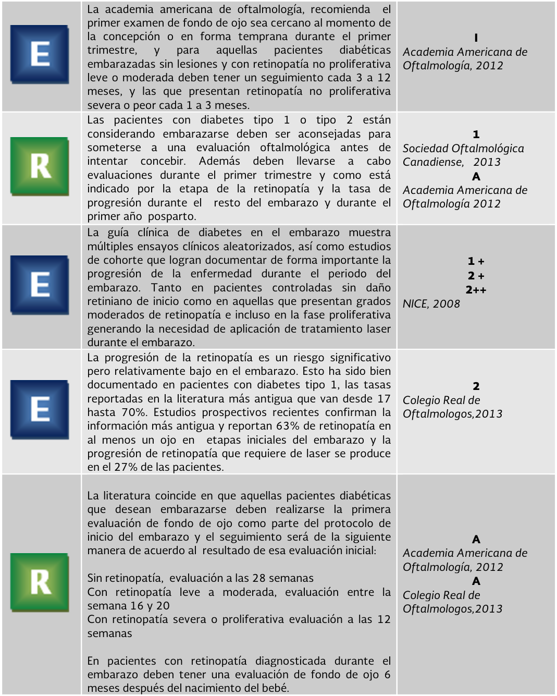

<details>
<summary>📝 Texto extraído (OCR) — GPC_Retinopatía_diabética_1er_nivel.pdf-0020-01.png</summary>

```
La academia americana de oftalmología, recomienda el
primer examen de fondo de ojo sea cercano al momento de
la concepción o en forma temprana durante el primer
trimestre, y para aquellas pacientes  diabéticas
embarazadas sin lesiones y con retinopatía no proliferativa
leve o moderada deben tener un seguimiento cada 3 a 12
meses, y las que presentan retinopatía no proliferativa
severa o peor cada 1 a 3 meses.

Las pacientes con diabetes tipo 1 o tipo 2 están
considerando embarazarse deben ser aconsejadas para
someterse a una evaluación oftalmológica antes de
intentar concebir. Además deben llevarse a cabo
evaluaciones durante el primer trimestre y como está
indicado por la etapa de la retinopatía y la tasa de
progresión durante el resto del embarazo y durante el
primer año posparto.

La guía clínica de diabetes en el embarazo muestra
múltiples ensayos clínicos aleatorizados, así como estudios
de cohorte que logran documentar de forma importante la
progresión de la enfermedad durante el periodo del
embarazo. Tanto en pacientes controladas sin daño
retiniano de inicio como en aquellas que presentan grados
moderados de retinopatía e incluso en la fase proliferativa
generando la necesidad de aplicación de tratamiento laser
durante el embarazo.

La progresión de la retinopatía es un riesgo significativo
pero relativamente bajo en el embarazo. Esto ha sido bien
documentado en pacientes con diabetes tipo 1, las tasas
reportadas en la literatura más antigua que van desde 17
hasta 70%. Estudios prospectivos recientes confirman la
información más antigua y reportan 63% de retinopatía en
al menos un ojo en etapas iniciales del embarazo y la
progresión de retinopatía que requiere de laser se produce
en el 27% de las pacientes.

La literatura coincide en que aquellas pacientes diabéticas
que desean embarazarse deben realizarse la primera
evaluación de fondo de ojo como parte del protocolo de
inicio del embarazo y el seguimiento será de la siguiente
manera de acuerdo al resultado de esa evaluación inicial:

Sin retinopatía, evaluación a las 28 semanas

Con retinopatía leve a moderada, evaluación entre la
semana 16 y 20

Con retinopatía severa o proliferativa evaluación a las 12
semanas

En pacientes con retinopatía diagnosticada durante el
embarazo deben tener una evaluación de fondo de ojo 6
meses después del nacimiento del bebé.

]
Academia Americana de
Oftalmología, 2012

1
Sociedad Oftalmológica
Canadiense, 2013

A
Academia Americana de
Oftalmología 2012

1+

2+

2++
NICE, 2008

2
Colegio Real de
Oftalmologos,2013

A
Academia Americana de
Oftalmologia, 2012

A
Colegio Real de
Oftalmologos,2013
```

</details>

<!-- Start of picture text -->
La academia americana de oftalmología, recomienda  el<br>primer examen de fondo de ojo sea cercano al momento de<br>la concepción o en forma temprana durante el primer  I<br>trimestre,  y  para  aquellas  pacientes  diabéticas  Academia Americana de<br>embarazadas sin lesiones y con retinopatía no proliferativa  Oftalmología, 2012<br>leve o moderada deben tener un seguimiento cada 3 a 12<br>meses, y las que presentan retinopatía no proliferativa<br>severa o peor cada 1 a 3 meses.<br>Las pacientes con diabetes tipo 1 o tipo 2 están<br>considerando embarazarse deben ser aconsejadas para   1<br>someterse a una evaluación oftalmológica antes de  Sociedad Oftalmológica<br>intentar  concebir.  Además  deben  llevarse  a  cabo  Canadiense,   2013<br>evaluaciones durante el primer trimestre y como está  A<br>indicado por la etapa de la retinopatía y la tasa de  Academia Americana de<br>progresión durante el  resto del embarazo y durante el  Oftalmología 2012<br>primer año  posparto.<br>La guía clínica de diabetes en el embarazo muestra<br>múltiples ensayos clínicos aleatorizados, así como estudios<br>de cohorte que logran documentar de forma importante la  1 +<br>progresión de la enfermedad durante el periodo del  2 +<br>embarazo. Tanto en pacientes controladas sin daño  2++<br>retiniano de inicio como en aquellas que presentan grados  NICE, 2008<br>moderados de retinopatía e incluso en la fase proliferativa<br>generando la necesidad de aplicación de tratamiento laser<br>durante el embarazo.<br>La progresión de la retinopatía es un riesgo significativo<br>pero relativamente bajo en el embarazo. Esto ha sido bien<br>documentado en pacientes con diabetes tipo 1, las tasas  2<br>reportadas en la literatura más antigua que van desde 17  Colegio Real de<br>hasta 70%. Estudios prospectivos recientes confirman la  Oftalmologos,2013<br>información más antigua y reportan 63% de retinopatía en<br>al menos un ojo en  etapas iniciales del embarazo y la<br>progresión de retinopatía que requiere de laser se produce<br>en el 27% de las pacientes.<br>La literatura coincide en que aquellas pacientes diabéticas<br>que desean embarazarse deben realizarse la primera<br>evaluación de fondo de ojo como parte del protocolo de<br>inicio del embarazo y el seguimiento será de la siguiente  A<br>manera de acuerdo al  resultado de esa evaluación inicial:   Academia Americana de<br>Oftalmología, 2012<br>Sin retinopatía,  evaluación a las 28 semanas  A<br>Con retinopatía leve a moderada, evaluación entre la  Colegio Real de<br>semana 16 y 20  Oftalmologos,2013<br>Con retinopatía severa o proliferativa evaluación a las 12<br>semanas<br>En pacientes con retinopatía diagnosticada durante el<br>embarazo deben tener una evaluación de fondo de ojo 6<br>meses después del nacimiento del bebé.<br><!-- End of picture text -->

**20** 

<details>
<summary>📝 Texto extraído (OCR) — GPC_Retinopatía_diabética_1er_nivel.pdf-0021-00.png</summary>

```
jopatia Diabética en Primer Nivel de Atención
```

</details>

<!-- Start of picture text -->
Detección de Retinopatía Diabética en Primer Nivel de Atención<br><!-- End of picture text -->

**4.2. Control metabólico del paciente diabético** _4.2.1. Criterios de seguimiento_ 

Evidencia / Recomendación Nivel / Grado La duración de la enfermedad es uno de los principales **1** factores de riesgo para el desarrollo de retinopatía _Colegio Real de_ diabética _Oftalmologos,2013_ Antecedentes **I** 1. Duración de la diabetes I-A _Academia Americana de_ 2. Control de glucosa HbA1c I-A _Oftalmología 2012_ 3. Antecedente de: enfermedad renal (II-A), hipertensión sistémica (I-A) niveles de lípidos (II-A),  embarazo (I-A) La duración de la diabetes y la severidad de la hiperglicemia son los principales factores de riesgo para el desarrollo de la **A** retinopatía. Una vez que la retinopatía está presente, la _Academia Americana de_ duración de la diabetes parece menos importante que la _Oftalmología 2012_ hiperglicemia para progresión de la retinopatía. Los principales factores de riesgo modificables para el **2** desarrollo de retinopatía diabética son: _Colegio Real de_ Presión sanguínea _Oftalmologos,2013_ Índice de masa corporal La progresión de retinopatía diabética avanzada está **A** relacionada con el control de la diabetes, el riesgo puede _Colegio Real de_ reducirse a través del control intensivo de los niveles de _Oftalmologos,2013_ glucosa en sangre, presión arterial e índice de masa corporal Mantener los niveles de glucosa lo más cercano a lo normal **I-A** así como las cifras de tensión arterial reduce el riesgo de _Academia Americana de_ desarrollo y progreso de retinopatía diabética. _Oftalmología 2012_ 

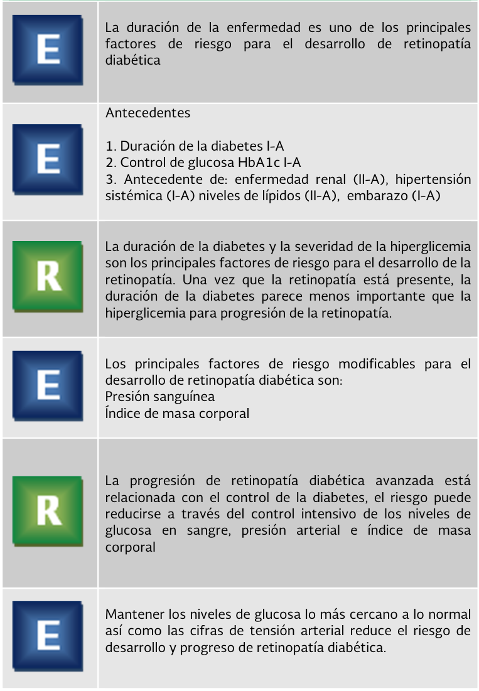

<details>
<summary>📝 Texto extraído (OCR) — GPC_Retinopatía_diabética_1er_nivel.pdf-0021-03.png</summary>

```
La duración de la enfermedad es uno de los principales
factores de riesgo para el desarrollo de retinopatía
diabética

Antecedentes

1. Duración de la diabetes I-A

2. Control de glucosa HbAlc I-A

3. Antecedente de: enfermedad renal (II-A), hipertensión
sistémica (I-A) niveles de lípidos (II-A), embarazo (I-A)

La duración de la diabetes y la severidad de la hiperglicemia
son los principales factores de riesgo para el desarrollo de la
retinopatía. Una vez que la retinopatía está presente, la
duración de la diabetes parece menos importante que la
hiperglicemia para progresión de la retinopatía.

Los principales factores de riesgo modificables para el
desarrollo de retinopatía diabética son:

Presión sanguínea

Índice de masa corporal

La progresión de retinopatía diabética avanzada está
relacionada con el control de la diabetes, el riesgo puede
reducirse a través del control intensivo de los niveles de
glucosa en sangre, presión arterial e Índice de masa
corporal

Mantener los niveles de glucosa lo más cercano a lo normal
así como las cifras de tensión arterial reduce el riesgo de
desarrollo y progreso de retinopatía diabética.
```

</details>

<!-- Start of picture text -->
La duración de la enfermedad es uno de los principales<br>factores de riesgo para el desarrollo de retinopatía<br>diabética<br>Antecedentes<br>1. Duración de la diabetes I-A<br>2. Control de glucosa HbA1c I-A<br>3. Antecedente de: enfermedad renal (II-A), hipertensión<br>sistémica (I-A) niveles de lípidos (II-A),  embarazo (I-A)<br>La duración de la diabetes y la severidad de la hiperglicemia<br>son los principales factores de riesgo para el desarrollo de la<br>retinopatía. Una vez que la retinopatía está presente, la<br>duración de la diabetes parece menos importante que la<br>hiperglicemia para progresión de la retinopatía.<br>Los principales factores de riesgo modificables para el<br>desarrollo de retinopatía diabética son:<br>Presión sanguínea<br>Índice de masa corporal<br>La progresión de retinopatía diabética avanzada está<br>relacionada con el control de la diabetes, el riesgo puede<br>reducirse a través del control intensivo de los niveles de<br>glucosa en sangre, presión arterial e índice de masa<br>corporal<br>Mantener los niveles de glucosa lo más cercano a lo normal<br>así como las cifras de tensión arterial reduce el riesgo de<br>desarrollo y progreso de retinopatía diabética.<br><!-- End of picture text -->

**21** 

<details>
<summary>📝 Texto extraído (OCR) — GPC_Retinopatía_diabética_1er_nivel.pdf-0022-00.png</summary>

```
jopatia Diabética en Primer Nivel de Atención
```

</details>

<!-- Start of picture text -->
Detección de Retinopatía Diabética en Primer Nivel de Atención<br><!-- End of picture text -->

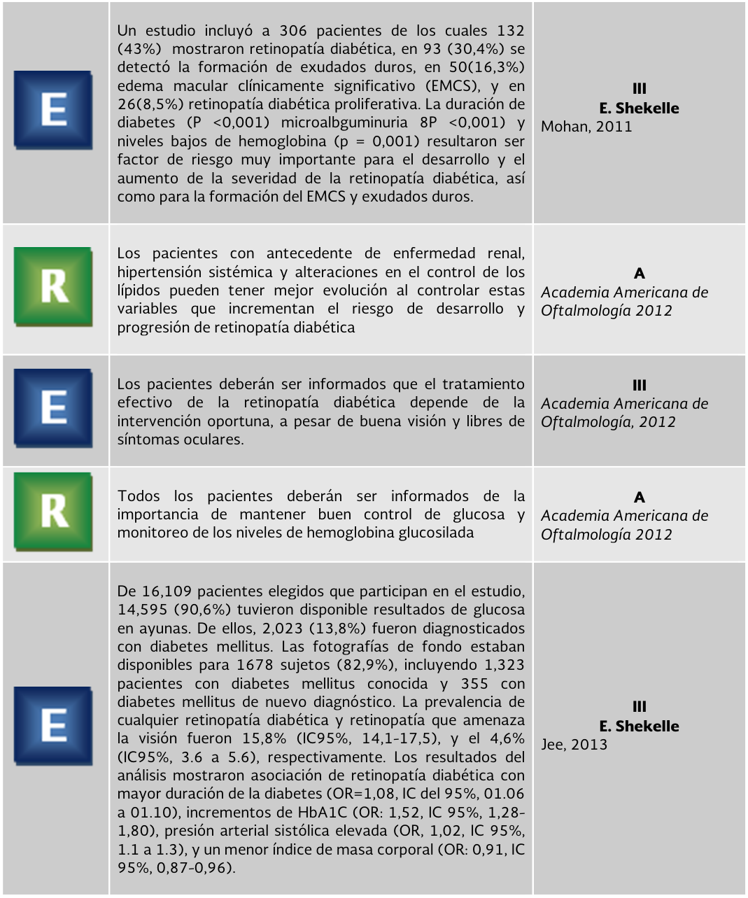

<details>
<summary>📝 Texto extraído (OCR) — GPC_Retinopatía_diabética_1er_nivel.pdf-0022-01.png</summary>

```
Un estudio incluyó a 306 pacientes de los cuales 132
(43%) mostraron retinopatía diabética, en 93 (30,4%) se
detectó la formación de exudados duros, en 50(16,3%)
edema macular clínicamente significativo (EMCS), y en
26(8,5%) retinopatia diabética proliferativa. La duración de
diabetes (P <0,001) microalbguminuria 8P <0,001) y
niveles bajos de hemoglobina (p = 0,001) resultaron ser
factor de riesgo muy importante para el desarrollo y el
aumento de la severidad de la retinopatía diabética, así
como para la formación del EMCS y exudados duros.

Los pacientes con antecedente de enfermedad renal,
hipertensión sistémica y alteraciones en el control de los
lípidos pueden tener mejor evolución al controlar estas
variables que incrementan el riesgo de desarrollo y
progresión de retinopatía diabética

Los pacientes deberán ser informados que el tratamiento
efectivo de la retinopatía diabética depende de la
intervención oportuna, a pesar de buena visión y libres de
síntomas oculares.

Todos los pacientes deberán ser informados de la
importancia de mantener buen control de glucosa y
monitoreo de los niveles de hemoglobina glucosilada

De 16,109 pacientes elegidos que participan en el estudio,
14,595 (90,6%) tuvieron disponible resultados de glucosa
en ayunas. De ellos, 2,023 (13,8%) fueron diagnosticados
con diabetes mellitus. Las fotografías de fondo estaban
disponibles para 1678 sujetos (82,9%), incluyendo 1,323
pacientes con diabetes mellitus conocida y 355 con
diabetes mellitus de nuevo diagnóstico. La prevalencia de
cualquier retinopatía diabética y retinopatía que amenaza
la visión fueron 15,8% (IC95%, 14,1-17,5), y el 4,6%
(IC95%, 3.6 a 5.6), respectivamente. Los resultados del
análisis mostraron asociación de retinopatía diabética con
mayor duración de la diabetes (OR=1,08, IC del 95%, 01.06
a 01.10), incrementos de HbA1C (OR: 1,52, IC 95%, 1,28-
1,80), presión arterial sistólica elevada (OR, 1,02, IC 95%,
1.1 a 1.3), y un menor indice de masa corporal (OR: 0,91, IC
95%, 0,87-0,96).

Ml
E. Shekelle
Mohan, 2011

A
Academia Americana de
Oftalmologia 2012

Ml
Academia Americana de
Oftalmologia, 2012

A
Academia Americana de
Oftalmologia 2012

Ml
E. Shekelle
Jee, 2013
```

</details>

<!-- Start of picture text -->
Un estudio incluyó a 306 pacientes de los cuales 132<br>(43%)  mostraron retinopatía diabética, en 93 (30,4%) se<br>detectó la formación de exudados duros, en 50(16,3%)<br>edema macular clínicamente significativo (EMCS), y en  III<br>26(8,5%) retinopatía diabética proliferativa. La duración de  E. Shekelle<br>diabetes (P <0,001) microalbguminuria 8P <0,001) y  Mohan, 2011<br>niveles bajos de hemoglobina (p = 0,001) resultaron ser<br>factor de riesgo muy importante para el desarrollo y el<br>aumento de la severidad de la retinopatía diabética, así<br>como para la formación del EMCS y exudados duros.<br>Los pacientes con antecedente de enfermedad renal,<br>hipertensión sistémica y alteraciones en el control de los  A<br>lípidos pueden tener mejor evolución al controlar estas  Academia Americana de<br>variables que incrementan el riesgo de desarrollo y  Oftalmología 2012<br>progresión de retinopatía diabética<br>Los pacientes deberán ser informados que el tratamiento  III<br>efectivo de la retinopatía diabética depende de la  Academia Americana de<br>intervención oportuna, a pesar de buena visión y libres de  Oftalmología, 2012<br>síntomas oculares.<br>Todos los pacientes deberán ser informados de la  A<br>importancia de mantener buen control de glucosa y  Academia Americana de<br>monitoreo de los niveles de hemoglobina glucosilada   Oftalmología 2012<br>De 16,109 pacientes elegidos que participan en el estudio,<br>14,595 (90,6%) tuvieron disponible resultados de glucosa<br>en ayunas. De ellos, 2,023 (13,8%) fueron diagnosticados<br>con diabetes mellitus. Las fotografías de fondo estaban<br>disponibles para 1678 sujetos (82,9%), incluyendo 1,323<br>pacientes con diabetes mellitus conocida y 355 con<br>diabetes mellitus de nuevo diagnóstico. La prevalencia de  III<br>cualquier retinopatía diabética y retinopatía que amenaza  E. Shekelle<br>la visión fueron 15,8% (IC95%, 14,1-17,5), y el 4,6%<br>Jee, 2013<br>(IC95%, 3.6 a 5.6), respectivamente. Los resultados del<br>análisis mostraron asociación de retinopatía diabética con<br>mayor duración de la diabetes (OR=1,08, IC del 95%, 01.06<br>a 01.10), incrementos de HbA1C (OR: 1,52, IC 95%, 1,28-<br>1,80), presión arterial sistólica elevada (OR, 1,02, IC 95%,<br>1.1 a 1.3), y un menor índice de masa corporal (OR: 0,91, IC<br>95%, 0,87-0,96).<br><!-- End of picture text -->

**22** 

<details>
<summary>📝 Texto extraído (OCR) — GPC_Retinopatía_diabética_1er_nivel.pdf-0023-00.png</summary>

```
jopatia Diabética en Primer Nivel de Atención
```

</details>

<!-- Start of picture text -->
Detección de Retinopatía Diabética en Primer Nivel de Atención<br><!-- End of picture text -->


<details>
<summary>📝 Texto extraído (OCR) — GPC_Retinopatía_diabética_1er_nivel.pdf-0023-01.png</summary>

```
La evidencia de nuevos ensayos muestra que el control del
riesgo cardiovascular en la diabetes reduce el riesgo para
retinopatía diabética que se puede lograr mediante el
control de glucosa y presión arterial.
```

</details>

<!-- Start of picture text -->
La evidencia de nuevos ensayos muestra que el control del<br>riesgo cardiovascular en la diabetes reduce el riesgo para<br>retinopatía diabética que se puede lograr mediante el<br>control de  glucosa y presión arterial.<br><!-- End of picture text -->

La evidencia de nuevos ensayos muestra que el control del **C** riesgo cardiovascular en la diabetes reduce el riesgo para **E. Shekelle** retinopatía diabética que se puede lograr mediante el _Dinari,2011_ control de  glucosa y presión arterial. 

<details>
<summary>📝 Texto extraído (OCR) — GPC_Retinopatía_diabética_1er_nivel.pdf-0023-03.png</summary>

```
4.3. Actividades a realizar por el médico familiar
capacitado
```

</details>

<!-- Start of picture text -->
4.3. Actividades a realizar por el médico familiar<br>capacitado<br><!-- End of picture text -->

Evidencia / Recomendación Nivel / Grado El médico familiar deberá lograr el control metabólico del paciente diabético Lograr control de glucemia con Hb A1c de 6.5% **Punto de Buena Práctica** Obtener niveles normales de presión arterial y colesterol (LDL,HDL y total) Detección temprana y manejo de microalbuminuria prana y manejo de microalbuminuria rana y manejo de microalbuminuria y manejo de microalbuminuria  manejo de microalbuminuria jo de microalbuminuria o de microalbuminuria Actividades que debe realizar el médico familiar en todo paciente con diagnóstico de diabetes: Evaluación de fondo de ojo de acuerdo a los esquemas señalados en recomendaciones previas. **Punto de Buena Práctica** Fondo de ojo con lesiones leves a moderadas  (fotos de ETDRS 1, 2A, 2B y 3 ) permanecen en vigilancia en primer nivel Fondo de ojo con lesiones más significativas (fotos ETDRS de la 4 a la 13) enviar a oftalmología para evaluación. El médico familiar deberá realizar evaluación de fondo de ojo en la paciente diabética como parte del protocolo de embarazo, en caso de observar lesiones enviar a valoración **Punto de Buena Práctica** por oftalmología. 

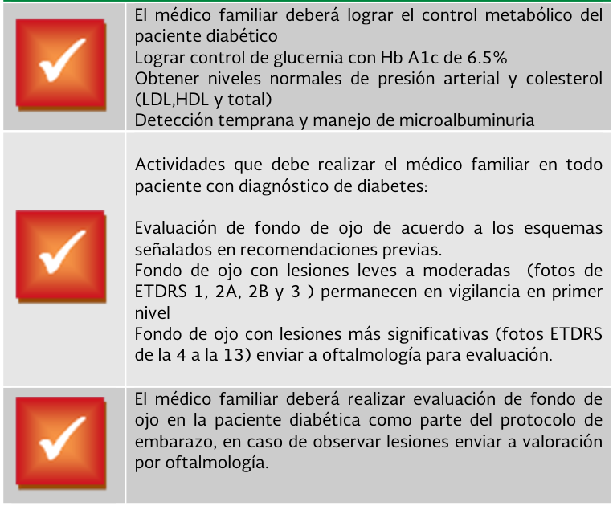

<details>
<summary>📝 Texto extraído (OCR) — GPC_Retinopatía_diabética_1er_nivel.pdf-0023-05.png</summary>

```
El médico familiar deberá lograr el control metabólico del
paciente diabético

Lograr control de glucemia con Hb Alc de 6.5%

Obtener niveles normales de presión arterial y colesterol
(LDL,HDL y total)

Detección temprana y manejo de microalbuminuria

Actividades que debe realizar el médico familiar en todo
paciente con diagnóstico de diabetes:

Evaluación de fondo de ojo de acuerdo a los esquemas
señalados en recomendaciones previas.

Fondo de ojo con lesiones leves a moderadas (fotos de
ETDRS 1, 2A, 2B y 3 ) permanecen en vigilancia en primer
nivel

Fondo de ojo con lesiones más significativas (fotos ETDRS
de la 4 a la 13) enviar a oftalmología para evaluación.

El médico familiar deberá realizar evaluación de fondo de
ojo en la paciente diabética como parte del protocolo de
embarazo, en caso de observar lesiones enviar a valoración
por oftalmología.
```

</details>

<!-- Start of picture text -->
El médico familiar deberá lograr el control metabólico del<br>paciente diabético<br>Lograr control de glucemia con Hb A1c de 6.5%<br>Obtener niveles normales de presión arterial y colesterol<br>(LDL,HDL y total)<br>Detección temprana y manejo de microalbuminuria prana y manejo de microalbuminuria rana y manejo de microalbuminuria y manejo de microalbuminuria  manejo de microalbuminuria jo de microalbuminuria o de microalbuminuria<br>Actividades que debe realizar el médico familiar en todo<br>paciente con diagnóstico de diabetes:<br>Evaluación de fondo de ojo de acuerdo a los esquemas<br>señalados en recomendaciones previas.<br>Fondo de ojo con lesiones leves a moderadas  (fotos de<br>ETDRS 1, 2A, 2B y 3 ) permanecen en vigilancia en primer<br>nivel<br>Fondo de ojo con lesiones más significativas (fotos ETDRS<br>de la 4 a la 13) enviar a oftalmología para evaluación.<br>El médico familiar deberá realizar evaluación de fondo de<br>ojo en la paciente diabética como parte del protocolo de<br>embarazo, en caso de observar lesiones enviar a valoración<br>por oftalmología.<br><!-- End of picture text -->

**23** 

<details>
<summary>📝 Texto extraído (OCR) — GPC_Retinopatía_diabética_1er_nivel.pdf-0024-00.png</summary>

```
inopatia Diabética en Primer Nivel de Atención
```

</details>

<!-- Start of picture text -->
Detección de Retinopatía Diabética en Primer Nivel de Atención<br><!-- End of picture text -->

# **5. Anexos** 

## **5.1 Protocolo de Búsqueda** 

La búsqueda sistemática de información se enfocó a documentos obtenidos acerca de la temática **Detección de Retinopatía Diabética en Primer Nivel de Atención** . La búsqueda se realizó en PubMed y en el listado de sitios Web para la búsqueda de Guías de Práctica Clínica. 

##### **Criterios de inclusión:** 

- Documentos escritos en inglés y español. 

- Documentos publicados los últimos 10 años 

- Documentos enfocados a Detección de Retinopatía Diabética 

- **Criterios de exclusión:** 

- Documentos escritos en otro idioma que no sea español o inglés. 

## _5.1.1 Primera Etapa_ 

Esta primera etapa consistió en buscar documentos relacionados al tema Detección de retinopatía diabética en PubMed. Las búsquedas se limitaron a humanos, documentos publicados durante los últimos 10 años, en idioma inglés o español, del tipo de documento de Guías de Práctica Clínica y se utilizaron términos validados del MeSh. Se utilizó el término **Diabetic Retinopathy y subheading Prevention and Control, diagnosis, screening, mass screening,** Esta etapa de la estrategia de búsqueda dio **34** resultados, de los cuales se utilizaron **4** documentos en la elaboración de la guía. 

|**Búsqueda**|**Resultado**|
|---|---|
|(("diabetic retinopathy"[MeSH Terms] OR ("diabetic"[All Fields] AND "retinopathy"[All<br>Fields]) OR "diabetic retinopathy"[All Fields]) AND ("diagnosis"[Subheading] OR||
|"diagnosis"[All Fields] OR "screening"[All Fields] OR "mass screening"[MeSH Terms] OR<br>("mass"[All Fields] AND "screening"[All Fields]) OR "mass screening"[All Fields] OR<br>"screening"[All Fields]) AND ("2009/02/12"[PDat] : "2014/02/10"[PDat] AND<br>(English[lang]OR Spanish[lang]))|34|

Mon Feb 10 14:21:33 2014  Utilizados: 4 

##### **Algoritmo de búsqueda:** 

1. diabetic retinopathy [MeSH] 

2. diagnosis [Subheading] 

3. screening [All Fields] 

10. #8 OR #9 

   11. #1 AND (#2 OR #3 OR#4) AND #7 (#8 OR #9) 

4. mass screening [MeSH] 

5. #2 OR #3 OR#4 

6. #1 AND #5 

7. "2009/02/12"[PDat] : "2014/02/10"[PDat] 

8. English[lang] 

9. Spanish[lang] 

**24** 

<details>
<summary>📝 Texto extraído (OCR) — GPC_Retinopatía_diabética_1er_nivel.pdf-0025-00.png</summary>

```
inopatia Diabética en Primer Nivel de Atención
```

</details>

<!-- Start of picture text -->
Detección de Retinopatía Diabética en Primer Nivel de Atención<br><!-- End of picture text -->

## _5.1.2 Segunda Etapa_ 

En esta etapa se realizó la búsqueda en sitios Web en los que se buscaron Guías de Práctica Clínica con el término **Diabetic Retinopathy.** A continuación se presenta una tabla que muestra los sitios Web de los que se obtuvieron los documentos que se utilizaron en la elaboración de la guía. 

|**Sítios Web**|**# de resultados obtenidos**|**# de documentos utilizados**|
|---|---|---|
|The Nacional Institute<br>for Health & Clinical<br>Excellence|26|2|
|American Academy of<br>Ophthalmology|1|1|
|The National Health<br>and Medical Research<br>Council(NHMRC)|2|1|
|Canadian<br>Ophthalmological<br>Society|19|2|
|The Royal College of<br>Ophthalmologists.|1|1|
|IMBIOMED|109|3|
|INEGI|1|1|
|Portal de Búsqueda de<br>la BVS|||
|IMSS|2|2|
|INSP|2|2|
|International Diabetes<br>Federation. Task Force|1|1|
|Otros|n|8|

En los siguientes sitios Web no se obtuvieron resultados: World Health Organization, National Guidelines Cleringhouse. 

**25** 

<details>
<summary>📝 Texto extraído (OCR) — GPC_Retinopatía_diabética_1er_nivel.pdf-0026-00.png</summary>

```
inopatia Diabética en Primer Nivel de Atención
```

</details>

<!-- Start of picture text -->
Detección de Retinopatía Diabética en Primer Nivel de Atención<br><!-- End of picture text -->

## **5.2 Escalas de Gradación** 

##### **Cuadro I. Escala Modificada de Shekelle y Colaboradores** 

Clasifica la evidencia en niveles (categorías) e indica el origen de las recomendaciones emitidas por medio del grado de fuerza. Para establecer la categoría de la evidencia utiliza números romanos de I a IV y las letras a y b (minúsculas). En la fuerza de recomendación letras mayúsculas de la A a la D. 

|**Nivel de Evidencia**|**Fuerza de recomendación**|
|---|---|
|Ia. Evidencia para meta-análisis de los estudios clínicos<br>aleatorios|A. Directamente basada en evidencia categoría<br>I|
|Ib. Evidencia de por lo menos un estudio clínico controlado<br>aleatorio||
|IIa. Evidencia de por lo menos un estudio controlado sin<br>aleatoridad|B. Directamente basada en evidencia categoría<br>II o recomendaciones extrapoladas de evidencia|
|IIb. Al menos otro tipo de estudio cuasiexperimental o<br>estudios de cohorte|I|
|III. Evidencia de un estudio descriptivo no experimental, tal<br>como estudios comparativos, estudios de correlación,<br>casosycontrolesyrevisiones clínicas|C. Directamente basada en evidencia categoría<br>III o en recomendaciones extrapoladas de<br>evidencias categorías I o II|
|IV. Evidencia de comité de expertos, reportes opiniones o<br>experiencia clínica de autoridades en la materia o ambas|D.<br>Directamente<br>basadas<br>en<br>evidencia<br>categoría<br>IV<br>o<br>de<br>recomendaciones<br>extrapoladas de evidencias categorías II,III|

Modificado de: Shekelle P, Wolf S, Eccles M, Grimshaw J. Clinical guidelines. Developing guidelines. BMJ 1999; 3:18:593-59 

Cuadro II . Academy American of Ophthalmology 

|**Nivel de**<br>**Evidencia**||**Interpretación**|
|---|---|---|
|A|La más importante||
|B|Moderadamente importante||
|C|Relevantepero no criticable||

El panel también evaluado cada una de las recomendaciones sobre la fortaleza de las pruebas en la literatura disponible para apoyar la recomendación hecha. La "fuerza de puntuaciones de las pruebas" también se divide en tres niveles 

|**Recomendación**|**Interpretación**|
|---|---|
|I|Nivel I se incluyen la evidencia obtenida de al menos un ensayo clínico  controlado,<br>aleatorio, bien diseñado, correctamente realizado. Se podría incluir meta-análisis de<br>ensayos controlados aleatorios.|
|II|Nivel II incluye la evidencia obtenida a partir de los siguientes:<br>ensayos controlados, bien diseñados no aleatorios<br>estudios analíticos, casos y controles y de cohorte bien diseñados<br>Múltiples series temporales con o sin la intervención|
|III|Nivel III incluye las evidencia obtenida a partir de uno de los siguientes:<br>Estudios descriptivos de  casos clínicos Informes de los comités de expertos y<br>organizaciones|

**26** 

<details>
<summary>📝 Texto extraído (OCR) — GPC_Retinopatía_diabética_1er_nivel.pdf-0027-00.png</summary>

```
inopatia Diabética en Primer Nivel de Atención
```

</details>

<!-- Start of picture text -->
Detección de Retinopatía Diabética en Primer Nivel de Atención<br><!-- End of picture text -->

**Cuadro III Niveles de evidencia para estudio de NICE.** 

|**Nivel de**<br>**Evidencia**|**Interpretación**|
|---|---|
|**1++**|Meta-análisis de gran calidad, RS de EC con asignación aleatoria o EC con asignación<br>aleatoria con muybajo riesgo de sesgos|
|**1+**|Meta-análisis de gran calidad, RS de EC con asignación aleatoria o EC con asignación<br>aleatoria con bajo riesgo de sesgos|
|**1-**|Meta-análisis de gran calidad, RS de EC con asignación aleatoria o EC con asignación<br>aleatoria con alto riesgo de sesgos*|
|**2++**|RS de alta calidad de estudios de cohortes o de casos-controles, con muy bajo riesgo de<br>confusión,sesgos o azaryuna altaprobabilidad deque la relación sea causal|
|**2+**|Estudios de cohortes o de casos-controles bien realizados, con bajo riesgo de confusión,<br>sesgos o azaryuna moderadaprobabilidad deque la relación sea causal|
|**2-**|Estudios de cohortes o de casosycontroles con alto riesgo de sesgo*|
|**3**|Estudios no analíticos,como informe de casosyseries de casos|
|**4**|Opinión de expertos|
|*Los estudios con un<br>Scottish Intercollegia|nivel de evidencia con signos “**-**“  no deberían utilizarse como base para elaborar una recomendación,. Adaptado de<br>te Guidelines Network.|
|**National Institute<br>Reviewingandgradin|for Clinical Excellence (NICE). Guidelines Development methods. Guideline Development Methods-Chapter 7:<br>gthe evidence. London: NICE update March 2005.Theguidelines manual 2009.|
|Escala utilizadap|or: Guía de Práctica Clínica Sistema Nacional de Salud 2008|

**Cuadro IV. Grados de recomendación para estudios de terapia (NICE)** 

|**Grados de**<br>**Recomendación**|**Interpretación**|
|---|---|
|**A**|Al menos un meta-análisis, o un EC con asignación aleatoria categorizados como<br>1++, que sea directamente aplicable a la población blanco; o una RS o un EC con<br>asignación aleatoria o un volumen de evidencia con estudios categorizados como<br>1+, que sea directamente aplicable a la población diana y demuestre consistencia de<br>los resultados.|
|**B**|Un volumen de evidencia que incluya estudios calificados de 2++, que sean<br>directamente aplicables a la población blanco y que demuestren globalmente<br>consistencia de los resultados, o evidencia que pueda extrapolarse de estudios<br>calificados como 1++ o 1+|
|**C**|Un volumen de evidencia que incluya estudios calificados de 2+, que sean<br>directamente aplicables a la población objeto y que demuestren globalmente<br>consistencia de los resultados, o extrapolación de estudios calificados como 2++|
|**D**|Evidencia nivel 3 o 4, o extrapolación de estudios calificados como 2+, o consenso<br>formal|
|**D(BPP)**|Un buen punto de práctica (BPP) es una recomendación para la mejor práctica<br>basado en la experiencia del grupo que elabora la guía|

**27** 

<details>
<summary>📝 Texto extraído (OCR) — GPC_Retinopatía_diabética_1er_nivel.pdf-0028-00.png</summary>

```
inopatia Diabética en Primer Nivel de Atención
```

</details>

<!-- Start of picture text -->
Detección de Retinopatía Diabética en Primer Nivel de Atención<br><!-- End of picture text -->

**Cuadro V. Guidelines for diabetic retinopathy 2005. The Royal College of Ophthalmologists** 

|**Grados de**<br>**evidencia**|**Interpretación**|
|---|---|
|Nivel 1|Nivel 1 fue basada en resultados de ensayos clínicos controlados aleatorizados,<br>bien diseñados,con resultados estadísticos validos|
|Nivel 2|Basado en resultados de casos y controles, series de casos o otros estudios<br>prospectivos o análisis retrospectivo de datos|
|Nivel 3|Basada en opinión de expertos, consenso u opinión actual. Análisis de casos sin<br>criterios formales|
|**Grados de**<br>**Recomendación**|**Interpretación**|
|A|Evidencia aceptada universalmente|
|B|Laprobabilidad de beneficiopara elpaciente supera los riesgos|
|C|Donde se reconoce que no existe diferencia de opinión en cuanto al probable<br>beneficio para el paciente y la decisión de tratar se basará después de la discusión<br>con elpaciente|
|http://www.rcophth.ac.|uk/docs/publications/published-guidelines/DiabeticRetinopathyGuidelines2005.pdf|

**Cuadro VI. Consejo Nacional de Salud e Investigación Médica de Australia  2008** 

|**Grados**<br>**recomendación**|**de**|**Interpretación**|
|---|---|---|
|**A**||Recomendaciónquepuede ser utilizada con confianza dentro de lapráctica|
|**B**||Recomendaciónquepuede ser aplicada en la mayoria de los casos|
|**C**||Con evidencia que proporciona cierto apoyo a la recomendación, pero se debe<br>tener cuidado en su aplicación|
|**D**||Con evidencia débilyla recomendación debe aplicarse con cautela|
|||Se utilizaron las recomendaciones NHMRC en la elaboración de directrices de<br>práctica clínica 8-12 en la evaluación y la literatura en el desarrollo de los puntos<br>clave, de consenso puntos de buenas prácticas y directrices basadas en la evidencia|

**28** 

<details>
<summary>📝 Texto extraído (OCR) — GPC_Retinopatía_diabética_1er_nivel.pdf-0029-00.png</summary>

```
inopatia Diabética en Primer Nivel de Atención
```

</details>

<!-- Start of picture text -->
Detección de Retinopatía Diabética en Primer Nivel de Atención<br><!-- End of picture text -->

##### **Cuadro VII. Canadian Diabetes Association 2008 Clinical Practice Guidelines for the Prevention and Management of Diabetes in Canada** 

|**Criterios**|**para la atribución de los niveles de evidenciapara estudiospublicados**|
|---|---|
|Nivel|Criterios|
|Estudios d|e diagnóstico<br>|
|Nivel 1|a) Interpretación independiente de los resultados de los estudios (sin conocimiento del<br>resultado del diagnóstico o estándar de oro)<br>b) Interpretación independiente del estándar de diagnóstico (sin conocimiento del resultado de<br>la prueba)<br>c) Selección de sospechosos<br>d) Descripción reproducible de los resultados y del diagnóstico estándar<br>e)Al menos 50pacientes con el trastornoy50 sin el trastorno|
|Nivel 2|Cumple 4 de los criteriospara el nivel 1|
|Nivel 3|Cumple 3 de los criterios del nivel 1|
|Nivel 4|Cumple 1 o 2 de los criterios del nivel 1|
|Estudios d|e tratamientoy prevención<br>|
|Nivel 1A|Revisión sistemática o meta-análisis de alta calidad de ECA<br>a) Búsqueda completa de evidencia<br>b) Autores evitar el sesgo en la selección de artículos para su inclusión<br>c) Los autores evaluaron la validez de cada uno de los artículos<br>d) Informes de conclusiones claras que se apoyan en los datos y análisis ó<br>ECA adecuadamente diseñados, con poder suficiente para responder a la pregunta planteada<br>por los investigadores<br>a) Los pacientes fueron asignados al azar a los grupos de tratamiento<br>b) Seguimiento completo de al menos el 80%<br>c) Los pacientes y los investigadores fueron cegados al tratamiento<br>d) Los pacientes fueron analizados en los grupos de tratamiento al que fueron asignados<br>e) El tamaño de la muestra fue lo suficientemente grande como para detectar los resultados<br>de interés|
|Nivel 2|ECA o revisión sistemáticaque no cumple los criterios del nivel 1|
|Nivel 3|Ensayo clínico no aleatorizado o estudio de cohorte|
|Nivel 4|Otros|
|Estudios d|epronóstico|
|Nivel 1|a) Inicio de cohortes de pacientes con la condición de interés, pero libre de los resultados de<br>interés<br>b) Criterios de inclusión y exclusión reproducibles<br>c) Seguimiento de al menos el 80% de los sujetos<br>d) Ajuste estadístico de factores pronósticos externos (confusión)<br>e)Descripción reproducible de las medidas de resultado|
|nivel 2|Cumple con el criteriopor encima de a)anterior,más 3 de los otros 4 criterios|
|nivel 3|Cumple con el criterio de a)anterior,más 2 de los demás criterios|
|nivel 4|Cumple criterio de a)anterior,más 1 de los otros criterios|

En los casos en que tales cegamiento no fue posible o práctico (por ejemplo, intensidad de la terapia con insulina versus convencionales), el cegamiento de la las personas que evaluaron los resultados del estudio y juzgados se consideró suficiente 

ECA = ensayo controlado aleatorizado 

**29** 

<details>
<summary>📝 Texto extraído (OCR) — GPC_Retinopatía_diabética_1er_nivel.pdf-0030-00.png</summary>

```
inopatia Diabética en Primer Nivel de Atención
```

</details>

<!-- Start of picture text -->
Detección de Retinopatía Diabética en Primer Nivel de Atención<br><!-- End of picture text -->

## **5.3 Escalas de Clasificación Clínica** 

**Anexo 5.3.1 Escala clínica internacional de severidad de la retinopatía diabética** 

|**Grados**<br>**de**<br>**recomendación**|**Interpretación**|
|---|---|
|Retinopatía diabética<br>no proliferativa leve|Al menos un microaneurisma.<br>No se reúnen los criterios para retinopatía no proliferativa moderada, severa,<br>proliferativa oproliferativa de alto riesgo(véase más adelante)|
|Retinopatía diabética<br>no proliferativa<br>moderada|Hemorragias y / o microaneurismas ≥ que la fotografía estándar 2A*; y / o<br>definitivamente<br>presentes:<br>exudados<br>blandos,<br>rosarios<br>venosos<br>(RV),<br>o<br>anormalidades microvasculares intrarretinianas (AMIR);<br>No se reúnen los criterios para retinopatía no proliferativa severa, retinopatía<br>proliferativa o retinopatíaproliferativa de alto riesgo(véase más adelante)|
|Retinopatía diabética<br>no proliferativa severa|Exudados blandos, RV y AMIR, todos sin duda presente en al menos dos de los<br>campos de cuatro a siete; o dos de los tres lesiones precedentes presente en al<br>menos dos de los campos a través de cuatro de siete y hemorragias y<br>microaneurismas presentes en estos cuatro campos, igual o superior al 2A foto<br>estándar en al menos uno de ellos; o AMIR presentes en cada uno de los campos<br>de cuatro al siete y valor igual o superior 8A fotografía estándar en al menos dos<br>de ellos; y la definición no se reunió para la retinopatía proliferativa temprana o<br>retinopatíaproliferativa de alto riesgo(véase más adelante|
|Retinopatía<br>proliferativa temprana<br>(es decir, la retinopatía<br>proliferativa sin<br>características de alto<br>riesgo)|Neovasos; y la definición no se cumplen para la retinopatía proliferativa de alto<br>riesgo (véase más adelante)|
|Retinopatía<br>proliferativa de alto<br>riesgo de (con<br>características de alto<br>riesgo)|Los nuevos vasos en o dentro de un diámetro de disco del disco óptico (NVD) ≥<br>norma fotografía 10A * (alrededor de un cuarto a la zona de un tercio del disco),<br>con o sin hemorragia vítrea o prerretinal; o / o hemorragia prerretinal acompañado<br>de nuevos buques, ya sea NVD <10A fotografía estándar o nuevos vasos en otros<br>lugares(NVE)≥ área vítreoyun cuarto disco|

*Early Treatment Diabetic Retinopathy Study Research Group. Grading diabetic retinopathy from stereoscopic color fundus photographs--an extension of the modified Airlie House classification. ETDRS report number 10. Ophthalmology 1991;98:786-806. Adapted from the Early Treatment Diabetic Retinopathy Study Research Group. Early Treatment Diabetic Retinopathy Study design and baseline patient characteristics. ETDRS report number 7. Ophthalmology 1991;98:742. <u>http://one.aao.org/preferred-practice-pattern/diabetic-retinopathy-ppp--september-2008-4thprint#APPENDIX5.CLASSIFICATIONOFDIABETICRETINOPATHYINTHEEARLYTREATMENTOFDIABETICRETINOPATHYSTUDY</u> 

**30** 

<details>
<summary>📝 Texto extraído (OCR) — GPC_Retinopatía_diabética_1er_nivel.pdf-0031-00.png</summary>

```
inopatia Diabética en Primer Nivel de Atención
```

</details>

<!-- Start of picture text -->
Detección de Retinopatía Diabética en Primer Nivel de Atención<br><!-- End of picture text -->

### **Anexo 5.3.2 Protocolo de graduación de la fotografía estándar** 

##### **-Lesiones no proliferativas** 

Aunque las lesiones no proliferativas pueden ser desde muy leves a muy graves, por lo general no requieren tratamiento (con la excepción de "EMCS”. La determinación de gravedad de la retinopatía diabética es difícil, pero en general está determinada la extensión o área física abarcan las siguientes lesiones. Las siguientes fotografías de retina corresponden a las utilizadas para el tratamiento precoz de la retinopatía diabética (ETDRS), que se utiliza como el estándar de oro para la clasificación de la gravedad en el ámbito clínico y de la investigación. 

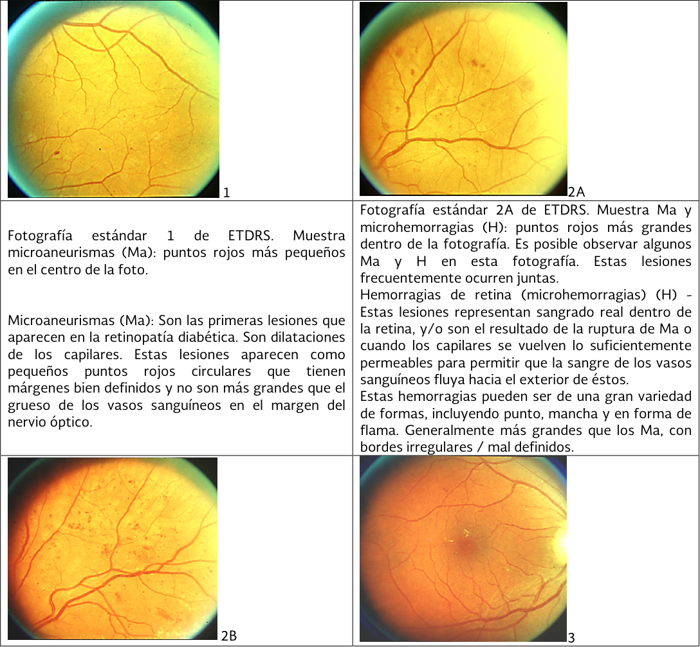

<details>
<summary>📝 Texto extraído (OCR) — GPC_Retinopatía_diabética_1er_nivel.pdf-0031-04.png</summary>

```
Fotografía estándar 1 de ETDRS. Muestra
microaneurismas (Ma): puntos rojos más pequeños
en el centro de la foto.

Microaneurismas (Ma): Son las primeras lesiones que
aparecen en la retinopatía diabética. Son dilataciones
de los capilares. Estas lesiones aparecen como
pequeños puntos rojos circulares que tienen
márgenes bien definidos y no son más grandes que el
grueso de los vasos sanguíneos en el margen del
nervio óptico.

Fotografía estándar 2A de ETDRS. Muestra Ma y
microhemorragias (H): puntos rojos más grandes
dentro de la fotografía. Es posible observar algunos
Ma y H en esta fotografía. Estas lesiones
frecuentemente ocurren juntas.

Hemorragias de retina (microhemorragias) (H) -
Estas lesiones representan sangrado real dentro de
la retina, y/o son el resultado de la ruptura de Ma o
cuando los capilares se vuelven lo suficientemente
permeables para permitir que la sangre de los vasos
sanguíneos fluya hacia el exterior de éstos.

Estas hemorragias pueden ser de una gran variedad
de formas, incluyendo punto, mancha y en forma de
flama. Generalmente más grandes que los Ma, con
bordes irregulares / mal definidos.

=—
```

</details>

<!-- Start of picture text -->
 1  2A<br>Fotografía estándar 2A de ETDRS. Muestra Ma y<br>microhemorragias (H): puntos rojos más grandes<br>Fotografía  estándar  1  de  ETDRS.  Muestra<br>dentro de la fotografía. Es posible observar algunos<br>microaneurismas (Ma): puntos rojos más pequeños<br>Ma  y  H  en  esta  fotografía.  Estas  lesiones<br>en el centro de la foto.<br>frecuentemente ocurren juntas.<br>Hemorragias de retina (microhemorragias) (H) -<br>Estas lesiones representan sangrado real dentro de<br>Microaneurismas (Ma): Son las primeras lesiones que<br>la retina, y/o son el resultado de la ruptura de Ma o<br>aparecen en la retinopatía diabética. Son dilataciones<br>cuando los capilares se vuelven lo suficientemente<br>de los capilares. Estas lesiones aparecen como<br>permeables para permitir que la sangre de los vasos<br>pequeños  puntos  rojos  circulares  que  tienen<br>sanguíneos fluya hacia el exterior de éstos.<br>márgenes bien definidos y no son más grandes que el<br>Estas hemorragias pueden ser de una gran variedad<br>grueso de los vasos sanguíneos en el margen del<br>de formas, incluyendo punto, mancha y en forma de<br>nervio óptico.<br>flama. Generalmente más grandes que los Ma, con<br>bordes irregulares / mal definidos.<br> 2B  3<br><!-- End of picture text -->

**31** 

<details>
<summary>📝 Texto extraído (OCR) — GPC_Retinopatía_diabética_1er_nivel.pdf-0032-00.png</summary>

```
inopatia Diabética en Primer Nivel de Atención
```

</details>

<!-- Start of picture text -->
Detección de Retinopatía Diabética en Primer Nivel de Atención<br><!-- End of picture text -->


<details>
<summary>📝 Texto extraído (OCR) — GPC_Retinopatía_diabética_1er_nivel.pdf-0032-01.png</summary>

```
4

5

Fotografia estandar 4 ETDRS. Muestra lesiones en la
macula.

Los exudados duros: son lesiones blanco / amarillas
por depósitos de colesterol que usualmente se
originan por fugas de Ma. Estas lesiones son de forma
irregular, afilados, varían en tamaño y tienen una
apariencia "grasa". Con frecuencia están asociados
con acumulación de líquido (edema retinal) dentro de
la retina.

*Los exudados duros y el edema pueden ocurrir
adyacente a la mácula. Cuando el edema se extiende
en o muy cerca de la mácula EMCS, la visión puede
verse afectada y hará que la visión central se vuelva
constantemente borrosa. El EMCS puede ocurrir en
cualquier etapa de la retinopatía (no proliferativa o
proliferativa), y por lo general se trata con láser.

Fotografía estándar 5 ETDRS. Muestra exudados
blandos.

En esta fotografía se aprecian exudados blandos
justo por encima del centro de la foto, a las 3 horas
(a la derecha extrema de la foto) y a las 9:30 (justo
por encima de la parte extrema izquierda de la foto).

Los exudados blandos, (también conocidos como
"manchas  algodonosas"): son formaciones
redondeadas u ovales, blanco amarillentas, (a veces
muy pequeños, discretamente grisáceas) de bordes
imprecisos y localizados superficialmente. Son de
tamaño variable y generalmente de mayor tamaño
que los exudados duros.

6A

6B
```

</details>

<!-- Start of picture text -->
4  5<br>Fotografía estándar 5 ETDRS. Muestra exudados<br>Fotografía estándar 4 ETDRS. Muestra lesiones en la<br>blandos.<br>mácula.<br>Los exudados duros: son lesiones blanco / amarillas<br>por depósitos de colesterol que usualmente se<br>En esta fotografía se aprecian exudados blandos<br>originan por fugas de Ma. Estas lesiones son de forma<br>justo por encima del centro de la foto, a las 3 horas<br>irregular, afilados, varían en tamaño y tienen una<br>(a la derecha extrema de la foto) y a las 9:30 (justo<br>apariencia "grasa". Con frecuencia están asociados<br>por encima de la parte extrema izquierda de la foto).<br>con acumulación de líquido (edema retinal) dentro de<br>la retina.<br>*Los exudados duros y el edema pueden ocurrir<br>Los exudados blandos, (también conocidos como<br>adyacente a la mácula. Cuando el edema se extiende<br>"manchas  algodonosas"):  son  formaciones<br>en o muy cerca de la mácula EMCS, la visión puede<br>redondeadas u ovales, blanco amarillentas, (a veces<br>verse afectada y hará que la visión central se vuelva<br>muy pequeños, discretamente grisáceas) de bordes<br>constantemente borrosa. El EMCS puede ocurrir en<br>imprecisos y localizados superficialmente. Son de<br>cualquier etapa de la retinopatía (no proliferativa o<br>tamaño variable y generalmente de mayor tamaño<br>proliferativa), y por lo general se trata con láser.<br>que los exudados duros.<br>6A A  6B<br><!-- End of picture text -->

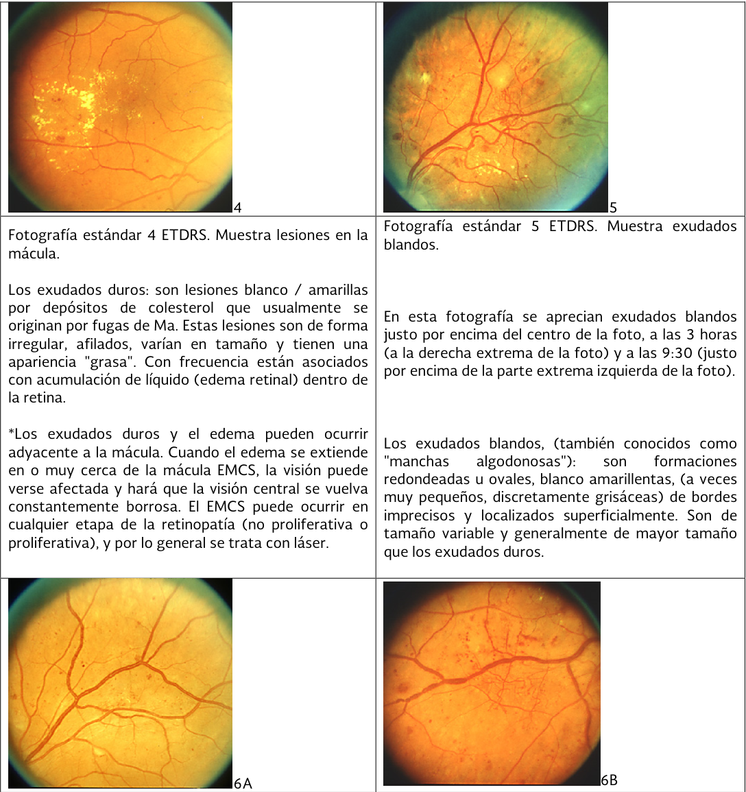

<details>
<summary>📝 Texto extraído (OCR) — GPC_Retinopatía_diabética_1er_nivel.pdf-0032-02.png</summary>

```
4

5

Fotografia estandar 4 ETDRS. Muestra lesiones en la
macula.

Los exudados duros: son lesiones blanco / amarillas
por depósitos de colesterol que usualmente se
originan por fugas de Ma. Estas lesiones son de forma
irregular, afilados, varían en tamaño y tienen una
apariencia "grasa". Con frecuencia están asociados
con acumulación de líquido (edema retinal) dentro de
la retina.

*Los exudados duros y el edema pueden ocurrir
adyacente a la mácula. Cuando el edema se extiende
en o muy cerca de la mácula EMCS, la visión puede
verse afectada y hará que la visión central se vuelva
constantemente borrosa. El EMCS puede ocurrir en
cualquier etapa de la retinopatía (no proliferativa o
proliferativa), y por lo general se trata con láser.

Fotografía estándar 5 ETDRS. Muestra exudados
blandos.

En esta fotografía se aprecian exudados blandos
justo por encima del centro de la foto, a las 3 horas
(a la derecha extrema de la foto) y a las 9:30 (justo
por encima de la parte extrema izquierda de la foto).

Los exudados blandos, (también conocidos como
"manchas  algodonosas"): son formaciones
redondeadas u ovales, blanco amarillentas, (a veces
muy pequeños, discretamente grisáceas) de bordes
imprecisos y localizados superficialmente. Son de
tamaño variable y generalmente de mayor tamaño
que los exudados duros.

6A

6B
```

</details>

<!-- Start of picture text -->
4  5<br>Fotografía estándar 5 ETDRS. Muestra exudados<br>Fotografía estándar 4 ETDRS. Muestra lesiones en la<br>blandos.<br>mácula.<br>Los exudados duros: son lesiones blanco / amarillas<br>por depósitos de colesterol que usualmente se<br>En esta fotografía se aprecian exudados blandos<br>originan por fugas de Ma. Estas lesiones son de forma<br>justo por encima del centro de la foto, a las 3 horas<br>irregular, afilados, varían en tamaño y tienen una<br>(a la derecha extrema de la foto) y a las 9:30 (justo<br>apariencia "grasa". Con frecuencia están asociados<br>por encima de la parte extrema izquierda de la foto).<br>con acumulación de líquido (edema retinal) dentro de<br>la retina.<br>*Los exudados duros y el edema pueden ocurrir<br>Los exudados blandos, (también conocidos como<br>adyacente a la mácula. Cuando el edema se extiende<br>"manchas  algodonosas"):  son  formaciones<br>en o muy cerca de la mácula EMCS, la visión puede<br>redondeadas u ovales, blanco amarillentas, (a veces<br>verse afectada y hará que la visión central se vuelva<br>muy pequeños, discretamente grisáceas) de bordes<br>constantemente borrosa. El EMCS puede ocurrir en<br>imprecisos y localizados superficialmente. Son de<br>cualquier etapa de la retinopatía (no proliferativa o<br>tamaño variable y generalmente de mayor tamaño<br>proliferativa), y por lo general se trata con láser.<br>que los exudados duros.<br>6A A  6B<br><!-- End of picture text -->

6A. Fotografía estándar 6A. Muestra RV. Define el límite inferior de la categoría no proliferativa moderada. 

Fotografía estándar 6B ETDRS: Muestra AMIR y RV muy evidentes. 

AMIR– Se observan en el centro de la fotografía, pequeños vasos sanguíneos en forma de telaraña – AMIR tempranos-  son muy sutiles, pero este es un ejemplo clásico y  obvio. 

**32** 

<details>
<summary>📝 Texto extraído (OCR) — GPC_Retinopatía_diabética_1er_nivel.pdf-0033-00.png</summary>

```
inopatia Diabética en Primer Nivel de Atención
```

</details>

<!-- Start of picture text -->
Detección de Retinopatía Diabética en Primer Nivel de Atención<br><!-- End of picture text -->

RV– Obsérvese el vaso principal a su paso por el centro de la foto y todo su trayecto  izquierdo, (posición 9 del reloj). 

AMIR- ocurren en la retinopatía no proliferativa, éstos aparecen como vasos anormales (telarañas) que aparecen dentro de la retina. Por lo general con apariencia retorcida con esquinas agudas, a menudo cruzando sobre sí mismos. 

RV - También ocurren en las últimas etapas de la enfermedad no proliferativa, cuando las paredes de las venas pierden su alineación normal paralela y comienzan a parecer más como una fila de salchichas. Esta lesión es fuerte predictor de progresión a enfermedad proliferativa. 

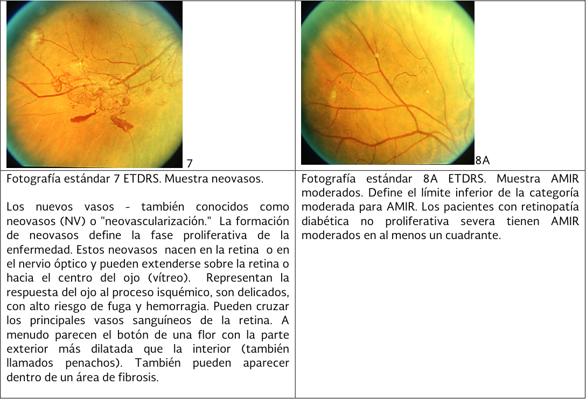

<details>
<summary>📝 Texto extraído (OCR) — GPC_Retinopatía_diabética_1er_nivel.pdf-0033-04.png</summary>

```
4,

4 8A

Fotografia estandar 7 ETDRS. Muestra neovasos.

Los nuevos vasos - también conocidos como
neovasos (NV) o "neovascularización." La formación
de neovasos define la fase proliferativa de la
enfermedad. Estos neovasos nacen en la retina o en
el nervio óptico y pueden extenderse sobre la retina o
hacia el centro del ojo (vítreo). Representan la
respuesta del ojo al proceso isquémico, son delicados,
con alto riesgo de fuga y hemorragia. Pueden cruzar
los principales vasos sanguíneos de la retina. A
menudo parecen el botón de una flor con la parte
exterior más dilatada que la interior (también
llamados penachos). También pueden aparecer
dentro de un área de fibrosis.

Fotografía estándar 8A ETDRS. Muestra AMIR
moderados. Define el límite inferior de la categoría
moderada para AMIR. Los pacientes con retinopatía
diabética no proliferativa severa tienen AMIR
moderados en al menos un cuadrante.
```

</details>

<!-- Start of picture text -->
 7  8A<br>Fotografía estándar 7 ETDRS. Muestra neovasos.  Fotografía estándar 8A ETDRS. Muestra AMIR<br>moderados. Define el límite inferior de la categoría<br>Los nuevos vasos - también conocidos como  moderada para AMIR. Los pacientes con retinopatía<br>neovasos (NV) o "neovascularización."  La formación  diabética no proliferativa severa tienen AMIR<br>de neovasos define la fase proliferativa de la  moderados en al menos un cuadrante.<br>enfermedad. Estos neovasos  nacen en la retina  o en<br>el nervio óptico y pueden extenderse sobre la retina o<br>hacia el centro del ojo (vítreo).  Representan la<br>respuesta del ojo al proceso isquémico, son delicados,<br>con alto riesgo de fuga y hemorragia. Pueden cruzar<br>los principales vasos sanguíneos de la retina. A<br>menudo parecen el botón de una flor con la parte<br>exterior más dilatada que la interior (también<br>llamados  penachos). También  pueden aparecer<br>dentro de un área de fibrosis.<br><!-- End of picture text -->


<details>
<summary>📝 Texto extraído (OCR) — GPC_Retinopatía_diabética_1er_nivel.pdf-0033-05.png</summary>

```
4,

4 8A

Fotografia estandar 7 ETDRS. Muestra neovasos.

Los nuevos vasos - también conocidos como
neovasos (NV) o "neovascularización." La formación
de neovasos define la fase proliferativa de la
enfermedad. Estos neovasos nacen en la retina o en
el nervio óptico y pueden extenderse sobre la retina o
hacia el centro del ojo (vítreo). Representan la
respuesta del ojo al proceso isquémico, son delicados,
con alto riesgo de fuga y hemorragia. Pueden cruzar
los principales vasos sanguíneos de la retina. A
menudo parecen el botón de una flor con la parte
exterior más dilatada que la interior (también
llamados penachos). También pueden aparecer
dentro de un área de fibrosis.

Fotografía estándar 8A ETDRS. Muestra AMIR
moderados. Define el límite inferior de la categoría
moderada para AMIR. Los pacientes con retinopatía
diabética no proliferativa severa tienen AMIR
moderados en al menos un cuadrante.
```

</details>

<!-- Start of picture text -->
 7  8A<br>Fotografía estándar 7 ETDRS. Muestra neovasos.  Fotografía estándar 8A ETDRS. Muestra AMIR<br>moderados. Define el límite inferior de la categoría<br>Los nuevos vasos - también conocidos como  moderada para AMIR. Los pacientes con retinopatía<br>neovasos (NV) o "neovascularización."  La formación  diabética no proliferativa severa tienen AMIR<br>de neovasos define la fase proliferativa de la  moderados en al menos un cuadrante.<br>enfermedad. Estos neovasos  nacen en la retina  o en<br>el nervio óptico y pueden extenderse sobre la retina o<br>hacia el centro del ojo (vítreo).  Representan la<br>respuesta del ojo al proceso isquémico, son delicados,<br>con alto riesgo de fuga y hemorragia. Pueden cruzar<br>los principales vasos sanguíneos de la retina. A<br>menudo parecen el botón de una flor con la parte<br>exterior más dilatada que la interior (también<br>llamados  penachos). También  pueden aparecer<br>dentro de un área de fibrosis.<br><!-- End of picture text -->

**33** 

<details>
<summary>📝 Texto extraído (OCR) — GPC_Retinopatía_diabética_1er_nivel.pdf-0034-00.png</summary>

```
inopatia Diabética en Primer Nivel de Atención
```

</details>

<!-- Start of picture text -->
Detección de Retinopatía Diabética en Primer Nivel de Atención<br><!-- End of picture text -->

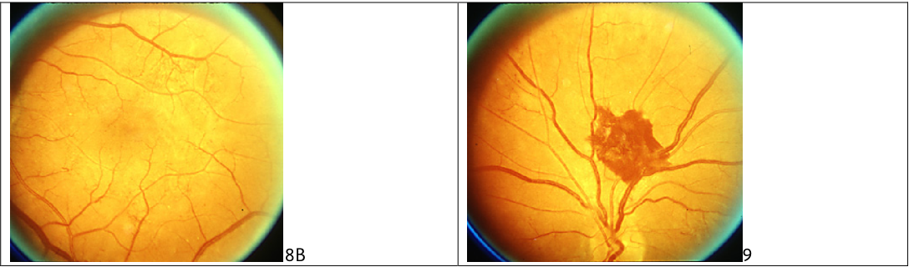

<!-- Start of picture text -->
8B  9<br><!-- End of picture text -->

##### **Las lesiones proliferativas** 

Las lesiones proliferativas son signos avanzados de retinopatía diabética y en general, requieren tratamiento, así como un seguimiento cercano. El objetivo del tratamiento en este estadio de la enfermedad es para reducir la necesidad de oxígeno, lo que genera regresión de las lesiones proliferativas y evita la pérdida grave de la visión. 


<details>
<summary>📝 Texto extraído (OCR) — GPC_Retinopatía_diabética_1er_nivel.pdf-0034-04.png</summary>

```
10A

10B

Fotografia estandar 10A ETDRS. Define el limite
inferior de la neovascularización moderada en el
nervio óptico, (NVD) los neovasos cubren
aproximadamente un tercio del área del nervio
óptico. Esta característica de NVD sitúa al paciente
en retinopatía diabética proliferativa de alto riesgo.

AWN

10C

11

Fotografía estándar 10C ETDRS. Muestra NVD

Fotografía estándar 11 ETDRS. Muestra proliferación
```

</details>

<!-- Start of picture text -->
10A  10B 0B B<br>Fotografía estándar 10A ETDRS. Define el límite<br>inferior de la neovascularización moderada en el<br>nervio  óptico,  (NVD)  los  neovasos  cubren<br>aproximadamente un tercio del área del nervio<br>óptico. Esta característica de NVD sitúa al paciente<br>en retinopatía diabética proliferativa de alto riesgo.<br>10C  11<br>Fotografía estándar 10C ETDRS. Muestra NVD grafía estándar 10C ETDRS. Muestra NVD rafía estándar 10C ETDRS. Muestra NVD  Fotografía estándar 11 ETDRS. Muestra proliferación grafía estándar 11 ETDRS. Muestra proliferación rafía estándar 11 ETDRS. Muestra proliferación proliferación roliferación<br><!-- End of picture text -->

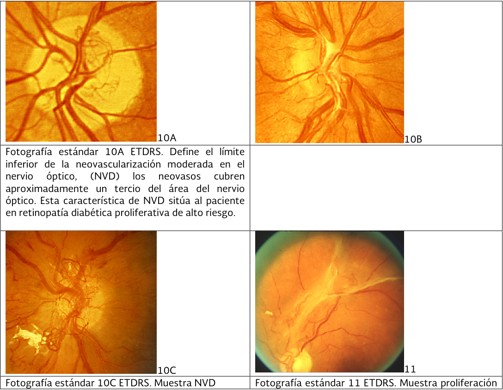

<details>
<summary>📝 Texto extraído (OCR) — GPC_Retinopatía_diabética_1er_nivel.pdf-0034-05.png</summary>

```
10A

10B

Fotografia estandar 10A ETDRS. Define el limite
inferior de la neovascularización moderada en el
nervio óptico, (NVD) los neovasos cubren
aproximadamente un tercio del área del nervio
óptico. Esta característica de NVD sitúa al paciente
en retinopatía diabética proliferativa de alto riesgo.

AWN

10C

11

Fotografía estándar 10C ETDRS. Muestra NVD

Fotografía estándar 11 ETDRS. Muestra proliferación
```

</details>

<!-- Start of picture text -->
10A  10B 0B B<br>Fotografía estándar 10A ETDRS. Define el límite<br>inferior de la neovascularización moderada en el<br>nervio  óptico,  (NVD)  los  neovasos  cubren<br>aproximadamente un tercio del área del nervio<br>óptico. Esta característica de NVD sitúa al paciente<br>en retinopatía diabética proliferativa de alto riesgo.<br>10C  11<br>Fotografía estándar 10C ETDRS. Muestra NVD grafía estándar 10C ETDRS. Muestra NVD rafía estándar 10C ETDRS. Muestra NVD  Fotografía estándar 11 ETDRS. Muestra proliferación grafía estándar 11 ETDRS. Muestra proliferación rafía estándar 11 ETDRS. Muestra proliferación proliferación roliferación<br><!-- End of picture text -->

**34** 

<details>
<summary>📝 Texto extraído (OCR) — GPC_Retinopatía_diabética_1er_nivel.pdf-0035-00.png</summary>

```
inopatia Diabética en Primer Nivel de Atención
```

</details>

<!-- Start of picture text -->
Detección de Retinopatía Diabética en Primer Nivel de Atención<br><!-- End of picture text -->

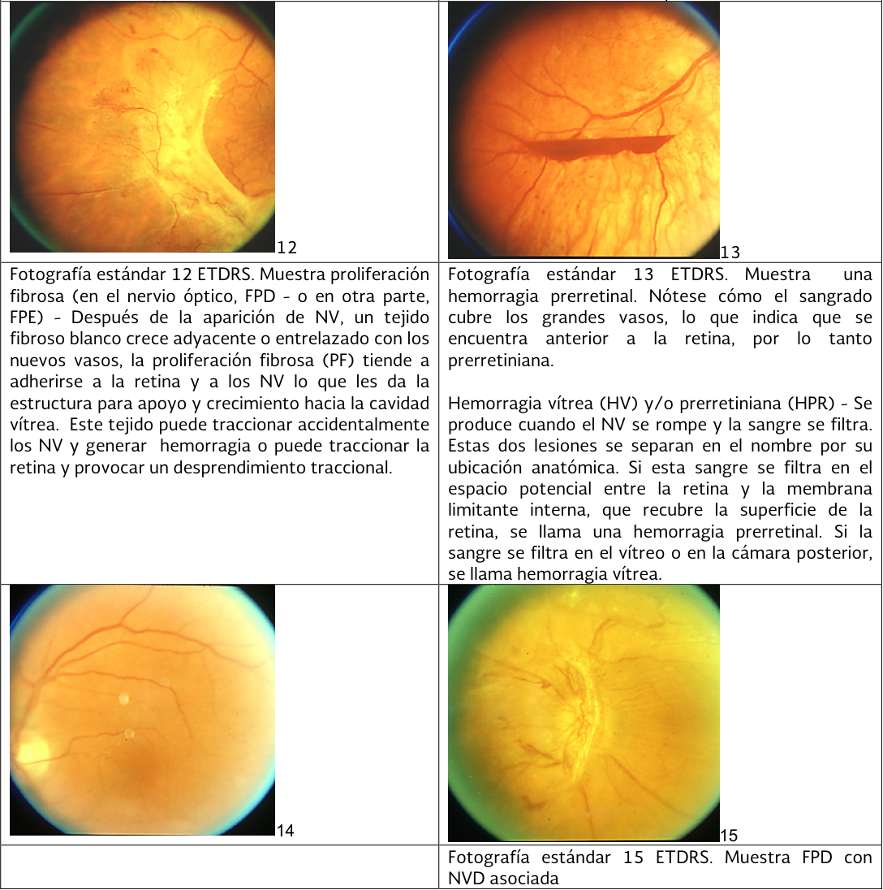

<details>
<summary>📝 Texto extraído (OCR) — GPC_Retinopatía_diabética_1er_nivel.pdf-0035-01.png</summary>

```
13

Fotografía estándar 12 ETDRS. Muestra proliferación
fibrosa (en el nervio óptico, FPD - o en otra parte,
FPE) - Después de la aparición de NV, un tejido
fibroso blanco crece adyacente o entrelazado con los
nuevos vasos, la proliferación fibrosa (PF) tiende a
adherirse a la retina y a los NV lo que les da la
estructura para apoyo y crecimiento hacia la cavidad
vítrea. Este tejido puede traccionar accidentalmente
los NV y generar hemorragia o puede traccionar la
retina y provocar un desprendimiento traccional.

Fotografía estándar 13 ETDRS. Muestra una
hemorragia prerretinal. Nótese cómo el sangrado
cubre los grandes vasos, lo que indica que se
encuentra anterior a la retina, por lo tanto
prerretiniana.

Hemorragia vítrea (HV) y/o prerretiniana (HPR) - Se
produce cuando el NV se rompe y la sangre se filtra.
Estas dos lesiones se separan en el nombre por su
ubicación anatómica. Si esta sangre se filtra en el
espacio potencial entre la retina y la membrana
limitante interna, que recubre la superficie de la
retina, se llama una hemorragia prerretinal. Si la
sangre se filtra en el vítreo o en la cámara posterior,
se llama hemorragia vítrea.

N

14

15

Fotografia estandar 15 ETDRS. Muestra FPD con
NVD asociada
```

</details>

<!-- Start of picture text -->
12  133<br>Fotografía estándar 12 ETDRS. Muestra proliferación  Fotografía estándar 13 ETDRS. Muestra  una<br>fibrosa (en el nervio óptico, FPD - o en otra parte,  hemorragia prerretinal. Nótese cómo el sangrado<br>FPE) - Después de la aparición de NV, un tejido  cubre los grandes vasos, lo que indica que se<br>fibroso blanco crece adyacente o entrelazado con los  encuentra anterior a la retina, por lo tanto<br>nuevos vasos, la proliferación fibrosa (PF) tiende a  prerretiniana.<br>adherirse a la retina y a los NV lo que les da la<br>estructura para apoyo y crecimiento hacia la cavidad  Hemorragia vítrea (HV) y/o prerretiniana (HPR) - Se<br>vítrea.  Este tejido puede traccionar accidentalmente  produce cuando el NV se rompe y la sangre se filtra.<br>los NV y generar  hemorragia o puede traccionar la  Estas dos lesiones se separan en el nombre por su<br>retina y provocar un desprendimiento traccional.  ubicación anatómica. Si esta sangre se filtra en el<br>espacio potencial entre la retina y la membrana<br>limitante interna, que recubre la superficie de la<br>retina, se llama una hemorragia prerretinal. Si la<br>sangre se filtra en el vítreo o en la cámara posterior,<br>se llama hemorragia vítrea. gia vítrea. ia vítrea.<br>14  15<br>Fotografía estándar 15 ETDRS. Muestra FPD con<br>NVD asociadaVD asociadaasociadaiadaada<br><!-- End of picture text -->


<details>
<summary>📝 Texto extraído (OCR) — GPC_Retinopatía_diabética_1er_nivel.pdf-0035-02.png</summary>

```
13

Fotografía estándar 12 ETDRS. Muestra proliferación
fibrosa (en el nervio óptico, FPD - o en otra parte,
FPE) - Después de la aparición de NV, un tejido
fibroso blanco crece adyacente o entrelazado con los
nuevos vasos, la proliferación fibrosa (PF) tiende a
adherirse a la retina y a los NV lo que les da la
estructura para apoyo y crecimiento hacia la cavidad
vítrea. Este tejido puede traccionar accidentalmente
los NV y generar hemorragia o puede traccionar la
retina y provocar un desprendimiento traccional.

Fotografía estándar 13 ETDRS. Muestra una
hemorragia prerretinal. Nótese cómo el sangrado
cubre los grandes vasos, lo que indica que se
encuentra anterior a la retina, por lo tanto
prerretiniana.

Hemorragia vítrea (HV) y/o prerretiniana (HPR) - Se
produce cuando el NV se rompe y la sangre se filtra.
Estas dos lesiones se separan en el nombre por su
ubicación anatómica. Si esta sangre se filtra en el
espacio potencial entre la retina y la membrana
limitante interna, que recubre la superficie de la
retina, se llama una hemorragia prerretinal. Si la
sangre se filtra en el vítreo o en la cámara posterior,
se llama hemorragia vítrea.

N

14

15

Fotografia estandar 15 ETDRS. Muestra FPD con
NVD asociada
```

</details>

<!-- Start of picture text -->
12  133<br>Fotografía estándar 12 ETDRS. Muestra proliferación  Fotografía estándar 13 ETDRS. Muestra  una<br>fibrosa (en el nervio óptico, FPD - o en otra parte,  hemorragia prerretinal. Nótese cómo el sangrado<br>FPE) - Después de la aparición de NV, un tejido  cubre los grandes vasos, lo que indica que se<br>fibroso blanco crece adyacente o entrelazado con los  encuentra anterior a la retina, por lo tanto<br>nuevos vasos, la proliferación fibrosa (PF) tiende a  prerretiniana.<br>adherirse a la retina y a los NV lo que les da la<br>estructura para apoyo y crecimiento hacia la cavidad  Hemorragia vítrea (HV) y/o prerretiniana (HPR) - Se<br>vítrea.  Este tejido puede traccionar accidentalmente  produce cuando el NV se rompe y la sangre se filtra.<br>los NV y generar  hemorragia o puede traccionar la  Estas dos lesiones se separan en el nombre por su<br>retina y provocar un desprendimiento traccional.  ubicación anatómica. Si esta sangre se filtra en el<br>espacio potencial entre la retina y la membrana<br>limitante interna, que recubre la superficie de la<br>retina, se llama una hemorragia prerretinal. Si la<br>sangre se filtra en el vítreo o en la cámara posterior,<br>se llama hemorragia vítrea. gia vítrea. ia vítrea.<br>14  15<br>Fotografía estándar 15 ETDRS. Muestra FPD con<br>NVD asociadaVD asociadaasociadaiadaada<br><!-- End of picture text -->

Fundus Photograph Reading Center Dept. of Ophthalmology & Visual Sciences University of Wisconsin - Madison http://eyephoto.ophth.wisc.edu/ResearchAreas/Diabetes/Diabetes.ht 

**35** 

<details>
<summary>📝 Texto extraído (OCR) — GPC_Retinopatía_diabética_1er_nivel.pdf-0036-00.png</summary>

```
inopatia Diabética en Primer Nivel de Atención
```

</details>

<!-- Start of picture text -->
Detección de Retinopatía Diabética en Primer Nivel de Atención<br><!-- End of picture text -->

**Tabla1. Parámetros clínicos a controlar para reducir el riesgo de retinopatía diabética** 

|Parámetro clínico|Cifras buscadaspara control|
|---|---|
|HbA1c|<6.5 %|
|Colesterol|Menos de 200 mg/dl|
|LDL|< 2.5mmol/L|
|Triglicéridos|< 2.0mmol/L|
|Tensión arterial|≤130/80 mmHg|

**36** 

<details>
<summary>📝 Texto extraído (OCR) — GPC_Retinopatía_diabética_1er_nivel.pdf-0037-00.png</summary>

```
inopatia Diabética en Primer Nivel de Atención
```

</details>

<!-- Start of picture text -->
Detección de Retinopatía Diabética en Primer Nivel de Atención<br><!-- End of picture text -->

## **5.4 Diagramas de Flujo** 

### **Esquema de evaluación de retina para diabéticos tipo 1.** 

<details>
<summary>📝 Texto extraído (OCR) — GPC_Retinopatía_diabética_1er_nivel.pdf-0037-03.png</summary>

```
Diagnóstico de diabetes tipo
```

</details>

<details>
<summary>📝 Texto extraído (OCR) — GPC_Retinopatía_diabética_1er_nivel.pdf-0037-05.png</summary>

```
M
Primera revisión de retina
a los 3 años después de su:
debut como diabéticos
```

</details>

<details>
<summary>📝 Texto extraído (OCR) — GPC_Retinopatía_diabética_1er_nivel.pdf-0037-06.png</summary>

```
Paciente sin
retinopatíd
dia’ bética
```

</details>

<details>
<summary>📝 Texto extraído (OCR) — GPC_Retinopatía_diabética_1er_nivel.pdf-0037-07.png</summary>

```
Paciente con
- retinopatia -
diabética
```

</details>

<details>
<summary>📝 Texto extraído (OCR) — GPC_Retinopatía_diabética_1er_nivel.pdf-0037-08.png</summary>

```
Y
Revisión anual
```

</details>

<details>
<summary>📝 Texto extraído (OCR) — GPC_Retinopatía_diabética_1er_nivel.pdf-0037-09.png</summary>

```
—
Con retinopatía
diabética severa o
baja visual
inexplicable
```

</details>

<details>
<summary>📝 Texto extraído (OCR) — GPC_Retinopatía_diabética_1er_nivel.pdf-0037-10.png</summary>

```
Retinopatía diabética leve
a moderada, evaluación
anual de retina
```

</details>

<details>
<summary>📝 Texto extraído (OCR) — GPC_Retinopatía_diabética_1er_nivel.pdf-0037-11.png</summary>

```
Paciente
controlado
```

</details>

<details>
<summary>📝 Texto extraído (OCR) — GPC_Retinopatía_diabética_1er_nivel.pdf-0037-12.png</summary>

```
Paciente
sin control metabólica
```

</details>

<details>
<summary>📝 Texto extraído (OCR) — GPC_Retinopatía_diabética_1er_nivel.pdf-0037-13.png</summary>

```
M

Evaluación de
retina anual
```

</details>

<details>
<summary>📝 Texto extraído (OCR) — GPC_Retinopatía_diabética_1er_nivel.pdf-0037-14.png</summary>

```
M
Evaluación de

retina
semestral
```

</details>

<details>
<summary>📝 Texto extraído (OCR) — GPC_Retinopatía_diabética_1er_nivel.pdf-0037-15.png</summary>

```
Evaluación por oftalmología
```

</details>

<details>
<summary>📝 Texto extraído (OCR) — GPC_Retinopatía_diabética_1er_nivel.pdf-0037-16.png</summary>

```
La etapa de retinopatía debe ser,
establecida con base en las
características clínicas descritas en ld
clasificación y fotografías estándar
que se localizan en los anexos de esta
guía de practica clínica
```

</details>

**37** 

<details>
<summary>📝 Texto extraído (OCR) — GPC_Retinopatía_diabética_1er_nivel.pdf-0038-01.png</summary>

```
Para conocer los criterios sobre control metabólico,
consultar guía de práctica clínica de diagnóstico,
metas de control ambulatorio v, referencia oportuna
de prediabetes, y diabetes mellitus tipa 2 en el
adulto en el primer nivel de atención. (SS-093-08)

Diabético tipo 2 }

Revisión de fondo de ojo al
momento del diagnóstico

Sin retinopatía

Cada año cuando o st,
Ñ control metabólica )

no sea continuo /
Ane NS

“Cada 2años —
Si tiene control

\ metabdlico

xs continud y

La etapa de retinopatía debe ser
establecida con base en las
características clínicas descritas en la
clasificación y fotografías estándar
que se localizan en los anexos de esta

guía de practica clit

Revisión anual y buscar el

( control metabólico estricto y [|

continua

No proliferativa

leve

Con retinopatía

Y

No proliferativa Proliferative

moderada
Y
No proliferativa
severa
A

( “Revisión de fondo \ »\
‘de ojo cada 6 meses!

/Envio a valoración por,
[oftalmología para decidir \
l esquema de seguimienti
MN otratamiento
```

</details>

<!-- Start of picture text -->
Para conocer los criterios sobre control metabdlico,<br>consultar guia de practica clinica de diagndstico,<br>metas de control ambulatorio v, referencia oportunal oo. .<br>de prediabetes, y diabetes mellitus tipo 2 en el Diabético tipo 2<br>adulto en el primer nivel de atencidén. (SS-093-08)<br>Revisi6n de fondo de ojo al<br>momento del diagndsticd<br>Sin retinopatia . ;<br>Con retinopatia<br>No proliferativa<br>leve<br>SiCada 2 afios Cada afio cuando s No proliferativa Proliferativa<br>tiene control control metabdlico moderada<br>metabolico no sea continuo<br>continud<br>No proliferativa<br>severa<br>La etapa de retinopatia debe ser<br>establecida con base en las<br>caracteristicas clinicas descritas en la<br>clasificacion y fotografias estandar Revisién de fondo<br>que se localizan en los anexos de esta de ojo cada 6 mese<br>guia de practica clinica<br>Revisi6n anual y buscar el f nae ‘ valoracion an<br>control metab6lico estricto y oftalmologia Para ecl ir<br>continua esquema de seguimiento<br>o tratamiento<br><!-- End of picture text -->

<details>
<summary>📝 Texto extraído (OCR) — GPC_Retinopatía_diabética_1er_nivel.pdf-0038-02.png</summary>

```
Prolifterativa
```

</details>

<details>
<summary>📝 Texto extraído (OCR) — GPC_Retinopatía_diabética_1er_nivel.pdf-0039-01.png</summary>

```
diabéticas  /

\
```

</details>

<!-- Start of picture text -->
Mujeres<br>diabéticas<br><!-- End of picture text -->

<details>
<summary>📝 Texto extraído (OCR) — GPC_Retinopatía_diabética_1er_nivel.pdf-0039-02.png</summary>

```
Están
planeando
embarazarse
```

</details>

<!-- Start of picture text -->
Estan<br>planeando<br>embarazarse<br><!-- End of picture text -->

<details>
<summary>📝 Texto extraído (OCR) — GPC_Retinopatía_diabética_1er_nivel.pdf-0039-03.png</summary>

```
Embarazadas

|
```

</details>

<!-- Start of picture text -->
Embarazadas<br><!-- End of picture text -->

<details>
<summary>📝 Texto extraído (OCR) — GPC_Retinopatía_diabética_1er_nivel.pdf-0039-04.png</summary>

```
a

<Conocidas SO

portadoras de
retinopatia diabética
A
```

</details>

<!-- Start of picture text -->
Conocidas<br>portadoras de<br>r Opatia diabética<br><!-- End of picture text -->

<details>
<summary>📝 Texto extraído (OCR) — GPC_Retinopatía_diabética_1er_nivel.pdf-0039-05.png</summary>

```
Primera revisión
como parte del
protocolo de
embarazo
```

</details>

<!-- Start of picture text -->
Primera revisién<br>como pa re a<br>embarazo<br><!-- End of picture text -->

<details>
<summary>📝 Texto extraído (OCR) — GPC_Retinopatía_diabética_1er_nivel.pdf-0039-06.png</summary>

```
Revisión de retina
al momento de
confirmar el
embarazo
```

</details>

<!-- Start of picture text -->
Revision de retina<br>al momento ae<br>embarazo<br><!-- End of picture text -->

<details>
<summary>📝 Texto extraído (OCR) — GPC_Retinopatía_diabética_1er_nivel.pdf-0039-07.png</summary>

```
HNo—
```

</details>

<details>
<summary>📝 Texto extraído (OCR) — GPC_Retinopatía_diabética_1er_nivel.pdf-0039-08.png</summary>

```
a Con retinopatía \
```

</details>

<!-- Start of picture text -->
Con retinopatia<br><!-- End of picture text -->

<details>
<summary>📝 Texto extraído (OCR) — GPC_Retinopatía_diabética_1er_nivel.pdf-0039-09.png</summary>

```
Sin retinopatía
```

</details>

<!-- Start of picture text -->
Sin retinopatia<br><!-- End of picture text -->

<!-- Start of picture text -->
Si<br><!-- End of picture text -->

<details>
<summary>📝 Texto extraído (OCR) — GPC_Retinopatía_diabética_1er_nivel.pdf-0039-11.png</summary>

```
E
No proliferativa
leve a moderada

E
```

</details>

<!-- Start of picture text -->
No proliferativa<br>leve a moderada<br><!-- End of picture text -->

<details>
<summary>📝 Texto extraído (OCR) — GPC_Retinopatía_diabética_1er_nivel.pdf-0039-12.png</summary>

```
No proliferativa
severa o peor
```

</details>

<!-- Start of picture text -->
No proliferativa<br>severa oO peor<br><!-- End of picture text -->

<details>
<summary>📝 Texto extraído (OCR) — GPC_Retinopatía_diabética_1er_nivel.pdf-0039-13.png</summary>

```
Revisión a las
```

</details>

<!-- Start of picture text -->
Revision a las<br><!-- End of picture text -->

<details>
<summary>📝 Texto extraído (OCR) — GPC_Retinopatía_diabética_1er_nivel.pdf-0039-15.png</summary>

```
semanas de
```

</details>

<!-- Start of picture text -->
semanas de<br><!-- End of picture text -->

<details>
<summary>📝 Texto extraído (OCR) — GPC_Retinopatía_diabética_1er_nivel.pdf-0039-16.png</summary>

```
Con
retinopatíd
```

</details>

<!-- Start of picture text -->
Con<br>retinopatia<br><!-- End of picture text -->

<details>
<summary>📝 Texto extraído (OCR) — GPC_Retinopatía_diabética_1er_nivel.pdf-0039-17.png</summary>

```
Evaluar retina entre la
semana 16 y 20 del
gestación
```

</details>

<!-- Start of picture text -->
Evaluar retina; entre la<br>semana 16 y 20 de<br><!-- End of picture text -->

<details>
<summary>📝 Texto extraído (OCR) — GPC_Retinopatía_diabética_1er_nivel.pdf-0039-18.png</summary>

```
Evaluar retina a las 12
semanas de gestación
```

</details>

<!-- Start of picture text -->
Evaluar retina. a las 12<br>semanas de gestacién<br><!-- End of picture text -->

<details>
<summary>📝 Texto extraído (OCR) — GPC_Retinopatía_diabética_1er_nivel.pdf-0039-19.png</summary>

```
gestación
```

</details>

<!-- Start of picture text -->
8estacid<br><!-- End of picture text -->

<details>
<summary>📝 Texto extraído (OCR) — GPC_Retinopatía_diabética_1er_nivel.pdf-0039-20.png</summary>

```
Sin retinopatía
```

</details>

<details>
<summary>📝 Texto extraído (OCR) — GPC_Retinopatía_diabética_1er_nivel.pdf-0039-21.png</summary>

```
Con
progresión
```

</details>

<!-- Start of picture text -->
Con<br>rogresion<br><!-- End of picture text -->

<details>
<summary>📝 Texto extraído (OCR) — GPC_Retinopatía_diabética_1er_nivel.pdf-0039-22.png</summary>

```
Revisión a los 6
meses después
del parto
```

</details>

<!-- Start of picture text -->
Revisionwe a los 6<br>meses después<br>del parto<br><!-- End of picture text -->

<details>
<summary>📝 Texto extraído (OCR) — GPC_Retinopatía_diabética_1er_nivel.pdf-0039-23.png</summary>

```
Revisión de
retina cada tres
meses
```

</details>

<!-- Start of picture text -->
Revision de<br>retina cada tres<br>meses<br><!-- End of picture text -->

<details>
<summary>📝 Texto extraído (OCR) — GPC_Retinopatía_diabética_1er_nivel.pdf-0039-24.png</summary>

```
Sin
progresión
```

</details>

<!-- Start of picture text -->
Sin<br>progresion<br><!-- End of picture text -->

<details>
<summary>📝 Texto extraído (OCR) — GPC_Retinopatía_diabética_1er_nivel.pdf-0039-25.png</summary>

```
/Revisión de retina cada”,
mes y envío a
oftalmología
```

</details>

<!-- Start of picture text -->
Revisi6n de retina cada<br>mes y envio a<br>oftalmologia<br><!-- End of picture text -->

<details>
<summary>📝 Texto extraído (OCR) — GPC_Retinopatía_diabética_1er_nivel.pdf-0039-26.png</summary>

```
Sin retinopatía
```

</details>

<!-- Start of picture text -->
Sin retinopatia<br><!-- End of picture text -->

<details>
<summary>📝 Texto extraído (OCR) — GPC_Retinopatía_diabética_1er_nivel.pdf-0039-27.png</summary>

```
/ Revisión como >,
[cualquier diabético)
o tipo2 /
```

</details>

<!-- Start of picture text -->
Revisi6n como<br>cualquier diabético<br>tipo 2<br><!-- End of picture text -->

La etapa de retinopatia debe ser establecida con base en las caracteristicas clinicas descritas en la clasificacio6n y fotografias estandar que se localizan en los anexos de esta guia de practica clinica 

<details>
<summary>📝 Texto extraído (OCR) — GPC_Retinopatía_diabética_1er_nivel.pdf-0040-00.png</summary>

```
Detección de Retinopatía Diabétoca en Primer Nivel de Atención
```

</details>

<!-- Start of picture text -->
Detección de Retinopatía Diabétoca en Primer Nivel de Atención<br><!-- End of picture text -->

## **5.5 Listado de Recursos** _5.5.1 Tabla de Medicamentos_ 

Medicamentos mencionados en la guía e indicados durante el diagnóstico de retinopatía diabética en el primer nivel de atención **<u>:</u>** 

|||**Cuadro**<br> <br> <br> <br>|**Básico de Med**<br>|**icamentos**<br> <br> <br>||
|---|---|---|---|---|---|
|**Clave**|**Principio activo**|<br>**Dosis**<br>**recomendada**<br>**Presentación**<br>**Tiempo**|**Efectos**|**adversos**<br>**Interacciones**<br>**Contr**|**aindicaciones**|
|2871|Fenilefrina|Adultos y niños:<br>Una gota en el<br>ojo<br>antes<br>del<br>examen.<br>Solución<br>oftálmica<br>Clorhidrato<br>de<br>fenilefrina 100<br>mg/ml<br>Frasco<br>gotero<br>con 15 ml.<br>Aplicación<br>e<br>consultorio<br>previo<br>procedimiento|n<br>a<br>Efectos adr|enérgicos<br>Con antidepresivos tricíclicos se<br>potencia el efecto cardiaco de la<br>adrenalina.<br>Con<br>guanetidina<br>se<br>aumentan los efectos midriáticos<br>con<br>inhibidores<br>de<br>la<br>monoaminooxidasa y bloqueadores<br>B, pueden presentarse arritmias.<br>Hipersensi<br>fármaco,<br>ángulo<br>hipertensió<br>sistémica,|bilidad<br>al<br>glaucoma<br>de<br>estrecho,<br>n<br>arterial<br>hipertiroidismo.|
|4409|Tropicamida|Una gota en el<br>ojo,<br>se<br>puede<br>repetir cada 5<br>minutos<br>hasta<br>en<br>tres<br>ocasiones.<br>Cada 100 ml<br>contienen:<br>Tropicamida 1<br>g<br>Frasco<br>gotero<br>con 5 ó 15 ml<br>Aplicación<br>e<br>consultorio<br>previo<br>procedimiento|n<br>a<br>Glaucoma<br>cerrado,<br>borrosa,<br>fotofobia,<br>facial,<br>se<br>boca,<br>cutánea|ángulo<br>visión<br>eritema<br>quedad<br>de<br>erupción<br>Con adrenérgicos de uso oftálmico,<br>aumenta la midriasis<br>Contraindi<br>Hipersensi<br>fármaco,<br>ángulo cer|caciones:<br>bilidad<br>al<br>glaucoma<br>de<br>rado.|
|602600|<br>Tropicamida<br>0.8g<br>y<br>clorhidrato<br>de fenilefrina<br>5.0 cbp 100.0<br>ml (tp)|<br> <br> <br>Una gota en el<br>ojo<br>antes<br>del<br>examen<br>solución<br>oftálmica<br>frasco<br>gotero de 15<br>ml.<br>Aplicación<br>e<br>consultorio<br>previo<br>procedimiento|n<br>a<br>Glaucoma<br>cerrado,<br>borrosa,<br>eritema<br>sequedad<br>erupción<br> <br>efectos adr|ángulo<br>visión<br>fotofobia,<br>facial,<br>de<br>boca,<br>cutánea<br>y<br>enérgicos.<br>Con antidepresivos tricíclicos se<br>potencia el efecto cardiaco de la<br>adrenalina.<br>Con<br>guanetidina<br>se<br>aumentan los efectos midriáticos<br>con<br>inhibidores<br>de<br>la<br>monoaminooxidasa y bloqueadores<br>B, puedenpresentarse arritmias.<br>Hipersensi<br>fármaco,<br>ángulo<br>hipertensió<br>sistémica,|bilidad<br>al<br>glaucoma<br>de<br>estrecho,<br>n<br>arterial<br>hipertiroidismo.|

**40** 

<details>
<summary>📝 Texto extraído (OCR) — GPC_Retinopatía_diabética_1er_nivel.pdf-0041-00.png</summary>

```
jopatia Diabétoca en Primer Nivel de Atención
```

</details>

<!-- Start of picture text -->
Detección de Retinopatía Diabétoca en Primer Nivel de Atención<br><!-- End of picture text -->

# **6.  Glosario** 

**Anormalidades microvasculares intrarretinianas (AMIR):** son alteraciones de la red capilar intrarretiniana que sufren los pequeños vasos, como: dilatación, tortuosidad y calibre irregular de capilares que están adyacentes o rodeando áreas de vasos ocluidos. Clínicamente aparecen como capilares telangiectásicos dentro de la retina, que varían de calibre, escasamente visibles  de 31 micras (aproximadamente ¼ del ancho de la vena mayor en los márgenes del disco óptico).Indican severa probabilidad de progresión de la retinopatía. 

**Asas y/o reduplicación:** Las asas venosas es una desviación curva abrupta de la vena en su trayectoria normal. La reduplicación de la vena es la dilatación de  un canal pre-existente o proliferación de un nuevo canal de calibre similar a la vena original. 

**Cicatrices de fotocoagulación previa:** El área de retina es cubierta por cicatrices de fotocoagulación pasada  o por otras cicatrices de apariencia similar.  La evaluación del área de retina cubierta como grado de cicatrización no puede ser discernida.  Las cicatrices y el área de retina cubiertas son estimadas como un porcentaje del total del campo.  Si una porción de retina está cubierta por hemorragia  o proliferación fibrosa, el grado estimado del área de cicatrices vistas se expresa en proporción  como un porcentaje del total del campo cubierto y descubierto. Por ejemplo cuando 50% del campo es cubierto y 50% del resto está ocupado p.or cicatrices el grado de cicatrices es 25% y el área cubierta es 50%. Cuando solo una pequeña área de retina es cubierta y existe ausencia total de cicatrices en todos los demás campos, indica que no ha recibido tratamiento de fotocoagulación y el grado estimado es 0. 

**Drusas:** Son depósitos anteriores a la membrana de Bruch’s asociada con adelgazamiento o hipopigmentación excesiva del epitelio pigmentario retiniano, aparecen como puntos blanco amarillentos profundos,  redondos, opacos, cercanos a la macula y algunas veces circunscritos por una línea de pigmento. Las grandes drusas son fácilmente reconocidas, las pequeñas drusas pueden ser confundidas con pequeños puntos de exudados duros.  Es necesario un buen efecto estereoscópico para distinguir la profundidad, la drusa aparece muy profunda a nivel del epitelio pigmentario retiniano, el exudado duro aparece más superficialmente. 

**Elevación retiniana:** El término incluye desprendimiento de retina, retinosquisis o la elevación de un vaso retiniano grande. 

**Envainamiento arteriolar.** Paredes arteriolares que son parcialmente   opacas (una línea de sangre roja  que puede ser vista con  líneas blancas sobre uno o ambos lados) o completamente opaca (no se logra observar columna  roja de sangre). 

**Envainamiento Venoso:** Líneas blancas a lo largo de uno o ambos lados de la columna de sangre venosa   y/o  opacificación completa de la pared venosa (hilos blancos). 

**41** 

<details>
<summary>📝 Texto extraído (OCR) — GPC_Retinopatía_diabética_1er_nivel.pdf-0042-00.png</summary>

```
jopatia Diabétoca en Primer Nivel de Atención
```

</details>

<!-- Start of picture text -->
Detección de Retinopatía Diabétoca en Primer Nivel de Atención<br><!-- End of picture text -->

**Estrechamiento  venoso:** Estrechamiento localizado en el calibre venoso. El total de la longitud de todos los segmentos estrechados dentro del campo son calificados, esta estimación y comparación  con el ancho promedio de  la vena mayor en el margen del disco óptico (considerado de 125 micras) y el diámetro del promedio del disco óptico (considerado de 1500 micras). 

**Estrechamiento arteriolar:** Irregularidades localizadas en el calibre arteriolar. El estrechamiento generalizado no es evaluado, excepto cuando indica estrechamiento extenso, estas arteriolas aparecen como filamentos blancos por todo el campo. 

**Extremos dilatados de Neovasos:** Los neovasos pueden tener  la punta dilatada, la cual es definida como dilatación sacular o fusiforme de la parte periférica  del neovaso.  Muchas veces la dilatación segmentaria es 2 a 4 veces el calibre del segmento proximal  del neovaso. 

**Exudados algodonosos** : Son formaciones redondeadas u ovales  blanco-amarillentas  o blancogrisaceas de bordes mal definidos y localizadas superficialmente en la capa de fibras nerviosas. Suelen mostrar estriaciones paralelas a las fibras, son de tamaño variable de 1/5 a ½ de diámetro papilar, se observan con más frecuencia cerca del nervio óptico, representan en realidad zonas de isquemia. 

**Exudados duros** : Son depósitos blanco o blanco-amarillentos (color de cera) con límites irregulares pero precisos, de tamaño variable, desde formaciones puntiformes hasta grandes placas compactas cuando confluyen. Localizados en las capas externas de la retina,  pero pueden ser más superficiales  sobre todo cuando la retina esta engrosada por edema. 

**Exudados perivenosos:** Exudados duros que se presentan  inmediatamente adyacentes  a uno o ambos lados de las venas retinianas, simulando envainamiento venoso, son clasificados como exudados perivenosos y graduados separadamente. 

**Hemorragia preretinales:** Hemorragia con un nivel de fluido con forma de canoa y redonda u oval, parches lineales o hemorragias justo antes de la retina, puede ser retrohialoideas cuando la sangre queda atrapada entre la retina y la hialoides.  Hemorragia sobre la superficie del desprendimiento de retina puede también ser considerada hemorragia preretiniana o bien vítreas cuando la sangre atraviesa la membrana limitante interna. 

**Hemorragia vítrea:** Hemorragia en el segmento anterior y posterior de la cavidad vítrea, preretinianas y en el área de proliferación fibrovascular. Cuando no es posible valorar es necesario considerar la hemorragia, opacidad del cristalino o pobre iluminación el grado asignado  es 1 (cuestionable). Si la hemorragia  definitivamente está presente pero puede ser hemorragia preretiniana o vítrea y esto es incierto el grado cuestionable no puede ser usado para ambos debe ser elegido el mejor. Cuando la hemorragia vítrea definitivamente está presente pero interferencia con el grado de  menos de 1 área del disco óptico del campo fotográfico  el grado es 2. El grado 2 es también asignado a hemorragia vítrea difusa pero no cubre un área del disco óptico o más de un campo (ocasionalmente todo el campo). Cuando la hemorragia vítrea es densa y cubre los vasos retinianos mayores y se extiende  más de un1 área del disco óptico pero menos de la mitad del 

**42** 

<details>
<summary>📝 Texto extraído (OCR) — GPC_Retinopatía_diabética_1er_nivel.pdf-0043-00.png</summary>

```
jopatia Diabétoca en Primer Nivel de Atención
```

</details>

<!-- Start of picture text -->
Detección de Retinopatía Diabétoca en Primer Nivel de Atención<br><!-- End of picture text -->

campo fotográfico  el grado es 3. Grado 4 es asignado cuando la hemorragia vítrea cubre la mitad del campo o más pero algunos detalles pueden ser graduados. Grado 5 es asignado a la hemorragia vítrea solo cuando todos los detalles del fondo son cubiertos en cuyo caso no pueden ser graduados, esta asignación de todas las otras características en el campo  con dos excepciones (ambos  solo en el campo 2): (1) Obscurecimiento del centro de la macula por hemorragia vítrea es grado 2, definitivamente presente  y (2) si es posible graduar un desprendimiento del vítreo posterior por inferencia en los campos adyacentes. 

**Hemorragias y/o microaneurismas** : Puntos rojos de bordes mal definidos, su forma depende de su localización  pueden ser profundas y superficiales. Las profundas son rojas, pequeñas de menos de 1/3 de diámetro papilar redondeadas pero con bordes irregulares.  Las superficiales son alargadas o en forma de llama. Su forma depende estrictamente de su ubicación dentro de las capas de la retina. Las hemorragias que son claramente preretinianas son excluidas.  Todos los puntos, manchas o líneas de hemorragia y todos los microaneurismas (con  el color de la sangre venosa o punto central luminoso con o sin pared reconocible) son incluidos. 

**Microaneurisma** : Son puntos rojos, redondos, con bordes lisos bien definidos, los de mayor tamaño presentan un reflejo luminoso central. Son de tamaño variable los menores de 15 micras de diámetro  no son  visibles a la exploración clínica, su diámetro máximo se ha fijado en 125 micras, menor de 1/12 del diámetro del nervio óptico, (aproximadamente el ancho promedio de la vena mayor en el margen del disco óptico) se encuentran con mayor frecuencia cerca de venas, adyacentes a las áreas de no perfusión y agrupados alrededor de zonas de exudados blandos. Histológicamente son dilataciones saculares adelgazadas de las paredes capilares con proliferación de células endoteliales. 

**Muescas arteriovenosas:** Aunque las muescas arteriovenosas no son características típicas de la retinopatía diabética, su evaluación se incluye como posible medida de hipertensión vascular de larga evolución. Los cruces arteriovenosos con ½ diámetro del  margen disco óptico son excluidos. El adelgazamiento de ambos lados  de la columna de sangre venosa en el lugar del cruce es requerido. 

**Neovasos:** Son capilares sin uniones estrechas entre sus células endoteliales, crecen en la retina y después atraviesan la membrana limitante interna  para situarse claramente sobre la retina, a más de un diámetro del disco óptico, son considerados nuevos vasos en otros (neovasos extrapapilares), excepto los que están sobre el disco óptico o dentro de un diámetro del disco óptico o en el margen y por delante del disco óptico extendiéndose hacia la cavidad vítrea (neovasos papilares). 

**Proliferación fibrosa:** Se presenta formando desde finas láminas o cordones hasta extensas condensaciones de tejido opaco, incluyendo engrosamiento de hialoides posterior, crece de manera frecuente sobre la papila o arcadas vasculares, para finalmente formar un anillo fibroso en polo posterior, puede encontrarse con o sin neovasos o bien con neovasos atroficos. Se le designa extrapapilar o papilar considerando el mismo criterio que en los neovasos. 

**43** 

<details>
<summary>📝 Texto extraído (OCR) — GPC_Retinopatía_diabética_1er_nivel.pdf-0044-00.png</summary>

```
jopatia Diabétoca en Primer Nivel de Atención
```

</details>

<!-- Start of picture text -->
Detección de Retinopatía Diabétoca en Primer Nivel de Atención<br><!-- End of picture text -->

**Rosarios venosos:** es el término que se emplea para referirse a las vénulas retinianas de calibre irregular con zonas sucesivas de dilatación y estenosis tomando una apariencia característica en forma de salchicha o rosario. Es un signo no específico de isquemia en la retina y es predictor de riesgo de progresión de la retinopatía. 

**44** 

<details>
<summary>📝 Texto extraído (OCR) — GPC_Retinopatía_diabética_1er_nivel.pdf-0045-00.png</summary>

```
jopatia Diabétoca en Primer Nivel de Atención
```

</details>

<!-- Start of picture text -->
Detección de Retinopatía Diabétoca en Primer Nivel de Atención<br><!-- End of picture text -->

# **7. Bibliografía** 

1. Ajoy Mohan VK, Nithyanandam S, Idiculla J. Microalbuminuria and low hemoglobin as risk factors for the occurrence and increasing severity of diabetic retinopathy. Indian J Ophthalmol. 2011;59(3):207-10. doi: 10.4103/0301-4738.81029. 

2. American Academy of Ophthalmoloy Retina Panel. Preferred Practice Pattern. Guidelines. Diabetic Retinopathy. San Francisco, CA: American Academy of Ophthalmology; 2008 (4th printing 2012) Acvaliable at: www.aao.org/ppp. 

3. Arredondo A, Icaza ED. Economic analysis: Costos de la Diabetes en América Latina: Evidencias del Caso Mexicano. Value Health 2011;14:S85-S88. 

4. Carrillo-Alarcón LC, López-López E, Hernandez-Aguilar C, Martinez-Cervantes JA. Prevalencia de retinopatía diabética en pacientes con diabetes mellitus tipo 2 en Hidalgo, México. Rev. Mex de Oftalmología 2011;85(3):142-147. 

5. Chalk D, Pitt M, Vaidya B, Stein K. Can the retinal screening interval be safely increased to 2 years for type 2 <u>diabetic patients without retinopathy?</u> Diabetes Care. 2012 Aug;35(8):1663-8. doi: 10.2337/dc11-2282. Epub 2012 May 7. 

6. Cruz Torres, Diego Leoncio, Saldívar González Atenógenes F., Martínez Perale, Gerardo M., Sánchez Nuncio Héctor Rafael. IMSS Tamaulipas. El trabajo fue presentado en la IX Reunión Nacional de Investigación en Salud en el Trabajo, celebrada del 27 al 29 de abril del 2005, en el Centro Médico Nacional Siglo XX, en la ciudad de México. Boletín Salud en el trabajo. Año 8/Numero 48/ Octubre-Diciembre 2005/México DF. 

7. Dirani M., Xie J.,  Fenwick E,Benarous R, Rees G,  Wong TY,and Lamoureux EL.Are Obesity and Anthropometry Risk Factors for Diabetic Retinopathy?: The Diabetes Management Project. IOVS 2011;52(7) 4416-4421. 

8. Encuesta Nacional de Salud y Nutrición. Resultados Nacionales 2012. http://ensanut.insp.mx/informes/ENSANUT2012ResultadosNacionales.pdf 

9. Escobedo-de la Peña J, Rico-Verdín B. Incidencia y letalidad de las complicaciones agudas y crónicas de la diabetes mellitus en México. Salud Publica Mex 1996;38:236-242. 

10. Early Treatment Diabetic Retinopathy Study (ETDRS) 

11. Forster AS, Forbes A, Dodhia H, Connor C, Du Chemin A, Sivaprasad S, Mann S, Gulliford MC. _<u>Changes in</u> -_ 

_<u>detection of retinopathy in type 2 diabetes in the first 4 years of a population based diabetic eye screening program: retrospective cohort study.</u>_ Diabetes Care. 2013;36(9):2663-9. doi: 10.2337/dc13-0130. Epub 2013 Apr 25. 

12. García-Serrano JM, Asensi Blanch A, Farre Marimon JM, Colome Sabate I, Gras Miguel M, Saldias Ochandonera Q y Susana Juan Ezquerra Satisfacción de los usuarios con el servicio de teleoftalmología con cámara no midriática para el cribado de la retinopatía diabética. Gac Sanit. 2009;23(4):322–325 

13. Grupo de trabajo de la Guía de Práctica Clínica sobre Diabetes tipo 2. Guía de Práctica Clínica sobre Diabetes tipo 2. Madrid: Plan Nacional para el SNS del MSC. Agencia de Evaluación de Tecnologías Sanitarias del País Vasco; 2008. Guías de Práctica Clínica en el SNS: OSTEBA Nº 2006/08Hernández-Ordoñez R, Nieves Ruiz ER, Cardona Hidalgo M. Resultados del programa de detección oportuna de retinopatía diabética UMF No. 47, 

45 

<details>
<summary>📝 Texto extraído (OCR) — GPC_Retinopatía_diabética_1er_nivel.pdf-0046-00.png</summary>

```
jopatia Diabétoca en Primer Nivel de Atención
```

</details>

<!-- Start of picture text -->
Detección de Retinopatía Diabétoca en Primer Nivel de Atención<br><!-- End of picture text -->

León, Guanajuato. Revista Dolor, Foro Nacional de Investigación y Clínica Médica. Dol Foro Nal Invest Clín Méd 2012;8(III): 15-20 http://www.guiasalud.es/GPC/GPC_429_Diabetes_2_Osteba_compl.pdf 

14. International Diabetes Federation. Clinical Guidelines Task Force 2005 www.idf.org 

15. Hooper P, Boucher MC, Cruess A, Dawson KG, Delpero W, Greve M, Kozousek V, Lam WC, Maberley DA. <u>Sociedad Oftalmológica Canadiense .</u> Can J Ophthalmol. 2012 Apr;47(2 Suppl):S1-30, S31-54. doi: 10.1016/j.jcjo.2011.12.025. English, French. No abstract available. 

16. Ibarra de Suarez E. Años de vida productiva perdidos por complicaciones crónicas de Diabetes Mellitus en Población económicamente activa. [Tesis] Monterrey: Universidad Autónoma de Nuevo León. Facultad de salud pública y nutrición; 2002 

17. Jee D1, Lee WK, Kang S. Prevalence and risk factors for diabetic retinopathy: the Korea National Health and Nutrition Examination Survey 2008-2011. Invest Ophthalmol Vis Sci. 2013 Oct 17;54(10):6827-33. doi: 10.1167/iovs.13-12654. 

18. Martínez Rubio A,∗, M. Moya Moyaa, A. Bellot Bernabéb y J. Belmonte Martíneza Cribado de retinopatía diabética y teleoftalmología. Arch Soc Esp Oftalmol. 2012;87(12):392–395 

19. Mohan, V. A., Nithyanandam, S., & Idiculla, J. Microalbuminuria and low hemoglobin as risk factors for the occurrence and increasing severity of diabetic retinopathy. Indian journal of ophthalmology, 2011;59(3), 207. 

20. National Health and Medical Research Council - NHMRC. Guidelines for the Management of Diabetic Retinopathy 2008. [en línea]   Consultado octubre 2014    http://www.nhmrc.gov.au/publications/synopses/_files/di15.pdf 

21. NICE. National Institute for Clinical ExcellenceClinical Guideline E Management of Type 2 diabetes Retinopathy – screening and early management. March 2005. Web: www.nice.org.uk 

22. NICE. National Institute for Clinical ExcellenceClinical Guideline Diabetes in pregnancy management of diabetes and its complications from preconception to the postnatal period.  July 2008. <u>http://www.nice.org.uk/guidance/cg63/resources/cg63-diabetes-in-pregnancy-full-guideline-reissued-july2008-2</u> 

23. NICE. National Institute for Clinical ExcellenceClinical Guideline Type 1 diabetes: diagnosis and management of type 1 diabetes in children and young people. September 2004. <u>http://www.nice.org.uk/guidance/cg15/resources/cg15-type-1-diabetes-in-children-and-young-peoplefull-guideline-2</u> 

24. Prado-Serrano A, Guido-Jimenez MA, Camas-Benitez JT. Prevalencia de retinopatía diabetica en población mexicana. Rev Mex de Oftalmol 2009;83(5):261-266. 

25. Rodríguez-Abrego G, Escobedo de la Peña J, Zurita B, Ramírez TJ. Premature death and disability profile in the population affiliated to the Mexican Institute of Social Security (IMSS). Salud Publica Mex 2007;49:132-143. 

26. Scottish Intercollegiate Guidelines Network. SIGN 55. Management of Diabetes, 2001. http://www.sign.ac.uk, /// Hutchinson A, McIntosh A, Peters J, Home P, Feder G, Baker R, et al. Clinical guidelines and evidence review for Type 2 diabetes: Diabetic retinopathy: early management and screening. Sheffield: ScHARR, University of Sheffield, 2001. http://www.nice.org.uk/ 

46 

<details>
<summary>📝 Texto extraído (OCR) — GPC_Retinopatía_diabética_1er_nivel.pdf-0047-00.png</summary>

```
jopatia Diabétoca en Primer Nivel de Atención
```

</details>

<!-- Start of picture text -->
Detección de Retinopatía Diabétoca en Primer Nivel de Atención<br><!-- End of picture text -->

pdf/diabetesretinopathyfullreport.pdf, /// Hammes HP, Bertram B, Bornfeld N, Gandjour A, Parandeh-Shab F, Danne D, et al. Diagnostik, 

27. <u>Sender MJ, Vernet M, Asaad M.Screening for ophthalmic disease in the diabetic patient: eye fundus</u> examination by non-mydriatic retinography with or without examination of visual acuity and intraocular pressure. Arch Soc Esp Oftalmol. 2013;88(7):261-5. doi: 10.1016/j.oftal.2012.09.015. Epub 2013 Jan 23. 

28. Sender Palacios MJ1, Vernet Vernet M, Maseras Bové M, Salvador Playà A, Pascual Batlle L, Ondategui Parra JC, Jovell Fernández E. Ophthalmic disease in diabetes mellitus: management from primary health care. Aten Primaria. 2011;43(1):41-8. doi: 10.1016/j.aprim.2010.01.005. Epub 2010 Apr 7. 

29. Therapie und Verlaufskontrolle der diabetischen Retinopathie und Makulopathie. In: Scherbaum WA, Lauterbach KW, Renner R (eds) Evidenzbasierte Diabetes-Leitlinien DDG, 1st edn. Deutsche Diabetes Gesellschaft 2000. http:// www.deutsche-diabetes-gesellschaft.de (actualización en 2004) UK Prospective Diabetes Study (UKPDS) Group 

30. The Royal College of Ophthalmologists. Diabetic Retinopathy Guidelines.  DR Guidelines Expert Working Party December 2012 (update to section 14.3.4 in July 2013 in accordance with College Statement on Intravitreal Injections). 

31. Vargas-Sánchez C, Maldonado-Valenzuela JJ, Pérez-Durillo FT, González-Calvo J, Pérez-Milena A. Coverage and results of a screening program for diabetic retinopathy using mydriatic retinography in primary health care. Salud Pública Mex 2011;53:212-219. 

32. The Wisconsin Epidemiologic Study of Diabetic Retinopathy (WESDR) 

47 

<details>
<summary>📝 Texto extraído (OCR) — GPC_Retinopatía_diabética_1er_nivel.pdf-0048-00.png</summary>

```
jopatia Diabétoca en Primer Nivel de Atención
```

</details>

<!-- Start of picture text -->
Detección de Retinopatía Diabétoca en Primer Nivel de Atención<br><!-- End of picture text -->

# **8. Agradecimientos** 

Se agradece a las autoridades de **Instituto Mexicano de Seguro Social** las gestiones realizadas para que el personal adscrito al centro o grupo de trabajo que desarrolló la presente guía asistiera a los eventos de capacitación en Medicina Basada en la Evidencia y temas afines, coordinados por **Instituto Mexicano de Seguro Social** y el apoyo, en general, al trabajo de los autores. 

#### **Instituto Mexicano de Seguro Social / IMSS** 

Secretaria Coordinación Técnica de Excelencia Clínica. Srita. Luz María Manzanares Cruz Coordinación de UMAE Mensajero Coordinación Técnica de Excelencia Clínica. Sr. Carlos Hernández Bautista Coordinación de UMAE 

48 

<details>
<summary>📝 Texto extraído (OCR) — GPC_Retinopatía_diabética_1er_nivel.pdf-0049-00.png</summary>

```
jopatia Diabétoca en Primer Nivel de Atención
```

</details>

<!-- Start of picture text -->
Detección de Retinopatía Diabétoca en Primer Nivel de Atención<br><!-- End of picture text -->

# **9. Comité Académico** 

##### **INSTITUTO MEXICANO DEL SEGURO SOCIAL** 

Dr. Jaime Antonio Zaldívar Cervera Coordinador de Unidades Médicas de Alta Especialidad 

Dr. Arturo Viniegra Osorio Coordinador Técnico de Excelencia Clínica 

Dra. Laura del Pilar Torres Arreola Jefa de Área de Desarrollo de Guías de Práctica Clínica 

Dra. Adriana Abigail Valenzuela Flores Jefa del Área de Implantación y Evaluación de Guías de Práctica Clínica 

Dra. Rita Delia Díaz Ramos Jefa de Área de Proyectos y Programas Clínicos 

Dra. Judith Gutiérrez Aguilar Jefa de Área de Innovación de Procesos 

Dr. Antonio Barrera Cruz Coordinador de Programas Médicos 

Dra. Virginia Rosario Cortés Casimiro Coordinadora de Programas Médicos 

Dra. Aidé María Sandoval Mex  Coordinadora de Programas Médicos 

Dra. Yuribia Karina Millán Gámez Coordinadora de Programas Médicos 

Dra. María  Antonia Basavilvazo Coordinadora de Programas Médicos Rodríguez 

Dr. Juan Humberto Medina Chávez Coordinador de Programas Médicos 

Dra. Adolfina Bergés García Coordinadora de Programas Médicos 

Lic. Ana Belem López Morales Coordinadora de Programas de Enfermería 

Lic. Héctor Dorantes Delgado Coordinador de Programas 

Lic. Abraham Ruiz López Analista Coordinador 

Lic. Ismael Lozada Camacho Analista Coordinador 

49

---

## Documento 4: La-retinopatía-diabética-e-hipertensiva.pdf

> 12 páginas | 2.1 MB

# Los principales problemas de salud 

La retinopatía diabética e hipertensiva Pedro Romero-Aroca Servicio de Oftalmología. Hospital Universitario Sant Joan de Reus. Institut d’Investigació Sanitària Pere Virgili [IISPV]. Universitat Rovira i Virgili. Reus. Tarragona. Ramón Sagarra Álamo Unidad de Retinografía no Midriática CAP Sant Pere de Reus. Institut Català de la Salut. Institut d’Investigació Sanitària Pere Virgili. Universitat Rovira i Virgili [IISPV]. Reus. Tarragona. 

## Anatomía de la retina 

El fondo de ojo representa para el médico una ventana exploratoria de carácter único gracias a la cual es posible complementar el estudio sistémico de muchos pacientes. De esta manera, puede evaluarse el árbol vascular de la retina, el nervio óptico y la retina en toda su extensión. La primera cuestión que debe conocer el médico de familia ante una retinografía es qué ojo está visualizando, si el derecho o el izquierdo. La clave la ofrece el nervio óptico, también llamado papila óptica, que se encuentra situado en el lado nasal de la imagen. Así pues, si se observa una retinografía en la que el nervio óptico está localizado a la derecha de la fotografía, se está examinando un ojo derecho, y viceversa (figura 1). 

El nervio óptico es redondeado, tiene un anillo anaranjado y por su parte central emergen las arterias retinianas y drenan las venas de la retina. Entre los vasos y el anillo papilar existe un espacio denominado excavación papilar. 

ve atravesada por vasos sanguíneos, sino que está vascularizada a partir de la circulación coroidea subyacente. 

## Técnicas de imagen 

Actualmente, la exploración del fondo de ojo sigue realizándose mediante oftalmoscopia directa o indirecta, además de la exploración con lámpara de hendidura ayudada por lentes de contacto (tipo Goldmann) o no contacto (de 90 dioptrías). Pero ninguna de ellas deja un registro histórico de imágenes que permita consultarlas con posterioridad. De manera que, tanto para el cribado de enfermedades de la retina (especialmente, la retinopatía diabética [RD]) como para su diagnóstico y clasificación, se recurre a técnicas de imagen fotográficas. La más utilizada es la retinografía, que, desde su introducción en la década de 1980, sigue siendo actualmente la técnica de elección para el cribado y diagnóstico, sobre todo de la RD y la hipertensiva arterial. 

Los vasos retinianos tienen unas características determinadas, puesto que al carecer de capa media no son verdaderas arterias y venas, sino arteriolas y vénulas. Además, por cada arteriola existe solamente una vénula y no dos, como es habitual en la circulación sistémica. 

Los vasos retinianos se distribuyen centrífugamente por los cuatro cuadrantes del fondo de ojo. Cada cuadrante recibe una arteriola y una vénula principal, que se diferencian entre sí por el calibre y su coloración. De esta manera, las arteriolas son de menor calibre y de un color rojo menos intenso que las vénulas. 

La mácula se corresponde con la región central de la retina comprendida entre las dos arcadas vasculares temporales. Justo en su centro, destaca una zona de coloración más oscura, conocida como fóvea, que es responsable de la máxima agudeza visual y de la percepción del color, por ser la zona más densamente poblada de conos de toda la retina. Para no interferir con la visión, la fóvea no se 

FIGURA 1 

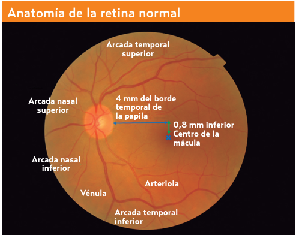

<details>
<summary>📝 Texto extraído (OCR) — La-retinopatía-diabética-e-hipertensiva.pdf-0001-12.png</summary>

```
Anatomía de la retina normal

Arcadá nasal
superior

Arcada nasal
inferior

Arcada temporal
superior

4 mm del borde
temporal de

Centro de la
mácula

Arteriola
Vénula

Arcada temporal
inferior
```

</details>

<!-- Start of picture text -->
Anatomía de la retina normal<br>Arcada temporal<br>superior<br>Arcada nasal  4 mm del borde<br>superior temporal de<br>la papila<br>0,8 mm inferior<br>Centro de la<br>mácula<br>Arcada nasal<br>inferior<br>Arteriola<br>Vénula<br>Arcada temporal<br>inferior<br><!-- End of picture text -->

Fondo de ojo izquierdo (papila a la izquierda). Descripción de las cuatro arcadas, arteriolas y vénulas. Posición de la mácula respecto a la papila. 

AMF 2018;14(7):382-393 

382 

10 

Pedro Romero-Aroca Ramón Sagarra Álamo 

La retinopatía diabética e hipertensiva 

La primera cámara introducida permitía obtener fotografías de la retina con una amplitud de campo de tan solo 30°. Este hecho explica que en el estudio Early Treatment Diabetic Retinopathy Study (ETDRS) se precisara realizar retinografías en siete campos centrados en diferentes partes de la retina (ver figura 1). 

La posterior introducción de nuevos equipos, que permitían retinografías de 45 y 50°, redujo la necesidad de hacer tal número de fotografías. Recientemente, se han diseñado nuevos equipos que realizan retinografías denominadas de campo amplio, llegando a 180° y permitiendo observar la retina periférica. De momento, la falta de implantación de dichos equipos no favorece el fácil acceso para uso inmediato para la técnica de cribado, aunque en el futuro podrán ser de gran utilidad. 

Volviendo a los equipos actuales que permiten obtener retinografías de 45 y 50°, existen diferentes opciones para el cribado y el diagnóstico de patologías de la retina: 

1.  Técnica del ETDRS: establece retinografías de 30° en siete campos<sup>1</sup> . 

2.  Técnica del EURODIAB: establece retinografías en dos campos de 45°, uno centrado en la mácula y el segundo en el lado nasal de la papila<sup>2</sup> . 

3.  Técnica del Instituto Joslin y utilizada por el estudio Wisconsin Epidemiologic Study of Diabetic Retinopathy (WESDR), que añade a la técnica anterior de dos campos, un tercero a nivel temporal superior<sup>3</sup> . 

4.  Finalmente, para el cribado de la RD, la ADA y la AAO han establecido que basta con la práctica de una retinografía de 45° centrada en un punto entre la mácula y el lado temporal de la papila. Si bien hay que señalar que no sirve para el diagnóstico definitivo de RD<sup>4-6</sup> . 

Respecto a quién debe realizar la retinografía, no hay criterios establecidos de forma unánime. En general, se acepta que ha de ser un técnico (optometrista o no) acreditado para la obtención de imágenes de retina. La lectura de las imágenes, en un primer tiempo, pueden realizarla médicos de familia, o endocrinólogos, si están formados previamente para su práctica<sup>7</sup> . 

2.  La introducción de la tomografía de coherencia óptica (OCT) ha cambiado la forma de diagnosticar y hacer un seguimiento del tratamiento de enfermedades que afectan al área macular. Sobre todo, ha pasado a ser una herramienta imprescindible para el diagnóstico y seguimiento del EMD. 

3.  Recientemente, se han introducido los equipos de angio-OCT que permiten visualizar la vascularización a nivel macular de forma estática (no dinámica), como el caso de la AGF, que sin duda revolucionará el diagnóstico de las maculopatías. Así, en el caso de pacientes con EMD, la presencia de áreas de isquemia a nivel macular puede ayudar a establecer el diagnóstico de pérdidas de visión en estos pacientes una vez han sido tratados. 

## RETINOPATÍA DIABÉTICA 

## Introducción 

La diabetes mellitus (DM) es actualmente una verdadera pandemia que afecta tanto a los países no desarrollados como a los más avanzados. La prevalencia de DM en 2015 afectaba a 415 millones de personas, un 8,8% de la población de edades comprendidas entre 20 y 79 años, y se espera que experimente un incremento significativo hasta alcanzar los 642 millones de pacientes en 2040<sup>8</sup> . En España, algunas estimaciones calculan que la prevalencia aumentará del 8,7% al 11,1%<sup>9</sup> . 

Tal y como es sabido, la DM es una enfermedad crónica en la que se desarrollan diferentes complicaciones, que darán lugar a diversas morbilidades, con gran impacto en el paciente y en la sociedad. La RD, afectación de los pequeños vasos o microangiopatía a nivel de la retina, puede ser origen de baja visión o ceguera en los pacientes afectados. Se sabe que aproximadamente un tercio de las personas con diabetes desarrollarán retinopatía, que es la quinta causa de ceguera en la población europea, después de las cataratas, los defectos de refracción, la degeneración macular y el glaucoma. Además, se ha determinado que la ceguera por RD ha aumentado de un 3,5% (2,4-5,4%) en 1990, en los países de Europa occidental, a un 4% (2,5-6,9%) en el año 2010. 

## Otras técnicas de imagen 

1.  La angiografía fluoresceínica (AGF) ha sido extensamente utilizada en oftalmología, sobre todo para poder observar la red vascular de forma activa, permitiendo distinguir áreas de ruptura de la barrera hematorretiniana (BHR) interna. Así se pueden hallar áreas de edema, dato muy importante si afectan a la mácula, dando lugar a edema macular diabético (EMD) (primera causa de baja visión y ceguera en los pacientes con RD). También permite detectar áreas de isquemia retiniana, y clasificar la RD en formas graves. 

Respecto a la epidemiología de la RD, su prevalencia varía según los países: desde un mínimo del 10% en Noruega hasta un máximo de un 61% en África del Sur en personas con DM conocida, y de un 1,5% en los afroamericanos en Estados Unidos, a un 31% en China. Los resultados globales indican una prevalencia media de cualquier forma de reti nopatía ( _any-retinopathy_ ) de un 34,6% (34,534,8%). Respecto a las formas más graves, la prevalencia de RD proliferativa es de un 6,96% (6,87- 7,04%) y la RD con afectación visual ( _visual threatening diabetic retinopathy_ , VTDR) es de un 10,2% (10,1-10,3%)<sup>10</sup> . En España, 

AMF 2018;14(7):382-393 

383 

11 

Pedro Romero-Aroca Ramón Sagarra Álamo 

La retinopatía diabética e hipertensiva 

la prevalencia de RD oscila entre un 6,3% y un 26,1%<sup>11-13</sup> , según los estudios consultados, que destacan por la variabilidad en la metodología utilizada. 

Sobre la incidencia de RD, se encuentran pocos estudios. En España, se ha publicado recientemente un estudio poblacional que sitúa la incidencia de RD entre un 8 y un 9%<sup>14</sup> . Estas cifras son similares a las obtenidas en otros países, como en el Reino Unido, con un sistema sanitario similar y un sistema de cribado de la RD basado en las retinografías mediante cámara no midriática, y que determinaron una incidencia anual de RD de un 8,14% en Inglaterra y un 6,66% en Gales<sup>15,16</sup> . 

## Lesiones típicas de la retinopatía diabética 

En la tabla 1 se describen las diferentes lesiones que se observan en la RD. En este punto, cabe destacar que sin la presencia de microaneurismas no se puede diagnosticar una RD (figura 2). 

## Complicaciones de la retinopatía diabética 

Además del desprendimiento traccional de la retina, descrito anteriormente, se pueden observar: 

1.  Hemorragia a nivel de la cavidad vítrea, que si se sitúa entre el vítreo y la retina se denomina hemorragia retrohialoidea, y si accede al interior del vítreo dará lugar a una hemorragia vítrea. 

2.  Glaucoma neovascular se produce como consecuencia de la aparición de neovasos a nivel del ángulo formado por la córnea y el iris, que es por dónde el humor acuo- 

#### FIGURA 2 

### Lesiones que se observan en una retinopatía diabética proliferativa 

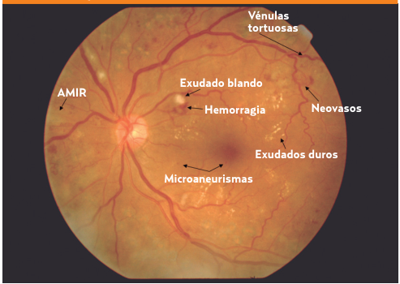

<details>
<summary>📝 Texto extraído (OCR) — La-retinopatía-diabética-e-hipertensiva.pdf-0003-12.png</summary>

```
Vénulas
tortuosas

Exudado blando
AMIR

Hemorragia Neovasos

Exudados duros

Microaneurismas
```

</details>

<!-- Start of picture text -->
Vénulas<br>tortuosas<br>Exudado blando<br>AMIR<br>Hemorragia Neovasos<br>Exudados duros<br>Microaneurismas<br><!-- End of picture text -->

AMIR: anomalías microvasculares intrarretinianas. 

- so es drenado del interior del ojo, si se impide su salida aumentará. Este tipo de glaucoma denominada neovascular por la presencia de neovasos como consecuencia de la isquemia de la retina y del iris. 

3.  Edema macular. Esta afectación solo se puede ver utilizando una lámpara de hendidura y observando la mácula con lentes de contacto o no contacto, que permiten ver un engrosamiento de la retina a nivel macular. También se puede observar realizando una angiografía fluoresceínica y, más recientemente, con la introducción de la OCT, es posible determinar su presencia mediante una fotografía del área macular que permitirá seguir su evolución tras el tratamiento. 

4.  Isquemia retiniana. Si afecta a la mácula, dará lugar a una pérdida de visión importante sin posibilidad de recuperación, y si afecta al resto de la retina, dará lugar a la formación de neovasos. Se puede observar mediante una angiografía fluoresceínica, prueba que pone en evidencia las áreas de falta de perfusión a nivel capilar y, más recientemente, mediante la angioOCT. 

## Clasificación de la retinopatía diabética 

La clasificación de la RD ha ido evolucionando en el tiempo, por lo que existen clasificaciones que se utilizan para estudios científicos y otras, más sencillas, para seguir la evolución de los pacientes. 

La clasificación de la retinopatía que se usa en ensayos clínicos es la empleada por el grupo de estudio del ETDRS<sup>17,18</sup> , que permite valorar la mejoría de la RD mediante el cambio de nivel (denominado _step_ ) del paciente. A efectos de práctica clínica, esta clasificación es compleja de interpretar. Debido a ello, se han elaborado nuevas clasificaciones recomendadas por diferentes sociedades de oftalmología, como la Academia Americana de Oftalmología (AAO), con su propia clasificación de la RD y del EMD<sup>19</sup> , así como en España con la clasificación de la Sociedad Española de Retina y Vítreo (SERV), aceptada por la Sociedad Española de Oftalmología (SEO)<sup>20</sup> (tabla 2 y figura 3). 

En Inglaterra y País de Gales, donde el cribado de la RD está muy avanzado, la clasificación de esta enfermedad recomendada por The Royal College of Ophthalmologists se basa en el objetivo de detectar aquellos pacientes con posibilidad de desarrollar pérdida de visión evitable con tratamiento láser adecuado. Asimismo, el National Institute for Clinical Excellence (NICE) usa una serie de criterios para definir el nivel de urgencia con el que enviar a los pacientes diabéticos al oftalmólogo<sup>21</sup> . Los criterios de ambas entidades los podemos observar de forma superpuesta en la tabla 3. 

AMF 2018;14(7):382-393 

384 

12 

Pedro Romero-Aroca Ramón Sagarra Álamo 

La retinopatía diabética e hipertensiva 

|TABLA 1(continuación)<br>**Lesiones que aparecen**|**en la retinopatía diabética**|
|---|---|
|Lesión|Descripción|
|Anomalías de los vasos<br>retinianos|En las vénulas pueden aparecer imágenes de tortuosidad,<br>secundarias a un aumento de fujo sanguíneo. También<br>pueden aparecer bucles y reduplicaciones venulares,<br>que indicarían gravedad de la RD<br>En la retinografía, las fechas verdes indican anomalías<br>venosas, la superior corresponde a un arrosariamiento<br>venoso y la fecha inferior señala una zona de<br>bucle venoso|
|Hemorragias retinianas|Son el resultado de la extravasación de sangre por la<br>ruptura de vasos, pueden ser superfciales<br>(denominadas en llama) o profundas (tienen forma<br>redonda y pueden ser de diferentes tamaños). Estas<br>últimas indican sufrimiento por isquemia de las capas<br>internas de la retina y, por lo tanto, indican gravedad<br>de la RD. Las hemorragias superfciales aisladas<br>pueden estar presentes en fases previas a la RD<br>(nivel 15 de la clasifcación del ETDRS).<br>La retinografía permite observar gran número de<br>hemorragias|
|Microaneurismas|Es la lesión diagnóstica de la presencia de RD, si no se<br>observan no estamos ante una RD. Son redondos y<br>pequeños, de 50 micras de diámetro (similar a una<br>arteriola), representan la dilatación en el sector<br>venular de los capilares retinianos, secundarios<br>a alteraciones de la pared vascular. Son de<br>color amarillo y de bordes mal defnidos<br>En la retinografía, las fechas indican los<br>microaneurismas, las manchas amarillentas<br>corresponden a exudados duros|
|Exudados duros|Son depósitos de material lipídico en la retina,<br>procedentes de la incompetencia de la BHR interna<br>(formada por la pared vascular de los vasos retinianos)<br>En la retinografía se observa una gran exudación lipídica<br>con gran cantidad de exudados duros|
|Exudados blandos|Son secundarios a la oclusión de las arteriolas<br>precapilares que producen una parada en el transporte<br>axoplásmico a nivel de la capa de células ganglionares<br>de la retina. Son blancos, de bordes mal defnidos.<br>Pueden estar presentes en fases previas a la retinopatía<br>diabética (nivel 14 de la clasifcación del ETDRS).<br>En la retinografía, las fechas indican dos exudados<br>blandos|
|Anomalías microvasculares<br>intrarretinianas|Tienen un color grisáceo y corresponden a áreas de<br>isquemia capilar, rodeadas de zonas de crecimiento<br>microvascular que se pueden considerar neovasos de<br>crecimiento intrarretiniano<br>La fecha verde indica el área grisácea de la retina rodeada<br>por dilataciones vasculares, correspondiente a una área<br>de isquemia retiniana|

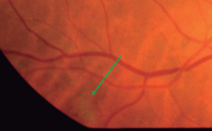

_(Continúa)_ 

AMF 2018;14(7):382-393 

385 

13 

Pedro Romero-Aroca Ramón Sagarra Álamo 

La retinopatía diabética e hipertensiva 

|**Lesiones que aparecen e**<br>|**n la retinopatía diabética**<br>|
|---|---|
|Lesión|Descripción|
|Neovasos|Su presencia defne la retinopatía diabética proliferativa.<br>Son vasos de diámetro pequeño, que pueden crecer a<br>partir de la papila o a nivel de una arteriola de una de<br>las cuatro arcadas vasculares retinianas. Pueden<br>acompañarse de tejido fbroglial que les permite crecer<br>en dirección a la cavidad vítrea, apoyándose en el vítreo<br>cercano<br>En la retinografía se pueden observar los neovasos a nivel<br>de la papila, señalados por la fecha verde|
|Desprendimiento traccional de<br>la retina|La retracción del complejo formado por tejido fbroglial y<br>neovasos puede traccionar de la retina y provocar su<br>separación del epitelio pigmentario, dando lugar a un<br>desprendimiento traccional de la retina<br>En la retinografía se observan neovasos con tejido<br>fbroglial que tracciona de la retina y la desprende|

BHR: barrera hematorretiniana; ETDRS: Early Treatment Diabetic Retinopathy Study; RD: retinopatía diabética. 

Si bien la clasificación de la RD será muy importante para su posterior seguimiento y tratamiento, para el cribado lo importante es detectar la presencia de lesiones típicas de retinopatía. Es decir, a partir del nivel 20 del ETDRS, o bien la presencia de microaneurismas o hemorragias abundantes en las retinografías, para su posterior análisis por el oftalmólogo de referencia. 

## Factores de riesgo 

Los factores de riesgo epidemiológico, para el desarrollo de la retinopatía diabética se describen en la tabla 4, en la que también se puede observar la evidencia científica que existe actualmente entre los diferentes factores de riesgo y la RD. 

## Tratamiento de la retinopatía diabética y del edema macular 

FIGURA 3 

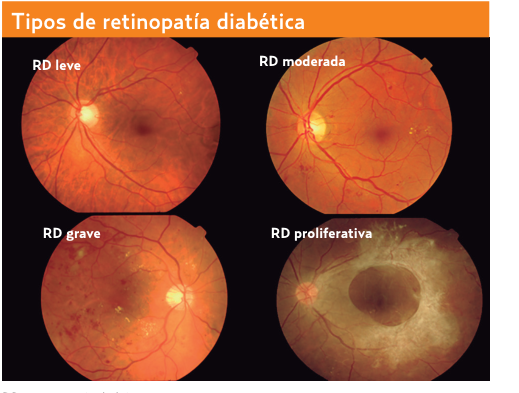

<details>
<summary>📝 Texto extraído (OCR) — La-retinopatía-diabética-e-hipertensiva.pdf-0005-09.png</summary>

```
Tipos de retinopatia diabética

RD leve RD moderada:

. 4

RD gfave RD proliferativa
```

</details>

<!-- Start of picture text -->
Tipos de retinopatía diabética<br>RD leve RD moderada<br>RD grave RD proliferativa<br><!-- End of picture text -->

El tratamiento, en todos los casos, pasa por el control de la glucemia, la presión arterial y el resto de los factores de riesgo descritos anteriormente. Las distintas sociedades científicas hacen hincapié en una serie de recomendaciones que se describen en la tabla 5. 

Respecto al tratamiento de la RD por parte del oftalmólogo, actualmente sigue vigente la panfotocoagulación en caso de que sea grave o proliferativa<sup>22</sup> . 

Ante la presencia de EMD, el tratamiento de elección actual son las inyecciones intravítreas de medicamentos antiVEGF (aflibercept, ranibizumab o bevacizumab)<sup>23</sup> . En los pacientes con resistencia a estos medicamentos se puede utilizar corticoides intravítreos (dexametasona o fluocinolona), que también están indicados de primera línea en pacientes operados de cataratas. Los efectos secundarios de los medicamentos anti-VEGF son poco frecuentes y en el caso de los corticoides hay que tener en cuenta que pueden dar lugar a la formación de catarata, y en pacientes sensibles puede producirse un aumento de la presión intraocular que desencadenaría un glaucoma secundario<sup>24</sup> . 

RD: retinopatía diabética. Retinografías superiores: superior izquierda, presencia de microaneurismas que indican la presencia de una retinopatía leve; superior derecha, retinografía con exudados duros, hemorragias y un mayor número de microaneurismas, que indica que se trata de una forma moderada. Las dos retinografías inferiores corresponden, la de la izquierda, a una forma grave, ya que presenta una gran número de hemorragias, sobre todo redondas y grandes en el lado temporal; la de la derecha es un caso de retinopatía proliferativa con gran cantidad de neovasos a nivel de las dos arcadas vasculares temporales superior e inferior, con tejido fibroglial que tracciona de la retina. 

AMF 2018;14(7):382-393 

386 

14 

Pedro Romero-Aroca Ramón Sagarra Álamo 

La retinopatía diabética e hipertensiva 

|TABLA 2<br>**Equivalencias en**|**tre las diferentes clasifcaciones**|||
|---|---|---|---|
||ETDRS|Clasifcación<br>Internacional|Clasifcaciones de la SERV<br>y de la SEO|
|Nivel 10<br>_No retinopatía_|No microaneurismas|_No retinopatía_|_Sin retinopatía aparente_|
|Niveles 14 y 15<br>_No retinopatía_|Nivel 14: Exudados blandos aislados,<br>AMIR. No Ma<br>Nivel 15: He aisladas.<br>No microaneurismas|_No retinopatía_|_Sin retinopatía aparente_|
|Nivel 20<br>_Retinopatía leve_|Solo Ma|_Retinopatía_<br>_leve_|_Retinopatía no proliferativa leve_|
|Nivel 35<br>_Retinopatía leve_|Ma y además uno o más de los siguientes<br>signos, en un cuadrante:<br>• Bucles venosos<br>• Exudados blandos aislados, AMIR<br>• He retinianas|||
|Nivel 43<br>_Retinopatía_<br>_moderada_|He/Ma moderadas en 4 cuadrantes o<br>AMIR en 1 a 3 cuadrantes|_Retinopatía_<br>_moderada_|_Retinopatía no proliferativa moderada_.<br>Ma asociados a menos de<br>20 he intrarretinianas en cada<br>|
|Nivel 47<br>_Retinopatía_<br>_moderada-grave_|Mismos signos del nivel 43 y uno<br>de los siguientes:<br>AMIR en 4 cuadrantes<br>• He/Ma graves en 2-3 cuadrantes<br>• Bucles venosos en 1 cuadrante||uno de los 4 cuadrantes, exudados<br>duros, «exudados» algodonosos,<br>arrosariamiento venoso en 1 solo<br>cuadrante|
|Nivel 53 A-D<br>_Retinopatía grave_|Signos del nivel 47 y uno o más<br>de los siguientes:<br>•  He grave en los 4 cuadrantes<br>• AMIR moderados en 1 cuadrante<br>• Bucles venosos en 2 o 3 cuadrantes|_Retinopatía_<br>_grave_|_Retinopatía no proliferativa grave_<br>Ma junto a uno de los siguientes<br>hallazgos:<br>•  He intrarretinianas grave (20)<br>en cada uno de los 4 cuadrante<br>•  Arrosariamiento venoso en<br>2 cuadrante<br>•  (AMIR en1 cuadrante|
|Nivel 53 E<br>_Retinopatía muy_<br>_severa_||_Retinopatía_<br>_proliferativa_|_Retinopatía no proliferativa muy grave_<br>Ma junto, al menos, dos de los<br>hallazgos del grupo anterior|
|Niveles 61, 65<br>_Retinopatía_<br>_proliferativa leve_<br>Niveles 71, 75<br>_Retinopatía_<br>_proliferativa de alto_<br>_riesgo_|Presencia de neovasos en la papila<br>o en cualquier lugar de la retina<br>Presencia de neovasos en la papila<br>o la retina asociada a la presencia de<br>He en el vítreo||_Retinopatía proliferativa_<br>Neovasos y/o He prerretiniana o He en<br>el vítreo|
|Niveles 81, 85<br>_Retinopatía_<br>_proliferativa_<br>_avanzada_|Fondo de ojo oscuro, no se puede<br>visualizar|||

AMIR: anomalías microvasculares intrarretinianas; ETDRS: Early Treatment Diabetic Retinopathy Study; He: hemorragias; Ma: micoraneurisma; SERV: Sociedad Española de Retina y Vítreo; SEO: Sociedad Española de Oftalmología. 

AMF 2018;14(7):382-393 

387 

15 

Pedro Romero-Aroca Ramón Sagarra Álamo 

La retinopatía diabética e hipertensiva 

|**Clasifcación de****_The Royal C_**<br>Nati<br>TABLA 3|**_ollege of Ophthalmologists_**<br>onal Guidelines on Screening for Diabet|ic Retinopathy|
|---|---|---|
|Retinopatía|||
|Nivel 0|No retinopatía|Control anual/bianual|
|Nivel 1|Retinopatía de fondo|Control anual|
|Nivel 2|Retinopatía preproliferativa|Derivación a hospital antes de 4 semanas|
|Nivel 4|Retinopatía proliferativa|Derivación a hospital en 1 semana|
|Maculopatía|||
|Nivel 0|No maculopatía||
|Nivel 1|Si maculopatía|Derivación a hospital antes de 4 semanas|
|Fotocoagulación láser|||
|Nivel 0|No fotocoagulación láser observada||
|Nivel 1|Fotocoagulación láser observada||
|Inclasifcable||Derivación a hospital|
|Otras lesiones||Informar cuáles son|
|En caso de pérdida de visión súbita||Derivación a hospital el mismo día|

Esta clasificación es útil para el cribado de RD, y para la realización del cribado, ya que orienta al tipo de pacientes que hay que derivar al centro de referencia. 

## RETINOPATÍA HIPERTENSIVA 

## Introducción 

La enfermedad cardiovascular sigue siendo en la actualidad la causa más frecuente de mortalidad. Los factores de riesgo tradicionales para la enfermedad cardiovascular, como la hipertensión arterial (HTA), las dislipemias y el tabaquismo, permiten a los médicos identificar, controlar y tratar a pacientes de alto riesgo. 

La HTA constituye un problema de salud a escala mundial por sus complicaciones y por su elevada trascendencia sanitaria, económica y social. Se trata de una enfermedad frecuente, fácil de detectar, pero que suele ser asintomática y que suele suponer complicaciones que pueden llegar a ser graves cuando no se corrigen las cifras anormalmente elevadas. 

La microcirculación retiniana puede ser considerada como una «representación anatómica» de las características fisiológicas y funcionales de la circulación coronaria y cerebral. 

La red capilar retiniana se puede visualizar fácilmente mediante técnicas no invasivas, como la retinografía, que permite, en la actualidad, un registro fotográfico comparativo digitalizado de alta calidad de las características 

circulatorias y el aspecto de los capilares retinianos. Por lo tanto, los cambios microvasculares en la retina, incluyendo los estrechamientos arteriolares, las alteraciones anatómicas en los cruzamientos arteriovenosos y la retinopatía, son marcadores concomitantes de la patología vascular en la circulación coronaria y cerebral y, en consecuencia, pueden predecir el riesgo de las principales enfermedades cardiovasculares<sup>25</sup> . 

La importancia del examen del fondo de ojo (oftalmoscopia) en los pacientes hipertensos reside, fundamentalmente, en la asociación existente entre las características de los cambios apreciados en la microcirculación de la retina y la evolución de la hipertensión sistémica. Este hecho permitirá una estimación de la gravedad de las alteraciones microcirculatorias existentes en otros órganos diana y así establecer un control y pronóstico de la enfermedad. No obstante, es importante resaltar que, aunque no se observen cambios significativos en el estado de los capilares retinianos, no se puede descartar la existencia de alteraciones circulatorias en otras partes del organismo en pacientes con HTA. 

## Definición y fisiopatología 

Se denomina retinopatía hipertensiva al conjunto de alteraciones vasculares retinianas que se encuentran patoló- 

AMF 2018;14(7):382-393 

16 

388 

Pedro Romero-Aroca Ramón Sagarra Álamo 

La retinopatía diabética e hipertensiva 

|**Descripción de los**<br>**epidemiológico y s**<br>TABLA 4|**factores de riesgo**<br>**u evidencia científca**|
|---|---|
|Factor de riesgo<br>|Potencia de la asociación<br>|
|Sexo|Desconocida|
|Edad|Desconocida|
|Etnia|Desconocida|
|Embarazo|Desconocida|
|Duración de la diabetes<br>mellitus|OR (IC 95%)8,92 (4,31-26,77)<br>si la DM15 años|
|Niveles de HbA1C|OR (IC 95%)3121 (1823–<br>10.332) si HbA1Ces7,0%|
|Tratamiento con in-<br>sulina|HR (IC 95%)2,17 (1,68–2,81)|
|Hipertensión arterial|HR (IC 95%)1,17 (1,10–1,25)<br>por cada 1% de aumento|
|Nefropatía|OR (IC 95%)6.774 (3.442–<br>18.236)|
|Niveles de lípidos|OR (IC 95%)4.125 (1.125–<br>15.857), Colesterol total/HDL<br>ratio3,5 en hombres y<br>3,0 en mujeres|
|Gravedad de la retino-<br>patía diabética|Desconocida|
|Cirugía del segmento<br>anterior, efecto de la<br>cirugía de catarata|Desconocida|
|Infamación ocular|Desconocida|

DM: diabetes mellitus; HbA1C: hemoglobina glucosilada; HDL: [colesterol de] lipoproteínas de alta densidad; HR: _hazard ratio_ ; IC: intervalo de confianza; OR: _odds ratio_<sup>12,14</sup> . 

gicamente relacionados con las lesiones microvasculares producidas por la HTA, que provoca cambios precoces en la red microvascular retiniana. Estas lesiones se producen, fundamentalmente, como consecuencia directa de la hipertensión, pero parece que otros factores, como la arteriosclerosis, la enfermedad de las arterias carótidas o la edad avanzada, pueden influir en su desarrollo. 

Los cambios vasculares en la retina debidos a los estados hipertensivos sistémicos se pueden dividir en cuatro fases de afectación, que dependen de diferentes estados fisiopatológicos<sup>26</sup> : 

Fase de vasoconstricción: el aumento en el tono arteriolar por los procesos de autorregulación conduce a un estrechamiento arteriolar generalizado. 1.  Fase de esclerosis: la hiperplasia de la túnica media y la 

### **Recomendaciones de la Asociación Americana de Diabetes y la Sociedad Española de Retina y Vítreo** 

Recomendaciones de la American Diabetes Association<sup>5</sup> : 

- Optimizar el control de la glucemia para reducir o enlentecer la progresión de la RD 

- Optimizar el control de la presión arterial y de los lípidos séricos para reducir o enlentecer la progresión de la RD (GR C) 

- Control de las mujeres embarazadas con DM tipo 1 o 2 preexistente, que no es necesario en caso de que aparezca diabetes gestacional, ya que no tienen un riesgo aumentado de desarrollo de RD (GR C) 

Recomendaciones de la Sociedad Española de Oftalmología, respecto a los factores de riesgo asociados<sup>20</sup> : 

- Es preciso insistir en el control de la glucemia (HbA1C), presión arterial, sobrepeso y lípidos. Se ha de enviar al paciente al endocrino/internista/nefrólogo siempre que sea necesario, dada la gran influencia de estos factores de riesgo (GR C) 

- Control de la glucemia en pacientes con DM tipo 1: de acuerdo con los resultados del Diabetes Control and Complications Trial (DCCT), la instauración de un control intensivo de la glucemia durante los 5 primeros años del diagnóstico reduce la aparición de edema en un 23% con respecto al tratamiento convencional y este efecto se mantiene a lo largo del tiempo (nivel de evidencia 1, GR A). 

•  Control de la glucemia en la DM 2, según el estudio UKPDS, de ahí que durante los primeros años se aconseje mantener los niveles de HbA1C por debajo del 7%. Sin embargo, en pacientes con DM 2 de larga evolución y con comorbilidades, mantener la HbA1C en esos niveles no resulta favorable por el riesgo de hipoglucemias y de aumento de la morbimortalidad, tal y como han demostrado los estudios ACCORD y ADVANCE, y las nuevas recomendaciones de la Asociación Americana de Diabetes sitúan los niveles aconsejables de HbA1C en torno al 7-8,5%. (nivel de evidencia 1, GR A). 

- Control de la HTA: es también un factor de riesgo y progresión del EMD, y los valores aconsejados se sitúan en la actualidad en torno a 140/80 mmHg, salvo en enfermos de larga evolución con muchas complicaciones macrovasculares o microvasculare, casos en los que se es más tolerante (Asociación Americana de Diabetes, 2014) (GR C) 

DM: diabetes mellitus; EMD: edema macular diabético; HbA1C: hemoglobina glucosilada; HTA: hipertensión arterial; GR: grado de recomendación; RD: retinopatía diabética; 

degeneración hialina de la pared de las arteriolas provocan alteraciones estructurales en la red capilar. 

2.  Fase exudativa: la alteración de la BHR, debida a la necrosis fibrinoide de la pared vascular, resulta en la extravasación de sangre y de elementos plasmáticos, además del deterioro del flujo sanguíneo con complicaciones isquémicas para el tejido retiniano. También se observa alteración del mecanismo de transporte axoplasmático con el compromiso de la capa de fibras nerviosas de la retina. 

AMF 2018;14(7):382-393 

389 

17 

Pedro Romero-Aroca Ramón Sagarra Álamo 

La retinopatía diabética e hipertensiva 

3.  Fase de complicaciones vasculares: cambios ateroscleróticos en las paredes vasculares provocan oclusiones arteriales, oclusiones venosas con edema de la retina y formación de macroaneurismas arteriales. 

Estos son los principales mecanismos fisiopatológicos que explicarán los hallazgos del fondo de ojo encontrados en los pacientes con retinopatía hiperten siva. 

## Clasificación 

Se han descrito varias propuestas para la clasificación de la retinopatía hipertensiva, pero no existe un consenso relacionado con su utilidad práctica. En primer lugar, por el progresivo y mejor entendimiento de los aspectos fisiopatológicos de las alteraciones de la HTA en la circulación de la retina, y también por las diferentes aproximaciones terapéuticas que determinan un mejor control de los estados hipertensivos sistémicos y sus conse cuencias. 

La clasificación más utilizada es la de Keith-WagenerBarker<sup>27</sup> (tabla 6), que se estableció según el pronóstico de la enfermedad. 

Originalmente, las retinopatías hipertensivas de grado I se consideraban asociadas a una supervivencia del 71% a los 10 años, el grado II con un 51%, el grado III con un 35%, y las retinopatías de grado IV disminuían la supervivencia de los pacientes a un 21% en 10 años, debido al desarrollo de enfermedades cardiovasculares o accidentes cerebrovasculares y, por lo tanto, la observación del fondo de ojo podía predecir el riesgo de mortalidad de los pacientes. Estos datos ya no son vigentes actualmente ya que el control de la hipertensión es mejor que en épocas anteriores y ha cambiado su pronóstico, lo que hace que rara vez se observen pacientes en estadios de retinopatía grave (grados III y IV). 

## Hallazgos oftalmoscópicos principales 

Los hallazgos de fondo de ojo más frecuentes en los casos de retinopatía hipertensiva se dividen en tres clases principales de alteraciones (figura 4): 

- Estrechamiento arteriolar. Puede ser generalizado a lo largo de las arteriolas, típico de la respuesta a la HTA en sujetos jóvenes, o bien focalizado, hallazgo típico en sujetos adultos en los que los fenómenos de esclerosis de la pared arteriolar ya han tenido lugar, y solo se produce vasoconstricción en zonas de la arteriola sin esclerosis. 

- Arteriolosclerosis. La hialinización de la capa íntima asociada a la hipertrofia de la capa media y la hiperplasia endotelial son las consecuencias del proceso de aterosclerosis arteriolar que conlleva un engrosamiento progresivo de la pared de los vasos retinianos. Las arteriolas y vénulas retinianas comparten una misma 

**Clasificación de la retinopatía hipertensiva de Keith-Wagener-Barker**<sup>**28**</sup> 

||Hallazgo oftalmológicos|Grado de<br>afectación|
|---|---|---|
|Grupo I|No vasoconstricción,<br>presencia de tortuosidad<br>vascular|Vasculopatia<br>hipertensiva|
|Grupo II|Vasoconstricción arteriolar<br>focal, dilatación venular,<br>presencia de algunas<br>hemorragias|Vaculopatia<br>hipertensiva|
|Grupo III|Vasoconstricción arteriolar<br>generalizada, vasoespasmo<br>coroideo, estrella macular,<br>exudados duros, áreas de<br>microinfartos, presencia<br>de numerosas hemorragias|Renopatia<br>hipertensiva|
|Grupo IV|Lesiones del grupo III y<br>presencia de edema de<br>papola|Retinopatia<br>hipertensiva|

capa adventicia en los cruces vasculares y, como resultado del engrosamiento de los vasos, el signo oftalmoscópico más importante es la presencia de cambios marcados en los cruces arteriolo-venulares (cruces patológicos). La presencia de un cruce arteriolo-venular anormal generalmente constituye un signo de arteriolosclerosis, que puede cursar sin hipertensión sistémica. 

- Extravasación vascular. Los cambios de la permeabilidad capilar debidos a las alteraciones de la BHR provocan la aparición de hemorragias retinianas superficiales o profundas, además del edema retiniano. En los estados persistentes de alteración de la permeabilidad capilar, se pueden observar exudados duros, que en la región macular adoptan una disposición típica denominada «estrella macular». 

- Edema de papila. Es el signo clave de retinopatía hipertensiva grave y representa los estados graves de hipertensión sistémica, observándose la papila hiperémica, ingurgitada, con los márgenes borrosos y difuminados. 

## Fases de la lesión retiniana por hipertensión arterial 

1.  Fase de vasoconstricción: generalizada en el joven, focal en el adulto. 

2.  Fase de esclerosis: la hiperplasia de la túnica media y degeneración hialina de la pared de las arteriolas provocan alteraciones estructurales en la red capilar. 

3.  Fase exudativa: alteración de la BHR con necrosis fibri- 

AMF 2018;14(7):382-393 

18 

390 

Pedro Romero-Aroca Ramón Sagarra Álamo 

La retinopatía diabética e hipertensiva 

#### FIGURA 4 

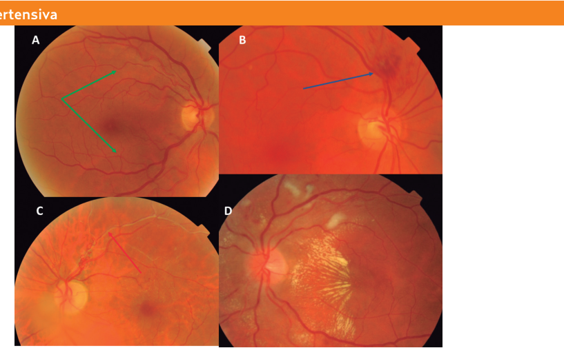

<details>
<summary>📝 Texto extraído (OCR) — La-retinopatía-diabética-e-hipertensiva.pdf-0010-04.png</summary>

```
Retinopatía hipertensiva
```

</details>

<!-- Start of picture text -->
Retinopatía hipertensiva<br><!-- End of picture text -->

En la retinografía A se observa una vasculopatía hipertensiva, con tortuosidad venosa (flechas verdes) y adelgazamiento arteriolar. La retinografía B muestra una zona de oclusión venosa (flecha azul) por esclerosis de la arteriola que al cruzar sobre la vénula produce la oclusión de esta y hemorragias retinianas en la zona vascular dependiente. La retinografía C presenta un caso antiguo de oclusión venosa con la aparición de una vénula en hilo de plata (exangüe). Finalmente, la retinografía D muestra una hipertensión arterial aguda, con edema de papila, exudados blandos y una estrella macular formada por exudados duros. 

noide de la pared vascular, que da lugar a exudación, además aparecen áreas de cierre vascular con isquemia y alteración del flujo axoplásmico. 

4.  Fase de complicaciones vasculares: oclusiones venosas, formación de macroaneurismas. 

## Complicaciones de la hipertensión arterial 

A nivel de la retina, la HTA puede dar lugar a: 

su calibre, hemorragias retinianas en «llama de vela» superficiales o redondas y profundas, edema en el área macular, y algunas veces «manchas algodonosas» (infartos de la capa de fibras nerviosas), que aparecen en el sector de la retina correspondiente a la vena afectada. Si se afecta la vena central, por trombosis posterior o a nivel de la lámina cribosa, se suele producir un edema del nervio óptico. Las oclusiones de rama venosa suelen producirse en los cruces arteriovenosos (figura 5). 

1. Oclusiones venosas 

2. Formación de macroaneurismas. 

Las oclusiones venosas son la segunda causa de pérdida de agudeza visual con resultado de ceguera legal (agudeza visual igual o inferior a 0,1), secundarias a enfermedad vascular retiniana, la primera sería la retinopatía diabética. 

Suelen ocurrir en pacientes mayores de 40 años, pero la media de edad es de 60 años. Existe una fuerte asociación con la HTA, y algunos estudios afirman que multiplica por cinco el riesgo de padecer una oclusión venosa en pacientes hipertensos. Otros factores de riesgo son la diabetes, la enfermedad carotídea, el tabaquismo, las enfermedades hematológicas, las vasculitis y algunos medicamentos<sup>29,30</sup> . Existen dos tipos de obstrucciones, la de una rama de la vena central de la retina y la de la vena central de la retina. En la retina de los pacientes con oclusión de la rama venosa o de la vena central de la retina, se observa una tortuosidad vascular venosa con aumento de 

Los macroaneurismas arteriales de la retina suelen presentarse como una única dilatación sacular de una arteria retiniana, observándose con mayor frecuencia a nivel de las arcadas temporales. A su alrededor, aparecen edema y exudación lipídica que, con el tiempo, puede afectar a la mácula y comprometer la visión. Suele afectar a pacientes con hipertensión arterial (figura 6). 

## Cribado y tratamiento de la retinopatía hipertensiva arterial 

No hay criterios definidos que establezcan la utilidad del cribado en aquellos pacientes con HTA bien controlada. Solamente en caso de que exista mal control o complicaciones derivadas de la HTA, como puede ser la nefropatía, es útil realizar técnicas de cribado consistentes, al igual que en la DM, en retinografías de control (GR C). Asimismo, ante la presencia de crisis hipertensivas arteriales graves, es obligado el estudio del fondo de ojo, ya 

AMF 2018;14(7):382-393 

19 

391 

Pedro Romero-Aroca Ramón Sagarra Álamo 

La retinopatía diabética e hipertensiva 

FIGURA 5 

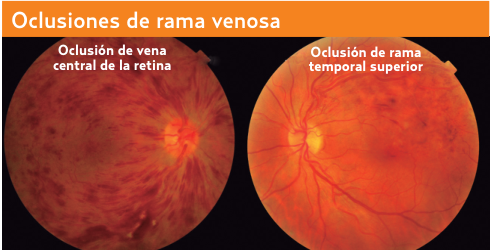

<details>
<summary>📝 Texto extraído (OCR) — La-retinopatía-diabética-e-hipertensiva.pdf-0011-03.png</summary>

```
‘Oclusién d
central de |
```

</details>

<!-- Start of picture text -->
Oclusiones de rama venosa<br>Oclusión de vena   Oclusión de rama<br>central de la retina temporal superior<br><!-- End of picture text -->

A la izquierda, imagen de una oclusión de la vena central de la retina; a la derecha, imagen de una oclusión de la rama temporal superior. 

#### FIGURA 6 

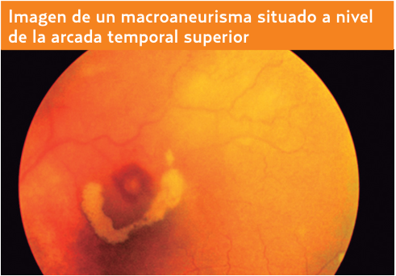

<details>
<summary>📝 Texto extraído (OCR) — La-retinopatía-diabética-e-hipertensiva.pdf-0011-06.png</summary>

```
Imagen de un macroaneurisma situado a nivel
de la arcada temporal superior
```

</details>

<!-- Start of picture text -->
Imagen de un macroaneurisma situado a nivel<br>de la arcada temporal superior<br><!-- End of picture text -->

que, como se ha descrito, pueden aparecer complicaciones a nivel macular (exudación lipídica) o papilar (edema de papila) con el riesgo de producir una pérdida posterior de visión. 

Respecto al tratamiento de la retinopatía hipertensiva, consiste en el tratamiento de la enfermedad de base que lo origina, es decir, la hipertensión arterial. 

## Dilatación arteriolar/venular y enfermedad sistémica 

Recientemente se ha querido relacionar las alteraciones del diámetro arteriolar y venular existentes en el área peripapilar con enfermedades sistémicas como el accidente cerebrovascular (ACV) y las enfermedades cardiovasculares como el infarto agudo de miocardio (IAM). 

Si bien el ACV es debido a oclusión de grandes vasos, en un 30% de los casos está asociado a patología de pequeños vasos. Como los vasos retinianos y los cerebrales tienen el mismo origen, las lesiones que se ven en la retina pueden estar en el cerebro (figura 7). La vasoconstricción arteriolar y la vasodilatación se ha podido medir me- 

#### FIGURA 7 

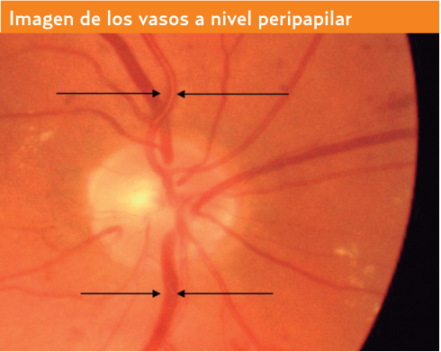

<details>
<summary>📝 Texto extraído (OCR) — La-retinopatía-diabética-e-hipertensiva.pdf-0011-13.png</summary>

```
Imagen de los vasos a nivel peripapilar
```

</details>

<!-- Start of picture text -->
Imagen de los vasos a nivel peripapilar<br><!-- End of picture text -->

Imagen de los vasos a nivel peripapilar En el estudio de los vasos se miden los diámetros de la arteriola y de la vénula en el área señalada por las flechas. 

diante imágenes digitalizadas. Actualmente parece que se puede relacionar la dilatación venular, medida en el área peripapilar con la predicción de riesgo de ACV, enfermedad coronaria y nefropatía. 

Si bien es un campo de investigación apasionante, aún no es posible extraer conclusiones definitivas de los estudios publicados<sup>31,32</sup> . 

## Bibliografía 

1.  Grading diabetic retinopathy from stereoscopic color fundus photographs-an extension of the modified Airlie House classification: ETDRS Report No. 10. Early Treatment Diabetic Retinopathy Study Research Group. Ophthalmology. 1991;98(suppl 5):786-806. 

2.  Aldington SJ, Kohner EM, Meuer S, Klein R, Sjølie AK. Methodology for retinal photography and assessment of diabetic retinopathy: the EURODIAB IDDM complications study. Diabetologia. 1995;38: 437-44. 

3.  Bursell SE, Cavallerano JD, Cavallerano AA, Clermont AC, BirkmirePeters D, Aiello LP, et al. Stereo nonmydriatic digital-video color retinal imaging compared with Early Treatment Diabetic Retinopathy Study seven standard field 35-mm stereo color photos for determining level of diabetic retinopathy. Ophthalmology. 2001 Mar;108(3):572-85. 

4.  Williams GA, Scott IU, Haller JA, Maguire AM, Marcus D, McDonald HR. Single-field fundus photography for diabetic retinopathy screening: a report by the American Academy of Ophthalmology. Ophthalmology. 2004 May;111(5):1055-62. 

5.  American Diabetes Association. 10. Microvascular Complications and Foot Care: Standards of Medical Care in Diabetes-2018. Diabetes Care. 2018 Jan;41(Suppl 1):S105-S118. 

6.  Vujosevic S, Benetti E, Massignan F, Pilotto E, Varano M, Cavarzeran F, et al. Screening for diabetic retinopathy: 1 and 3 nonmydriatic 45-degree digital fundus photographs vs 7 standard early treatment diabetic retinopathy study fields. Am J Ophthalmol. 2009 Jul;148(1):111-8. 

7.  Bragge P, Gruen RL, Chau M, Forbes A, Taylor HR. Screening for presence or absence of diabetic retinopathy: a meta-analysis. Arch Ophthalmol. 2011 Apr;129(4):435-44. 

AMF 2018;14(7):382-393 

392 

20 

Pedro Romero-Aroca Ramón Sagarra Álamo 

La retinopatía diabética e hipertensiva 

8.  Atlas de la Diabetes de la FID. [Internet] 7.<sup>a</sup> edición. International Diabetes Federation, IDF 2015. ISBN: 978-2-930229-81-2. Disponible en:  http://www.idf.org 

9.  Shaw JE, Sicree RA, Zimmet PZ. Global estimates of the prevalence of diabetes for 2010 and 2030. Diabetes Res Clin Pract. 2010 Jan;87(1):4-14. 

10.  Yau JW, Rogers SL, Kawasaki R, Lamoureux EL, Kowalski JW, Bek T, et al.; Meta-Analysis for Eye Disease (META-EYE) Study Group. Global prevalence and major risk factors of diabetic retinopathy. Diabetes Care. 2012 Mar;35(3):556-64. 

11.  Rodríguez-Poncelas A, Miravet-Jiménez S, Casellas A, Barrot-De La Puente JF, Franch-Nadal J, López-Simarro F, et al. Prevalence of diabetic retinopathy in individuals with type 2 diabetes who had recorded diabetic retinopathy from retinal photographs in Catalonia (Spain). Br J Ophthalmol. 2015 Dec;99(12):1628-33. 

12.  Romero-Aroca P, Sagarra-Aalmo R, Baget-Bernaldiz M, Fernandez Ballart J, Mendez Marin I. Prevalence and relationship between diabetic retinopathy and nephropathy, and its risk factors in the NorthEast of Spain, a population-based study. Ophthalmic Epidemiol. 2010 Aug;17(4):251-65. 

13.  Alonso-Morán E, Orueta JF, Fraile Esteban JI, Arteagoitia Axpe JM, Marqués González ML, et al. The prevalence of diabetes-related complications and multimorbidity in the population with type 2 diabetes mellitus in the Basque Country. BMC Public Health. 2014 Oct 10;14:1059. 

14.  Romero-Aroca P, De La Riva-Fernandez S, Valls-Mateu A, SagarraAlamo R, Moreno-Ribas A, Soler N. Changes observed in diabetic retinopathy: eight year follow up of a Spanish population. Br J Ophthalmol. 2016 Oct;100(10):1366-71. 

15.  Scanlon PH. The English National Screening Programme for diabetic retinopathy 2003-2016. Acta Diabetol. 2017 Jun;54(6):515-525. 

16.  Thomas RL, Dunstan F, Luzio SD, Roy Chowdury S, Hale SL, North RV, et al. Incidence of diabetic retinopathy in people with type 2 diabetes mellitus attending the Diabetic Retinopathy Screening Service for Wales: retrospective analysis. BMJ. 2012;344:e874. 

17.  Fundus photographic risk factors for progression of diabetic retinopathy. ETDRS Report number 12. Early Treatment Diabetic Retinopathy Study Research Group. Ophthalmology. 1991 May;98(5 Suppl):823-33. 

18.  Davis MD1, Fisher MR, Gangnon RE, Barton F, Aiello LM, Chew EY. Risk factors for high-risk proliferative diabetic retinopathy and severe visual loss: Early Treatment Diabetic Retinopathy Study Report #18. Invest Ophthalmol Vis Sci. 1998;39:233-52. 

19.  Wilkinson CP, Ferris FL 3rd, Klein RE, Lee PP, Agardh CD, Davis M, et al.; Global Diabetic Retinopathy Project Group. Proposed international clinical diabetic retinopathy and diabetic macular edema disease severity scales. Ophthalmology. 2003 Sep;110(9):167782. 

20.  Manejo de las complicaciones oculares de la diabetes. Retinopatía Diabética y Edema Macular. «Guías de Práctica Clínica de la SERV». [Internet] Disponible en: www.serv.es 

21.  Royal College of Ophthalmologists. Guidelines for Diabetic Retinopathy. Disponible en: [Internet] London: Royal College of Ophthalmologists, 2005. www.rcophth.ac.uk 

22.  Evans JR, Michelessi M, Virgili G. Laser photocoagulation for proliferative diabetic retinopathy. Cochrane Database Syst Rev. 2014 Nov 24;(11):CD011234. 

23.  Virgili G, Parravano M, Evans JR, Gordon I, Lucenteforte E. Antivascular endothelial growth factor for diabetic macular oedema: a network meta-analysis. Cochrane Database Syst Rev. 2017 Jun 22;6:CD007419. 

24.  Khan Z, Kuriakose RK, Khan M, Chin EK, Almeida DR. Efficacy of the Intravitreal Sustained-Release Dexamethasone Implant for Diabetic Macular Edema Refractory to Anti-Vascular Endothelial Growth Factor Therapy: Meta-Analysis and Clinical Implications. Ophthalmic Surg Lasers Imaging Retina. 2017 Feb 1;48(2):160-6. 

25.  Wong TY, Klein R, Klein BE, Tielsch JM, Hubbard L, Nieto FJ. Retinal microvascular abnormalities and their relationship with hypertension, cardiovascular disease, and mortality. Surv Ophthalmol. 2001; 46:59-80. 

26.  Dodson PM, Lip GYH, Eames SM, Gibson JM, Beevers DG. Hypertensive retinopathy: a review of existing classification systems and a suggestion for a simplified grading system. J Hum Hypertens. 1996;10: 93-8. 

27.  Keith NM, Wagener HP, Barker NW. Some different types of essential hypertension: their course and prognosis. Am J Med Sci. 1939; 191:332. 

28.  Keith NM, Wagener HP, Barker NW. Some different types of essential hypertension: their course and prognosis. Am J Med Sci. 1974 Dec;268(6):336-45. 

29.  Jaulim A, Ahmed B, Khanam T, Chatziralli IP. Branch retinal vein occlusion: epidemiology, pathogenesis, risk factors, clinical features, diagnosis, and complications. An update of the literature. Retina. 2013 May;33(5):901-10. 

30.  Khan Z, Almeida DR, Rahim K, Belliveau MJ, Bona M, Gale J. 10Year Framingham risk in patients with retinal vein occlusion: a systematic review and meta-analysis. Can J Ophthalmol. 2013 Feb;48 (1):40-5. 

31.  Patton N, Aslam T, Macgillivray T, Pattie A, Deary IJ, Dhillon B. Retinal vascular image analysis as a potential screening tool for cerebrovascular disease: a rationale based on homology between cerebral and retinal microvasculatures. J Anat. 2005;206:319-48. 

32.  Wong TY, Kamineni A, Klein R, Sharrett AR, Klein BE, Siscovick DS, et al. Quantitative retinal venular caliber and risk of cardiovascular disease in older persons: the cardiovascular health study. Arch Intern Med. 2006 Nov 27;166(21):2388-94. 

AMF 2018;14(7):382-393 

21 

393

---

## Documento 5: Manifestacciones de la RD y RH 2021.pdf

> 9 páginas | 1.6 MB

<details>
<summary>📝 Texto extraído (OCR) — Manifestacciones_de_la_RD_y_RH_2021.pdf-0001-00.png</summary>

```
cientifiC;.
ducation
ledical
ourhña!
```

</details>

Scientific & Education Medical Journal / Vol. 1, N° 1, 2021 

# **Manifestaciones de la retinopatía hipertensiva y de la retinopatía diabética en población adulta** 

Daniela Gasca Cuello<sup>1</sup> ,Jennifer Paola Martínez Parra<sup>2</sup> Juan sebastián Gómez Gordillo<sup>3</sup> Susan Lizeth Delgado Contreras.<sup>4</sup> Ricardo Andres Fuentes Martinez 

- 1 Daniela Gasca Cuello.MD; Universidad El Bosque; danigasca20@gmail.com 

- 2 Jennifer Paola Martínez Parra.MD; Fund. Univers. Juan N. Corpas; jennymartinez_@hotmail.com 

- 3 Juan sebastián Gómez Gordillo MD; Universidad Libre de Cali; juangomez116025@gmail.com 

- 4 Susan Lizeth Delgado Contreras.MD; Universidad Autónoma de Bucaramanga; drasusandelgadocontreras@gmail.com 

- 5 Ricardo Andres Fuentes Martinez, Universidad Simon Bolivar - Barranquilla, Richar.co6@gmail.com 

##### **Historia del Artículo:** 

## **Resumen** 

Recibido el 1 de octubre de 2020 Aceptado el 30 de noviembre de 2020 On-line el 16 de diciembre de 2020 La retinopatía se define como el conjunto de enfermedades no inflamatorias que afectan la retina que se caracterizan por ser afecciones de diferentes características, la cual puede ser provocada por una diversidad de enfermedades. 

> **Palabras Clave:** Unas de las enfermedades más comunes es la diabetes y la hipertensión la cual Retinopatía, hipertensión, diabetes, retina, constituye uno de los primeros problemas de salud pública alrededor del mundo. alteraciones micro vasculares, fondo de ojo. Existen estudios en la literatura donde se evalúan síntomas iniciales de la enfermedad, diagnóstico y tratamiento. 

**Keywords:** Retinopathy, hypertension, diabetes, retina, microvascular alterations, fundus. 

## **Abstract** 

Retinopathy is defined as the set of non-inflammatory diseases that affect the retina that are characterized by being affections of different characteristics, which can be caused by a variety of diseases. 

One of the most common diseases is diabetes and hypertension, which constitute one of the first public health problems around the world. There are studies in the literature where initial symptoms of the disease, diagnosis and treatment are evaluated.. 

##### *** Autor para correspondencia:** 

Daniela Gasca Cuello-Universidad El Bosque, e-mail: danigasca@gmail.com 

**Cómo citar:** 

Gasca Cuello et al. Manifestaciones de la retinopatía hipertensiva y de la retinopatía diabética en población adulta. S&EMJ. Año 2021; Vol. 1: 64-72. 

64 ISSN: 2745-0252 (En Línea) 

Manifestaciones de la retinopatía hipertensiva y de la retinopatía diabética en población adulta 

#### **_Objetivo_** 

Elaborar una revisión de literatura sobre la presentación clínica, diagnóstico y ámbitos terapéuticos para identificar el nuevo enfoque del paciente con retinopatía hipertensiva y diabética. 

#### **_Método_** 

Se realizó una búsqueda sistemática con términos Mesh, en bases de datos _PubMed_ , _Medscape_ , _The New England Journal of Medicine_ y _Google Academics_ desde el año 2018 hasta la fecha. Se encontró una amplia variedad de artículos dentro de los cuales se encuentran revisiones sistemáticas, reporte de casos, estudios retrospectivos, estudios metacéntricos y revisiones bibliográficas, se seleccionaron un total de 40 artículos. El criterio de selección de los mismos fue de inclusión de inicio de enfermedad, diagnóstico y tratamiento realizados en humanos, artículos completos y originales. 

#### **_Conclusiones_** 

La retinopatía sea diabética o hipertensiva tiene como afectación los pequeños vasos o microangiopatias de la retina. Un tercio de la población con diabetes mellitus desarrollan retinopatía diabética llevando a ceguera u origen de baja visión después de otras comorbilidades tales como catarata, defectos de refracción y glaucoma. 

La importancia del fondo de ojo y el control médico periódico de paciente con hipertensión arterial y diabetes estableciendo así la gravedad de las alteraciones micro vasculares, igualmente se concluye que así no se observen alteraciones no se descarta la presencia de la enfermedad, siempre tener en cuenta los signos de otros órganos diana para establecer un control y pronóstico de la enfermedad. 

#### **_Manifestations of hypertensive retinopathy and diabetic retinopathy in the adult population_** 

#### **_Objective_** 

To prepare a literature review on the clinical presentation, diagnosis and therapeutic areas to identify the new approach to the patient with hypertensive and diabetic retinopathy. 

#### **_Method_** 

A systematic search with Mesh terms was carried out in PubMed, Medscape, The New England Journal of Medicine and Google Academics databases from 2018 to date. A wide variety of articles were found, including systematic reviews, case reports, retrospective studies, metacentric studies and bibliographic reviews, a total of 40 articles were selected. Their selection criteria was the inclusion of disease onset, diagnosis and treatment performed in humans, complete and original articles. 

small vessels or microangiopathies of the retina. One third of the population with diabetes mellitus develop diabetic retinopathy leading to blindness or low vision origin after other comorbidities such as cataract, refractive errors and glaucoma. 

The importance of the fundus and the periodic medical control of patients with hypertension and diabetes, thus establishing the severity of microvascular alterations, it is also concluded that even if alterations are not observed, the presence of the disease is not ruled out, always bear in mind the signs of other target organs to establish a control and prognosis of the disease. 

### **Conocer la estructura anatómica del ojo** 

Al realizar el fondo de ojo lo primero que se puede visualizar es la retina siendo esta la capa más interna del globo ocular, de color rojizo y es la única parte del cuerpo donde se pueden observar directamente los vasos sanguíneos y las múltiples estructuras (1,2). 

Primero se establece el nervio óptico se encuentra ubicado en la región nasal, es redondo tiene un anillo anaranjado y en su parte central emergen las arteriolas de la retina siendo estas de mayor calibre, de color rojo intenso, y entran a la parte central las vénulas llamadas así porque carecen de capa media (4), cabe aclaras que entre estos vasos y el anillo papilar hay un espacio llamado excavación papilar (5,6). 

La macula ubicada en la región central de la retina encontrándose en su centro una parte más oscura denominada fóvea, la cual es la responsable de la máxima agudeza visual y de visión de colores por tener la mayor cantidad de conos (1), una característica de esta es que por el centro no atraviesa ninguna arteriola o vénula ya que esta es irrigada por la coroides (6). 

**Figura 1.** Anatomía del fondo de ojo sano. 

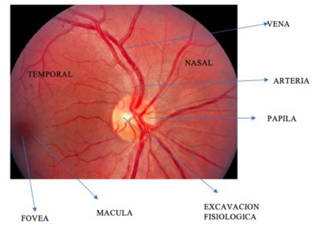

<details>
<summary>📝 Texto extraído (OCR) — Manifestacciones_de_la_RD_y_RH_2021.pdf-0002-20.png</summary>

```
VENA

> ARTERIA

PAPILA

| e EXCAVACION
FOVEA MACULA FISIOLOGICA
```

</details>

**Fuente:** Tomada y modificada por fines académicos de artículo Romero-Aroca P, Sagarra Álamo R. La retinopatía diabética e hipertensiva. AMF. 2018; 14 (7): 382-384. 

#### **_Conclusions_** 

Retinopathy, whether diabetic or hypertensive, affects the 

La diabetes y la hipertensión arterial son dos enfermedades de gran prevalencia que afectan la circulación generando complicaciones y una de ellas es la 

ISSN: 2745-0252 (En Línea) 65 

Scientific & Education Medical Journal / Vol. 1 - N° 1 - 2021, 64-72 

Gasca Cuello et al. 

retinopatía que afecta la retina provocando una afectación de ocular la cual se puede medir la gravedad dependiendo del nivel de ceguera que genere (9,10). 

posteriormente se desarrolla la retinopatía proliferativa (33). 

**Figura 2.** Anomalías de los vasos retinianos. 

### **Diabetes y la retinopatía** 

La diabetes es una enfermedad de gran prevalencia tanto en los países desarrollados como no desarrollados que trae consigo múltiples comorbilidades uno de ellos es la retinopatía diabética siendo esta la primera causa de ceguera antes de los 60 años (13,14), es la complicación micro vascular más común entre los diabéticos, se sabe que un tercio de la población de diabéticos desarrollan una retinopatía que se asocia a hiperglucemia mantenida, mal control metabólico y diabetes de larga evolución (20). 

### **Epidemiología** 

La prevalencia de la retinopatía diabética en Estados Unidos aproximadamente está estimada en un 28,5%, a nivel mundial está en 34,6% y en Latinoamérica se estima que esta entre un 20 a 30% y en total un 5% presenta complicaciones que pueden derivar en ceguera, la retinopatía diabética es la primera causa de ceguera no recuperable (21). 

Los factores de riesgo para desarrollar retinopatía diabética se pueden enumerar dando como prevalencia el tipo de diabetes y el tiempo de evolución de la enfermedad, dándose como el 98% de los pacientes con diabetes tipo 1 desarrollan retinopatía diabética y el solo el 60% de las personas que padecen de diabetes tipo 2 llegan a desarrollar retinopatía diabética (23) y estudios han demostrado que la desarrollan después de 20 años de inicio de la enfermedad. Sin embargo, en los dos tipos de diabetes se demuestra que el mal control glucémico y los altos niveles de hemoglobina glicosilada puede influir en la progresión de aparición de la retinopatía diabética igualmente el control de cifras tensionales control metabólico como la hiperlipidemia (27, 29). 

Diferentes estudios han demostrado que existen diferentes factores de riesgo genéticos con el desarrollo en la progresión de la retinopatía diabética así también como lo es el embarazo y la pubertad, otros estudios limitados hablan de la radioterapia como factor de riesgo y el traumatismo ocular. 

### **Lesiones típicas de la retinopatía diabética** 

Hablando de la fisiopatología de la retinopatía diabético estudios demuestran que al no control de la glucemia se producen cambios bioquímicos en el metabolismo de la glucosa provocando daños anatómicos en la pared vascular los cuales serían responsables de la aparición de los microangiopatia con formación de exudados y edema de retina afectando notablemente la visión cuando desarrolla edema macular. 

La alteración de la pared vascular altera la cascada de proangiogenica la cual produce los neo vasos y 


**Fuente:** Tomada y modificada por fines académicos de artículo Romero-Aroca P, Sagarra Álamo R. La retinopatía diabética e hipertensiva. AMF. 2018; 14 (7): 382-384 

**Figura 3.** Microaneurismas. 


**Fuente:** Tomada y modificada por fines académicos de artículo Romero-Aroca P, Sagarra Álamo R. La retinopatía diabética e hipertensiva. AMF. 2018; 14 (7): 382-384 

Otras lesiones típicas que se pueden presentar son: anomalías micro vasculares, neovasos y desprendimiento de la retina. 

### **Complicaciones** 

- Hemorragia vítrea 

- Glaucoma neo vascular 

- Edema macular 

- Isquemia retiniana 

- Neuropatía 

66 ISSN: 2745-0252 (En Línea) 


<!-- Start of picture text -->
hey<br>e set ® a)<br><!-- End of picture text -->


Scientific & Education Medical Journal / Vol. 1 - N° 1 - 2021, 64-72 

Gasca Cuello et al. 

**Figura 8.** Neovascularización y hemorragia preretinal. 


**Fuente:** Tomada y modificada por fines académicos de artículo Romero-Aroca P, Sagarra Álamo R. La retinopatía diabética e hipertensiva. AMF. 2018; 14 (7): 382-384 

3. Edema macular diabético:  puede presentarse tanto en la proliferativa como en la no proliferativa y es la causa más frecuente de ceguera en el paciente diabético. 

**Figura 9.** Edema macular. 


### **Tratamiento para la retinopatía diabética** 

Se considera que el tratamiento en todos los casos primero es de prevención, buen control del paciente diabético, tanto de la glicemia y de los factores de riesgo sea como perfil lipídico y metabólico ideal hemoglobina glicosilada menor de 7 así mismo de las cifras tensionales para evitar complicaciones (35). 

Respecto al tratamiento de retinopatías avanzadas se evaluará la posibilidad de un pan fotocoagulación en retinopatías proliferativas, también se utilizan inyecciones intravitreas como de corticoide. 

1. Fotocoagulación retinal con rayos láser (1,40). 

2. Tratamiento con inyecciones intravítreas de fármacos anti angiogénicos y/o corticoesteroides. 

3. Tratamiento quirúrgico: Vitrectomía. 

Antes de evaluar el tratamiento de la retinopatía hay que tener en cuenta la importancia del edema macular el cual es el principal causante de la disminución de la agudeza visual en donde están implicadas muchas citoquinas como es la del factor de crecimiento endotelial vascular (VEGF) responsables de la angiogénesis y del aumento de la permeabilidad vascular por esto se crearon agentes que bloquean los efectos del VEGF para así tratar la retinopatía diabética (14). 

### **Retinopatía hipertensiva** 

La hipertensión arterial se considera como un problema de salud pública a escala mundial por su elevada frecuencia adicional sus complicaciones, la retinopatía hipertensiva es un daño en la retina ocasionado por la elevación abrupta de la presión arterial sea por causa primaria o secundaria, (16,17) esta produce disminución de la agudeza visual hasta ceguera, en cuanto la retinopatía sea aguda y se normalizan las cifras tensionales mejora significativamente la agudeza visual, diferentes estudios han demostrado que la retinopatía hipertensiva se asocia a la subida de las cifras tensionales sin embargo también influye factores como la arterioesclerosis, la enfermedad de las arterias carótidas y edad avanzada. 

**Fuente:** Tomadas y modificadas de artículo Tobaru-Miyashiro L, Guzmán-Ahumada M. Retinopatía diabética. 2019; 58 (2): 85-90. 

**Tabla 1.** Tratamiento farmacológico para la retinopatía diabética. 

|**Tratamiento farmacológic**|**o para la retinopatía diabé**|**tica**||
|---|---|---|---|
|**Nombre**|**Tipo de fármaco**|**Mecanismo de acción**|**Dosis**|
|Bevacizumab (Avastin)|Fármaco antigénico|Dirigido contra todas las isoformas activas del VEGF|Intravítrea 1,25 mg|
|Ranibizumab (Lucentis)|Fármaco antigénico|Es el fragmento FAB del anticuerpo anti-VEGF. Es un<br>anticuerpo monoclonal dirigido contra el VEGF-a|Intravítrea 0,3 o 0,5 mg.|
|Afibercept (Eylea)|Fármaco antigénico|Actúa como un receptor competitivo e inhibe a los factores<br>de crecimiento placentario (plgf1 y plgf2)|Intravítrea 2 mg|
|Triamcinolona|Corticoide|Efecto estabilizador del endotelio vascular, disminuyendo<br>la permeabilidad vascular|No vitrectomizados 4mg<br>Vitrectomizados 8mg|

**Fuente:** Elaborada en base en articulo García Ferrer L, Ramos López M, Molina Santana Y, Chang Hernández M, Perera Miniet E, Galindo Reydmond K. Estrategias en el tratamiento de la retinopatía diabética. Revista cubana de oftalmología. 2018; 31(1): 90-99. 

68 ISSN: 2745-0252 (En Línea) 

Manifestaciones de la retinopatía hipertensiva y de la retinopatía diabética en población adulta 

### **Epidemiología** 

La prevalencia de la retinopatía hipertensiva es mucho menor que la retinopatía diabética dándose en un 7 a 11 % de los pacientes hipertensos y las complicaciones se asocian a complicación cardiovasculares mayormente en accidentes cardiovasculares. 

### **Clasificación** 

La clasificación más utilizada es la de Keith-WagenerBaker basada en la severidad y las alteraciones presentes al realizar fondo de ojo. 

Grado I. Mínimos cambios en los vasos retinianos, estrechamiento arterial y mínimos signos de cruce. 

Grado II. Estrechamiento arterial generalizado y focal en hilo de cobre y algún signo de cruce, mínimo o nulo compromiso sistémico 

Grado III. Arterias en hilo de plata, signos de cruce más marcados, presencia de exudados y/o hemorragias, puede existir alteración cardiaca o cerebral 

Grado IV. Lo mismo que el grado III mas edema de papila lo que indica hipertensión maligna (1,18).4 

**Figura 10.** Tortuosidad venosa. 


**Fuente:** Tomadas y modificadas por fines académicos de artículo Romero-Aroca P, Sagarra Álamo R. La retinopatía diabética e hipertensiva. AMF. 2018; 14 (7): 382-384 

**Figura 11.** Hilos de plata. 


**Fuente:** Tomadas y modificadas de artículo Tobaru-Miyashiro L, Guzmán-Ahumada M. Retinopatía diabética. 2019; 58 (2): 85-90. 

**Figura 12.** Papiledema. 


**Fuente:** Tomadas y modificadas por fines académicos de artículo Romero-Aroca P, Sagarra Álamo R. La retinopatía diabética e hipertensiva. AMF. 2018; 14 (7): 382-384 

### **Complicaciones** 

1. Oclusiones venosas 

2. Formación de macro aneurismas 

La oclusión venosa es de las principales causas de ceguera secundaria a enfermedad vascular retiniana, existen factores de riesgo los cuales pueden influir en 

**Tabla 2.** Clasificación de la retinopatía hipertensiva de Keith Wagener Barker 

||**Hallazgo oftalmológico**|**Grado de afectación**|
|---|---|---|
|**Grado I**|No vasoconstricción, estrechamiento arterial|Vasculopatía hipertensiva|
|**Grado II**|Estrechamiento arterial, hilo de cobre|Vasculopatía hipertensiva|
|**Grado III**|Arterias en hilo de plata presencia de exudados y hemorragia|Retinopatía hipertensiva|
|**Grado IV**|Lesiones del grado III mas papiledema|Retinopatía hipertensiva|

**Fuente:** Retinopatía hipertensiva. Manual MSD versión para profesionales. 2020. 

ISSN: 2745-0252 (En Línea) 

69 


<details>
<summary>📝 Texto extraído (OCR) — Manifestacciones_de_la_RD_y_RH_2021.pdf-0007-00.png</summary>

```
Algoritmo manejo paciente con retinopatía diabética

Paciente con diagnóstico

de diabetes mellitus

evaluacion oftalmologica

Se encontraron hallazgos compatibles con
retinopatía diabética y/o edema macular?

SI

Control metabólico y
de factores de riesgo

Retinopatía diabética
no proliferativa

Retinopatía diabética
proliferativa

Fotocoagulación con laser
Tratamiento con antiogenicos

leye

moderada

Seguimiento
periodico

Seguimiento 2-3 meses
Fotocoagulación: en pacientes
con alto riesgo de progresion,

pacientes que no se puede
continuar el seguimiento,
pacientes con catarata,
embarazadas.

HblAc <7%
LDL <100
TA < 130/80

Laser

Inyección Bevacizumab Intravitreo
```

</details>

<!-- Start of picture text -->
Algoritmo manejo paciente con retinopatia diabética<br>Paciente con diagndstico<br>de diabetes mellitus<br>evaluacion oftalmologica<br>Se encontraron hallazgos compatibles con<br>retinopatia diabética y/o edema macular?<br>NO SI<br>Controlcada periddicoafio— Controlde factores metabdlicode riesgoaa . y eeTA < 130/80<79 | :iy<br>Retinopatia diabética Retinopatia diabética<br>no proliferativa proliferativa<br>Laser<br>ne madiindh severa Fotocoagulacién con laser Inyeccién Bevacizumab Intravitreo<br>Tratamiento con antiogenicos<br>Seguimiento Seguimiento 2-3 meses<br>periodico Fotocoagulacion: en pacientes<br>con alto riesgo de progresion,<br>pacientes que no se puede<br>continuar el seguimiento,<br>pacientes con catarata,<br>embarazadas.<br><!-- End of picture text -->


<details>
<summary>📝 Texto extraído (OCR) — Manifestacciones_de_la_RD_y_RH_2021.pdf-0008-00.png</summary>

```
Algoritmo manejo paciente con retinopatía hipertensiva

Paciente con diagnóstico

de hipertension arterial

evaluacion oftalmologica

Se encontraron hallazgos compatibles con
retinopatía hipertensiva?

NO! SI

Estratificación del riesgo
Tratamiento hipertensivo

Control periódico Control metabolico

Control tension arterial

Factores de riesgo y/o

paciente con diabetes

Un factor de riesgo en
paciente no diabetico

No factores de riesgo

Manejo farmacológico antihipertensivo
Control oftalmológico 6 meses - 1 año

Modificar estilos de vida
Control cifras tensionales
Control periodico oftalmológico
```

</details>

<!-- Start of picture text -->
Algoritmo manejo paciente con retinopatia hipertensiva<br>Paciente con diagnostico<br>de hipertension arterial<br>evaluacion oftalmologica<br>Se encontraron hallazgos compatibles con<br>retinopatia hipertensiva?<br>NO SI<br>Control periédico Estratificacion del riesgo Conindl meisialt<br>Control tension arterial Tratamiento hipertensivo iia<br>Factores de riesgo y/o<br>No factores de riesgo: Un factor:  de riesgoahaa en Paciente con diabetes<br>paciente no diabetico<br>Manejo farmacolégico antihipertensivo<br>Control oftalmolégico 6 meses - | afio<br>Modificar estilos de vida<br>Control cifras tensionales<br>Control periodico oftalmologico<br><!-- End of picture text -->

Scientific & Education Medical Journal / Vol. 1 - N° 1 - 2021, 64-72 

Gasca Cuello et al. 

15. Cyrus Kayange P, Schulze Schwering M, Stephen Manda C, Singini I, Phillip Moyo VV, Kumwenda J. Prevalence _and clinical spectrum of hypertensive retinopathy among hypertension clinic patients at Queen Elizabeth Central Hospital in Malawi._ 2018; 30(3): 180-183. 

16. Tsukikawa M, W Stacey A. _A Review of Hypertensive Retinopathy and Chorioretinopathy._ 2020; 12: 67-73 

17. Zhang Y, Zhao L, Li H, Wang Y. Risk factors for hypertensive retinopathy in a Chinese population with hypertension: The Beijing Eye study. _Experimental and therapeutic medicine. Experimental and therapeutic medicine_ . 2020; 17 (1): 435-458. 

18. Zamora M, Asociación entre obesidad y retinopatía diabética en pacientes adultos con diabetes mellitus tipo 2. 2018: 1-20. 

19. Leyton D, Sepúlveda A. Estudio de la prevalencia de la Retinopatía Diabética en pacientes diagnosticados con Diabetes Mellitus tipo II atendidos en el Centro de Atención Primaria de Salud Viña del Mar (CAPS), de la Dirección de Sanidad General de la Armada de Chile. 2018: 1-71. 

20. Lee HJ, Kim CO, Lee _DC. Association between daily sunlight exposure duration and diabetic retinopathy in Korean adults with diabetes: A nationwide population-based crosssectional study._ PLOS ONE. 2020; 15 (8): 1-11. 

21.  Lin YC, Chen YC, Horng JT, Chen JM. _Association of Fenofibrate and Diabetic Retinopathy in Type 2 Diabetic Patients: A Population-Based Retrospective Cohort Study in Taiwan_ . 2020; 56 (8) :385. 

22.  Habib SA, Jibran MS, Khan SB, Gul AM. _Association of hypertensive retinopathy with angiographic severity of coronary artery disease determined by syntax score._ 2019 31(2):189-191 

_Retinopathy Vision Analysis using Image Identification Service Analysis Approach. Procedia Computer Science._ 2019; 165 :470-477. 

   35. Feng X, Wang H, Kong Y, Zhang J, He J, Zhang B. _Diagnosis of chronic stage of hypertensive retinopathy based on spectral domain optical coherence tomography. Wiley_ . 2020; 22:1247-1252. 

   36. Cáceres-del-Carpio JH, Cañote R, Montes-Alvis J, Pacheco- Barrios K, Quiroz-Cerna D, Lujan-Donayre VC et al. Diagnóstico y tratamiento de la retinopatía diabética y edema macular diabético: guía de practica clínica del Seguro Social de Salud del Perú (EsSalud). An Fac med. 2020;81(1): 113- 122. 

   37. Mohana Devi S, Mahalaxmi I, Kaavya J, Chinnkulandhai V, Balachandar V. _Does epigenetics have a role in age related macular degeneration and diabetic retinopathy?_ 2020: 1-8. 

   38. Madera N, Escorcia-Gutierrez J, Gamarra M, Torres M, De los Ríos E. Metodología de Segmentación de la Estructura Ocular en Imágenes de Fondo de Ojo de Pacientes con Retinopatía Diabética. Prospectiva. 2020; 18 (2) :1-14. 

   39. Labrada-Arias BD, Ramírez-Pérez Ed, Abreu-Leyva AB, Aveleira-Ortiz BD, González-Leyva M. Retinopatía diabética en mujeres atendidas en el hospital “Ernesto Guevara de la Serna”. 2018; 43 (4): 1-7. 

   40. Yamanouchi M, Mori M, Hoshino J, Kinowaki K, Fujii T, OhashiK, _Retinopathy progression and the risk of end-stage kidney disease: results from a longitudinal Japanese cohort of 232 patients with type 2 diabetes and biopsy-proven diabetic kidney disease._ 2019; 7: 1-12. 

23. Kim S, Park S, Kim DY, Yun S, Lee O, Han H. _Bilateral Obstructive Uropathy Caused by Congenital Bladder Diverticulum Presenting as Hypertensive Retinopathy._ 2018; 33(8): 54. 

24. Matsubara N, Kato A, Kominami A, Nozaki M, Yasukawa T, Yoshida M, _Ogura Y. Bilateral giant retinal pigment epithelial tears in hypertensive choroidopathy_ . 2019; 15:1-4. 

25. Ruiz M, Ramos M, Duperet D. Caracterización epidemiológica y clínica de pacientes con retinopatía diabética. Ciencias básicas biomédicas. 2020; 1: 1-13. 

26. Lee HM, Lee WH, Kim KN, Jo1 YJ, Kim JY _, Changes in thickness of central macula and retinal nerve fibre layer in severe hypertensive retinopathy: a 1-year longitudinal study._ 2018; 96 (3): 386-392. 

27. Somilleda-Ventura SA, Ceballos-Reyes GM, Lima-Gómez V. _Comparison of macular retinal sensitivity and its contribution to the foveal sensitivity between diabetic and non-diabetic patients with normal visual acuity. J Optom._ 2019;12(3):180-185 

28. Sánchez-Vicente JL, López-Herrero F, Martínez-Borrego AC, Lechón-Caballero B, Moruno-RodríguezA, MolinaSocolab FE. Coroidopatía, retinopatía y neuropatía óptica hipertensiva en un paciente con fracaso de trasplante renal. Sociedad Española de oftalmología. 2019; 94 (11): 551-555. 

29. Son J, Shin JY, Kim HD, Jung KH, Park KH, Park SJ. _Development and Validation of Deep Learning Models for Screening Multiple Abnormal Findings in Retinal Fundus Images_ . 2019; 127 (1): 95-96. 

30. Sinclair SH, Schwartz SS. _Diabetic Retinopathy–An Underdiagnosed and Undertreated Inflammatory, NeuroVascular Complication of Diabetes. 2019._ 

31. Peter H Scanlon. _Diabetic retinopathy._ 2019; 13 (10):843. 

32.  Gupta A, Chhikara R. _Diabetic Retinopathy: Present and Past. Procedia._ 2018; 132: 1032-1440. 

33.  Wejdan L. Alyoubi, Wafaa M. Shalash, Maysoon F. Abulkhair. _Diabetic retinopathy detection through deep learning techniques: A review. Informatic in Medicine._ 2020; 20:1-11. 

34. Alamelu M, Balaji1 R, Mithun J, Hariharan M. _Diabetics_ 

72 ISSN: 2745-0252 (En Línea)

---

## Documento 6: Ocular effects of hypertension - UpToDate.pdf

> 8 páginas | 0.3 MB

23/6/25, 4:33 p.m. 

Ocular effects of hypertension - UpToDate 

Official reprint from UpToDate® www.uptodate.com © 2025 UpToDate, Inc. and/or its affiliates. All Rights Reserved. 

# **Ocular effects of hypertension** 

**AUTHOR:** Raymond R Townsend, MD **SECTION EDITOR:** William B White, MD **DEPUTY EDITOR:** Karen Law, MD, FACP 

All topics are updated as new evidence becomes available and our peer review process is complete. 

Literature review current through: **May 2025.** This topic last updated: **Nov 20, 2024.** 

## **INTRODUCTION** 

A number of ocular abnormalities are directly or indirectly associated with hypertension [1,2]. These include some that are a direct consequence of elevated blood pressure, including hypertensive retinopathy, choroidopathy, and optic neuropathy. With other abnormalities, hypertension is a significant risk factor, including retinal vein and artery occlusion, retinal artery emboli, and diabetic retinopathy. In addition, hypertension may accelerate nonvascular eye disease, including age-related macular degeneration and glaucoma. 

## **OCULAR DISEASES DIRECTLY RELATED TO HYPERTENSION** 

Fundoscopy should be part of the physical examination on every patient with newly diagnosed hypertension since the retina is the only part of the vasculature that can be visualized noninvasively. Pupillary dilatation with a short-acting mydriatic (eg, tropicamide 1%) is almost always useful since the mild changes are hard to quantify, even with retinal photography [3]. Newer approaches to retinal imaging, such as optical coherence tomography angiography (OCTA), may also be useful in evaluating hypertensive retinopathies [4]. 

The most common ocular diseases directly related to hypertension are progressively increasing retinal microvascular changes, which are subsumed under the name "hypertensive retinopathy." Classically, the features are divided into four degrees, and their morphologic classification has been widely used [5]. However, a more pathophysiologic division has been proposed and seems more logical [3,6]. This three-degree classification includes mild, moderate, and severe ( image 1): 

https://www.uptodate.com/contents/ocular-effects-of-hypertension/print?search=hypertensive retinopathy&source=search_result&selectedTitle=1~18&usage_type=de… 

1/8 

23/6/25, 4:33 p.m. 

Ocular effects of hypertension - UpToDate 

- 

   - Mild – Retinal arteriolar narrowing related to vasospasm, arteriolar wall thickening or 

   - opacification, and arteriovenous nicking, referred to as "nipping" ( image 1) [3]. 

- Moderate – Hemorrhages, either flame or dot-shaped, cotton wool spots, hard exudates, and microaneurysms ( image 1). 

- Severe – Some or all of the above, plus optic disc edema ( image 1). The presence of papilledema mandates rapid lowering of the blood pressure. Symptoms of papilledema are discussed elsewhere. (See "Overview and differential diagnosis of papilledema".) 

Generalized narrowing and nicking are related to current and previous blood pressure levels; by comparison, focal narrowing, hemorrhages, and exudates are related only to current blood pressure levels [7]. 

Retinal arterial narrowing, a predictor of the future development of hypertension, is linked to nonocular systemic vascular diseases, particularly stroke [8,9]. In a study of 2907 hypertensives who had gradable retinal photographs and were followed for an average of 13 years, hypertensive retinopathy predicted the long-term risk of stroke, independent of the level of blood pressure [10]. Substantial evidence also exists for the association with coronary heart disease, left ventricular remodeling, and kidney damage [11-14]. 

The presence of hypertensive retinopathy should serve as an additional stimulus to ensure adequate control of hypertension. With good control, retinopathy may regress, providing an easily obtained indicator of success [15]. 

## **HYPERTENSION AS A RISK FACTOR FOR OCULAR DISEASE** 

Hypertension increases the risk of a number of ocular diseases. The most common is diabetic retinopathy, which is also the most common cause of blindness in developed societies. In a multiethnic cohort in the United States, retinopathy was found in 33 percent of diabetics over age 40 years, 8 percent of whom had vision-threatening retinopathy [16]. Multiple factors may be involved in the added risk of hypertension to the development and progression of diabetic retinopathy, including increased endothelial damage [17]. 

Fortunately, good control of hypertension can reduce the threat of diabetic retinopathy, independent of control of hyperglycemia [18]. In the United Kingdom Prospective Diabetes Study, the risk of retinopathy was reduced 10 percent for each 10 mmHg lower systolic blood pressure [18]. Goal blood pressure and choice of antihypertensive therapy in patients with diabetes and diabetic retinopathy are discussed elsewhere in detail. (See "Diabetic retinopathy: 

https://www.uptodate.com/contents/ocular-effects-of-hypertension/print?search=hypertensive retinopathy&source=search_result&selectedTitle=1~18&usage_type=de… 2/8 

23/6/25, 4:33 p.m. 

Ocular effects of hypertension - UpToDate 

Prevention and treatment", section on 'Good blood pressure management' and "Treatment of hypertension in patients with diabetes mellitus".) 

Other ocular diseases wherein hypertension serves as a risk factor include retinal venous and arterial occlusion, retinal emboli, retinal macroaneurysm, and anterior ischemic optic neuropathy [1]. (See "Retinal vein occlusion: Epidemiology, clinical manifestations, and diagnosis" and "Central and branch retinal artery occlusion" and "Nonarteritic anterior ischemic optic neuropathy: Epidemiology, pathogenesis, and etiologies".) 

## **OCULAR DISEASES WHEREIN HYPERTENSION MAY BE A RISK FACTOR** 

The risk for two of the more common causes of vision loss, age-related macular degeneration and glaucoma, may be increased by the presence of systemic hypertension. Although crosssectional data support an association [19,20], the evidence is not conclusive. It should be noted that systemic hypotension, especially at night from excessive antihypertensive therapy, has been shown to further reduce blood flow to the optic nerve, accentuating the damage of high intraocular pressure from glaucoma [21]. (See "Age-related macular degeneration" and "Openangle glaucoma: Epidemiology, clinical presentation, and diagnosis".) 

## **SUMMARY** 

- **Ocular diseases directly related to hypertension** – The most common ocular diseases directly related to hypertension are progressively increasing retinal microvascular changes, which are subsumed under the name "hypertensive retinopathy." The three-degree classification includes mild, moderate, and severe disease ( image 1). The presence of papilledema mandates rapid lowering of the blood pressure. (See 'Ocular diseases directly related to hypertension' above.) 

- **Hypertension as a risk factor for ocular disease** – Hypertension increases the risk of a number of ocular diseases, with the most common being diabetic retinopathy. Other ocular diseases wherein hypertension serves as a risk factor include retinal venous and arterial occlusion, retinal emboli, retinal macroaneurysm, and anterior ischemic optic neuropathy. (See 'Hypertension as a risk factor for ocular disease' above.) 

The risk for two of the more common causes of vision loss, age-related macular degeneration and glaucoma, may be increased by the presence of systemic hypertension. (See 'Ocular diseases wherein hypertension may be a risk factor' above.) 

https://www.uptodate.com/contents/ocular-effects-of-hypertension/print?search=hypertensive retinopathy&source=search_result&selectedTitle=1~18&usage_type=de… 3/8 

23/6/25, 4:33 p.m. 

Ocular effects of hypertension - UpToDate 

## **ACKNOWLEDGMENTS** 

The UpToDate editorial staff acknowledges Norman M Kaplan, MD, who contributed to earlier versions of this topic review. 

We are saddened by the death of George Bakris, MD, who passed away in June 2024. UpToDate acknowledges Dr. Bakris's past work as a section editor for this topic. 

Use of UpToDate is subject to the Terms of Use. 

#### **REFERENCES** 

1. Wong TY, Mitchell P. The eye in hypertension. Lancet 2007; 369:425. 

2. Gudmundsdottir H, Taarnhøj NC, Strand AH, et al. Blood pressure development and hypertensive retinopathy: 20-year follow-up of middle-aged normotensive and hypertensive men. J Hum Hypertens 2010; 24:505. 

3. Wong TY, Mitchell P. Hypertensive retinopathy. N Engl J Med 2004; 351:2310. 

4. Shaw LT, Khanna S, Chun LY, et al. Quantitative Optical Coherence Tomography Angiography (OCTA) Parameters in a Black Diabetic Population and Correlations with Systemic Diseases. Cells 2021; 10. 

5. Keith NM, Wagener HP, Barker NW. Some different types of essential hypertension: their course and prognosis. Am J Med Sci 1974; 268:336. 

6. Downie LE, Hodgson LA, Dsylva C, et al. Hypertensive retinopathy: comparing the KeithWagener-Barker to a simplified classification. J Hypertens 2013; 31:960. 

7. Sharrett AR, Hubbard LD, Cooper LS, et al. Retinal arteriolar diameters and elevated blood pressure: the Atherosclerosis Risk in Communities Study. Am J Epidemiol 1999; 150:263. 

8. Wong TY, Klein R, Sharrett AR, et al. Retinal arteriolar diameter and risk for hypertension. Ann Intern Med 2004; 140:248. 

9. Wong TY, Klein R, Couper DJ, et al. Retinal microvascular abnormalities and incident stroke: the Atherosclerosis Risk in Communities Study. Lancet 2001; 358:1134. 

10. Ong YT, Wong TY, Klein R, et al. Hypertensive retinopathy and risk of stroke. Hypertension 2013; 62:706. 

11. Wong TY, Klein R, Sharrett AR, et al. Retinal arteriolar narrowing and risk of coronary heart disease in men and women. The Atherosclerosis Risk in Communities Study. JAMA 2002; 287:1153. 

https://www.uptodate.com/contents/ocular-effects-of-hypertension/print?search=hypertensive retinopathy&source=search_result&selectedTitle=1~18&usage_type=de… 4/8 

23/6/25, 4:33 p.m. 

Ocular effects of hypertension - UpToDate 

12. Cheung N, Bluemke DA, Klein R, et al. Retinal arteriolar narrowing and left ventricular remodeling: the multi-ethnic study of atherosclerosis. J Am Coll Cardiol 2007; 50:48. 

13. Wong TY, Coresh J, Klein R, et al. Retinal microvascular abnormalities and renal dysfunction: the atherosclerosis risk in communities study. J Am Soc Nephrol 2004; 15:2469. 

14. Shantha GP, Kumar AA, Bhaskar E, et al. Hypertensive retinal changes, a screening tool to predict microalbuminuria in hypertensive patients: a cross-sectional study. Nephrol Dial Transplant 2010; 25:1839. 

15. Bock KD. Regression of retinal vascular changes by antihypertensive therapy. Hypertension 1984; 6:III158. 

16. Wong TY, Klein R, Islam FM, et al. Diabetic retinopathy in a multi-ethnic cohort in the United States. Am J Ophthalmol 2006; 141:446. 

17. Hsueh WA, Anderson PW. Hypertension, the endothelial cell, and the vascular complications of diabetes mellitus. Hypertension 1992; 20:253. 

18. Tight blood pressure control and risk of macrovascular and microvascular complications in type 2 diabetes: UKPDS 38. UK Prospective Diabetes Study Group. BMJ 1998; 317:703. 

19. Hyman L, Schachat AP, He Q, Leske MC. Hypertension, cardiovascular disease, and agerelated macular degeneration. Age-Related Macular Degeneration Risk Factors Study Group. Arch Ophthalmol 2000; 118:351. 

20. Mitchell P, Lee AJ, Rochtchina E, Wang JJ. Open-angle glaucoma and systemic hypertension: the blue mountains eye study. J Glaucoma 2004; 13:319. 

21. Hayreh SS, Zimmerman MB, Podhajsky P, Alward WL. Nocturnal arterial hypotension and its role in optic nerve head and ocular ischemic disorders. Am J Ophthalmol 1994; 117:603. 

Topic 3859 Version 32.0 

https://www.uptodate.com/contents/ocular-effects-of-hypertension/print?search=hypertensive retinopathy&source=search_result&selectedTitle=1~18&usage_type=de… 5/8 

23/6/25, 4:33 p.m. 

Ocular effects of hypertension - UpToDate 

### **GRAPHICS** 

## **Retinal fundus photographs of hypertensive retinopathy** 


<details>
<summary>📝 Texto extraído (OCR) — Ocular_effects_of_hypertension_-_UpToDate.pdf-0006-04.png</summary>

```
<=—AV nicking

<== "Copper wiring”
<— ricino

Retinal hemorrhage =>

Catton wool patch ==>

LS hemorrhage LR

Hon wool patch ==>
nal hemorrhage =>

Optic disc swelling =>

Hard exudate =>

hemorrhage —=>

Focal arteriolar

<= 7
narrowing

ZN
Retinal
hemorrhages
V

Retinal hemorrhage =>

<= Cotton wool patch

_ <==Cotton wool patch!

Optic disc swelling
o

<< Retinal hemorrhage

<= Hard exudate
```

</details>

Representative digital retinal fundus photographs of mild (A,B), moderate (C,D), and severe (E,F) hypertensive retinopathy, as graded with the simplified classification: 

https://www.uptodate.com/contents/ocular-effects-of-hypertension/print?search=hypertensive retinopathy&source=search_result&selectedTitle=1~18&usage_type=de… 

6/8 

23/6/25, 4:33 p.m. 

Ocular effects of hypertension - UpToDate 

- (A) Mild hypertensive retinopathy is indicated by the presence of generalized arteriolar narrowing, arteriovenous (AV) nicking, and opacification of the arteriolar wall ("copper wiring"). 

- (B) Mild hypertensive retinopathy with focal arteriolar narrowing. 

(C,D) Moderate hypertensive retinopathy with multiple retinal hemorrhages and cotton wool patches. 

(E,F) Severe hypertensive retinopathy with swelling of the optic disk, retinal hemorrhages, hard exudates, and cotton wool patches. 

_From: Downie LE, Hodgson LA, Dsylva C, et al. Hypertensive retinopathy: Comparing the Keith-Wagener-Barker to a simplified classification. J Hypertens 2013; 31:960. DOI: 10.1097/HJH.0b013e32835efea3. Copyright © 2013. Reproduced with permission from Wolters Kluwer Health. Unauthorized reproduction of this material is prohibited._ 

Graphic 104437 Version 4.0 

https://www.uptodate.com/contents/ocular-effects-of-hypertension/print?search=hypertensive retinopathy&source=search_result&selectedTitle=1~18&usage_type=de… 

7/8 

23/6/25, 4:33 p.m. 

Ocular effects of hypertension - UpToDate 

<mark></mark> 

https://www.uptodate.com/contents/ocular-effects-of-hypertension/print?search=hypertensive retinopathy&source=search_result&selectedTitle=1~18&usage_type=de… 

8/8

---

## Documento 7: Retinopatía diabética dx y tx.pdf

> 41 páginas | 0.6 MB

} 7 i ‘ fAl:" (co= ne r.=fa yh‘ 3 a tr. 

aul 

: 

: 

ae ~ 

ba = % y =. 

Ls a Pl : — fe hal t a ~ = oO = “ 7 295 ay dite L fl elA st2 ~ | i 1 2. Mephe ay . mr.)a * Me "7 sh of va Se a ioe L., tal f : ae ; : Yet Ew Shag ae i —~— 2a =n. — . 6A Sed Fg 

7 4 = = 

lates 

4 

a 

. 

NARS 

¢ Rec wees al 

<details>
<summary>📝 Texto extraído (OCR) — Retinopatía_diabética_dx_y_tx.pdf-0002-00.png</summary>

```
tico y Tratamiento de Retinopatía Diabética
```

</details>

<!-- Start of picture text -->
Diagnóstico y Tratamiento de Retinopatía Diabética<br><!-- End of picture text -->

<details>
<summary>📝 Texto extraído (OCR) — Retinopatía_diabética_dx_y_tx.pdf-0002-01.png</summary>

```
y
INSTITUTO MEXICANO DEL SEGURO SOCIAL
SEGURIDAD Y SOLIDARIDAD SOCIAL
```

</details>

DIRECCIÓN  GENERAL DR. JOSÉ ANTONIO GONZÁLEZ ANAYA 

DIRECCIÓN  DE PRESTACIONES MÉDICAS DR. JAVIER DÁVILA TORRES 

UNIDAD DE ATENCION MÉDICA DR. JOSÉ DE JESÚS GONZÁLEZ IZQUIERDO 

COORDINACIÓN  DE UNIDADES MÉDICAS DE ALTA ESPECIALIDAD DR. JAIME ANTONIO ZALDÍVAR CERVERA 

COORDINACION DE ATENCIÓN INTEGRAL EN SEGUNDO NIVEL DR. RAFAEL RODRÍGUEZ CABRERA 

COORDINACIÓN  DE PLANEACIÓN DE INFRAESTRUCTURA MÉDICA MTRO. DANIEL SAUL BROID KRAUZE 

COORDINACIÓN  TÉCNICA DE EXCELENCIA CLÍNICA DR. ARTURO VINIEGRA OSORIO 

UNIDAD DE EDUCACIÓN, INVESTIGACIÓN Y POLÍTICAS EN SALUD DR. GERMÁN ENRIQUE FAJARDO DOLCI 

COORDINACIÓN  DE POLÍTICAS DE SALUD 

###### DR. MARIO MADRAZO NAVARRO 

COORDINACIÓN  DE EDUCACIÓN EN SALUD 

DR. SALVADOR CASARES QUERALT 

COORDINACIÓN  DE INVESTIGACIÓN EN SALUD DR. FABIO ABDEL SALAMANCA GÓMEZ 

COORDINACIÓN  DE PLANEACIÓN EN SALUD MTRA.LISA RAMÓN VAN HEEST 

UNIDAD DE ATENCIÓN PRIMARIA A LA SALUD 

###### DR. VICTOR HUGO BORJA ABURTO 

COORDINACIÓN DE ATENCIÓN INTEGRAL A LA SALUD EN EL PRIMER NIVEL DR. MANUEL CERVANTES OCAMPO 

COORDINACIÓN  DE VIGILANCIA EPIDEMIOLÓGICA DR. ROMEO S. RODRÍGUEZ SUÁREZ 

COORDINACIÓN  DE SALUD EN EL TRABAJO DR. MANUEL DÍAZ VEGA 

COORDINACIÓN DE CONTROL TÉCNICO DE INSUMOS DR. RODOLFO ANTONIO DE MUCHA MACÍAS 

2 

<details>
<summary>📝 Texto extraído (OCR) — Retinopatía_diabética_dx_y_tx.pdf-0003-00.png</summary>

```
tico y Tratamiento de Retinopatía Diabética
```

</details>

<!-- Start of picture text -->
Diagnóstico y Tratamiento de Retinopatía Diabética<br><!-- End of picture text -->

Durango 289- 1A Colonia Roma Delegación Cuauhtémoc, 06700 México, DF. Página Web: <u>www.imss.gob.mx</u> 

Publicado por Instituto Mexicano del Seguro Social © Copyright Instituto Mexicano del Seguro Social ‘‘Derechos Reservados’’. Ley Federal de Derecho de Autor 

Editor General Coordinación Técnica de Excelencia Clínica Coordinación de Unidades Médicas de Alta Especialidad 

Esta guía de práctica clínica fue elaborada con la participación de las instituciones que conforman el Sistema Nacional de Salud, bajo la coordinación del Centro Nacional de Excelencia Tecnológica en Salud. El personal de salud que participó en su integración han hecho un esfuerzo por asegurarse de que la información aquí contenida  sea completa y actual; por lo que asumen la responsabilidad editorial por el contenido de esta guía, declaran que no tienen conflicto de intereses y en caso de haberlo lo han manifestado puntualmente, de tal manera que no se afecte su participación y la confiabilidad de las evidencias y recomendaciones. 

Las recomendaciones son de carácter general, por lo que no definen un curso único de conducta en un procedimiento o tratamiento. Las recomendaciones aquí establecidas, al ser aplicadas en la práctica, podrían tener variaciones justificadas con fundamento en el juicio clínico de quien las emplea como referencia, así como en las necesidades específicas y preferencias de cada paciente en particular, los recursos disponibles al momento de la atención y la normatividad establecida por cada Institución o área de práctica. 

En cumplimiento de los artículos 28 y 29 de la Ley General de Salud; 50 del Reglamento Interior de la Comisión Interinstitucional del Cuadro Básico y Catálogo de Insumos del Sector Salud y Primero del Acuerdo por el que se establece que las dependencias y entidades de la Administración Pública Federal que presten servicios de salud aplicarán, para el primer nivel de atención médica, el cuadro básico y, en el segundo y tercer niveles, el catálogo de insumos, las recomendaciones contenidas en las GPC con relación a la prescripción de fármacos y biotecnológicos deberán aplicarse con apego a los cuadros básicos de cada Institución. 

Este documento puede reproducirse libremente sin autorización escrita, con fines de enseñanza y actividades no lucrativas, dentro del Sistema Nacional de Salud. Queda prohibido todo acto por virtud del cual el Usuario pueda explotar o servirse comercialmente, directa o indirectamente, en su totalidad o parcialmente, o beneficiarse, directa o indirectamente, con lucro, de cualquiera de los contenidos, imágenes, formas, índices y demás expresiones formales que sean parte del mismo, incluyendo la modificación o inserción de textos o logotipos. 

En la integración de esta Guía de Práctica Clínica se ha considerado integrar la perspectiva de género utilizando un lenguaje incluyente que permita mostrar las diferencias por sexo (femenino y masculino), edad (niños y niñas, los/las jóvenes, población adulta y adulto mayor) y condición social, con el objetivo de promover la igualdad y equidad así como el respeto a los derechos humanos en atención a la salud. 

Debe ser citado como: Diagnóstico y tratamiento de retinopatía diabética. México: Instituto Mexicano del Seguro Social; 2 de julio de 2015 

###### Actualización parcial. 

Esta guía puede ser descargada de internet en: - <u>http://imss.gob.mx/profesionales salud/gpc http://www.cenetec.salud.gob.mx/interior/catalogoMaestroGPC.html</u> 

###### ISBN: 978-607-8270-55-2 

3 

<details>
<summary>📝 Texto extraído (OCR) — Retinopatía_diabética_dx_y_tx.pdf-0004-00.png</summary>

```
tico y Tratamiento de Retinopatía Diabética
```

</details>

<!-- Start of picture text -->
Diagnóstico y Tratamiento de Retinopatía Diabética<br><!-- End of picture text -->

CIE-10: H36.0 RETINOPATÍA DIABÉTICA 

## GPC: DIAGNÓSTICO Y TRATAMIENTO DE RETINOPATÍA DIABÉTICA 

### **COORDINACIÓN, AUTORÍA Y VALIDACIÓN 2009** 

|||AUTOR|ÍA|
|---|---|---|---|
|Dr.<br>Héctor<br>Fierro<br>Gossman|Oftalmología|Instituto Mexicano del<br>Seguro Social(IMSS)|Médico Jubilado del Hospital de Especialidades Dr.<br>Bernardo Sepúlveda Gutiérrez. CMN SXXI.|
|Dra.<br>Adriana<br>Hernández López|Oftalmología|IMSS|Jefe del Servicio de Oftalmología del  Hospital de<br>Especialidades Dr. Bernardo Sepúlveda Gutiérrez. CMN<br>SXXI.|
|Dra. Yuribia Karina<br>Millán Gámez|Oftalmología|IMSS|Coordinador de Programas Médicos de la División de<br>Excelencia Clínica. Coordinación de UMAE,México D F|
|Dr. Roberto Ortiz<br>Lerma|Oftalmología|IMSS|Jefe del Servicio de Oftalmología del Hospital de<br>Especialidades Gaudencio González Garza, CMN La<br>Raza.|
|Dr. Niels H. Wacher<br>Rodarte|Medicina<br>interna|IMSS|Jefe de la Unidad de Investigación en Epidemiología<br>Clínica de la Coordinación de Investigación en Salud.<br>CMS XXI.|
|Dr. Jorge Alberto<br>Blancas Ontiveros|Oftalmología|IMSS|Jefe del Servicio de Oftalmología del Hospital de<br>Especialidades. CMN Veracruz.|
|Dr.<br>Juan<br>Carlos<br>Bravo Ortiz|Oftalmología|IMSS|Jefe del Servicio de Oftalmología del Hospital de<br>Pediatría. CMN SXXI|
|Dr.<br>Néstor<br>Hugo<br>Garrido Gaspar|Oftalmología|IMSS|Jefe del Servicio de Oftalmología del Hospital de<br>Especialidades No.2 "Luis Donaldo Colosio Murrieta",<br>CMN del Noroeste.|
|Dra.<br>Adriana<br>Marcela<br>Martínez<br>Ruiz|Oftalmología|IMSS|Médico Adscrito al Servicio de Oftalmología del<br>Hospital de Especialidades, CMN de Occidente.|
|Dra.<br>Rosaura<br>Mendoza Topete|Oftalmología|IMSS|Jefe del Servicio de Oftalmología del Hospital de<br>Especialidades. CMN de Occidente.|
|Dr. Guillermo Miller<br>Arrevillaga|Oftalmología|IMSS|Médico Adscrito al Servicio de Oftalmología del<br>Hospital de Especialidades. CMN de Occidente.|
|Dr.<br>Luis<br>Raúl<br>Palazuelos López|Oftalmología|IMSS|Médico Adscrito al Servicio de Oftalmología del HGR<br>No. 1  Delegación Sinaloa|
|Dr. Alfonso Ramírez<br>Nájera|Oftalmología|IMSS|Médico Adscrito al Servicio de Oftalmología del<br>Hospital Benito Juárez No. 12 Delegación Mérida|

4 

<details>
<summary>📝 Texto extraído (OCR) — Retinopatía_diabética_dx_y_tx.pdf-0005-00.png</summary>

```
tico y Tratamiento de Retinopatía Diabética
```

</details>

<!-- Start of picture text -->
Diagnóstico y Tratamiento de Retinopatía Diabética<br><!-- End of picture text -->

### **COORDINADORES, AUTORES Y VALIDADORES 2015** 

||||COORDINACIÓN<br>|<br> <br>|
|---|---|---|---|---|
|Dra. Yuribia Karina<br>Millán Gámez|Médico<br>Oftalmólogo|IMSS|Coordinadora de Programas Médicos de la<br>División de Excelencia Clínica. Coordinación|Sociedad<br>Mexicana<br>de<br>Oftalmología|
||||de UMAE,México D F<br>**AUTORÍA**<br>||
|Dr. Néstor Hugo<br>Garrido Gaspar|Médico<br>Oftalmólogo|IMSS|Jefe del Servicio de Oftalmología del Hospital<br>de Especialidades No.2 "Luis Donaldo Colosio<br>Murrieta", CMN del Noroeste. Delegación<br>Sonora|Colegio de Oftalmólogos<br>del Estado de Sonora.<br>Sociedad<br>Mexicana<br>de<br>Oftalmología|
|Dr. Noé Rogelio<br>Méndez Martínez|Médico<br>Oftalmólogo|IMSS|Jefe del Servicio de Oftalmología Pediátrica<br>del Hospital General del Centro Médico La<br>Raza Dr. Gaudencio González Garza|Asociación Mexicana de<br>Retina Profesor Titular<br>‘‘A’’ ESM-IPNc.|
|Dra. Yuribia Karina<br>Millán Gámez|Médico<br>Oftalmólogo|IMSS|Coordinadora de Programas Médicos de la<br>División de Excelencia Clínica. Coordinación<br>de UMAE, México D F|Sociedad<br>Mexicana<br>de<br>Oftalmología|
|Dr.<br>Roberto<br>Ramón<br>Jiménez<br>Franco|Médico<br>Oftalmólogo|IMSS|Jefe<br>del<br>departamento<br>de<br>Cirugía<br>del<br>Hospital General Regional No. 1 Culiacán,<br>Sinaloa|Colegio de Oftalmólogos<br>de Sinaloa|
||||**VALIDACIÓN**||
|Dra.<br>Wendolyn<br>Rodriguez<br>Garciduenas|Oftalmología|IMSS|Médica no familiar adscrita al servicio de<br>oftalmología  del hospital de especialidades<br>T1 Leon, Guanajuato|Sociedad<br>Mexicana<br>de<br>Oftalmología<br>Consejo<br>Mexicano<br>de<br>Oftalmología|
|Dr. Rolando Lopez<br>Lopez|Oftalmología|IMSS|Médico no familiar adscrito al servicio de<br>oftalmología del hospital regional Benito<br>Juarez No. 12 en la delegación Yucatán|Sociedad<br>Oftalmológica<br>de Yucatán<br>Consejo<br>Mexicano<br>de<br>Oftalmología|

5 

<details>
<summary>📝 Texto extraído (OCR) — Retinopatía_diabética_dx_y_tx.pdf-0006-00.png</summary>

```
tico y Tratamiento de Retinopatía Diabética
```

</details>

<!-- Start of picture text -->
Diagnóstico y Tratamiento de Retinopatía Diabética<br><!-- End of picture text -->

# **Índice** 

|1.|Clasificación............................................................................................................................. 7|
|---|---|
|2.|Preguntas a Responder ......................................................................................................... 8|
|3.|Aspectos Generales ................................................................................................................ 9|
|3.1.|Justificación ........................................................................................................................................................ 9|
|3.2.|Actualización del Año 2009 al 2015 ........................................................................................................ 10|
|3.3.|Objetivo ............................................................................................................................................................ 10<br>|
|3.4.|Definición .......................................................................................................................................................... 11|
|4.|Evidencias y Recomendaciones .......................................................................................... 12|
|4.1.|Diagnóstico ...................................................................................................................................................... 13|
|_4.1.1._|_Historia clínica y exploración oftalmológica .......................................................................................... 13_|
|4.2.|Estudios de gabinete ..................................................................................................................................... 14|
|4.3.|Tratamiento .................................................................................................................................................... 15|
|_4.3.1._|_Láser .................................................................................................................................................................. 15_|
|4.3.1.1.|Tratamiento láser en retinopatía diabética no proliferativa .................................................................................. 15<br>|
|4.3.1.2.|Tratamiento láser en retinopatía diabética proliferativa ........................................................................................ 17|
|_4.3.2._|_Inhibidor del factor de crecimiento vascular endotelial ....................................................................... 20_|
|_4.3.3._|_Cirugía ............................................................................................................................................................... 20_|
|5.|Anexos ................................................................................................................................... 22|
|5.1.|Protocolo de Búsqueda ................................................................................................................................. 22|
|_5.1.1._|_Estrategia de búsqueda ................................................................................................................................ 22_|
|5.1.1.1.|Primera Etapa ...................................................................................................................................................................... 22|
|5.1.1.2.|Segunda Etapa .................................................................................................................................................................... 23|
|5.2.|Escalas de Gradación ..................................................................................................................................... 24|
|5.3.|Escalas de Clasificación Clínica ................................................................................................................... 29|
|5.4.|Diagramas de Flujo ........................................................................................................................................ 33|
|5.5.|Listado de Recursos ....................................................................................................................................... 34|
|_5.5.1._|_Tabla de Medicamentos ............................................................................................................................... 34_|
|5.6.|Cédula de Verificación de Apego a las Recomendaciones Clave de la Guía de Práctica Clínica 35|
|6.|Glosario .................................................................................................................................. 37|
|7.|Bibliografía ............................................................................................................................ 39|
|8.|Agradecimientos .................................................................................................................. 40|
|9.|Comité Académico ............................................................................................................... 41|

6 

<details>
<summary>📝 Texto extraído (OCR) — Retinopatía_diabética_dx_y_tx.pdf-0007-00.png</summary>

```
\Ostico y tratamiento de retinopatía diabét
```

</details>

<!-- Start of picture text -->
Diagnóstico y tratamiento de retinopatía diabética<br><!-- End of picture text -->

# **1. Clasificación** 

|Profesionales<br>de la salud|CATÁLOGO M<br>1.38. Oftalmología|AESTRO: IMSS-171-09|
|---|---|---|
|Clasificación<br>de la enfermedad<br>Categoría de GPC|H36.0 Retinopatía diabética (E10<br>Segundo nivel de atención|-**-**E14† con cuarto carácter común .3)|
|Usuarios|4.5. Enfermeras generales|4.7. Estudiantes<br>4.14. Médicos familiares|
|potenciales|4.6. Enfermeras especializadas<br>4.9. Hospitales|4.12. Médicos especialistas<br>4.13. Médicosgenerales<br>4.16. Optometristas|
|Tipo de<br>organización<br>|6.6. Dependencia del IMSS||
|desarrolladora|||
|Población blanco|7.4. Adolescente13 a 18 años<br>7.5. Adulto 19 a 44 años<br>|7.7. Adultos mayores 65 a 79 años<br>7.8. Adultos mayores de 80 y más<br> <br>7.9. Hombre<br>7.10 Mujer|
||7.6. Mediana edad 45 a 64 años|años|
|Fuente de<br>financiamiento|8.1. Gobierno Federal||
|Intervenciones<br>y actividades<br>consideradas|362.0 Retinopatía diabética<br>362.01 Retinopatía diabética de fo<br>362.02 Retinopatía diabética prolif<br>362.03 Retinopatía diabética nopr|ndo<br>erante<br>oliferativa NEOM<br>362.04 Retinopatía diabética no proliferativa leve<br>362.05 Retinopatía diabética no proliferativa<br>moderada<br>362.06 Retinopatía diabética noproliferativagrave|
|Impacto esperado<br>en salud|Reducción de los casos de ceguer<br>Envío oportuno al tercer nivel en|a<br>casosque requieren cirugía|
|Metodología de<br>Actualización<sup>1</sup>|Evaluación de la guía a actualizar<br>preguntas a responder y conversi<br>sistemática de la literatura: recup<br>aleatorizados, o estudios observa<br>los cuales se seleccionarán las fu<br>ylas de mayor nivel en cuanto a|con el instrumento AGREE II, ratificación o rectificación de las<br>ón a preguntas clínicas estructuradas, búsqueda y revisión<br>eración de guías internacionales o metanálisis, o ensayos clínicos<br>cionales publicados que den respuesta a las preguntas planteadas, de<br>entes con mayor puntaje obtenido en la evaluación de su metodología<br>gradación de evidenciasyrecomendaciones de acuerdo con la escala.|
|Método<br>de integración|Métodos empleados para cole<br>Protocolo sistematizado de búsq<br>electrónicas, en centros elaborad<br>en sitios Web especializados y bú<br>Número de fuentes documentale<br>Número de fuentes documentale<br>Número total de fuentes vigente<br>Número total de las fuentes utiliz<br>Guías seleccionadas: 6<br>Revisiones sistemáticas: 2<br>|ctar y seleccionar evidencia<br>ueda: Algoritmo de búsqueda reproducible en bases de datos<br>ores o compiladores de guías, de revisiones sistemáticas, metanálisis,<br>squeda manual de la literatura.<br>s utilizadas: 6 fuentes del 2009 al 2014<br>s utilizadas: 2000-2008<br>s de la guía original 2, de 1991 al 2009<br>adas en la actualización  10, del  2010 al 2014|
||Otras fuentes seleccionadas: 4||
|Método<br>de validación|Validación por pares clínicos<br>Validación del protocolo de búsqu<br>Validación de laguía: IMSS|eda: Coordinación Técnica de Excelencia Clínica|
|Conflicto|Todos los miembros del grupo de|trabajo han declarado la ausencia de conflictos de interés.|
|de interés|||
|Registro|IMSS-171-09||
|Actualización|Fecha de publicación de la actua<br>cuando exista evidencia que así l<br>lapublicación de la actualización.|lización: 2 de julio de 2015. Esta guía será actualizada nuevamente<br>o determine o de manera programada, a los 3 a 5 años posteriores a<br>|

> _1 Para mayor información sobre los aspectos metodológicos empleados en la construcción de esta Guía, puede dirigir su correspondencia a la Coordinación Técnica de Excelencia Clínica, con domicilio en Durango No. 289 Piso 1ª, Col. Roma, México, D.F., C.P. 06700, teléfono 55533589._ 

7 

<details>
<summary>📝 Texto extraído (OCR) — Retinopatía_diabética_dx_y_tx.pdf-0008-00.png</summary>

```
tico y Tratamiento de Retinopatía Diabética
```

</details>

<!-- Start of picture text -->
Diagnóstico y Tratamiento de Retinopatía Diabética<br><!-- End of picture text -->

# **2. Preguntas a Responder** 

1. ¿Cuáles son los signos y síntomas que permiten integrar el diagnóstico de retinopatía diabética? 

2. ¿Cuál es el esquema de seguimiento para el paciente con retinopatía diabética en sus diferentes etapas? 

3. ¿Cuáles son las indicaciones para tratamiento láser? 

4. ¿Cuáles es el papel de los inhibidores del factor de crecimiento vascular endotelial en el paciente con retinopatía diabética? 

5. ¿Cuáles son las indicaciones para tratamiento quirúrgico? 

8 

<details>
<summary>📝 Texto extraído (OCR) — Retinopatía_diabética_dx_y_tx.pdf-0009-00.png</summary>

```
tico y Tratamiento de Retinopatía Diabética
```

</details>

<!-- Start of picture text -->
Diagnóstico y Tratamiento de Retinopatía Diabética<br><!-- End of picture text -->

# **3. Aspectos Generales** 

## 3.1. Justificación 

La retinopatía diabética (RD) es una complicación crónica y especifica de la diabetes mellitus y tiene una prevalencia del 43.6% a nivel internacional; el estudio más extenso realizado en población mexicana encontró una prevalencia del 31.5%. Es la causa más frecuente de ceguera entre la población en edad productiva a nivel mundial. Las formas de retinopatía que amenazan la visión son el edema macular clínicamente significativo (EMCS) y la retinopatía diabética proliferativa (RDP); ambas pueden tratarse eficazmente mediante fotocoagulación en etapas tempranas, lo cual reduce la incidencia de pérdida visual en un 50% o más. Las prevalencias de RDP y EMCS en el estudio de pacientes latinos de Los Ángeles fueron del 6.1 y el 6.2%, respectivamente (Avila A, 2013). 

En México, los resultados de la Encuesta Nacional de Salud y Nutrición en el año 2012, muestran que tres de cada cuatro diabéticos, requieren de un mayor control del padecimiento que permita reducir las complicaciones que se presentan a largo plazo, las más frecuentes son disminución de la visión con 47.6% (3 millones) y daño a la retina con 13.9% (889 mil) (ENSANUT 2012). El IMSS tiene 3, 416,643 (cifras de la dirección de información en salud hasta 2013), lo que representa una prevalencia de 8.09 (IMSS 2014). Un estudio aleatorio, realizado en una unidad de medicina familiar del IMSS en la delegación Querétaro, mostró una prevalencia de 24.4%, de estos; el 95.2% presentó retinopatía diabética no proliferativa (RDNP) y 4.8% presento RDP, de estos últimos, el 50% presentaron características de alto riesgo; Respecto a la RDNP el 75% fue leve y 25% moderada. Con relación a la edad se encontró que el grupo más afectado fue de 50 a 59 años y en cuanto al tiempo de evolución los más afectados se ubican entre uno y 5 años de evolución y representan 40.5%, seguidos por aquellos de más de 15 años con 26.2% (Zaragoza-Palacios, 2012). 

Esta complicación es cada vez más frecuente y predomina en pacientes cada vez más jóvenes; esto trae como consecuencia incremento en los casos de pensión por invalidez, lo que incrementa la carga económica. Dadas estas cifras podemos estimar que la RD en la población derechohabiente representa un grave problema de salud visual, ante el cual el sistema de salud resulta evidentemente insuficiente; por otra parte es conveniente exponer además la falta de control de los factores de riesgo de la población diabética, lo que incrementa el riesgo a desarrollar la enfermedad y consecuentemente ceguera. 

Estudios realizados en población del Distrito Federal reportaron que la proporción de diabéticos con EMCS que presentan deficiencia visual en el momento del diagnóstico es del 69.4%. Entre los pacientes con RDP que requieren cirugía porque el láser ya no es suficiente para tratar la enfermedad, los procedimientos pueden mejorar la capacidad visual en un 73%, pero solo el 43% alcanzan una capacidad visual mejor a 20/200. En ambos casos, la posibilidad de conservar una visión útil resulta menor a la esperada, por la referencia tardía. (Avila A, 2013). 

9 

<details>
<summary>📝 Texto extraído (OCR) — Retinopatía_diabética_dx_y_tx.pdf-0010-00.png</summary>

```
tico y Tratamiento de Retinopatía Diabética
```

</details>

<!-- Start of picture text -->
Diagnóstico y Tratamiento de Retinopatía Diabética<br><!-- End of picture text -->

## 3.2. Actualización del Año 2009 al 2015 

La presente actualización refleja los cambios ocurridos alrededor del mundo y a través del tiempo respecto al abordaje del padecimiento o de los problemas relacionados con la salud tratados en esta guía. 

De esta manera, las guías pueden ser revisadas sin sufrir cambios, actualizarse parcial o totalmente, o ser descontinuadas. 

A continuación se describen las actualizaciones más relevantes: 

1. La actualización en Evidencias y Recomendaciones se realizó en: 

   - Tratamiento 

## 3.3. Objetivo 

La Guía de Práctica Clínica Diagnóstico y tratamiento de retinopatía diabética forma parte de las guías que  integran el Catálogo Maestro de Guías de Práctica Clínica, el cual se instrumenta a través del Programa de Acción Específico: Desarrollo de Guías de Práctica Clínica, de acuerdo con las estrategias y líneas de acción que considera el Programa Nacional de Salud 2013-2018. 

La finalidad de este catálogo es establecer un referente nacional para orientar la toma de decisiones clínicas basadas en recomendaciones sustentadas en la mejor evidencia disponible. 

Esta guía pone a disposición del personal del segundo nivel de atención las recomendaciones basadas en la mejor evidencia disponible con la intención de estandarizar las acciones nacionales acerca de: 

- Diagnóstico temprano 

- Tratamiento oportuno 

- Referencia adecuada 

Lo anterior favorecerá la mejora en la efectividad, seguridad y calidad de la atención médica contribuyendo, de esta manera, al bienestar de las personas y de las comunidades, el cual constituye el objetivo central y la razón de ser de los servicios de salud. 

10 

<details>
<summary>📝 Texto extraído (OCR) — Retinopatía_diabética_dx_y_tx.pdf-0011-00.png</summary>

```
tico y Tratamiento de Retinopatía Diabética
```

</details>

<!-- Start of picture text -->
Diagnóstico y Tratamiento de Retinopatía Diabética<br><!-- End of picture text -->

## 3.4. Definición 

La RD es una enfermedad crónica progresiva, que se asocia a hiperglucemia prolongada, es considerada la principal causa de discapacidad visual en los adultos en edad laboral. Aunque se han demostrado defectos en la función neurosensorial antes de la aparición de lesiones vasculares, las manifestaciones más comunes en etapas tempranas incluyen formación de microaneurismas y hemorragias intrarretinianas,  daño microvascular que conduce a no perfusión en los capilares retinianos, exudados algodonosos, alteraciones venosas e incremento de las anormalidades microvasculares intrarretinianas. Durante esta etapa, el aumento de vasopermeabilidad puede resultar en engrosamiento retiniano (edema) o exudados que pueden llevar a pérdida de la agudeza visual central. La fase proliferativa, conduce a cierre de arteriolas y vénulas con proliferación secundaria de neovasos (NV) en el disco óptico, retina, iris y en el ángulo camerular, en la retina estos NV generan tracción y desprendimiento traccional de retina (Academia Americana de Oftalmología, 2014) 

11 

<details>
<summary>📝 Texto extraído (OCR) — Retinopatía_diabética_dx_y_tx.pdf-0012-00.png</summary>

```
tico y Tratamiento de Retinopatía Diabétic:
```

</details>

<!-- Start of picture text -->
Diagnóstico y Tratamiento de Retinopatía Diabética<br><!-- End of picture text -->

# **4. Evidencias y Recomendaciones** 

Las recomendaciones señaladas en esta guía son producto del análisis de las fuentes de información obtenidas mediante el modelo de revisión sistemática de la literatura. La presentación de las Evidencias y Recomendaciones expresadas corresponde a la información disponible y organizada según criterios relacionados con las características cuantitativas, cualitativas, de diseño y tipo de resultados de los estudios que las originaron. 

Las Evidencias y Recomendaciones provenientes de las guías utilizadas como documento base se gradaron de acuerdo a la escala original utilizada por cada una. En caso de Evidencias y Recomendaciones desarrolladas a partir de otro tipo de estudios, los autores utilizaron la escala: SIGN 

Símbolos empleados en las tablas de Evidencias y Recomendaciones de esta guía: 

<!-- Start of picture text -->
E<br><!-- End of picture text -->

<details>
<summary>📝 Texto extraído (OCR) — Retinopatía_diabética_dx_y_tx.pdf-0012-06.png</summary>

```
Evidencia
```

</details>

<!-- Start of picture text -->
Evidencia<br><!-- End of picture text -->

Evidencia Recomendación Punto de buena práctica 

<!-- Start of picture text -->
R<br><!-- End of picture text -->

<details>
<summary>📝 Texto extraído (OCR) — Retinopatía_diabética_dx_y_tx.pdf-0012-09.png</summary>

```
Recomendación
```

</details>

<!-- Start of picture text -->
Recomendación<br><!-- End of picture text -->

<!-- Start of picture text -->
<br><!-- End of picture text -->

<details>
<summary>📝 Texto extraído (OCR) — Retinopatía_diabética_dx_y_tx.pdf-0012-11.png</summary>

```
Punto de buena práctica
```

</details>

<!-- Start of picture text -->
Punto de buena práctica<br><!-- End of picture text -->

En la columna correspondiente al nivel de Evidencia y Recomendación, el número o letra representan la calidad de la Evidencia o fuerza de la Recomendación, especificando debajo la escala de gradación empleada; el primer apellido e inicial del primer nombre del primer autor y el año de publicación identifica a la referencia bibliográfica de donde se obtuvo la información, como se observa en el ejemplo siguiente: 

|EVIDENCIA / RECOMENDACIÓN|NIVEL / GRADO|
|---|---|
|La valoración del riesgo para el desarrollo de UPP a<br>través de la escala de ‘‘BRADEN’’ tiene una capacidad<br>predictiva superior al juicio clínico del personal de<br>salud.|1++<br>NICE<br>_<Primer apellido Inicial primer_<br>_nombre, Año>_|

12 

<details>
<summary>📝 Texto extraído (OCR) — Retinopatía_diabética_dx_y_tx.pdf-0013-00.png</summary>

```
tico y Tratamiento de Retinopatía Diabétic:
```

</details>

<!-- Start of picture text -->
Diagnóstico y Tratamiento de Retinopatía Diabética<br><!-- End of picture text -->

## 4.1. Diagnóstico 

## _4.1.1.Historia clínica y exploración oftalmológica_ 

#### EVIDENCIA / RECOMENDACIÓN 

#### NIVEL / GRADO 


<details>
<summary>📝 Texto extraído (OCR) — Retinopatía_diabética_dx_y_tx.pdf-0013-05.png</summary>

```
El examen inicial de un paciente con diabetes mellitus,
incluye todas las características de la atención
médica completa, en especial aspectos relevantes
para la RD como: Duración de la diabetes, control
glucémico y antecedentes personales patológicos

El examen oftalmológico debe incluir agudeza visual,
biomicroscopia con lámpara de hendidura, presión
intraocular, gonisocopía y examen de fondo de ojo
con revisión de vítreo y retina periférica

Historia clínica que incluya:

+ Duración de la diabetes

e Control de la glicemia

+ Antecedentes patológicos

Exploración oftalmológica que contenga:

e Mejor agudeza visual corregida

Presión intraocular

Biomicroscopia

Gonioscopía

Examen de fondo de ojo bajo  midriasis
medicamentosa que incluya descripción de vítreo
y retina en polo posterior, ecuador y periferia.
Con  oftalmoscopia indirecta y/o bajo
biomicroscopia con lámpara de hendidura

Los oftalmólogos, optometristas y demás personal
de salud capacitados deben realizar evaluación de
fondo de ojo bajo dilatación pupilar mediante
oftalmoscopia o biomicroscopia con lámpara de
hendidura y con lente apropiado para detectar la
presencia y severidad de RD y edema macular
diabético (EMD) con adecuada sensibilidad y
especificidad

Se recomienda que las personas con retinopatía
diabética no proliferativa tengan examen regular de
fondo de ojo bajo biomicroscopia en lámpara de
hendidura, para buscar características de isquemia
retiniana constantemente (ver cuadro de
seguimiento, anexo 5.3.5)

2++
Academia Americana de
Oftalmologia 2014

3
Academia Americana de
Oftalmologia 2014

Fuerte recomendación
Academia Americana de
Oftalmología 2014

Nivel |
Consejo Australiano de
Investigaciones Médicas y de la
Salud, 2008

Nivel A
The Royal College of
Ophthalmologists 2013
```

</details>

<!-- Start of picture text -->
El examen inicial de un paciente con diabetes mellitus,<br>incluye todas las características de la atención  2++<br>médica completa, en especial aspectos relevantes  Academia Americana de<br>para la RD como: Duración de la diabetes, control  Oftalmología 2014<br>glucémico y antecedentes personales patológicos<br>El examen oftalmológico debe incluir agudeza visual,<br>3<br>biomicroscopia con lámpara de hendidura, presión<br>Academia Americana de<br>intraocular, gonisocopía y examen de fondo de ojo<br>Oftalmología 2014<br>con revisión de vítreo y retina periférica<br>Historia clínica que incluya:<br> Duración de la  diabetes<br><br>Control de la glicemia<br><br>Antecedentes patológicos<br>Exploración oftalmológica que contenga:<br> Mejor agudeza visual corregida  Fuerte recomendación<br> Presión intraocular   Academia Americana de<br><br>Biomicroscopia   Oftalmología 2014<br><br>Gonioscopía<br> Examen  de  fondo  de  ojo  bajo  midriasis<br>medicamentosa que incluya descripción de  vítreo<br>y retina en polo posterior, ecuador y periferia.<br>Con  oftalmoscopia  indirecta  y/o  bajo<br>biomicroscopia con lámpara de hendidura<br>Los oftalmólogos, optometristas y demás personal<br>de salud capacitados deben realizar evaluación de<br>fondo de ojo bajo dilatación pupilar mediante  Nivel I<br>oftalmoscopia o biomicroscopia con lámpara de  Consejo Australiano de<br>hendidura y con lente apropiado para detectar la  Investigaciones Médicas y de la<br>presencia y severidad de RD y edema macular  Salud, 2008<br>diabético  (EMD)  con  adecuada  sensibilidad  y<br>especificidad<br>Se recomienda que las personas con retinopatía<br>diabética no proliferativa tengan examen regular de<br>Nivel A<br>fondo de ojo bajo biomicroscopia en lámpara de<br>The Royal College of<br>hendidura, para buscar características de isquemia<br>Ophthalmologists 2013<br>retiniana  constantemente  (ver  cuadro  de<br>seguimiento, anexo 5.3.5)<br><!-- End of picture text -->

13 

<details>
<summary>📝 Texto extraído (OCR) — Retinopatía_diabética_dx_y_tx.pdf-0014-00.png</summary>

```
tico y Tratamiento de Retinopatía Diabétic:
```

</details>

<!-- Start of picture text -->
Diagnóstico y Tratamiento de Retinopatía Diabética<br><!-- End of picture text -->

<details>
<summary>📝 Texto extraído (OCR) — Retinopatía_diabética_dx_y_tx.pdf-0014-01.png</summary>

```
El diagnóstico de RD debe clasificar los dos ojos por
separado estableciendo su categoría y gravedad,
presencia/ausencia de EMCS, ya que cada ojo puede
tener características y consecuentemente riesgos de
progresión diferente

A
Consejo Internacional de
Oftalmología / Federación
Internacional de Sociedades
Oftalmológicas, 2011
```

</details>

<!-- Start of picture text -->
El diagnóstico de RD debe clasificar los dos ojos por  A<br>separado estableciendo su categoría y gravedad,  Consejo Internacional de<br>presencia/ausencia de EMCS, ya que cada ojo puede  Oftalmología / Federación<br>tener características y consecuentemente riesgos de  Internacional de Sociedades<br>progresión diferente  Oftalmológicas,  2011<br><!-- End of picture text -->

## 4.2. Estudios de gabinete 

#### EVIDENCIA / RECOMENDACIÓN 

#### NIVEL / GRADO 


<details>
<summary>📝 Texto extraído (OCR) — Retinopatía_diabética_dx_y_tx.pdf-0014-05.png</summary>

```
La evidencia es insuficiente para considerar el uso de
fotografía de fondo con color libre de rojo,
tomografía de coherencia óptica (OCT), angiografía
con fluoresceína (FAR) y ultrasonografía como
auxiliares de la exploración clínica

Nunca debe realizarse OCT como examen de
detección en población diabética con sospecha de RD

No está indicado realizar OCT, como examen de
detección de retinopatía en población diabética

No hay evidencia para recomendar FAR para la
evaluación rutinaria de los pacientes con RD.

No está indicado realizar FAR, como examen de
rutina en población diabética

La ultrasonografía es útil para evaluar el estado de la
retina en presencia de hemorragia vítrea o cualquier
otra opacidad

3
Academia americana de
oftalmolgía 2014

3
Academia Americana de
Oftalmología 2014

Fuerte recomendación
Academia Americana de
Oftalmología 2014

Nivel IV
Consejo Australiano de
Investigaciones Médicas y de la
Salud, 2008

Fuerte recomendación
Academia Americana de
Oftalmología 2014

3
Academia Americana de
Oftalmología 2014
```

</details>

<!-- Start of picture text -->
La evidencia es insuficiente para considerar el uso de<br>fotografía de fondo con color libre de rojo,  3<br>tomografía de coherencia óptica (OCT),  angiografía  Academia americana de<br>con fluoresceína (FAR) y ultrasonografía como  oftalmolgía 2014<br>auxiliares de la exploración clínica<br>Nunca debe realizarse OCT como examen de<br>detección en población diabética con sospecha de RD  3<br>Academia Americana de<br>Oftalmología 2014<br>No está indicado realizar OCT, como examen de<br>Fuerte recomendación<br>detección de retinopatía en población diabética<br>Academia Americana de<br>Oftalmología 2014<br>No hay evidencia para recomendar FAR para la  Nivel IV<br>evaluación rutinaria de los pacientes con RD.<br>Consejo Australiano de<br>Investigaciones Médicas y de la<br>Salud, 2008<br>No está indicado realizar FAR, como examen de<br>Fuerte recomendación<br>rutina en población diabética<br>Academia Americana de<br>Oftalmología 2014<br>La ultrasonografía es útil para evaluar el estado de la<br>retina en presencia de hemorragia vítrea o cualquier  3<br>otra opacidad  Academia Americana de<br>Oftalmología 2014<br><!-- End of picture text -->

14 

<details>
<summary>📝 Texto extraído (OCR) — Retinopatía_diabética_dx_y_tx.pdf-0015-00.png</summary>

```
tico y Tratamiento de Retinopatía Diabétic:
```

</details>

<!-- Start of picture text -->
Diagnóstico y Tratamiento de Retinopatía Diabética<br><!-- End of picture text -->

<details>
<summary>📝 Texto extraído (OCR) — Retinopatía_diabética_dx_y_tx.pdf-0015-01.png</summary>

```
En pacientes con hemorragia vítrea o cualquier otra o
opacidad es recomendable realizar ultrasonografía Fuerte recomendación

para conocer el estado de la retina Academia Americana de
Oftalmología 2014
```

</details>

<!-- Start of picture text -->
En pacientes con hemorragia vítrea o cualquier otra<br>Fuerte recomendación<br>opacidad es recomendable realizar ultrasonografía<br>para conocer el estado de la retina  Academia Americana de<br>Oftalmología 2014<br><!-- End of picture text -->

## 4.3. Tratamiento 

## _4.3.1.Láser_ 

#### <mark>4.3.1.1. Tratamiento láser en retinopatía diabética no</mark> proliferativa 

#### EVIDENCIA / RECOMENDACIÓN 

NIVEL / GRADO El tratamiento de laser: Panfotocoagulación (PFC), focal o en rejilla, no es recomendable para pacientes 3 normales o con retinopatía diabética no proliferativa _Academia Americana de_ (RDNP) leve o moderada _Oftalmología 2014_ En pacientes con RDNP leve y moderada no se debe Nivel 1 aplicar tratamiento, solo deben ser monitoreados anualmente y mantener un buen control de la _The Royal College of_ diabetes _Ophthalmologists 2013_ 


<details>
<summary>📝 Texto extraído (OCR) — Retinopatía_diabética_dx_y_tx.pdf-0015-08.png</summary>

```
En pacientes con RDNP leve y moderada no se debe
aplicar tratamiento, solo deben ser monitoreados
anualmente y mantener un buen control de la
diabetes

Los paciente con RDNP leve o moderada no son
candidatos a recibir tratamiento con láser en ninguno
de sus esquemas

Para RDNP moderada se deben medir riesgos y
beneficios de tratamiento con láser sobre la visión

El tratamiento láser focal o en rejilla algunas veces es
recomendado para pacientes con RDNP moderada y
EMCS

En pacientes con RDNP moderada y EMCS, algunas
veces se recomienda aplicación de láser focal o en
rejilla

Nivel 1
The Royal College of
Ophthalmologists 2013

Fuerte recomendación
Academia Americana de
Oftalmología 2014

Nivel II
Consejo Australiano de
Investigaciones Médicas y de la
Salud, 2008

I++
Academia Americana de
Oftalmologia 2014

Fuerte recomendacion
Academia Americana de
Oftalmologia 2014
```

</details>

<!-- Start of picture text -->
En pacientes con RDNP leve y moderada no se debe<br>Nivel 1<br>aplicar tratamiento, solo deben ser monitoreados<br>anualmente y mantener un buen control de la  The Royal College of<br>diabetes  Ophthalmologists 2013<br>Los paciente con RDNP leve o moderada no son<br>Fuerte recomendación<br>candidatos a recibir tratamiento con láser en ninguno<br>de sus esquemas  Academia Americana de<br>Oftalmología 2014<br>Para RDNP moderada se deben medir riesgos y  Nivel II<br>beneficios de tratamiento con láser sobre la visión<br>Consejo Australiano de<br>Investigaciones Médicas y de la<br>Salud, 2008<br>El tratamiento láser focal o en rejilla algunas veces es<br>recomendado para pacientes con RDNP moderada y  I++<br>EMCS    Academia Americana de<br>Oftalmología 2014<br>En pacientes con RDNP moderada y EMCS, algunas<br>Fuerte recomendación<br>veces se recomienda aplicación de láser focal o en<br>rejilla   Academia Americana de<br>Oftalmología 2014<br><!-- End of picture text -->

15 

<details>
<summary>📝 Texto extraído (OCR) — Retinopatía_diabética_dx_y_tx.pdf-0016-00.png</summary>

```
tico y Tratamiento de Retinopatía Diabétic:
```

</details>

<!-- Start of picture text -->
Diagnóstico y Tratamiento de Retinopatía Diabética<br><!-- End of picture text -->


<details>
<summary>📝 Texto extraído (OCR) — Retinopatía_diabética_dx_y_tx.pdf-0016-01.png</summary>

```
Considere PFC retiniana para RDNP severa, en
pacientes con falta de seguimiento, necesidad de
cirugía catarata en corto tiempo, enfermedad renal,
embarazo o evidencia de progresión de la RD

En pacientes con RDNP severa se debe considerar la
PFC temprana, especialmente cuando:
+ tienen mal control metabólico
e no cumplen las revisiones de retina de forma
habitual
e cursa con catarata que puede limitar la
aplicación de láser en un futuro próximo
+ presenta isquemia generalizada
+ existe embarazo

Considerar PFC retiniana en pacientes con RDNP
severa

En pacientes con RDNP de alto riesgo, se requiere de
aplicación de PFC retiniana

La PFC retiniana algunas veces es recomendada para
pacientes con RDNP severa independientemente de
la presencia de edema.

Es apropiado aplicar PFC retiniana, en pacientes
diabéticos tipo 2 con RDNP severa

Para la RDNP la aplicación de PFC retiniana
comenzará después de estabilizar cualquier
maculopatía

En pacientes con RDNP severa y EMCS, algunas veces
se recomienda aplicación de láser focal o en rejilla

Nivel Il
Consejo Australiano de
Investigaciones Médicas y de la
Salud, 2008

2
Sociedad española de retina y
vítreo, 2009

2++
Academia Americana de
Oftalmologia 2014

Nivel 1
The Royal College of
Ophthalmologists 2013

1++
Academia Americana de
Oftalmología 2014

Fuerte recomendación
Academia Americana de
Oftalmología 2014

Nivel Il
Consejo Australiano de
Investigaciones Médicas y de la
Salud, 2008

Fuerte recomendación
Academia Americana de
Oftalmología 2014
```

</details>

<!-- Start of picture text -->
Considere PFC retiniana para RDNP severa, en  Nivel II<br>pacientes con falta de seguimiento,  necesidad de<br>Consejo Australiano de<br>cirugía catarata en corto tiempo, enfermedad renal,<br>Investigaciones Médicas y de la<br>embarazo o evidencia de progresión de la RD     Salud, 2008<br>En pacientes con RDNP severa se debe considerar la<br>PFC temprana, especialmente cuando:<br> tienen mal control metabólico<br> no cumplen las revisiones de retina de forma  2<br>habitual  Sociedad española de retina y<br> cursa con catarata que puede limitar la  vítreo, 2009<br>aplicación de láser en un futuro próximo<br><br>presenta isquemia generalizada<br> existe embarazo<br>Considerar PFC retiniana en pacientes con RDNP<br>severa   2++<br>Academia Americana de<br>Oftalmología 2014<br>En pacientes con RDNP de alto riesgo, se requiere de<br>aplicación de PFC retiniana   Nivel 1<br>The Royal College of<br>Ophthalmologists 2013<br>La PFC  retiniana algunas veces es recomendada para<br>pacientes con RDNP severa  independientemente de  1++<br>la presencia de edema.  Academia Americana de<br>Oftalmología 2014<br>Es apropiado aplicar PFC retiniana, en pacientes<br>Fuerte recomendación<br>diabéticos tipo 2 con RDNP severa<br>Academia Americana de<br>Oftalmología 2014<br>Para la RDNP la aplicación de PFC retiniana  Nivel II<br>comenzará  después  de  estabilizar  cualquier<br>Consejo Australiano de<br>maculopatía<br>Investigaciones Médicas y de la<br>Salud, 2008<br>En pacientes con RDNP severa y EMCS, algunas veces<br>Fuerte recomendación<br>se recomienda aplicación de láser focal o en rejilla<br>Academia Americana de<br>Oftalmología 2014<br><!-- End of picture text -->

16 


<details>
<summary>📝 Texto extraído (OCR) — Retinopatía_diabética_dx_y_tx.pdf-0018-00.png</summary>

```
tico y Tratamiento de Retinopatía Diabétic:
```

</details>

<!-- Start of picture text -->
Diagnóstico y Tratamiento de Retinopatía Diabética<br><!-- End of picture text -->


<details>
<summary>📝 Texto extraído (OCR) — Retinopatía_diabética_dx_y_tx.pdf-0018-01.png</summary>

```
El tratamiento focal o en rejilla no está recomendado
en pacientes con RDP sin características de alto
riesgo sin EMCS

El tratamiento con láser focal o en rejilla algunas
veces está recomendado en pacientes con RDP sin
características de alto riesgo y EMCS

En pacientes con RDP sin características de alto
riesgo y EMCS está recomendada la aplicación de
láser focal o en rejilla

El ETDRS y DRS concluyeron que el tratamiento
temprano con láser evita la progresión de la RDP de
alto riesgo (que tiene mayor riesgo de ceguera )

Las técnicas para aplicación de láser disponibles
durante los estudios de ETDRS y DRS permitieron
recomendar la aplicación de tratamiento en RDP de
alto riesgo, con las técnicas actuales es posible iniciar
el tratamiento antes de que inicie la proliferación
vascular

La PFC está recomendada en pacientes con RDP de
alto riesgo, independientemente de la presencia de
edema

Para RDP de alto riesgo, realice PFC tan pronto como
sea posible.

La RDP de alto riesgo debe ser tratada con PFC
retiniana para reducir el riesgo de pérdida visual
severa

Pacientes con RDP de alto riesgo deben ser
sometidos a tratamiento con PFC a la brevedad
posible

3
Academia Americana de
Oftalmología 2014

3
Academia Americana de
Oftalmología 2014

Fuerte recomendación
Academia Americana de
Oftalmología 2014

Nivel 1
The Royal College of
Ophthalmologists 2013

Nivel A
The Royal College of
Ophthalmologists 2013

2++
Academia Americana de
Oftalmologia 2014

Nivel Il
Consejo Australiano de
Investigaciones Médicas y de la
Salud, 2008

Nivel 1
The Royal College of
Ophthalmologists 2013

Fuerte recomendación
Academia Americana de
Oftalmología 2014
```

</details>

<!-- Start of picture text -->
El tratamiento focal o en rejilla no está recomendado<br>en pacientes con RDP sin características de alto  3<br>riesgo sin EMCS    Academia Americana de<br>Oftalmología 2014<br>El tratamiento con láser focal o en rejilla algunas<br>veces está recomendado en pacientes con RDP sin   3<br>características de alto riesgo y EMCS   Academia Americana de<br>Oftalmología 2014<br>En pacientes con RDP sin características de alto<br>Fuerte recomendación<br>riesgo y EMCS está recomendada la aplicación de<br>láser focal o en rejilla   Academia Americana de<br>Oftalmología 2014<br>El ETDRS y DRS concluyeron que el tratamiento<br>temprano con láser evita la progresión de la RDP de  Nivel 1<br>alto riesgo (que tiene mayor riesgo de ceguera )  The Royal College of<br>Ophthalmologists 2013<br>Las técnicas para aplicación de láser disponibles<br>durante los estudios de ETDRS y DRS permitieron<br>Nivel A<br>recomendar la aplicación de tratamiento en RDP de<br>The Royal College of<br>alto riesgo, con las técnicas actuales es posible iniciar<br>Ophthalmologists 2013<br>el tratamiento antes de que inicie la proliferación<br>vascular<br>La PFC  está recomendada en pacientes con RDP de<br>alto riesgo, independientemente de la presencia de  2++<br>edema   Academia Americana de<br>Oftalmología 2014<br>Para RDP de alto riesgo, realice PFC tan pronto como  Nivel II<br>sea posible.<br>Consejo Australiano de<br>Investigaciones Médicas y de la<br>Salud, 2008<br>La RDP de alto riesgo debe ser tratada con PFC<br>retiniana para reducir el riesgo de pérdida visual  Nivel 1<br>severa   The Royal College of<br>Ophthalmologists 2013<br>Pacientes con RDP de alto riesgo deben ser<br>sometidos a tratamiento con PFC a la brevedad  Fuerte recomendación<br>posible    Academia Americana de<br>Oftalmología 2014<br><!-- End of picture text -->

18 

<details>
<summary>📝 Texto extraído (OCR) — Retinopatía_diabética_dx_y_tx.pdf-0019-00.png</summary>

```
tico y Tratamiento de Retinopatía Diabétic:
```

</details>

<!-- Start of picture text -->
Diagnóstico y Tratamiento de Retinopatía Diabética<br><!-- End of picture text -->


<details>
<summary>📝 Texto extraído (OCR) — Retinopatía_diabética_dx_y_tx.pdf-0019-01.png</summary>

```
En pacientes con RDP de alto riesgo, se indica
tratamiento focal o en rejilla solo cuando coexiste
con edema macular diabético

En pacientes con RDP de alto riesgo y edema macular
diabético algunas veces está recomendado aplicar
láser focal o en rejilla

El tratamiento con láser para la RDP ha demostrado
ser seguro y eficaz, conservar la agudeza visual
central, así como el campo visual periférico

El ETDRS concluye que la aplicación de láser se
extienda hasta la periferia extrema en los ojos de
alto riesgo

Los pacientes que finalizan su tratamiento con láser,
continúan con vigilancia cercana para evaluación
permanente de retina ya que pueden sufrir regresión
O reaparición de las características de alto riesgo, lo
que implica realizar tratamiento adicional con láser

En pacientes con NV en el iris y medios claros se debe
aplicar PFC retiniana completa inmediata para inducir
la regresión. La regresión se caracteriza por cierre de
la punta de los NV, o sustitución por fibrosis. Se
considera que la destrucción de la retina periférica no
es necesaria para el éxito del control de la vaso
proliferación y en casos avanzados los NV pueden
persistir a pesar del tratamiento completo de láser

3
Academia Americana de
Oftalmología 2014

Fuerte recomendación
Academia Americana de
Oftalmología 2014

Nivel 1
The Royal College of
Ophthalmologists 2013

Nivel 1
The Royal College of
Ophthalmologists 2013

Nivel II
Consejo Australiano de
Investigaciones Médicas y de la
Salud, 2008

Nivel A
The Royal College of
Ophthalmologists 2013
```

</details>

<!-- Start of picture text -->
En pacientes con RDP de alto riesgo, se indica<br>tratamiento focal o en rejilla solo cuando coexiste  3<br>con edema macular diabético   Academia Americana de<br>Oftalmología 2014<br>En pacientes con RDP de alto riesgo y edema macular<br>Fuerte recomendación<br>diabético algunas veces está recomendado aplicar<br>láser focal o en rejilla   Academia Americana de<br>Oftalmología 2014<br>El tratamiento con láser para la RDP ha demostrado  Nivel 1<br>ser seguro y eficaz, conservar la agudeza visual  The Royal College of<br>central, así como el campo visual periférico   Ophthalmologists 2013<br>El ETDRS concluye que la aplicación de láser se  Nivel 1<br>extienda hasta la periferia extrema en los ojos de   The Royal College of<br>alto riesgo  Ophthalmologists 2013<br>Los pacientes que finalizan su tratamiento con láser,<br>Nivel II<br>continúan con vigilancia cercana para evaluación<br>Consejo Australiano de<br>permanente de retina ya que pueden sufrir regresión<br>Investigaciones Médicas y de la<br>o reaparición de las características de alto riesgo, lo<br>Salud, 2008<br>que implica realizar tratamiento adicional con láser<br>En pacientes con NV en el iris y medios claros se debe<br>aplicar PFC retiniana completa inmediata para inducir<br>la regresión. La regresión se caracteriza por cierre de<br>Nivel A<br>la punta de los NV, o sustitución por fibrosis. Se<br>The Royal College of<br>considera que la destrucción de la retina periférica no<br>Ophthalmologists 2013<br>es necesaria para el éxito del control de la vaso<br>proliferación y en casos avanzados los NV pueden<br>persistir a pesar del tratamiento completo de láser<br><!-- End of picture text -->

19 

<details>
<summary>📝 Texto extraído (OCR) — Retinopatía_diabética_dx_y_tx.pdf-0020-00.png</summary>

```
tico y Tratamiento de Retinopatía Diabétic:
```

</details>

<!-- Start of picture text -->
Diagnóstico y Tratamiento de Retinopatía Diabética<br><!-- End of picture text -->

## _4.3.2.Inhibidor del factor de crecimiento vascular endotelial_ 

EVIDENCIA / RECOMENDACIÓN NIVEL / GRADO Una revisión sistemática evaluó los ensayos clínicos 1++ realizados para estimar la visión y progresión  de RD SIGN con la aplicación de inhibidor del factor de _Martinez-Zapata M, 2014_ crecimiento vascular endotelial (anti-VEGF), concluyendo que la evidencia es de baja o muy baja calidad metodológica, por alto riesgo de sesgo a falta de enmascaramiento, escaso seguimiento y tamaño de muestra insuficiente El tratamiento con anti-VEGF está considerado para pacientes con RDP de alto riesgo sin edema macular 3 diabético _Academia Americana de Oftalmología 2014_ El tratamiento con anti-VEGF no está recomendado en pacientes con: 3 _Academia Americana de_  RDNP  moderada o severa _Oftalmología 2014_  RDP sin alto riesgo Para conocer las indicaciones de aplicación de antiVEGF en casos de retinopatía diabética con edema Punto de buena practica macular diabético vea guía correspondiente 

<details>
<summary>📝 Texto extraído (OCR) — Retinopatía_diabética_dx_y_tx.pdf-0020-05.png</summary>

```
Para conocer las indicaciones de aplicación de anti-
/ VEGF en casos de retinopatía diabética con edema .
macular diabético vea guía correspondiente Punto de buena practica
```

</details>

<!-- Start of picture text -->
Para conocer las indicaciones de aplicación de anti-<br>VEGF en casos de retinopatía diabética con edema<br>Punto de buena practica<br>macular diabético vea guía correspondiente<br><!-- End of picture text -->

## _4.3.3.Cirugía_ 

EVIDENCIA / RECOMENDACIÓN NIVEL / GRADO Pacientes con RDP que no han sido tratados antes y 1++ que presentan opacidad vítrea y proliferación _Academia Americana de_ fibrovascular son considerados candidatos a _Oftalmología 2014_ vitrectomía vía pars plana 

<details>
<summary>📝 Texto extraído (OCR) — Retinopatía_diabética_dx_y_tx.pdf-0020-08.png</summary>

```
Pacientes con RDP que no han sido tratados antes y 1++

que presentan opacidad vítrea y proliferación Academia Americana de
fibrovascular son considerados candidatos a Oftalmología 2014
vitrectomía vía pars plana
```

</details>

<!-- Start of picture text -->
Pacientes con RDP que no han sido tratados antes y  1++<br>que  presentan opacidad  vítrea y  proliferación  Academia Americana de<br>fibrovascular  son  considerados  candidatos  a  Oftalmología 2014<br>vitrectomía vía pars plana<br><!-- End of picture text -->

20 

<details>
<summary>📝 Texto extraído (OCR) — Retinopatía_diabética_dx_y_tx.pdf-0021-00.png</summary>

```
tico y Tratamiento de Retinopatía Diabétic:
```

</details>

<!-- Start of picture text -->
Diagnóstico y Tratamiento de Retinopatía Diabética<br><!-- End of picture text -->


<details>
<summary>📝 Texto extraído (OCR) — Retinopatía_diabética_dx_y_tx.pdf-0021-01.png</summary>

```
Pacientes con hemorragia vítrea y RDP que no
presentan desprendimiento de retina, pueden esperar
2 meses con control de agudeza visual y ecografía.
De no haber mejoría son candidatos a cirugía diferida

Considere vitrectomía dentro de 3 meses para los
pacientes con DM tipo 1 y hemorragia vítrea severa
en los ojos que se sospecha que tienen RDP severa

Ojos que demuestran evidencia de hemorragia vítrea,
tracción vitreomacular y edema macular deben ser
considerados para vitrectomía

Considerar vitrectomía temprana para los ojos con
RDP, que no responde a PFC retiniana agresiva y
extensa

Considerar la vitrectomía para aliviar la tracción de la
retina sobre área macular o periferia

La vitrectomía está indicada en pacientes que a pesar
de PFC retiniana presentan:
e RDP persistente
+ Hemorragia vítrea o preretinal severa
+ Falta de regresión de los neovasos
e Incremento de los neovasos en retina o iris
+ Nuevas áreas de neovascularización
+ Desprendimiento traccional del área macular
(particularmente si es reciente),
+ Desprendimiento traccional o regmatógeno
de retina

A
Sociedad española de retina y
vítreo, 2009

Nivel Il
Consejo Australiano de
Investigaciones Médicas y de la
Salud, 2008

Nivel 1
Sociedad canadiense de
oftalmologia,2012

Nivel Il
Consejo Australiano de
Investigaciones Médicas y de la
Salud, 2008

Nivel IV
Consejo Australiano de
Investigaciones Médicas y de la
Salud, 2008

3
Academia Americana de
Oftalmología 2014

Nivel 3
Sociedad canadiense de
oftalmología, 2012
```

</details>

<!-- Start of picture text -->
Pacientes con hemorragia vítrea y RDP que no  A<br>presentan desprendimiento de retina, pueden esperar  Sociedad española de retina y<br>2 meses con control de agudeza visual y ecografía.  vítreo, 2009<br>De no haber mejoría son candidatos a cirugía diferida<br>Considere vitrectomía dentro de 3 meses para los  Nivel II<br>pacientes con DM tipo 1 y hemorragia vítrea severa  Consejo Australiano de<br>en los ojos que se sospecha que tienen RDP severa   Investigaciones Médicas y de la<br>Salud, 2008<br>Ojos que demuestran evidencia de hemorragia vítrea, Nivel 1<br>tracción vitreomacular y edema macular deben ser  Sociedad canadiense de<br>considerados para vitrectomía  oftalmologia,2012<br>Considerar vitrectomía temprana para los ojos con Nivel II<br>RDP, que no responde a PFC retiniana agresiva y  Consejo Australiano de<br>extensa  Investigaciones Médicas y de la<br>Salud, 2008<br>Considerar la vitrectomía para aliviar la tracción de la  Nivel IV<br>retina sobre área macular o periferia   Consejo Australiano de<br>Investigaciones Médicas y de la<br>Salud, 2008<br>La vitrectomía está indicada en pacientes que a pesar  3<br>de PFC  retiniana presentan:  Academia Americana de<br><br>RDP persistente    Oftalmología 2014<br><br>Hemorragia vítrea o preretinal severa<br><br>Falta de regresión de los neovasos<br> Incremento de los neovasos en retina o iris  Nivel 3<br> Nuevas áreas de neovascularización   Sociedad canadiense de<br><br>Desprendimiento traccional del área macular  oftalmología, 2012<br>( particularmente si es reciente),<br><br>Desprendimiento traccional o regmatógeno<br>de retina<br><!-- End of picture text -->

<details>
<summary>📝 Texto extraído (OCR) — Retinopatía_diabética_dx_y_tx.pdf-0021-02.png</summary>

```
Se recomienda enviar a tercer nivel a pacientes con
las siguientes características: Fuerte recomendación
+ Hemorragia vítrea Academia Americana de
+ Desprendimiento de retina traccional o Oftalmología 2014
regmatógeno
```

</details>

<!-- Start of picture text -->
Se recomienda enviar a tercer nivel a pacientes con<br>las siguientes características:   Fuerte recomendación<br> Hemorragia vítrea  Academia Americana de<br> Desprendimiento  de  retina  traccional  o  Oftalmología 2014<br>regmatógeno<br><!-- End of picture text -->

21 

<details>
<summary>📝 Texto extraído (OCR) — Retinopatía_diabética_dx_y_tx.pdf-0022-00.png</summary>

```
tico y Tratamiento de Retinopatía Diabética
```

</details>

<!-- Start of picture text -->
Diagnóstico y Tratamiento de Retinopatía Diabética<br><!-- End of picture text -->

# **5. Anexos** 

## 5.1. Protocolo de Búsqueda 

La búsqueda sistemática de información se enfocó en documentos obtenidos acerca de la temática diagnóstico y tratamiento de retinopatía diabética. La búsqueda se realizó en PubMed y en el listado de sitios Web para la búsqueda de Guías de Práctica Clínica. 

##### Criterios de inclusión: 

- Documentos escritos en idioma inglés y español. 

- Documentos publicados los últimos 5 años. 

- Documentos enfocados a tratamiento. 

##### Criterios de exclusión: 

- Documentos escritos en otro idioma que no sea español o inglés. 

## _5.1.1.Estrategia de búsqueda_ 

5.1.1.1. Primera Etapa 

Esta primera etapa consistió en buscar documentos relacionados al tema diagnóstico y tratamiento de retinopatía diabética en PubMed. La búsqueda se limitó a humanos, documentos publicados durante los últimos 5 años, en idioma inglés y español, del tipo de documento de Guías de Práctica Clínica y se utilizaron términos validados del MeSh. Se utilizó el término diabetic retinopathy. Esta etapa de la estrategia de búsqueda dio 16 resultados, de los cuales se utilizaron 3documentos para la elaboración de la guía. 

|BÚSQUEDA|RESULTADO|
|---|---|
|Búsqueda de PubMed|# de documentos<br>obtenidos como<br>resultado|
|"Diabetic Retinopathy/therapy"[Majr] NOT "Macular Edema"[Majr] AND<br>((Meta-Analysis[ptyp] OR systematic[sb]) AND "2009/12/21"[PDat] :<br>"2014/12/19"[PDat]AND(English[lang]OR Spanish[lang]))|16|

##### Algoritmo de búsqueda: 

|1.|Diabetic retinopathy [Mesh]|
|---|---|
|2.|Macular Edema"[Majr]|
|3.|#1 NOT #2|
|4.|Meta-Analysis[ptyp]|
|5.|systematic[sb]|
|6.|#4 OR #5|

22 

<details>
<summary>📝 Texto extraído (OCR) — Retinopatía_diabética_dx_y_tx.pdf-0023-00.png</summary>

```
tico y Tratamiento de Retinopatía Diabética
```

</details>

<!-- Start of picture text -->
Diagnóstico y Tratamiento de Retinopatía Diabética<br><!-- End of picture text -->

7. #3 AND #6 

8. 2009/12/21"[PDat]: 2014/12/19"[PDat] 

9. English[lang] 10. Spanish[lang] 11. #9 OR#10 12. #3 AND (#4 OR #5) AND #8 AND (#9OR#10) 

#### 5.1.1.2. Segunda Etapa 

En esta etapa se realizó la búsqueda en sitios Web en los que se buscaron Guías de Práctica Clínica con el término diabetic retinopathy. A continuación se presenta una tabla que muestra los sitios Web de los que se obtuvieron los documentos que se utilizaron en la elaboración de la guía. 

|SITIOS WEB|# DE RESULTADOS<br>OBTENIDOS|# DE DOCUMENTOS<br>UTILIZADOS|
|---|---|---|
|La Biblioteca Cochrane Plus|6|2|
|American AcademyOphthalmology|8|1|
|The Royal College of Ophthalmologists|2|1|
|National Guidelines Cleringhouse|9|1|
|International Council of Ophthalmology|2|2|
|Total|27|7|

Colocar el nombre de las GPC utilizadas como documentos de referencia y el cuadro de evaluación de las GPC con AGREE II 

|Dominios|Guía|Guía 2|Guía 3|Guía 4|Guía 5|
|---|---|---|---|---|---|
||Puntaje|Puntaje|Puntaje|Puntaje|Puntaje|
|ObjetivoyPropósito|100%|100%|78%|||
|Participación de los implicados|61%|89%|61%|||
|Rigor en el desarrollo|63%|85%|77%|||
|Claridad en lapresentación|89%|89%|100%|||
|Aplicabilidad|0%|21%|17%|||
|Independencia editorial|100%|92%|100%|||

Guía 1: Diabetic retinopathy. American Academy Ophthalmlology 

Guía 2: Canadian Ophthalmological Society evidence-based clinical practice guidelines for the management of diabetic retinopathy Guía 3: Diabetic Retinopathy Guidelines. The Royal College of Ophthalmologists 

En los siguientes sitios Web no se obtuvieron resultados: NICE, SIGN, National Health and Medical Research Council Australian Government, Guías salud, American Optometric Association, Network Guidelines International, New Zealand Clinical Guidelines Group. 

En resumen, de 43 resultados encontrados (2 duplicados), 8 fueron útiles para el desarrollo de esta guía 

23 

<details>
<summary>📝 Texto extraído (OCR) — Retinopatía_diabética_dx_y_tx.pdf-0024-00.png</summary>

```
tico y Tratamiento de Retinopatía Diabética
```

</details>

<!-- Start of picture text -->
Diagnóstico y Tratamiento de Retinopatía Diabética<br><!-- End of picture text -->

## 5.2.Escalas de Gradación 

Niveles de evidencia para estudios de terapia por NICE** 

|Nivel de<br>Evidencia|Interpretación|
|---|---|
|1++|Meta-análisis de gran calidad, RS de EC con asignación aleatoria o EC con<br>asignación aleatoria con muybajo riesgo de sesgos|
|1+|Meta-análisis de gran calidad, RS de EC con asignación aleatoria o EC con<br>asignación aleatoria con bajo riesgo de sesgos|
|1-|Meta-análisis de gran calidad, RS de EC con asignación aleatoria o EC con<br>asignación aleatoria con alto riesgo de sesgos*|
|2++|RS de alta calidad de estudios de cohortes o de casos-controles, con muy bajo<br>riesgo de confusión, sesgos o azar y una alta probabilidad de que la relación sea<br>causal|
|2+|Estudios de cohortes o de casos-controles bien realizados, con bajo riesgo de<br>confusión, sesgos o azaryuna moderadaprobabilidad deque la relación sea causal|
|2-|Estudios de cohortes o de casosycontroles con alto riesgo de sesgo*|
|3|Estudios no analíticos,como informe de casosyseries de casos|
|4<br>*Los estudios co|Opinión de expertos<br>n un nivel de evidencia con signos ‘‘-‘‘no deberían utilizarse como base para elaborar una|

*Los estudios con un nivel de evidencia con signos ‘‘-‘‘no deberían utilizarse como base para elaborar una recomendación. Adaptado de Scottish Intercollegiate Guidelines Network. **National Institute for Clinical Excellence (NICE). Guidelines Development methods. Guideline Development MethodsChapter 7: Reviewing and grading the evidence. London: NICE update March 2005.The guidelines manual 2009. 

Grados de recomendación para estudios de terapia (NICE) 

|Grados de<br>Recomendación|Interpretación|
|---|---|
|A|Al menos un meta-análisis, o un EC con asignación aleatoria categorizados<br>como 1++, que sea directamente aplicable a la población blanco; o una RS o<br>un EC con asignación aleatoria o un volumen de evidencia con estudios<br>categorizados como 1+, que sea directamente aplicable a la población diana y<br>demuestre consistencia de los resultados.|
|B|Un volumen de evidencia que incluya estudios calificados de 2++, que sean<br>directamente aplicables a la población blanco y que demuestren globalmente<br>consistencia de los resultados, o evidencia que pueda extrapolarse de estudios<br>calificados como 1++ o 1+|
|C|Un volumen de evidencia que incluya estudios calificados de 2+, que sean<br>directamente aplicables<br>a<br>la<br>población<br>objeto<br>y<br>que<br>demuestren<br>globalmente consistencia de los resultados, o extrapolación de estudios<br>calificados como 2++|
|D|Evidencia nivel 3 o 4, o extrapolación de estudios calificados como 2+, o<br>consenso formal|
|D(BPP)|Un buen punto de práctica (BPP) es una recomendación para la mejor práctica<br>basado en la experiencia delgrupoque elabora laguía|

24 

<details>
<summary>📝 Texto extraído (OCR) — Retinopatía_diabética_dx_y_tx.pdf-0025-00.png</summary>

```
tico y Tratamiento de Retinopatía Diabética
```

</details>

<!-- Start of picture text -->
Diagnóstico y Tratamiento de Retinopatía Diabética<br><!-- End of picture text -->

##### NHMRC: Nivel jerárquico de evidencias y recomendaciones 

|Nivel de<br>evidencia|Intervención|
|---|---|
|I|Revisión sistemática de ensayos controlados aleatorios|
|II|Al menos un ensayo controlado aleatorizado bien realizado|
|III-1|Ensayo controlado pseudoaleatorizado (asignación alternada o algún otro<br>método)|
|III-2|Estudios comparativos con controles concurrentes y asignación no aleatorio,<br>estudios de cohortes, estudios de casos y controles o de series de tiempo<br>interrumpido con un grupo de control|
|III-3|Estudio comparativo con control histórico, dos o más estudios individuales o<br>series de tiempo interrumpidas sin grupo control|
|IV|Series de casos,  prueba pre-test/post-test|

|Recomendación|Descripción|
|---|---|
|A|Recomendación que puede ser utilizada con confianza dentro de la práctica|
|B|Recomendación que puede ser aplicada en la mayoría de los casos|
|C|Con evidencia que proporciona cierto apoyo a la recomendación, pero se debe<br>tener cuidado en su aplicación|
|D|Con evidencia débil y la recomendación debe aplicarse con cautela|

Guidelines for the management of diabetic retinopathy 2008. Prepared by the australian diabetes society for the department of health and ageing 

25 

<details>
<summary>📝 Texto extraído (OCR) — Retinopatía_diabética_dx_y_tx.pdf-0026-00.png</summary>

```
tico y Tratamiento de Retinopatía Diabética
```

</details>

<!-- Start of picture text -->
Diagnóstico y Tratamiento de Retinopatía Diabética<br><!-- End of picture text -->

##### Niveles de evidencia para American Academy Ophthalmology 

|Nivel de Evidencia|Interpretación|
|---|---|
|I++|Meta-análisis de gran calidad, RS de EC con asignación aleatoria o EC<br>con asignación aleatoria con muy bajo riesgo de sesgos|
|I+|Meta-análisis de gran calidad, RS de EC con asignación aleatoria o EC<br>con asignación aleatoria con bajo riesgo de sesgos|
|I -|Meta-análisis de gran calidad, RS de EC con asignación aleatoria o EC<br>con asignación aleatoria con alto riesgo de sesgos|
|II++|RS de alta calidad de estudios de cohortes o de casos-controles, con muy<br>bajo riesgo de confusión, sesgos o azar y una alta probabilidad de que la<br>relación sea causal|
|II+|Estudios de cohortes o de casos-controles bien realizados, con bajo<br>riesgo de confusión, sesgos o azar y una moderada probabilidad de que la<br>relación sea causal|
|II-|Estudios de cohortes o de casos y controles con alto riesgo de sesgo|
|III|Estudios no analíticos, como informe de casos y series de casos|
|*Las recomendacion<br>evidencia. La calidad|es de cuidado deben ser realizadas  basadas en el  cuerpo de la<br>del cuerpo de la evidencia está definidapor GRADE como sigue:|
|Buena calidad|Es muy poco probable que más investigación cambien nuestra confianza<br>en la estimación del efecto|
|Moderada calidad|Es probable que más investigación tenga un impacto importante sobre<br>nuestra confianza en la estimación del efecto y que puedan cambiar la<br>estimación|
|Insuficiente<br>calidad<br>Recomendaciones c|Es muy probable que más investigación tenga un impacto importante sobre<br>nuestra confianza en la estimación del efecto y es probable que cambien la<br>estimación<br>Cualquier estimación del efecto es incierto<br>lave  son definidaspara GRADE de la siguiente manera|
|Fuerte<br>recomendación|Se utiliza cuando los efectos deseables de una intervención superan<br>claramente los efectos indeseable o no lo hacen claramente|
|Recomendación<br>opcional|Se utiliza cuando los beneficios no son seguros -ya sea debido a la evidencia<br>de baja calidad o porque la evidencia sugiere que los efectos deseados y no<br>deseados son estrechamente compensados|

26 

<details>
<summary>📝 Texto extraído (OCR) — Retinopatía_diabética_dx_y_tx.pdf-0027-00.png</summary>

```
tico y Tratamiento de Retinopatía Diabética
```

</details>

<!-- Start of picture text -->
Diagnóstico y Tratamiento de Retinopatía Diabética<br><!-- End of picture text -->

|Canadia<br>Criterios|n Ophthalmological Societyevidence-based clinicalpracticeguidelines<br> para la atribución de los niveles de evidenciapara estudiospublicados|
|---|---|
|Estudios|de diagnóstico|
|Nivel 1|a) Interpretación independiente de los resultados de los estudios (sin conocimiento<br>del resultado del diagnóstico o estándar de oro)<br>b) Interpretación independiente del estándar de diagnóstico (sin conocimiento del<br>resultado de la prueba)<br>c) Selección de sospechosos<br>d) Descripción reproducible de los resultados y del diagnóstico estándar<br>e)Al menos 50pacientes con el trastornoy50 sin el trastorno|
|Nivel 2|Cumple 4 de los criteriospara el nivel 1|
|Nivel 3|Cumple 3 de los criterios del nivel 1|
|Nivel 4|Cumple 1 o 2 de los criterios del nivel 1|
|Estudios|de tratamientoy prevención|
|Nivel|Revisión sistemática o meta-análisis de alta calidad de ECA|
|1A|a) Búsqueda completa de evidencia<br>b) Autores evitar el sesgo en la selección de artículos para su inclusión<br>c) Los autores evaluaron la validez de cada uno de los artículos<br>d) Informes de conclusiones claras que se apoyan en los datos y análisis ó ECA<br>adecuadamente diseñados, con poder suficiente para responder a la pregunta<br>planteada por los investigadores|
||<br>a) Los pacientes fueron asignados al azar a los grupos de tratamiento<br>b) Seguimiento completo de al menos el 80%<br>c) Los pacientes y los investigadores fueron cegados al tratamiento<br>d) Los pacientes fueron analizados en los grupos de tratamiento al que fueron<br>asignados<br>e) El tamaño de la muestra fue lo suficientemente grande como para detectar los<br>resultados de interés|
|Nivel 2|ECA o revisión sistemáticaque no cumple los criterios del nivel 1|
|Nivel 3|Ensayo clínico no aleatorizado o estudio de cohorte|
|Nivel 4|Otros|
|Estudios|depronóstico|
|Nivel 1|a) Inicio de cohortes de pacientes con la condición de interés, pero libre de los<br>resultados de interés<br>b) Criterios de inclusión y exclusión reproducibles<br>c) Seguimiento de al menos el 80% de los sujetos<br>d) Ajuste estadístico de factores pronósticos externos (confusión)<br>e)Descripción reproducible de las medidas de resultado|
|Nivel 2|Cumple con el criteriopor encima de a)anterior,más 3 de los otros 4 criterios|
|Nivel 3|Cumple con el criterio de a) anterior,más 2 de los demás criterios|
|Nivel 4|Cumple criterio de a)anterior,más 1 de los otros criterios|

En los casos en que tales cegamiento no fue posible o práctico (por ejemplo, intensidad de la terapia con insulina versus convencionales), el cegamiento de la las personas que evaluaron los resultados del estudio y juzgados se consideró suficiente (ECA = ensayo controlado aleatorizado) 

27 

<details>
<summary>📝 Texto extraído (OCR) — Retinopatía_diabética_dx_y_tx.pdf-0028-00.png</summary>

```
tico y Tratamiento de Retinopatía Diabética
```

</details>

<!-- Start of picture text -->
Diagnóstico y Tratamiento de Retinopatía Diabética<br><!-- End of picture text -->

##### Guía sociedad española de retina y vítreo 2009 

|Niveles de evidencia|Interpretación|
|---|---|
|A|Alta calidad|
|B|Moderada Calidad|
|C|Baja calidad|
|Grados de Recomendación|Interpretación|
|1|Fuerte recomendación ya que los beneficios superan claramente<br>los riesgos|
|2|Sugerencias de tratamientos en la que los riesgos y beneficios<br>están más próximos o son más inciertos|

<u>http://scielo.isciii.es/pdf/aseo/v84n9/revision.pdf</u> 

Guidelines for diabetic retinopathy 2013. The Royal College of Ophthalmologists 

|**Grados de**<br>**evidencia**<br>|**Interpretación**<br>|
|---|---|
|Nivel 1|Basada en resultados de ensayos clínicos controlados aleatorizados,<br>bien diseñados,con resultados estadísticos validos|
|Nivel 2|Basado en resultados de casos y controles, series de casos o otros<br>estudiosprospectivos o análisis retrospectivo de datos|
|Nivel 3|Basada en opinión de expertos, consenso u opinión actual. Análisis de<br>casos sin criterios formales|
|**Grados de**<br>**Recomendación**|**Interpretación**|
|A|Evidencia aceptada universalmente|
|B|Laprobabilidad de beneficiopara elpaciente supera los riesgos|
|C<br>http://www.rcophth.ac.uk/docs/|Donde se reconoce que no existe diferencia de opinión en cuanto al<br>probable beneficio para el paciente y la decisión de tratar se basará<br>después de la discusión con elpaciente<br>publications/published-guidelines/DiabeticRetinopathyGuidelines2005.pdf|

- <u>http://www.rcophth.ac.uk/docs/publications/published guidelines/DiabeticRetinopathyGuidelines2005.pdf</u> 

28 

<details>
<summary>📝 Texto extraído (OCR) — Retinopatía_diabética_dx_y_tx.pdf-0030-00.png</summary>

```
tico y Tratamiento de Retinopatía Diabética
```

</details>

<!-- Start of picture text -->
Diagnóstico y Tratamiento de Retinopatía Diabética<br><!-- End of picture text -->

##### Anexo 5.3.3 Escala clínica internacional de severidad de la retinopatía diabética (ETDRS) 

|Nivel de severidad<br>de la enfermedad|Hallazgos observados a la oftalmoscopia con dilatación pupilar|
|---|---|
|Retinopatía<br>diabética no<br>proliferativa leve|Al menos un microaneurisma. No se reúnen los criterios para retinopatía no<br>proliferativa moderada, severa, proliferativa o proliferativa de alto riesgo<br>(véase más adelante)|
|Retinopatía<br>diabética no<br>proliferativa<br>moderada|Hemorragias y / o microaneurismas ≥ que la fotografía estándar 2A*; y / o<br>definitivamente presentes: exudados blandos, rosarios venosos (RV), o<br>anormalidades microvasculares intrarretinianas (AMIR). Cuando no cumple<br>criterios para RDNP severa, RDP o RDP de alto riesgo (véase más adelante)|
|Retinopatía<br>diabética no<br>proliferativa<br>severa|Exudados blandos, rosarios venoso y anormalidades microvasculares<br>intrarretinianas  presentes en dos de los 4 cuadrantes; o dos de las lesiones<br>antes mencionadas en  dos de los 4 cuadrantes y hemorragias y AMIR en<br>los cuatro cuadrantes, ≥ que la fotografía 2A, o AMIR en los cuatro<br>cuadrantes ≥ que la fotografía 8A y no reúne características para RDP<br>temprana o RDP de alto riesgo (véase más adelante)|
|Retinopatía<br>proliferativa<br>temprana|(sin características de alto riesgo)<br>Presenta neovasos; y no cumple criterios para RDP de alto riesgo (véase<br>más adelante)|
|Retinopatía<br>proliferativa de<br>alto riesgo<br>(con características<br>de alto riesgo)|Neovasos dentro de un diámetro de la papila (NVD) ≥ fotografía estándar<br>10A * (de ¼ a1/3del área de la papila), con o sin hemorragia vítrea o<br>prerretinal; o hemorragia vítrea o preretinal acompañada de neovasos <<br>que la fotografía estándar 10A o neovasos extrapapilares (NVE)≥un<br>cuarto del área de la papila|

*Early Treatment Diabetic Retinopathy Study Research Group. Grading diabetic retinopathy from stereoscopic color fundus photographs--an extension of the modified Airlie House classification. ETDRS report number 10. Ophthalmology 1991;98:786-806. Adapted from the Early Treatment Diabetic Retinopathy Study Research Group. Early Treatment Diabetic Retinopathy Study design - - and baseline patient characteristics. ETDRS report number 7. Ophthalmology 1991;98:742. <u>http://one.aao.org/preferred practice pattern/diabetic-retinopathy-ppp--september-2008-4</u><sup>th</sup> <u>print#APPENDIX5.CLASSIFICATIONOFDIABETICRETINOPATHYINTHEEARLYTREATMENTOFDIABETICRETINOPATHYSTUDY</u> 

30 

<details>
<summary>📝 Texto extraído (OCR) — Retinopatía_diabética_dx_y_tx.pdf-0031-00.png</summary>

```
tico y Tratamiento de Retinopatía Diabética
```

</details>

<!-- Start of picture text -->
Diagnóstico y Tratamiento de Retinopatía Diabética<br><!-- End of picture text -->

Anexo 5.3.4. Equivalencia aproximada de los sistemas de clasificación alternativos utilizados actualmente para la retinopatía diabética 

|ETDRS|RCOphth|AAO|NSC|SDRGS|
|---|---|---|---|---|
|(referencia 1)|<br>(referencia 2)|(referencia 3)|(referencia<br>4)|(referencia 5)|
|10 Sin retinopatía|Sin retinopatía|Sin retinopatía|R0 Sin<br>retinopatía|R0 Sin<br>retinopatía|
|20 solo micro<br>aneurismas<br>35 RDNP leve|Bajo riesgo|RDNP leve<br>RDNP moderada|R1 de fondo|R1 de fondo<br>leve|
|43 RDNP moderada|Alto riesgo||R2 pre-<br>proliferativa|R2 RD de fondo<br>moderada|
|47 RDNP<br>moderadamente<br>severa|||||
|53 A-D RDNP severa||RDNP severa||R3 RD de fondo<br>severa|
|53E<br>RDNP<br>muy<br>severa|||||
|61 RDP leve|RDP|RDP|R3 RDP|R4 RDP|
|65 RDP moderada||RDP<br>sin<br>características<br>de<br>alto riesgo|||
|71,<br>75<br>RDP<br>alto<br>riesgo||RDP<br>con<br>características<br>de<br>alto riesgo|||
|81, 85 RDP avanzada|||||
|ETDRS<br>=<br>Early<br>Trea<br>Retinopathy;<br>AAO = Academia Americ<br>NSC = Comité Proyecció<br>Sistema de calificación R|tment<br>Diabetic<br>S<br>ana de Oftalmologí<br>n Nacional;<br>etinopatía|tudio<br>a<br>SDRGS = s<br>retinopatía d<br>RDNP: Retino<br>BDR: retinop<br>PDR: retinop<br>HRC: caracte|istema de gra<br>iabética<br>patía diabética n<br>atía diabética de f<br>atía diabética pro<br>rísticas de alto ri|dación escoses de<br>o proliferativa;<br>ondo<br>liferativa<br>esgo|

31 

<details>
<summary>📝 Texto extraído (OCR) — Retinopatía_diabética_dx_y_tx.pdf-0032-00.png</summary>

```
Diagnóstico y Tratamiento de Retinopatía Diabéti
```

</details>

<!-- Start of picture text -->
Diagnóstico y Tratamiento de Retinopatía Diabética<br><!-- End of picture text -->

Anexo 5.3.5.Recomendaciones de manejo para los pacientes con diabetes 

|Severidad de la<br>retinopatía|Presencia de edema<br>macular|Seguimiento en<br>meses|Fotocoagulación panretinal<br>con láser|Láser focal o en<br>rejilla|
|---|---|---|---|---|
|Normal o RDNP<br>mínima|No|12|No|No|
|RDNP leve|No|12|No|No|
||EM|4-6|No|No|
||EMCS†|1|No|Algunas veces|
|RDNP  moderada|No|6-12|No|No|
||EM|3-6|No|No|
||EMCS†|1|No|Algunas veces|
|RDNP Severa|No|4|Algunas veces|No|
||EM|2-4|Algunas veces|No|
||EMCS†|1|Algunas veces|Algunas veces|
|RDP sin alto riesgo|No|4|Algunas veces|No|
||EM|4|Algunas veces|No|
||EMCS†|1|Algunas veces|Algunas veces|
|RDP con alto riesgo|No|4|Recomendado|No|
||EM|4|Recomendado|Algunas veces|
||EMCS†|1|Recomendado|Algunas veces|

Esquema adaptado al segundo nivel de atención a partir de la Academia Americana de Oftalmología 2014 

EMCS= Edema macular clínicamente significativo 

EM= Edema macular clínicamente no significativo 

RDNP= Retinopatía diabética no proliferativa 

RDP= Retinopatía diabética proliferativa 

†Excepciones incluyen hipertensión o retención de líquidos asociados con falla cardiaca, renal, embarazo o cualquier otra causa que pueda agravar el edema macular. La aplicación diferida de láser por un breve periodo para tratamiento médico puede ser considerada en estos casos. También, es opción diferir el tratamiento de EMCS cuando el centro de la macula no está involucrado, cuando existe buena agudeza visual, cuando es posible un seguimiento cercano y cuando el paciente comprende los riesgos. 

32 

<details>
<summary>📝 Texto extraído (OCR) — Retinopatía_diabética_dx_y_tx.pdf-0033-00.png</summary>

```
tico y Tratamiento de Retinopatía Diabética
```

</details>

<!-- Start of picture text -->
Diagnóstico y Tratamiento de Retinopatía Diabética<br><!-- End of picture text -->

## 5.4. Diagramas de Flujo 

Seguimiento del paciente con retinopatía diabética en el segundo nivel de atención 

<details>
<summary>📝 Texto extraído (OCR) — Retinopatía_diabética_dx_y_tx.pdf-0033-03.png</summary>

```
Paciente con retinc
```

</details>

<details>
<summary>📝 Texto extraído (OCR) — Retinopatía_diabética_dx_y_tx.pdf-0033-05.png</summary>

```
diabética con características de
```

</details>

<details>
<summary>📝 Texto extraído (OCR) — Retinopatía_diabética_dx_y_tx.pdf-0033-06.png</summary>

```
alto riesgo
```

</details>

<details>
<summary>📝 Texto extraído (OCR) — Retinopatía_diabética_dx_y_tx.pdf-0033-07.png</summary>

```
Si
```

</details>

<details>
<summary>📝 Texto extraído (OCR) — Retinopatía_diabética_dx_y_tx.pdf-0033-11.png</summary>

```
características de
alto riesgo
```

</details>

<details>
<summary>📝 Texto extraído (OCR) — Retinopatía_diabética_dx_y_tx.pdf-0033-14.png</summary>

```
Vigilancia en
consulta
```

</details>

<details>
<summary>📝 Texto extraído (OCR) — Retinopatía_diabética_dx_y_tx.pdf-0033-16.png</summary>

```
Presenta
```

</details>

<details>
<summary>📝 Texto extraído (OCR) — Retinopatía_diabética_dx_y_tx.pdf-0033-17.png</summary>

```
Hemorragia vit
```

</details>

<details>
<summary>📝 Texto extraído (OCR) — Retinopatía_diabética_dx_y_tx.pdf-0033-18.png</summary>

```
rea
```

</details>

<details>
<summary>📝 Texto extraído (OCR) — Retinopatía_diabética_dx_y_tx.pdf-0033-19.png</summary>

```
Jesprendimiento a
```

</details>

<details>
<summary>📝 Texto extraído (OCR) — Retinopatía_diabética_dx_y_tx.pdf-0033-20.png</summary>

```
e retina
```

</details>

<details>
<summary>📝 Texto extraído (OCR) — Retinopatía_diabética_dx_y_tx.pdf-0033-21.png</summary>

```
traccional o regm:
```

</details>

<details>
<summary>📝 Texto extraído (OCR) — Retinopatía_diabética_dx_y_tx.pdf-0033-22.png</summary>

```
atogeno
```

</details>

<details>
<summary>📝 Texto extraído (OCR) — Retinopatía_diabética_dx_y_tx.pdf-0033-23.png</summary>

```
características de alto
```

</details>

<details>
<summary>📝 Texto extraído (OCR) — Retinopatía_diabética_dx_y_tx.pdf-0033-24.png</summary>

```
rlesgo
```

</details>

<details>
<summary>📝 Texto extraído (OCR) — Retinopatía_diabética_dx_y_tx.pdf-0033-25.png</summary>

```
Envio a tercer nivel para
valorar cirugía
```

</details>

33 

## 5.5. Listado de Recursos 

## _5.5.1.Tabla de Medicamentos_ 

Medicamentos mencionados en la guía e indicados en el tratamiento de retinopatía diabética del Cuadro Básico Sectorial: 

||||Cuadro<br>|Básico de<br>|Medicamentos<br>|<br>||
|---|---|---|---|---|---|---|---|
|Clave|Principio<br>activo|Dosis<br>recomendada|Presentación|Tiempo|Efectos adversos|Interacciones|Contraindicaciones|
|010.<br>000.<br>4409.<br>00 /<br>010.<br>000.<br>4409.<br>01|Tropicamida|Una gota en el<br>ojo, se puede<br>repetir cada 5<br>minutos hasta en<br>tres ocasiones|Solución oftálmica<br>Cada 100 ml<br>contienen: 1 g.<br>Envase con 5 ml y<br>con 15 ml|Aplicación<br>previa a su<br>revisión|Glaucoma de ángulo<br>cerrado, visión<br>borrosa, fotofobia,<br>eritema facial,<br>sequedad de boca,<br>erupción cutánea|Con adrenérgicos de<br>uso oftálmico,<br>aumenta la midriasis|Hipersensibilidad al<br>fármaco, glaucoma de<br>ángulo cerrado|
|010.<br>000.<br>2871.<br>00|Fenilefrina|Una gota en el<br>ojo, se puede<br>repetir cada 5<br>minutos hasta en<br>tres ocasiones.|Solución oftálmica.<br>Cada ml contiene:<br>Clorhidrato de<br>fenilefrina 100 mg.<br>Envase con 15 ml.|Aplicación<br>previa a su<br>revisión|Efectos adrenérgicos.|Con antidepresivos<br>tricíclicos se potencia<br>el efecto cardiaco de la<br>adrenalina. Con<br>guanetidina se<br>aumentan los efectos<br>midriáticos con<br>inhibidores de la<br>monoaminooxidasa y<br>bloqueadores beta,<br>pueden presentarse<br>arritmias|Hipersensibilidad al<br>fármaco, glaucoma de<br>ángulo estrecho,<br>hipertensión arterial<br>sistémica,<br>hipertiroidismo|
|010.<br>000.<br>4407.<br>00|Tetracaína|Una o dos gotas<br>antes del<br>procedimiento:<br>Aplicación de<br>laser|Solución oftálmica<br>Cada ml contiene:<br>Clorhidrato de<br>Tetracaína 5.0 mg<br>Envase con 10 ml.|Previo a la<br>colocación<br>de lente y<br>aplicación de<br>láser|Prurito, ardor,<br>hiperemia, edema,<br>reacción de<br>hipersensibilidad local|Con sulfonamidas<br>disminuye la actividad<br>antimicrobiana|Prurito, ardor, hiperemia,<br>edema, reacción de<br>hipersensibilidad local|
|010.<br>000.<br>2893.<br>00|Hipromelosa|En la curvatura<br>de lente de<br>contacto para<br>aplicación de<br>láser|Solución oftálmica al<br>2%. Cada ml<br>contiene:<br>Hipromelosa 20 mg<br>Envase  con15 ml.|Lubricante y<br>protector del<br>globo ocular|Visión borrosa<br>transitoria, irritación<br>leve, edema,<br>hiperemia.|Ninguna de<br>importancia clínica.|Hipersensibilidad al<br>fármaco|

<details>
<summary>📝 Texto extraído (OCR) — Retinopatía_diabética_dx_y_tx.pdf-0035-00.png</summary>

```
jOstico y tratamiento de retinopatia diabét
```

</details>

<!-- Start of picture text -->
Diagnóstico y tratamiento de retinopatía diabética<br><!-- End of picture text -->

## <mark>5.6. Cédula de Verificación de Apego a las Recomendaciones Clave de la Guía de Práctica Clínica</mark> 

|Diagnóstico(s) Clínico(s):||
|---|---|
|CIE-9-MC / CIE-10<br>H36.0 Retinopatía diabética (E10-**-**E14† con cuarto carácter común .3)||
|Código del CMGPC:||
|TÍTULO DE LA GPC|ó|
|Diagnóstico y Tratamiento de Retinopatía Diabética (RD)|Calificacin de las<br>recomendaciones|
|POBLACIÓN BLANCO<br>USUARIOS DE LA GUÍA<br>NIVEL DE ATENCIÓN||
|7.4. Adolescente13 a 18 años<br>7.5. Adulto 19 a 44 años<br>7.6. Mediana edad 45 a 64<br>años  7.7. Adultos mayores 65<br>a 79 años<br>7.8. Adultos mayores de 80 y<br>más años  7.9. Hombre<br><br>4.5. Enfermeras generales<br>4.6. Enfermeras especializadas<br>4.9. Hospitales<br>4.7. Estudiantes<br>4.12. Médicos especialistas<br>4.13. Médicos generales<br>4.14. Médicos familiares<br> <br>Segundo nivel de atención|(Cumplida: SI=1,<br>NO=0,<br>No Aplica=NA)|
|7.10 Mujer<br>4.16. Optometristas||
|<br>  <br>EL MÉDICO DOCUMENTA EN LA NOTA DE PRIMERA VEZ  PARA ESTABLECER EL DIAGNÓSTICO||
|Agudeza visual corregida (AV ó CV)||
|Presión intraocular (TIO)(PIO)||
|Biomicroscopía (SA)||
|Gonioscopia||
|EL MÉDICO DOCUMENTA EN LAS NOTAS SUBSECUENTES, PARA SEGUIMIENTO:||
|Agudeza visual corregida (AV ó CV)||
|Presión intraocular (TIO)(PIO)||
|Biomicroscopía (SA)||
|EL MÉDICO REALIZA EXPLORACIÓN DE FONDO DE OJO (FO) BAJO  MIDRIASIS MEDICAMENTOSA Y<br>DOCUMENTA EN TODAS LAS NOTAS MEDICAS:||
|Caracteristicas de todos los siguientes:<br>Vitreo<br>Papila o nervio optico<br>Area macular<br>Patron vascular<br>Retina: especificando lesiones como microaneurismas,hemorragias,exudados o huellas de laser||
|EN EL DIAGNOSTICO ESPECIFICA||
|RDNP: Retinopatia diabetica no proliferativa: leve, moderada o severa<br>RDP: Retinopatia diabeticaproliferativa con o sin caracteristicas de alto riesgo||
|DE ACUERDO A SU DIAGNÓSTICO DA SEGUIMIENTO||
|Sin retinopatía diabética:  vigilancia anual sin estudios de diagnóstico||
|RDNP leve:  vigilancia anual sin estudios de diagnóstico||
|RDNP moderada:  cita cada 6 meses sin estudios de diagnóstico||
|RDNP severa:  cita cada 4 meses, sin estudios de diagnóstico y realiza aplicación de laser inmediata en la<br>periferia(PFC)||
|RDP sin alto riesgo: Vigilancia en 4 meses y aplicación de laser inmediato en periferia (PFC)||
|RDP severa con alto riesgo: aplicación de laser inmediata con vigilancia cada 4 meses||

35 

<details>
<summary>📝 Texto extraído (OCR) — Retinopatía_diabética_dx_y_tx.pdf-0037-00.png</summary>

```
tico y Tratamiento de Retinopatía Diabética
```

</details>

<!-- Start of picture text -->
Diagnóstico y Tratamiento de Retinopatía Diabética<br><!-- End of picture text -->

# **6. Glosario** 

Agudeza visual (AV): capacidad de discriminar como diferentes dos puntos u objetos próximos. Refleja de forma gruesa la función visual (transparencia de medios y función retininiana en el área macular, estado refractivo y trastornos neuro- oftalmológicos). 

Anormalidades microvasculares intrarretinianas (AMIR): son alteraciones de la red capilar intrarretiniana que sufren los pequeños vasos, como: dilatación, tortuosidad y calibre irregular de capilares que están adyacentes o rodeando áreas de vasos ocluidos. Clínicamente aparecen como capilares telangiectásicos dentro de la retina. Indican severa probabilidad de progresión de la retinopatía. 

Anti-VEGF: Inhibidor del factor de crecimiento vascular endotelial. Actualmente autorizados y disponibles en el cuadro básico sectorial de medicamentos y autorizados para uso intraocular: aflibercept y ranibizumab. 

Arrosariamiento venoso: es el término que se emplea para referirse a las vénulas retinianas de calibre irregular con zonas sucesivas de dilatación y estenosis tomando una apariencia característica en forma de salchicha o rosario. Es un signo no específico de isquemia en la retina y es predictor de riesgo de progresión de la retinopatía. 

Biomicroscopia: examen de las estructuras oculares usando un fuente focal de luz con una hendidura variable unida a un microscopio binocular con una magnificación variable. 

Exudados blandos: también llamadas manchas algodonosas no son verdaderos exudados, son áreas de isquemia de fibras nerviosas o infartos con edema de los axones de la capa de las fibras. Suelen aparecer en el polo posterior. Se aprecian como formaciones redondeadas u ovales, blanquecinas, de bordes imprecisos. 

Exudados duros: son lípidos o depósitos lipoproteínicos usualmente localizados en la capa externa de la retina, de apariencia serosa como manchas blanquecinas o blanco amarillentos de bordes bien definidos resultado del escape de fluidos sanguíneos. Son de tamaño variable, desde formaciones puntiformes hasta grandes placas confluentes. Se encuentran aislados o agrupados en forma de estrellas, anillo  (parcial o completo) o placas compactas. 

Fibrosis: es tejido que se genera a partir de la migración, adhesión y proliferación celular intraocular, lo que lleva a la formación de membranas que pueden presentar o no vasos sanguíneos y pueden contraerse. Cuando se localiza abajo de la retina se considera subretiniana. Cuando se localizan encima de la retina es llamada fibrosis prerretiniana o epirretiniana. 

Fluorangiografía retiniana: Es un estudio mediante la toma y registro fotográfico utilizando determinados filtros y la inyección de un colorante intravenoso que permite el registro gráfico de algunas características del parénquima retiniano y los vasos sanguíneos y de esta forma permite identificar enfermedades, clasificarlas y reconocer el estadio en el que se encuentran 

Fotocoagulación: se define como el tratamiento de todos los cuadrantes de retina pre y postecuatorial fuera de las arcadas vasculares. La técnica habitual consiste en aplicar tratamiento inicial desde afuera de la arcada vascular hasta la ora serrata con énfasis en la retina isquémica cerca NVE pero evitando aplicación NV directa. 

37 

<details>
<summary>📝 Texto extraído (OCR) — Retinopatía_diabética_dx_y_tx.pdf-0038-00.png</summary>

```
tico y Tratamiento de Retinopatía Diabética
```

</details>

<!-- Start of picture text -->
Diagnóstico y Tratamiento de Retinopatía Diabética<br><!-- End of picture text -->

Fotocoagulación focal: una técnica láser dirigida a los vasos sanguíneos anormales y  áreas específicas de fuga de colorante a partir de microaneurismas como tratamiento para el edema macular clínicamente significativo. 

Hemorragia vítrea: sangre en cavidad vítrea. 

Hemorragias intrarretinianas: se producen por ruptura de microaneurismas, capilares o vénulas. Su forma depende de la localización dentro de las capas de la retina. Se adaptan a la forma del espacio extracelulares y de dividen en profundas y superficiales. 

Hemorragia prerretinianas o subhialoideas: es la sangre atrapada entre la retina  y la hialoides posterior desprendida en el espacio prerretinal, retrohialoideo o subhialoideo.  En su parte superior presentan un nivel recto y en su parte inferior delinean la porción de adherencia vítreoretiniana. También pueden ser redondas, ovales o lineales. Grandes hemorragias se pueden romper dentro del vítreo y ocasionar una hemorragia vítrea. 

Microaneurismas: son dilataciones saculares de los capilares adelgazadas que logran apreciarse durante la exploración del fondo de ojo, se observan como pequeños puntos rojos, redondos, con bordes lisos, bien definidos y son dilataciones saculares de las paredes capilares adelgazadas con proliferación de células endoteliales. 

Neovascularización extrapapilar (NVE): se aplica para los neovasos situados en cualquier parte de la retina situada a más de 1DP del disco óptico. 

Neovascularización papilar (NVD): es la presencia de neovasos en o dentro de 1DP del disco óptico.  Originados en el sistema vascular peripapilar que irriga el disco crecen enfrente de la retina o a lo largo de la superficie posterior del vítreo o se extienden hacia la cavidad vítrea. 

Neovasos: son vasos de nueva formación que se encuentran en la retina y en el iris. En la retina van hasta el vítreo en una matriz de tejido fibroso. Se producen por la liberación de un factor estimulador del crecimiento vascular junto al efecto sinérgico del factor de crecimiento vascular presente en la retina. 

PFC: aplicación de láser donde los disparos se distribuyen en forma homogénea cubriendo toda la superficie retiniana desde las arcadas vasculares temporales y la papila hasta la periferia 

Proliferación fibrosa: es la formación de finas capas de tejido fibroso que acompaña a la neovascularización. En la proliferación fibrosa se incluye el engrosamiento de la hialoides posterior y las áreas avasculares o con vasos totalmente atróficos sin sangre visible en su interior.  Crecen sobre la papila y las arcadas vasculares hasta formar un anillo fibroso circular. 

38 

<details>
<summary>📝 Texto extraído (OCR) — Retinopatía_diabética_dx_y_tx.pdf-0039-00.png</summary>

```
tico y Tratamiento de Retinopatía Diabética
```

</details>

<!-- Start of picture text -->
Diagnóstico y Tratamiento de Retinopatía Diabética<br><!-- End of picture text -->

# **7. Bibliografía** 

1. American Academy of Ophthalmology Retina/Vitreous Panel. Preferred Practice Pattern. Guidelines. Diabetic - 

Retinopathy. San Francisco, CA: American Academy Ophthalmology; 2014 Disponible: http://one.aao.org/preferred <u>practice-pattern/diabetic-retinopathy-ppp--2014</u> 

2. Ávila-Alcaraz Y, Lima- Gómez V. Retinopatía que amenaza la visión en pacientes diabéticos no referidos al oftalmólogo. Gaceta Médica de México. 2013; 149:624-9 

3. Diabetic Retinopathy Guidelines Working Group. The Royal College of Ophthalmologists. London, UK.  Diabetic retinopathy guidelines; Royal College of Ophthalmologists (Dec 2012) Acceso 21 diciembre 2014. <u>www.rcophth.ac.uk/clinicalguidelines</u> 

4. Encuesta Nacional de Salud y Nutrición. Resultados Nacionales 2012. <u>http://ensanut.insp.mx/informes/ENSANUT2012ResultadosNacionales.pdf</u> 

5. Evans JR, Michelessi M, Virgili G. Láser photocoagulation for proliferative diabetic retinopathy. _Cochrane Database of Systematic Reviews_ 2014, Issue 11. Art. No.: CD011234. DOI: 10.1002/14651858.CD011234.pub2. 

<mark>6. Hooper P, Boucher MC, Cruess A, Dawson KG, Delpero W, Greve M, Kozousek V, Lam WC, Maberley DA. Canadian Ophthalmological Society evidence-based clinical practice guidelines for the management of diabetic retinopathy. Can J Ophthalmol. 2012 Apr;47(2 Suppl):S1-30, S31-54. doi: 10.1016/j.jcjo.2011.12.025. English, French. No abstract available.</mark> 

7. International Council of Ophthalmology/ International Federation of Ophthalmologic Societies ICO International Clinical Guidelines Diabetic Retinopathy (Initial and Follow-up Evaluation) [en línea] [consulta: 22 diciembre 2014] <u>http://www.icoph.org/resources/81/ICO-International-Clinical-Guideline-Diabetic-Retinopathy-Initial-and-follow-upevaluation.html</u> 

8. IMSS. Dirección de información en salud. Intranet. Estadística de Censos de Pacientes con Diabetes Mellitus 2013 Actualizado. Acceso 07/01/2014 <u>http://11.22.41.169/dis_intranet/Estadisticas_Censos_2013/index.htm</u> 

9. Martinez-Zapata MJ, Martí-Carvajal AJ, Solà I, Pijoán JI, Buil-Calvo JA, Cordero JA, Evans JR. Anti-vascular endothelial growth factor for proliferative diabetic retinopathy. Cochrane Database Syst Rev. 2014 Nov 24;11:CD008721. doi: 10.1002/14651858.CD008721.pub2. 

10. National Health and Medical Research Council - NHMRC. Guidelines for the Management of Diabetic Retinopathy 2008. [en línea] [consulta:21 enero 2009] <u>http://www.nhmrc.gov.au/publications/synopses/_files/di15.pdf</u> 

11. Pareja-Ríos A, Serrano-García MA, Marrero-Saavedra MD, Abraldes-López VM, Reyes-Rodríguez MA, Cabrera-López F, López-Gálvez M, Cardona-Guerra P, Abreu-Reyes P, Quijada-Fumero E, Coronado-Toural A, Gutiérrez-Sánchez E, GilHernández MA, Valls-Quintana P, Marín-Olmos F, Navarro-Alemany R. Guidelines of clinical practice of the SERV: management of ocular complications of diabetes. Diabetic retinopathy and macular edema. Arch Soc Esp Oftalmol. 2009;84(9):429-50. [en línea] [consulta:  03 diciembre 2009] <u>http://scielo.isciii.es/pdf/aseo/v84n9/revision.pdf</u> 

12. Zaragoza-Palacios, JH.  Prevalencia de Retinopatía Diabética en DIABETIMSS en el periodo de junio 2011 a febrero del 2012 de la UMF 16 del IMSS, delegación Querétaro. Accesado el 18 diciembre 2014 <u>http://ri.uaq.mx/handle/123456789/1552</u> 

39 

<details>
<summary>📝 Texto extraído (OCR) — Retinopatía_diabética_dx_y_tx.pdf-0040-00.png</summary>

```
tico y Tratamiento de Retinopatía Diabética
```

</details>

<!-- Start of picture text -->
Diagnóstico y Tratamiento de Retinopatía Diabética<br><!-- End of picture text -->

# **8. Agradecimientos** 

Se agradece a las autoridades de Instituto Mexicano del Seguro Social las gestiones realizadas para que el personal adscrito al centro o grupo de trabajo que desarrolló la presente guía asistiera a los eventos de capacitación en Medicina Basada en la Evidencia y temas afines, coordinados por Instituto Mexicano del Seguro Social y el apoyo, en general, al trabajo de los autores. 

##### Instituto Mexicano de Seguro Social / IMSS 

Secretaria Coordinación Técnica de Excelencia Clínica. Srita. Luz María Manzanares Cruz Coordinación de UMAE Mensajero Coordinación Técnica de Excelencia Clínica. Sr. Carlos Hernández Bautista Coordinación de UMAE 

40 

<details>
<summary>📝 Texto extraído (OCR) — Retinopatía_diabética_dx_y_tx.pdf-0041-00.png</summary>

```
tico y Tratamiento de Retinopatía Diabética
```

</details>

<!-- Start of picture text -->
Diagnóstico y Tratamiento de Retinopatía Diabética<br><!-- End of picture text -->

# **9. Comité Académico** 

##### **INSTITUTO MEXICANO DEL SEGURO SOCIAL** 

Dr. Jaime Antonio Zaldívar Cervera Coordinador de Unidades Médicas de Alta Especialidad 

Dr. Arturo Viniegra Osorio Coordinador Técnico de Excelencia Clínica 

Dra. Laura del Pilar Torres Arreola Jefa de Área de Desarrollo de Guías de Práctica Clínica 

Dra. Adriana Abigail Valenzuela Flores Jefa del Área de Implantación y Evaluación de Guías de Práctica Clínica 

Dra. Rita Delia Díaz Ramos Jefa de Área de Proyectos y Programas Clínicos 

Dra. Judith Gutiérrez Aguilar Jefa de Área de Innovación de Procesos 

Dr. Antonio Barrera Cruz Coordinador de Programas Médicos 

Dra. Virginia Rosario Cortés Casimiro Coordinadora de Programas Médicos 

Dra. Aidé María Sandoval Mex Coordinadora de Programas Médicos 

Dra. Yuribia Karina Millán Gámez Coordinadora de Programas Médicos Dra. María  Antonia Basavilvazo Rodríguez Coordinadora de Programas Médicos 

Dr. Juan Humberto Medina Chávez Coordinador de Programas Médicos 

Dra. Adolfina Bergés García Coordinadora de Programas Médicos 

Dra. Socorro Azarell Anzures Gutiérrez Coordinadora de Programas Médicos 

Lic. Ana Belem López Morales Coordinadora de Programas de Enfermería 

Lic. Héctor Dorantes Delgado Coordinador de Programas 

Lic. Abraham Ruiz López Analista Coordinador 

Lic. Ismael Lozada Camacho Analista Coordinador 

41

---
